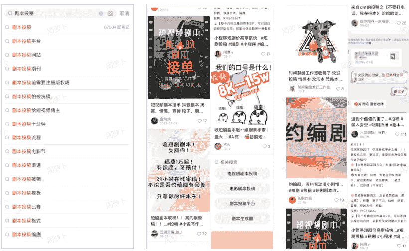
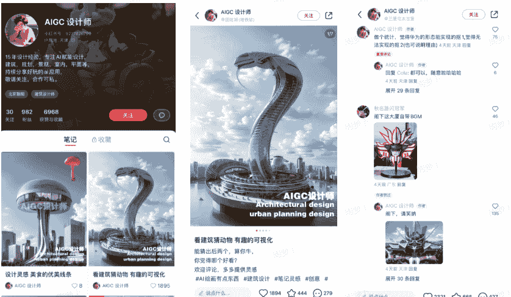
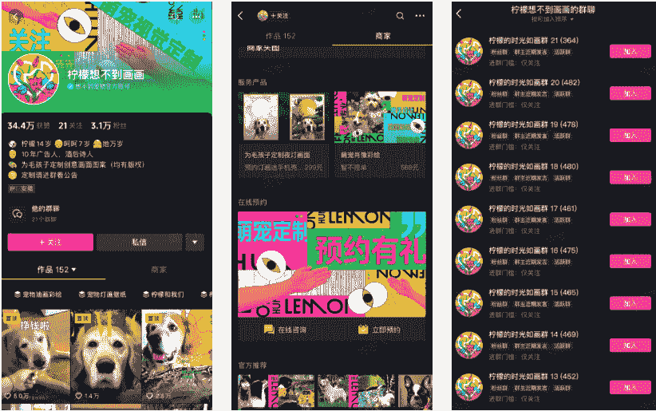

# 30个AI变现案例，太全了，赶紧实操起来_ai变现最简单的方法

> 来源：[https://my.feishu.cn/docx/AAXhdVDIzoIznxxddOhcKlKZnrh](https://my.feishu.cn/docx/AAXhdVDIzoIznxxddOhcKlKZnrh)

# 30个AI变现案例，太全了，赶紧实操起来

精心整理了30个AI变现案例，每一个都可以作为一个完整的副业去实践，AI时代已经来了，所有不甘于现状的朋友，都应该去下场，先把手弄脏，不要怕，实践起来！

###   1．【副业创业】AI+剧本

####   项目：

Al技术手剧本创作商单

####   市场分析：

客户群体： 需求简单、成本敏感的商单， 适合Al剧本创作， 可以实现低成本交付。

项目痛点 ：原创剧本生产不足， 且人力成本高昂， Al创作可提供高效解决方

市场商机：在小红书、拼多多、淘宝等平台上的竞争较小，且有机会与商家建立长期合作。

####   执行策略：

1.寻找投稿渠道

2.需求拆解与试稿

3.测试迭代优化

4.项目放大

###   2 · 【副业创业】AI+LOGO建筑

####   项目：

将众所周知的公司LOGO或者相关熟悉的内容和其他日常物品转化为建筑设计，吸引眼球。通过引导评论以及回复粉丝来获得更多评论，从而涨高账号杈重来达到快速起号的目的。后面可以通过定制化设计、Al绘画培训等进行变现

####   操作：

1.本地部署Stable Diffusion或者进行云端部Stable Diffusion

2.将相应要转换的LOGO进行抠图处理

3.然后用到Stab Diffusion中的segment anything进行处理，或者使用局部重绘

4.进行小红书的专题号发布，可以对标下方的账号

####   引流：

到私域进行定制化的设计方案或者进行相关培训收费，质量只要过关有很多的转介绍和复购

###   3．【副业创业】Al +宠物定制小夜灯/肖像彩绘

####   项目：

利用Stable diffusion可以快速画出宠物灯或者壁画的线稿投入生产。引图的博主是否运用Al技术未知，但是SD已经能够做到相同的效果

####   操作：

1．熟悉使用Midjourny中的局部重绘或者是Stable diffusion中的语义分割功能，能够做到定制宠物像的海报或者 像彩绘。

2．在某红薯或者某音上进行账号注册，以及视频的发布。在这里可以结合小故事，也可以做图文视频的矩阵账号。

3．引导到私域或者粉丝群促达成交。

