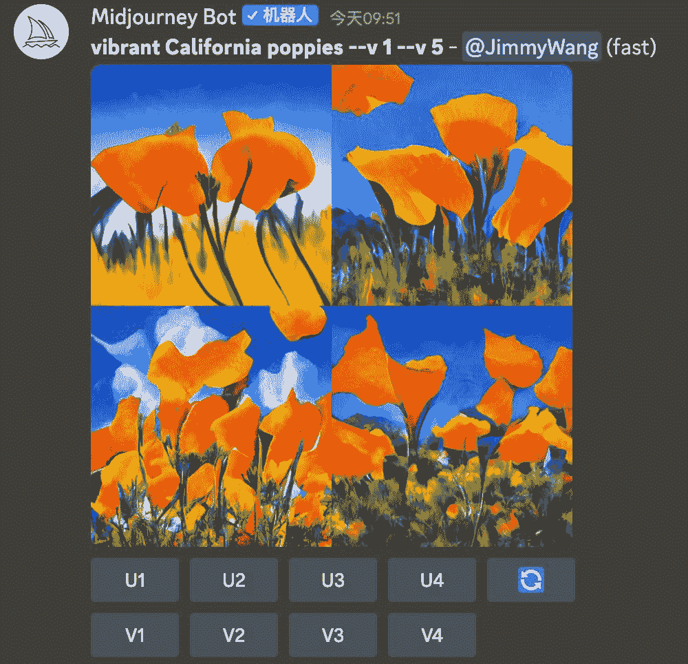
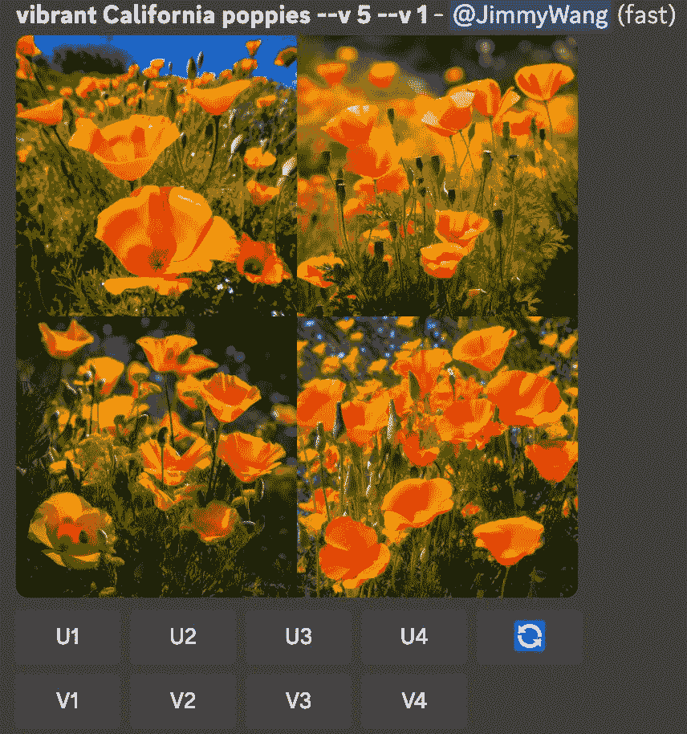
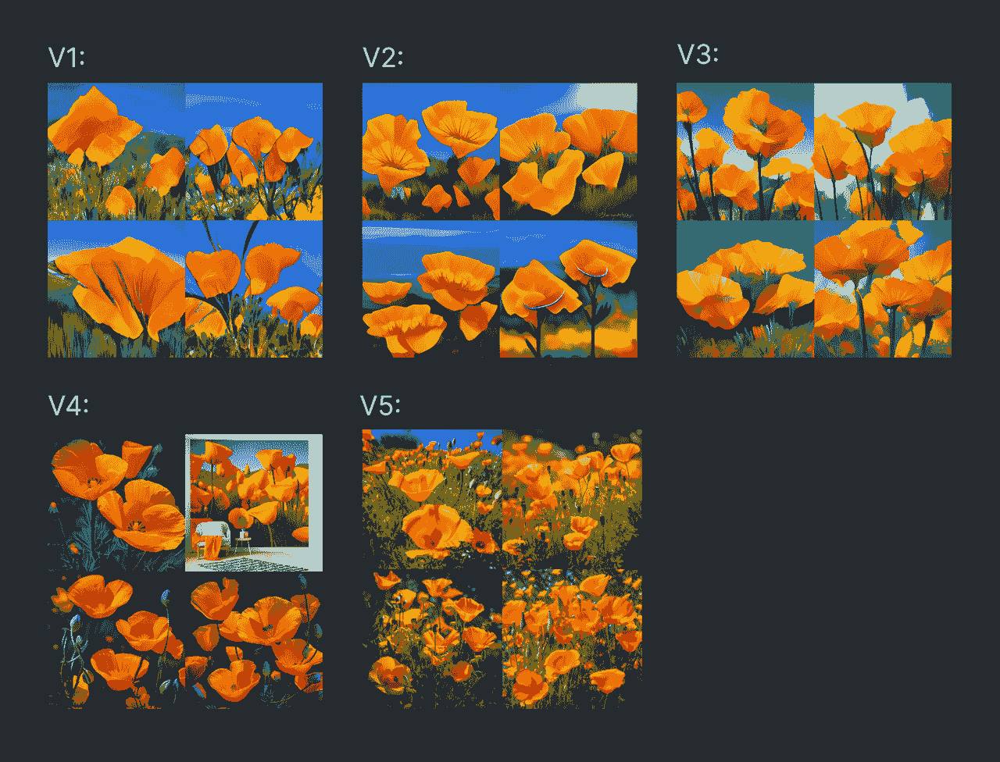
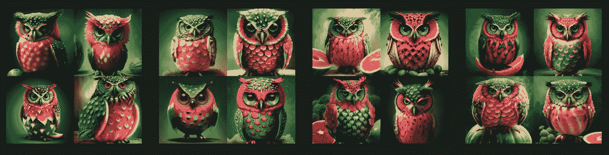
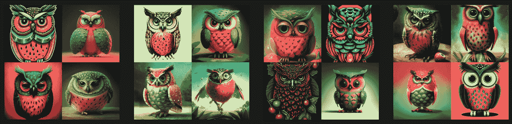
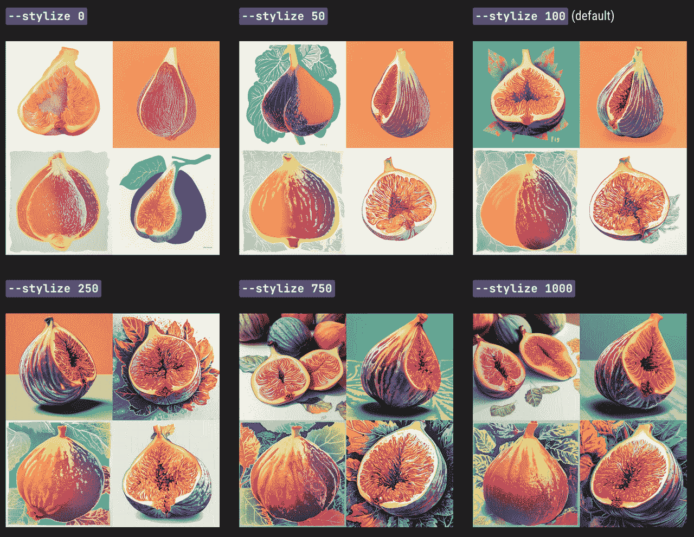
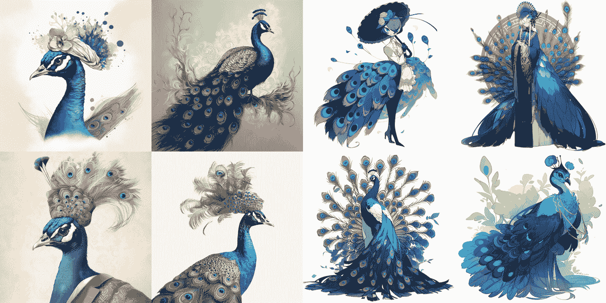

# Midjourney Prompt 常用参数

> 来源：[https://my.feishu.cn/docx/Ke6rdWO04oF591xHridcFGqFnTg](https://my.feishu.cn/docx/Ke6rdWO04oF591xHridcFGqFnTg)

简单说来，你可以将这些参数理解为官方的固定 prompt 模版，而且这个模板包含了一些特殊字符，让模型能百分百保证输出结果的一致性，并且还能提升 prompt 的准确度和输入效率。

如果你有用过 ChatGPT ，应该会遇到过这种场景，用了别人一样的 prompt 模板，但却没法令 ChatGPT 生成相同的内容。

而 Midjourney 因为是图片类目，相对比较垂直，所以他们将很多图片类的通用 prompt 语句做成了模板，比如图片长宽比，有 1:1、2:3、4:7 等等，如果你要用 ChatGPT 的使用习惯，就需要在 prompt 里不断重复 Aspect Ratios 1:1 等，而且每个人的表达 Aspect Ratios 的方式都不一样，模型还要去理解人说的话，比较麻烦。

所以 Midjourney 就设计了一些参数，让你能快速调用，比如 Aspect Ratio 这个，就只需要输入 — ar 1:1 即可。同时因为固定了表达方式，大家要改长宽比，都会用这种方式表达，Midjourney 调整下模型，就能保证输出的图片的一致性了。

因为其稳定且必须，所以我才会先教各位参数。

## Version

目前 Midjourney 支持多个版本，最新的版本是 V5 ，跟 ChatGPT 稍微有点不一样，Midjourney 给我的感觉，并不是版本越大，约厉害，而是擅长的东西不太一样。相关区别请查阅 Midjourney 各版本差异。

Version 参数使用方式见下表。你也可以在设置里，调整默认的版本，相关教程请查阅 Midjourney 基础设置。

因为可以在 prompt 里直接加版本参数，同时又可以在设置里设置版本，所以你有可能会遇到如下图这样的情况（我想生成版本 1 的图，但设置里设置了 5 怎么办？) :

此时模型会按照从左往右的顺序运行这些参数，按照上面的例子，其实生成的图片是 V1 版本，可以跟下面的这个 V5 版本对比下：

## Aspect Ratios

第一个参数是图片的长宽比，使用方式如下，及版本差异如下：

另外，长宽比在业界也有最佳实践：

+   5:4 多用于传统打印

+   3:2 多用于照片打印

+   7:4 比例接近于 HD TV 的比例，或者是智能手机

## No

这个参数的意思是不要什么，如果你不想让 AI 生成的图片里出现树，那就输入 plants 即可：

## Chaos

这个参数跟 ChatGPT 里的 Top P 有点像，主要控制模型的随机性，数字越高，约有可能产生一些意想不到的结果，数字越低一致性会更高。看看官方的例子， prompt 是 watermelon owl hybrid。

这是当 Chaos 为 0 的时候，一致性会比较高，西瓜和猫头鹰的融合的方式，在四次输出里都比较类似，另外在单次输出里，4 张图（四宫格）的风格相似度也比较高：

这是 Chaos 为 100 的时候，你会发现多次输出的融合风格都不太一样，且即使是在单次输出里，4 张图的风格区别也比较大。如果你是想让 AI 帮你做一些探索性的事情，我建议初期可以将 Chaos 调高一点，结果会发散一些。

## Stylize

这个参数跟 ChatGPT 里的 Temperature 有点像，主要是控制生成图片的风格化程度。简单理解，这个值越低会更符合 prompt 的描述，数值越高艺术性就会越强，但跟 prompt 关联性就会比较弱。

我们一起看下官方的例子，prompt 都是 colorful risograph of a fig。Risograph 是一种数字印刷机，它使用模板和专用油墨来制作印刷品。Risograph 通常用于制作海报、宣传册等低成本印刷品。这种印刷机可以产生特殊的色彩和纹理效果，头三张图基本上契合 risograph 的风格，但右下角那四张就非常不像了，模型加了很多戏 😂

除了在 prompt 里输入外，你也可以在设置里，调整默认的版本，相关教程请查阅 Midjourney 基础设置。

## Niji

[这个其实 Niji ](https://spellbrush.com/)模型，是 Midjourney 跟 Spellbrush 一起开发的。「niji」是日语「にじ」，意思是「彩虹」 或者 「2D」。

它在生成动漫类的图片上，比较在行。举个例子，prompt 是 fancy peacock，左图是 v5 模型，右图是 niji v5 模型，右图更偏向于漫画风格：

使用方法跟 Version 比较像，只需要在文字 prompt 最后输入 —niji 即可