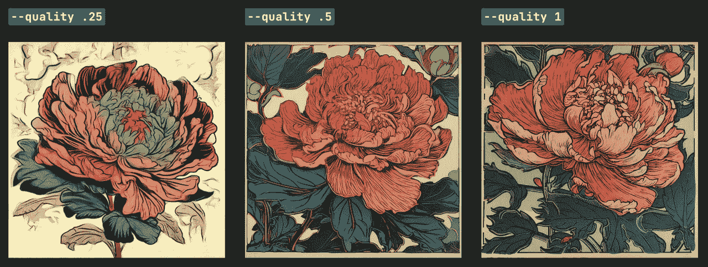
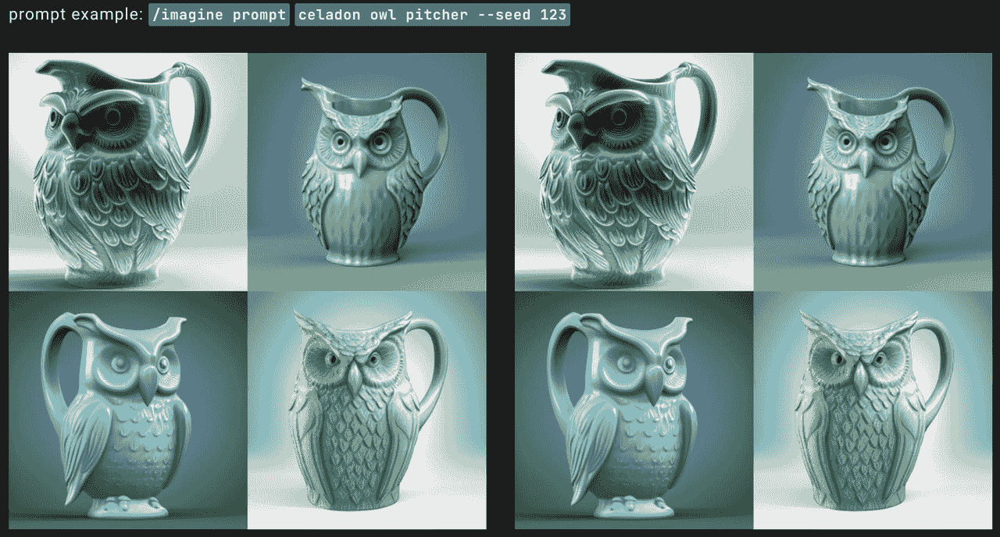
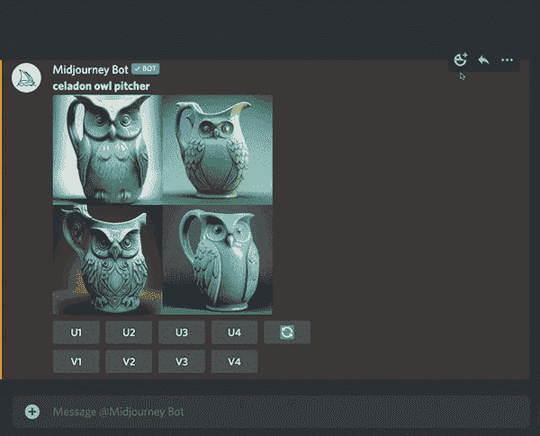
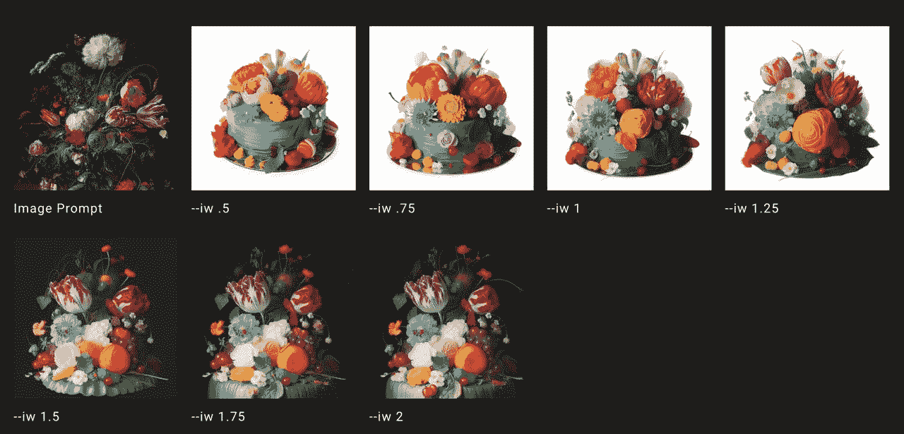

# Midjourney Prompt 高级参数

> 来源：[https://my.feishu.cn/docx/XBetdrouXoyjTBxqgNtcUgmgnsh](https://my.feishu.cn/docx/XBetdrouXoyjTBxqgNtcUgmgnsh)

## Quality

图片质量是另一个我比较常用的属性，首先需要注意这个参数并不影响分辨率，并不改变分辨率，并不改变分辨率（重要的事情要说三遍）。

它改变的更多的是图片的细节，比如下面这个例子，下方第一张图是 0.25 ，你会发现最右边的图细节比第一张图多很多很多。

但低 Quality 也不是没有好处，它的好处是生成图片的时间会更快，换句话说，你可以花更少的 GPU 时间，我一般会用这个参数做一些探索性生成图，大方向没问题，再让模型丰富细节。

除了在 prompt 里输入外，你也可以在设置里，调整默认的版本，相关教程请查阅 Midjourney 基础设置。

## Seed

你在使用 Midjourney 的时候，应该会发现，即使用相同的 prompt，每次生成的图片都会不一样。其实 Midjourney 会为每个生成的图片打上一个 seed 编号，你可以在 prompt 里加入这个 seed 参数，这样每次生成的图片就一样了，以下是官方的例子：

调用方法很简单：

那如何获得这个 seed？

找到你想要获得 seed 的图片，然后在其消息右上角有个 emoji 按钮，点击后会出现一个 emoji 菜单，然后在 emoji 菜单里输入 envelope ，最后点击 ✉️ emoji ，然后在图片下方就会出现一个 envelope 的 emoji，最后你会收到 Midjourney Bot 的私信推送，该消息上面就会有 Seed 号码。

## Image Weight

这个翻译成中文是「图片权重」的意思。

当你同时用 img prompt 和文字 prompt 的时候，就可以通过这个参数设置到底更像图片还是更像文字，当这个参数越大，AI 生成的图片就越像原图，越小，就越像文字描述。

以下是 Midjourney 的官方案例，可以看到，数值越大，就越像原图：

## Stop

这个参数跟 ChatGPT 里的 stop 类似，就是强制暂停模型。

## Style

这个参数主要是用于切换 V4 模型中的分支模型。

我个认为觉的这个不是很好用，且因为 V5 已经推出，大家都在用 V5 了，所以未来我认为会淘汰（这个我猜测其实是 V5 的其他分支版本，早放出是为了收集数据）。所以就不做介绍了。

## Uplight

当 Midjourney Bot 图片生成完成后，图片下方都会有一排 U 按钮，这些按钮做的事情就是这个 Uplight 参数做的事情，一般人都会通过点击按钮来使用，比较少在 prompt 里添加。

而且现在 V5 版本，U 按钮已经不会影响分辨率了，只是做为一个裁切图片的功能。所以这个参数也是一个我认为要被淘汰的参数。大家不必关心。

## Upbeta

另一个我认为会被淘汰的按钮。

## Video

我觉得这个参数很有意思，这其实是个类似录 gif 的参数。在 prompt 里加入这个参数，升成图片的同时，还会记录升成的过程，但可惜这个参数只支持到 V3，估计官方未来也会放弃吧，主要是没啥用，就是好玩。