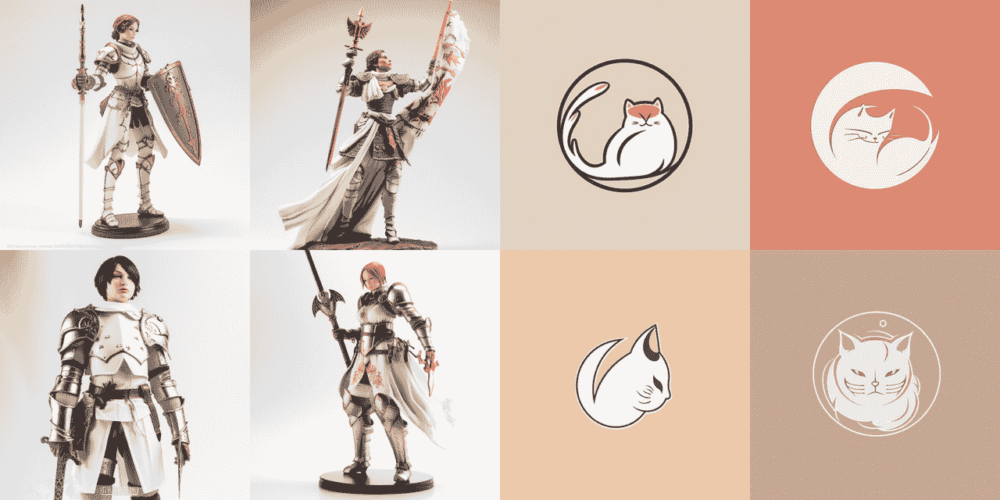
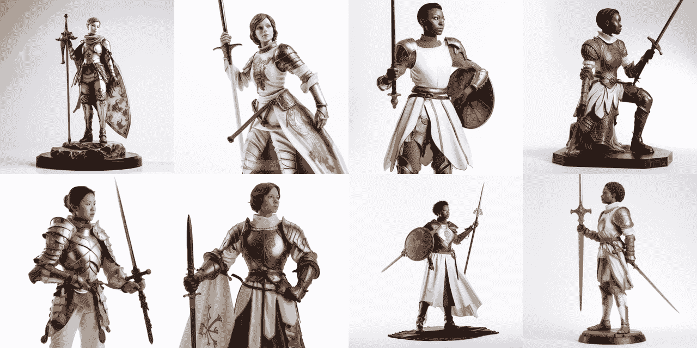

# 技巧十一：增加风格——国家

> 来源：[https://my.feishu.cn/docx/UayHdhcfZoaP9XxCMWHcC1Qgn1e](https://my.feishu.cn/docx/UayHdhcfZoaP9XxCMWHcC1Qgn1e)

说到手办，大家应该第一反应会想起日本，再介绍一个技巧，在 prompt 里加入 Japanese style 即可，拿圣女贞德作手办，以及之前做的 logo 作为例子：

圣女贞德是不是有种 FF 的感觉？Logo 也比较简洁，猫的外观也有点像动漫里猫的外观，当然除了 Japanese 还有 Chinese（左边4张），甚至 African Style：

