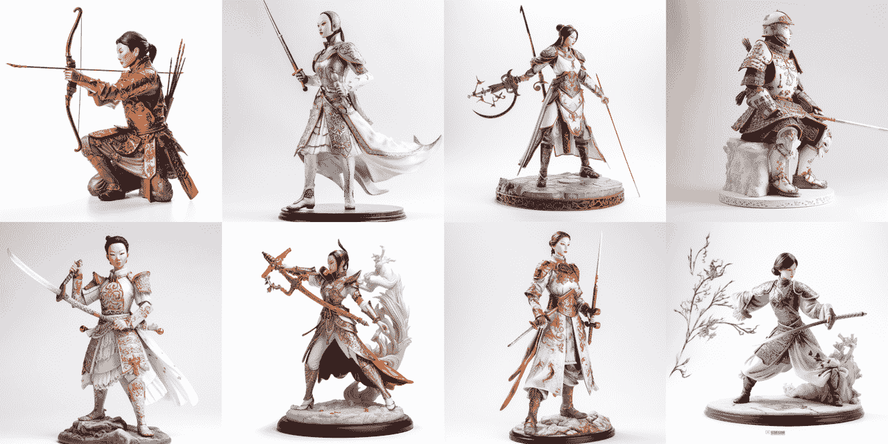
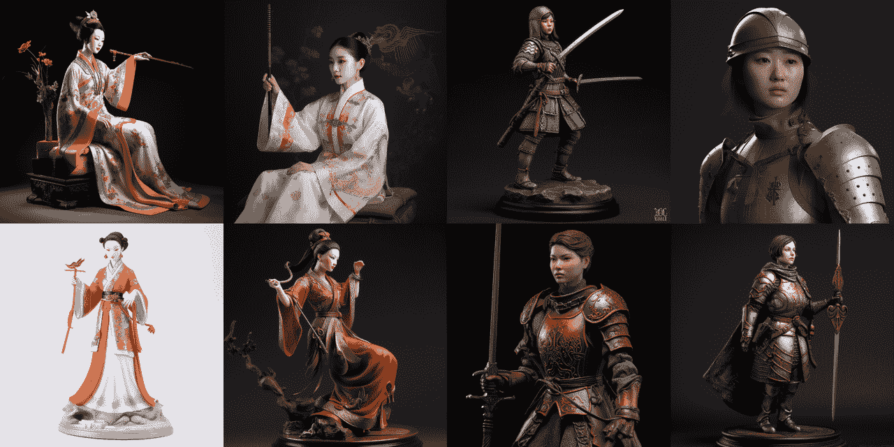
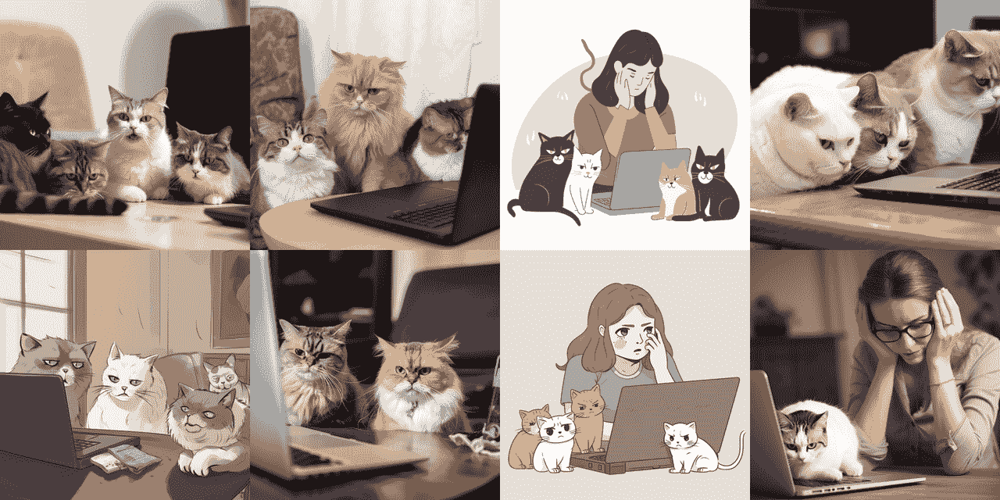
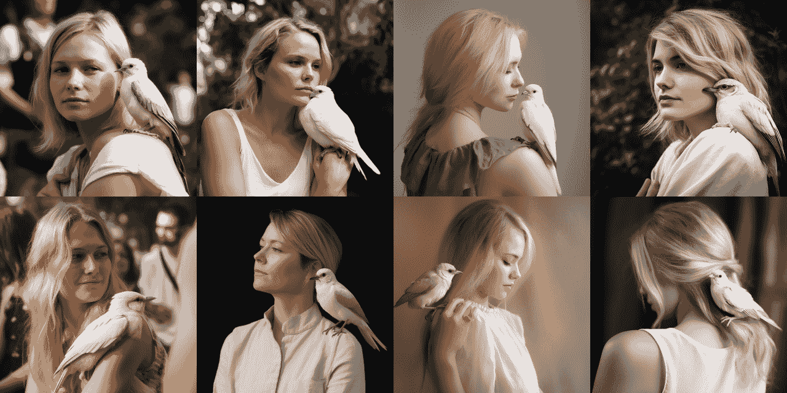

# 技巧十二：增加权重

> 来源：[https://my.feishu.cn/docx/ZI9udMSVTohcOExJSZ9cjgeTn5r](https://my.feishu.cn/docx/ZI9udMSVTohcOExJSZ9cjgeTn5r)

各位有没有发现，上面那个 Chinese 手办生成的结果好像只有第三张是中国人面孔？原因是 Chinese style 的权重太低，所以仅输出了一个结果。你在实践的过程中，也肯定会遇到，AI 忽略了某些 prompt 词的情况，比如你提到画面中要有一只鸟，但它就是没画出来。

那为何会产生这样的结果？原因 Midjourney 的 prompt 权重是按照顺序逐个降低（详情请见我翻译的 Midjourney 官方 FAQ），在我们上面的 prompt，我们将 Chinese Style 放到了最后，所以生成的结果也是最少的。忽略了某些词，这个原因暂时为止，但应该很可能是权重导致的问题。

增加权重的方法有很多，最简单的方法就是调整顺序，比如将上面的 Chinese Style 放到最前面（然后生成的结果就是眯眯眼 style 了 🤣，我生成了两次，第二次好一些）：

```
product photography, Chinese Style,Joan of Arc, full body, hand painted, plastic, detailed, white background, studio lighting
```

调整下顺序，效果就大不一样，所以各位不要迷信所谓的 prompt 模板，多试试。



第二种方法是 Slider 方法。

你需要在 prompt 最后加 ，然后加上你需要调整权重的词语，接着再加 ，最后加上权重值。比如还是上面的例子，我想突出 Chinese style 但不想调整顺序，就可以改为：

```
product photography,Joan of Arc, full body, hand painted, plastic, detailed, white background, studio lighting, Chinese Style :: Chinese Style :: 0.5
```

然后你会发现，好像权重太高了，生成了跟 prompt 无关的图（下方左图），那我们可以在原来的基础上，再加以下 Joan of Arc 的权重（下方右图）：

```
product photography,Joan of Arc, full body, hand painted, plastic, detailed, white background, studio lighting, Chinese Style :: Joan of Arc:: 0.25 style of Chinese:: 0.5
```

你可以看到，调整参数后，生成的 4 张图有 2 张具备较强的 Chinese 风格：



不过坦率说来，这个方法，并不特别适合这个案例，调整主体内容，或者顺序， ROI 会更高一些，这个方法更适合 miss 掉某个 prompt 词时使用，比如官方的案例是这样的：

```
several sad cats watch a crying woman in a home-office environment with laptop
```

生成的图片里（左四张图），猫咪们都看着你（你可能才是 crying woman 😂），如果用 slider 的功能（右边四张），crying woman 就出现在画面里了：

```
several sad cats watch a crying woman in a home-office environment with laptop:: several sad cats::0.5 crying woman::0.6 laptop::0.7
```

另外需要注意，slider 可用的参数有 0.25、0.5、0.6、0.7，也可以用这个方法降低权重，区间是 -0.7、-0.6、-0.5、-0.25：



**如果你用了 slider 还是**没有出现应该有的画面，那还有一个大招 cowbell，坦率说来，这个并不符合 Midjourney 的官方最佳实践，但的确是个可行的方法，以下面这个 prompt 为例，生成的图片里，woman 看起来并不 shy（左边四张图）：

```
A songbird sits on the shoulder of a shy blonde woman dressed in white.
```

此时你可以重复重复再重复（我觉得这就是为何这个方法叫 cowbell 的原因）：

```
A songbird sits on the shoulder shoulder shoulder shoulder shoulder shoulder of a shy shy shy shy shy shy shy blonde woman dressed in white.
```

