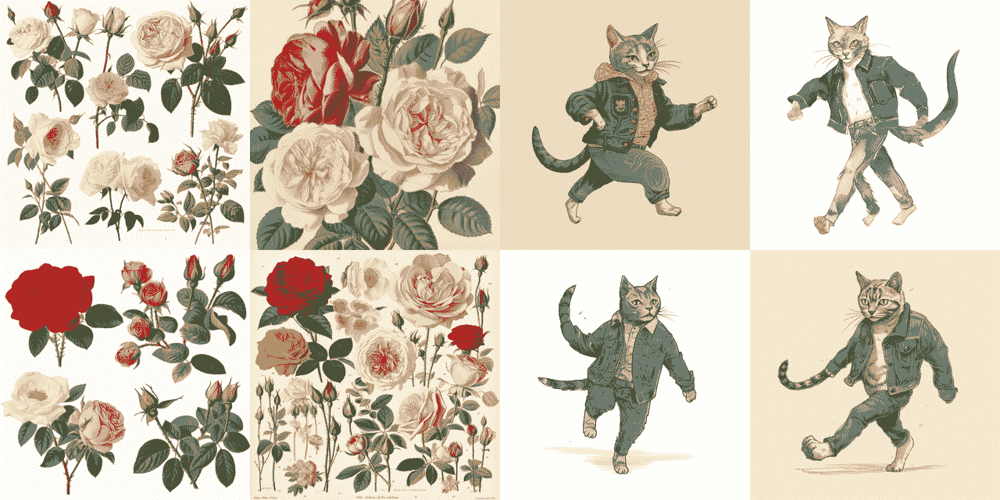

# 技巧十四：增加风格——年份

> 来源：[https://my.feishu.cn/docx/RJKQdqghYo6TMqx2ElGcQesynCg](https://my.feishu.cn/docx/RJKQdqghYo6TMqx2ElGcQesynCg)

上面的老照片场景，我们用了 1990s 风格，严格地说，这个 1990s 更适合放在主体，或者环境里，放在风格里也不是不行，因为不仅仅希望主体是 1990s 还希望图片生成的风格也是 1990s。

这就是最后一种风格词用法：年代。

拿插画那一章的两个 prompt 修改一下，我都没在 prompt 里加艺术家的名字，而是改为 style of 1920s，玫瑰的图有点那味，猫的图右上角那张太逗了。

