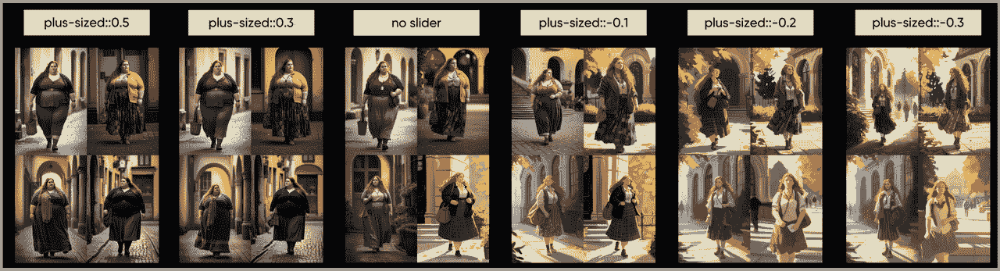
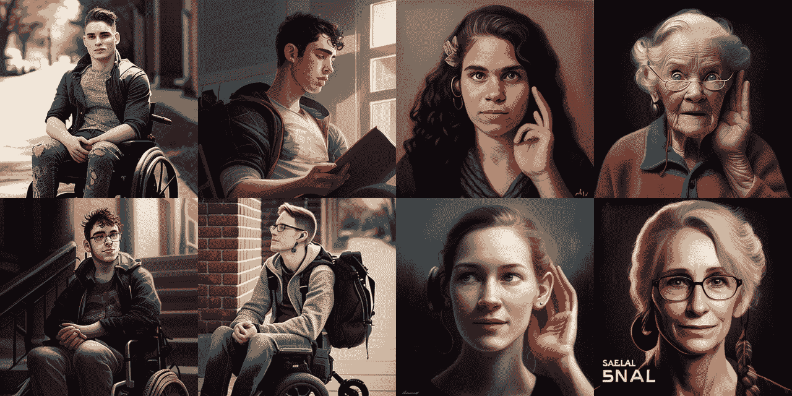

# 技巧十五：如何让 Midjourney 生成的人更具有多样性？

> 来源：[https://my.feishu.cn/docx/EB39dc0T1oYuMZxGiXbcjgIxnnc](https://my.feishu.cn/docx/EB39dc0T1oYuMZxGiXbcjgIxnnc)

这里的多样性其实是指人的高矮胖瘦，甚至身体的一些特殊性等。

不知道各位有没有发现，大多数用 AI 生成的图片，人物都非常漂亮和英俊，但这并不好，这其实某种程度上代表了社会的偏见。

所以我想在本章重点介绍下，如何让 Midjourney 生成更多样的人体。

**方法一：Slider 方法**

在上一章，我介绍了增加权重的方法，这个方法还可以帮助你生成不同体型的人物，以下是 Midjourney 官方社区的案例：

```
Plus-sized ginger female dressed in bohemian vest, maxi skirt, espadrilles, walking across autumn campus courtyard, morning atmosphere:: plus-sized::-0.3 --ar 2:3
```

你可以控制 plus-sized 后面的参数，从而使画面中的人物变胖或者变瘦。这里需要注意，并不是负数就是越瘦的意思，而是削弱了 plus-sized 权重，如果你的 prompt 词是 thin 你加个负数 slider 参数那就是变胖了：



**方法二：直接描述**

Midjourney 是知道一些多样性的词语的，比如：

+   blind：失明

+   deaf：聋

+   cerebral palsy：小儿麻痹

+   accessibility：行动不便

