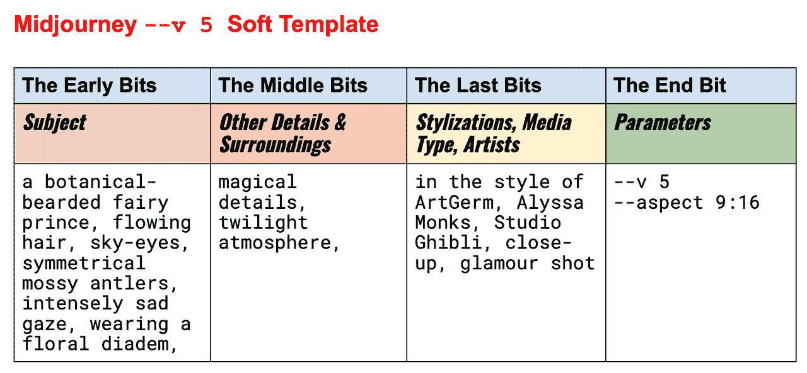

# 框架总结

> 来源：[https://my.feishu.cn/docx/Th3IdHmOQo2VdYxmI3ScVsTMnpg](https://my.feishu.cn/docx/Th3IdHmOQo2VdYxmI3ScVsTMnpg)

经过几个专题的学习，我们基本将 text prompt 框架里包含的元素都过了一遍，但大家可能会觉得内容不好记忆，所以本章我会对框架进行总结。

## 官方框架

[在做总结前](https://docs.google.com/document/d/e/2PACX-1vRHOxyEb-ERGi-BdZM8Z_piEP54m4HwO0z8scjmEurEp2UZVA6rFxvyKd15elYVHUWfP1oSA4CQFwxr/pub?utm_source=docs.google.com&utm_medium=tutorial&utm_campaign=midjourney)，我想先介绍下 Midjourney 官方的框架：

官方的模板很简单，分成四个部分：

1.  主体

1.  细节 & 背景

1.  风格、媒介、艺术家

1.  参数

## 我的总结

其实按照官方模板写，你已经能超过 90% 的初学者，但根据我的实验，我细化了他们的模板的，有以下调整：

1.  将类型放在了最前面，因为 prompt 的顺序会影响权重（详情见我翻译的 Midjourney 官方 FAQ）

1.  官方的 Middle Bits 和 Last Bits 写得比较宽泛，我对其进行了拆分，让大家更好记忆。

我用一个表格总结下这个框架，各位可以根据不同场景有选择地使用。

## 如何记忆？

这个模板看起来很长，但它跟各位拍照其实很像（只是顺序做了权重优化），各位想想自己的整个拍照的过程，是不是：

1.  看到某个物体/人物（主体），在某个环境下（环境）很漂亮

1.  拿出手机（拍摄媒介），打开相机，用手机取景器确定好构图（构图），按下快门

1.  最后 PS 一下（风格 & 参数）