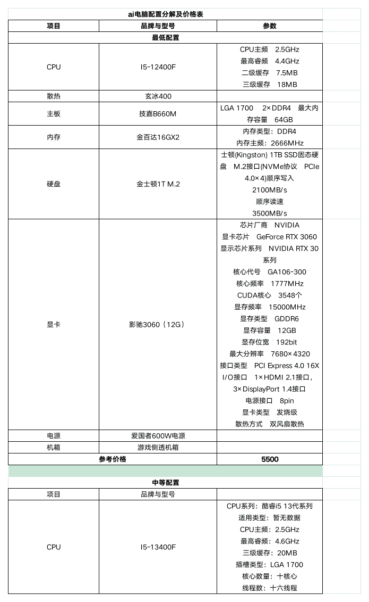

# Stable Diffusion 系列

> 来源：[https://my.feishu.cn/docx/LYPtdX4qToLQAaxhz9wczyoinFc](https://my.feishu.cn/docx/LYPtdX4qToLQAaxhz9wczyoinFc)

> （推荐）MJ/SD 提示词 Prompt 生成器：https://prompt.aigc369.com/

Stable diffusion 由于其开源特性，发展极为迅猛，可以说很多效果超过了 Midjourney 也完全不过分**，知**识系统**十分**庞杂，这里**引入门之后，****推荐**大家在查看“Stable diffusion”相关消息的时候，尤其关注“训练”、“模型”等词汇，Novel AI 是 Stable diffusion 的一个二次元特化分支

因为流程较为麻烦，所以这里推荐 3 个上手直接就能用的网站。

[1、直接用 Dreamlike](https://ssw9noe1h6.feishu.cn/wiki/wikcnPQaniZleLZz3OT9WamU31g)

[2、直接用 Playground](https://ssw9noe1h6.feishu.cn/wiki/wikcnYVMzdYwXIG5DmpY8ZH0eEg)

[3、直接用 Dreamstudio](https://ssw9noe1h6.feishu.cn/wiki/wikcnnLJ7Y5Rcc8chCYTnF8WDXf)

它们出图都比较方便，操作起来也简单，输入关键词即可出图。

[零基础入门 Stable Diffusion - 无需显卡把 AI 绘画引擎搬进家用电脑](https://ssw9noe1h6.feishu.cn/wiki/D7j5wPIJUiZoWhkgo39cmvLQnli)

**进阶请点击查看**** ➡️**** **[Stable Diffusion 系列](https://ssw9noe1h6.feishu.cn/docx/GnK2drODrorjGRxqc5GczHMKnde)** **

另外我列举一些我认为比较好的参考链接，希望能够帮到大家：

+

[Stable Diffusion 电脑推荐配置.xlsx](https://internal-api-drive-stream.feishu.cn/space/api/box/stream/download/all/OJM9brIO2oY54dxzhuOcHDw9nic)

+   AUTOMATIC1111 的一个非常全的文档：https://github.com/AUTOMATIC1111/stable-diffusion-webui/wiki

+   一篇对各种插件的说明：https://www.bilibili.com/read/cv19211897?from=articleDetail

+   Stable Diffusion Lora locon loha 训练参数设置：https://zhuanlan.zhihu.com/p/618758020

+   一些好用的插件介绍：https://zhuanlan.zhihu.com/p/579538165

+   不同 Tag 和采样方法效果：https://www.bilibili.com/video/BV1aV4y1G7eZ/

+   提示词技巧：https://www.youtube.com/watch?v=jQH5g6s05S8

+   提示词技巧：https://zhuanlan.zhihu.com/p/577238010

+   模型网站：https://civitai.com/

+   模型网站：https://aimodel.subrecovery.top/

+   模型网站：https://models.paomiantv.cn/models/

+   提示词网站：https://tags.novelai.dev/

+   提示词网站：https://aitag.top/

+   提示词网站：https://aitags.fun/

+   提示词网站：https://wolfchen.top/tag/

+   提示词网站：https://finding.art/

+   提示词网站：https://thereisnospon.github.io/NovelAiTag/

+   提示词网站：http://tomxlysplay.com.cn/#/

+   提示词网站：https://aimds.top/home

+   导航：https://novelai.dev/

+   导航：https://wogaosuni.cn/

+   经验贴：https://sparkly-day-9db.notion.site/AI-1962de6fa0b44378b2fed3b79df5252b