# 泰裤辣！用 AI 生成爆火的艺术二维码，营销新风口！手把手免费教程

> 来源：[https://my.feishu.cn/docx/RmXSdfRI6o64xfxfH4ScDzutnug](https://my.feishu.cn/docx/RmXSdfRI6o64xfxfH4ScDzutnug)

2012 年，微信之父张小龙发了一条著名的朋友圈：

> **PC **互联网的入口在搜索框，移动互联网的入口在二维码。

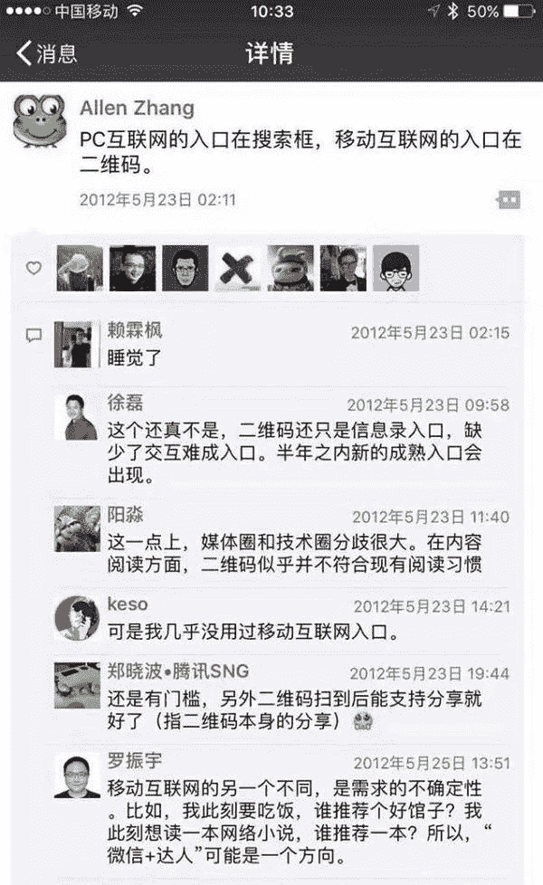

10 年过去了，无论是线上网站、社群，还是线下支付，二维码确实铺天盖地包围了我们的生活。

但都难以回避一个问题： **丑，真 tm 太丑了！**

设计师们最头疼的问题是，二维码像一个狗皮膏药，贴在哪里都会破坏整体的美感。

## **用 ****AI**** 生成艺术二维码**

但是假如你的二维码是这样的：

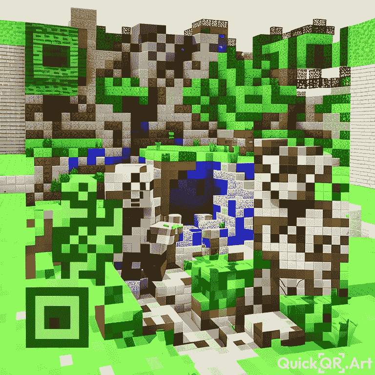

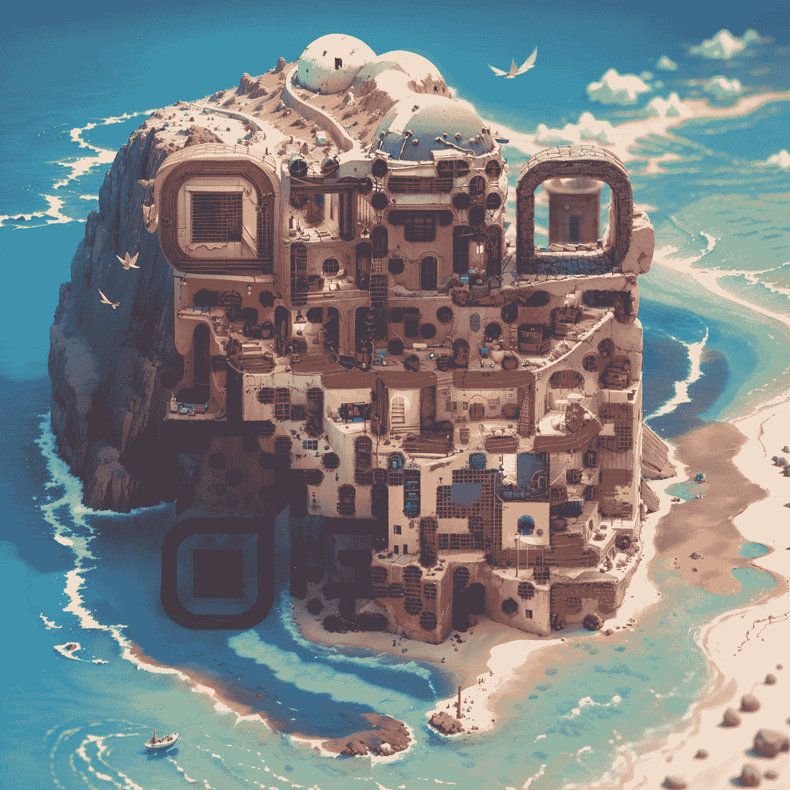

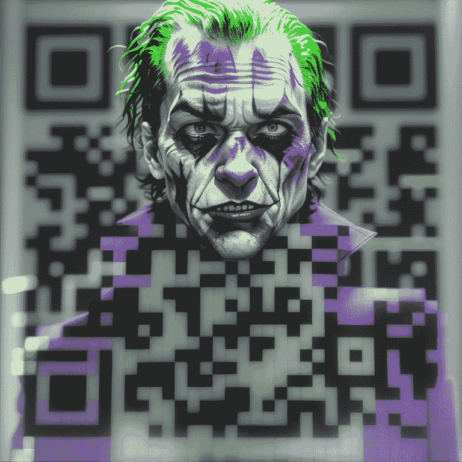

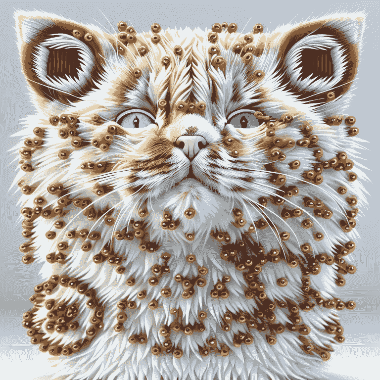

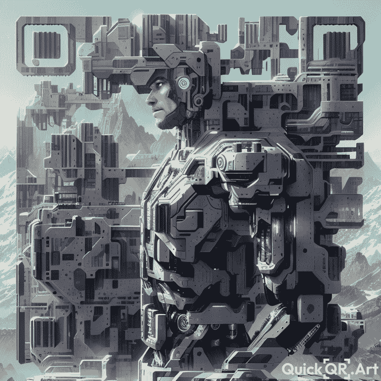

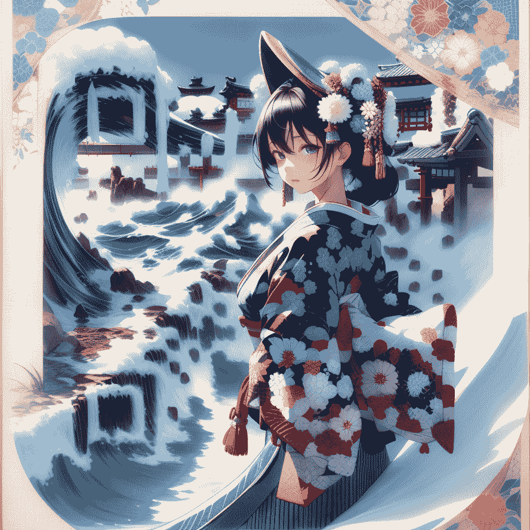

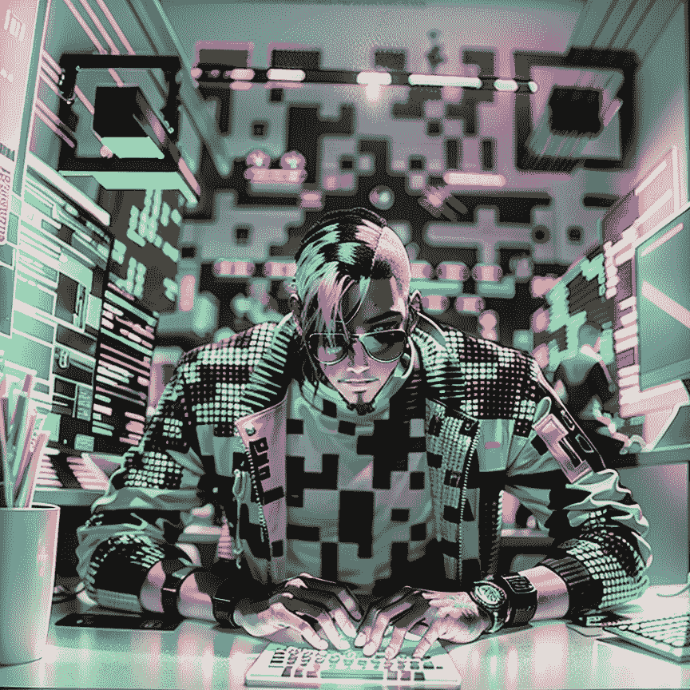

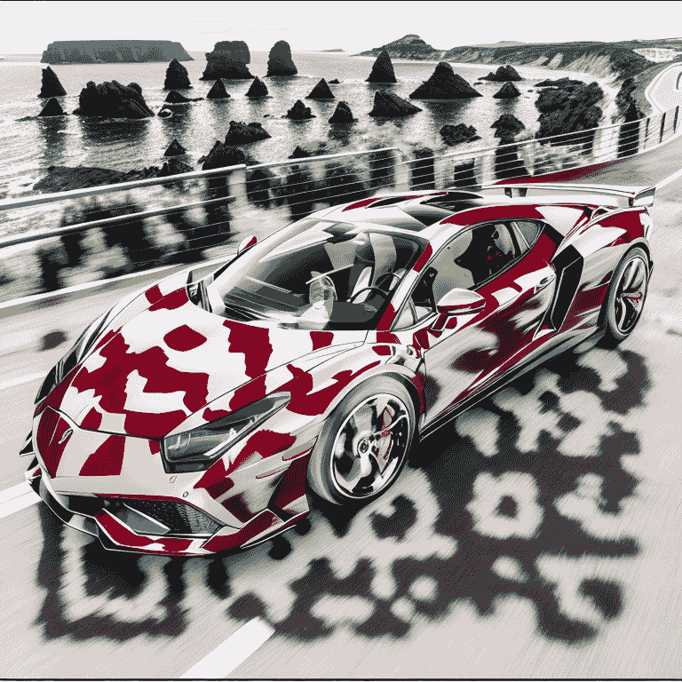

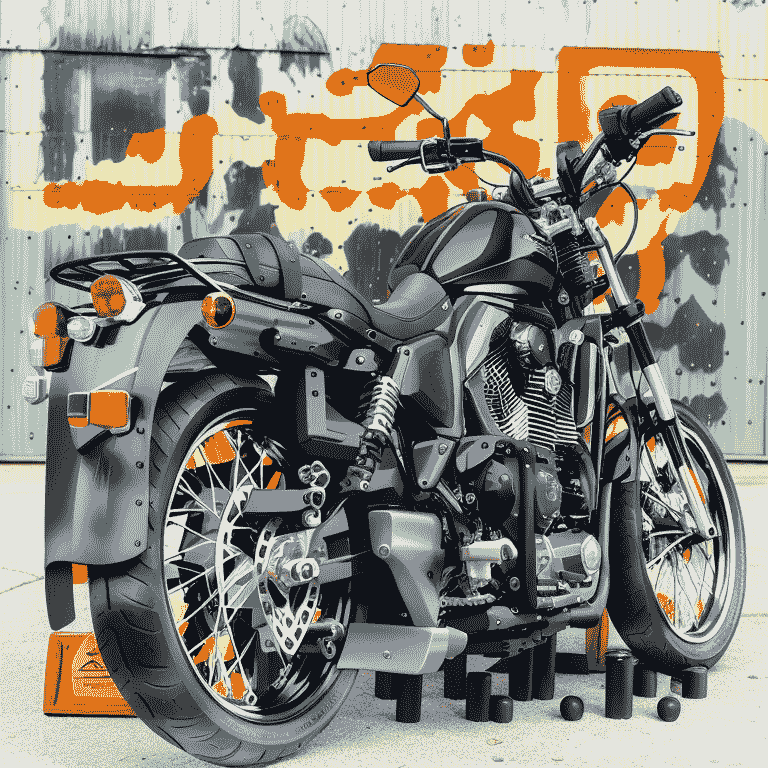

### 这些 AI 艺术二维码是不是非常吸睛？

甚至可以成为整个设计的**亮点**，吸引人主动地举起相机，扫码！

相比于传统的二维码，AI 艺术二维码可以极大美化你的移动流量入口，让你的产品在一众无聊的二维码中独树一帜！

那该如何制作一个这样漂亮的 AI 艺术二维码呢？

## **4 步免费制作属于你的 ****AI**** 二维码**

1.  **1. 准备你的二维码**

打开 quickqr.art，输入你的链接生成二维码。

或者下载好你的微信二维码、收款码等等。

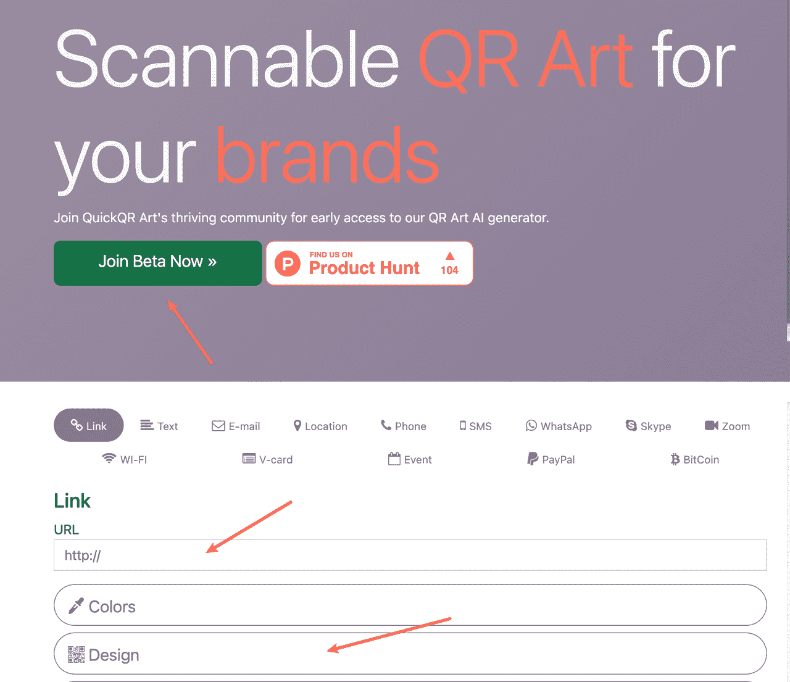

1.  2. 进入 Discord 社区

在** qickqr.art **里点击** join the beta**，受邀进入 discord 讨论社区。

关于 Discord 社区是什么，如何注册，请看 Midjourney 相关教程。

把二维码发送到** paste-bin **频道里，然后右键点击二维码，复制图片链接。

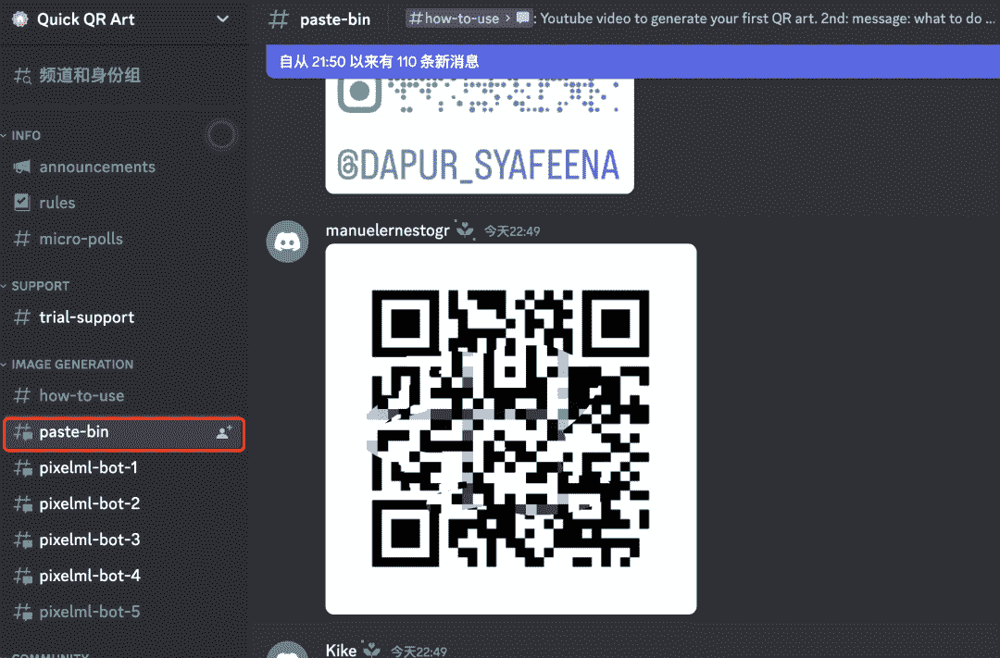

1.  3. 进入任意 Pixelml-bot 频道

在频道中输入："/generate"

+   在"prompt"中，输入你想要的图片提示词描述

+   在"URL"中，粘贴你在第二步复制的二维码链接

点击生成

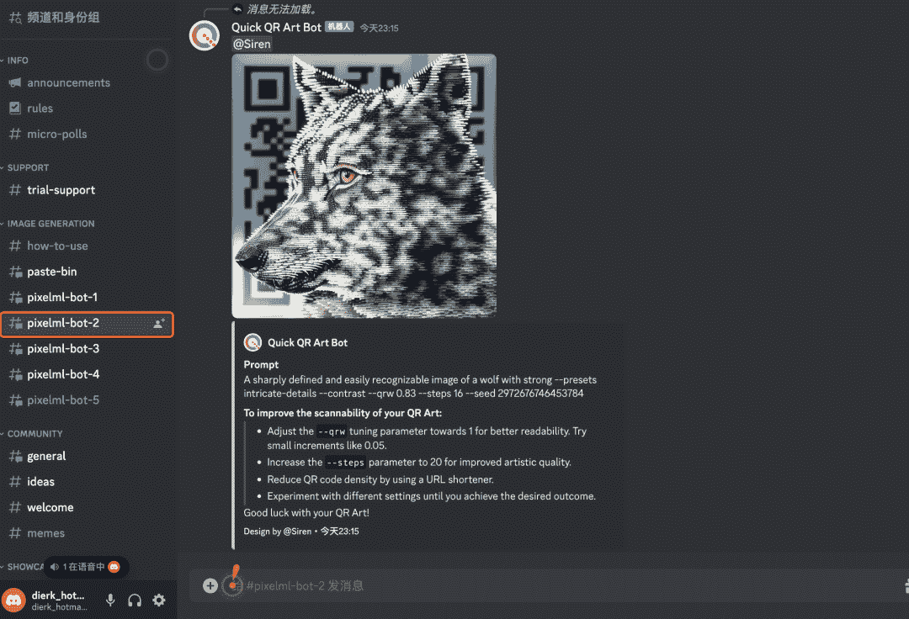

### **4.调整艺术二维码参数**

默认参数下生成的二维码，可能出现扫不出来的情况。

可以通过官方提供的两个参数进行微调。

+   qrw：二维码权重，权重越高，最终作品更像传统的二维码。默认权重 0.85， 如果无法识别，建议调节至 0.90 或 0.95

+   steps：采样步数，步数越高，最终作品越具有艺术性，但二维码的可读性也越差。默认步数 16，最高可设置为 20

与 Midjourney 类似，微调的参数需要写在提示词中，具体的格式是：

> /generate: prompt （a cute cat --qrw 0.95 --steps 18）， url（二维码链接）

### **注意事项📢**

+   不要指望一下子生成精美、可用的二维码

+   多尝试不同参数的组合，并参考社区里其他作品

+   每个账号有 25 次免费生成额度

## **AI ****生成艺术二维码的原理**

原理非常简单，利用了 Stable Diffusion 中的 Control Net 模型，让生成的图像能够较好的符合二维码本身的编码特征，实现既能扫码、又有艺术性的特点。

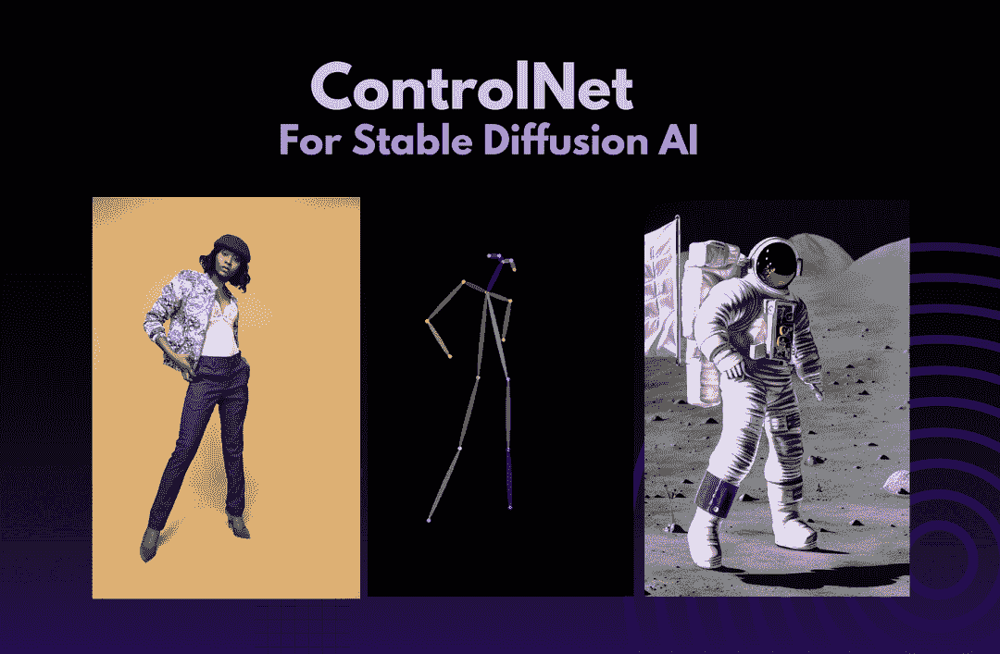

ContrlNet 示意图

创作者们还可以根据二维码的特点，通过搜集特定的样本，训练专属的 LoRA 模型，让生成的二维码具有独特的艺术风格。

在 Huggingface 上，也有开发者开源了基于 SD 生成艺术二维码的模型（[1]），大家可以自行尝试。

## **营销新风口？**

可以预见：

> **未来所有的二维码都会用**** AI ****重新设计一遍！**

包括各种网站、小程序、社群、名片、收款码等等...

而 AI **艺术二维**码也会激发无数定制需求和新的商业机会，例如：

+   企业们会希望把自己的品牌、产品融入到二维码中，强化品牌调性

+   个人希望输入一张头像就能转成二维码，印在名片上

+   艺术家、设计师们可以将二维码融入到艺术作品中，只要举起手机拍照就自动扫码

那么如何用 AI 改造移动互联网入口？

创业者如何抓住 AI 生成艺术二维码的新营销风口？

怎么把 AI 二维码变成一个可执行、高收益的副业、创业项目？

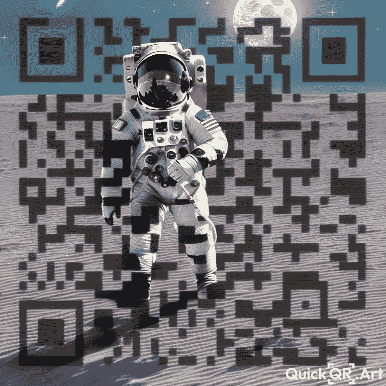

### **参考资料**

基于 SD 生成艺术二维码的模型： https://huggingface.co/spaces/huggingface-projects/QR-code-AI-art-generator