# PS Beta 爱国版安装教程（Windows+Mac）

> 来源：[https://my.feishu.cn/docx/IFBUdhrX8o8wwsxDh8lcHlTFnF4](https://my.feishu.cn/docx/IFBUdhrX8o8wwsxDh8lcHlTFnF4)

## 夸克网盘分享

> 链接：https://pan.quark.cn/s/b395c4444f16

# 安装方法（Windows 和 Mac 均支持）：

安装的时候 bug 可能会多一些，可能需要魔法，有的不需要也行，有的会跳出来让选正版服务安装，不要点。经验：用魔法，切换美国、谷歌账号登录，这样基本都会通过。

### 1、安装 Creative Cloud：https://creativecloud.adobe.com/apps/download/creative-cloud

### 2、点“继续”

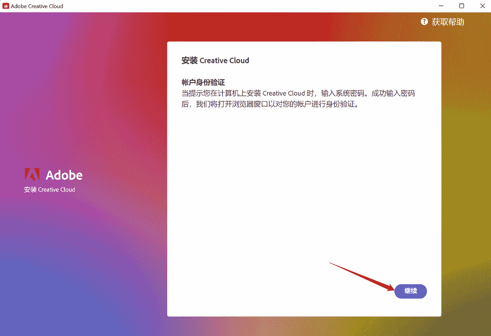

### 3、创建账户，填写电子邮件地址等相关信息

（1）不要填 QQ 邮箱，其他都可以。

（2）填写姓氏名字、出生日期、国家建议选择"美国”（Adobe 禁用了国内账号，注册一定要选中国以外才有 beta 版本）

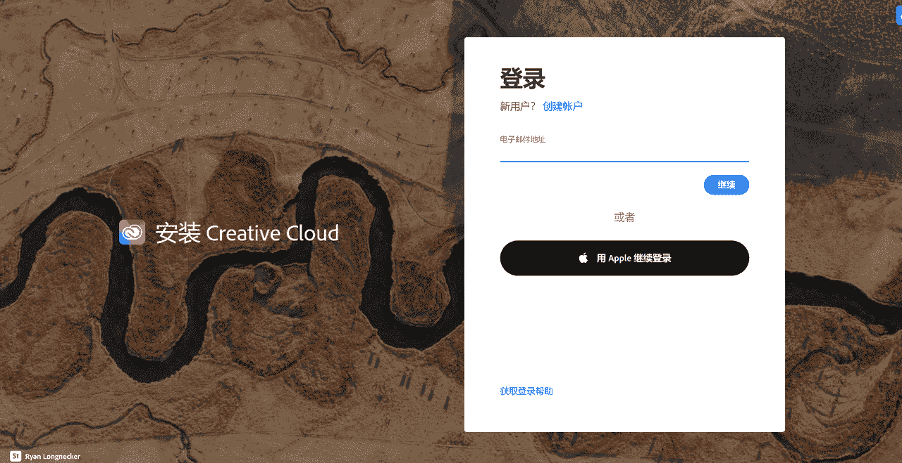

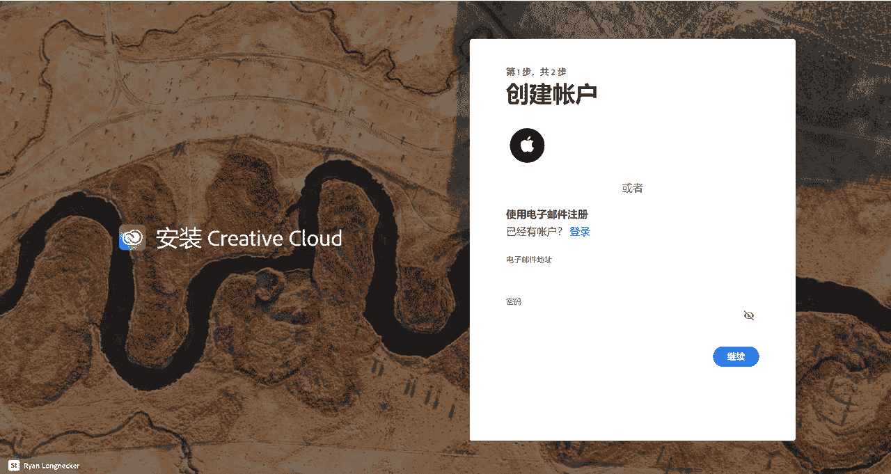

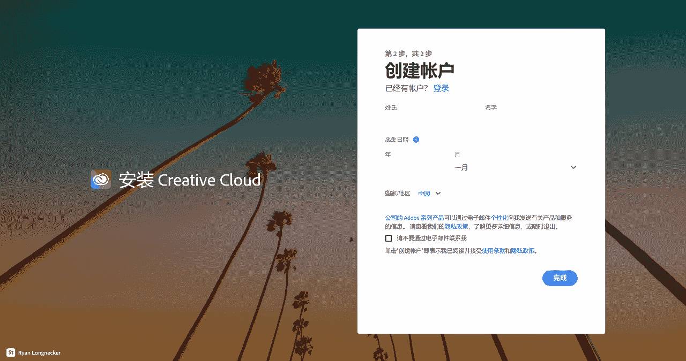

如果您的浏览器没有响应，请在下边页面点击登录

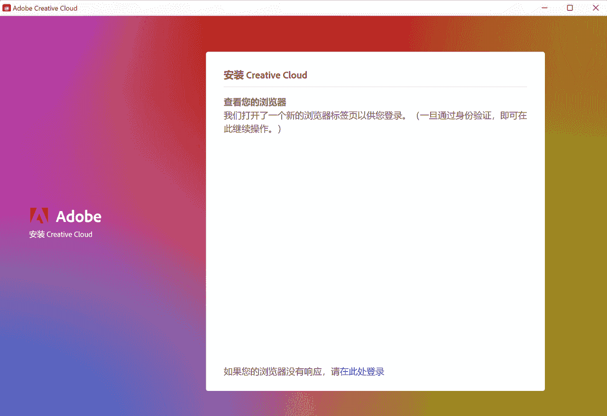

根据你的情况，正常选择即可，也可以选择跳过此步骤。

##  五、登录美区后就能在这里看到最新的 PS 程序了

## 六、先不要急着安装，我们先点开设置——文件——首选项，调整安装位置到你希望的文件夹

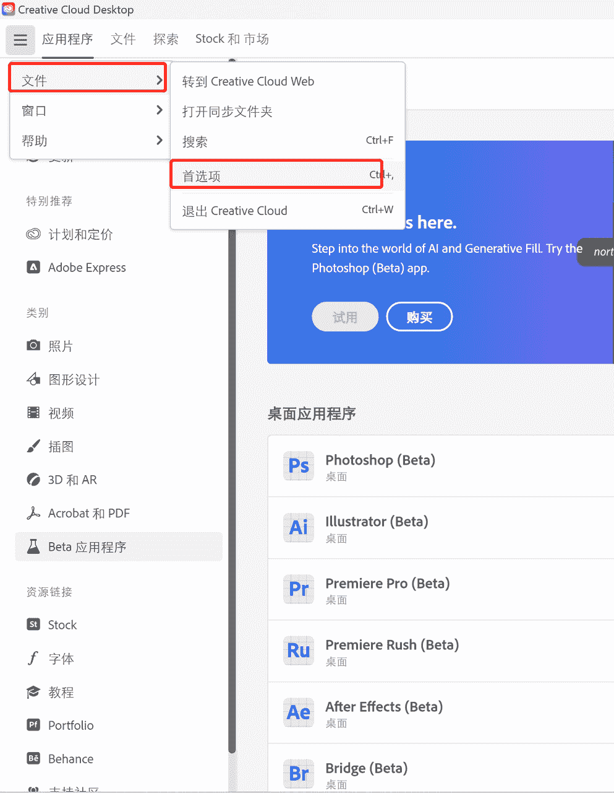

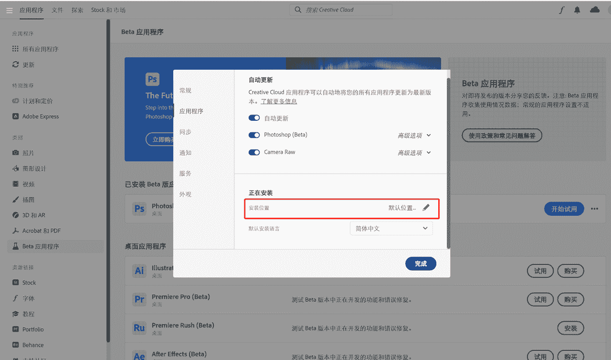

## 七、完成后，在"Beta 应用程序"里找到"Photoshop （Beta）"

点击试用、耐心等待安装

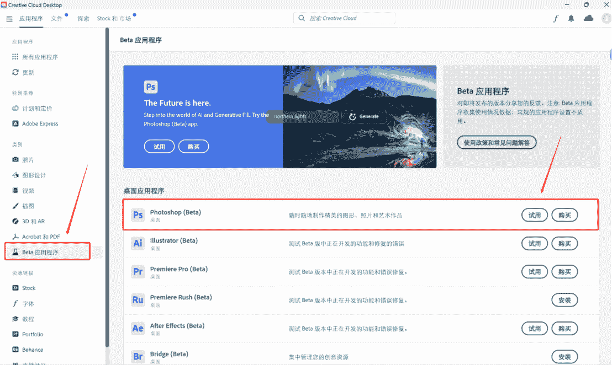

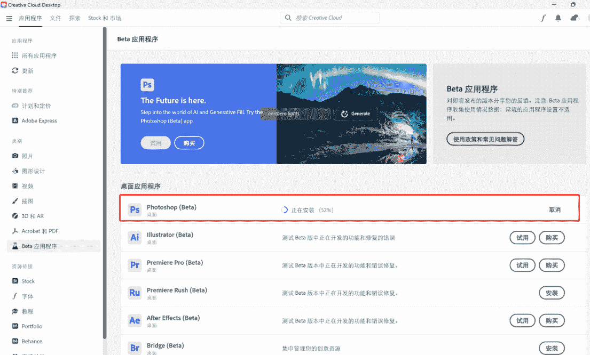

##

# 爱国版白嫖方法

## 一、Windows

### 1、等待安装完成后，打开文件夹里的 GenP

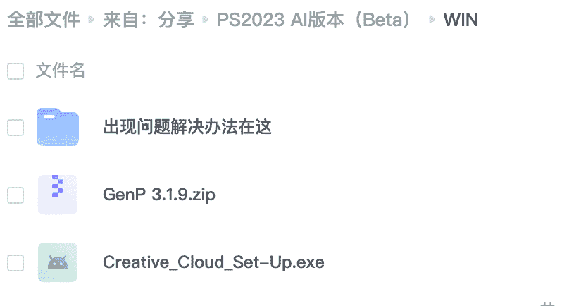

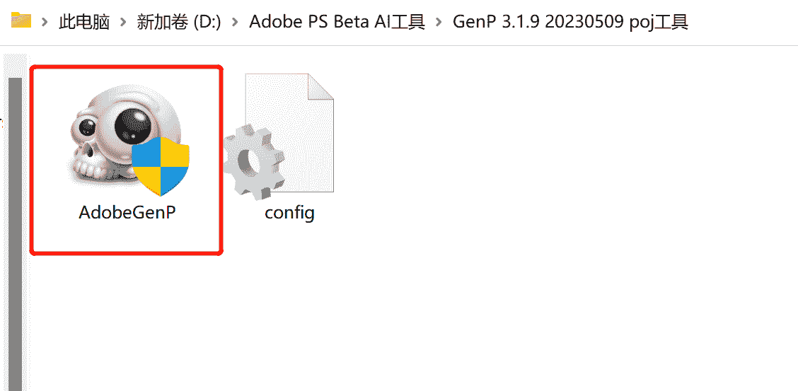

### 2、先点 search 扫描 C 盘，扫描完成后点 patch

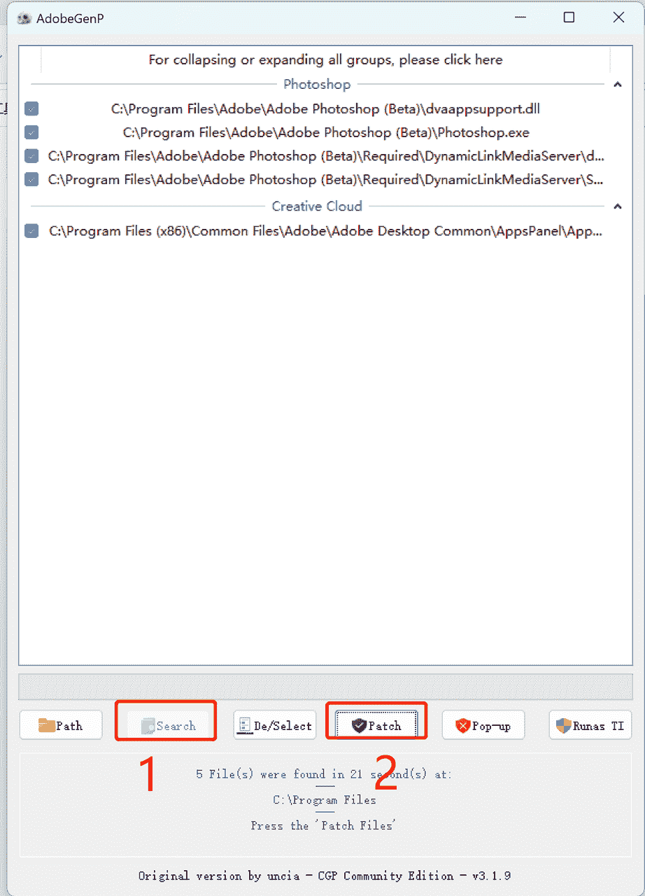

### 3、再点 path，在里面选择你刚才选择的安装路径，然后点 seach 扫描安装路径，再点一次 patch （虚线部分会变成你的安装路径）

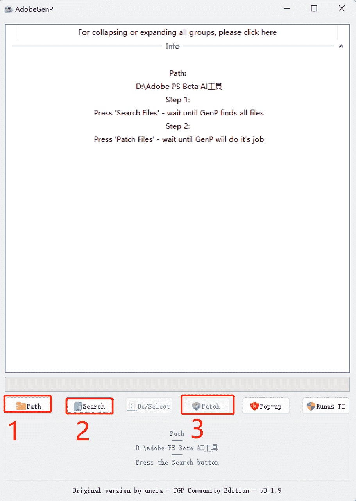

（不改安装路径默认安装跳过这步）

### 4、在应用里边找到 PS 的启动程序，丢到桌面，就可以用了（注意此时打开魔法）。

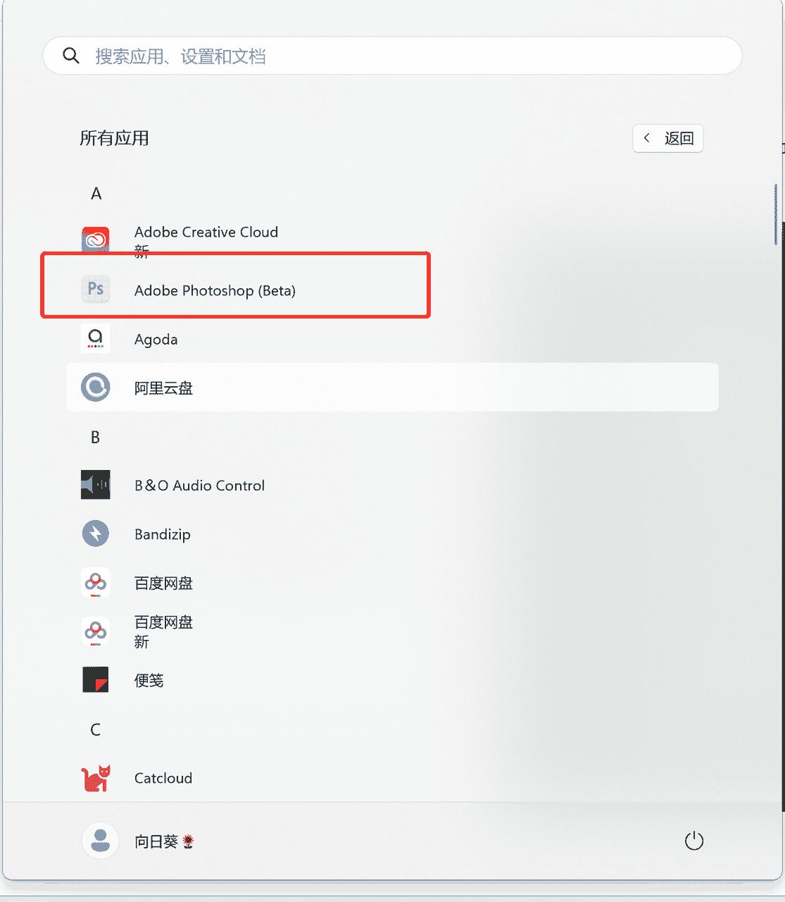

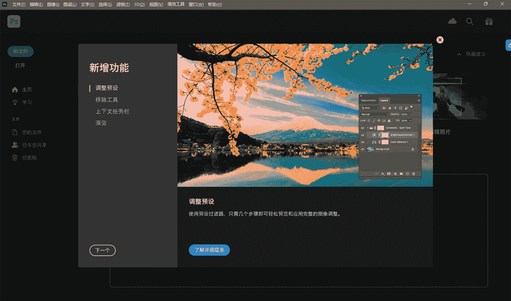

## 二、Mac

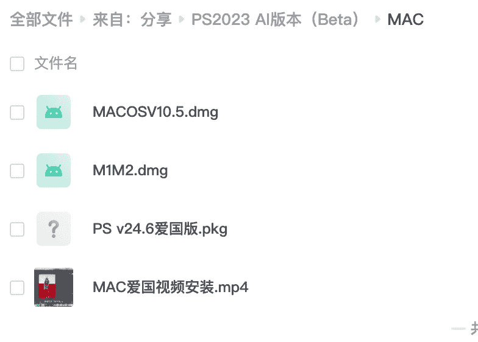

### 把 PS 和 CC 退出，安装爱国版程序，只需要一直点下一步即可。