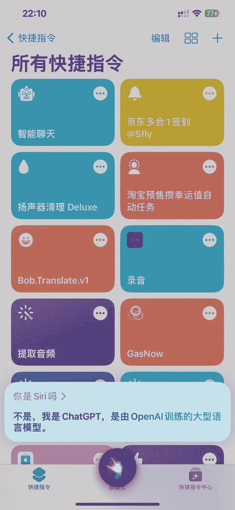
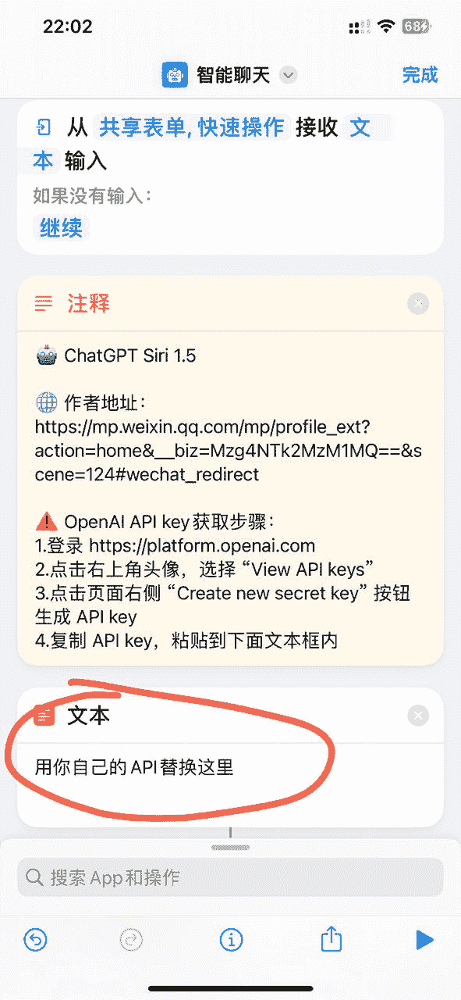

# 教你把 ChatGPT 接入Siri

> 来源：[https://my.feishu.cn/docx/GU2CdXQCvoaxrKx3bKiciCDwnMg](https://my.feishu.cn/docx/GU2CdXQCvoaxrKx3bKiciCDwnMg)

**本工具已收录至老于编写的里**[「AI 知识库」 永久免费更新](https://ssw9noe1h6.feishu.cn/wiki/wikcn59pPXfAiF1ONajdPzvhA9d)** **

> 通过 Siri 启动「快捷指令」连接 ChatGPT API，让 Siri 变身 AI 聊天助手。你可以直接和 Siri 说出你的问题，Siri 会回答你。现在我们的 Siri 终于变得智能了，可以和我们对答如流！而这一切只需要一个快捷指令和 API key 就可以做到了。

# **准备工作**

+   确保网络能正常访问 https://api.openai.com 域名

+   确保 API 帐户有足够余额：[https://platform.open](https://platform.openai.com/account/usage)ai.com/account/usage

+   使用 Siri 启动快捷指令，打开设置-》Siri 回答-〉自动。钩上“始终显示你对 Siri 说的话”，可以方便查看识别是否精准。确保 Siri 的语言设置和你使用的语言一致。

+   需要打开「设置」- Apple ID - iCloud - iCloud 云盘 功能，才能使用保存到 txt 文件功能。

# **其他相关问题**

+   如何安全使用 API key（英文）：[https://help.openai.com/en/articles/5](https://help.openai.com/en/articles/5112595-best-practices-for-api-key-safety)112595-best-practices-for-api-key-safety

+   API keys: [https://platform.openai.](https://platform.openai.com/account/api-keys)com/account/api-keys

+   API 用量： [https://platform.open](https://platform.openai.com/account/usage)ai.com/account/usage

+   API 价格： https://openai.com/pricing

+   ChatGPT API 常见问题： [h](https://help.openai.com/en/articles/7039783-chatgpt-api-faq)ttps://help.openai.com/en/articles/7039783-chatgpt-api-faq

# **快捷指令下载**

点击下面链接下载快捷指令，支持 iPhone、iPad、Mac、HomePod、CarPlay。

### **智能聊天 1.5**

https://www.icloud.com/shortcuts/e90b59faf5e4494997887129b13185a9

# **API**** key 获取**

使用「快捷指令」调用 ChatGPT API，必须要有 OpenAI API key。你可以到 OpenAI 官网免费获取，步骤如下：

1.  到 https://platform.openai.com 注册账号并登陆

1.  点击右上角头像，选择 “View API keys”

1.  点击页面右侧 “Create new secret key” 按钮生成 API key

1.  复制 API key，备用。注意 API key 只出现一次。忘了只能重新生成一个新的 key。

> 使用 API 需要付费，价格为 $0.0020 / 1K tokens，1k tokens 大约等于 750 个单词，或者 500 个汉字。OpenAI 新用户在头三个月会有 $5 美元免费额度供使用。因此最好不要把 API key 和其他人共享，如果 API key 泄露，可以到 OpenAI 后台删掉，重新生成一个新的。

# **编辑「快捷指令」替换 ****API**** key**

**打开「快捷指令」app，找到下载的「智能聊天****」快捷****指令，长按选择「编辑」，将上面**的 API key 粘贴到下面文本框中。

# **使用方法**

用 Siri 启动「快捷指令」，直接说 “嘿，Siri，智能聊天”，然后就可以开始和 Siri 聊天了，我们的 Siri 变得非常智能，enjoy！🎉

如果你不喜欢这个名字，你可以长按选择重新命名，改成任意你喜欢的名字，然后用 Siri 唤醒就直接说 “嘿，Siri，xxx”，xxx 是你修改的名字，最好不要加特殊符号什么的，不好念😂，识别匹配不了就启动不了！

你当然也可以直接点击使用「快捷指令」，这个时候是以对话框的形式使用，不会读出来，添加到主屏幕更方便点击使用。完结🎉

# **进阶用法**

本快捷指令支持 iPhone、iPad 和 Mac，支持连续对话，支持退出聊天，新聊天。用法如下：

+   默认就是支持连续对话，可以记录上下文，可以连续讨论问题

+   如果你想开启新聊天，在我们输入时说 “新聊天”，Siri 会开启新一轮聊天，这意味着前面的上下文将丢失，不能接着前面的信息继续聊

+   如果想退出智能聊天以使用系统的 Siri，你可以在自己轮，说 “退出聊天”。当然你也可以直接关闭 Siri，重新在打开。但这里提供命令退出，更自然

##