# 吴恩达面向开发人员的 ChatGPT 提示工程中文版

> 来源：[https://my.feishu.cn/docx/YsbUdjKTjoCnP4xCpkUcMkrynb6](https://my.feishu.cn/docx/YsbUdjKTjoCnP4xCpkUcMkrynb6)

[「AI 知识库」 永久免费更新](https://ssw9noe1h6.feishu.cn/wiki/wikcn59pPXfAiF1ONajdPzvhA9d)**提**示工程中文版已收录至老于编写的里

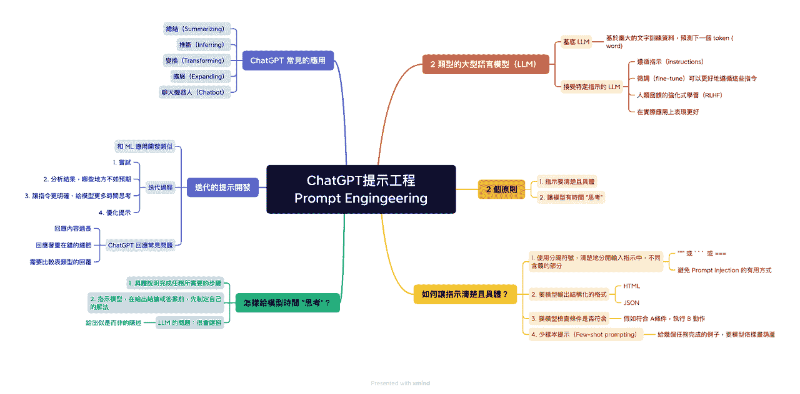

# **介绍**

ChatGPT Prompt Engineering Learning Notesfor Developers (面向开发者的ChatGPT提问工程学习笔记)

原视频：https://learn.deeplearning.ai/chatgpt-prompt-eng/lesson/1/introduction

课程简单介绍了语言模型的工作原理，提供了最佳的提示工程实践，并展示了如何将语言模型 API 应用于各种任务的应用程序中。 此外，课程里面提供了 Jupyter Notebook 代码实例，可以直接使用 OpenAI 提供的 API Key 获得结果，所以没有账号也能够进行体验。

在ChatGPT Prompt Engineering for Developers 中，能够学习到如何使用大型语言模型 (LLM) 快速构建功能强大的新应用程序。使用 OpenAI API，您将能够快速构建学习创新和创造价值的能力，而这在以前是成本高昂、技术含量高或根本不可能的。

这个由 Isa Fulford (OpenAI) 和 Andrew Ng (DeepLearning.AI) 教授的短期课程将描述 LLM 的工作原理，提供即时工程的最佳实践，并展示 LLM API 如何用于各种任务的应用程序，包括：

+   总结（例如，为简洁起见总结用户评论）

+   推断（例如，情感分类、主题提取）

+   转换文本（例如，翻译、拼写和语法更正）

+   扩展（例如，自动编写电子邮件）

**在这个课程中能够学习到**，编写有**效提示的两个关键原则**，即如何系统地设计好的提示，并学习构建自定义聊天机器人。

所有概念都通过大量示例进行说明，可以直接在官方的Jupyter notebook环境中使用这些示例，以获得即时工程的实践经验。

# **主要内容**

## **课程章节**

1.  课程简介 (Introduction)

1.  提示工程关键原则 (Guidelines)

1.  提示工程需要迭代 (Iterative)

1.  总结类应用 (Summarizing)

1.  推理类应用 (Inferring)

1.  转换类应用 (Transforming)

1.  扩展类应用 (Expanding)

1.  打造聊天机器人 (Chatbot)

1.  课程总结 (Conclusion)

这个项目是对于[**ChatGPT Prompt Engine**](https://www.deeplearning.ai/short-courses/chatgpt-prompt-engineering-for-developers/)**ering ****f**or Developers课程的学习笔记整理，这里要感谢Isa Fulford (OpenAI) 和 Andrew Ng (DeepLearning.AI) 提供的精彩课程，这些内容对于像我一样的初学者提供了很大的帮助，本着学习与实践的想法，做了下面这些事情，希望可以对提示工程学习者起到帮助：

+   1.使用prompt+ChatGPT对课程内容原文进行机器翻译（全文由ChatGPT翻译生成，每一章都提供了中英对照）；

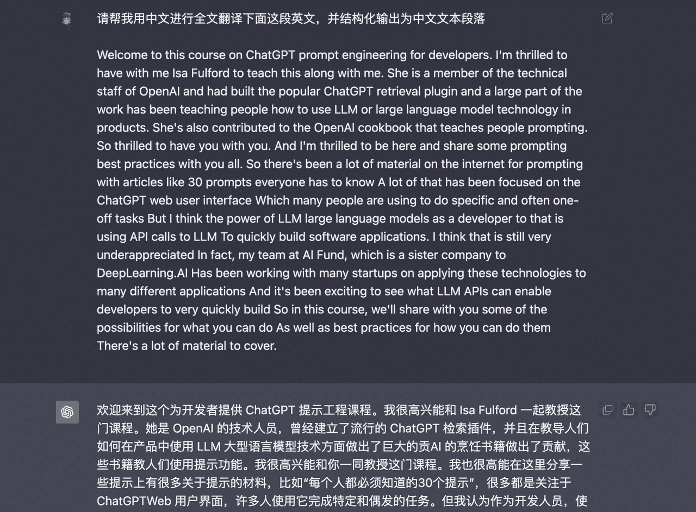

+   2.使用prompt+ChatGPT对笔记内容进行总结与扩展（在每一节的最后，附上了ChatGPT总结的效果）；

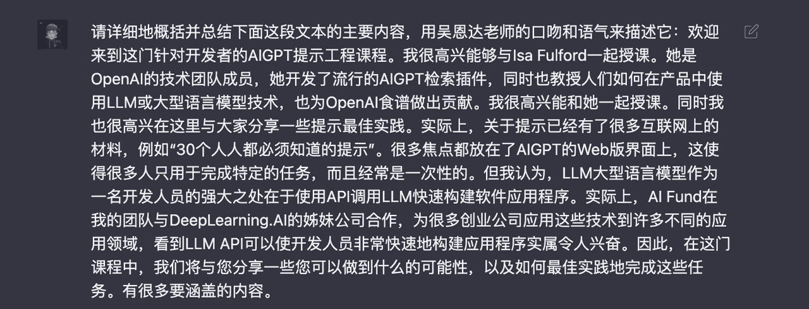

+   3.整理了实践过程中对应的jupyterbook代码，位置在： jb_code （可以在本地化部署环境运行）；

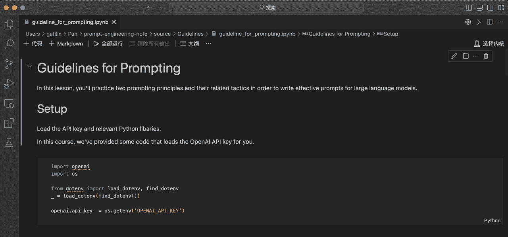

+   4.基于notebook代码制作shell的cli命令脚本(更新中)

+   5.整理了提示工程相关的awesome的项目清单(更新中)

+   ... ...

##

# **致谢**

+   [https://learn.deeplearning.ai](https://learn.deeplearning.ai/chatgpt-prompt-eng/)/chatgpt-prompt-eng/

+   [https://github.com/op](https://github.com/openai/openai-cookbook)enai/openai-cookbook

+   [https://github.com/](https://github.com/openai/openai-python)openai/openai-python

+   [https://github.com/openai/chat](https://github.com/openai/chatgpt-retrieval-plugin)gpt-retrieval-plugin

+   [h](https://learnwithhasan.com/prompt-engineering-guide/)ttps://learnwithhasan.com/prompt-engineering-guide/

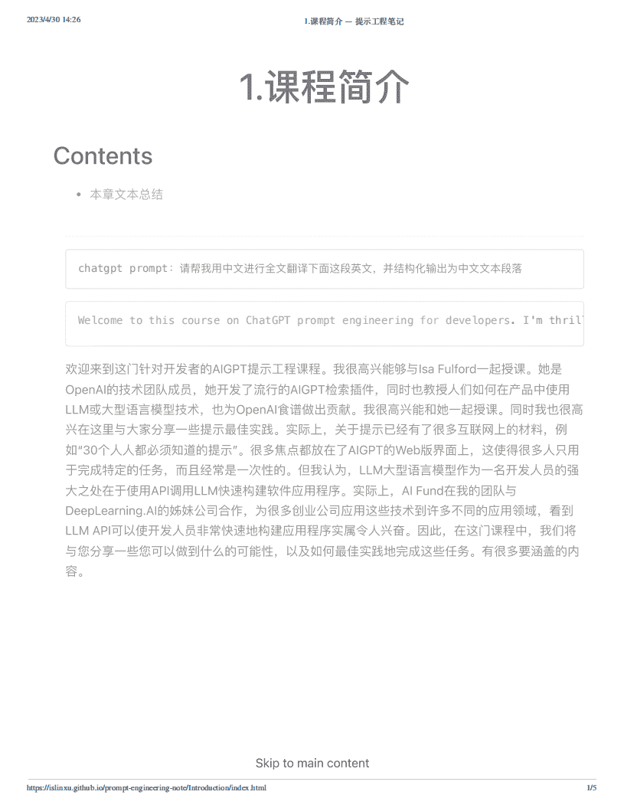

[1.课程简介 — 提示工程笔记.pdf](https://internal-api-drive-stream.feishu.cn/space/api/box/stream/download/all/Fpyfb3BaAo7gfTxQB1DcOs9rnRb)

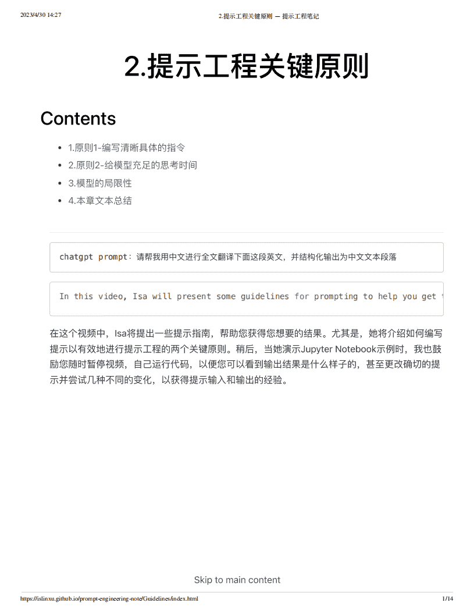

[2.提示工程关键原则 — 提示工程笔记.pdf](https://internal-api-drive-stream.feishu.cn/space/api/box/stream/download/all/EM1EbPCwsoVgDhxBBW3cetYDnRo)

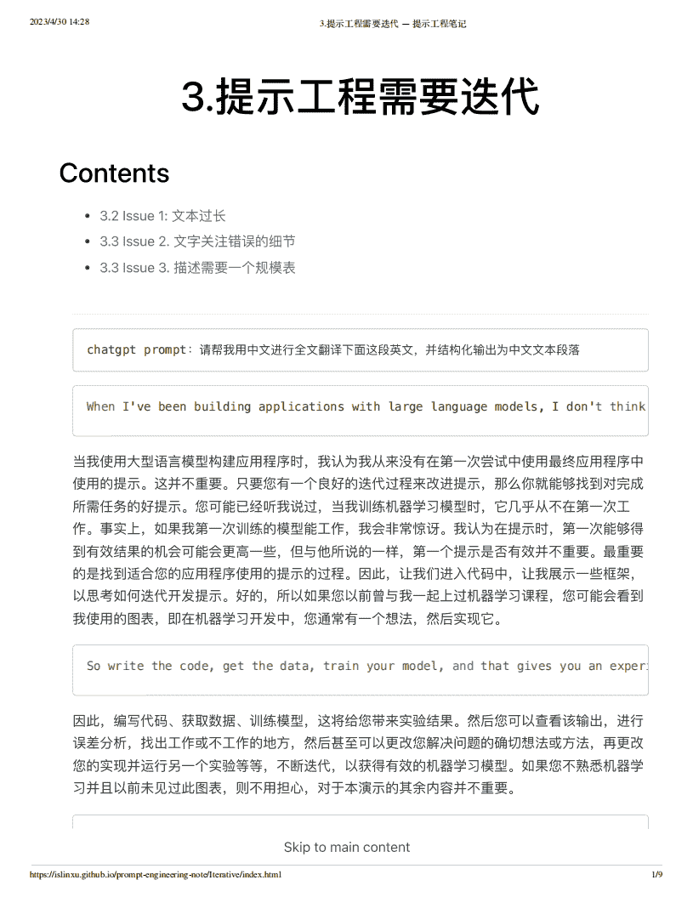

[3.提示工程需要迭代 — 提示工程笔记.pdf](https://internal-api-drive-stream.feishu.cn/space/api/box/stream/download/all/ZFsrbPTE0oPUlwxgMiXcpIZCnjf)

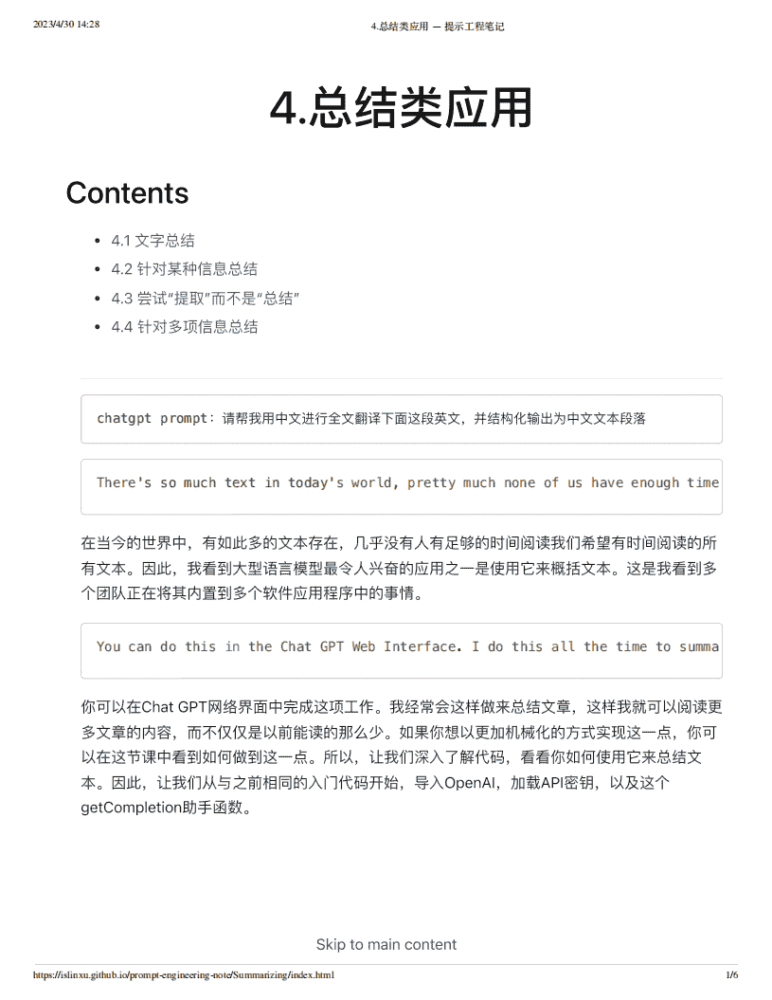

[4.总结类应用 — 提示工程笔记.pdf](https://internal-api-drive-stream.feishu.cn/space/api/box/stream/download/all/J7PqbrR8ToXelPxdr9CcHnnznpZ)

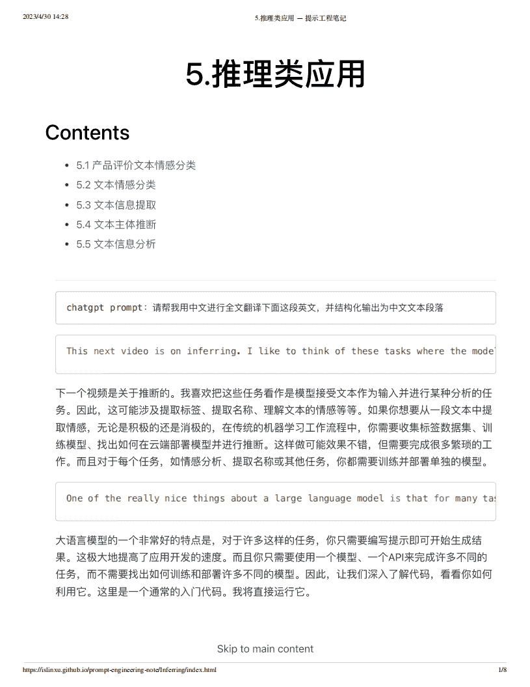

[5.推理类应用 — 提示工程笔记.pdf](https://internal-api-drive-stream.feishu.cn/space/api/box/stream/download/all/Y41TbFkDZoz76RxwN6ucWHSonAg)

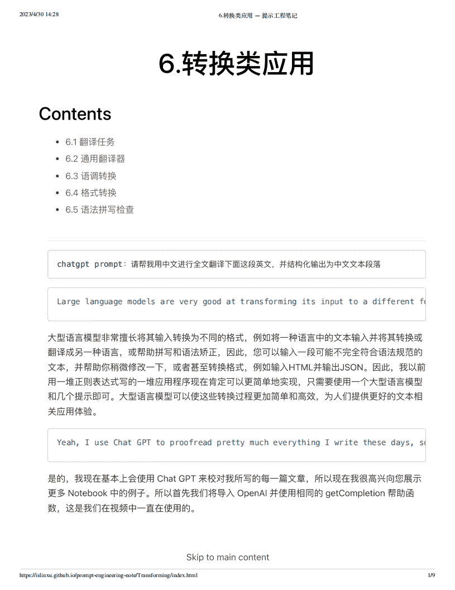

[6.转换类应用 — 提示工程笔记.pdf](https://internal-api-drive-stream.feishu.cn/space/api/box/stream/download/all/Zlq3b5ogvoRzxBxMyAtcOW13nBe)

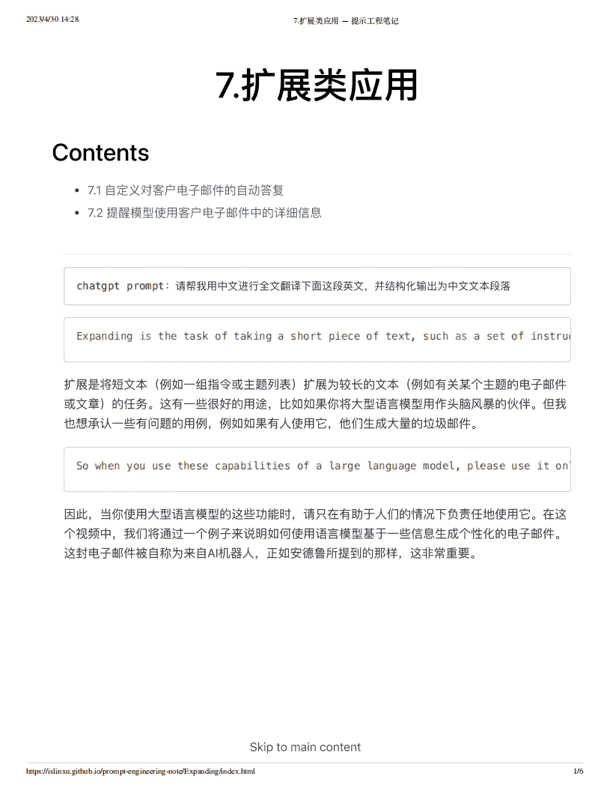

[7.扩展类应用 — 提示工程笔记.pdf](https://internal-api-drive-stream.feishu.cn/space/api/box/stream/download/all/MrKvbQxXpoZyagxR9YQcq0tln8Q)

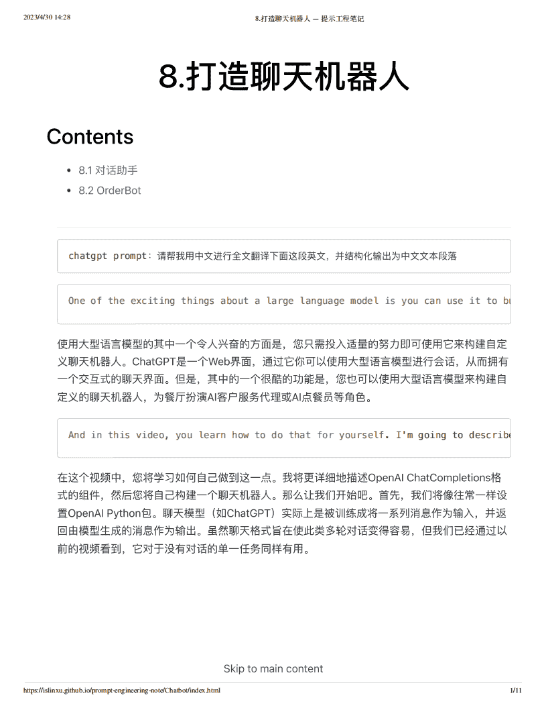

[8.打造聊天机器人 — 提示工程笔记.pdf](https://internal-api-drive-stream.feishu.cn/space/api/box/stream/download/all/RCyEbi60DoCEraxA4QTcGaJdncg)

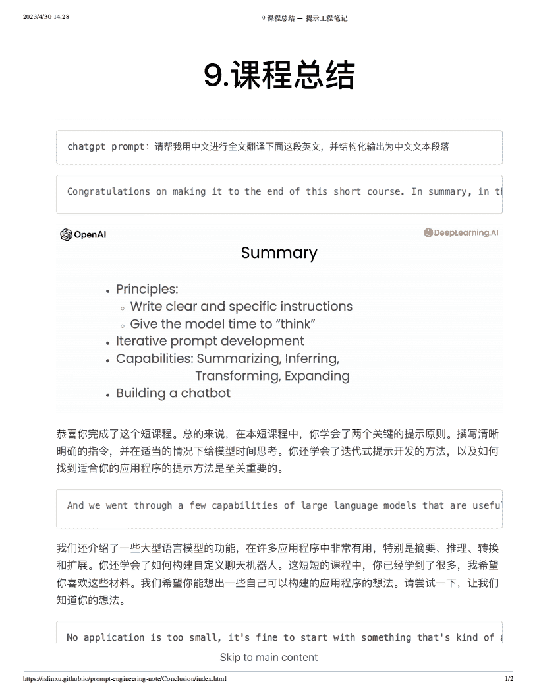

[9.课程总结 — 提示工程笔记.pdf](https://internal-api-drive-stream.feishu.cn/space/api/box/stream/download/all/HCS9bHnxVof3asxf40wczpmfnHc)