# 【喂饭级干货】10分钟教你如何使用ChatGPT定制行业专属QA

> 来源：[https://my.feishu.cn/docx/EFX0dT4JYoFA1Qxc7edc4BIon9f](https://my.feishu.cn/docx/EFX0dT4JYoFA1Qxc7edc4BIon9f)

# 一、ChatGPT在QA问答场景目前存在的问题

首先如果ChatGPT作为一个聊天助理，如果单纯从聊天的场景来看，是完全合格的

但是如果我们想要ChatGPT做一些个性化的回答，比如基于某个产品特性，去精确回复用户的某些问题，这个目前还是比较麻烦的

**举个🌰：**

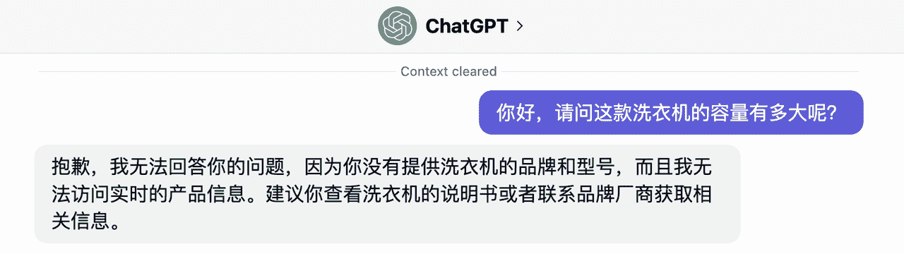

可以看到如果需要ChatGPT去回答这些问题，需要提供一些精确的上下文。但是实际场景问题可能很多，比如问：洗衣机脱水时长要多久，洗衣机最多可以洗几件衣服、洗衣机长宽高是多少等等

如果每次都把这些上下文一股脑的塞给ChatGPT，在API调用中实际消耗token费用是非常大的

# 二、解决这个问题思路

目前我所了解到的，解决这个问题的思路都大差不差

就是对「资料库」和「提的问题」做一些预处理，考虑到圈友大多不是技术出身，我尽可能用大白话描述清楚

假设我们有一些关于洗衣机的使用说明（随便生成的一批）：

```
问题：我刚刚购买了这台洗衣机，但是我不知道如何使用它，我该怎么做？
回答：没问题，我可以为您提供详细的使用说明。首先，您需要将洗衣机插上电源并打开开关，然后将衣服放入洗衣机内部，调整好水位和洗衣模式，最后按下启动按钮即可。

问题：这款洗衣机有哪些洗衣模式可供选择？
回答：这款洗衣机有多种洗衣模式可供选择，包括标准洗、快速洗、单脱水、强制脱水等模式。您可以根据自己的需求选择相应的洗衣模式。

问题：这款洗衣机需要添加多少清洁剂才能洗干净衣服？
回答：不同的洗衣模式需要添加不同的清洁剂量，一般来说，标准洗模式需要添加约50克清洁剂，快速洗模式则只需要添加约30克清洁剂。具体使用时可参考用户手册。

问题：我在使用这款洗衣机时，发现洗衣机内部有异味，怎么办？
回答：这可能是因为洗衣机内部积累了污垢，建议您使用专门的洗衣机清洁剂进行清洁。具体操作方法请参考用户手册。

问题：我在启动洗衣机后，发现洗衣机无法正常工作，是什么原因？
回答：可能是因为洗衣机没有插好电源线或者电源线损坏导致的。建议您检查电源线是否插好，或者更换一个新的电源线进行测试。

问题：这款洗衣机有哪些安全措施？
回答：这款洗衣机有多重安全措施，包括过流保护、漏电保护、超温保护等。当洗衣机出现异常情况时，会自动停止工作，确保用户的安全。

问题：在洗衣机使用过程中，出现了噪音过大的情况，是什么原因？
回答：可能是因为洗衣机不平衡或者内部零件磨损导致的。建议您检查洗衣机是否平放，并联系售后服务人员进行检查和维修。

问题：这款洗衣机的容量有多大？
回答：这款洗衣机的容量为8公斤，适合家庭使用。

问题：这款洗衣机有哪些节能功能？
回答：这款洗衣机有多种节能功能，包括快速洗、智能洗、智能调节水位等。这些功能可以有效降低能耗，节约能源。

问题：在洗衣机使用过程中，出现了漏水的情况，是什么原因？
回答：可能是因为洗衣机的排水管道堵塞或者洗衣机内部水泵故障导致的。建议您联系售后服务人员进行检查和维修。

问题：我在使用这款洗衣机时，发现洗衣机无法正常脱水，是什么原因？
回答：可能是因为洗衣机内部的滤网被堵塞或者水位设置不正确导致的。建议您首先检查滤网是否干净，如果还是无法正常脱水，可以尝试调整水位设置或者联系售后服务人员进行检查和维修。

问题：这款洗衣机可以用来洗哪些衣服？
回答：这款洗衣机可以用来洗各种衣服，包括棉质、麻质、毛织品等。需要注意的是，不同的衣服需要使用不同的洗涤模式和温度，具体使用时请参考用户手册。

问题：这款洗衣机可以进行手动控制吗？
回答：是的，这款洗衣机可以进行手动控制。除了自动模式外，您还可以手动调整洗衣机的水位、洗涤时间等参数。

问题：我可以在洗衣机内同时洗几件衣服？
回答：根据洗衣机的容量，您可以同时洗多件衣服。但是需要注意的是，过多的衣服可能会导致洗衣机负荷过大，影响洗涤效果和寿命，建议按照洗衣机说明书推荐的装载量来使用。

问题：这款洗衣机需要定期保养吗？
回答：是的，这款洗衣机需要定期进行保养。建议您定期清洁洗衣机内部、更换滤网、检查水管和电源线等，以确保洗衣机的正常运行和寿命。

问题：在洗衣机使用过程中，出现了电源突然断电的情况，是什么原因？
回答：可能是因为电源线接触不良或者电源插头老化导致的。建议您检查电源线和插头是否干净、正常，如果问题依然存在，建议联系售后服务人员进行检查和维修。

问题：这款洗衣机是否支持预约洗涤？
回答：是的，这款洗衣机支持预约洗涤功能。您可以在洗衣机上设置洗涤时间，让洗衣机在指定时间开始工作，方便您的生活。

问题：我在使用这款洗衣机时，发现洗衣机内部有异物，怎么办？
回答：如果您在使用洗衣机时发现异物，建议立即停止使用，并清理洗衣机内部。如果异物较大或者无法清除，建议联系售后服务人员进行检查和维修。
```

**处理逻辑思路如下：**

1.  用户提问：洗衣机需要定时保养吗？

1.  程序根据用户提问，可以从**现有的知识库**中匹配出一段文字，如下：

```
问题：这款洗衣机可以进行手动控制吗？
回答：是的，这款洗衣机可以进行手动控制。除了自动模式外，您还可以手动调整洗衣机的水位、洗涤时间等参数。

问题：我可以在洗衣机内同时洗几件衣服？
回答：根据洗衣机的容量，您可以同时洗多件衣服。但是需要注意的是，过多的衣服可能会导致洗衣机负荷过大，影响洗涤效果和寿命，建议按照洗衣机说明书推荐的装载量来使用。

问题：这款洗衣机需要定期保养吗？
回答：是的，这款洗衣机需要定期进行保养。建议您定期清洁洗衣机内部、更换滤网、检查水管和电源线等，以确保洗衣机的正常运行和寿命。
```

1.  拼接ChatGPT Prompt，如下；

```
我提供了一批必要的上下文信息如下:
---------------------
问题：这款洗衣机可以进行手动控制吗？
回答：是的，这款洗衣机可以进行手动控制。除了自动模式外，您还可以手动调整洗衣机的水位、洗涤时间等参数。

问题：我可以在洗衣机内同时洗几件衣服？
回答：根据洗衣机的容量，您可以同时洗多件衣服。但是需要注意的是，过多的衣服可能会导致洗衣机负荷过大，影响洗涤效果和寿命，建议按照洗衣机说明书推荐的装载量来使用。

问题：这款洗衣机需要定期保养吗？
回答：是的，这款洗衣机需要定期进行保养。建议您定期清洁洗衣机内部、更换滤网、检查水管和电源线等，以确保洗衣机的正常运行和寿命。
---------------------
通过我给你的这些信息，请回答这个问题：洗衣机需要定时保养吗？
如果你无法根据我给的信息回答这个问题，请务必回答：我暂时无法回答，请寻求人工帮助
```

1.  向ChatGPT提问，获取返回结果

可以看出，通过这一套流程，不用每次都向ChatGPT投喂全量的数据

因此可以极大的节省Token数量，并且经过测试，实际运行后响应挺快

从这四个步骤可以看出，我们要解决的问题已经转变成：如何从一大批数据中，筛选其中的某几段，投喂到ChatGPT当中

# 三、实操环节

这部分可能需要一点动手能力，以及需要有🪜、openai的key

懒得动手的圈友可以看个思路，或者直接跳过即可

文末有体验环节～

## 数据准备

这部分数据，一般需要和实际应用场景相结合，比如是：某本手册的说明书、某个社群的QA库、电商客服常用的话术等

这部分数据没有的话，可以直接让ChatGPT写一批，可以得到类似的一批数据

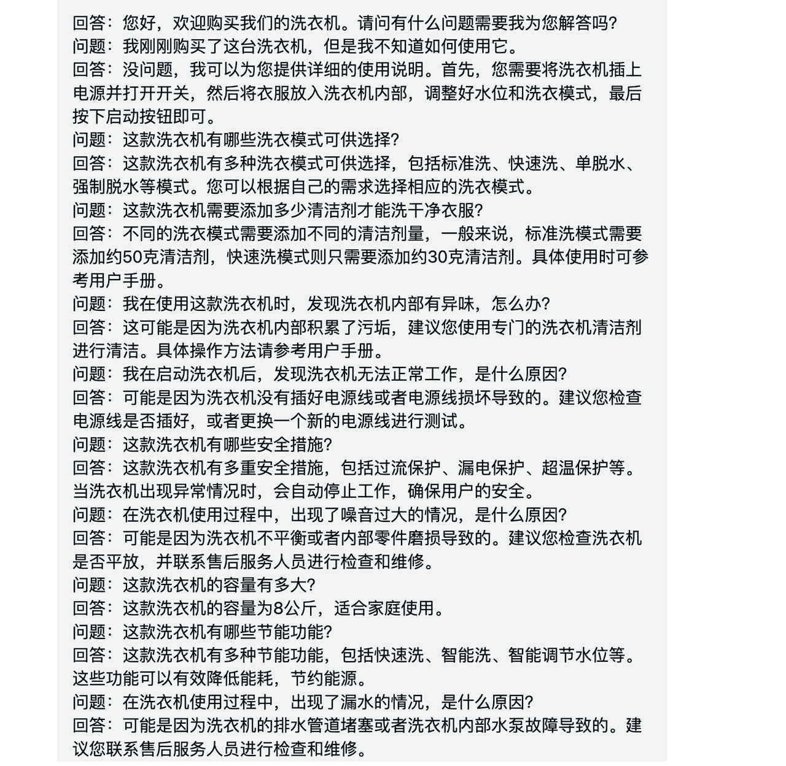

## 数据清洗

拿到的数据不一定能直接用，可能存在非常多的错误，这部分就需要专门做一次数据清洗

比如删掉一些奇怪的符号：@？! 等

清洗的步骤很多，这里就不细列出

我这里偷了个懒，数据没怎么清洗，原封不动的拿来用了

最后整合数据成一个txt文件，命名为：data.txt（名字无所谓随便取）

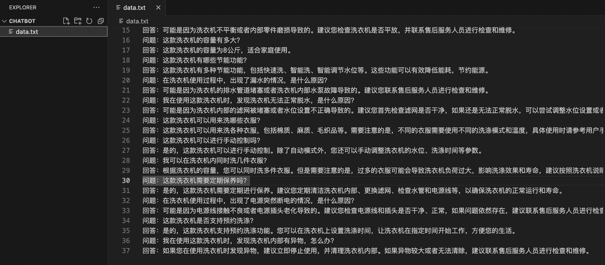

## 建立索引

这一步给大家画个图，简单理解一下原理（太深的需要一定的技术功底）

其中向量化可能大家比较陌生

简单理解就是：原始数据以及问题被转化成了下面这样

```
[-0.02181987278163433, -0.00725163146853447, -0.02838272973895073, -0.024522989988327026, -0.023587295785546303, 0.028824584558606148, -0.012300482019782066, -0.00291429809294641, -0.00836926605552435, -0.005383491516113281, 0.02937040664255619, -0.003205078188329935, -0.015555919148027897, -0.0026917457580566406, ...]
```

计算机可以通过这一大串数字，去计算「用户提的问题」和「准备的原始数据」的相似度（看不懂是吧，跳过跳过～）

> **实操环节**

这一步就需要涉及到代码编写了，需要两个前置条件

1.  电脑安装Python环境：https://www.python.org/downloads/

1.  安装完Python环境后，需要再用pip命令安装两个包（很简单）

```
pip install llama-index
pip install openai
```


1.  把准备好的data.txt放到单独的文件夹里，并且新建一个main.py，放入下方的代码

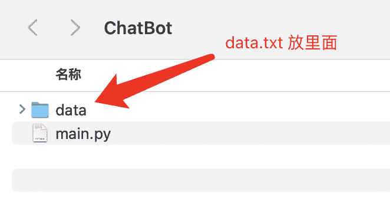

```
# main.py
import os
from llama_index import SimpleDirectoryReader, GPTVectorStoreIndex, LLMPredictor, ServiceContext
from langchain.chat_models import ChatOpenAI 


os.environ[&quot;OPENAI_API_KEY&quot;] = &#x27;OPENAI官网的key，要手动替换&#x27;

def construct_index(directory_path):
    llm_predictor = LLMPredictor(llm=ChatOpenAI())
    service_context = ServiceContext.from_defaults(llm_predictor=llm_predictor)
    docs = SimpleDirectoryReader(directory_path).load_data()
    index_from_doc = GPTVectorStoreIndex.from_documents(docs, service_context=service_context, chunk_size_limit=500)
    index_from_doc.storage_context.persist()
    return index_from_doc

if __name__ == &#x27;__main__&#x27;:
    construct_index(&quot;./&quot;)
```

+   Openai api key在注册完ChatGPT账号后，目前会送5美元：https://platform.openai.com/account/api-keys

1.  命令行执行，生成索引文件（也就是向量化的步骤），可以获得三个文件

```
python main.py
```

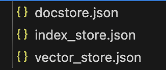

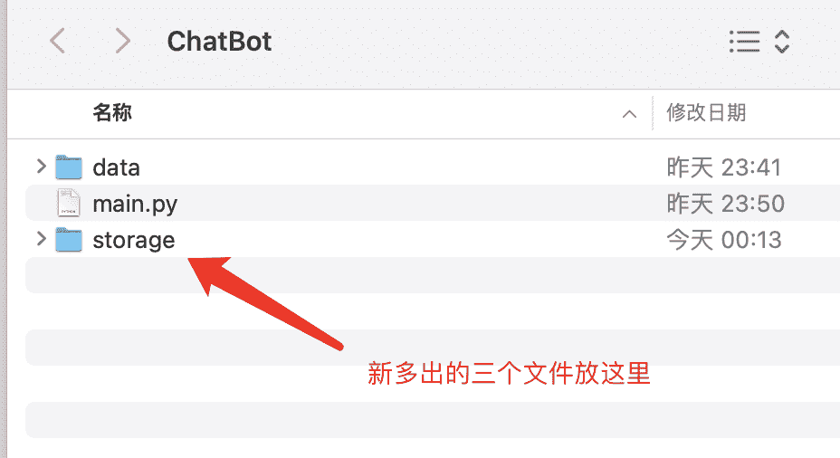

## 向ChatGPT提问

到这里已经准备的差不多了，接下来就可以输入问题向ChatGPT提问了

到目前为止，目录结构应该是长这样的

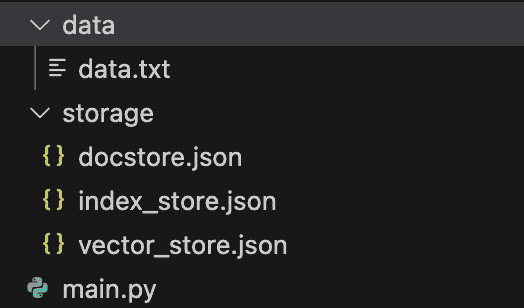

更新main.py的代码为

```
import os
from llama_index import SimpleDirectoryReader, GPTVectorStoreIndex, LLMPredictor, ServiceContext
from llama_index import Prompt , load_index_from_storage , StorageContext
from langchain.chat_models import ChatOpenAI 


os.environ[&quot;OPENAI_API_KEY&quot;] = &#x27;OPENAI官网的key&#x27;

def construct_index(directory_path):
    llm_predictor = LLMPredictor(llm=ChatOpenAI())
    service_context = ServiceContext.from_defaults(llm_predictor=llm_predictor)
    docs = SimpleDirectoryReader(directory_path).load_data()
    index_from_doc = GPTVectorStoreIndex.from_documents(docs, service_context=service_context, chunk_size_limit=500)
    index_from_doc.storage_context.persist()
    return index_from_doc

def chat(message):
    template = (
        &quot;你是一个专业的客服，现在提供了一下上下文信息给你 \n&quot;
        &quot;---------------------\n&quot;
        &quot;{context_str}&quot;
        &quot;\n---------------------\n&quot;
        &quot;请根据我给你的这些信息，回答用户的问题: {query_str}\n&quot;
        &quot;请注意，如果无法回答，请务必回复：”暂时无法找到相关信息，输入人工服务转接客服“\n&quot;
    )
    qa_template = Prompt(template)
    storage_context = StorageContext.from_defaults(persist_dir=&#x27;./storage&#x27;)
    index = load_index_from_storage(storage_context)
    index.service_context.llm_predictor = LLMPredictor(llm=ChatOpenAI())
    query_engine = index.as_query_engine(text_qa_template=qa_template)
    print(&quot;用户提问:&quot; + message)
    print(query_engine.query(message).response)


if __name__ == &#x27;__main__&#x27;:
    # construct_index(&quot;./data&quot;)
    chat(&quot;你好，我在店铺买了个洗衣机，想请问一下洗衣机容量多大呢？&quot;)
```

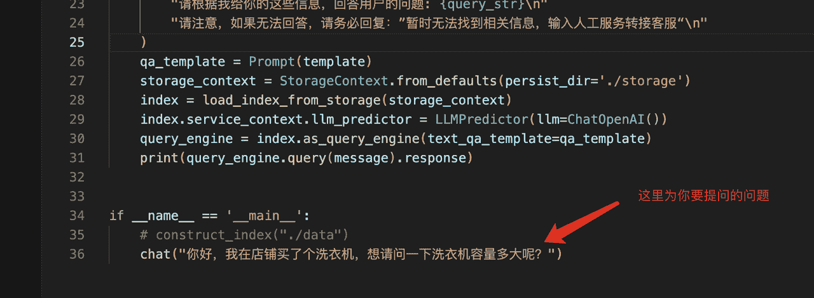

命令行运行:python main.py，既可以拿到结果。

可以看出，其实核心就是构建一个Prompt，填入匹配到的文本段以及用户的问题

```
&quot;你是一个专业的客服，现在提供了一下上下文信息给你 \n&quot;
&quot;---------------------\n&quot;
&quot;{context_str}&quot;
&quot;\n---------------------\n&quot;
&quot;请根据我给你的这些信息，回答用户的问题: {query_str}\n&quot;
&quot;请注意，如果无法回答，请务必回复：”暂时无法找到相关信息，输入人工服务转接客服“\n&quot;
```

# 四、效果展示

这里简单得给大家展示一下效果

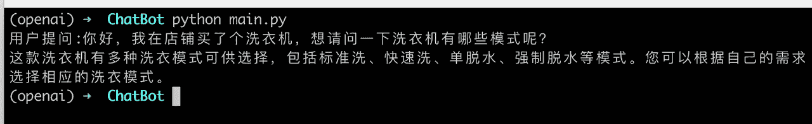

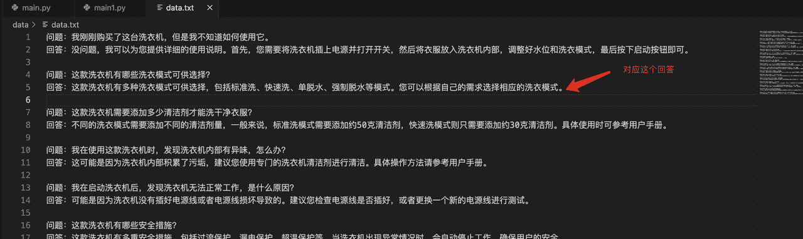

###

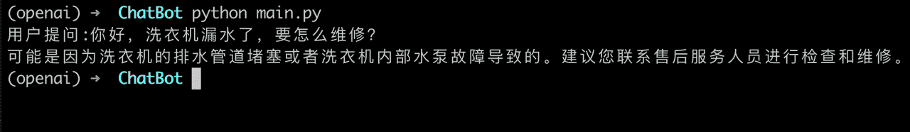

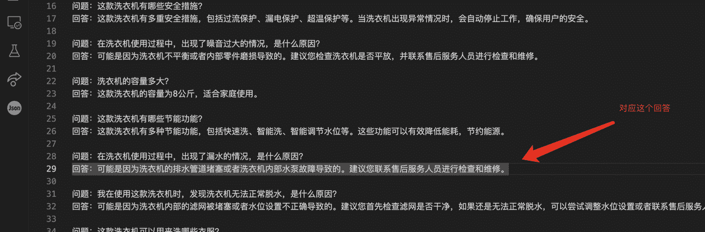

###

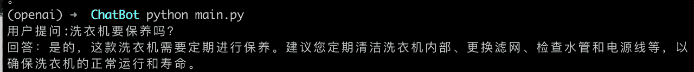

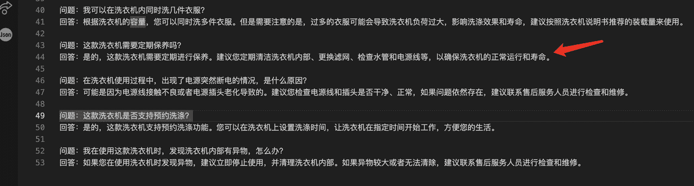

+   匹配不到的场景

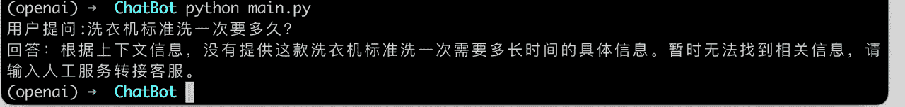

# 五、总结

可以看到目前跑出的效果，在数据量不多的情况下，匹配的还算顺利

数据量多的情况，我也没测试过，效果可能会弱一些

应用到实际应用场景，可以节省大量的人力资源，毕竟招聘一个客服人员去回复消息，成本并不低