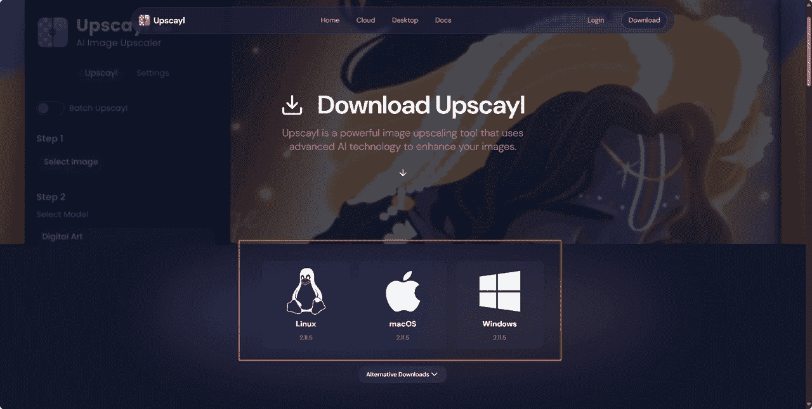
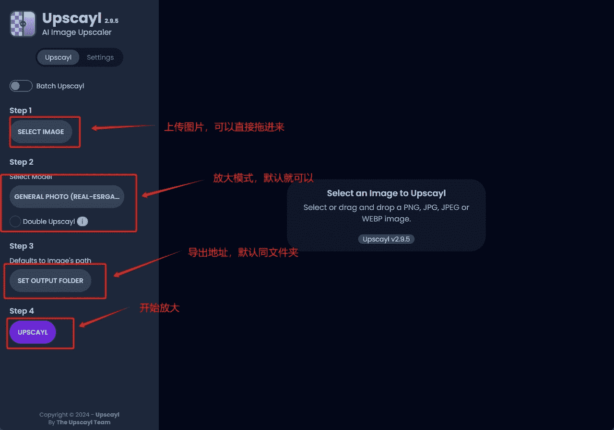
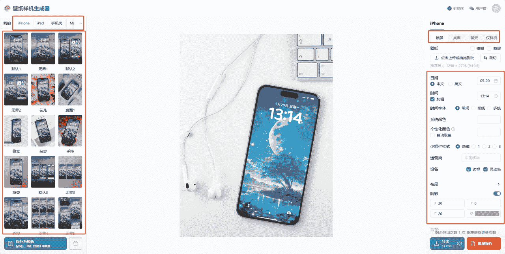
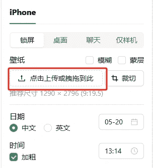
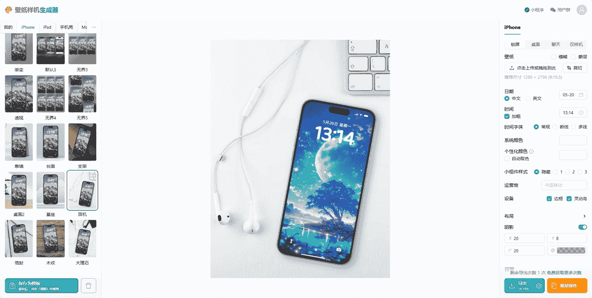
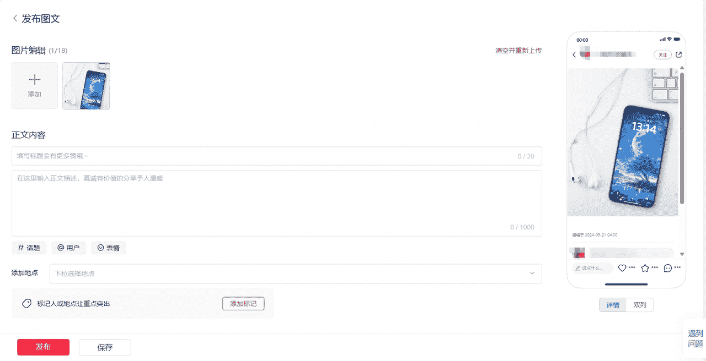

# 【AI副业解析】手机壁纸📕

> 来源：[https://my.feishu.cn/docx/Hqrvd5E72oO5QIxOzswcxuM9ned](https://my.feishu.cn/docx/Hqrvd5E72oO5QIxOzswcxuM9ned)

+   项目介绍

+   成功案例分析

+   使用工具

+   详细操作流程

+   使用MidJourney生成图片

+   图片高清放大

+   壁纸排版与模板制作

+   发布至📕和其他平台

+   变现途径：

+   项目评价

##  **项目介绍 **

该副业项目通过AI生成精美的手机壁纸，并使用整理好的模板制作适用于不同手机尺寸的壁纸。将作品发布在📕等自媒体平台吸引用户关注，并通过壁纸平台赚取佣金。用户可以通过持续更新热门主题、潮流风格的壁纸吸引粉丝和下载量，提升变现机会。

##  **成功案例分析 **

**“雪纳瑞AI壁纸学”账号 **：拥有0.7万粉丝和2.4万点赞。该账号通过使用MidJourney生成个性化手机壁纸，精准地抓住了用户对高质量、独特壁纸的需求。持续发布作品，积累了稳定的粉丝群体，并通过作品销售获得收益。

##  **使用工具 **

**MidJourney **：以图像生成的精确度和风格广泛使用，适合创意型壁纸设计。

**Upscayl **：能够将MIdjourney做好的壁纸图片进行放大，提高分辨率。

**手机壁纸模板 **： [壁纸样机 生成器 ](https://17yongai.com/go/?url=aHR0cHM6Ly9tamNuLmNsdWIv)，可以方便地将图片转入模板，设计出符合不同屏幕尺寸的壁纸。

##  **详细操作流程 **

###  使用MidJourney生成图片

> 输入相关关键词生成手机壁纸图片。你可以调试关键词，例如“minimalist black and white wallpaper”或“nature landscape wallpaper for phone”来生成符合市场需求的壁纸。反复调试提示词，直到获得满意的图片。

> 推荐提示词： **moon **in silent night, beside a blue forest, a lake is emitting green fluorescence, the blue water is clear, fireflies, fantasy, dreamy, intricated details, illustration, 8k, ultra HD –ar 9:16 –s 750 –niji 6

###  **图片高清放大 **

> 使用 **Upscayl **工具将生成的壁纸图片进行高清放大。确保最终图像能够保持画面清晰。

1、下载 **Upscayl **

** **

2、选择要放大的图片和放大倍数点击放大

###  **壁纸排版与模板制作 **

> 使用 壁纸样机 生成器 或Photoshop将壁纸图像导入手机壁纸模板中，制作锁屏、待机等不同样式的壁纸。通过排版和调整比例，使壁纸作品更具专业感。

1、进入 壁纸样机 生成器，选择要生成的样式

2、导入之前制作好的壁纸图片

3、导出做好的壁纸样式

###  **发布至📕和其他平台 **

> 完成设计后，将壁纸作品发布至📕，使用相关标签如#手机壁纸、#个性化壁纸等吸引更多用户关注。

###  **变现途径 **：

+   **作品销售**
将壁纸作品发布至📕和壁纸平台，等待用户购买。同时，可以将壁纸打包成多款风格合集，在电商平台或📕商城上架，供用户下载或定制。

+   **平台佣金**
在壁纸平台如Zedge等发布作品，通过用户下载量赚取佣金。高质量的作品加上热门标签的使用，可以提高曝光率，增加收益。

##  项目评价

> **适合人群**

> AI手机壁纸副业适合对壁纸感兴趣的创作者，尤其是没有专业设计背景但希望通过AI技术快速创作的人。全职妈妈、学生或业余创作者都可以通过这一项目获得收入。

> **操作难度**

> AI手机壁纸制作门槛低，即便没有设计基础，通过MidJourney等AI工具也能生成满意的作品。整体操作简便，适合初学者快速上手。

> **项目前景**

> 随着手机更新换代和个性化需求的增加，手机壁纸市场前景广阔。通过AI工具高效创作壁纸，创作者可以抓住市场机遇，未来有望获得稳定的收入来源。

> **副业评价**

> AI手机壁纸副业操作简单、投入少，适合初学者尝试。但是竞争比较大，没有明确的头部，该副业的收入可能不是很可观。