# 钉钉AIGC实践：一键焕新工作台应用图标

> 来源：[https://my.feishu.cn/docx/TBHCdlRR4oAz48xdhuJcguWOnxb](https://my.feishu.cn/docx/TBHCdlRR4oAz48xdhuJcguWOnxb)

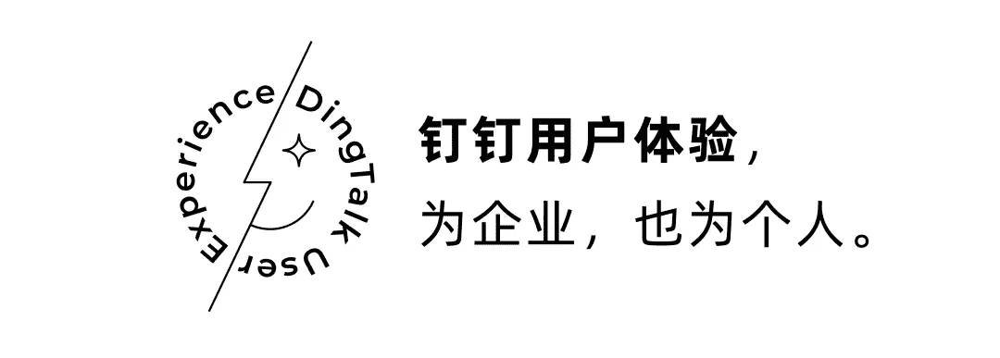

# **前言**

钉钉工作台作为组织数字化的入口，不同企业通过工作台打造属于自己的门户，不仅可以帮助员工快速找到各种功能，更能成为打造企业组织文化的重要阵地，是企业品牌形象的一块亮眼招牌。

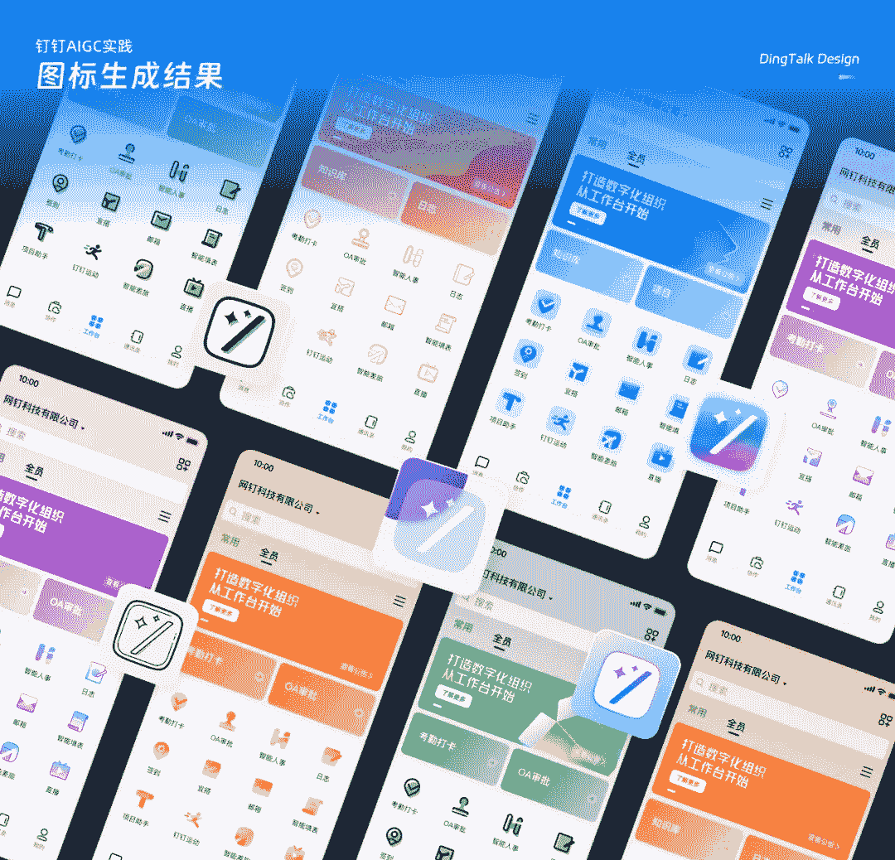

# **#01.**

# **为什么要AI生成应用图标**

#

在客户案例中，典型行业大客户的自定义工作台体现了企业文化和品牌形象，样式设计也十分丰富多样。自定义工作台首页的图标通常会进行重新设计和替换，以更好地契合企业的品牌设计和文化氛围。

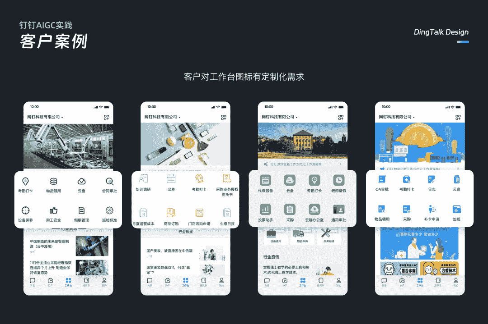

然而在用户反馈中，我们发现这样的声音：有时客户企业内没有设计师无法进行个性化设计，又或者自行设计的效果不理想；有时已经进行了图标设计和替换，但后续有新增的应用，导致新旧图标混杂。

随着 AIGC 的火爆，我们在思考：怎样借助强大的 AI 工具快速生成符合要求的图标， 让钉钉上的企业也能通过 AI 轻松实现图标的个性化定制？

# **#02.**

# **生成应用图标可行么**

#

最开始我们设想的是用 Prompt 生成所需的图标，例如“帮我生成一套蓝色科技风的图标”。

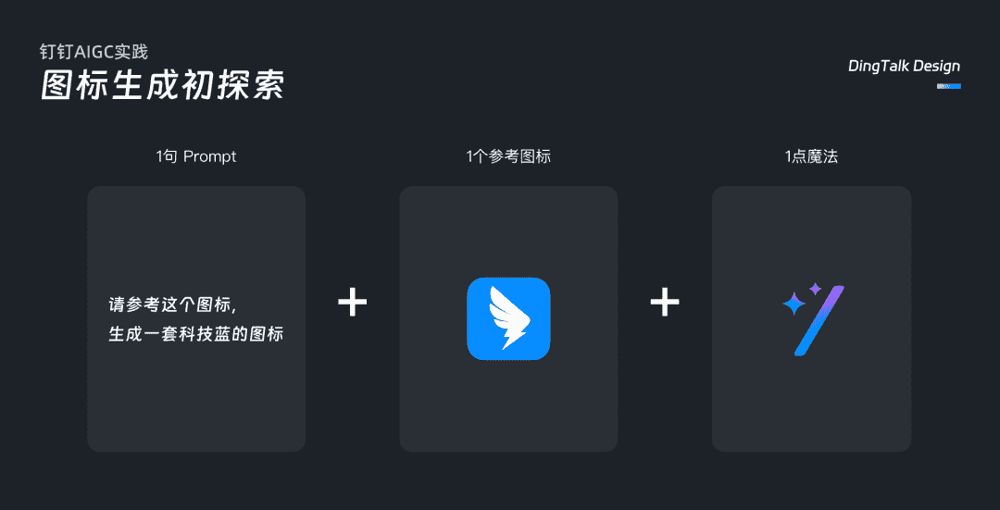

然而实际测试发现，仅使用 Prompt 生成的图标，其内部图形缺乏具体语意和规则化的形状，而且不同图标之间缺乏很好的风格关联。在加入了钉钉图标进行垫图后，虽然不同图标之间看起来更相似了，但图标主体形状仍然缺乏任何明确的语意。

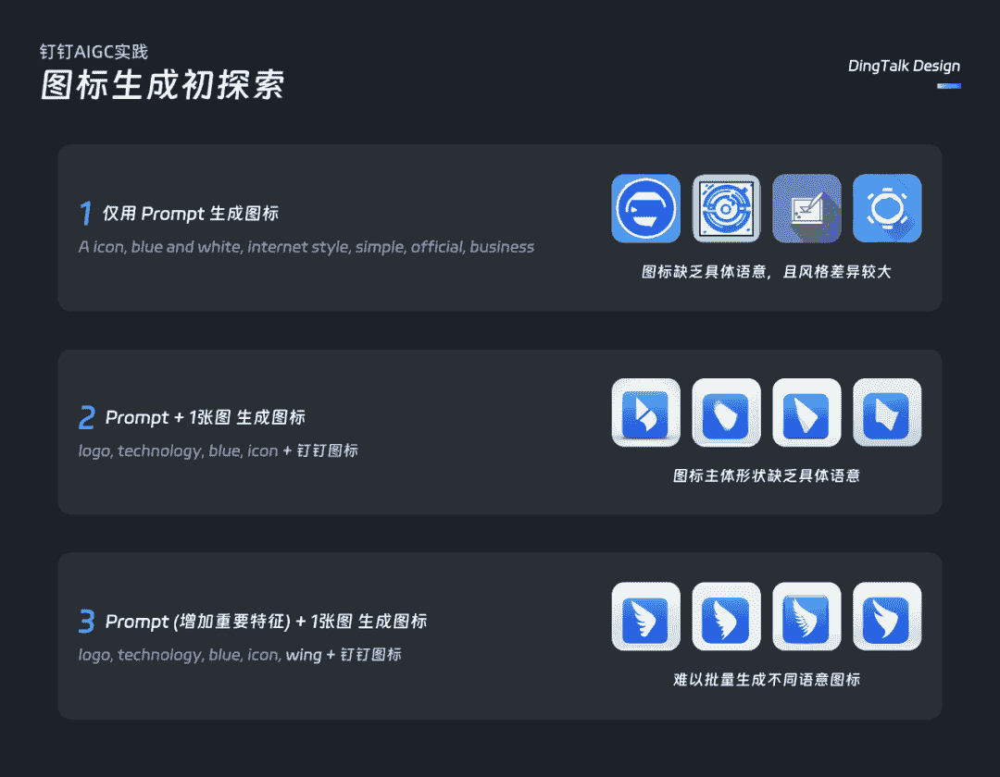

第三种尝试是 Prompt +垫图+关键特征，结果发现虽然和翅膀的语意有所关联，但仅限于单个图标的生成，难以实现整套工作台图标的批量生成，因为我们无法便捷提取工作台所有图标的所有特征。

# **#03.**

# **如何优化生成质量**

#

想要实现工作台上的应用图标的批量生成和替换，最关键的问题就是优化图标的生成质量，使得随机不可控的结果变得可控。

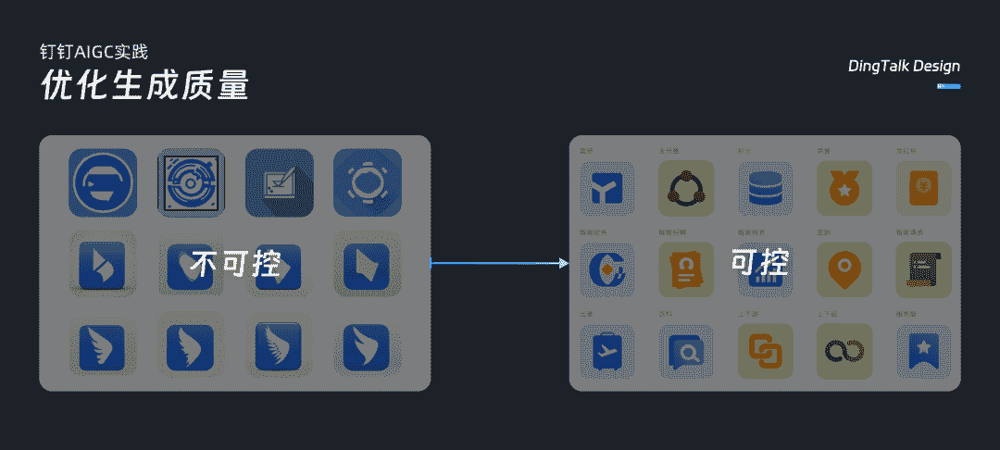

我们意识到，最大的问题是图标 **主体形状的语意问题 **，AI 难以识别每个应用应该对应什么样的语意。

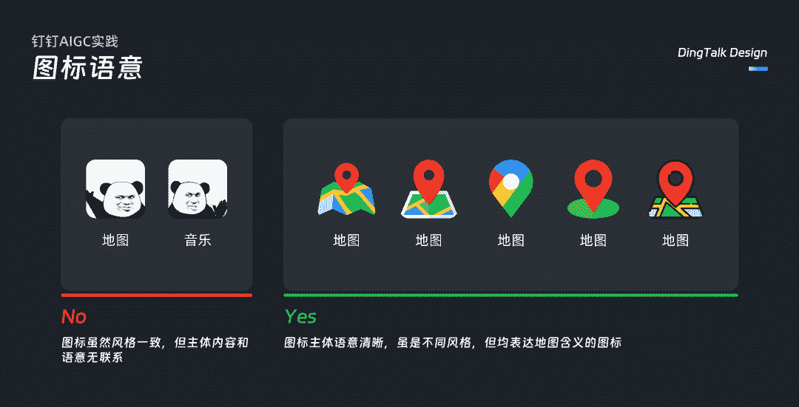

而工作台的原始图标，应用和图标语意都是一一关联的。对于钉钉工作台的用户，更多的是基于当前的应用图标去做风格颜色的替换。

在这个思路下，我们发现 ControlNet 的边缘检测 + LoRA 非常满足这个场景，在主体形状保留的同时，可以进行不同风格和颜色的变化。

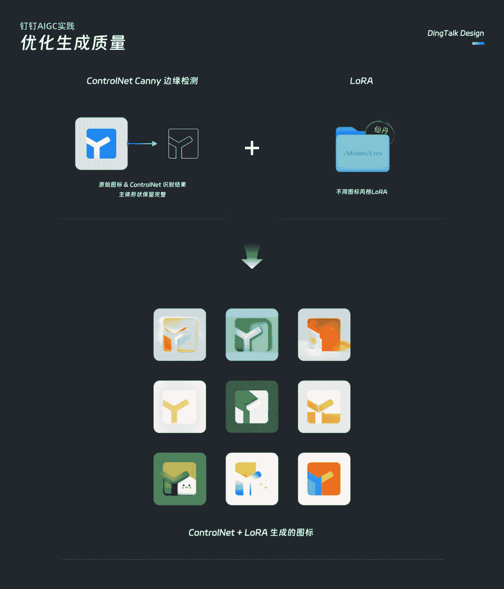

至此，我们对生成应用图标这件事有了可落地的方向和信心。但如果想真正在钉钉上线，我们需要自行训练不同风格的 LoRA 模型。

# **#04.**

# **自训练模型的步骤**

模型的训练大致有以下五步：

**确定风格—准备数据集—数据集打标—** LoRA 训练— Prompt 调优。

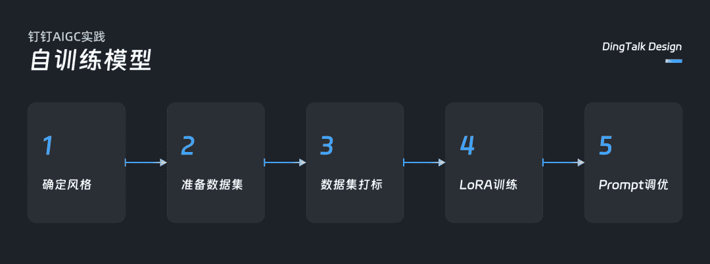

首先确定图标的风格，我们选择了目前UI设计中比较常见的图标风格：毛玻璃、手绘线条、3D拟物、渐变、和描边。

同时考虑整套图标最好能尽量契合不同企业的品牌主色调，以及钉钉图标的常用色，我们提供了常见的颜色：红、橙、黄、绿、蓝、紫，以及随机。

共5种风格 x 7种颜色 35种排列组合。

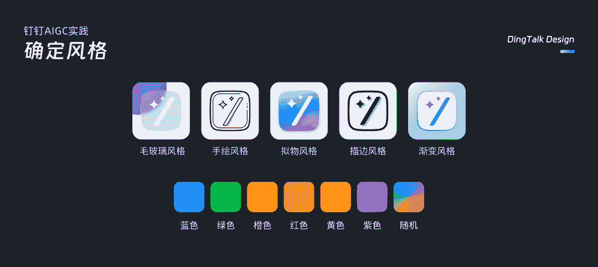

接下来，就是准备对应风格的数据集。这一步会直接关系到最终的模型质量。每种风格数据集数量一般30张左右，切图背景完整，尽量贴合实际效果，同时避免特殊纹理。

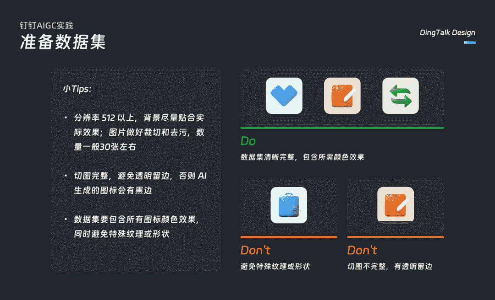

在数据集打标上我们通过 Blip 和 Deepbooru 自动打标，再人工调整校正的方式进行。

**Blip ： **长句，经测试描述基本都比较准确；

**Deepbooru ： **词组标签，但更适合人物相关内容的识别，识别图标时会有“1girl（女孩）”“long hair（长发）”“close-up（特写）”等不太准确的识别。需人工删除错误的标签。

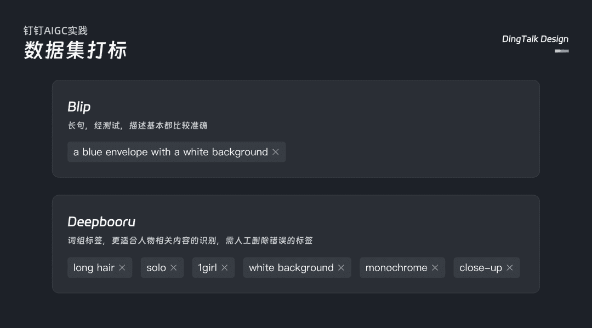

在 LoRA 训练完成后，输入的 Prompt 不同，生成的结果也会有所差异。因此，我们针对5种不同的图标风格，对应其特点进行了 Prompt 优化。

对于开发同学来说，会将用户选择的颜色，映射到对应的颜色字段，输入到 Prompt 里，从而实现不同颜色的匹配生成。

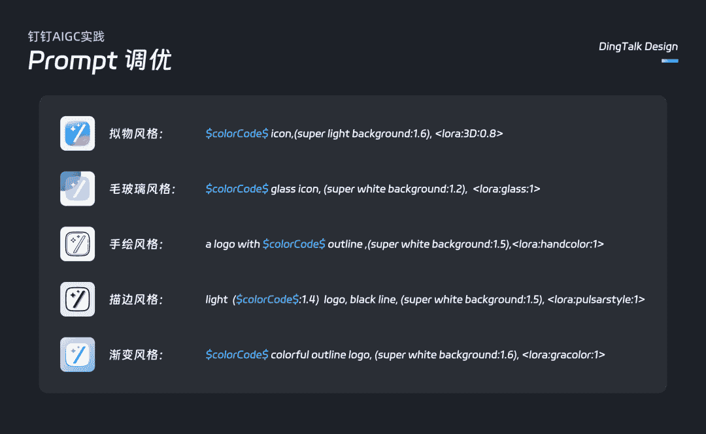

# **#05.**

# **体验设计**

最后说一下 AI 生成应用图标的体验设计，在设计时，我们主要考虑了以下几点：

## **1、怎样缓解等待焦虑？**

考虑到大部分企业的工作台应用数较多，批量生成所有图标耗时较久。我们在用户选择图标风格和颜色后，会优先随机生成4个图标进行快速预览，用户对生成效果满意再进行批量生成。

同时也支持订阅消息通知，在生成结束时自动通过钉钉通知生成结果。

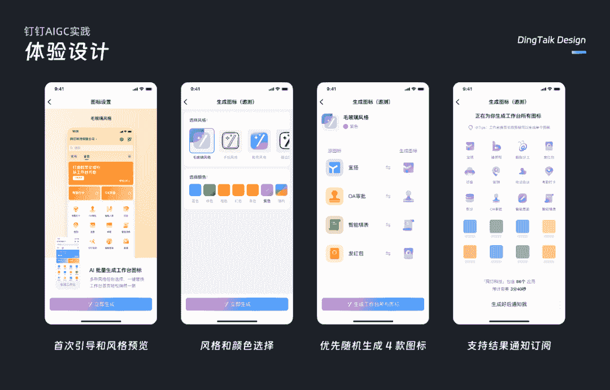

## 2、如何提升管理员操作的安全感？

由于生成图标是管理员操作，会生效于整个团队/组织的。在此过程中，我们支持对生成的结果进行实时效果预览，做到心中有数。同时每次生成都会有对应的记录，展示生成时间和操作人。图标替换后支持恢复任意一次历史效果或恢复钉钉的默认图标。

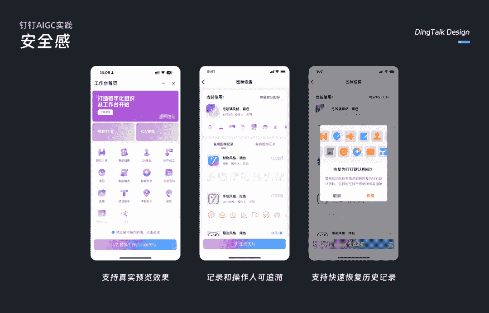

## **3、单图标生成和调优**

在批量生成的基础上，考虑到生成结果抽卡有一定随机性，我们在批量生成结果页也支持单图标的重新生成和调优，操作更灵活。同时工作台新安装的应用，支持直接通过工作台首页长按进行AI生成。

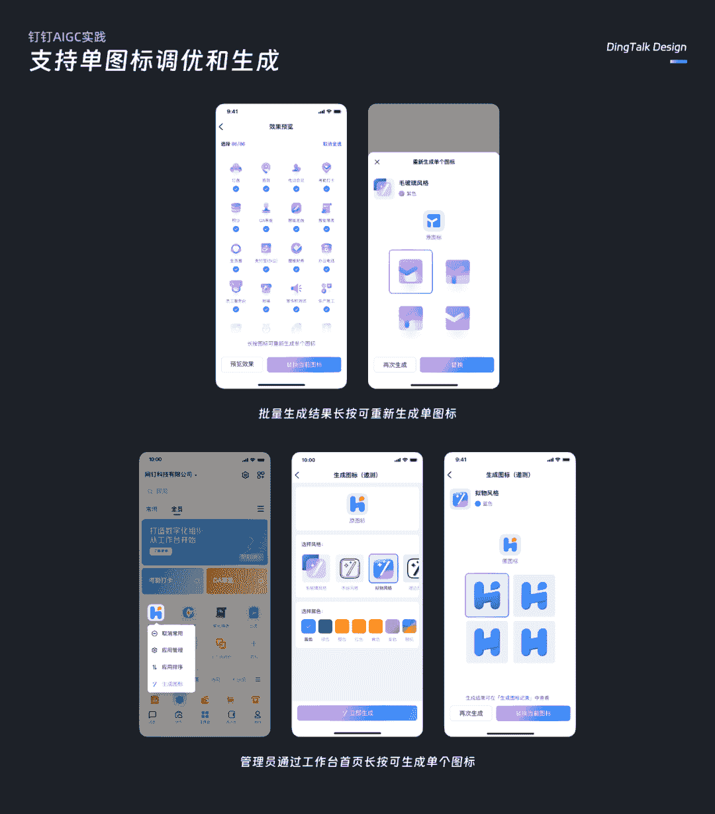

#

#

# **结语**

目前钉钉工作台 AI 生成应用图标已经上线，多样风格，批量生成，一键替换，省钱又省心，美观又专业。AI 助力工作台轻松焕然一新！

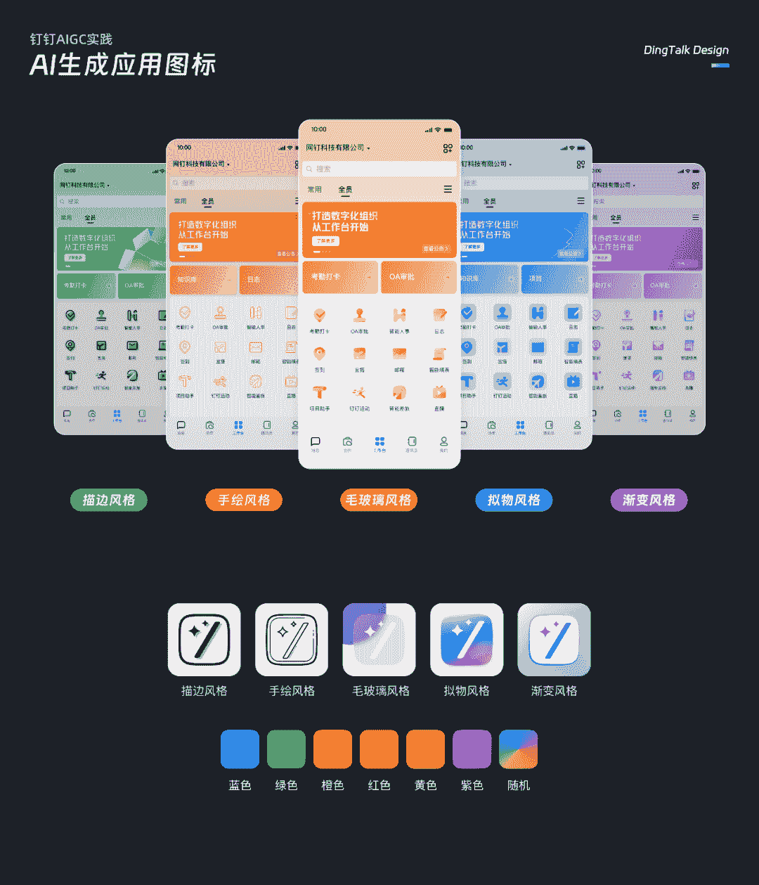

当前仅限创业版 / 专业版 / 专属版钉钉组织管理员，在钉钉移动端使用。

欢迎大家体验，并反馈建议。未来我们还将继续优化模型质量，以及提供更多的图标风格，敬请期待。

---

