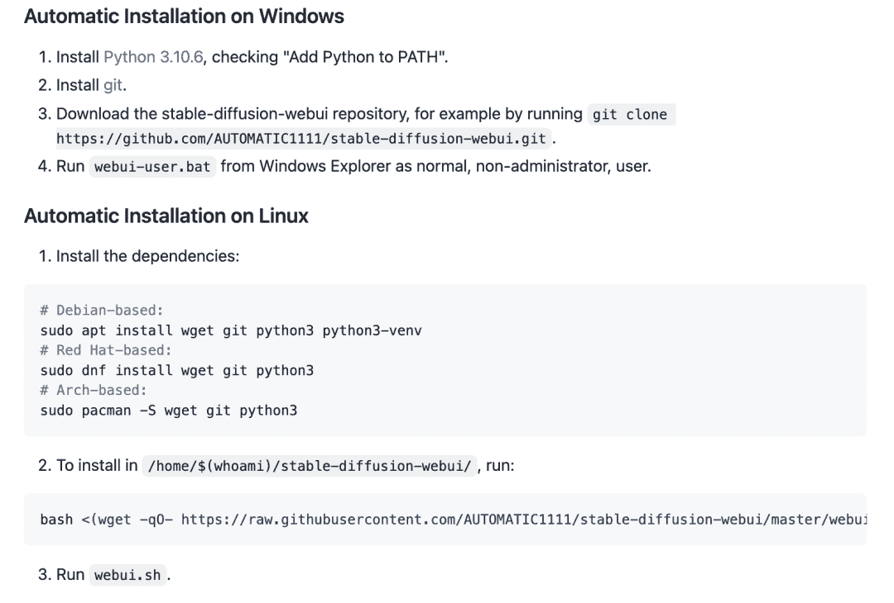
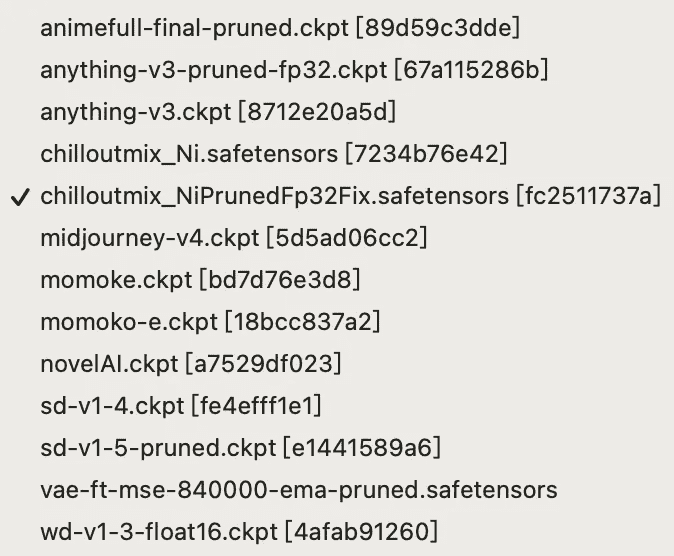
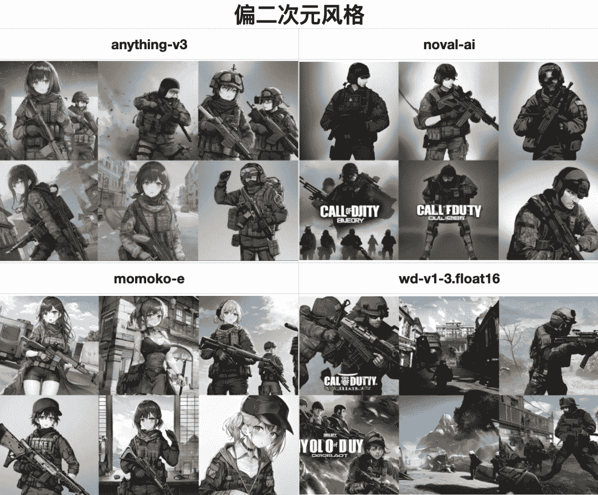
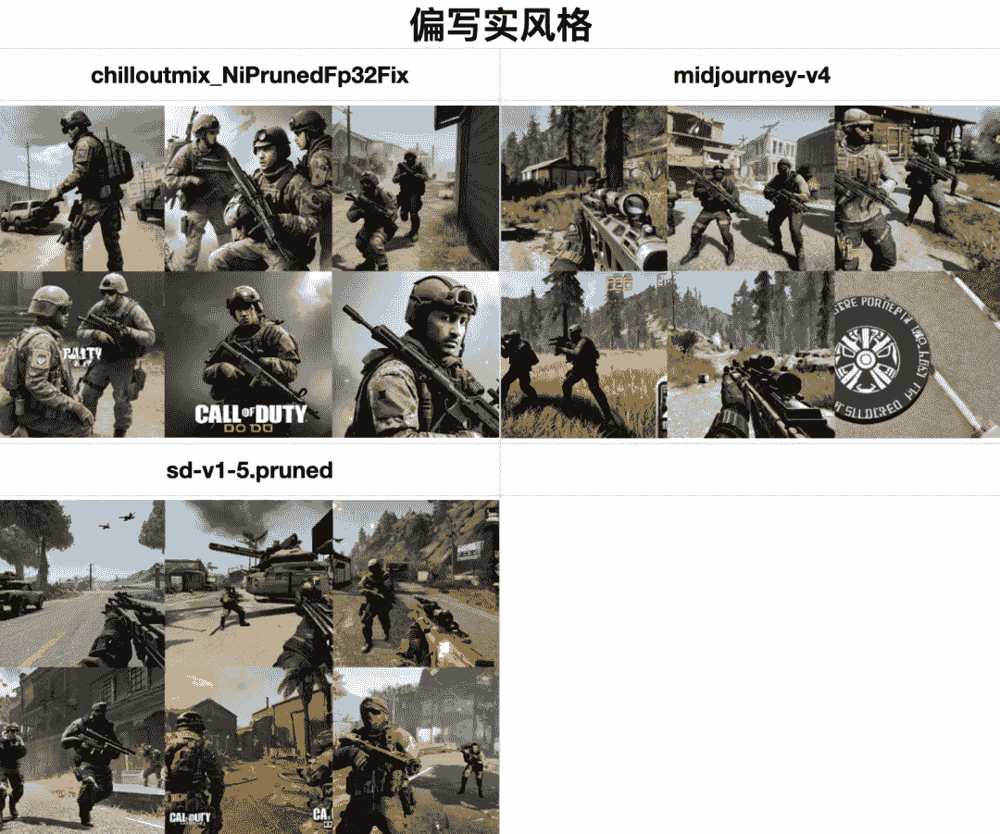
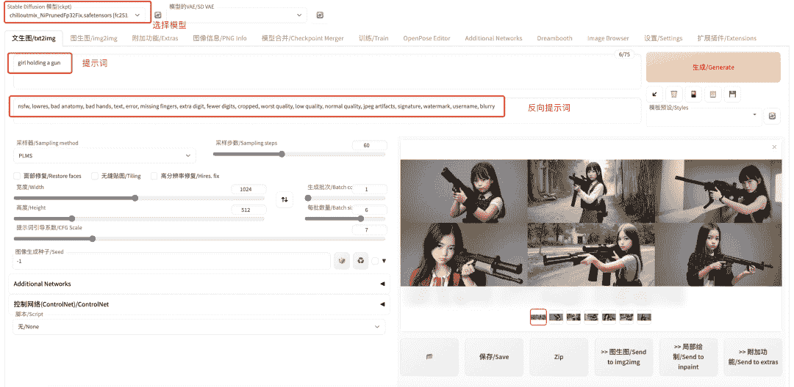
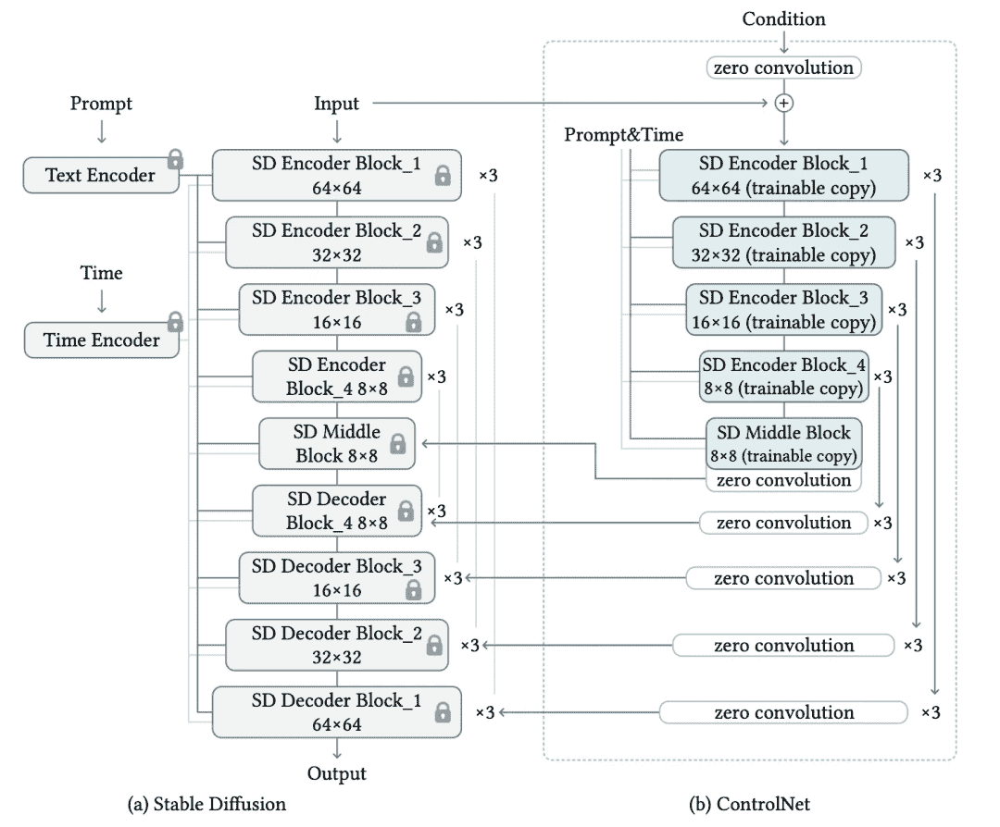
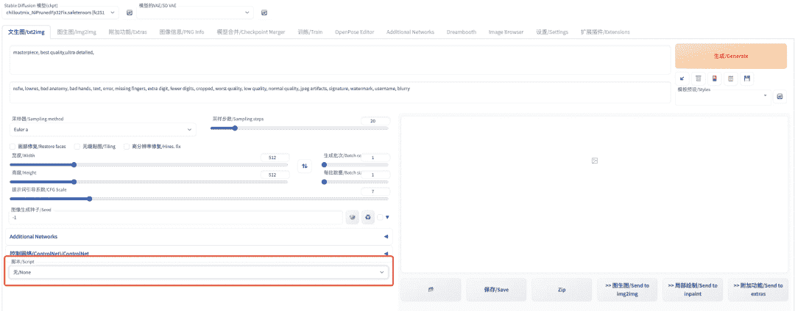
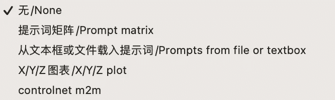
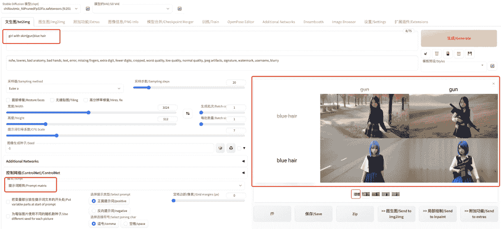
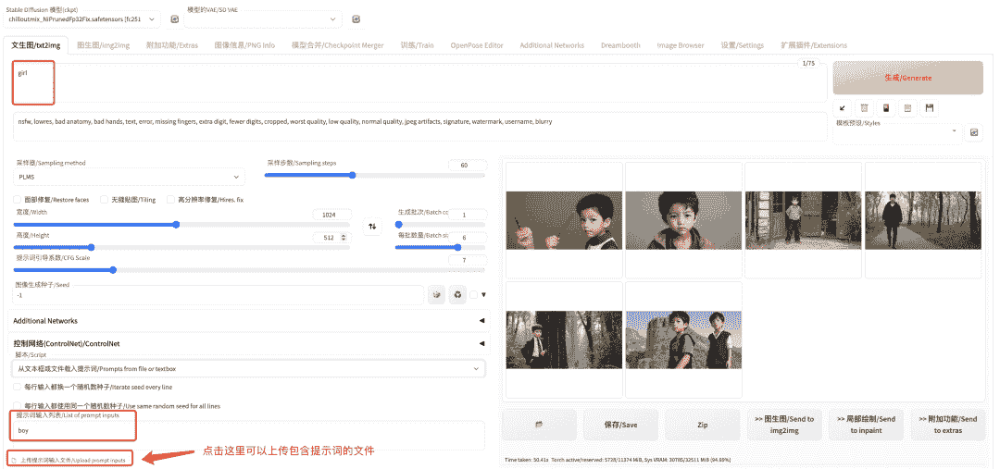

# 腾讯丨教会你使用 Al 绘画利器 Stable Diffusion

> 来源：[https://my.feishu.cn/docx/XAsCd79sConoCxxDaARcwK23nDu](https://my.feishu.cn/docx/XAsCd79sConoCxxDaARcwK23nDu)

### **背景知识**

Stable Diffusion 是什么？

Stable Diffusion 是利用扩散模型进行图像生成的产品，可以支持 text2image、image2image。并且由于“论文公开+代码开源”，其用户群体远大于其他 AI 图像生成产品。另外，而且众人拾柴火焰高，代码和项目开源使得各项优化技术在其上快速应用，使其不断迭代优化。

传送门：[**官网**](https://stablediffusionweb.com/) | [**论文**](https://arxiv.org/abs/2112.10752) | [**Git**](https://github.com/CompVis/latent-diffusion)

**WebUI 是什么？**

[**Stable Diffus**](https://github.com/AUTOMATIC1111)ion WebUI 是 AUTOMATIC1111 为 Stable Diffusion 开发的一套 UI 操作界面，大幅度降低了 Stable Diffusion 的使用门槛，让用户甚至可以不用写代码就能够实现模型的推理、训练等操作。

传送门：[**Git**](https://github.com/AUTOMATIC1111/stable-diffusion-webui)

**启动器是什么？**

启动器是[**秋葉 aaaki**](https://space.bilibili.com/12566101) 团推开发的用来启动 Stable Diffusion WebUI 的启动工具。不仅能够实现一键启动（否则需要用户先打开 webui 服务，在打开浏览器网页），还包含了诸如环境选项、疑难解答、版本管理、模型管理、扩展插件管理等诸多功能。让没有开发经验的同学能够用起来更顺手。

传送门：[**教程**](https://www.bilibili.com/video/BV1ne4y1V7QU/) | [**网盘下载**](https://pan.baidu.com/s/1XHOx7zgO0IQVL-01opwXjA?pwd=uvdy)

这三者依次递进，最终呈现在我们眼前，让我们能够方便的使用 Stable Diffusion 的能力。下面我们分 2 个大块，分别介绍如何使用 WebUI 进行推理（即生成内容）和训练，以及他们的应用场景。

### **1 上篇：推理应用**

在开始之前，需要用户安装 Stable-Diffusion-WebUI，网络上有很多安装教程，比如：https://www.bilibili.com/video/BV1NX4y1Q7MH

但是实际上，在 WebUI 的官方介绍中已经列举了安装步骤：

#### **1.1 文生图**

##### **1.1.1 模型风格介绍**

[**首先不**](https://civitai.com/)同模型所生成的图风格是会完全不一样的，在 C 站 上可以直接下载模型。用户只需要把CHECKPOINT格式的模型下载下来并放到stable-diffusion-webui/models/Stable-diffusion这个路径下就可以直接使用。在 WebUI 界面左上角既可以选择模型：

我将其按风格分成两大类：偏二次元风格 和 偏写实风格。下面我们分别以“Call of Duty”作为 prompt，看一些不同模型生成图片的效果：

【说明】：问了方便，本文后面的介绍全部都是基于 chilloutmix 模型进行的。

##### **1.1****.2** text2image 超参数设置

【说明】：该界面随着版本迭代会有些不同，如果读者自己的界面和我这个不通，不用太在意

我们举一个例子，打开 txt2image 的标签，左上角选择你想用的模型；在下方两个方框中分别输入提示词（prompt）来生成你想要什么样的图片，以及反向提示词来控制你不想要什么图片；后面几个参数说明如下：

1.  采样器：其实就是在做图像生成的步骤，选用哪种模型（或扩散模型）

1.  采样步数：其实就是扩散模型进行扩散的 step（这里的“采样”就是“生成图片”的意思，并不是我们平常理解的从很多数据中抽出一部分的那个采样）。一般设置为 60 就已经很清楚了，用户可根据对显存大小和耗时进行调整。

1.  高度/宽度：生成图片的 size

1.  生成批次/每批数量：最终会生成“生成批次 x 每批数量”张图片，这里分成两个参数是考虑到显存的限制，无法一口气生成大量图片

1.  图像生成种子：随机种子不多介绍

1.  Aditional Networks：是一个插件，可以为模型加上一些其他结构（如 LoRA 等），关于模型训练和组合，我们以后找机会专门介绍

1.  ControlNet：是一个插件，可以通过输入一张图片，来控制生成结果与输入图片相似（下一节单独介绍）

这样输入相关参数后，可以看到 girl holding a gun 作为 prompt，所生成的 6 张图片

##### 1.1.3 ControlNet 的应用

传送门：[**论文**](https://arxiv.org/abs/2302.05543) | [**代码**](https://github.com/lllyasviel/ControlNet) | [**插件**](https://github.com/Mikubill/sd-webui-controlnet)

+   **是做什么的？**

> We present a neural network structure, ControlNet, to control pretrained large diffusion models to support additional input conditions.

> 我们提出了一个神经网络结构，ControlNet，以控制预训练的大型扩散模型，以支持额外的输入条件。

其实就是在大型扩散生成模型的基础上，再加上一个结构，使得扩散生成模型能够接受一个新的“图像输入”。并且对模型的输出起到控制作用，使其与输入图像类似。

+   **特点是什么？**

1.  是一个与训练模型，拿来即用，且已经集成在 Stable Diffusion WebUI 中

1.  在 text2image 时，需要额外输入一张图片

1.  生成的结果会与输入图片保持较高的一致性

1.  用户可以对输入图片进行一定的预处理，以保留最关注的信息，从而产生不同风格

+   **怎么做到的？**

Step1: 将预训练好的扩散生成模型参数冻结，并 copy 一个新的可训练模型

> The ControlNet clones the weights of a large diffusion model into a "trainable copy" and a "locked copy"

Step2: 将得到的两个模型按照下图的模式一起训练，其中可训练模型中的 Decoder 结构是“零卷积”结构

> The trainable and locked neural network blocks are connected with an unique type of convolution layer called "zero convolution", where the convolution weights progressively grow from zeros to optimized parameters in a learned manner.

+   **怎么使用？**

重述下本文的原则是，已经有人讲解过我就不废话了，直接把现有的教程链接贴给你。

1.  安装插件，教程：https://www.bilibili.com/video/BV15k4y1t7Mo/

1.  下载模型，主要 controlnet 模型下载地址：https://huggingface.co/lllyasviel/ControlNet

1.  全流程例子：https://www.bilibili.com/read/cv21829826

1.  官方参数说明：https://github.com/Mikubill/sd-webui-controlnet

##### **1.1.4 脚本的使用**

在 text2image 页面的左下方提供了脚本的选择。这里的脚本其实就是保存在stable-diffusion-webui/scripts/路径下的 python 脚本文件，目的就是为我们提供了一些方便的功能。

截至目前，text2image 功能支持 4 个脚本选择：

我们分别简单介绍：

**提示词矩阵** ：当我们有多个提示词时，该脚本提供一个能够看不同组合效果的功能。例如我们输入"girl with skirt|gun|blue hair"作为 prompt，其中包含 3 个提示词，且用"|"分割。这样就可以生成下图这种两两组合的效果图：

**从文本框或文件载入提示词** ：顾名思义，就是让用户能够从文件中导入提示词。举个例子我们在上面的 prompt 中输入 girl，在下面的文本框中输入 boy，结果生成的图片是男孩，说明通过“脚本”导入的提示词覆盖了在上面文本框中的提示词

**X/Y/Z 图表** ：针对特定 prompt，对比不同纬度的参数取不同值时的效果。如下例中，我们选用 prompt 为“girl holding a gun”，然后对比三个模型以及 10，20，30 三个不同采样步数的效果：

**controlnet m2m** ：这个是一个[视频处理](https://cloud.tencent.com/product/mps?from=20065&from_column=20065)功能，本质上是把用户上传的视频切帧，并分别进行 image2image，最后捏成一整个新的视频。由于视频不方便展示，而且 text2image 的 m2m 效果一般，容易产生图像的跳动/闪烁，本文在这里就直接略过了，大家感兴趣可以去尝试一下。

#### **1.2 图生图**

##### **1.2.1 Deepbooru**

传送门：[**代码**](https://github.com/AUTOMATIC1111/stable-diffusion-webui/blob/master/modules/deepbooru.py)

对于一些通用的超参数，如：采样器、采样步数在前文 text2image 中就已经介绍过了，这里介绍一下 image2image 特有的一个功能：Deepbooru 反向推导提示词。即输入一张图片，输出该图像对应的提示词，以求根据该提示词能尽可能的还原输入图像。

+   **怎么做到的？**

根据代码可知，本质上它就是把 self.model.tags 遍历一遍，并且通过阈值过滤以及排序给出来的一份 tags 列表。

+   **怎么使用？**

在 image2image 中，上传图片后，点击“DeepBooru 反向推倒提示词”，等一会就可以看到提示词窗口中生成了一串提示词。并且该提示词会被应用后续的图像生成过程。

##### **1.2.2 功能介绍**

除了进行 image2image，还提供了其他功能，如涂鸦绘制（sketch）、局部绘制（inpaint）等：

**涂鸦绘制（sketch）**：允许用户在上传的图像上进行涂鸦，并根据涂鸦后的结果生成新的图像。如下例中，我把角色和黄色背景用黑笔框起来，生成的图片就会把这部分内容放在手机屏幕上。

**局部绘制（inpaint）**：允许用户指定在图像中特定区域进行修改，而保证其他区域不变。如下例中，我们把角色的头发涂掉，然后在 prompt 中输入"colorful hair"，试图让模型把头发改成彩色。

局部绘制-涂鸦蒙版（inpaint sketch）：其实也是一种局部绘制（inpaint），区别之处在于在局部绘制（inpaint）中，用户涂黑的部分表示该部分可以被重绘；而在局部绘制-涂鸦蒙版（inpaint sketch）中，用户涂鸦的部分不仅表示可以重绘，用户涂鸦的内容还会成为图像生成的内容来源。下例中依然涂抹了角色的头发，并且在 prompt 中写入“colorful hair”试图让模型生成彩色头发：

结果发现没有成功生成彩色头发，反而是黑色头发（而且质量也不高），这是因为我们用黑笔进行的涂鸦。模型会把我们涂鸦的内容作为生成图像的素材来源。

局部绘制-上传蒙版（inpaint upload）：其实就是不需要用户手动在前端页面进行涂鸦，取而代之是用户上传一张图片作为蒙版（类似于我们前面的涂鸦的作用）。这里就不展示了。

##### 1.2.3 ControlNet 的使用

这部分内容网上已经有很多例子和教程了，比如：https://www.bilibili.com/video/BV1Wo4y1i77v

这里我们只简单举一个例子，选取下面这张角色跳舞的图进行 control，模式选择人物姿势检测

然后随便找一张图片来进行生成，根据结果可以明显看出 ControlNet 起到了作用，结果图中的人物都摆出了相同的姿势，但是输入图片的内容中只有色调和输出图片接近，人物的形象/装扮等都没有很好的保留。

##### **1.2.4 脚本的使用**

相比 text2image 来说，目前的版本中 image2image 有更多的脚本可以使用，除了已经介绍过的 4 个，还有：图生图替代测试（img2img alternative test）、图像迭代（Lookb[**ack）**](https://test.ocom.vn/?url=github.com/AUTOMATIC1111/stable-diffusion-webui/wiki/Features)、向外绘制第二版（Outpainting mk2）、低质量画布补全（Poor man's outpainting）、SD 模式方法（SD upscale）共 5 个脚本功能。关于每种脚本的功能和使用说明，由于有 WebUI 作者的 官方说明 ，并且内容很多很杂，本文就不在这里废话了。

### **2 下篇：模型训练**

目前常用的模型微调方法，主要包含以下几种模式：

1.  **Dreambooth**：微调整个网络参数

1.  **LoRA**：通过矩阵分解的方式，微调少量参数，并加总在整体参数上

1.  Textual Inversion：只微调新词对应的 embedding

1.  HyperNetworks：微调一个额外的网络结构，作用于 diffusion 过程的 attention 结构上

由于 Textual Inversion 和 HyperNetworks 的训练难度较大，效果也通常不尽如人意，目前并没有成为模型微调的主流选择。所以下文我们主要介绍 Dreambooth 和 LoRA（以及 LoRA 的变体 LyCORIS）相关的技术原理、特点、使用场景、使用方法。

#### **2.1 Dreambooth**

传送门：[**论文**](https://arxiv.org/abs/2208.12242) | [**代码**](https://github.com/google/dreambooth) | [**插件**](https://github.com/d8ahazard/sd_dreambooth_extension)

##### **2.1.1 是做什么的？**

> our technique enables synthesizing the subject in diverse scenes， poses， views， and lighting conditions that do not appear in the reference images

> 我们的技术能够在参考图像中没有出现的不同场景、姿势、视图和光照条件下合成主题

##### **2.1.2 特点是什么？**

> 最少只需要 3-5 个样本进行微调（但这几个样本需要时同一个主体的不同图片）

> 生成的结果是这个主体（subject）在不同场景下的图片（如下图）

##### **2.1.3 怎么做到的？**

Step1: 通过图像-提示词的唯一标识符，来微调低分辨率模型

> We first fine-tune the low-resolution text-to- image model with the input images and text prompts containing a unique identifier followed by the class name of the subject (e.g., “A [V] dog”)

而这一步的难点是避免过拟合，文中作者通过新增一种 autogenous class-specific prior preservation loss，来避免遗忘问题

> A key problem is that fine-tuning on a small set of images showing our subject is prone to overfitting on the given images. For this, we present an autogenous class-specific prior preservation loss, where we alleviate overfitting and prevent language drift by encouraging the diffusion model to keep generating diverse instances of the same class as our subject.

Step2: 通过低-高分辨率的配对，来微调超分辨率组件（就是根据低分辨率生成高分辨率的那个模型）

> In the second step, we fine-tune the super-resolution component with pairs of low-resolution and high-resolution versions of the input images.

而其模型结构如下：

其中 reconstruction loss 就是 AutoEncoder 常用的重建损失，而 class-specific prior preservation loss 在文中的形式为：

##### **2.1.4 如何使用？**

首先这是关于 Dreambooth 插件的详细说明 ，以及为大家提供一份 Dreambooth 的参数设定指南 ，本文简单介绍一个例子：

Step1: Create Model

所谓 Create Model，就是创建一个初始化的模型，后面训练微调会在此基础上进行梯度更新。Create 出来的模型，会作为中间文件保存在stable-diffusion-webui/models/dreambooth路径下，而是包含 logging、samples、working、db_config.json 等多个子路径和文件的空间（而非 ckpt 文件），你可以把他理解成一个 workspace，该空间作为中间文件。

其中，Source Checkpoint 参数就是选择哪一个模型的参数作为初始化模型参数，模型路径为：stable-diffusion-webui/models/Stable-diffusion/下的 ckpt 文件模型。而所谓 Scheduler，也就是采样器，就是选择扩散模型的形式。都设置好之后，点击黄色的 Create Model，再等一会就能看到创建好的模型了。这时在 Output 处可以看到 successfully 的日志，以及在左边 Model Selection 处可以看到自己刚 Create 出来的模型。

**Step2: 设置相关参数**

[**这部分参**](https://github.com/d8ahazard/sd_dreambooth_extension)数比较多，大家可以参考前文提到的 官方说明 ，既然有了官方说明，本文只作简要说明：

+   Settings 部分主要需要设置是否采用 LoRA、Epochs、模型保存策略、Batch Size、学习率等，都是基本参数基本不需要额外介绍。

+   Concepts 部分主要有两个，一个是数据路径，另一个是 class 和 promote。所谓 prompt，就是我们的目标样本对应应该输入什么提示词；而 class 是在前文 dreambooth 原理介绍中，为了避免过拟合，需要补充一些与目标主体属于同一类别但不是同一个体的样本，并计算 class-specific prior preservation loss 的那部分样本的类别（prompt），模型会根据此内容来生成一部分图片，作为微调样本。

+   Saving 部分主要设置 ckpt 持久化保存策略，具体来说就是。ckpt 文件、loRA 小模型、扩散模型分别以什么样的策略进行保存。

+   Generate 部分主要设置模型生成

**Step3: 训练和监控**

全都参数都设置好后，直接点击上面橙色的 Train，就可以开始训练了。在训练过程中，不需要我们做什么，如果感兴趣的话可以盯着日志/WebUI 的 Output 界面看一看训练过程中的 loss，以及模型生成出来的图片。

其中 Steps 指的是正在进行本次训练的多少步，而 Lifetime 指的是这个模型总共训练了多少步（对于首次训练的模型二者相等，如果这个模型之前被你训练过，这次拿出来继续训练，那么 Lifetime 大于 Steps）。上例中我们采用 CODM 中的一个角色“Ghost”作为 prompt 进行微调训练，训练数据共 8 张图片：

由于数据量很小，不到半个小时就训练完成了。下面是微调前后根据“Ghost”进行生成的图像对比，微调前：

微调后：

模型已经学习到了，“Ghost”是一个带着面罩+护目镜+耳罩的军人（而不是鬼魂），但是目前还没有学习到 ghost 面罩上的骷髅图案。想必在更多数据以及更加精细化的微调后，是能够做到的。下面是选取了 50 张经过简单清洗的样本，进行训练的结果，可见模型已经能够学习到 ghost 的很多细节了，而且成功剔除了无关的文字。

以及我们可以试图制作一版圣诞节主题的图片：

而且还可以结合 ControlNet，进行人物动作的控制：

另外我们开可以通过 prompt 对 ghost 的风格进行调整：

##### **2.1.5 补充说明 A**

在 Dreambooth 训练中，class 的信息是可选的（对应论文中的 class-specific prior preservation loss），在我自己的经验中，如果不是为了训练比较通用的大模型，一般可以忽略 class 选项。下面举一个栗子：

不加 class 项的训练过程（从左到右，训练 epoch 递增）：

加了 class 项（man）的训练过程（从左到右，训练 epoch 递增）：

明显看出，在加了 class 信息之后，对于背景的学习的更好了，但是在以下 2 个方面的效果下降了：

1.  明显看出 ghost 身旁经常有其他人，这是由于训练样本截图中，通常会出现这种情况

1.  会出现一张图有多个骷髅的情况，以及 CODM 的 logo

具体原因，个人理解为：加了 class 之后，模型会认为把 target sample 中出现，但是在 class sample 中没有出现的元素都当作要学习的目标内容，当样本不太干净时，会让模型把冗余的背景信息也学进去（比如 ghost 旁边的人、CODM 的 logo），从而导致过拟合。反而不加 class 时，模型会忽略这些样本中时有时无的背景信息。

有趣的是，一项以避免过拟合而提出的技术，却在样本不太干净的情况下，反而导致了过拟合。

##### **2.1.6 补充说明 B**

Dreambooth 可以在一次训练中，指定多个 concepts 一起训练。但是笔者发现这样会让训练变得困难，导致结果不如之前。下面举一个 ghost 和星瞳的例子：

结果就是，同时设置多个 concept 时，模型会学到每个 concept（虽然学的不如单 concept 好），但是如果让模型同时输出多个 concept 结果，或多个 concept 之间的关系，就比较困难。

原因分析：当输入一个短语时（如：ghost and 星瞳），多主体之间的关系，应该是由 CLIP 模型进行语义解码的。经过微调后，模型虽然学到了特定词对应的图像信息，但是 CLIP 模型解码得到的语义信息没有充分学习（或被覆盖掉了），导致微调后多个新主题之间的复杂关系难以直接通过提示词体现。

#### **2.2 ****LoRA** 技术原理和在 Dreambooth 上的应用

传送门：[**论文**](https://arxiv.org/abs/2106.09685) | [**代码**](https://github.com/microsoft/LoRA)

##### **2.2.1 是做什么的？**

> We propose Low-Rank Adaptation, or LoRA, which freezes the pre- trained model weights and injects trainable rank decomposition matrices into each layer of the Transformer architecture, greatly reducing the number of trainable pa- rameters for downstream tasks.

> 我们提出了低秩自适应（Low-Rank Adaptation， LoRA），它冻结了预训练的模型权重，并将可训练的秩分解矩阵注入到 Transformer 架构的每一层，极大地减少了下游任务的可训练参数的数量。

其实就是加速微调：通过“矩阵分解”的方式，只需要微调更少的参数。

##### **2.2.2 特点是什么？**

1.  通用：任何网络结构都可以利用 LoRA 的思路来进行微调

1.  可移植：微调结束后，只需要让原模型参数+新矩阵乘积，即可得到新模型。并且可以通过+/-的操作，直接进行 LoRA 的迁移

1.  推理性能不变：模型总参数量不变，推理性能不变（相比 ControlNet 等新增参数的结构相比）

##### **2.2.3 怎么做到的？**

**Step1**: 冻结原模型（图中蓝色部分）

**Step2**: 训练微调两个小矩阵参数 A 和 B（图中橙色部分），可以理解为学习一个残差，只不过是通过矩阵分解的形式表达

**Step3**: 把模型参数矩阵相乘（BA）后，加到原来的模型参数上，形成新的模型

##### **2.2.4 如何使用？**

目前使用 LoRA 技术进行 AI 绘画的方式主要有 2 个：

1.  在 Dreambooth 的 Settings 中勾选“Use LoRA”

1.  通过脚本直接训练 LoRA 模型

由于后者的内容很多，下一节中我会单独进行介绍，本节主要介绍 LoRA 技术在 Dreambooth 上的应用。即直接在 Dreambooth 的 Settings 中勾选“Use LoRA”选项。

个人感觉 Dreambooth 采用了 LoRA 后，效果略有下降，对比图如下：

##### **2.2.5 补充说明**

1.  通过 Dreambooth 训练导出的 LoRA，无法直接通过 Additional Network 使用，报错如下，是一个 AttributeError。（猜测 Additional Network 这个插件制作的时候，主要是针对秋葉 aaaki 训练出来的 LoRA ，所以如果 LoRA 模型与秋葉 aaaki 的训练方法不同，就没有兼容）

1.  通过 Dreambooth 训练导出的 LoRA，同样无法在 prompt 中加入，报错内容如下，是一个 TypeError（猜测同样是 WebUI 的使用方式和 Dreambooth 的 LoRA 导出的模型结构对不上，还是插件兼容性问题）。

如此一来，Dreambooth 导出的 LoRA 模型岂不是全无用武之地？

#### **2.3 ****LoRA**** 的脚本训练与代码解读**

##### **2.3.1 一些基础**

关于 LoRA 的训练，一般采用[**秋葉 aaaki**](https://space.bilibili.com/12566101) 的这个[** LoRA 教程**](https://www.bilibili.com/video/BV1fs4y1x7p2) （请读者先学习该教程），除了教程内包含的使用方法以外，简单补充几个知识点：

1.  [**lora-scripts**](https://github.com/Akegarasu/lora-scripts) 这个项目是在[** sd-scripts**](https://github.com/kohya-ss/sd-scripts) 项目的外面包了一层，目的是让 sd-scripts 更加易用

1.  sd-scripts 提供了更加灵活的功能，如：训练 lora、训练 dreambooth、训练 test-embedding、指定训练 UNet 或 Text Encoder、图像生成、模型转换等多种能力

1.  lora-scripts 调用了 sd-scripts 中的训练 lora 训练的脚本，但是把很多的设置、参数等进行了说明和整理，且顺便带了 tensorbord 的功能，让用户能够一键完成环境配置

##### **2.3.2 浅浅看下代码**

在lora-scripts/train.ps1中可以看出，实际调用的是lora-scripts/sd-scripts/train_network.py

而在这个过程中实际上有两个主要过程：

1.  模型创建

1.  模型训练

+   **创建模型过程**

在lora-scripts/sd-scripts/train_network.py中，在训练前会先读取 base 模型，并创建一个带 lora 的可训练模型

然后我们具体看下creat_network这个函数内部，如何创建新的 lora 模型的，脚本在lora-scripts/sd-scripts/networks/lora.py。

进入到LoRANetwork类的__init__函数内部看看，具体如何创建新的 lora 模型的。下方代码中显示，会根据原始的 unet 和 text-encoder 创建新的带 lora 的 unet 和 text-encoder（不会针对 vae 进行训练）：

再进一步，看一下LoRAModule的__init__函数内部，是如何创建一个 lora 的。实际上就是针对原始模型中每一个层，都创建两个全连接层（就是 lora）：

在最后进行前向计算时，把原始模型该层的输出与两个全连接层的输出相加。这与论文中的做法是一样的。

+   **训练模型过程**

创建好带 lora 的模型（network）后，看lora-scripts/sd-scripts/train_network.py中核心训练过程如下，中规中矩

然后我们看下最核心的遍历样本训练的过程，可以看出有完整的正向扩散和反向去噪两个过程。

##### **2.3.3 跑几个 demo**

+   **Ghost 的 case**

为了方便与前文进行对比，我选择 ghost 的数据集进行训练，下图展示了不同的 “训练 step“ x ”lora 权重” 的效果：

结论：

1.  随着训练的进行，lora 也能够逐渐认识 ghost，并且在训练过程中也能去除掉文字。

1.  权重适中即可，理论上训练完美的情况下权重==1 是合理的（因为在训练过程就是 1）；如果训练不充分（如第二行），可适当调大 lora 权重（但过大会让结果糊掉），反之如果过拟合，可适当调小 lora 权重。

1.  个人经验：如果要进行更多的控制操作（如 ControlNet，复杂的 prompt 等），建议把权重调小一些，以此来增大泛化性能

1.  像比于前文的 Dreambooth，lora 模型对于背景细节的控制能力较弱。好处是不容易对背景过拟合，坏处是可能需要对背景进行更多调教。

1.  尝试了不同的种子，生成图片的多样性较低（相对于 Dreambooth）

+   **星瞳的 case**

同样的方式，我们在星瞳的例子上进行尝试：

在星瞳的例子中，生成图中有不少“类文字”的内容，这是因为训练样本中有很多图片中就包含文字，在 ghost 训练样本中文字被我手动抹去了。这也从另一方面说明了 lora 与 dreambooth 的一个不同点：

1.  dreambooth 通过“唯一标识符”来学习样本，对细节把控更加精准。只有训练样本中出现频率高且变化不大的元素，才能被精准学习到（比如 CODM 的 ghost 和 logo、背景风格、星瞳的脸）

1.  lora 对训练样本的学习更加泛化，训练样本中出现频率没那么高的内容也可以被学习到，但是对这部分信息学习的不准确，（比如星瞳身旁的文字，以及 ghost 身后的背景）

总结起来可以理解为：**dreambooth 学习的是，仔****细对比不**同样本中同时出现的特定元素；而 lora 学习的是，大概看一眼不同样本中同时出现的大概内容。

+   多 concept 融合的 badcase

这里我同样尝试下 lora 的多 concept 是否表现更好，在数据目录下分别创建了 ghost 和星瞳两个 concept，并进行训练。但是在训练完成后，同样出现了 concept 融合的情况：

关于 concept 融合的一些经验，目前网上的讲解不多，我看到比较好的是这篇：Lora 人物训练（多 concept）导论 ，他利用多 concept 来对同一个角色进行换装，concept 之间的差异较小。

【补充说明】：上边这篇资料中提到，秋叶的脚本无法调整keep_tokens，但实际上是可以的。在秋叶脚本的train_util.py中，add_dataset_arguments这个函数里可以看到keep_tokens参数的定义。当然我们也就可以在 launch 的命令中加入这个参数。

总的来说，concept 融合是比较难以避免的问题，因为从原理上看，模型就是把多个 concept 的数据放在一起直接进行训练的，模型在学习过程中难免会学混。（没有像 CLIP 模型那样采用了对比学习的方法，个人推测，如果采用对比学习的方法，再对错误配对的样本进行一定的惩罚，也许可以解决这个问题）

另外，如果对每个 concept 单独训练一个 lora 模型，然后在推理时一起应用，也会出现比较严重的融合现象。因为实际应用时，时先将所有 lora 模型加和到大模型上，在进行生成的。下面是同时使用 2 个 lora 生成的 badcase：

对此，我总结了一些个人的经验：

1.  concepts 之间如果是同类主体（比如两个都是人脸），融合风险较大；反之如果是不同主体（一个人脸，一个是装备），融合风险较低

1.  训练样本，要尽可能保证非目标主体内容尽可能多样化（比如目标主体是人脸，就尽可能有多样的背景、动作等）

1.  如果确实有比较强的多主体出图的需求，建议尝试 textual-inversion 的训练方法，这样不会把多个主体的梯度同时更新到共有的模型上。

所以目前的结论就是：如果要训练多个 concept，只有两种办法：

1.  准备足够精良的样本，同时包含两个 concept，并定义此为一个新的 concept（比如 C 站上 233 娘的那个 lora，应该就是把 22 娘和 33 娘两张脸当作一个共同的 concept 来学习）

1.  进行更加细致的样本、参数、训练方式（如 textual-inversion、对比学习等等）的调整和尝试。至少像我这样用默认参数和低质样本简单跑一下是不行的。

#### **2.4 ****LoRA**** 的变体：LyCORIS**

##### 2.4.1 LyCORIS 是什么

[**Ly**](https://github.com/KohakuBlueleaf/LyCORIS)CORIS（Lora beYond Conventional methods， Other Rank adaptation Implementations for Stable diffusion） 是一些在 LoRA 的思想基础上，对具体网络结构的改进。

> A project for implementing different algorithm to do parameter-efficient finetuning on stable diffusion or more.

从前面代码中可以了解到，LoRA 实际上是对原始模型中每个层，都创建了 2 层线性全连接层，并在该层输出的时候加上去。那么如果我们创建的新结构不是 2 层线性全连接，而是其他什么结构，是否会有更好的效果呢？这就是 LyCORIS 项目研究的内容。

具体来说，截至目前（2023.04.04）LyCORIS 包含了 2 种方法（也就是[** 2 种不同的**](https://github.com/KohakuBlueleaf/LyCORIS/blob/main/Algo.md)结构来替代 2 层全连接），分别为 LoCon 和 LoHa。这是官方的说明文档 ，下面我们分别简单介绍：

【补充说明】：与 lora 不同，lycoris 的脚本不放在lora-scripts/sd-scripts/networks下，而是在安装过程中直接集成在 python 环境中（具体在lora-scripts/install.ps1中的pip install --upgrade lion-pytorch lycoris-lora），因此其脚本保存在lora-scripts/venv/Lib/site-packages/lycoris下面。

+   **LoCon 介绍**

模型原理在官方的说明中已经介绍的很清楚了，其实就是用两个 Conv 操作，代替原来的两个矩阵相乘（Wa 和 Wb 相乘）的操作：

下面我们浅浅的看一下关键代码，模型脚本位置：lora-scripts/venv/Lib/site-packages/lycoris/locon.py

本质上是把 LoRA 的 2 层全连接替换成了带卷积结构的网络，最终该层输出为原始模型输出+卷积结构输出*一些因子。

+   **LoHa 介绍**

LoHa 方法，本质上是在 LoCon 的基础上，对 Wa 和 Wb 进行矩阵分解，其目的是为了提升结果矩阵 W 的秩的上限。这基于一种假设，即秩矩阵的秩越高，通常来讲其信息承载的能力越高。

下面我们浅浅的看一下关键代码，模型脚本位置：lora-scripts/venv/Lib/site-packages/lycoris/loha.py

本质上是依然是采用了 LoCon 的卷积操作，只不过其中参数不是直接初始化的大矩阵，而是通过初始化的小矩阵进行叉乘而得到的大矩阵。

##### 2.4.2 LyCORIS 实践

###### **2.4.2.1 使用方法**

想要使用 lycoris 模型，需要安装 lycoris 插件：https://github.com/KohakuBlueleaf/a1111-sd-webui-locon

然后就可以将 lycoris 模型和 lora 模型一样，加入到 prompt 中来使用了

而且也可以在“X/Y/Z plot”脚本中，对比不同模型的结果：

【补充说明】：目前的 lycoris 插件不支持 addtional network 插件，所以无法通过 addtional network 插件使其生效。（但是我亲自试用了下，locon 是可以生效的，但是 loha 是没生效）

###### 2.4.2.2 Demo 展示和分析

+   **LoCon - Ghost**

+   **LoCon - 星瞳**

+   **LoCon - 一些结论：**

1.  在 ghost 的例子中，我做的样本中人物尽可能大，基本会顶在图像边缘。本例子中图像边缘信息容易被丢失，导致在结果中角色不完整，我怀疑是由于卷积结构的原因（但还不能确定）。

1.  在 0.75 倍权重情况下，也会出现糊图的情况，说明 locon 虽然学习能力更强，但是泛化性略差。这一点在 ghost 和星瞳的例子上都的已验证

+   **LoHa - Ghost**

+   **LoHa - 星瞳**

+   **LoHa - 一些结论：**

1.  图片灰蒙蒙，不清晰（step=40），这一点在 ghost 和星瞳的例子上都可以反映出来，但调低 dim 参数能够一定程度上缓解。（推测：根据 https://github.com/KohakuBlueleaf/LyCORIS#lora-with-hadamard-product-representation-loha ，LoHa 的 rank<=dim^2，所以应该用更小的 dim 参数）

1.  loha 更占内存，我在跑的过程中经常爆内存

1.  听说 LoHa 在多 concept 方面表现比较好（这一点我自己暂时没去验证）

1.  总体来看，这两个 LoHa 都没有取得好的效果。训练后期会过拟合，前期又没学到东西，整体画面还不清晰。

【[**补充】：关于 LoHa 的训练技巧，如果读**](https://zhuanlan.zhihu.com/p/618758020)者小伙伴有更多的经验，欢迎在评论区指点一二。这里我就先贴一个关于几种模型调参数的经验贴：《Stable Diffusion Lora locon loha 训练参数设置》

###### **2.4.2.3 与 ****LoRA**** 的对比**

为了统一度量，我们依然在 ghost 和星瞳两个例子上来观察效果。首先看训练过程的 loss

在这两个例子**中，单纯从训练过程的 loss 来看模型效果（其他参数一样），loha >** locon > lora。但是 loss 不代表一切，从前面的例子中可以看出，locon 和 loha 分别有一些的问题，反而 loha 的效果最不理想。（这不意味着该缺点无法避免，C 站上仍然有很多优秀的 LyCORIS 模型，这里只是阐述 LyCORIS 的训练难度和使用难度可能比 LoRA 更大一些）。

#### 2.5 Textual Inversion

传送门：[**论文**](https://arxiv.org/abs/2208.01618) | [**代码**](https://github.com/rinongal/textual_inversion) | [**插件**](https://github.com/AUTOMATIC1111/stable-diffusion-webui/wiki/Textual-Inversion)

##### **2.5.1 是做什么的？**

> Using only 3-5 images of a user-provided concept, like an object or a style, we learn to represent it through new “words” in the embedding space of a frozen text-to-image model.

> 只使用用户提供的概念（如对象或样式）的 3-5 张图像，我们学习通过冻结的文本到图像模型的嵌入空间中的新“单词”来表示它

其实就是学习一个新的词表示，作者在文中论证了，单纯学习词的表征已经能够学习到独特而多样的概念。

##### **2.5.2 特点是什么？**

1.  很少的样本量需求（论文中说 3-5 张图片）

1.  主要学习新的词和概念

1.  只更新 word embedding 的参数

1.  词 embedding 结果在微调模型上表现好，但很难迁移到其他的模型上

##### **2.5.3 怎么做到的？**

其实原理上很简单，从图中可以很明显看出来，作者把整个 Generator 部分都冻结，以及整个 Text Encoder 中的 Transformer 也冻结，其他词的 embedding 也都冻结，最后只留下目标词的 embedding 会参与到梯度更新中。

##### **2.5.4 浅浅看一下代码**

虽[**然具体使用推荐直接用**](https://github.com/kohya-ss/sd-scripts) WebUI 进行训练，就已经很方便了。但是为了更加直观的理解他具体做了什么，我们还是看一下 sd-scripts 项目中的关键代码：

在 sd-scripts/train_textual_inversion.py 脚本中可以看到训练过程代码，整体流程上与前文的 LoRA 训练是差不多的，但是有几点关键不同：

1.  没有 create model 的过程，因为不需要创建 lora，直接在原模型基础上进行梯度更新

1.  需要对新的词进行初始化，并读取 embedding

1.  需要指定出了词 embedding 以外的结构，不进行梯度更新

因此可以看出，textual_inversion 的训练，实际上是更加纯粹的一种方式。仅仅是通过参数冻结的方式，更新特定词 embedding 来进行训练。

##### **2.5.5 怎么使用？**

一般来说，textual_inversion 这种训练方式，由于指更新词 embedding，梯度作用范围低，限制了训练效果的上限。所以这种方法对样本的要求更高、训练难度更大，通常不是首选方法。因此本文就给出一些教程链接，和简单的样例：

+   Textual-Inversion 插件详细介绍

+   教程 1：https://www.bilibili.com/video/BV1pm4y1A7rn

+   教程 2：https://www.bilibili.com/read/cv19040576

为了方便对比，我们同样用 Ghost 的例子，来训练 textual_inversion。期间创建词 embedding、设置参数、开始训练等步骤已经在教程中有介绍，本文就不赘述了。我们直接看一下训练效果：

可见虽然最终效果不见得有 Dreambooth 那样精细，但是模型已经完全能够知道"Ghost"这个词的含义了。

#### 2.6 HyperNetworks

##### 2.6.1 HyperNetworks 是什么

与 Textual Inversion 让梯度仅作用于词 embedding 相比，HyperNetworks 是让梯度作用于模型的 Diffusion 过程。他在 Diffusion 过程中的每一步都通过一个额外的小网络来调整去噪过程的结果。

准确的说，是作用在 Diffusion 的 Attention 部分，通过额外的小网络，把 key 和 query 进行变换，从而影响整个 diffusion 过程。

但是和 Textual Inversion 一样，由于其效果和训练难度的原因（需要设置网络结构、训练参数等），目前并没有成为主流选择。

##### **2.6.2 怎么使用？**

HyperNetworks 的训练与前文介绍的 Textual Inversion 非常相似，因此关于如何使用的问题，本文不过多赘述，仅贴出相关的教程供大家参考：

+   教程 1：https://ivonblog.com/posts/stable-diffusion-webui-training/

+   教程 2：https://www.bilibili.com/read/cv19174085

+   教程 3：https://shiina-h.notion.site/Hypernetwork-1fc0b60645284c5e96bb41b583a4e86f

+   教程 4：http://www.gamelook.com.cn/2023/04/513756

+   教程 5：https://shemmytalk.com/stable-diffusion%E4%B8%AD%E7%9A%84hypernetworks%E6%98%AF%E4%BB%80%E4%B9%88/

### **3 其他经验说明**

#### 3.1 关于 concept 融合与 concept 覆盖

在笔者更进一步的尝试中发现，使用 textual_inversion 来训练多主体，依然无法避免 concept 融合的现象（即无法把 ghost 和星瞳的两张脸画在同一张图里）。除此之外不仅新学习的多个主体会出现融合，连原有的主体词的信息也会被覆盖（如"ghost next to a dog"，生成的图片中没有 dog，只有 ghost），即使调整提示词权重也没有取得理想效果。

这使我反过头来，尝试 dreambooth 和 lora 的训练结果（prompt: ghost next to a dog，并调整 ghost 和 dog 的权重），结果是

+   dreambooth 模型出现了 concept 覆盖，没有成功生成 dog，只有 ghost。

+   lora 的训练结果不一定会出现 concept 覆盖，结果图中可能同时包含 ghost 和 dog，如下图（约一半概率出 badcase）

这个例子也说明了，lora 训练出来的模型，虽然精细度不如 dreambooth，但具有更高的泛化性。关于为什么会出现这种情况，我个人倾向于把它理解成一种过拟合，即少数新的样本把大模型给带偏了。如果读者朋友有这方面的相关经验，欢迎在评论区指出～

#### **3.2 写在最后**

在文章的结尾，我列举一些我认为比较好的参考链接，希望能够帮到大家：

+   AUTOMATIC1111 的一个非常全的文档：https://github.com/AUTOMATIC1111/stable-diffusion-webui/wiki

+   一篇对各种插件的说明：https://www.bilibili.com/read/cv19211897?from=articleDetail

+   Stable Diffusion Lora locon loha 训练参数设置：https://zhuanlan.zhihu.com/p/618758020

+   一些好用的插件介绍：https://zhuanlan.zhihu.com/p/579538165

+   不同 Tag 和采样方法效果：https://www.bilibili.com/video/BV1aV4y1G7eZ/

+   提示词技巧：https://www.youtube.com/watch?v=jQH5g6s05S8

+   提示词技巧：https://zhuanlan.zhihu.com/p/577238010

+   模型网站：https://civitai.com/

+   模型网站：https://aimodel.subrecovery.top/

+   模型网站：https://models.paomiantv.cn/models/

+   提示词网站：https://tags.novelai.dev/

+   提示词网站：https://aitag.top/

+   提示词网站：https://aitags.fun/

+   提示词网站：https://wolfchen.top/tag/

+   提示词网站：https://finding.art/

+   提示词网站：https://thereisnospon.github.io/NovelAiTag/

+   提示词网站：http://tomxlysplay.com.cn/#/

+   提示词网站：https://aimds.top/home

+   导航：https://novelai.dev/

+   导航：https://wogaosuni.cn/

+   经验贴：https://sparkly-day-9db.notion.site/AI-1962de6fa0b44378b2fed3b79df5252b

最后，本文是作者在探索尝试过程中，梳理总结得出的个人经验，其中不免会有疏漏之处。如果细心的小伙伴发现，请在评论区指出～