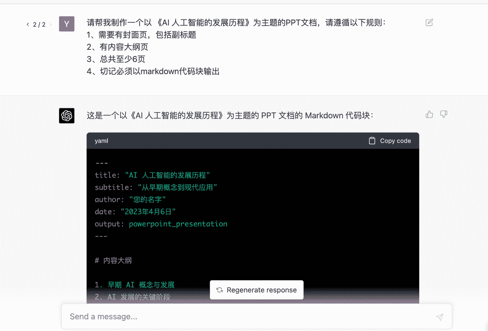
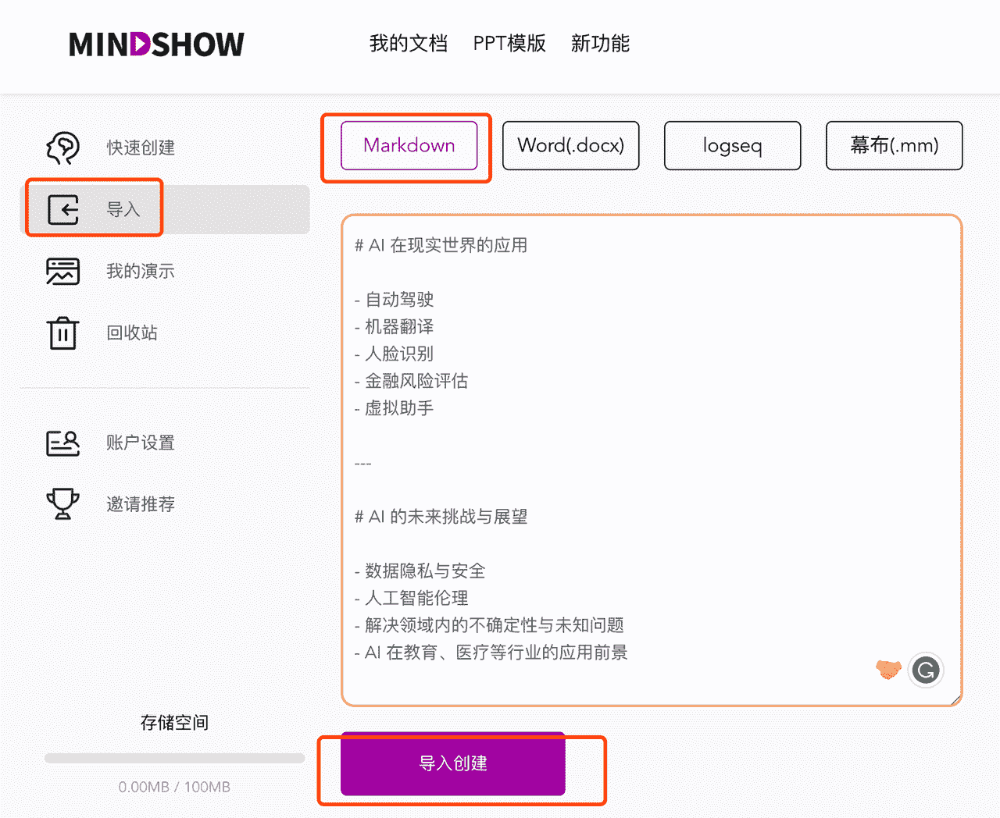
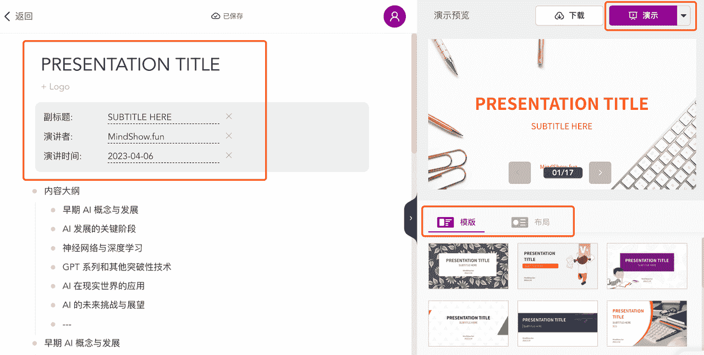

# 如何用ChatGPT做PPT

> 来源：[https://my.feishu.cn/docx/QplwdayizoudSGxeyGTca1ASnJd](https://my.feishu.cn/docx/QplwdayizoudSGxeyGTca1ASnJd)

## 前言

在当今快节奏的工作环境中，时间就是金钱。为了提高效率，人们不断寻找创新的工具和方法。在这篇文章中，我们将探讨如何将两个强大的工具——ChatGPT 与 MindShow 结合使用，以高效地生成 PPT。这些工具分别专注于文字内容生成和视觉呈现，搭配使用将让你的 PPT 制作过程更加轻松、高效。

### 一、ChatGPT 与 MindShow 工具简介

ChatGPT 简介

ChatGPT 是一款基于 OpenAI GPT-3.5/GPT-4 架构的人工智能语言生成模型。它具有强大的自然语言处理能力，能够理解用户输入的信息，并生成具有连贯性、相关性和创造性的文本。在 P[PT 制作中，ChatGPT ](https://chat.openai.com/chat)可以帮助快速生成有针对性的文本内容，节省大量时间。chat.openai.com

MindShow 简介

Min[dShow 是一款出色的](https://www.mindshow.fun/#/login?inviteCode=6540887)视觉呈现工具，专注于创建引人入胜的 PPT。它内置了丰富的模板、图表和设计元素，让用户可以轻松地制作出专业级别的幻灯片。MindShow 的自动排版功能可根据输入内容智能调整布局，使得 PPT制作过程更加便捷。具体地址：mindshow.fun

### 二、ChatGPT 与 MindShow 工具的搭配使用

内容生成

使用 ChatGPT 生成 PPT 的文本内容时，你可以根据主题或关键词输入问题，让其为你提供相关的文本。这样，你可以快速地得到所需的内容，而无需花费大量时间进行查找和整理。

这里介绍几个小技巧，以《AI 人工智能的发展历程》为主题来举例说明：

输入的内容越详细，描述的越清楚，它输出的内容会更加精准

有任何需求都可以写进去

切记最终以** MarkDown 代码块**输出（以便之后用MindShow来自动生成PPT）

视觉设计

将 ChatGPT 生成的文本内容导入 MindShow 后，你可以使用该工具丰富的设计资源对内容进行美化。从模板到图表，再到配色方案，MindShow 提供了一系列可供选择的选项。此外，其自动排版功能将确保你的 PPT 布局精美、专业。

具体操作：

a. 点击 ChatGPT 中的 copy code将输出结果拷贝出来，将顶部的描述内容删除，如下所示：

---

title: "AI 人工智能的发展历程"

subtitle: "从早期概念到现代应用"

author: "您的名字"

date: "2023年4月6日"

output: powerpoint_presentation

---

b. 打开 MindShow 网站，选择"我的文档"，点击导入，选择 Markdown 格式，然后把拷贝的内容复制到下面的输入框中，最后点击"导入创建"。

c. 进入到 PPT 的预览编辑页，自行修改左侧的封面相关内容，然后右侧可点击模版和布局选择具体的样式，其中有免费和 VIP 的。最后可点击右上角的"演示"按钮全屏查看效果，如果觉得OK，直接点击下载，如果有问题，可返回重新选择合适的模版和布局。

通过将这两个工具结合使用，你将大大减少在内容生成和设计方面的时间消耗。此外，这种搭配可以使你的PPT更具吸引力，从而提高观众的关注度和信息接收效果。

## 总结

总之，ChatGPT 与 MindShow 的完美搭配为高效生成PPT提供了一个强大的解决方案。这种组合不仅节省了时间和精力，而且提高了最终成果的质量。在快节奏的工作环境中，掌握这种搭配方法将为你带来竞争优势，让你在商务、教育和各种场合的演讲中脱颖而出。

附录：ChatGPT与MindShow操作指南

1. 使用ChatGPT生成文本内容

a. 访问ChatGPT官方网站并注册/登录。

b. 输入主题或关键词，以引导模型生成相关内容。

c. 根据需要对生成的文本进行修改和调整。

2. 使用MindShow设计PPT

a. 访问MindShow官方网站并注册/登录。

b. 选择一个合适的模板或从空白幻灯片开始。

c. 将ChatGPT生成的文本内容复制粘贴到MindShow中。

d. 使用MindShow的设计元素和功能进行美化和调整。

e. 预览和导出你的PPT。

通过以上指南，你将能够顺利地使用ChatGPT和MindShow来高效地制作PPT。这种搭配方法不仅适用于创建商务报告、教育讲座和产品演示等场景，同时也适用于个人项目和兴趣爱好。让我们一起利用这些先进工具，为更多人带来高质量、引人入胜的演示文稿。