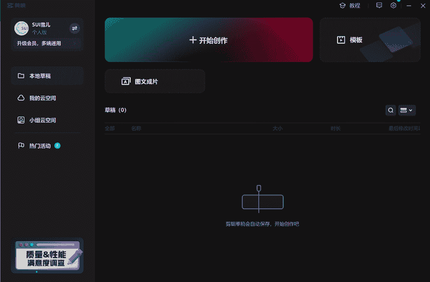
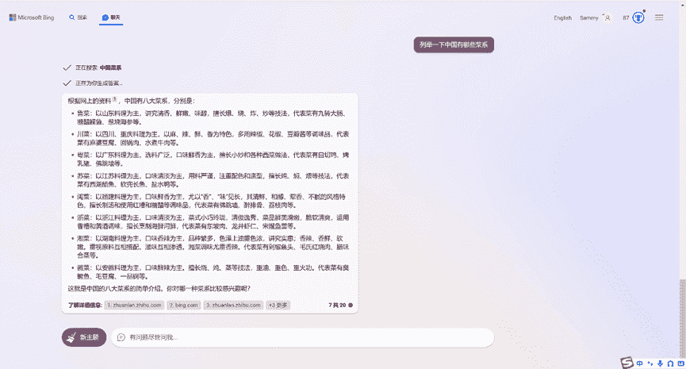
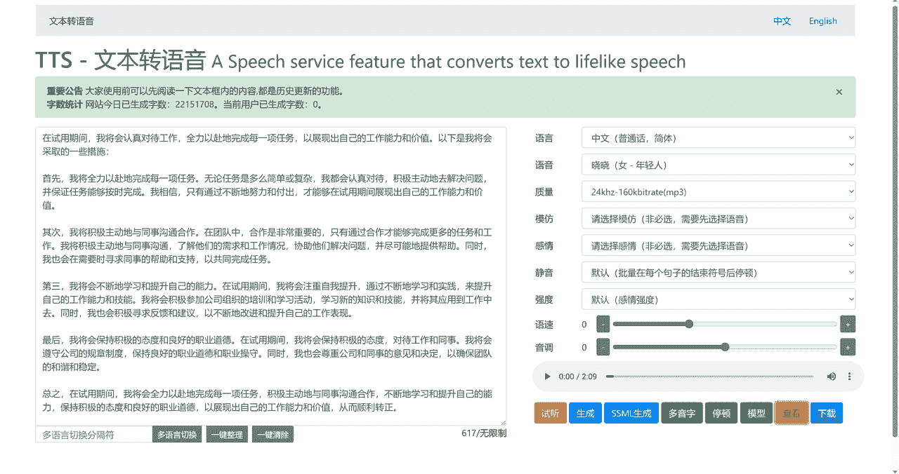
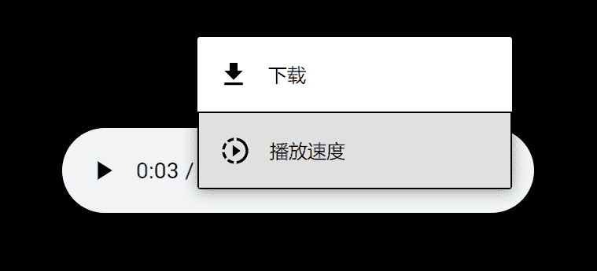
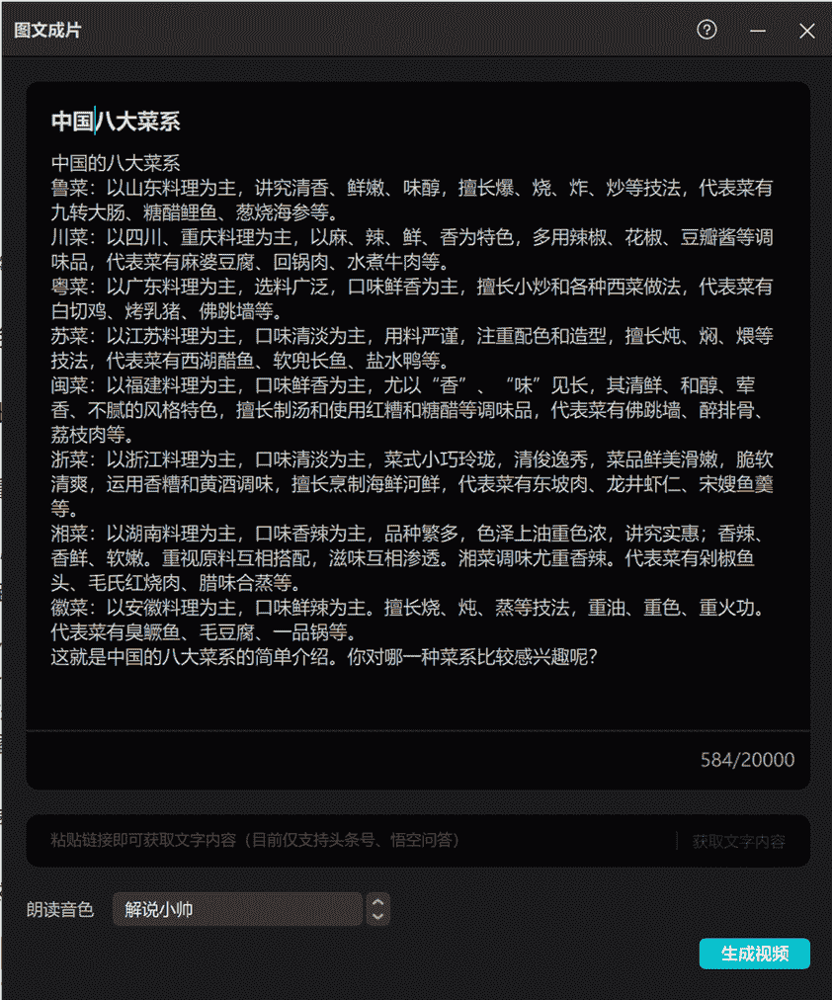
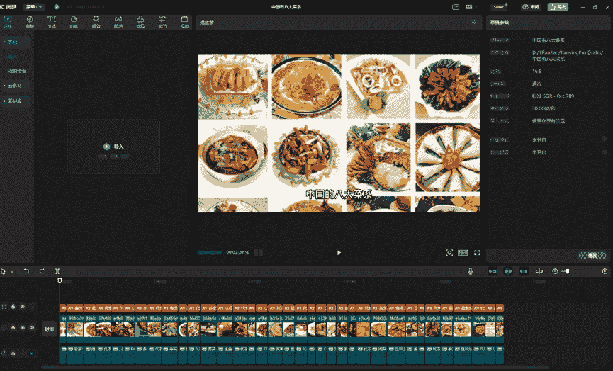
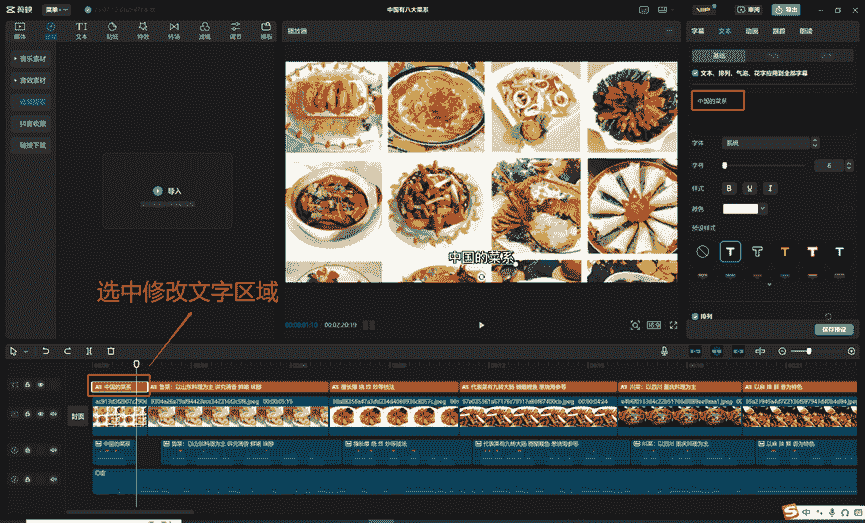
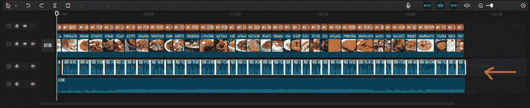
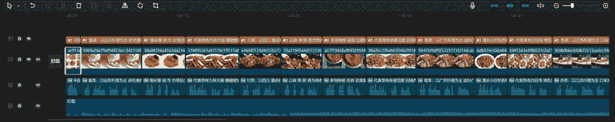
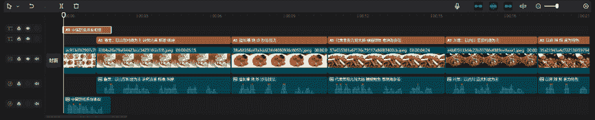

# 如何用ChatGPT做出优雅的视频

> 来源：[https://my.feishu.cn/docx/JZsudg2zUoE4fax1CwEcnVE2ndf](https://my.feishu.cn/docx/JZsudg2zUoE4fax1CwEcnVE2ndf)

欢迎大家来到ChatGPT教学课程，今天我将与你分享一门极具实用性的课程，相信你一定能从中收获满满的知识和经验。在这里，我们将带领你进入一个全新的学习旅程，一起探索新的领域，开启新的智慧之窗。

我们都知道chatgpt只能以文字输出，老玩家这里就说了，是不是忘记AI绘图了，咳咳，除了绘图，那么你想让他生成你需要的视频，他当然不会了，也许未来可以，但现在不行，所以我们就需要借助其他工具来辅助使用了

以下内容堪称史诗级小白教程

剪映下载：https://www.capcut.cn/

平台介绍：剪映是一款由字节跳动推出的视频剪辑应用程序，它简单易用、功能强大，适用于各种场景下的视频编辑。无论你是想制作个人Vlog、短视频搞笑、记录生活趣事，还是制作专业广告宣传视频，剪映都可以满足你的需求。其特点在于提供了一系列优质视频素材及专业剪辑工具，可快速实现各种视觉效果，如添加字幕、特效、滤镜等，使你的视频更具有视觉冲击力和艺术感。同时，它还支持多种视频比例，适用于各种社交平台的发布，如抖音、快手、微博、ins等。

一、 剪映使用图文成片功能

剪映版本在3.6之后出现的新功能：图文成片

意思就是文字+图片组合成视频，下面跟着我一起操作吧

首先要确定一个主题，你是围绕那个方向制作，例如：生活，科技，美食等等

我这里以美食为例子吧

列举一下中国有哪些菜系

这里复制newbing给出的资料，复制到下面

标题地方，是给我们看的，起一个名字

下面第一行要给一个开头，要不然不连贯

其实应该是中国的八大菜系有......这样子看起来更连贯

后面结尾倒是不用修改，很完美

朗读音色就是视频以什么声音播放，这里用到的是文字转语音

可以改成你喜欢的声音，我觉得小帅的不错，挺帅的

如果出来的效果不太好怎么办？

这里我们使用[T](https://www.text-to-speech.cn/)ext To Speech - 在线文本转语音 (text-to-speech.cn)

还是很友好的，输入文字后直接下载即可（相信这里很多小伙伴就搞起来了）

等待生成成功后，如下页面

需要替换语音就可以在这里替换了

可以预览一下页面，看看语句是否通顺，页面是否与文字相匹配

下面就是修改了

先说一下使用快捷键

Ctrl+鼠标上下滚轮，可调节下方视频、文字、音频时间轴

Alt+鼠标上下滚轮，时间轴左右调节

主要用于当页面与文字不匹配，需要修改文字或者图片时

右边是对选择的效果进行参数调整，获得更好的视频效果

修改完文字后，点击下面的保存预设，下面音频会跟着改变，此时注意一个小坑，时间短的话，中间的的空白区域会造成短暂的无声，难道要把后面的音轨一个一个往上拼接吗？

这里一个小技巧缩小后，空白区域鼠标带点住往左边拉，到那个空白区域对齐就ok了

当文字修改过长时，会被挤出轨道，这时怎么办呢？

别慌别慌，先把中间的画面时间拉长和音频时长一样

再把下面的音轨统一后移，然后就可以拉上来了，是不是特别简单

到这里视频基本就完成了，下面选择一个封面，咳，我的比较丑，别学我

然后导出视频，下一步你应该知道怎么办了吧（疯狂发布视频）

当然这只是简单操作，细节地方需要大家调节，加油，等着大家更好的案例（狗头）

成片地址：newbing中国八大菜系_哔哩哔哩_bilibili

二、 使用[VEED -](https://www.veed.io/)

[Edit, Record & Lives](https://www.veed.io/)tream Video - Online来制作

与剪映的图文成片还是有点不一样的

上手有点稍微难

[这里，你可以问](http://veed.io/)一下newbing ，veed.io是什么

这里要问的语句要高级一点了

例如：帮我写一个视频脚本，内容是关于中国的八大菜系的介绍

然后让他把介绍内容补充一下，视频脚本就完成了

主页面选择start for free然后到这个页面，我选择了页面翻译为中文，选择空白画布

然后我们选择media（媒体），选择 text to speech（文本转语音）

输入第一段文字，语言选择中国，下面的声音可以调节add添加到项目即可

然后一段一段的拉上去后拼凑到一起search搜索

这里要求是英文检索，中文搜不出来，dish（菜）选择相关视频放上去，后面操作交给大家来做，最后选择右上角保存导出视频

三、使用国内[一帧秒创](https://aigc.yizhentv.com/index.html)

+   [- AI视频创作，图文转](http://yizhentv.com/)[视](https://aigc.yizhentv.com/index.html)频,智能内容创作平台 (yizhentv.com)

注册完进去之后主页面这个样子，我们选择图文转视频

然后把文章放进来，删除没用的文字，主持人就不需要了，下面的文字整理，下一步

有些地方，会出现文字与视频不符合，需要我们去调整，这里有个智能匹配，可以一键替换素材，第二个是替换素材，可以选用素材库里面的在线素材，后面操作交给大家

讲了这么多，然后说一下这几个平台之间的区别吧

剪映：针对与小白用户更加友好，上手简单，操作容易，素材也有很多，就不多讲了

Veed.io：其实它是有许多的动态视频素材的，搜索相关的词语，不过是要用英文的词语，不好的是免费的太少（白嫖党的最爱），反应有点慢，CPU给我造的直冒烟，哈夸张了，就是有点吃内存

一帧秒创：看起来不错，AI还是有点智障，还是需要在素材库里面找的，每天也是有创作限制的，所以玩玩就行了

谢谢大家耐心观看我的教学课程，相信你们已经收获了许多有用的知识和技巧。在接下来的时间里，我希望你们能够推陈出新，将这些技巧运用到实例或者工作中，创造更多有趣、有价值的内容。

最后，当我们完成作业后，希望你能分享你的成果和心得体会，让我们共同进步，共同成长！