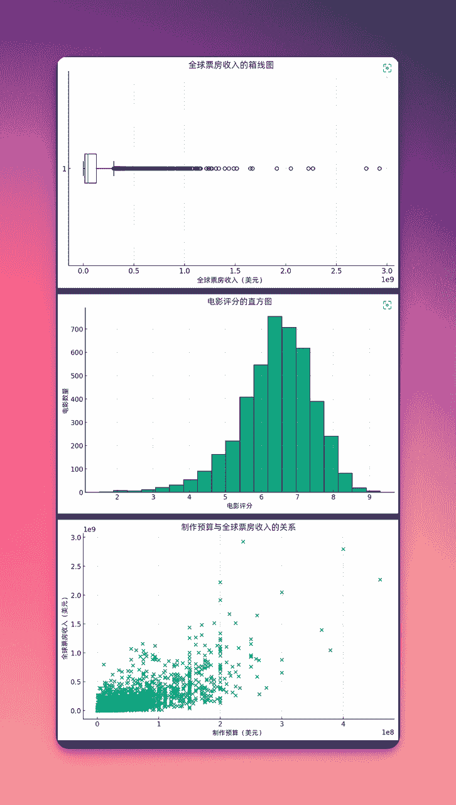
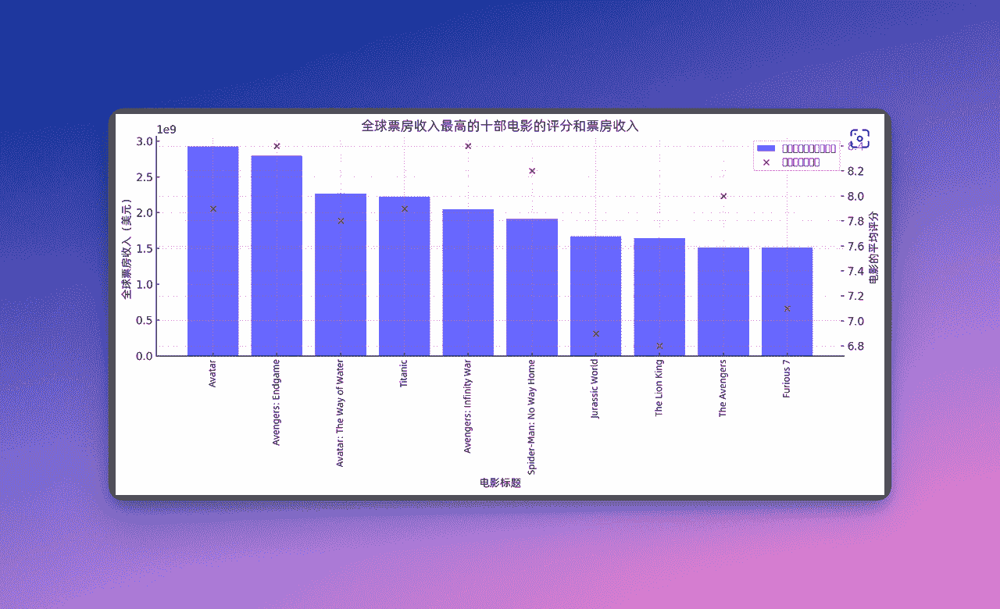
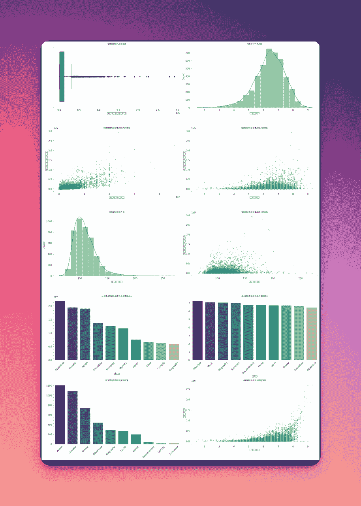
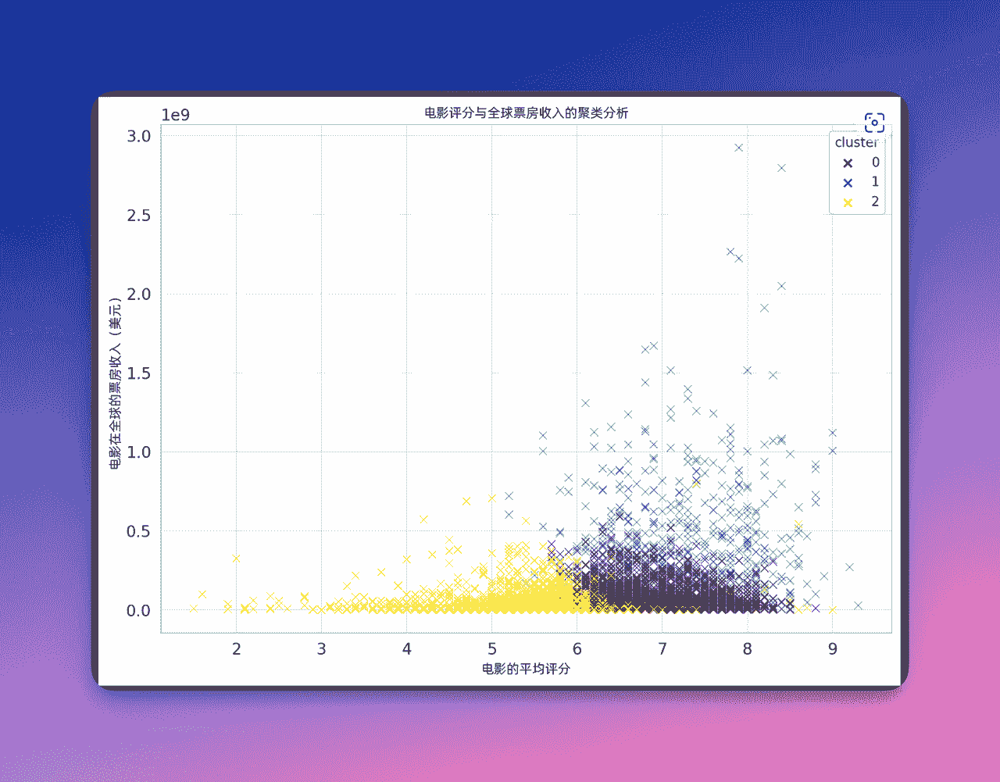
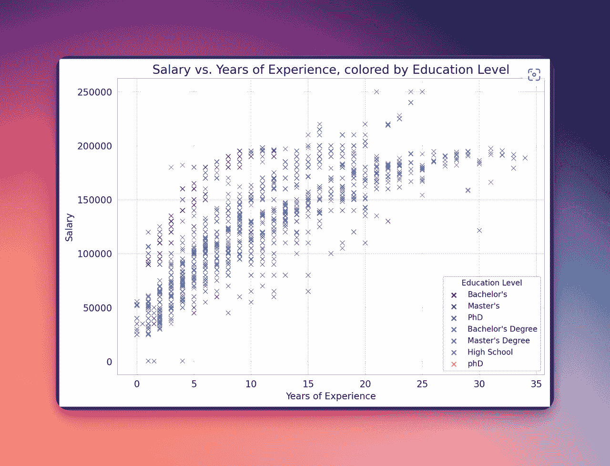
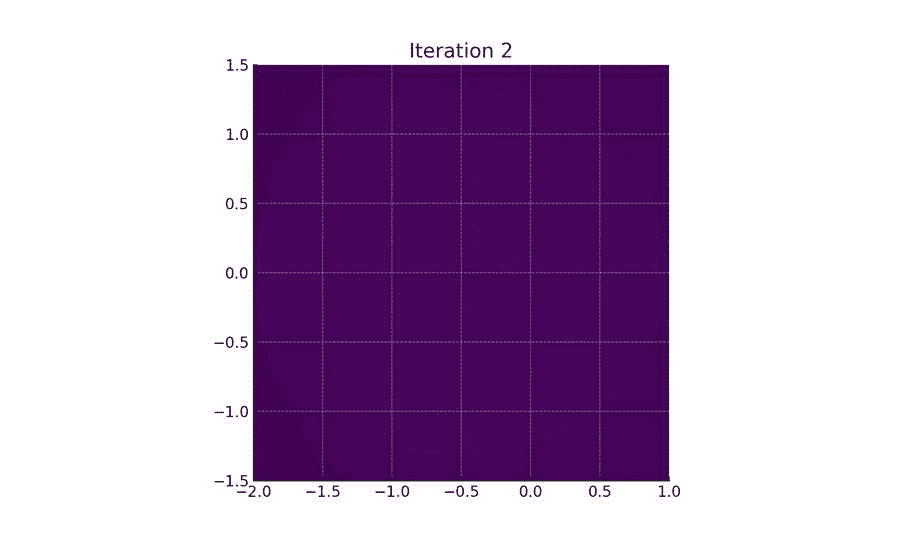
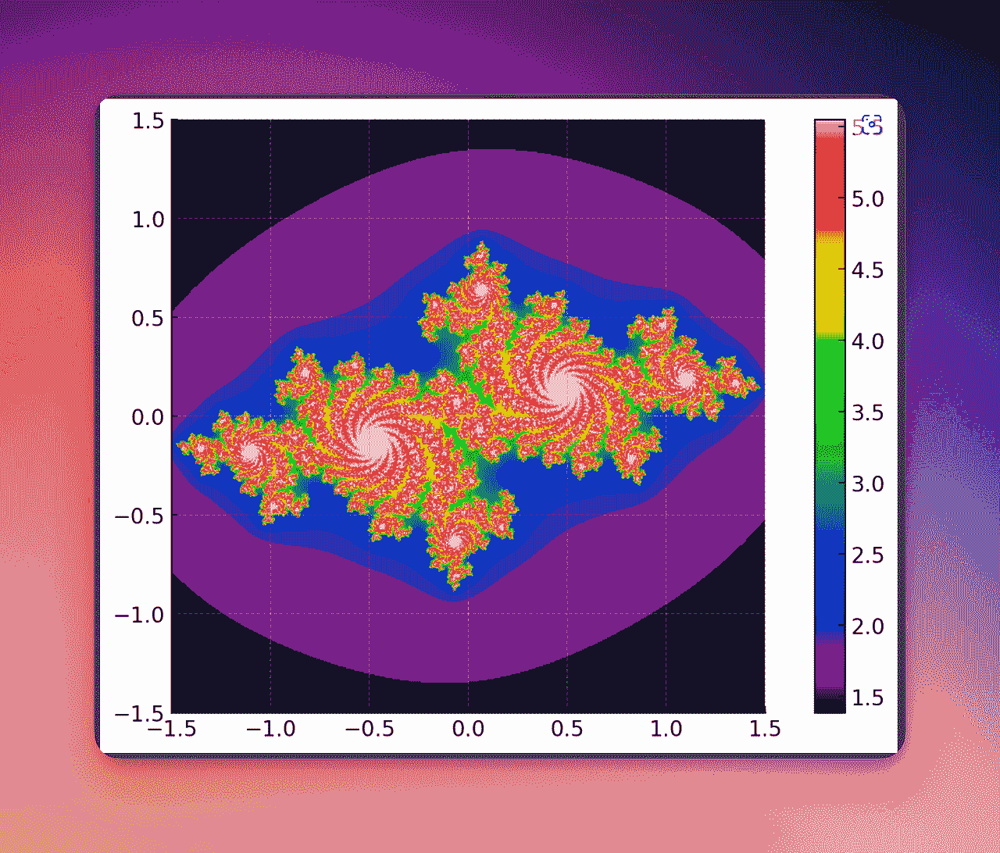

# ChatGPT Code Interpreter 高级指南 - 重创数据分析市场，中文词云，PDF、Excel文件处理，歌曲分析、MTV制作，生成视频、二维码，绘制分形艺术

> 来源：[https://my.feishu.cn/docx/G6yIdQWDforImSxUCZXcCi0Rn2c](https://my.feishu.cn/docx/G6yIdQWDforImSxUCZXcCi0Rn2c)

这两天，我深度地使用了ChatGPT的代码解释器。我没有想到，它会在数据分析中，自己决定采用一个非常复杂的分析方法。

它会分析音乐的情感，画出各种分形艺术，分析文章，生成中文的词云，处理PDF文档。至于生成一个带背景图的二维码，生成一个带字幕的小视频，这类简单任务，那就更是不在话下了。那测试完之后，我脑袋里冒出来的首先的想法就是，如果这不是未来，那什么才是未来呢？

## 想测试Code Interpreter找不到数据集？

数据集最佳下载地址： Kaggle: Your Home for Data Science，这是世界上最大的数据科学社区，拥有强大的工具和资源，可帮助你实现数据科学的目标。

## **中文PDF分析及中文词云**

首先，我们看一下它的中文词云，以及对PDF文档的处理。我们先给它上传一个中文的小说《被讨厌的勇气》，然后让它生成这个文件的词云。结果看起来像是一堆乱码，那我就给它上传一个中文的字体文件。虽然他说他觉得结果不理想，但实际上他已经生成了中文的词云。

但是，目前这个词云的问题，就是他有太多不该出现的词了。比如说各种连接词、语气词，包括“青年”和“哲人”，这两个人本来就是这本书的主角。好，我们让他把这些词删掉。好，我们看到它生成的这个词云，还是有很多不该出现的词。我们呢，给它上传一个中文的停用词的文件，也就是说，是一个包含着所有不需要的词汇的文件。

好，这下呢，它生成的结果，虽然还是有一些多余的词，什么是啊，好吧之类的，但是已经比刚才前两次没有停用词的时候给出的结果好很多了。那么我们看他能不能总结一下这本书的要点，根据词云做出的一些初步推测：“人生”、“活”、“自己”、“问题”，他暗示到这本书涉及到一些关于人生、活、自我认知和解决问题的主题等等。这些基本上是偏差不太远的，因为这本书就是阿德勒心理学的一本书。

好，到这里我们可以看到，他对中文PDF文档的处理是没有问题的。而且你只要给他中文的字体文件，他也能没有任何问题的生成中文的词云。同时，如果你生成词云不仅仅是为了好看，而是为了有用的话，那也就需要给他一定的停止词。停止词列表越全，那么他生成的词云最终的效果也会越好。好，看完了中文的PDF文档，我们接下来看一下英文的PDF文档怎么样。

## **英文PDF词云及PDF转图片**

好，这次我就给他上传了一个英文的PDF文档，就是GPT-4的一个论文，然后让他建立英文文档的PDF文档的词云。这下他自己就知道他要去移除一些常见的英文停用词了。然后生成词云之后，他主动的对这个词云进行了解释。比如他说“GPT-4”这是文件的主要主题，可能是一种技术算法或者工具的名称。“Model”这可能表示文件在讨论一种或多种模型等等。整个的解释很准确的描述了论文当中的主要内容。

然后，因为我在这个GPT-4的论文之前，给他上传过一个英文的PDF，让他去生成词云。但是因为那个PDF文档主要都是些图形，所以他就没有办法去提取当中的所有的文字。我就要求他，你不用提取文字了，你把这个PDF文档给我转成图片，然后压缩成一个压缩包给我。他就很顺利的把这个PDF文档，每一页给转换成了一个文本文件，然后把所有的文件压缩成一个压缩包，打包让我进行下载。这就可以体现出ChatGPT的Code Interpreter，它对基本的PDF处理已经是没有问题的了。

## **生成带字幕的视频以及滑动动画**

好，看完了PDF文档的处理，咱们接下来看一个轻松一点的。首先，生成一个带字幕的小视频。我们可以看这个小视频，我把它拿到中间来，一个缩放的小视频，然后下面它有它自己生成的字幕。还有这种，大家可能看到过的一些用code interpreter生成的视频，就是把一个图片循环的滑动。让code interpreter去做这种类似的视频很简单的，一个python的初学者都能很快的自己写代码来搞定。这个我们就不去详细的讲解它，我给大家简单说一下小视频的生成过程就可以了。

这个视频实际上是首先你用MidJourney，它的无穷的缩放的功能，做出一系列的图片。比如说我这边做了8个图片，然后就把这些图片直接丢给code interpreter。同时你给他简单说一下这些图片大概的内容是什么，然后就让他去根据这些图片去生成一个视频，然后让他根据你告诉他的内容来给他配上字幕。其中的结果就是这样，他生成了一个不断循环播放的，看起来还挺好玩。

好，还是同样，类似于这种图形和视频的处理很简单。那接下来我们来看一个也很简单，但是相对来说有一定的实用性的功能，也就是可以让他生成一个二维码，尤其是可以让他生成一个在图片背景的二维码，看起来稍微的炫酷一点。好，我们来看一下。

## **带图片背景的二维码生成**

首先，我让他把我的网址AIGC369.COM生成二维码，并且显示出来。他上来就说他没有办法访问互联网来生成二维码，然后他说我可以给你提供一个python代码，然后就把代码给我了。那明显就是因为我给他的提示说的没说清楚，让他误解我的提示了。他肯定是认为，我想把我的网站上的内容给生成二维码。所以我就给他澄清一下。

那这下就没有问题了，他首先就生成了一个非常标准的二维码，当然也没有什么美感。那为了让这个二维码好看点，我就给他上传一个图片，然后我就告诉他，我给你上传了一个图片，请你把这个图片作为二维码的背景。没问题，它就生成了一个带背景的二维码。那这样看起来就好看一些，只不过图片看起来不是很清楚。然后我就让他，你能不能把图片显示的更明显一些呢？但是你要依然要保证，这个二维码是能够被扫出来的。

好，接下来他就把这个二维码给更新了一下，然后说他把这个白色的二维码背景，把这个白色的二维码给它替换成了一个淡蓝色，来增加整个二维码的一个可见性，图片的可见性，看起来稍微好一些。好，还是一样，生成二维码，这个也是很简单的一个事情，这个没什么大不了的，很多工具都能干。

## **电影数据文件分析**

在这个电影数据的分析过程中，最后他给出了一个让我非常惊讶的分析方法。我们先不着急，慢慢的看到最后。

首先，我们来简介一下电影的数据文件。这个文件内容有多少列多少条记录，每列的名称以及它的中文意思。结果显示这个数据集包含了4380条记录，一共有14列。每一列的名称和中文意思如下：电影标题、制作日期、电影类型、时长、导演名称、导演职业、导演的出生年份、电影的评分、人数赞同指数、制作预算和票房收入。

接下来，我们把列名改成中文。因为这个数据文件的列名都是英文，我们看起来方便一些，接着进行改成中文。同时，为了让他后续更好地去做各种分析图表，我将中文字体文件也一并传给他。从前面然后知道了，如果你不给他中文字体文件，因为他没有内置的中文字体，他给你的图形是没有办法去显示中文的。好，我提供了中文字体文件，然后让他把列名都更改为中文。同时，让他根据这些数据，去进行一下这个电影的票房分析，看看他能给我们给出什么样的分析结果。

他直接给我们给出了三种不同的图表分析，来分析电影的票房收入。这就包括全球票房收入的线图、电影评分的直方图，以及制作预算和全球票房收入的关系。这三个图形都非常漂亮。我继续让他用一个图形来展示Top10电影的评级、票房收入、导演以及它的电影类型。然后让他告诉我，你是根据什么条件来确定Top10的。

这里实际上就体现出了ChatGPT的Code Interpreter和直接用Python来写代码，然后去运行代码的一个区别。就是ChatGPT，他本身他是具有自主意识自主能力的。如果你没有给他一个很明确的指令，比如说我让他去分析Top10，我没有告诉他你一定要去按照票房收入，来给我分析Top10的话，他自己可以自己来决定他用什么方式来给你一个Top10的名单，而且还给出一些很合理的理由。这就是他比较强的地方。

我们看一下他给出了一个Top10列表，在图表当中。蓝色的柱状图表示了每部电影的全球票房收入，红色的点代表了每部电影的平均评分。他是怎么挑这Top10的呢？他实际上就是按照票房收入来挑的Top10，然后还给出了一个简单的总结，有很多都是动作片，然后卡梅隆的电影在这个电影当中占了三部。

那我就问他，导演对电影的评级和票房哪一项影响更大呢？ChatGPT根据相关性的计算，结果就是，导演他和平均电影评分，以及平均全球票房收入的相关性系数是0.207，说明这个相关性不强，也就是导演是谁，他对电影的评分和票房收入影响不显著。这有点出乎意料，我一直觉得导演应该对这些影响挺显著的，但是ChatGPT给出的结果不是这样。

那么我询问，根据这些数据你能够分析出对票房影响最重要的因素吗？他依然采用了相关性系数的计算方式，然后对所有的因素进行了总结计算。这些因素就是电影时长、平均评分人数、赞同指数、制作预算。最后给出的结果是，电影在国内的票房收入，跟全球票房收入的相关性最大。其次是电影的制作预算和电影的评分人数。这基本上说明，拍电影花的钱越多，它最后的票房收入也就越高，这还是有很强的正相关性的。

接着我问他，你能创建出10个图形来展示不同的数据吗？最后请你对每个图形给出一个简短的解释。实际上我在测试当中的这些问题，都应该属于是开放式的问题。我并没有要求他，你根据票房收入给我画一个折线图，这种应该是非常简单就能做到的事情。开放式的问题，实际上就是不但体现了code interpreter它编程的能力，还体现了ChatGPT本身的理解和推理能力。所以说Code Interpreter，虽然它本质上就是一个Python的解释器，然后ChatGPT它会编码，但是结合起来你这么一想，这就相当于一个很厉害的AI，也就是ChatGPT它手上有了一个非常趁手的工具，这就比较厉害了。

也许Code Interpreter它不能完全的取代数据分析师，但是它会极大的抬高进入数据分析师的门槛。

他给出了10个漂亮的图形，然后这些图形是，都是什么图形呢？全球票房收入的线图、电影评分的直方图、制作预算和全球票房收入的关系、电影评分与全球票房收入的关系等等等等。图形很漂亮，中文列名没有显示出来，那这可能是他忘记了我曾经给过他一个中文字体文件了，提醒他一下就好。提醒他之后重新又绘制了一把，但是X轴和Y轴的中文没有出来，这个我们暂时先不管它了，因为这个不是什么大的问题，它能够显示中文这个已经是验证过的，所以然后先放过这个问题。

接下来，我再给他一个最开放的一个问题了，你能根据这些数据做出一个你认为最复杂和最有趣的分析吗？请用图表来表示，并且给出简短的解释。这一步我确实完全没有想到，他居然做了一个聚类分析。他用K-Means的一个聚类算法，把电影给分成了三类，根据电影的多个特性来分成了三类。聚类算法它本身就是机器学习当中一个非常常用的一个算法，但是让code interpreter去画一些折线图、直方图、甚至是散点图、热力图等等，这些可能都是一些低级水平的一些工作，也就相当于是一个低级别的数据分析员。但是到聚类分析这个层次，他就可以算得上是一个中级的数据分析员了。而且关键是，这不是我要求他这么干的，是他自己去想到要做这么一个分析的。

结果是，X轴和Y轴还是没有办法显示中文。我将这个问题提给了他，就说你的X轴和Y轴无法显示中文啊。只要你告诉他他的问题在哪，他很快就自己进行了一个修正，修正后的结果就显示的非常正常了。所以说，Code Interpreter做数据分析，确实还是一把好手。接着我们接下来看一下，它能不能处理Excel文件呢？同样我提供了提供一个Excel的数据文件，因为这些文件都是大家比较常用的，因为我也不知道他能不能处理Excel文件，我就先问他，你能处理Excel文件吗？他表示可以，然后我上传了一个Excel文件。

## **Excel文件分析**

这个文件是薪水的一个数据文件，数据集。那我们就不用演示太多的功能了，我们就让他直接根据这个数据文件，来生成一个最有意义的图形，并且进行简短解释。那他生成的结果是什么呢？就是员工的工资和工作经验之间的关系，并且的颜色显示了教育程度的差异。X轴表示工作经验的年数，Y轴表示工资，每个点代表一个员工，颜色表示他的教育程度。最后的结果呢，基本上跟我们大家的认知是一样的，工资随着工作经验的增长而增长，不同教育程度之间的工资差距相当明显，尤其是在高工作经验年数的员工当中，拥有更高教育程度的员工，往往有更高的工资。基本上从数据分析当中，我们就可以看到code interpreter对常用的数据文件CSV、Excel，做一些我们日常所需要的一些数据分析，应该是不在话下了。这会极大的提高大部分人的工作效率。

## **奥德布洛特集合绘制**

看完了枯燥的数据分析之后，我们再来看一点轻松的，调剂一下心情。我们让他去绘制一些漂亮的图形。首先我们问他，你能不能绘制一个奥德布罗特集合，然后并且以合适的格式展现出来呢？你可以选择图片、GIF或者MP4的视频。他表示他可以画一个静态图片，但是GIF和MP4可能没有办法去展示。所以呢，如果你需要GIF或者MP4的视频，他可以生成文件然后让我下载。

他首先生成了一个静态图片，这个图片你看起来没什么大不了的，而且可以说得上很难看。那是因为它的分辨率和迭代次数很低。那我就让它给我一个更高分辨率和更多迭代次数的MP4文件吧。第一次尝试呢，它失败了，因为这个时间太长，肯定是计算量太大，所以它要降低分辨率和迭代次数，然后在允许的时间范围内完成。这下就给我生成了一个简单的奥德布洛特集合的图形。

[mandelbrot_reduced.mp4](https://internal-api-drive-stream.feishu.cn/space/api/box/stream/download/all/M7H7bFkdroplQGxwQ2Dcsj7Intd)

## **分形艺术 - Julia集**

那接下来呢，我也不指定让他生成什么图形了，让他自己来决定，生成一个分形艺术吧。那我就让他，你能自己创造出一个具有同样美感的艺术吗？他说当然可以，我给你创建一个Julia集的分形。直接创建出了一个Julia集的分形效果，看起来是不是也很不错呀？

## **歌曲频谱以及感情分析**

首先我给他上传一个歌曲的mp3文件，让他进行分析。为了防止他从歌曲的文件名获得歌曲的信息，我们就把这个文件名改成一个毫无意义的文件名，比如说就给他改成“我不告诉你”。OK，不要逗他了，我们就改成1就OK了，1.mp3。

上传文件，我告诉他这是一首歌曲的MP3文件，请你绘制出频谱图，然后你尽可能的去理解这首歌曲，告诉我这首歌曲的感情，它是关于什么的，以及你觉得它好听吗？首先他说他可以创建频谱图，但是作为人工智能，他不能干这个不能干那个。

OK，我们先看看他的频谱图，频谱图没有问题，然后他继续表示他在分析情感方面能力比较弱，然后呢，好不好听，他作为一个人工智能呢，他也没办法评价。那这时候呢，我们就稍微鼓励他一下吧，然后让他，你不用管我怎么想，你做出你自己的一个评估就OK。好，我就告诉他，根据你所具有的能力，对歌曲进行你所能做到的分析，包括根据音乐特性所能推断出的情感，以及作为一个人工智能的角度，对歌曲的好听与否，做出自己的评估，不用考虑准确性。

他就对歌曲从节拍、它的频谱对比度以及什么频谱滞星，这些方面还有频谱的降落、零交叉率等等，我都没有听说过的一些术语进行了分析。基于这些特性，他推断出这首歌有一种中等的节奏和较大的能量水平，可能是一种积极或者快乐的情绪。当然他说这只是一种推测了。至于好不好听，他认为这首歌没有特别突出，没有特别好，也没有特别差，一般般。然后还不忘给自己留条后路，说他的评估只是基于统计分析，然后每个人有每个人的爱好。那这首歌到底是什么样的，到底好不好听呢，我们大家最后听一听MTV。

## MTV生成，根据音乐+自己生成图片

到底好不好听呢，我们大家可以来一起来听一听。

[music_video_21_sec.mp4](https://internal-api-drive-stream.feishu.cn/space/api/box/stream/download/all/Bp9cb6S5Vomy3rxTb3ccCBP4nkh)

如果code interpreter的运行环境没有受到诸多的限制，那么我相信code interpreter它可以生成更加酷炫的效果。虽然ChatGPT的code interpreter它不会像有些人说的那么夸张，一下子可以抹去几百亿的数据分析的市场，但是就像我之前说的，code interpreter的出现，它极大的提高了数据分析师的门槛。所以未来你只需要掌握一种技能，那就是驾驭AI的能力。如果你想从现在开始，就请加入到我的AI和自动化课程当中，链接在描述