# 📕 AI 研报资料库

> 来源：[https://my.feishu.cn/docx/CBscdy546oXlRex48gpc5u64njd](https://my.feishu.cn/docx/CBscdy546oXlRex48gpc5u64njd)

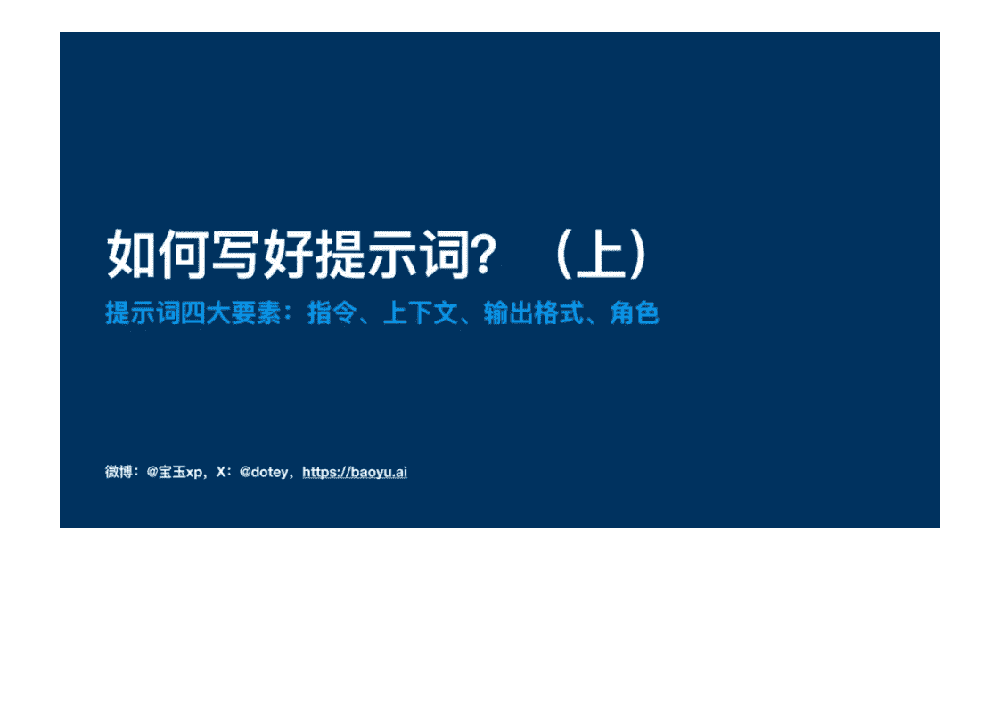

[深度理解提示词：人人能学会，无需硬背.pdf](https://internal-api-drive-stream.feishu.cn/space/api/box/stream/download/all/HqDBbwqbmoKKQWxFEP0c8mv3nye)

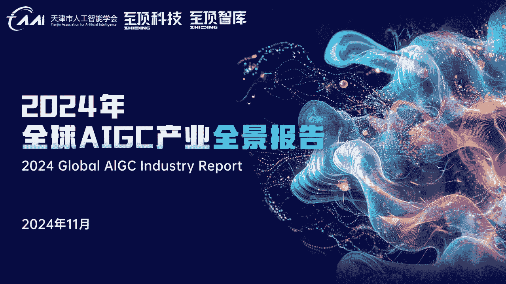

[2024 年全球 AIGC 产业全景报告.pdf](https://internal-api-drive-stream.feishu.cn/space/api/box/stream/download/all/I2sebMs6HoXGcpx4PN0cZT2tnsg)

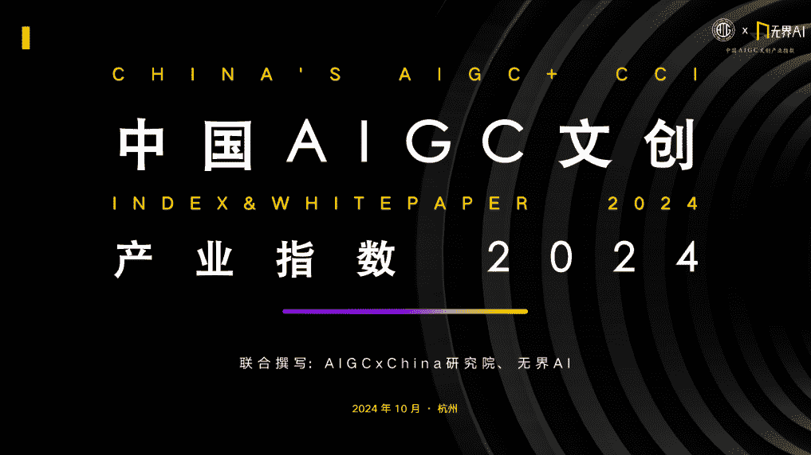

[中国AIGC文创产业指数（2024）-无界AI-41页.pdf](https://internal-api-drive-stream.feishu.cn/space/api/box/stream/download/all/FmUEb7TXgobq5IxBiV6cRvi1nfb)

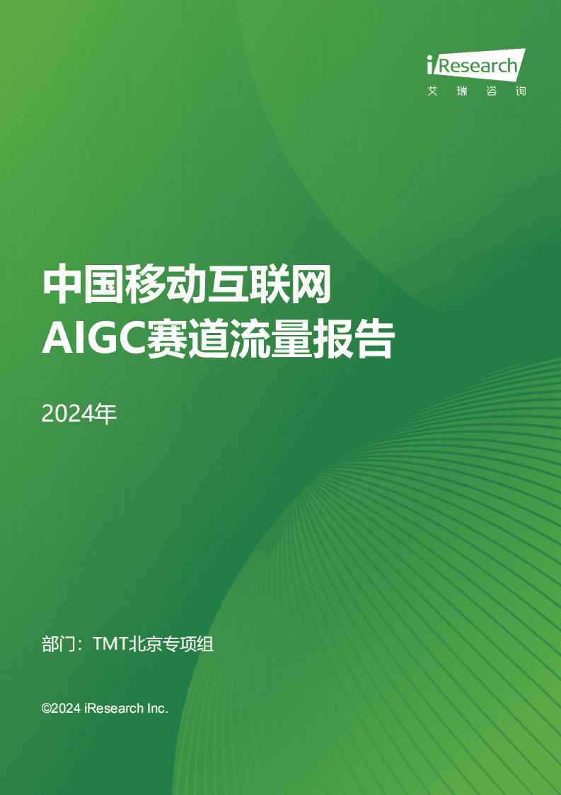

[艾瑞咨询：2024年中国移动互联网AIGC赛道流量报告.pdf](https://internal-api-drive-stream.feishu.cn/space/api/box/stream/download/all/RmxibQzjioNh9Ixjrdtc2VOtndb)

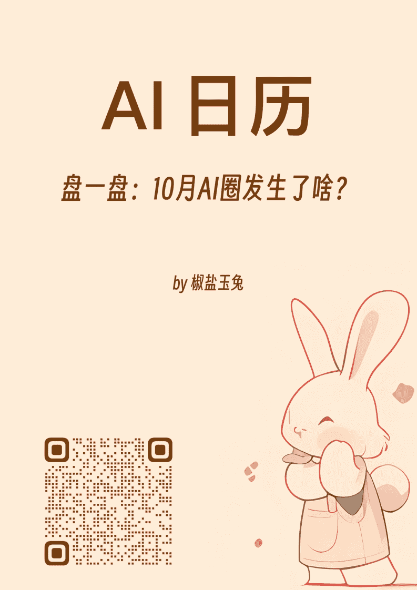

[月度盘点_202410_AI行业_椒盐玉兔.pdf](https://internal-api-drive-stream.feishu.cn/space/api/box/stream/download/all/PPRXbrgT7oaDWVxlfedcUwkJnhg)

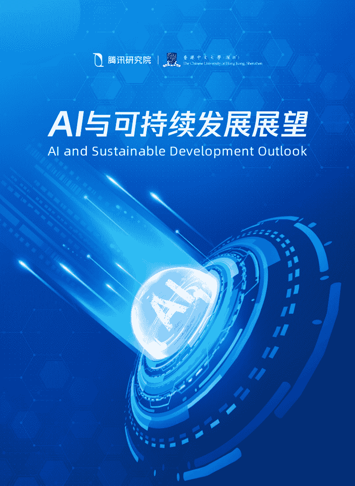

[2024年AI与可持续发展展望（中文版）-腾讯研究院-85页.pdf](https://internal-api-drive-stream.feishu.cn/space/api/box/stream/download/all/BIV3b6ZjyovMR0xOGcMcTyQen0f)

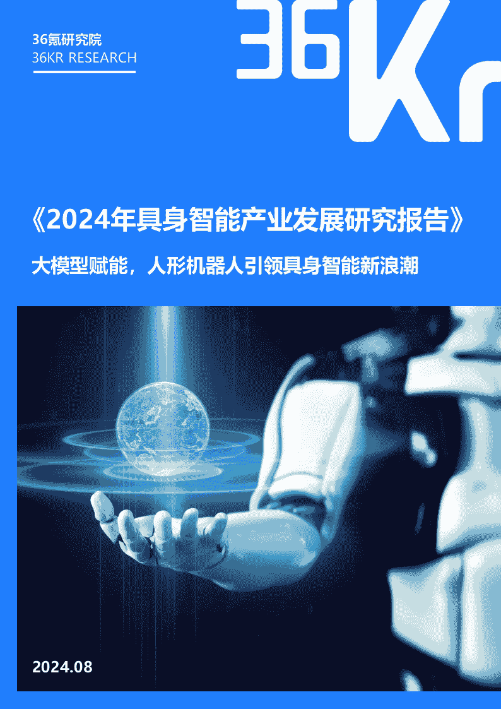

[2024年具身智能产业发展研究报告：大模型赋能，人形机器人引领具身智能新浪潮-36Kr-55页.pdf](https://internal-api-drive-stream.feishu.cn/space/api/box/stream/download/all/OMxdbMqcXoliWLxTBuLcOT7Nnhc)

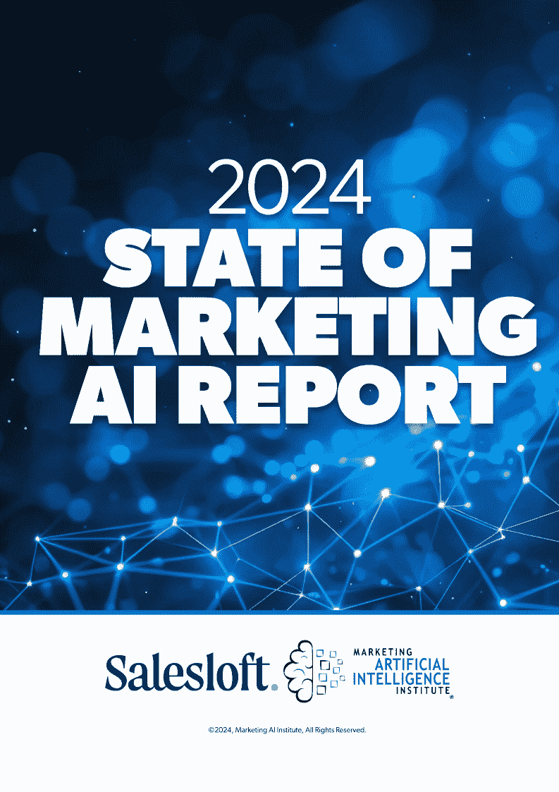

[2024年营销AI报告（中英双语）-Salesloft-35页.pdf](https://internal-api-drive-stream.feishu.cn/space/api/box/stream/download/all/LO8AbmDolov9E5xsmKqcErw0n0f)

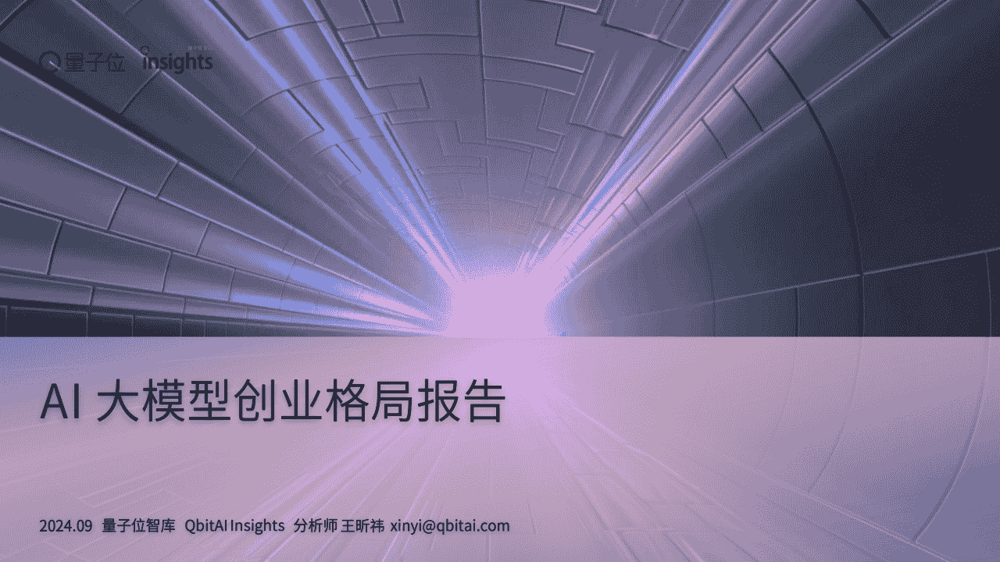

[AI大模型创业格局报告【量子位智库】.pdf](https://internal-api-drive-stream.feishu.cn/space/api/box/stream/download/all/OiQNbzBP4oCZgSxae75cFz3qnof)

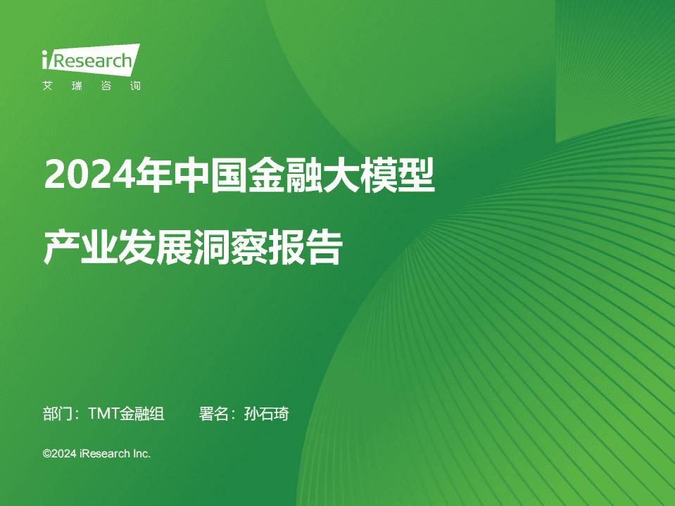

[2024年中国金融大模型产业发展洞察报告-艾瑞-34页.pdf](https://internal-api-drive-stream.feishu.cn/space/api/box/stream/download/all/W2NVb75nEoqAD0xeGwTc5iLfnTb)

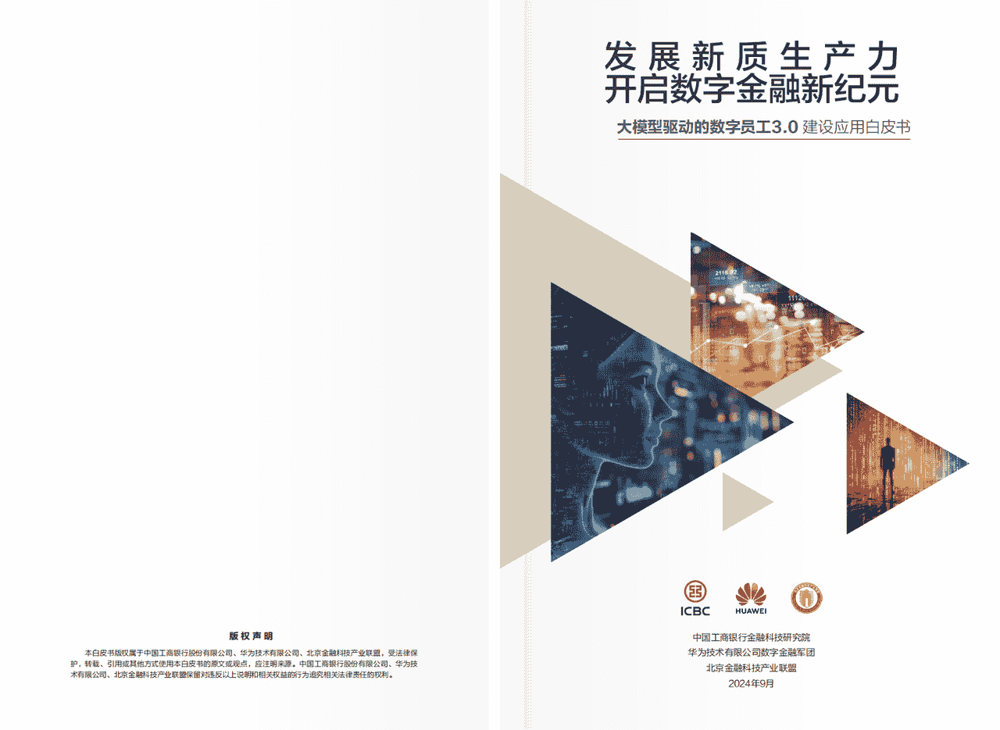

[2024大模型驱动的数字员工3.0建设应用白皮书：发展新质生产力开启数字金融新纪元-工商银行&华为&北京金融科技产业联盟-51页.pdf](https://internal-api-drive-stream.feishu.cn/space/api/box/stream/download/all/BfTRbLRIVohSRAxQ5g8ctVKun4K)

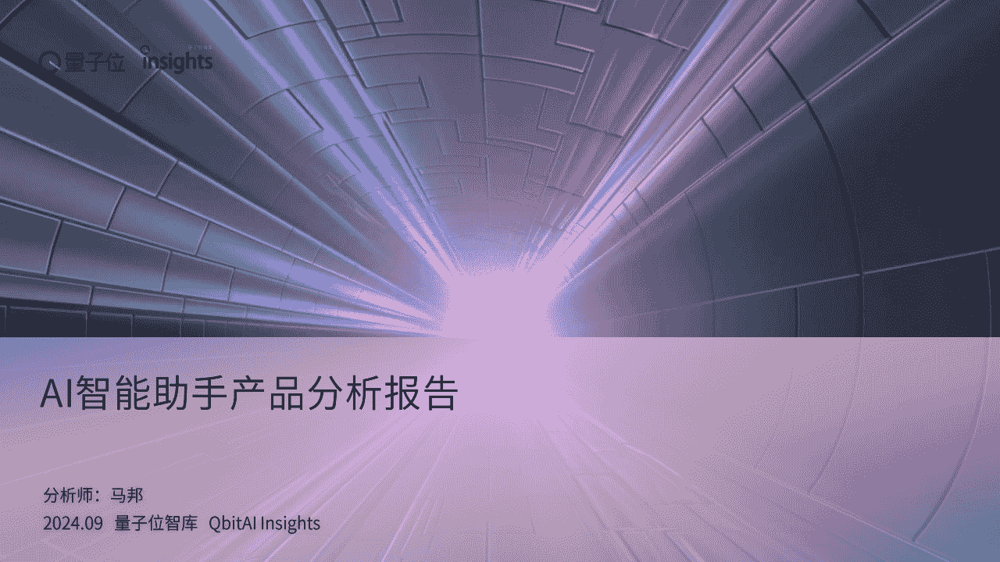

[AI智能助手产品分析报告【量子位智库】.pdf](https://internal-api-drive-stream.feishu.cn/space/api/box/stream/download/all/IvWxbgdkqoDEYCxTVDcccf9bn7g)

[GIO白皮书：AI使能工业创新（2024）-73页.pdf](https://internal-api-drive-stream.feishu.cn/space/api/box/stream/download/all/Z2ylbjxRWolqF2xrdJucQPlwnhc)

[面向教师的人工智能能力框架（中英双语）-UNESCO-52页.pdf](https://internal-api-drive-stream.feishu.cn/space/api/box/stream/download/all/HkPhbZpkcov2RMxqwoacIVQLnhe)

[2024年中国移动互联网AIGC赛道流量报告.pdf](https://internal-api-drive-stream.feishu.cn/space/api/box/stream/download/all/GAVtboMe5oC7MaxwDimcTrwjnzg)

[AI大模型系列报告二：OpenAI发布GPT-O1，模型能力持续提升-国信证券-20241011.pdf](https://internal-api-drive-stream.feishu.cn/space/api/box/stream/download/all/K1GybRQXkodvLsxXYK1c0XIRnXb)

[腾讯研究院AIGC发展趋势报告2023.pdf](https://internal-api-drive-stream.feishu.cn/space/api/box/stream/download/all/NnF4btQsUoFGvlx2xAxcV7t1nhd)

[吴恩达联合OpenAI制作《面向开发者的ChatGPT提示工程》笔记.pdf](https://internal-api-drive-stream.feishu.cn/space/api/box/stream/download/all/D7dzbYeYPosvYfxp6DScITdnnGh)

[陆奇《新范式 新时代 新机会》北京场.pdf](https://internal-api-drive-stream.feishu.cn/space/api/box/stream/download/all/DrTxbmIoVoVZJFxmWedcmqVxnIf)

[中国AIGC产业全景报告——量子位智库 .pdf](https://internal-api-drive-stream.feishu.cn/space/api/box/stream/download/all/HUKNbl4FaojQjkxvltWcOPUOnlh)

[2024大模型人才报告-脉脉-33页.pdf](https://internal-api-drive-stream.feishu.cn/space/api/box/stream/download/all/APonbrJvLo6Ol4xPQwgclpHNnVc)

[中国AI Agent应用研究报告2024-InfoQ-49页.pdf](https://internal-api-drive-stream.feishu.cn/space/api/box/stream/download/all/U1ZYbUjU2oLDzPxq2ddcoi1tnzd)

[中文大模型基准测评2024年8月报告..pdf](https://internal-api-drive-stream.feishu.cn/space/api/box/stream/download/all/WWB0bnYgBoMNu7xSgNgcWJI0nXe)

[阿里发布AI职业趋势报告.pdf](https://internal-api-drive-stream.feishu.cn/space/api/box/stream/download/all/GTbAbs7DpoGkHux5WbUciJI9nag)

[微软&领英：2024年工作趋势指数年度报告：工作中的AI，挑战与机遇并存-42页.pdf](https://internal-api-drive-stream.feishu.cn/space/api/box/stream/download/all/SCpHbq8cyoWN7Nxjtqqc60R6nnd)

[2024年AI应用市场洞察-Sensor Tower-32页.pdf](https://internal-api-drive-stream.feishu.cn/space/api/box/stream/download/all/VS3xbknIMoJwn2xjsmycRfWOnjd)

[人工智能行业：2024年智能PPT行业市场研究报告-月狐数据-26页.pdf](https://internal-api-drive-stream.feishu.cn/space/api/box/stream/download/all/SR9GbeEURofMzdxocQkcTNOen1c)

[2024AI智慧生活白皮书：AI智能科技重塑居家体验 -阿里妈妈&天猫-34页.pdf](https://internal-api-drive-stream.feishu.cn/space/api/box/stream/download/all/HGV8blg8ioOJFwxPcCzcbhdVnhb)

[2024年AI+生成式营销产业研究蓝皮书-复旦管院&明略&秒针营销科学院-99页.pdf](https://internal-api-drive-stream.feishu.cn/space/api/box/stream/download/all/MRmYbIIPDo2pY4xUXIBcp5gtnde)

[中国游戏产业AIGC发展前景报告-伽马数据-46页.pdf](https://internal-api-drive-stream.feishu.cn/space/api/box/stream/download/all/VCeZbtp7doYwxix9DwvctWI6nU6)

[2024生成式AI时代的工作模式、工作组织、工作者-埃森哲-48页.pdf](https://internal-api-drive-stream.feishu.cn/space/api/box/stream/download/all/ZIv7bK44Aodj0sxhJCKchzUGn6f)

[2024人工智能大数据创新应用案例集-数字产业创新研究中心-68页.pdf](https://internal-api-drive-stream.feishu.cn/space/api/box/stream/download/all/VNZTbbqwEoXz74x8amXcWolYnGW)

[中国游戏产业AIGC发展前景报告-伽马数据-46页.pdf](https://internal-api-drive-stream.feishu.cn/space/api/box/stream/download/all/PIQ3bg8egoLVw6xI4xYcafsvn2d)

[智谱AI：2024开启AI智能化新纪元白皮书-48页.pdf](https://internal-api-drive-stream.feishu.cn/space/api/box/stream/download/all/Nv0Gb6JbGoyQITxg4qEcoQCynC8)

[高通：2024高通AI白皮书-让AI触手可及-78页.pdf](https://internal-api-drive-stream.feishu.cn/space/api/box/stream/download/all/IMkMb12SyojYO5xXbAicQS5Mnpc)

[量子位：AI视频生成研究报告（2024年）-46页.pdf](https://internal-api-drive-stream.feishu.cn/space/api/box/stream/download/all/K5OKbEQvKoeij4x5gyJcRotKnDg)

[量子位：AI音乐应用产业报告（2024年）-24页.pdf](https://internal-api-drive-stream.feishu.cn/space/api/box/stream/download/all/Jsf8b4QoMoq619xkoK1cbsJanAe)

[2024国产AI大模型应用报告-点点数据-20页.pdf](https://internal-api-drive-stream.feishu.cn/space/api/box/stream/download/all/Q6LibZj5vooANKxienCcrKMZntb)

[AI大模型对我国劳动力市场潜在影响研究报告（2024）-北大国发院&智联招聘-20页.pdf](https://internal-api-drive-stream.feishu.cn/space/api/box/stream/download/all/YUf2bFhzyo6ksjxkuB1c1TU9npb)

[AI加速游戏：安全治理生态-网易-30页.pdf](https://internal-api-drive-stream.feishu.cn/space/api/box/stream/download/all/IKDPbOYzYorxd9xIG70c8Jstngb)

[2024全球人工智能发展研究报告-44页.pdf](https://internal-api-drive-stream.feishu.cn/space/api/box/stream/download/all/SlXIbtQXEo0TVvxcqYQclDS3neb)

# 文心一言

[华泰证券：文心一言：技术与能力拆解.pdf](https://internal-api-drive-stream.feishu.cn/space/api/box/stream/download/all/V9c9b5🐧aoAieCxiVGoc1LyinHf)

[华西证券：百度文心一言畅想.pdf](https://internal-api-drive-stream.feishu.cn/space/api/box/stream/download/all/QGG7bLq0zoHxXCx2HfocIZagnkf)

[首创证券：文心一言接入生态伙伴，AIGC关注度持续.pdf](https://internal-api-drive-stream.feishu.cn/space/api/box/stream/download/all/R8JxbELvmoGYtZxrnAecqFwxnlc)

[开源证券：百度文心一言展望.pdf](https://internal-api-drive-stream.feishu.cn/space/api/box/stream/download/all/QsLZb3l7CoVz0rxcItTcZFtfnRJ)

[文心一言测试指引 .pdf](https://internal-api-drive-stream.feishu.cn/space/api/box/stream/download/all/GdKWbugjWoLkiYxwmd2cev2RnBe)

[ChatGPT系列—百度文心一言解读20230315.pdf](https://internal-api-drive-stream.feishu.cn/space/api/box/stream/download/all/OUgAbqUFlos2kWxMPxocbG9snve)

# GPT-4 相关

[GPT-4 技术报告.pdf](https://internal-api-drive-stream.feishu.cn/space/api/box/stream/download/all/OpQLbcX8goiCA3xTEvEcAIyFnpd)

[GPT-4 震撼发布, AI 算法之巅.pdf](https://internal-api-drive-stream.feishu.cn/space/api/box/stream/download/all/NkmUbXda0oM3OjxLuaQcUY4antb)

[gpt-4.pdf](https://internal-api-drive-stream.feishu.cn/space/api/box/stream/download/all/R5yJbcsPooyy3IxAc1FcXD6wnog)

[GPT-4技术报告.pdf](https://internal-api-drive-stream.feishu.cn/space/api/box/stream/download/all/RgANbSnU0o9hDqxQgg7cGpQ6nh7)

[GPT-4震撼发布-AI 算法之巅.pdf](https://internal-api-drive-stream.feishu.cn/space/api/box/stream/download/all/HeN4bAlv6oojlXx1hcXcTIKenfc)

[OpenAI发布GPT-4，大模型的发展进入新的里程碑.pdf](https://internal-api-drive-stream.feishu.cn/space/api/box/stream/download/all/A3iebb28mokBasxCSOoceKnMnHd)

# ChatGPT

[SHAP-E的模型的研究论文.pdf](https://internal-api-drive-stream.feishu.cn/space/api/box/stream/download/all/CjFEbGeEkoSZC7xtoczcKYbvnA9)

[ChatGPT_Prompts_使用场景.pdf](https://internal-api-drive-stream.feishu.cn/space/api/box/stream/download/all/ABUQbTvnAo238rx27b6cTzrKnVh)

[ChatGPT过去现在与未来.pdf](https://internal-api-drive-stream.feishu.cn/space/api/box/stream/download/all/AT9lbO47go5qRLxw9OvctMnxnxf)

[gpt1-language_understanding_paper.pdf](https://internal-api-drive-stream.feishu.cn/space/api/box/stream/download/all/VeHxbjHU3oP8rrxGEWtci1DYnzb)

[gpt2-language_models_are_unsupervised_multitask_learners.pdf](https://internal-api-drive-stream.feishu.cn/space/api/box/stream/download/all/D3YlbFQlVoFjQIxpRs1cRNcjnrc)

[gpt3-Language-Models-are-Few-Shot-Learners.pdf](https://internal-api-drive-stream.feishu.cn/space/api/box/stream/download/all/BisZbMD2Uo4ujhxFjjecTrVnnVe)

[Training language models to follow instructions with human feedback.pdf](https://internal-api-drive-stream.feishu.cn/space/api/box/stream/download/all/Cf8SbDc49oQiSqxc8DUcdHZRnLe)

[ChatGPT - 开启AI新纪元.pdf](https://internal-api-drive-stream.feishu.cn/space/api/box/stream/download/all/JBKhbIq5dopMq9x3dR9cs1m4nih)

[ChatGPT-开启AI新纪元.pdf](https://internal-api-drive-stream.feishu.cn/space/api/box/stream/download/all/Ncfpb0s8AofCqdxgqNWcnhG1neh)

[ChatGPT-真格基金分享.pdf](https://internal-api-drive-stream.feishu.cn/space/api/box/stream/download/all/KhgRbi6brovyS1xxqgycMyCdnUh)

[ChatGPT研究框架2023.pdf](https://internal-api-drive-stream.feishu.cn/space/api/box/stream/download/all/OgZ2bEHS8oZmblxl7TmcOzjTnzg)

[从CHAT_GPT到生成式AI.pdf](https://internal-api-drive-stream.feishu.cn/space/api/box/stream/download/all/VYkCbEYlRoIMWsx4bDPcE18gnHc)

[从ChatGPT到通用智能新长征上的新变化.pdf](https://internal-api-drive-stream.feishu.cn/space/api/box/stream/download/all/Z0LkbdrCjorUzqxQuRccu6PynSc)

[揭秘ChatGPT身后的AIGC技术和它的中国同行们.pdf](https://internal-api-drive-stream.feishu.cn/space/api/box/stream/download/all/YmwObxLUio6KT6xAfkfcgQYInLb)

[三分钟看懂ChatGPT.pdf](https://internal-api-drive-stream.feishu.cn/space/api/box/stream/download/all/K5Stbn5oIo34j3xOYNCcGGcXnxc)

[像ChatGPT这样的工具如何改变你的企业.pdf](https://internal-api-drive-stream.feishu.cn/space/api/box/stream/download/all/LqaYb25qdo07wMx7TUQcLMWMnvg)

[AIGC行业深度报告-ChatGPT-重新定义搜索“入口”.pdf](https://internal-api-drive-stream.feishu.cn/space/api/box/stream/download/all/O7wzbNJkGotDEPxJGvqc3wBPn7f)

# AIGC相关

[人机共生——大模型时代的AI十大趋势观察.pdf](https://internal-api-drive-stream.feishu.cn/space/api/box/stream/download/all/UqXPbGxm0oDQxCxKV4zcgXxtn6g)

# RLHF 论文集

[Dynamic Planning in Open-Ended Dialogue using Reinforcement Learning.pdf](https://internal-api-drive-stream.feishu.cn/space/api/box/stream/download/all/Thm8b4ReKoCxomxChQkc9n5unEd)

[Fine-Tuning Language Models from Human Preferences.pdf](https://internal-api-drive-stream.feishu.cn/space/api/box/stream/download/all/JqGPbex2RoA00LxWVw1cb2X3nxc)

[Improving alignment of dialogue agents via targeted human judgements.pdf](https://internal-api-drive-stream.feishu.cn/space/api/box/stream/download/all/RF3RbwkdRo07tZxkzTjctFEjnub)

[Learning to summarize from human feedback.pdf](https://internal-api-drive-stream.feishu.cn/space/api/box/stream/download/all/WLAMbF5jHoKATTxCXVVc852ZnNc)

[NeurIPS-2020-learning-to-summarize-with-human-feedback-Paper.pdf](https://internal-api-drive-stream.feishu.cn/space/api/box/stream/download/all/IWFIbMVsLozaOBxfdGDchX1UnSd)

[NIPS-2017-deep-reinforcement-learning-from-human-preferences-Paper.pdf](https://internal-api-drive-stream.feishu.cn/space/api/box/stream/download/all/YjLubKgbzoQjdXxqICZcEU5Anwf)

[Red Teaming Language Models to Reduce Harms- Methods, Scaling Behaviors, and Lessons Learned.pdf](https://internal-api-drive-stream.feishu.cn/space/api/box/stream/download/all/GvLJbHdSEoicWGxHLvQcG36onpP)

[Teaching language models to support answers with verified quotes.pdf](https://internal-api-drive-stream.feishu.cn/space/api/box/stream/download/all/ExjHb6cyJoxmyPxpJo1cgwVrnwg)

[Training a Helpful and Harmless Assistant with Reinforcement Learning from Human Feedback.pdf](https://internal-api-drive-stream.feishu.cn/space/api/box/stream/download/all/ZFnab1edeoC5L0xpXTCcqZ3MnTc)

[Training language models to follow instructions with human feedback.pdf](https://internal-api-drive-stream.feishu.cn/space/api/box/stream/download/all/Pkedb1f8Oo4DGWxStQ8cwmZCnQg)

[WebGPT- Browser-assisted question-answering with human feedback.pdf](https://internal-api-drive-stream.feishu.cn/space/api/box/stream/download/all/Pg3rbRVUKoep7hx1UufcToR2nib)

# 巴菲特专栏

巴菲特致股东的信 1957-2021，巴菲特先生的信一直是价值投资的经典范本，超越时间，超越周期，站在资本与金融的顶峰。

[2019年巴菲特致股东信.pdf](https://internal-api-drive-stream.feishu.cn/space/api/box/stream/download/all/Mymeba8OWoUeEBx1vxwc8UVhnXf)

[2020年巴菲特致股东的信.pdf](https://internal-api-drive-stream.feishu.cn/space/api/box/stream/download/all/LsGmb1WIFoo3nkx0NjKc4HRznud)

[2021年巴菲特致股东的信.pdf](https://internal-api-drive-stream.feishu.cn/space/api/box/stream/download/all/MiCFbDacZoNw2cxN851c5QEjnab)

[2022年巴菲特股东信中文.pdf](https://internal-api-drive-stream.feishu.cn/space/api/box/stream/download/all/DBfmboUbGorOFSx9p0pcnyHxnOd)

[2022年巴菲特致股东信英文.pdf](https://internal-api-drive-stream.feishu.cn/space/api/box/stream/download/all/ZqMobISiiompjmx7EDVcSVNXnsf)

[巴菲特50年评论-伯克希尔：过去现在和未来.pdf](https://internal-api-drive-stream.feishu.cn/space/api/box/stream/download/all/G9XdbTBezoA6f3xBehSc2HQ5nYc)

[巴菲特致股东的信_1957_2018_en.pdf](https://internal-api-drive-stream.feishu.cn/space/api/box/stream/download/all/VnJ5bBmqhoqzMexotpJcv6lDn1g)

[巴菲特致股东的信_1957_2018_zh.pdf](https://internal-api-drive-stream.feishu.cn/space/api/box/stream/download/all/H4CsbH6X3ozFcQx9V4gc3mMhngf)

[芒格_伯克希尔50周年评论.pdf](https://internal-api-drive-stream.feishu.cn/space/api/box/stream/download/all/Z7VYb1Tl0ola6vxnA0Ic4pEXnJh)