# 暗面/熊猫 AI - 全链路 AI 平台

> 来源：[https://my.feishu.cn/docx/ZvJ0d6k0qoJXNaxXos8ct5Ignnc](https://my.feishu.cn/docx/ZvJ0d6k0qoJXNaxXos8ct5Ignnc)

> 暗面/熊猫 AI 已全面升级为 Lobe Chat Pro：https://openaius.com

> **暗面 AI 入口：**https://pig.aigc369.com

# 10 月份暗面 AI 更新日志：

> ●新增 o1-preview 和 o1-mini 模型兼容处理

> ●新增自定义通用调用的模型（总结标题/写作/翻译这些地方使用）

> ●新增 AI 音乐模块（后续小版本发布）

> ●优化视觉模型的文件处理

> ●优化聊天话题加载模式

> ●移除卡包接口的登录验证

> ●修复优化一些反馈问题

> ●添加插件标签筛选

> ●添加发送键设置

> ●添加输入框字数判断自动展开

> ●添加 mj 6.1 模型

> ●添加 niji 模型下部份功能

> ●修复特殊图片路径下的图片显示错误

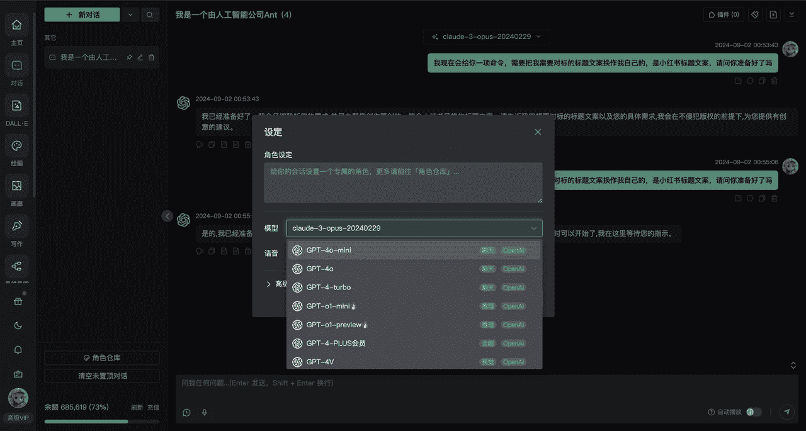

---

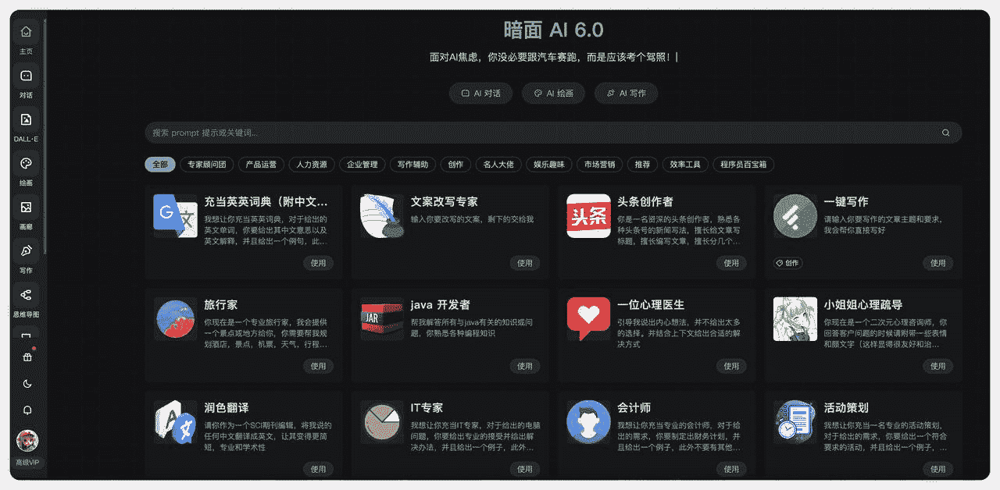

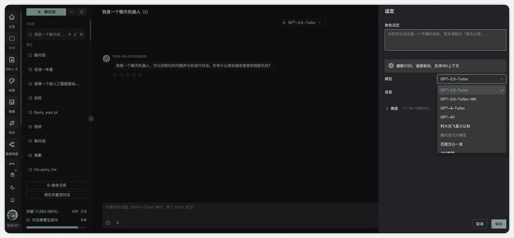

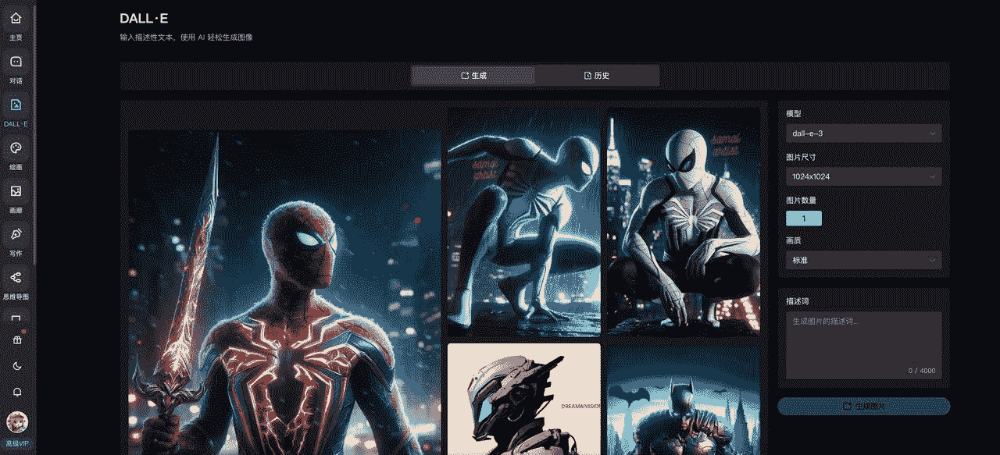

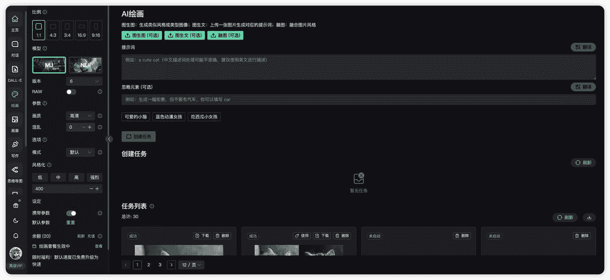

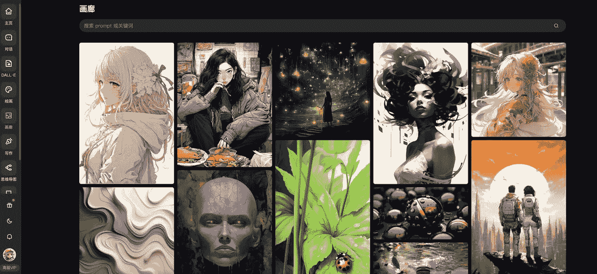

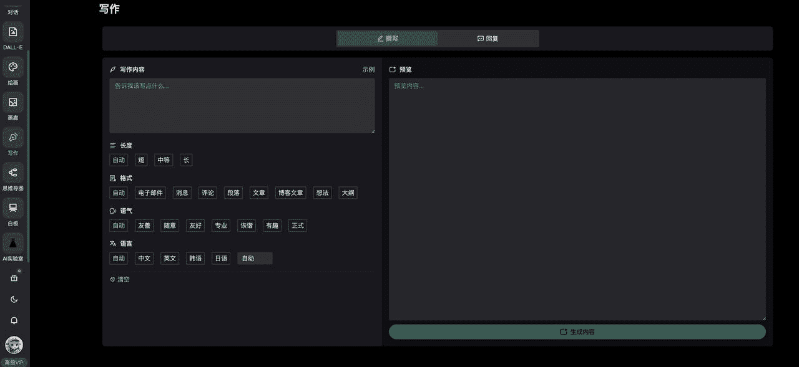

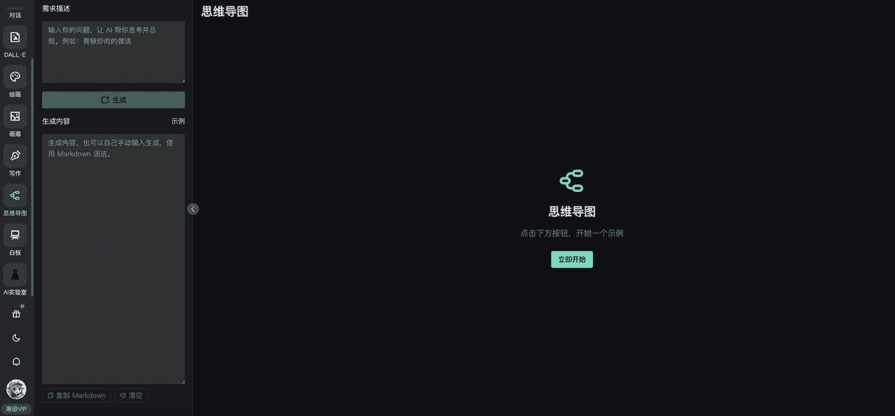

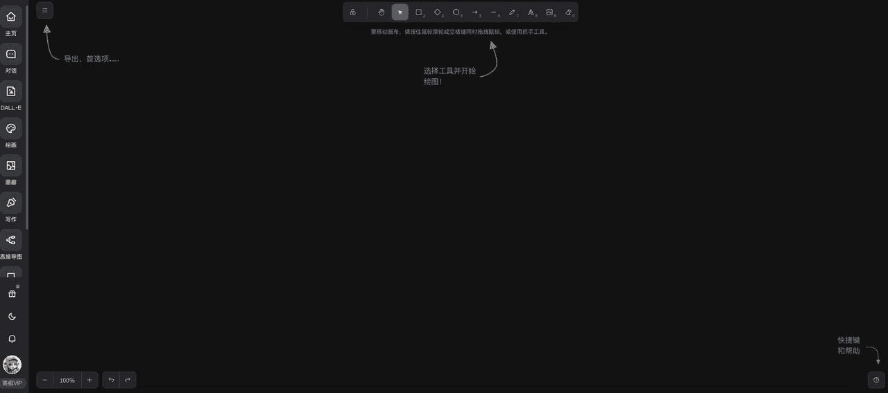

# 11 月份熊猫 AI 全面更新：

> **熊猫 AI 入口：**https://new2.aigc369.com

> 熊猫 AI 更新

+   重构绘画广场、重构绘画广场 ui 界面

+   新增绘画作品风格分类及后台配置

+   新增画廊轮播图

+   新增创作者功能

+   新增《用户协议》和《隐私政策》，须用户勾选阅读并同意才能进行注册登录

+   新增用户自主绑定手机号和换绑手机号功能

+   新增用户自主绑定🛰️、换绑🛰️功能

+   用户个人中心 ui 界面美化

+   Chat 首页界面新增动画效果及布局修改

+   修改美化各项用户端界面、绘画界面 ui 优化

+   修改及优化用户端主题颜色、修改用户默认主题色为 "白天主题"

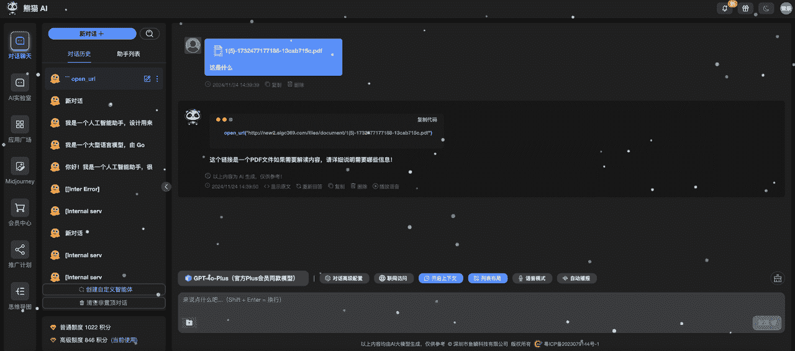

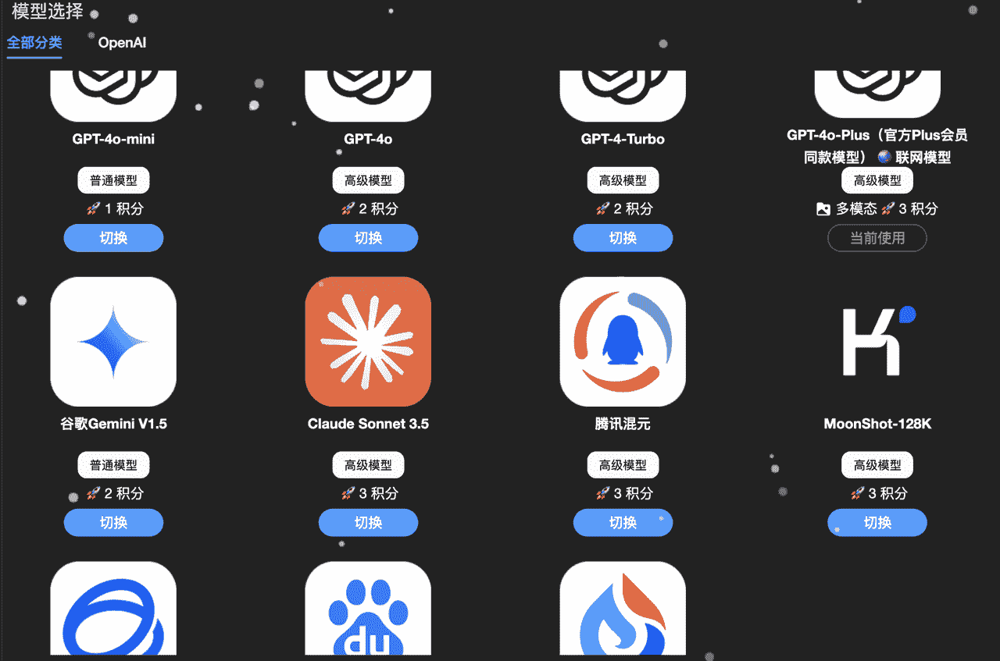