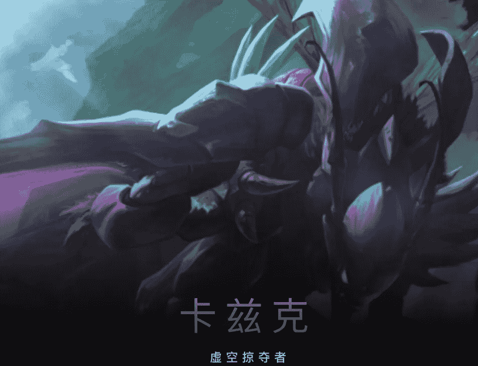
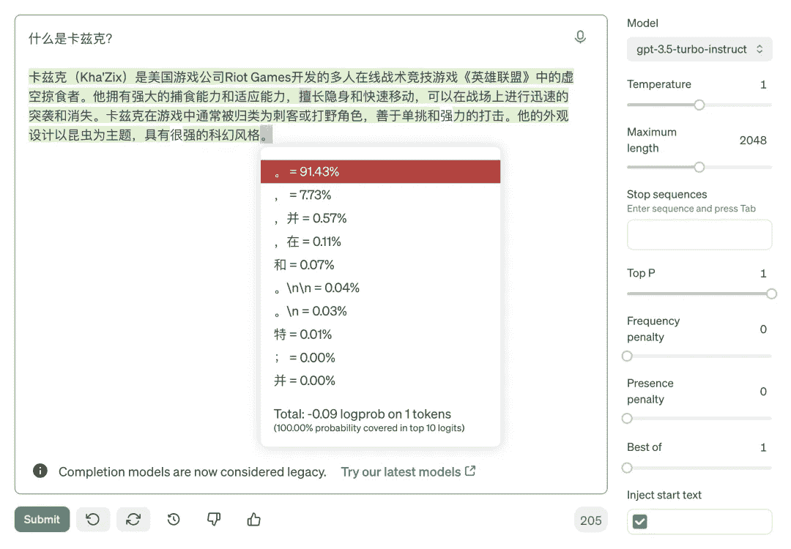
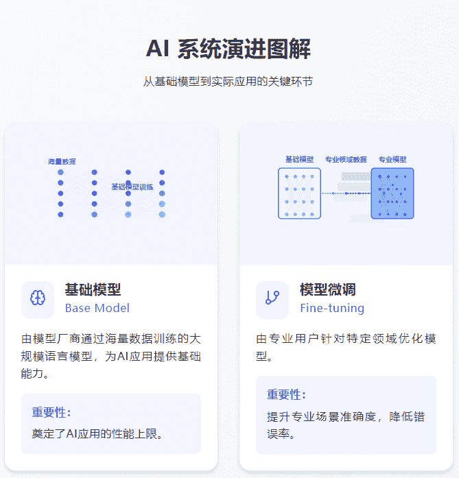
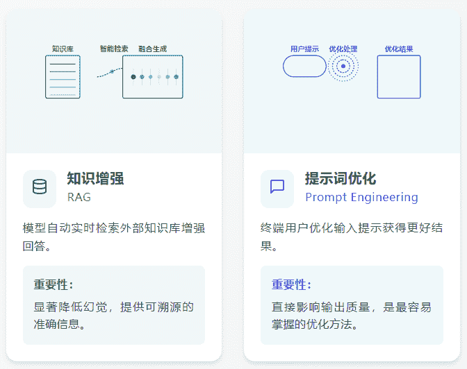
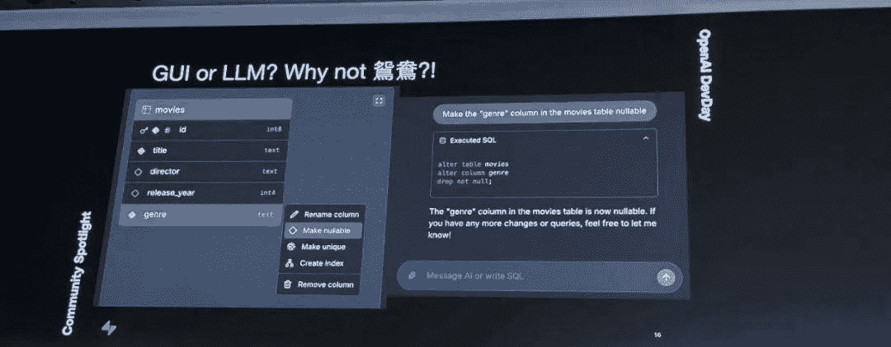
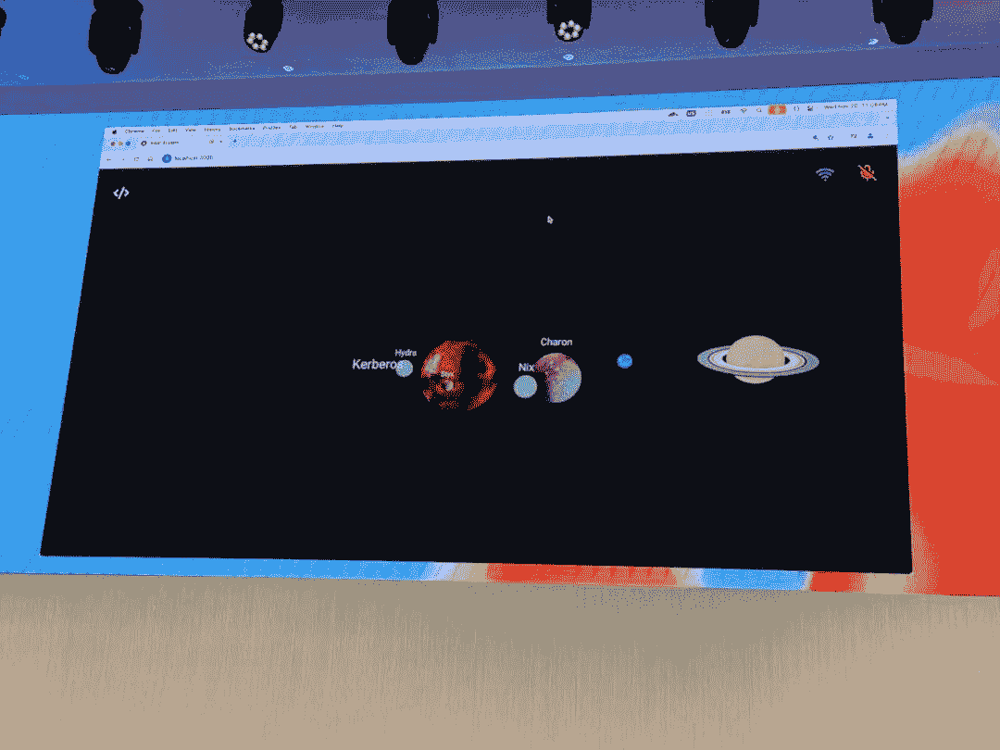
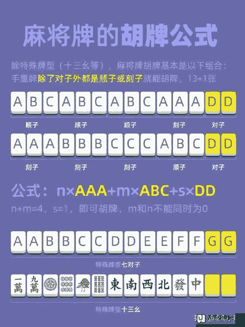
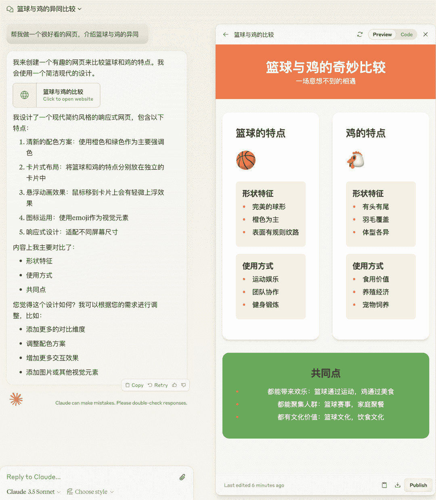
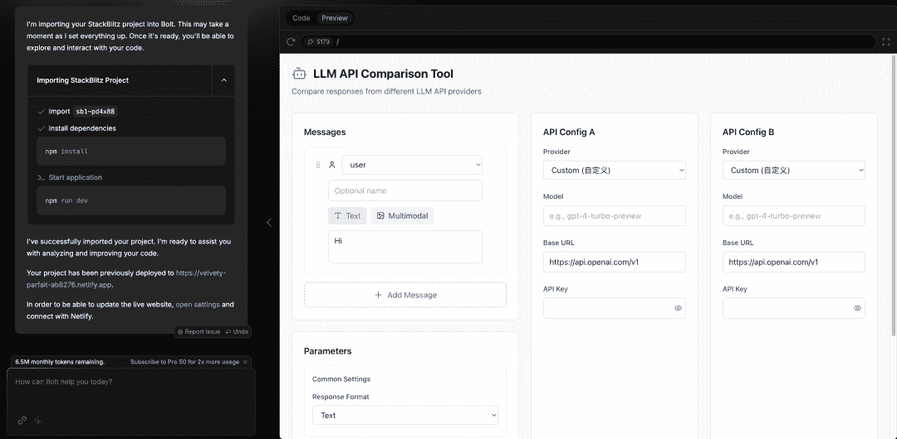
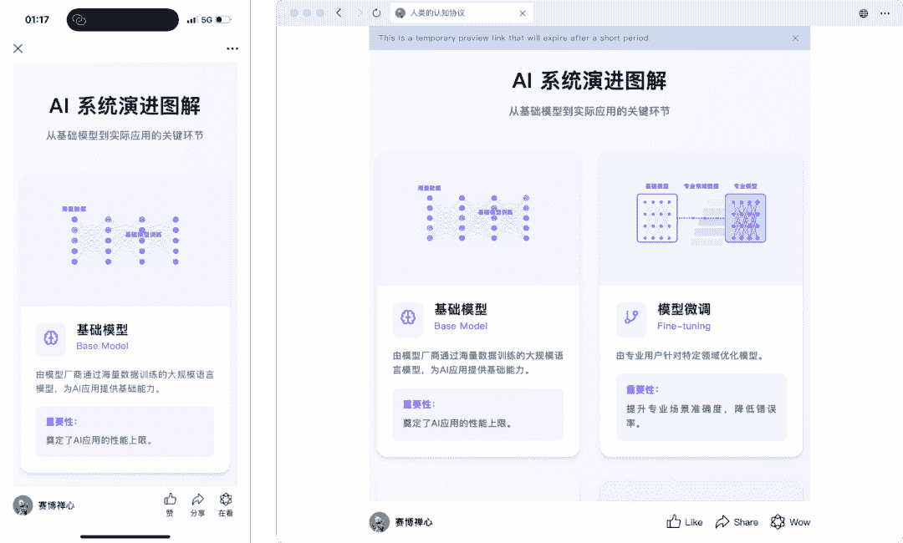

# 人类的认知协议，AI 如何服务于人

> 来源：[https://aigcreative.feishu.cn/docx/X5T2dGttBokQFZxZGwMc7n2YnMg](https://aigcreative.feishu.cn/docx/X5T2dGttBokQFZxZGwMc7n2YnMg)

> 本文讨论了人类的认知特点以及AI如何基于这些特点更好地服务人类，涉及多模态交互、认知协议等方面的探索。关键要点包括：

1.  **人类与AI的思维差异**：人类擅长具象，习惯类比理解未知；AI是概率的集合，通过预测下一个词工作，Prompt可弥合两者认知差异。

1.  **多模态交互探索**：尝试将图形、语言、声音界面更融洽结合，如Supabase产品的混合交互、OpenAI实时天文解说等，让AI更“自然”。

1.  **人类认知特性**：依赖经验节省精力，用类比理解新事物，记忆需结合场景；情绪是认知工具，决策会调用情感经验。

1.  **注意力与产品优化**：人类注意力有限，产品应从等待用户分配注意力转变为主动优化认知资源，如“响应式AI”。

1.  **人类认知协议**：AI输出应逻辑分层，采用多模态动态结合，融入情感体验，具备可交互性，实现“响应式”输出，成为一种体验。

> 原文链接： [https://mp.weixin.](https://mp.weixin.qq.com/s/fzoNf3NWwJuDSthi67QySg)qq.com/s/fzoNf3NW...

> 👸号：赛博禅心，金色传说大聪明

本系列分两篇，本篇为上：

+   上篇：人类的认知协议，AI 如何服务于人

+   下篇：世界的物理接口，AI 如何链接万物

前置问题：Prompt 是什么？

答： 翻译官，能填补人类与 AI 的认知差异

人，擅长具象，习惯用类比的方式，借由已知去理解未知。

比如，如果被小朋友问到“什么是卡兹克？”

我会说：“一个螳螂，游戏里的，不耐揍”

注意，这里我会引入一个小朋友见过的东西 螳螂 ，然后再加上一些限定词： 游戏里的 、 不耐揍

AI，是概率的集合。

在 AI 眼中，世界是概率的，所做之事，是不断预测下一个词。

比如，在 GPT 的眼中卡兹克，就是下面这一连串的概率。

正是这种思维方式的不同，让我们有了 Prompt： 通过定义角色、约束范围和明确目标，来将人类意图，转化为 AI 的执行 。

但这只解决了一半问题： AI 理解人类了，但人类依然不理解 AI。

AI 回应人类时，依旧按照其本能输出，并不在乎人的认知需求 ：

+   喜欢多感官的信息：说话时，我们会用语气、表情、手势来传递丰富的信息

+   需要更清晰的结构：阅读时，我们喜欢合理分段、标注重点，而不是一篇纯文本

+   无法保持长效注意力：上高数的时候，如果前面一句话没搞懂，后面就再也听不懂了

+   珍视更深的情感共鸣：听故事的时候，我们更容易记住那些让我们笑过、哭过的情节，而不是干巴巴的数字

+   ...

Prompt 让人类更好地使用 AI，AI 也需要更好地服务人类： 在设计 AI 产品时，基于人类的认知协议，去做更深层次的双向适配。

---

## **人是感官动物**

下面的内容，是典型的 AI 生成，很枯燥，没人想读。

从基础模型到实际应用的关键环节

基础模型通过模型厂商利用海量数据训练的大规模语言模型，为 AI 应用提供基础能力。它奠定了 AI 应用的性能上限。在基础模型的基础上，通过引入专业领域数据进行模型微调，由专业用户针对特定领域优化模型，提升专业场景的准确度并降低错误率。为了进一步增强模型的能力，加入知识增强技术（RAG），通过模型自动实时检索外部知识库并融合生成回答，从而显著降低幻觉现象，并提供可溯源的准确信息。在终端应用中，通过提示词优化技术，用户可以通过优化输入提示直接影响输出质量，这是最容易掌握的优化方法。

下面这一段内容，也是 AI 生成的，但易于阅读

Prompt

「图解大模型从预训练到终端用户 prompt 发生了什么，以及重要性」

区别在哪？

+   信息不再是文本，而是有重点的、结构化的图文。

+   先用版式建立关联，再用动画辅助认识，最后是文字深入细节。

+   通过这种方式，降低认知负担，减少阅读压力。

于是， 我们在开始探索更丰富的多模态交互方式：比如尝试将图形界面 GUI，语言界面 LUI，乃至声音界面 VUI 更加融洽的结合。

这里我举两个例子，都来自前几天的 OpenAI 开发者大会：《 来自现场：OpenAI 把实时交互，卷到了新高度 》

场景一：数据库构建的混合交互

Supabase 是一个数据库产品，提供如 Postgres database, Authentication 等服务。

在其最新产品中，借由鼠标点选和自然语言交互，快速地更改数据库结构，或者生成对应查询语句。这种交互方式既保留了 GUI 的直观性，又融入了 LUI 的灵活性。

Chatbot，也可以和 GUI 融合

场景二：实时天文解说

OpenAI 之前发布了 RealTime API OpenAI 凌晨发布：Realtime 实时多模态 API，及其他 。

前几天，这一 API 支持到了 Function Calling。这意味着即便是语音交互，也不再拘泥于单纯的声音传递，而是可以进行如操作电脑、联网、查找资料等功能。在发布会现场，演示人展示了如何「言出法随」操作天体。

现场声控演示，效果惊艳

这些有趣的探索，不再满足单纯的信息传递，而是试图让 AI 贴近人脑的思考和表达：

+   纵向上，它学会了先说重点、再谈原因、最后深入

+   横向上，它开始让视觉、动画和声音在恰当的时机出现

+

多种感知通道不是简单叠加，而是如交响乐般默契配合，在恰当时机调动视觉、动画和声音来传递信息。

或许，好的 AI，不仅应该更“智能”，还应该更“自然” - 更接近人类认知的认知协议。

---

## **人，头脑简单，要顺着**

我们总会把零散的事件，编织成故事。

比如当年“贾君鹏，你妈妈喊你回家吃饭”爆火，我们就会开始寻找原因：“是不是公关给了压力”，“是不是贴吧没活硬整”。

当一个公司突然倒闭，自媒体上，就会看到一个完整的衰落史：“从他们更换了那个 CEO 开始”，“自从转型做 To B 就注定要完”。

我们有足够强的兴致，将任何事情归因，哪怕相信一个漏洞百出的故事，也不愿承认很多事情就是偶然和随机的叠加。

我们的世界，何尝不是一只猫？

这并不是坏事，对于经验和刻板印象的依赖，会帮助我们节省太多的精力，比如：

+   挑餐厅的时候，选人多的，大概率比较新鲜好吃

+   看到赛博禅心推送的时候，总认为是最好、最新的内容（bushi

在新事物前，我们也会不自觉的去联系以往经验：

+   电流就像水流，电压就像水位

+   大气环流像烧热水，热空气上升，冷空气下沉

+   原子结构像是太阳系，原子围绕着原子核，像是行星围绕着太阳

类比虽不准确，但也是我们理解新事物的脚手架，帮助我们从已知过渡到未知。

用蹦床，模拟相对论

我们记不住太多东西。数字大于 7 位的时，就很难一次记下。

如果手机号是“13812345678”，就会被分段记成类似“138-1234-5678”。

在记忆时，我们还需要去找场景，否则也会很快忘掉：

+   狼人杀教不会，打一边就会

+   麻将教不会，搓一把就会

+   代码看再多的书都记不住，得上手做项目

如果内容不能结合上手，可能不会留下记忆。

网传的胡牌公式，反正我不会打

这些都是基因的选择，需要我们去配合：

+   把复杂的并行信息编织成一个个引人入胜的故事

+   善用类比，用熟悉的事物解释陌生的概念

+   控制好节奏，让信息量不会让大脑过载

+   创造应用场景，让知识找到它的用武之地

---

## **人是情绪动物**

情绪，是认知世界的重要工具。我们自傲的理性，其底色也都是情绪。

人类对世界的认知，总伴随着情感的投射。比如古人会把雷电，想像成天神发威；现代人会给自己的玩偶，起各种名字。

以至于这两天有了一个爆款小程序：狸谱Lipu 的《灵魂提取器 》- 拍摄/上传物体照片，AI 就能将其转化为拟人化角色。

把生活中的物件，变成二次元萌娘

这并非是幼稚，而是基因的传承：用情感化的方式，快速理解世界。

信息伴随情感之时，大脑会调动更多的神经来处理：杏仁核标记情感，海马体储存记忆，前额叶也会更优先分配注意力，让一切信息变得更加丰富立体、鲜活。这种情绪机制，也在帮我们决定什么值得注意，什么该被记住，什么需要思考。

而 在面对选择时，大脑会自动调用过往的情感经验作为决策依据 。这虽然不够理性，却能帮我们在复杂环境中快速快速决断。

布嘌呤半升

岂能久居人下

须知： 情绪不是理性的对立面，而是认知的催化剂。

以及： 未来最成功的 AI，一定既能解决问题，又能触动人心。

---

## **人，注意力有限**

好友 Owen，也是沉浸式翻译的作者，提到过一个点： 「最宝贵的，是注意力自由」

是啊，人没有足够精力，去完成所有的事情：每天做不了多少事，便没了力气。

所有的抱怨，都是人和事儿的失调，是机遇。

我不擅长写前端。

之前每有需求，就是让 ChatGPT 来写，然后人工贴到 VSCode，报错了再回去问。

如此反复，很耗心力。

而如果我用 Claude，便可通过 Artifact 直接渲染，节省了许多不必要的精力损耗。

🏀和🐔，是有共同点的

bolt.new 则更进一步，将环境完整搬到浏览器，支持更多文件的读写，这使得我可以完成更为复杂的。比如，这里我用纯自然语言，让他帮我做了一个 API 接口测试对比工具。

按正常开发，这个东西我得写一周

在内容消费方面，如何有效利用注意力的问题同样重要。同样的内容，在不同的设备上，都会被以更好的方式渲染：

+   在手机这样的小屏上，内容会自动重组，突出核心信息

+   在电脑等大屏设备上，则能呈现更丰富的细节和交互选项

本篇内容，手机和电脑显示不同

这种展示方式，被称之为「响应式设计」，Responsive Design。

随着 AI 的加入，相信我们还可以拥有 「响应式 AI」：根据使用场景和读者的偏好，动态的调整内容及交互。 例如：同样的内容，AI 可以在嘈杂场景中强调视觉信息，在运动场景中则用声音提醒。

这是一个转变： 产品从等待用户分配注意力，到主动优化认知资源。

---

## **人类认知协议**

我们曾经的内容表达，局限于常规预设：文字、静态图表、简单对话。

但这并无法发挥 AI 的潜力，甚至带来了 AI 的融入困难。

或许，我们应重新审视：

**大脑习惯于信息的分层理解 **。AI 的输出应建立于逻辑分层：核心结论直接可见，支持逻辑和背景次之，深度细节作为扩展选项。比如，展示技术方案时，会先看到直接效果，再了解到背后的机制，最后决定是否进一步探索细节。

比起静态文字，我们更喜欢视觉化的动态信息 。多模态的表达，可以使信息更生动：视觉化简化复杂关系，动画展示变化过程，声音和触觉强化关键提醒。这些形式并非互相叠加，而应动态结合，形成一种协同的信息传递。并且：多使用 Function Calling 吧，方法都在文档里。

**情感体验至关重要 **。信息的最佳载体是情感，当内容带着适当的情绪，大脑会本能地加深理解和记忆。这启发了 AI 的表达艺术：不仅传递答案，更要在恰当的场景中唤起共鸣。

**可交互性，是关键 **。传统的信息展示是单向的独白，而 AI 让内容变成了双向对话。通过实时交互和即时反馈，我们不再是内容的被动接收者，而是共同创作者。

**属于 AI 的响应式 **。AI 的输出，不应是千篇一律的答案，而应像变色龙般适应环境。在手机上它是简洁的决策助手，在电脑前它是全面的分析工具，在嘈杂环境它侧重视觉，在运动场景它善用声音——始终以最适合当下场景的方式传递信息。

认知即接口：我们会不断探索人类的认知模式，然后设计出更自然的人机交互： AI 未来的输出，或不再是单纯的“答案”，而是一种体验。

<https://aigcreative.feishu.cn/sync/K4Gvd9vUQsy9Oubwqaeclu0Fnbg>

# 知识库动态