# 世界的物理接口，AI 如何链接万物

> 来源：[https://aigcreative.feishu.cn/docx/NfN3dBU01ooAJExI6HTcEqa7nCe](https://aigcreative.feishu.cn/docx/NfN3dBU01ooAJExI6HTcEqa7nCe)
>
> 本文讨论了AI从虚拟走向现实的发展历程、关键技术及应用探索，介绍了结构化输出、多端到多端模式、预测性输出等进展，还提及AGI Bar这一AI经营实体店的尝试及AI产业落地的方向。关键要点包括：
>
> 1. **结构化输出是AI走出屏幕的核心**：机器只能理解结构化信息，结构化输出准确率的提升使AI从「建议者」向「决策者」和「执行者」转变，人类变为「监督者」。
> 2. **多端到多端变革重塑数字世界架构**：AI从信息转换器变为复杂系统的「指挥中心」，具备调度能力，未来智慧城市等将基于此范式构建。
> 3. **预测性输出契合工业诉求**：是修改式的「精准调整」，具有改动小、风险低、速度快的优势，在多领域有应用价值。
> 4. **AGI Bar探索AI线下潜力**：白天作为「AI门店」展示，夜晚AI扮演「酒吧主理人」，计划将设备联网，通过「线上A/B测试 + 线下实战验证」优化运营。
> 5. **AI产业落地方向明确**：AI从「建议者」向「执行者」转变，能精细调控实体经济各环节，推动智能化变革。
>
> 作者：金色传说大聪明  👸号：赛博禅心
>
> 链接：https://mp.weixin.qq.com/s/8MZH0MTR3yUZ8lLU1gzNGA

前置问题：何时我们会见到，第一个 AI 经营的商业实体？

答：**今年，在中国**

希望你可以**仔细读完本篇**，我会将这件事情说清楚。

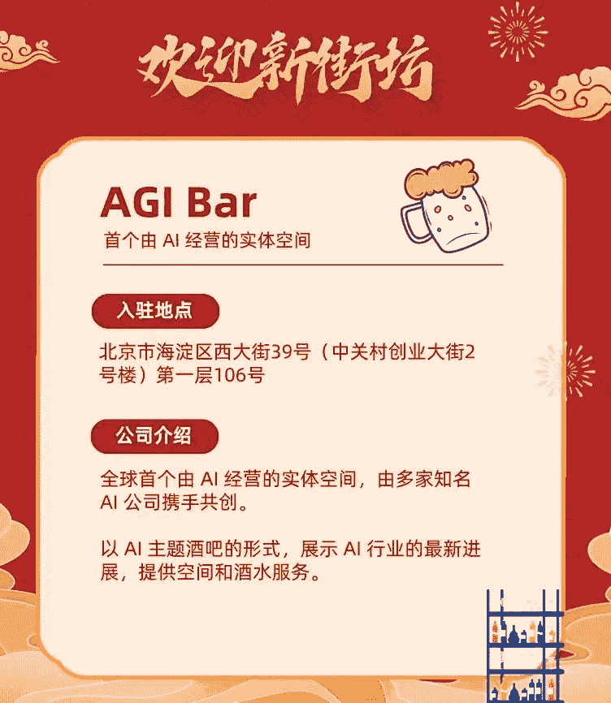

来自：👸号「中关村创业大街」

PS：这篇写了一个多月，与上一篇《[人类的认知协议](https://mp.weixin.qq.com/s?__biz=MzkzNDQxOTU2MQ==&mid=2247493515&idx=1&sn=ff7089d391a68b6aeecee906cf56a3c7&scene=21#wechat_redirect)》互为姊妹

## 从“符号”到“实体”

人类的文明，总在不经意间跃迁。

而文明加速的时刻，往往都指向同一个奇点：当人类控制的信息，开始交融世界之时：

+ 当土地上的符号化为治国方略，农耕社会由此孕育；
+ 当演算的稿纸化为轰鸣机器，流水生产由此开启；
+ 当库存的数字接上网络，全球贸易由此重构...

在我看来：文明的演进，就是不断的信息构建，然后用之驾驭现实。

而现在，是新的一轮跃迁：**AI** 将走出虚拟屏幕，走进闹市街头，迸发真正的力量。


休闲游戏《文明六》宣传片

那么，AI 怎样才能走出屏幕呢？

可以从一个很熟的例子谈起：与 GPT 问答。

如果你问 GPT：「介绍一下乔布斯」，它通常会给你一段文字，就像这样：

史蒂夫·乔布斯，1955年2月24日出生，2011年10月5日去世，美国人。他活跃于科技、创新、企业管理和动画领域。乔布斯创立了Apple、NeXT和Pixar公司，推出了Mac、iPod、iPhone等具有划时代意义的产品，重塑了个人电脑、音乐和手机行业，奠定了苹果在全球科技领域的领军地位。作为Pixar的创办人之一，他也在动画领域留下了深远的影响。乔布斯是20世纪末至21世纪初最具影响力的企业家和创新者之一。

没毛病，对吧？人类阅读起来完全没问题。

但其实，GPT 还可以输出结构化的信息，像下面这种格式：

```json
{
  "name": "史蒂夫·乔布斯",
  "birth_date": "1955-02-24",
  "death_date": "2011-10-05",
  "nationality": "美国",
  "fields": ["科技", "创新", "企业管理", "动画"],
  "companies_founded": ["Apple", "NeXT", "Pixar"],
  "achievements": [
    "创立苹果公司",
    "推出Mac、iPod、iPhone等产品",
    "重塑个人电脑、音乐、手机行业",
    "奠定苹果全球科技领军地位",
    "Pixar创办人之一"
  ],
  "influence": "20世纪末至21世纪初最具影响力的企业家和创新者之一"
}
```

当然，很多人会觉得，文本信息挺好的啊，为啥还要搞这么复杂的结构化输出？对于给人看的信息，文字当然足够了。毕竟，我们从小到大看书、杂志、文章，都是文字。

但细想一下，如果信息要走出屏幕，读者就是机器了。

一切都会不一样：机器可读不懂自然语言，它们只能理解结构化信息。

所以，结构化输出，便是 AI 走出屏幕的核心抓手。

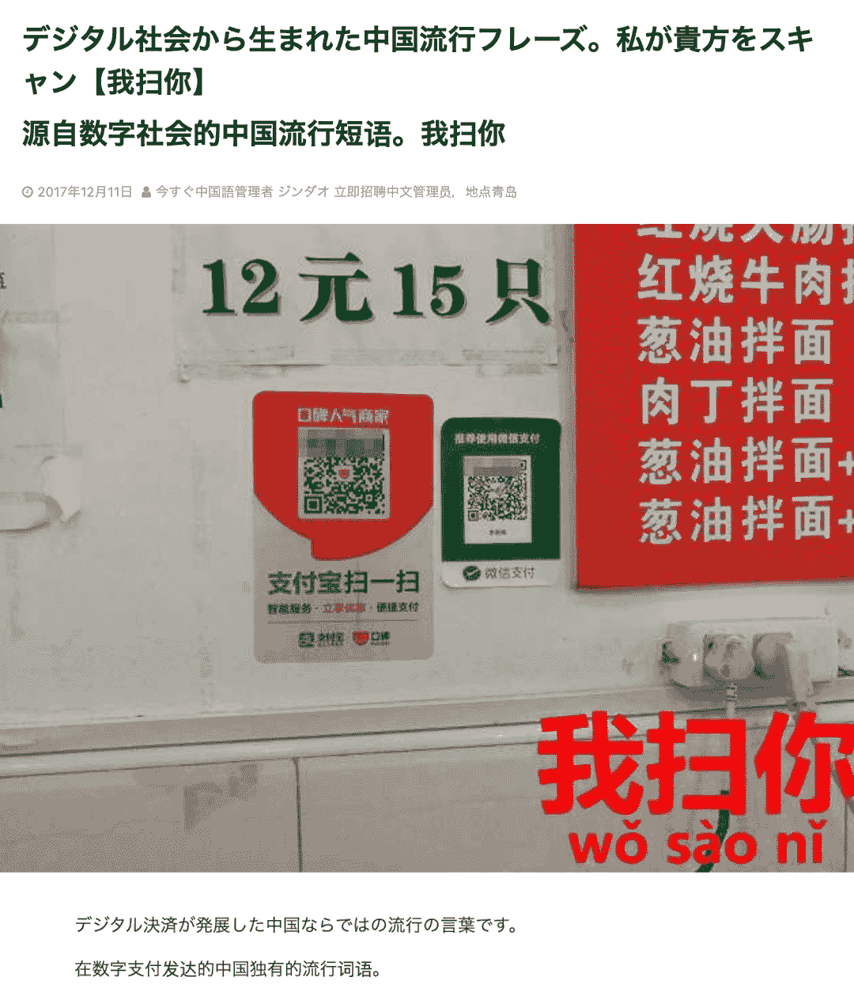

二维码也是抓手，让信息走入手机

AI 搜索，想必大家都用过/听过：你问 AI 一个问题，AI 满世界给你找资料，然后告诉你回答。比如，你让它「介绍一下乔布斯」：

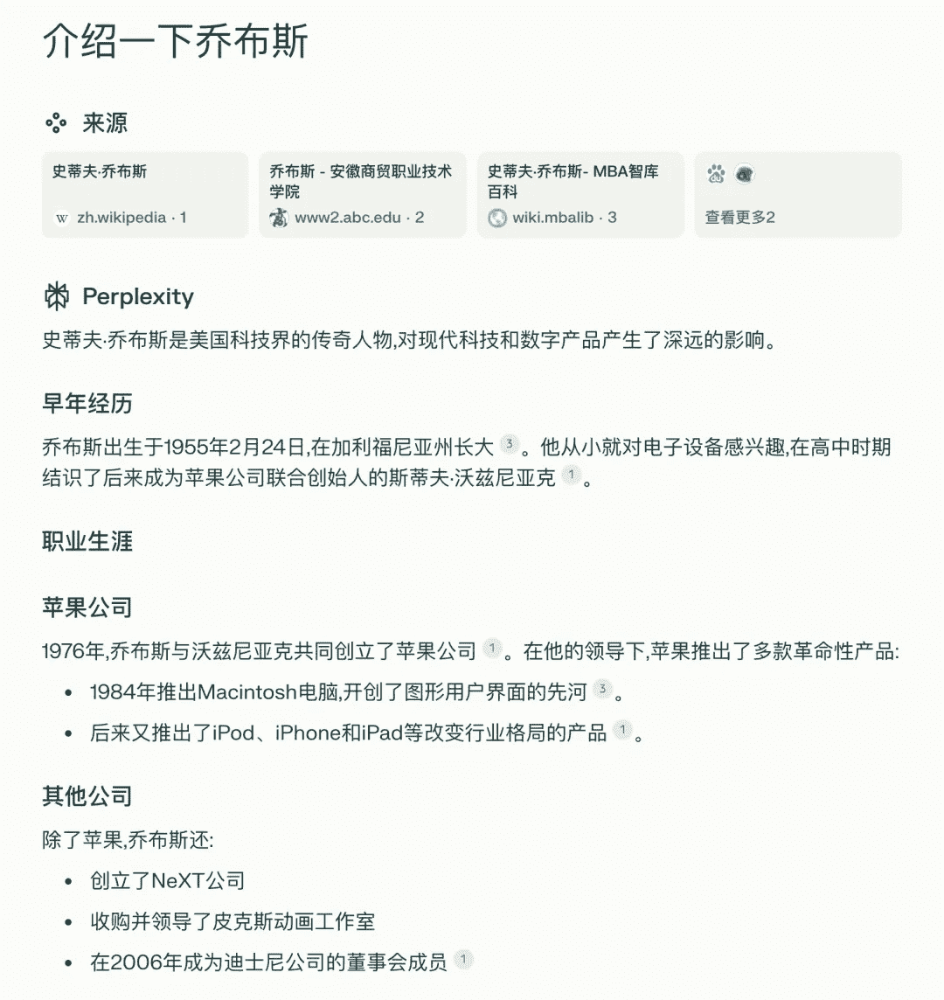

用 perplexity 来回答这一问题

这里有个问题，AI 怎么知道搜啥呢？

流程中，它会先问一下大模型：“嘿，想回答‘介绍乔布斯’这个问题，我需要去哪里找资料？”大模型在思考一会儿后，获得了一份结构化信息：`{ "query": "乔布斯", "search_engine": "Google" }`

有了这个指令，AI 就能调用 Google 的 API，把相关的网页内容抓取过来，最后整理总结成答案。

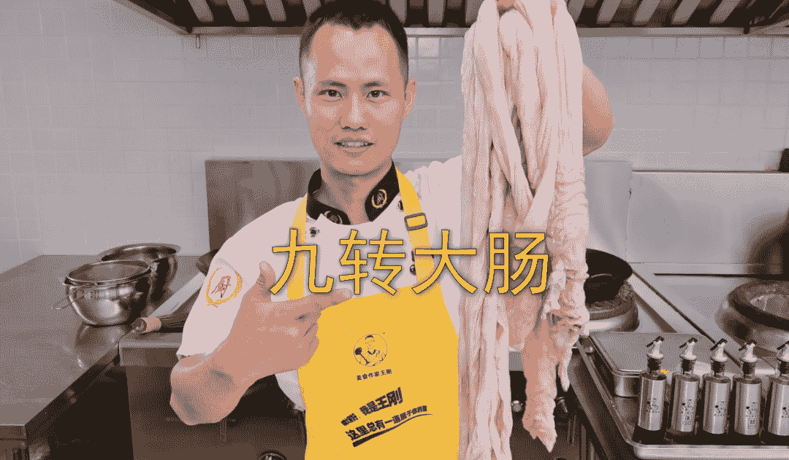

过程像是在做菜：先按菜谱买菜，然后组合在一起

再举个例子：天气预报机器人。当你问它“北京明天会不会下雨？”的时候，AI 实际上会先把你的问题，解析成一个结构化的数据请求，然后调用后台气象服务，得到一份 `json` 数据：包含温度、湿度、降雨概率等信息。

最后，AI 再把这些结构化的数据，整合回自然语言，呈现给你：

北京明天（1 月 21 日）的天气预计为多云，最低温度 -3℃，最高温度 8℃，东北风 2 级，湿度 33。整体天气较为寒冷，需要注意防寒保暖。

你看，对我们用户来说，好像只是「一句话」就完成了天气查询。但实际上，在系统内部，这背后至少经历了两次以上的「生成 — 调用 — 返回」的循环。所有关键信息，都是以结构化的方式传递的，而不是模糊地给一段包含数字的文本。

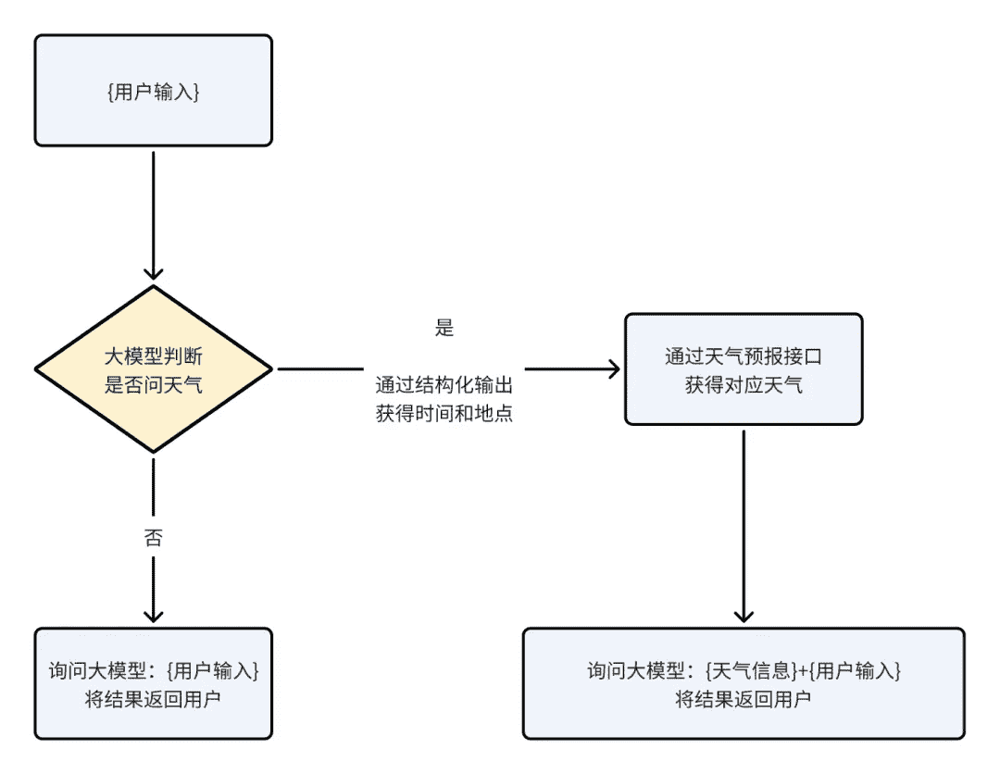

用流程图画一下，大概是这样

再进一步，如果把这种能力扩展到物联网，大模型就能控制家里的各种设备了，比如：空调、音响、灯光等等。

比如，你跟 AI 说：“把客厅灯光调暗到 30%”。AI 理解你的需求后，就会输出这样的结构化指令给中控系统：`{ "device": "living_room_light", "action": "dim", "value": 30 }`。中控系统接收到指令，灯光就瞬间变暗了。就像我之前搞的这个“大爱同学”：

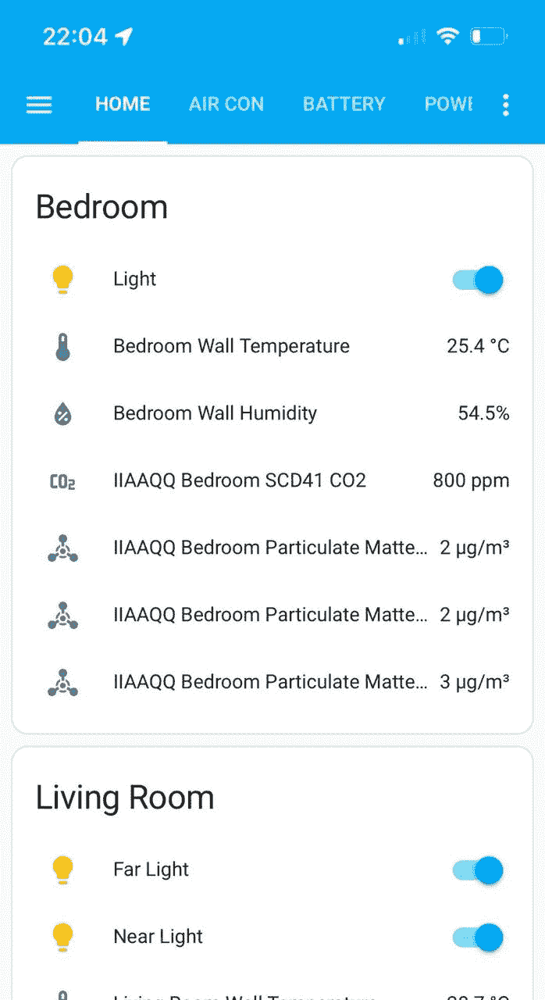

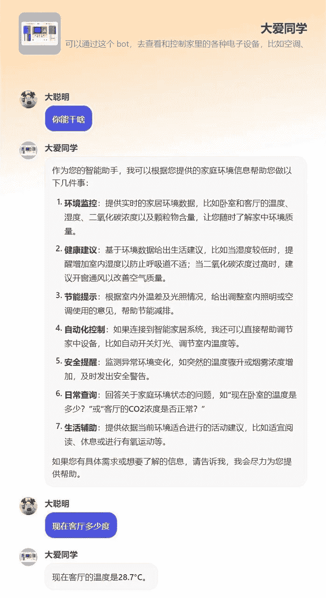

## 「结构化输出」简史

说到这里，就不得不提 2023 年初那篇震撼人心的论文《Toolformer: Language Models Can Teach Themselves to Use Tools / AI 学会用工具了》。它的核心概念，就是让大语言模型学会使用外部工具。

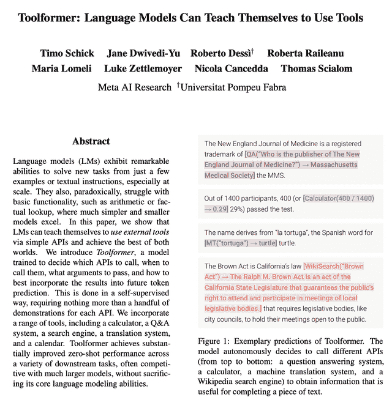

Toolformer: Language Models Can Teach Themselves to Use Tools

同时，OpenAI 发布了 Plugin 计划，邀请开发者提交插件配置，让 ChatGPT 可以发起 `post` 请求，调用外部工具。5 月份，Plugin 正式上线，首批就包含了大约 70 个工具。

我当时有幸成为这 1/70，所以见过最初版本的文档。你需要写一个 `yaml` 文件，描述在什么情况下调用插件，以及发出什么样的请求。插件服务器收到请求后，会给出一个回调（后来这套东西变成了 GPTs 的 Actions）。

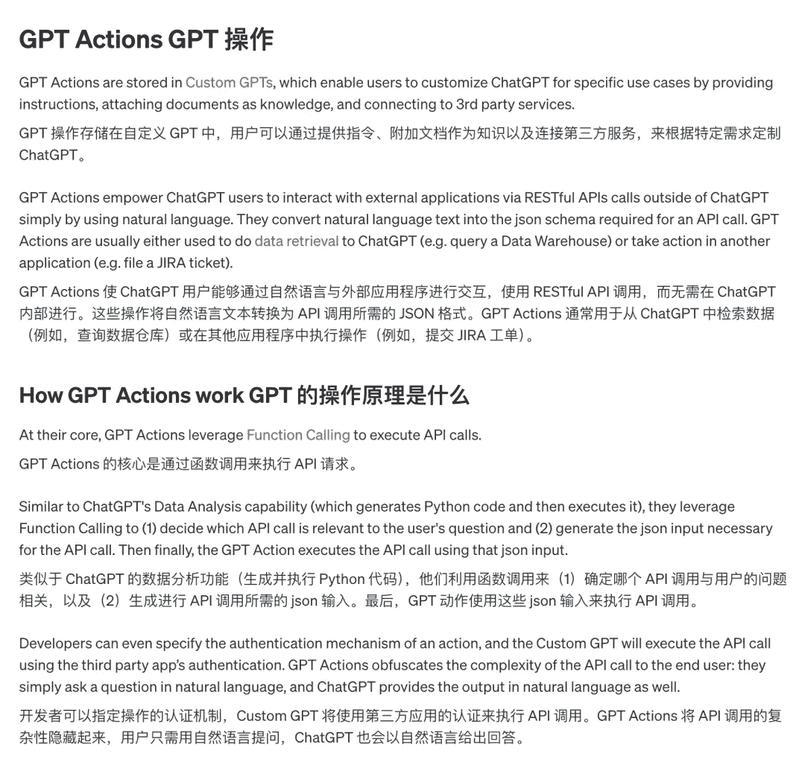

GPT Actions 的相关文档

2023 年 6 月，OpenAI 又发布了 0613 年中更新，带来了 **Function Calling** 功能。这也是现在最主流的 AI 工具调用方法，国内的大模型基本都支持。2023 年 11 月，OpenAI 开发者大会上，又更新了 `json` mode。最近一次大的更新，是 2024 年 8 月，有了新的调用方法，定名为 Structured Outputs，也就是我们说的「结构化输出」。

在这个过程中，不只是名称和接口在变，更重要的是，结构化输出的准确率有了质的飞跃。2023 年中的时候，用提示词来做，成功率只有可怜的 35.9%，得不停地重试。到了 2023 年 4 月，成功率提升到 75.3%；5 月份是 86.4%。而 8 月 6 号 Structured Outputs 更新后，在严格模式下，GPT 甚至可以做到 100% 的输出准确率。

正是这 100% 的准确率，让 AI 真正成功地接入了现实世界，开始操作现实世界，从「建议者」向「决策者」和「执行者」转变。与此同时，人类的角色也开始转变：从「执行者」变成了「监督者」。一个永动的机器开始运转，将 AI 的判断精准地传递到现实的每个角落，而结构化输出，就是这个机器的传动轴。

## 多端到多端

2023 年 11 月 6 号，OpenAI 发布了 `gpt-4-vision-preview`，AI 终于能「看懂」图像和视频了！后来的 `gpt-4o`，更是支持原生的语音输入输出。自此，大模型正式进入了「多模态」时代：它能理解你眼前的图片，听懂你说的话，甚至能感情丰沛地给你唱歌。

就在我们惊叹大模型变得「能说会道」之时，另一场「水下革命」正悄然发生，唤做：「多端到多端」。如果你表示，没听说过这个名词：那正常 - 这个词是我创的。

可以先看这个视频：你对着太阳系星系图提问，AI 不仅能用声音跟你讨论，还能操作演示界面，放大对应的天体，并在屏幕上展示相关图表。

来自 24 年的 OpenAI DevDay，对应产品未发布

过去，无论是多媒体还是 AI 对话，我们接收到的信息，基本都离不开文字、图像和声音这三种形式。

而在这个演示里，AI 展现了一种全新的能力：在理解问题和回答问题的同时，还能调度各种外部设备，协同表达知识：

```json
{
  "comprehension": {
    "query_type": "astronomical",
    "topic": "solar_system",
    "depth": "educational"
  },
  "system_control": {
    "display": "zoom_into_target",
    "audio": "narrative_with_effects",
    "data": "comparison_charts"
  },
  "coordination": {
    "timing": "synchronized",
    "transitions": "smooth",
    "focus_flow": "guided"
  }
}
```

在之前的「多模态大模型」阶段，AI 扮演的角色，更像是一个「Any to Any」的信息转换器：输入是图像、文字、声音，输出的也是文字、图像和声音。


Any to Any：大概就像转接头

而在「多端到多端」模式下，AI 变成了一个复杂系统的「指挥中心」：它的输出，除了常规的图像、文字、声音，还会通过多重结构化输出，来调度各种软硬件协同。比如在智慧教室里，当 AI 检测到学生注意力不集中时，它不仅仅是发出一个提醒，而是同时调整多个系统：降低室温来提神、调整灯光亮度、切换教学内容、启动互动环节。

这种「多端到多端」变革，将重塑整个数字世界的架构。传统的系统是线性的，信息从输入端流向输出端。新一代的系统是网状的，每个节点既可以是输入，也可以是输出，AI 在其中扮演着中枢调度的角色。如果说多模态让 AI 有了感知能力，那么多端协同则赋予了它调度能力。

可以畅想一下，未来的智慧城市、无人工厂、自动医院，都将基于这种范式：我们将会看到的，不会是简单的自动化，而是由 AI 实时感知、精准调度、智能编排的有机整体。这标志着人工智能从工具走向平台，从助手走向管理者，一个真正的「AI 驱动」时代即将到来。

## 预测性输出

很多人会疑惑：为什么 AI 这么强了，但为啥还没落地到行业？

确实，日常用 AI 写邮件、文章、代码片段，已经很方便了。顶天也就几千字，从头开始写也花不了多少时间。

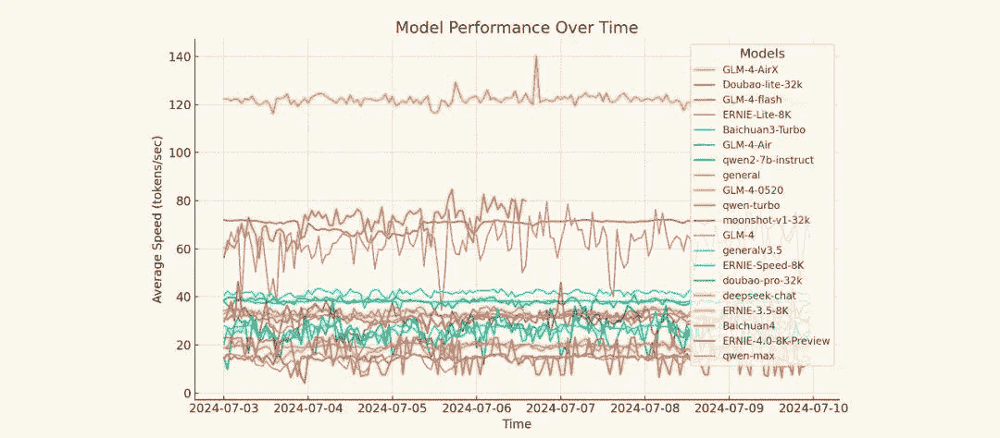

《对大模型来说，生成 1000 字的内容，只需要 10 秒》

但在工业领域，情况就复杂多了：工业生产线上，每个环节、每个控制系统，都积累了非常成熟的工艺文档、参数配置和安全策略。如果大刀阔斧地推倒重来，从零开始，显然不是最佳方案。在高度自动化的产线上，哪怕一个阀门开度只变动 5%，都可能引发上下游十几个环节的连锁反应。这就好比用推土机来修剪盆栽，虽然也能完成任务，但显然不够精细。

如果还是用传统的**「生成式」思路**，每次更新都让 AI 重新写一份完整的工艺文档或流程脚本，很可能把已经稳定运行的部分也给改乱了。这样既浪费算力，也容易出错，还需要投入大量人力去复核。

在工业场景下，我们更需要一种**「修改式」迭代**：AI 只关注需要调整的一小段代码或参数，其他部分保持不变，避免破坏现有的稳定流程。对工业生产来说，「少动多看」能更快恢复生产，把停机时间降到最低。这种策略，也特别符合柔性制造和精益运营的理念。


水多了加面，是老祖宗的智慧

OpenAI 前段时间悄悄发布的「预测性输出」（Predictive Outputs），就是修改性的：《“鸽”声中，OpenAI 偷偷上线：预测性输出》

预测性输出，不再是推倒重来的「生成」，而是修改式的「精准调整」：当系统需要微调时，AI 只关注必要的改动，保持其他部分的稳定性。这种方法，完美契合了工业现场稳中求进的核心诉求。

这里举个例子，比如我希望用「预测性输出」的方式，对下面内容进行修改：

近年来，变压器模型在深度学习领域取得了重大突破。

变压器最初是为自然语言处理任务而设计的，但现在它已被广泛应用于计算机视觉和其他领域。

大语言模型，也称为法学硕士，是基于变压器架构的。

法学硕士可以生成高质量的文本，并用于各种应用，如机器翻译和文本摘要。我们的产品使用了最新的法学硕士技术。

我希望让它：

请将这段文本中的“变压器”改为“Transformer”，“法学硕士”改为“LLM”，并在所有中英文之间添加空格。

就会很快的获得：

近年来，Transformer 模型在深度学习领域取得了重大突破。

Transformer 最初是为自然语言处理任务而设计的，但现在它已被广泛应用于计算机视觉和其他领域。

大语言模型，也称为 LLM，是基于 Transformer 架构的。

LLM 可以生成高质量的文本，并用于各种应用，如机器翻译和文本摘要。我们的产品使用了最新的 LLM 技术。

代码也很简洁：


```python
completion = client.chat.completions.create(
    model="gpt-4o",
    messages=[
        {"role": "user", "content": rewrite_prompt},
        {"role": "user", "content": original_text},
    ],
    prediction={"type": "content", "content": original_text},
)
```

通过上面的例子，我们可以看到「预测性输出」的明显优势：

+ **改动小，风险低：** 只有少部分内容会被修改，不用担心内容被改得面目全非。
+ **速度快：** 毕竟只输出了极少量的内容，速度自然很快。

当然，这项技术的应用远不止于工业生产。在电商领域，就可以用它来做更精细化的运营优化：当系统检测到某个商品页面的转化率下降时，AI 可以在毫秒级别内完成一系列精准调整——重新排序推荐商品、微调价格展示方式、优化按钮位置。每一个微小变化，都基于实时数据分析，而且能根据用户反馈持续优化。这让 A/B 测试从「等待-分析-调整」的慢节奏，进化为实时响应的快速迭代。

**在机器控制领域，「预测性输出」也展现了大模型的另一种价值：持续的策略迭代。** 当机器狗在执行任务时，大模型不负责具体的路径规划，而是扮演一个高层次的决策者角色：通过分析任务状态（电量、负载、进度）和环境信息（温度、湿度、光照），不断调整和优化任务策略。比如，当检测到电量偏低时，它会权衡是继续任务还是提前充电；当发现某区域人流密集时，它会决定是否临时改变任务次序。

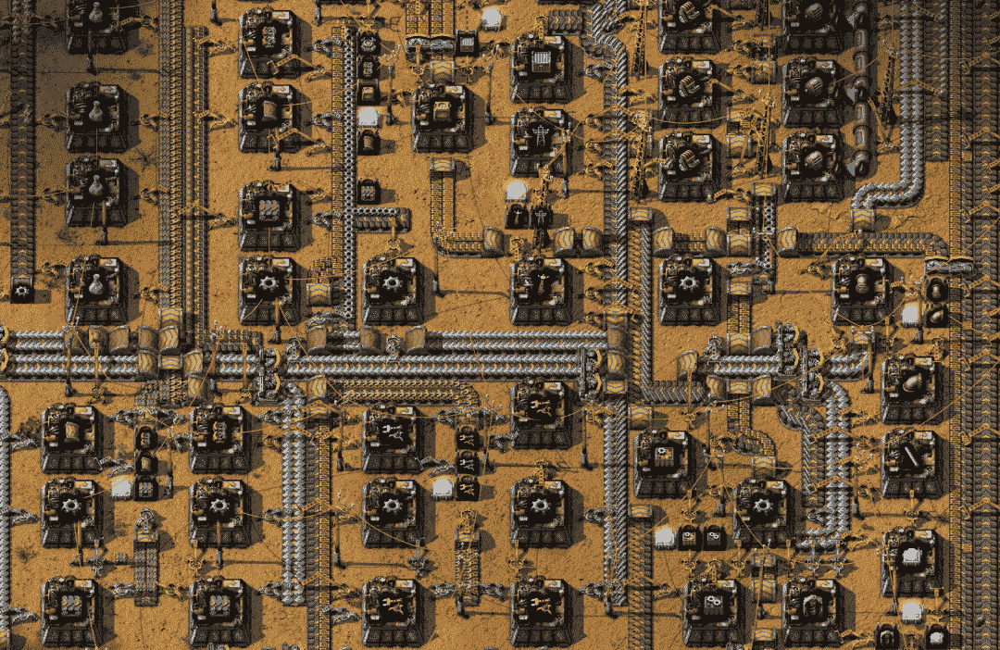

持续自迭代的流水线，才是好流水线

我们都希望 AI 能做更有价值的事情，并且能更安全地落地应用。在工厂里，它是那个只调 0.5% 阀门的老师傅；在电商平台上，它是不断微调用户体验的设计师；在机器人策略中，它是随时迭代决策的指挥官。这种演进给我们上了宝贵的一课：真正的智能不在于取代，而在于配合；不在于革命，而在于共生。也许未来的智能化图景，就是由无数个这样的「精准协作」编织而成。

## AGI Bar

最近我一直在思考，AI 的能力已经发展到一定程度，能否走出虚拟世界，真正在现实商业中创造价值？

前段时间，参加了 OpenAI 的发布会：《来自现场：OpenAI 把实时交互，卷到了新高度》。期间见了很多人，聊了很多事儿，进而，一个想法逐渐清晰：不如让 AI 尝试经营一家实体店，就从小型酒吧开始 - SKU 相对简单，也适合大家一起交流。

AGI Bar 的构想由此而来，并非宏大的商业计划，而是一个探索 AI 在线下商业场景中潜力的「小实验」。

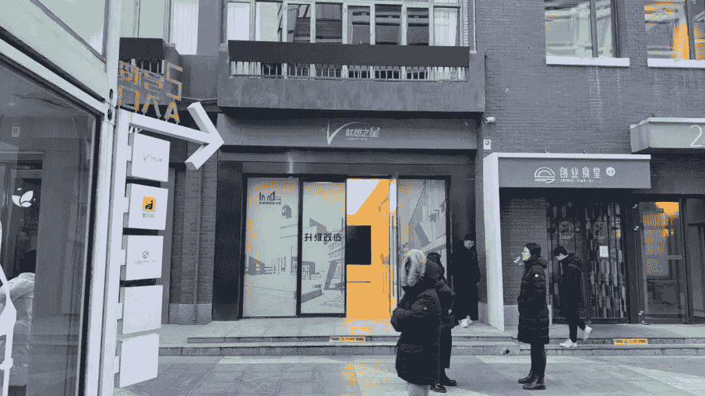

在原「联想之星」的地方，来开这家酒吧

在白天，将作为一个「AI 门店」的小型展示空间：你可以近距离观察「AI + 线下商业」的可能性。店内会设置纪念品区，并利用大屏幕实时展示运营数据，例如库存变化、AI 进货决策、顾客喜好分析、促销效果等，尽可能透明地呈现 AI 运营的「幕后」逻辑。


示意图：白天长这样

你也可以在这里直接体验到各家的最新产品与技术。**在门口，或许还会设置科技感十足的、另类的自动售货机**，甚至是有机器狗来提供外送服务。我希望借由 AGI Bar 这个窗口，与大家一同探讨 AI 能为线下商业带来哪些新思路。

**到了夜晚**，AGI Bar 将回归酒吧的本质，为顾客提供放松空间。此时，AI 需要扮演「酒吧主理人」的角色。尝试去分析顾客口味，把握上酒时机，并根据店内氛围调整灯光音乐，力求优化顾客体验。对于上面提到的机器狗送餐，AI 还需要监控配送状态，确保服务质量。


示意图：晚上长这样

**这是新的探索：构建一个 AI 经营的酒吧**，来落地「AI + 实体商业」。例如，AI 分析数据预测客流高峰，便可提前调整灯光、音乐、促销活动，以契合高峰期的氛围和需求。这可以看作是将电商平台的「智能推荐」能力延伸至线下，尝试在现实世界中构建一个「智能决策」的闭环。

如果 AI 真的能将一家小型酒吧经营得有声有色，甚至实现盈利，是否意味着这种模式具备一定的可复制性？这也是我思考 AGI Bar 的出发点之一。希望 AGI Bar 可以是一个「小型实验基地」，来去做更多的具身智能相关的探索。**很多想法仍需实践检验，例如机器狗送餐效率**、数据展示对顾客体验的影响、库存与促销的协同策略等等。我预料 AI 在初期运营中可能会犯错，但希望通过不断「喂入」数据，让 AI 在实战中学习，在试错中进步，如同进行 A/B 测试，逐步优化运营策略。「线上 A/B 测试 + 线下实战验证」的模式，或许能加速探索最佳运营方案。

**为了更好地支持 AI 运营，我计划尽可能将店内设备联网**，接入统一的 AI 中控平台。门口屏幕、店内音响、各类传感器等都将「听从」AI 的指挥，AI 将实时掌握店铺「数据脉搏」，并以此为依据进行决策，例如自动补货、调整室温等，尝试打通「物理世界」与「数字世界」的接口。参观者或能亲眼见证 AI 如何像「智能大脑」一样，指挥店铺运转，从「聊天机器人」走向「智能实体」。

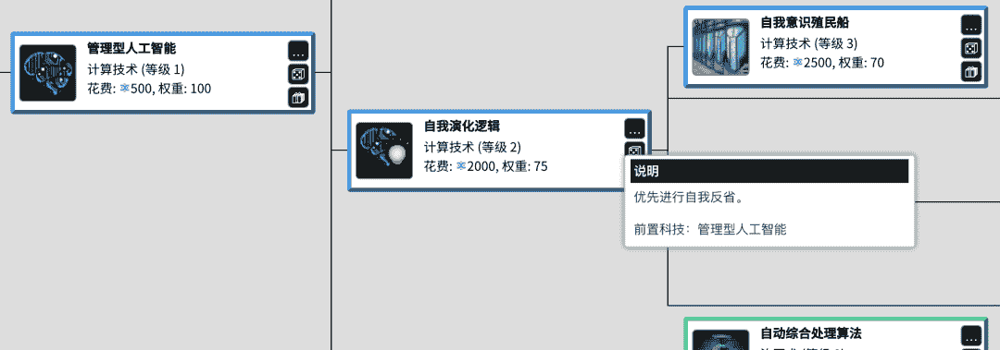

摊牌了：我是群星玩家

**工业**时代的流程智慧，加上新一代 AI 算法，两者能否碰撞出适用于线下商业的创新火花？AGI Bar 就是我希望亲手打造的‘碰撞’现场，也是我想要认真观察的‘实验’样本。我期待 AGI Bar 能在中关村创业大街，成为一个兼具科技感与烟火气的小店，让人们白天体验「AI 门店」，晚上在此放松交流，感受 AI 带来的新奇体验。

酒吧是共创的：包括很多 AI 知名大厂，预计将在 3 月正式开放。目前正处于设计和施工阶段，设计部分由我的好朋友、首批共创伙伴「矩阵&暗壳」负责。

如果你也对 AI 驱动实体商业感兴趣，或对 AGI Bar 项目有任何想法，欢迎扫码进群，一起交流！（在 AGI 真正来临之前，我暂代这里的主理人）

## 产业落地

**当 AI 能够以精确、可执行的指令与物理世界沟通，实体经济的智能化变革才真正拉开序幕。**

AGI Bar 会沿着这个方向进行实践，透过这些探索，一起看看未来的可能：AI 不再仅仅是监控数据，而是能够发出指令，精细调控生产线的每一个环节：比如在工厂中，机械臂的动作、参数的调整、流程的优化，都由 AI 的智能决策驱动，实现高度柔性化和定制化的生产。而我们的城市，各种基础设施也会连接成一个整体，优化着各种信号网络与公共服务。

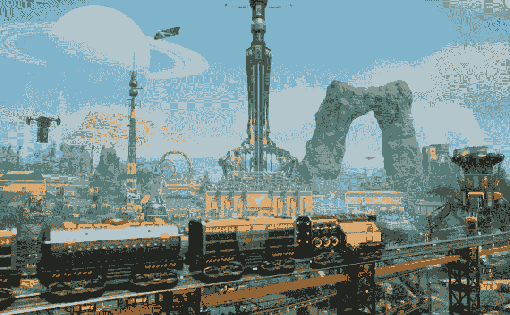

再推荐一款休闲游戏：《幸福工厂》

这些变革的核心，都指向 **AI 从「建议者」向「执行者」的转变**：不只是提供分析建议，而能够直接发出指令，操控物理世界的运行。

## 最后

从符号到实体，AI 的进化正在开启一场意义深远的变革。AGI Bar 也只是一个最初步的尝试，希望可以利用结构化输出，让 AI 从虚拟空间向现实，逐步构建起连接智能与物理世界的桥梁。

技术仍在快速发展，应用场景不断拓展，相关的讨论和研究也在持续深入。AI 实体化，并非一蹴而就的革命，而是一个循序渐进的过程。它能否真正普及，并对社会产生深远影响，仍然面临诸多挑战，也需要各界的共同努力。

让我们拥抱变革，迎接挑战，乐见于 AI 走出屏幕，走进现实的那一刻。

<https://aigcreative.feishu.cn/sync/K4Gvd9vUQsy9Oubwqaeclu0Fnbg>

# 知识库动态
