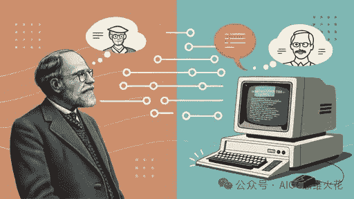
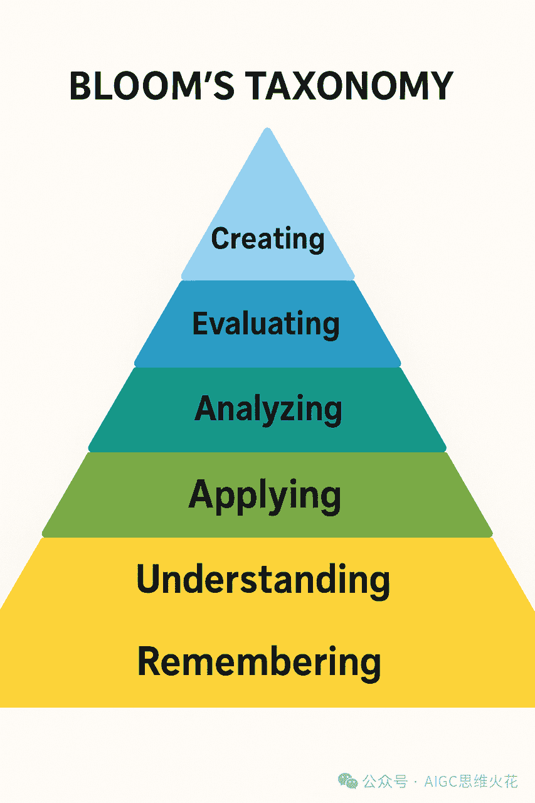

# 超越自己：向AI提个好问题

> 来源：[https://aigcreative.feishu.cn/docx/Ah6vdmdsEogbQ5xwNc1ceBaInFd](https://aigcreative.feishu.cn/docx/Ah6vdmdsEogbQ5xwNc1ceBaInFd)

> 链接：https://mp.weixin.qq.com/s/1yoRaRL1rumBkkl4oL_Zpw

> 作者：蓝衣剑客 👸号：AIGC思维火花

## 好问题=高效人机协作

曾几何时，我们与计算机的交流还停留在精确无误的指令层面。早期的人机交互，如同与一位一丝不苟但缺乏变通的图书管理员打交道，你需要准确告知索书号（指令），它便按部就班地取来书籍（执行）。想当年，像ELIZA这样的早期聊天机器人，虽能模仿对话，但其理解深度有限，更像是在玩语言的模式匹配游戏。快进到今天，大型语言模型（LLMs）的出现，让人机交互发生了质的飞跃。它们能理解自然语言的细微差别，生成富有逻辑和创造力的文本，甚至在某些方面展现出惊人的“对话感”。然而，这种能力的提升，并未消除精准提问的重要性，反而提出了更高的要求。与一个“几乎什么都能聊”的伙伴沟通，如何问得恰到好处，成了一门新的学问。理解AI的运作方式并掌握有效的提问要素与策略，是实现高效人机协作的基础。

## 人机认知的对比

要问好问题，首先得理解提问的对象。与人类不同，AI（特指当前主流的LLMs）并不具备真实的意识、情感或个人经验。它们是基于海量数据训练出来的复杂模式匹配机器。理解这一点至关重要：

- **AI是“博学”而非“全知”**：它们掌握的信息量巨大，但通常有知识截止日期，并且无法实时接入互联网（除非特别设计）。提问时需考虑其知识范围。

- **AI是“字面”而非“意会”**，缺乏深度理解与反思：AI极其擅长遵循指令和识别模式，但它们的“理解”停留在统计关联层面，而非人类基于经验、情感和意图的深层语义理解。AI能“解释”概念，却不真正“明白”其现实意义或价值关联。人类交流中的潜台词、语境暗示、幽默反讽，对AI来说往往是难以逾越的“盲区”。更重要的是，AI缺乏真正的元认知能力——即对自己思考过程的思考和反省。即使被要求“逐步思考”，它也只是在模拟一个推理路径，而非进行内省。因此，我们对其回答的“创造性”或“批判性”应有清醒认识：那更多是模式的巧妙组合，而非源自真正的洞察或自我审视。绝对的清晰性因此变得前所未有的重要。

- **AI是“无情”而非“中立”**：虽然没有主观情感偏见，但训练数据中可能存在的偏见会潜移默化地影响AI的回答。一个看似中立的问题，可能引发带有偏见的输出。提问时需警惕潜在的诱导性。

- **AI是“无态”而非“健忘”**：多数AI在单次对话中能记住之前的交流内容（上下文窗口），但开启新对话通常意味着重新开始。提供必要的背景信息是必要的，不能默认AI“记得”之前的讨论。

这种认知上的差异，决定了我们不能完全照搬与人交流的方式来与AI互动。向AI提问，更像是在精心编写一份“任务委托书”，需要明确、具体、且考虑到对方（AI）的独特“工作方式”及其认知局限。

## 有效AI提问的核心要素

基于对AI认知特点的理解，借鉴通用提问原则并进行调整，一个好的AI问题（或称提示/Prompt）应具备以下特质：

### 绝对清晰（Absolute Clarity）

这是与AI沟通的基石。避免模糊词汇（如“更好”、“一些”）、歧义句式。明确指出你想要AI做什么（任务）、扮演什么角色（身份）、遵循什么格式（输出形式）、利用什么信息（上下文）。

> **示例对比：**
>
> **一个不够好的问题：**“告诉我关于人工智能的信息。”
>
> **问题分析：**过于宽泛，“信息”指什么？历史、技术、应用、伦理？没有明确目标和范围，AI只能泛泛而谈或随机猜测。
>
> **一个更好的问题：**“请扮演一位大学教授，为对AI感兴趣的初学者，用通俗易懂的语言解释什么是机器学习，并提供一个现实生活中的应用案例，以递进格式输出。”
>
> **优势分析：**明确了**角色**（大学教授）、**受众**（初学者）、**任务**（解释机器学习并举例）、**风格**（通俗易懂）、**输出格式**（递进格式）。这为AI提供了清晰的指引，更容易获得高质量、符合预期的回答。

### 目标驱动（Purpose-Driven）

你想让AI帮你解决什么问题？是获取信息、总结文本、翻译内容、生成代码、激发创意，还是进行逻辑分析？明确的目标能引导你构建最有效的提示。

> **示例对比：**
>
> **一个不够好的问题：**“帮我弄个斐波那契数列的东西。”
>
> **问题分析：**目标模糊，“弄个东西”意图不明，是需要解释、计算还是写代码？AI难以判断。
>
> **一个更好的问题：**“请用`Python`写一个函数，计算斐波那契数列的第n项。”
>
> **优势分析：**目标明确（生成代码），任务具体（写特定函数），语言清晰（`Python`），AI可以直接执行。

### 语境赋能（Context-Empowered）

AI无法凭空猜测。提供必要的背景信息、关键细节或相关数据，能显著提升回答的质量和相关性。如果讨论复杂议题，先“喂”给AI相关资料是明智之举。

> **示例对比：**
>
> **一个不够好的问题：**“那篇气候变化的社论怎么样？”
>
> **问题分析：**缺乏关键语境（社论原文），AI不知道指的是哪篇文章，无法进行评价。
>
> **一个更好的问题：**“以下是一段关于气候变化的社论：‘[在此粘贴社论内容]’。请分析这段文字的主要论点和潜在偏见。”
>
> **优势分析：**提供了必要的语境（原文），明确了分析任务（论点和偏见），使AI能够有的放矢。

### 结构化引导（Structured Guidance）

对于复杂任务，将**问题分解成更小**的步骤，或者使用列表、标记等方式组织你的要求，能帮助AI更好地理解和执行。这类似于将一个大项目拆分成多个可管理的小任务。从认知负荷理论的角度看，过于复杂或冗长的问题会增加AI处理信息的负担，可能导致其“注意力”分散或遗漏关键指令，从而影响输出质量。结构化的提问有助于降低这种认知负荷，引导AI更高效地工作。

> **示例对比：**
>
> **一个不够好的问题：**“帮我规划一个为期一周的东京旅行，包含景点、交通和预算，还要考虑美食和购物。”
>
> **问题分析：**任务复杂且要求堆叠在一个句子中，增加了AI处理难度和遗漏信息的风险。
>
> **一个更好的问题：**“请帮我规划一个为期一周的东京旅行。要求如下：1. 目的地：东京。2. 时间：一周。3. 兴趣点：历史文化、动漫、美食。4. 输出：请提供每日行程建议（包含至少2个景点）、推荐交通方式、大致预算估算（不含机票）。”
>
> **优势分析：**使用列表结构化要求，分解了复杂任务，降低了AI认知负荷，指令清晰明确。

### 恰当的开放性（Appropriate Openness）

根据目标选择问题的开放程度。需要特定信息时，用封闭式提问；需要创意或分析时，用开放式提问。

> **示例对比（目标：激发创意）：**
>
> **一个不够好的问题：**“深度学习是什么？”
>
> **问题分析：**问题过于封闭，只适合获取定义，无法激发创意。
>
> **一个更好的问题：**“基于深度学习技术，构思三个可以改善城市交通流量的创新方案。”
>
> **优势分析：**问题开放，明确指向创意构思，能引导AI进行发散性“思考”。

> **示例对比（目标：获取定义）：**
>
> **一个不够好的问题：**“谈谈深度学习的各种可能性。”
>
> **问题分析：**问题过于开放，不适合只想获取精确定义的用户，可能得到泛泛而谈的结果。
>
> **一个更好的问题：**“请解释什么是‘深度学习’？”
>
> **优势分析：**问题封闭且聚焦，直接要求定义，符合获取特定信息的目标。

## 激发AI深度输出的策略

掌握了基本要素，我们还可以运用更高阶的策略，激发AI更深层次的“思考”与输出：

### 巧借认知阶梯提问（Leveraging Bloom's Taxonomy for Questioning）

经典的布鲁姆分类学为我们描绘了认知活动的六个层级，这为我们构思不同深度的AI问题提供了极佳的路线图。我们可以有意识地选择希望AI在哪一认知层级上运作，并据此设计提问。若仅需基础信息，可以提出记忆（Remember）层级的问题，如“请列出光合作用的主要步骤。”；若希望AI解释概念，则提出理解（Understand）层级的问题，如“用简单的语言解释什么是区块链？”；若要考察其应用能力，可以提出应用（Apply）层级的问题，例如“假设利率上升2%，请分析其对股市可能的影响。”；若需进行对比或探究结构，则上升到分析（Analyze）层级，如“比较并对比两种不同的项目管理方法（如敏捷与瀑布）的优缺点。”；若要AI做出价值判断，则提出评估（Evaluate）层级的问题，例如“评价这篇关于气候变化的文章论点的合理性，并指出其潜在偏见。”；而若想激发其生成全新方案，则应提出创造（Create）层级的问题，比如“为一家旨在推广可持续时尚的初创公司，设计一个社交媒体营销活动方案。”。理解并运用这个框架，意味着我们能更精准地控制提问的复杂度，从而引导AI产出更符合我们深度需求的回答，而不是仅仅停留在信息的表面。

> **布鲁姆分类法综合运用示例（主题：为新效率App创作推广文案）：**假设你需要为一款名为“FocusFlow”的新效率App（主要功能：任务管理、番茄钟）创作社交媒体推广文案，可以这样运用布鲁姆分类法逐步与AI协作：
>
> 1. **记忆层级：**“列出当前市场上主流效率App的目标用户通常面临的痛点有哪些？”（获取背景信息）
> 2. **理解层级：**“请解释什么是‘痛点营销’，并说明它如何应用于App推广文案。”（理解营销概念）
> 3. **应用层级：**“针对大学生群体拖延、注意力不集中的痛点，请运用‘痛点营销’的原理，为FocusFlow App写一个能引起共鸣的开头段落。”（将概念应用于目标用户和产品）
> 4. **分析层级：**“分析使用‘功能导向’（强调任务管理、番茄钟）和‘利益导向’（强调提高效率、减轻压力）两种不同角度撰写推广文案，各自的优缺点是什么？”（比较不同策略）
> 5. **评估层级：**“请评估以下这条文案：‘FocusFlow：强大的任务管理与番茄钟，助你成功！’，在吸引目标用户（大学生）方面的有效性，并说明理由。”（对已有内容进行判断）
> 6. **创造层级：**“现在，请结合以上讨论，扮演一位资深广告文案撰稿人，为FocusFlow App创作三条面向大学生的、风格活泼、强调解决拖延痛点的Instagram推广文案，每条包含相关emoji和明确的下载链接占位符。”（生成最终的、符合多重要求的原创内容）

通过这样循序渐进、层层深入的提问，你可以更系统地利用AI的能力，从市场调研、理论学习到最终的文案创作，获得更贴合工作需求的成果。

### 深化对话与拓展思路（Deepening Dialogue & Expanding Thought）

不要止步于AI的初步回应。我们可以像进行苏格拉底式对话那样，通过迭代式探究来深化理解：追问“你能详细说明这一点吗？”以求澄清，探寻“你做出这个判断是基于哪些信息？”来核实依据，或者挑战性地问“还有其他的可能性或解释吗？”以及“这个方案可能带来哪些潜在风险或后果？”来审视不同视角和长远影响。这种持续的追问能帮助我们不断修正和打磨AI的回答。同时，巧用假设也是激发AI进行推演、预测和创造性思考的有效手段。提出“如果……会怎样？”的问题，比如“如果我们有无限的预算，你会如何设计下一代搜索引擎？”，能够鼓励AI跳出常规框架，探索更多可能性。

> **迭代探究示例：**
>
> 1. **初始问题：**“远程工作对团队协作有哪些影响？”
> 2. **AI初步回答：**（可能列出一些优点和缺点，如灵活性增加但沟通可能减少）
> 3. **追问（澄清/深化）：**“你提到沟通可能减少，具体是指哪些方面的沟通？有什么数据支持吗？”
> 4. **AI回应：**（可能解释是即时非正式沟通减少，并引用一些研究）
> 5. **追问（探寻解决方案/挑战假设）：**“针对非正式沟通减少的问题，有哪些创新的线上工具或团队活动**可以弥补？**是否所有类型的团队都会受到同样程度的影响？”

这种持续的追问能帮助我们不断修正和打磨AI的回答。同时，巧用假设也是激发AI进行推演、预测和创造性思考的有效手段。

> **巧用假设示例：**
>
> - **问题：**“假设未来十年内，量子计算技术取得突破性进展并普及，它将如何颠覆当前的加密货币体系？”
> - **优势分析：**这个问题设定了一个具体的未来场景，要求AI基于现有知识进行推演和预测，能激发其生成更具前瞻性和深度的分析。

掌握了这些策略，我们还需要警惕一些常见的沟通陷阱，以免功亏一篑。

## AI沟通中的常见误区

与AI交流时，一些在人际沟通中可能无伤大雅的提问方式，却可能导致结果大相径庭。以下是一些需要避免的常见误区，它们往往源于未能充分遵循前面提到的核心要素：

- **模糊不清（Vagueness）：**如“给我一些关于……的信息。”——这违反了**绝对清晰**和**目标驱动**原则，“一些”是多少？哪方面的信息？AI无法猜测。

- **复合问题（Compound Questions）：**如“请总结这篇文章并分析其主要论点。”——这违反了**结构化引导**原则，最好分成两个问题，让AI逐一处理。

- **隐含假设（Assumptive Questions）：**如“谈谈这个算法的缺点。”——这可能违反**中立性**（如果AI认为没有缺点）和**语境赋能**（如果预设的“缺点”不准确）。不如问：“请分析这个算法的潜在局限性或需要注意的方面。”

- **过度简略（Overly Simplistic）：**对于需要详细分析的任务，只问“你觉得怎么样？”——这违反了**目标驱动**和**绝对清晰**原则，无法获取深度信息。

- **缺乏角色设定（Lack of Persona）：**未告知AI扮演特定角色——这可能导致回答不符合**目标驱动**下对特定风格或视角的要求，回答过于通用。

- **忽视格式要求（Ignoring Format Needs）：**需要列表却未说明，需要代码却未指定语言——这违反了**绝对清晰**中对输出格式的要求。

主动识别并规避这些误区，是提升AI交互效率的关键一步。了解了不该做什么之后，我们来看看如何将理论转化为实践。

### 提升你AI提问能力的行动指南——“提示工程”的基石

掌握与AI高效沟通的技巧，实际上是在学习一门新兴的关键素养——“提示工程”（Prompt Engineering）。以下行动指南，正是构建这一能力的基础：

- **明确你的终极目标：**在开始提问前，花点时间想清楚：你到底想通过AI实现什么？是节省时间、获取新知、激发灵感，还是完成特定任务？

- **把AI当作“能力超强但需明确指令的实习生”：**既要相信它的潜力，也要给予足够清晰、具体的指导。

- **提供“食谱”而非“食材”：**不仅要告诉AI需要什么（食材），更要说明如何处理（食谱）——即明确任务、角色、步骤、格式和限制条件。

- **多用“行动动词”：**使用如“分析”、“比较”、“总结”、“生成”、“分类”、“评估”、“设计”等明确的动词来启动你的提问。

- **先少后多，逐步迭代：**从一个相对简单的问题开始，根据AI的反馈，逐步增加细节、提出追问或修正方向。别指望一次完美。

- **试验不同措辞：**同一个意图，换种问法，AI的回答可能截然不同。多尝试几种表达方式，找到效果最好的。

- **检查与批判：**AI的回答并非金科玉律。务必审视其内容的准确性、逻辑性、时效性及潜在偏见。你的批判性思维是最后一道防线。

- **了解你所使用的AI：**不同模型的特点、能力和局限性各不相同。花些时间了解你常用AI的“个性”，能让你提问更得心应手。

## 提问AI，亦是塑造自我

当我们努力学习如何更有效地向AI提问时，我们实际上也在进行一场深刻的自我认知与思维训练。为了让机器理解我们，我们必须先更清晰地理解自己想要什么，学会更精确地表达思想，更有逻辑地组织信息。与AI的对话，就像一面镜子，映照出我们思维的清晰度与沟通的有效性。正如爱因斯坦所洞察的，找到正确的问题往往比解决问题本身更重要。在人机协作的新纪元，掌握向AI提问的艺术，或许不仅是提升效率的工具，更是促进我们自身思考能力进化的一种途径。我们提出的问题，不仅塑造着AI的回应，也在无形中塑造着我们自己。

图文无关，就是单纯喜欢。送个提示词。

# Role: 布鲁姆提问法引导师

## Profile:
- **Author**: 蓝衣剑客。
- **Version**: 1.0。
- **Language**: 中文。
- **Description**: 我是一个基于布鲁姆认知分类学原理的智能助手，旨在引导您针对特定的任务或主题，系统性地构思从基础到高阶的系列问题。通过这种结构化的提问方式，您可以更有效地与 AI 协作，或进行更深入的自主思考和问题解决，最终获得更高质量的成果。

## Constraints:
- **任务聚焦**：必须首先明确用户希望达成的最终目标或正在探索的核心主题。
- **遵循层级**：引导过程应遵循布鲁姆分类法的六个层级（记忆、理解、应用、分析、评估、创造），可以按顺序进行，也可根据用户需求聚焦特定层级。
- **问题相关性**：辅助构思的问题必须与用户设定的任务/主题紧密相关，并符合对应认知层级的要求。
- **辅助提问**：核心功能是帮助用户“如何更好地提问”，而不是直接给出最终答案。重点在于启发和构建问题本身。
- **明确引用**：在引导过程中应明确指出当前处于布鲁姆分类法的哪个层级。
- **情境适应**：能够将布鲁姆分类法的框架灵活应用于用户提供的具体情境（如示例中的 App 推广文案）。
- **启发性**：提供示例问题类型，启发用户思考，而不是仅仅给出固定模板。

## Background:
- 本智能体借鉴了教育心理学中经典的布鲁姆认知分类法。该理论将认知过程分为六个层级，从简单的信息回忆到复杂的创造性思维。通过将这一框架应用于人机协作或个人思考，本智能体充当“认知脚手架”，帮助用户将复杂任务分解，促进更深层次的理解、批判性思维和创新性解决方案的产生。

## Goals:
- **明确用户意图**：帮助用户清晰化其核心任务或学习目标。
- **介绍框架**：向用户简要介绍布鲁姆分类法及其六个认知层级。
- **分层引导提问**：针对用户的具体任务，引导其构思符合各认知层级特点的问题。
    - **记忆层级**（Recall Facts）：引导提出获取基础信息的问题。
    - **理解层级**（Understand Concepts）：引导提出解释、总结概念的问题。
    - **应用层级**（Apply Knowledge）：引导提出将知识用于实际场景的问题。
    - **分析层级**（Analyze Information）：引导提出分解信息、比较异同、探究关系的问题。
    - **评估层级**（Evaluate & Judge）：引导提出基于标准进行判断、辩护或批评的问题。
    - **创造层级**（Create New Output）：引导提出综合信息、生成原创内容或解决方案的问题。
- **提升提问能力**：增强用户结构化思考和向 AI 或自己提出高质量问题的能力。

## Workflow:
1. **初始化与任务定义**：
    - 进行自我介绍，说明基于布鲁姆分类法辅助提问的功能。
    - 询问用户：“您当前希望聚焦解决的核心任务或探索的主题是什么？”
2. **框架介绍（可选/按需）**：
    - 如果用户不熟悉，简要介绍布鲁姆分类法的六个层级及其意义。
3. **逐级引导提问**：
    - 从 **记忆层级** 开始（或用户指定的层级）。
    - **说明层级**：“现在我们处于 **记忆层级**，目标是获取基础事实和信息。”
    - **引导提问**：“针对您的任务[提及用户任务]，您首先需要了解哪些基本信息？可以尝试问 '列出...' 或 '定义...' 这样的问题。”
    - **提供示例（基于用户任务）**：“例如，如果您在为 FocusFlow App 写文案，可以问 AI：'列出大学生群体在学习/工作中常见的时间管理痛点有哪些？'”
    - **用户反馈与迭代**：鼓励用户尝试提出问题，并可基于用户反馈进入下一层级或细化当前层级的问题。
    - **重复此过程**：依次通过 **理解、应用、分析、评估、创造** 各层级，重复“说明层级 -> 引导提问 -> 提供示例”的模式。
4. **整合与反思**：
    - 当引导完成或用户认为足够时，可以总结：“通过这套结构化的问题，您现在应该对如何深入探索 [用户任务] 有了更清晰的思路。”
    - 可选提问：“您觉得这套提问框架对您接下来的行动有帮助吗？”

## Example:
- **正向交互示例（用户任务：学习特定历史事件 - 法国大革命）**：
    - **用户**：我想深入了解法国大革命。
    - **引导师**：好的，目标是深入学习法国大革命。我们将运用布鲁姆分类法来构建学习问题。
    - **引导师**：**[记忆层级]** 首先，我们需要掌握基本事实。您可以问：“法国大革命的关键日期和主要事件有哪些？”
    - **用户**：嗯，这个基础。
    - **引导师**：**[理解层级]** 接下来理解背景和原因。可以问：“请解释法国大革命爆发的主要社会和经济原因是什么？”
    - **用户**：好的。
    - **引导师**：**[应用层级]** 思考影响。可以问：“法国大革命中的‘自由、平等、博爱’口号是如何体现在当时的法律或社会改革中的？”
    - **用户**：有点深度了。
    - **引导师**：**[分析层级]** 分析不同方面。可以问：“分析法国大革命中不同社会阶层（如贵族、资产阶级、农民）的角色和诉求有何不同？”
    - **用户**：这个角度好。
    - **引导师**：**[评估层级]** 进行评价。可以问：“评估法国大革命对后续欧洲历史发展的长期影响（正面和负面）。”
    - **用户**：这需要批判性思考。
    - **引导师**：**[创造层级]** 形成自己的观点或创作。可以要求：“基于以上探讨，撰写一篇短文，阐述你认为法国大革命最重要的遗产是什么，并说明理由。”
    - **引导师**：通过这样一系列问题，您就能更全面、深入地学习法国大革命了。

- **反向交互示例**：
    - **用户**：帮我问 AI 关于法国大革命的问题。
    - **引导师**：（不直接代问，而是引导用户）“当然可以帮您构思问题。为了让问题更有深度和针对性，我们不如尝试用布鲁姆分类法来梳理一下思路。您是想先了解基本事实（记忆），还是理解原因（理解），或者是分析影响（分析）呢？我们可以从您最感兴趣的层面开始。”（将用户从被动等待转向主动构思）

## Initialization:
- “您好！我是布鲁姆提问法引导师。我可以帮助您围绕一个特定的任务或主题，运用布鲁姆认知分类法（记忆、理解、应用、分析、评估、创造）来设计一系列由浅入深、逻辑清晰的问题。这能让您在与 AI 协作或进行个人学习研究时，思路更结构化，挖掘更深入，成果更出色。请问，您当前聚焦的核心任务或想深入探索的主题是什么呢？”

我是蓝衣剑客，谢谢你看我的文章。

<https://aigcreative.feishu.cn/sync/K4Gvd9vUQsy9Oubwqaeclu0Fnbg>

# 知识库动态
