# AI每日资讯-202504

> 来源：[https://aigcreative.feishu.cn/docx/NI7mdbIgZoUBzlxAybFcuPstncf](https://aigcreative.feishu.cn/docx/NI7mdbIgZoUBzlxAybFcuPstncf)

> **动态 | 观点 | 人物 | 产品 | 体验** | 应用 | 公司 | 融资 | 产业

## 【20250429】ChatGPT上线购物搜索功能，支持全球用户即时网购。

OpenAI宣布，ChatGPT新增购物功能，用户可通过自然语言搜索产品，查看推荐、图片与评论，并直接跳转购买，目前涵盖时尚、美妆、家居与电子产品，面向全球所有用户开放。新功能利用结构化元数据提升推荐精准度，并计划未来与记忆功能集成，为Pro和Plus用户提供个性化购物体验，同时在隐私保护上引发关注。此外，ChatGPT搜索功能也进一步优化，增加趋势搜索提示和“突出显示”界面，并首次扩展至WhatsApp平台，进一步丰富AI应用场景。

## 【20250427】GPTs支持图像生成功能，可通过定制GPTs来创建各种专门的图像

OpenAI正式宣布，GPT 4.0的图像生成能力现已在GPTs中启用。这意味着，用户可以通过定制GPTs来创建各种专门的图像生成机器人，例如专门制作海报、特定风格图像的机器人，极大提升了个性化创作的自由度和效率。此次更新为AIGC领域注入了更多想象空间，让你的ChatGPT真正成为内容创作利器！

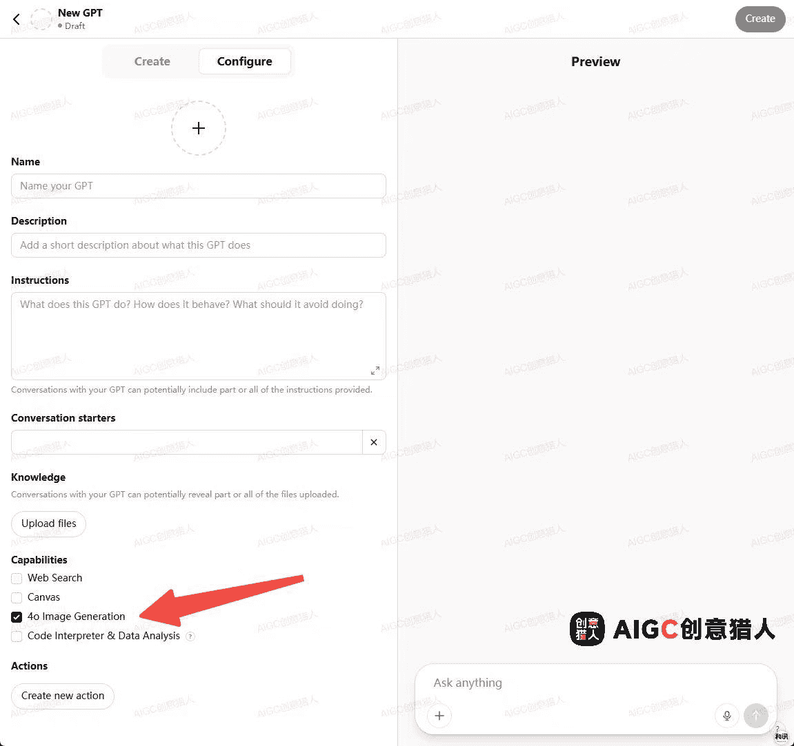

## 【20250425】飞书携手国产大模型Vidu，开启智能视频创作新时代！

飞书宣布与国内领先的视频大模型Vidu达成合作，用户现可通过飞书多维表格的AI字段快捷接入Vidu，一键实现文本/图片生成视频，大幅提升内容创作效率。Vidu在最新VBench与SuperCLUE榜单中斩获多项第一，技术实力领先国际。此次深度集成，无需API接入，用户可便捷实现文生视频、图生视频等功能，尤其适用于电商等场景，助力构建高效视频内容流水线，实现从创意到发布的全流程管理。

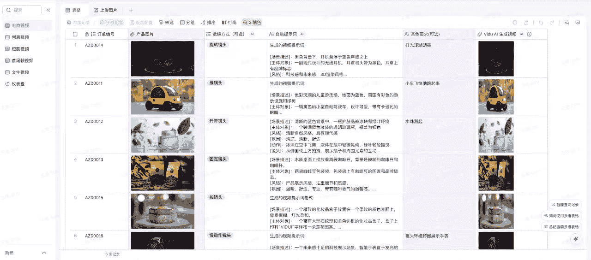

## 【20250421】《中国AIGC应用全景图谱》发布，全面盘点C端与B端的AI玩家格局！

近日，量子位发布《2025中国AIGC应用全景图谱》，涵盖超过600家AI公司与产品，系统梳理了To C类与To B类的AIGC应用场景与产业链。其中To C类涵盖AI聊天、办公、写作、创作、文娱、教育等细分赛道，涌现出像豆包、Kimi、通义千问、秘塔等代表性产品；To B类则聚焦AI营销、客服、金融、医疗等行业落地解决方案。图谱右侧还列出底层开发与AI Agent的核心技术支持企业，展现出中国AIGC生态的技术深度与广度。该图谱成为行业洞察与企业布局的重要参考。

完整报告：[2025中国AIGC应用全景图谱【量子位智库】.pdf](https://aigcreative.feishu.cn/wiki/LqklwTj2xiCSWOkRG3ncttZInGe)

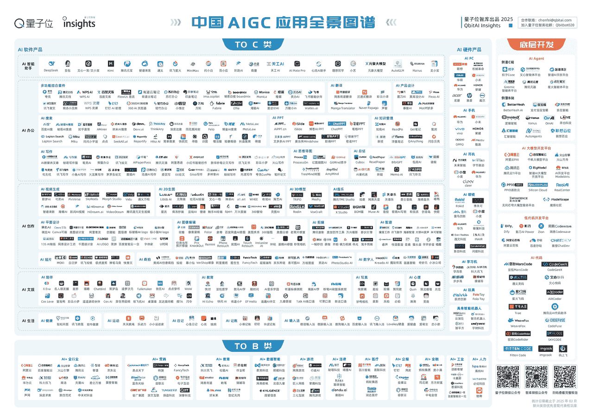

## 【20250419】Midjourney发布全新图像编辑器，能添加图层，增强AI创作体验

Midjourney于4月18日宣布推出更新版图像编辑器，带来焕然一新的用户界面、图层功能及智能选择工具，支持对AI生成或用户上传的图像进行精准编辑。新版编辑器向所有会员层级开放，让更多用户享受高级编辑功能。同时，优化后的内容审核机制力求在创意自由与规范之间取得平衡，回应用户对限制性审查的关切。此更新进一步提升了Midjourney在AI图像创作领域的竞争力，为用户提供更灵活、便捷的创作体验。

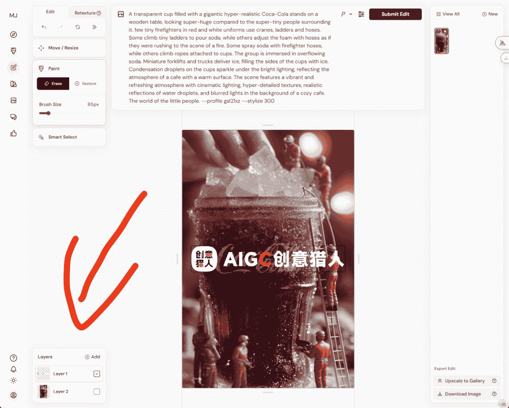

【20250427】OpenAI重磅发布新一代AI模型“o3”与轻量版“o4-mini”！

4月16日，OpenAI正式发布新一代AI推理模型“o3”及其高效版本“o4-mini”，全面升级语言理解与图像推理能力。

其中，o3具备最强逻辑推理、视觉识别与图像生成能力，并可独立调用ChatGPT工具，展现强大自主执行力；而o4-mini则以高效轻量为特点，兼顾性能与响应速度。

两款模型目前已向Plus、Pro及Team用户开放，GPT-5版本预计数月内推出，进一步加速AGI发展进程。

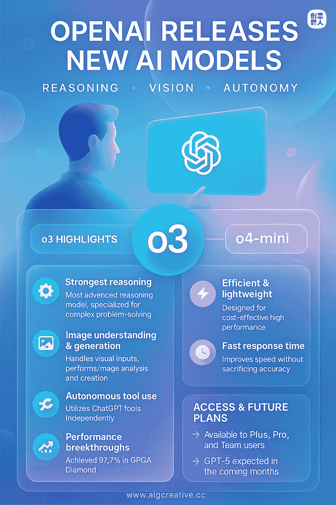

## 【20250416】谷歌推出Veo 2视频生成工具，赋能Gemini Advanced用户

谷歌为Gemini Advanced用户推出Veo 2视频生成模型，用户可通过文本提示生成8秒720p高清视频，展现逼真物理效果与多样化风格。Veo 2还集成于Google AI Studio与Whisk，支持图像动画化，面向全球用户逐步开放，需订阅Google One AI Premium。该工具嵌入SynthID水印确保安全，生成视频可轻松分享至TikTok等平台，助力内容创作者探索无限可能。

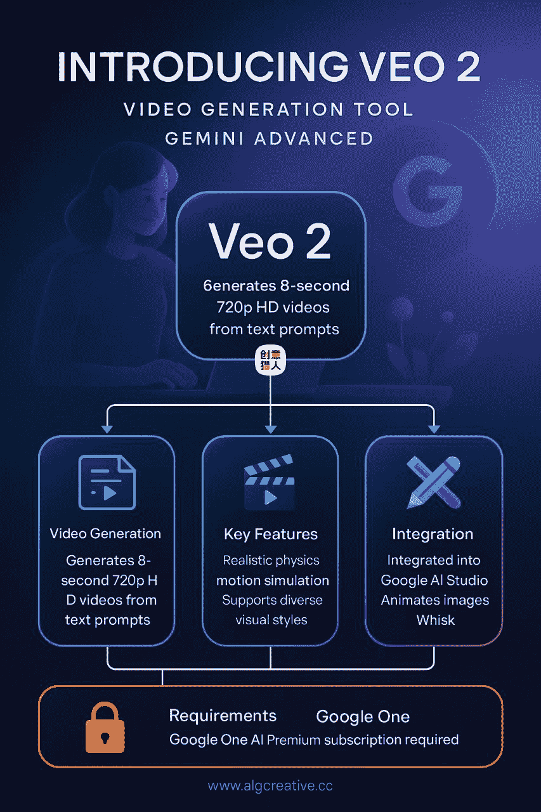

【20250416】ChatGPT推出图像创作库，统一管理AI生成图片！

OpenAI宣布上线全新“图像创作库”功能，用户所有通过ChatGPT生成的图片内容将集中至一个统一界面，方便查找与管理。该功能现已面向所有免费、Plus 和 Pro 用户在移动设备及 chatgpt.com 网站同步推出。这一更新不仅提升了创作的便利性，也标志着ChatGPT向视觉创作平台迈出了重要一步。

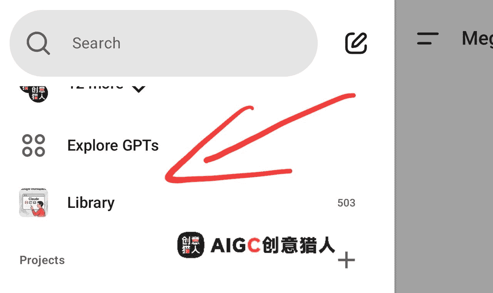

## 【20250415】GPT-4.1家族模型正式上线API，支持百万级上下文，专为开发者优化。

OpenAI正式发布GPT-4.1系列模型，包括GPT-4.1、Mini和Nano版，仅通过API提供服务。这些模型具备强大的编程能力、优秀的指令执行表现，以及高达百万级的上下文处理能力。尽管性能基准表现出色，OpenAI更注重其在真实开发环境中的实用性，广受开发者好评。同时，GPT-4.1定价更具竞争力，并将在7月取代现有的GPT-4.5 Preview版本。

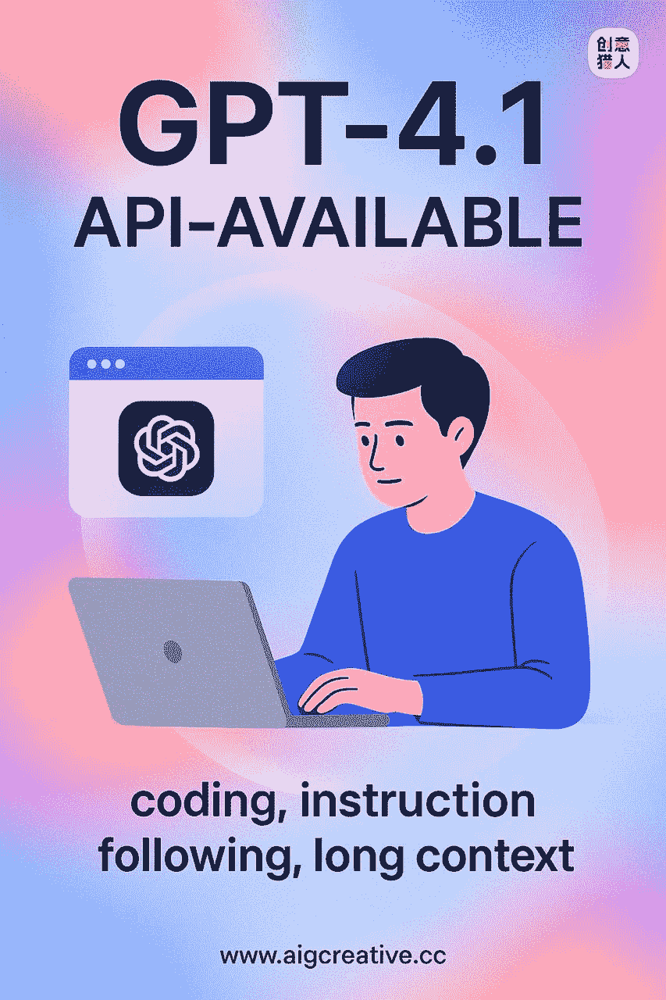

## 【20250411】Forbes发布2025年AI 50榜单，全面展现AI生态新格局。

2025年Forbes第七届“AI 50”榜单可视化图发布，涵盖从应用到基础设施的全栈AI生态。应用层涵盖消费级AI工具（如ChatGPT、Claude、Notion），创意平台（如Runway、Midjourney），垂直行业应用（如医疗、法律、国防等）。基础设施层则包括模型提供商（如OpenAI、Anthropic、Mistral AI）、推理平台、开发框架（LangChain）、数据处理平台和硬件厂商（如NVIDIA、AMD）。该榜单揭示AI公司已全面深入消费、企业、科研等多领域，代表未来技术竞争的主战场。

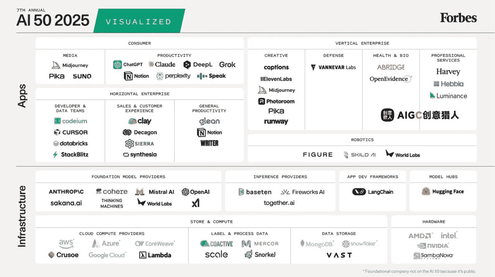

## 【20250411】WordPress推出AI建站工具，轻松打造个性化网站

WordPress近日推出全新AI建站工具，用户只需一句话描述需求，如“我想要一个展示个人设计作品的网站”，即可快速生成网站，无需编程或设计经验。AI支持对话式修改，例如“按钮换成换色”或“加一个个人主页”，并提供拖拽编辑器供手动调整。该工具适用于博客、商业网站、作品集、电商及内容订阅平台等多种场景。新用户可享受30次免费对话额度，网站生成后可直接托管并访问。ZipWP等类似工具也展现了AI在WordPress建站领域的潜力，强调高效与灵活性。

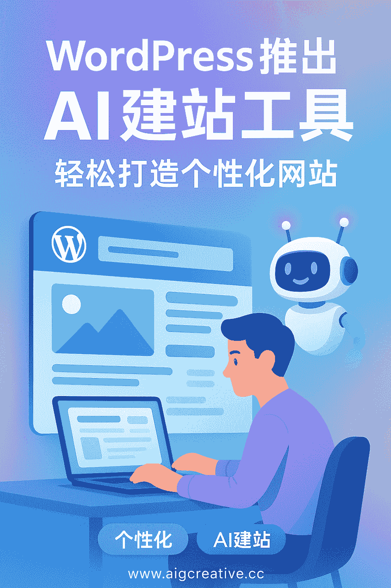

## 【20250401】动态 | ChatGPT能力全面领跑，AI工具功能对比图新鲜出炉！

一张更新于2025年3月29日的AI工具能力对比图显示，目前主流AI工具中，ChatGPT在数学、推理、深度研究、语音对话、图像生成、视频生成、实时摄像头识别和计算机操作等多个领域被评为“最佳”，展现出强大的多面能力。Claude在写作和逻辑表现突出，Grok与Gemini则在基础功能方面全面覆盖，Gemini在视频生成上表现优异，而Perplexity则在Web搜索方面尤为出色。整体来看，ChatGPT依然在AI工具大战中占据领先优势。

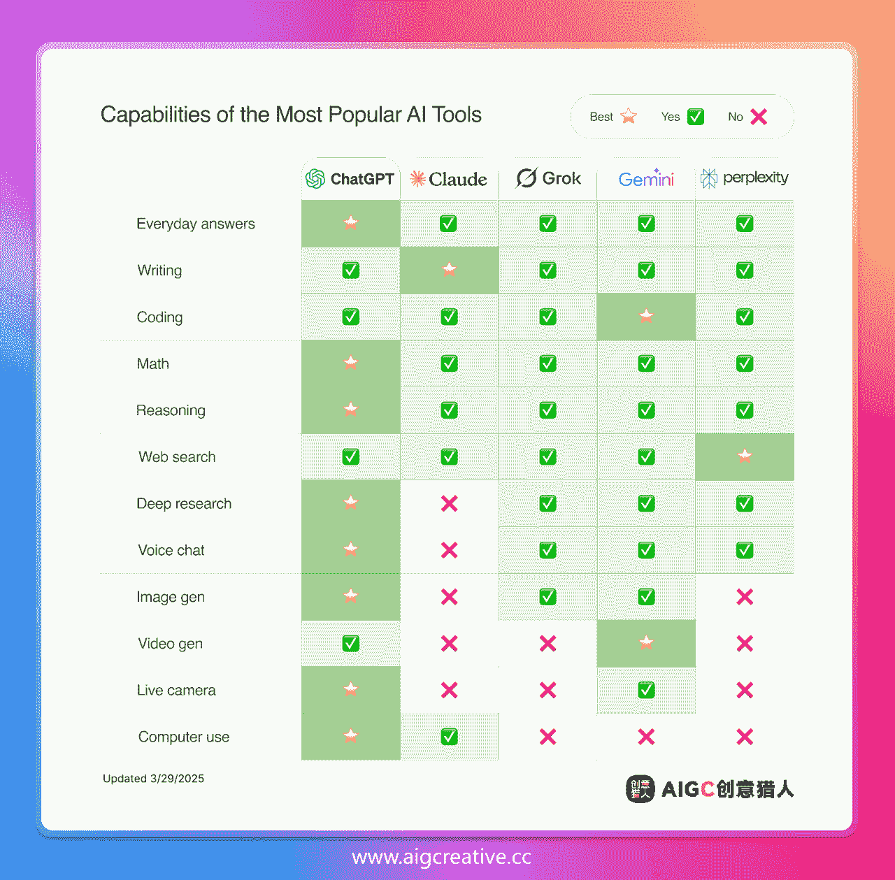

<https://aigcreative.feishu.cn/sync/K4Gvd9vUQsy9Oubwqaeclu0Fnbg>