# AI每日资讯-202503

> 来源：[https://aigcreative.feishu.cn/docx/Bebhd0LNCor2b3xaR4Wc83OLnzf](https://aigcreative.feishu.cn/docx/Bebhd0LNCor2b3xaR4Wc83OLnzf)

> **动态 | 观点 | 人物 | 产品 | 体验** | 应用 | 公司 | 融资 | 产业

## 【20250331】动态 |Runway推出Gen-4 AI模型，革新媒体生成技术

Runway公司发布Gen-4系列AI模型，显著提升了媒体生成的质量与控制力，超越前代Gen-3 Alpha。新模型在视频生成中展现出更高的真实感、动态效果及风格一致性，支持用户通过图像参考和指令创建连贯的故事内容。Gen-4的图像转视频功能已向付费及企业用户开放，并通过短片《The Lonely Little Flame》等作品展示其叙事能力。Runway致力于通过AI技术推动艺术与娱乐创新，其Runway Studios已利用该技术制作多部影片与音乐视频，为创作者提供强大工具。

详情见官网：https://runwayml.com/research/introducing-runway-gen-4

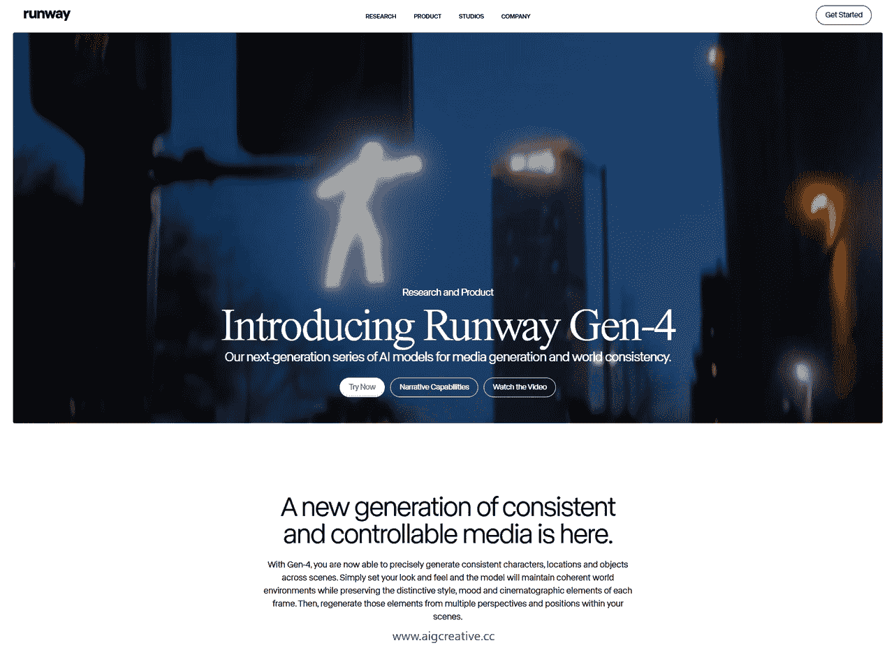

# 【20250330】动态 | AWPortrait CN2正式发布，升级模型聚焦东方美学表达！

由DynamicWang发布的AWPortrait CN2模型正式上线，这是对AWPortrait CN的全新升级版本。该模型深入探索东方美学，支持更多年龄段、服饰、场景等多样化主题，适用于食物、建筑、环境等图像生成需求，展现更细腻的视觉风格。该模型无需额外关键词，推荐LoRA权重为0.9-1，用户可免费在HuggingFace平台下载体验，使用Flux-1-dev-non-commercial-license VEL授权，进一步拓展AIGC在人物肖像生成领域的创造力边界。

# 【20250330】动态 | 谷歌火力全开！Gemini 2.5 Pro 实验版全面开放，支持多模态输入与百万Token上下文！

Google 正式向所有 Gemini 用户开放 Gemini 2.5 Pro（实验版），无需付费即可体验。该版本拥有更强的推理理解能力、更快更准确的代码生成能力，并支持文本、图片、音频、视频等多模态输入，最大支持上下文长度达100万token。TPU算力全面开动，Google团队全力加速推广，只为让这款更智能的模型尽早触达用户。

现在可通过 gemini.google.com 直接使用体验！

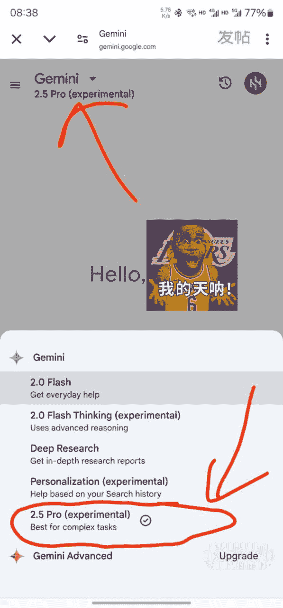

# 【20250328】动态 | PixVerse API推出首尾帧魔术功能，极简操作实现丝滑转场！

PixVerse最新发布的API功能“First & Last Frame Magic”，只需上传2张图片和文字，即可生成自然流畅的视频转场动画，助力内容创作者以极高效率打造视觉作品。该功能具备极简操作界面与高速渲染能力，适合日程繁忙的创作人群使用。全流程用户掌控，释放创意不设限。PixVerse再次展现其在AI视频编辑领域的领先实力。

[94886936c4062b5d3d92166bacbb7216.mp4](https://internal-api-drive-stream.feishu.cn/space/api/box/stream/download/all/NWGdbfFQcoPdoNxK3ohcCwbYnYc)

# 【20250327】动态 | 对抗GPT-4o，Ideogram 3.0发布，AI图像生成再升级

Ideogram AI推出Ideogram 3.0模型，以其惊艳的真实感、创意设计和一致的风格受到关注。新模型在图像-提示对齐、照片级真实感和文本渲染质量上取得重大突破，支持复杂空间构图和艺术化文本生成，适用于广告、设计等专业场景。Ideogram 3.0还引入了风格参考功能，用户可上传至多三张图像引导生成风格，并提供43亿预设风格库供探索。

性能测试显示，其ELO评级达1132，超越Flux Pro和DALL-E 3等竞品。目前，该模型已免费向所有用户开放，API接入即将来袭。

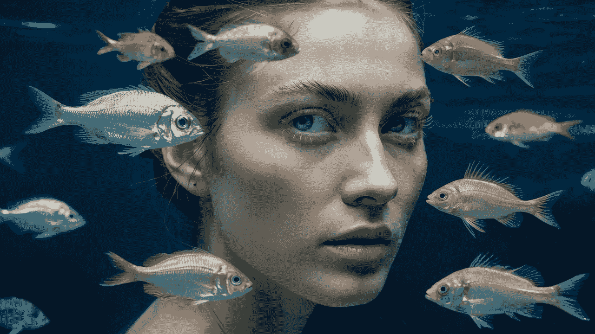

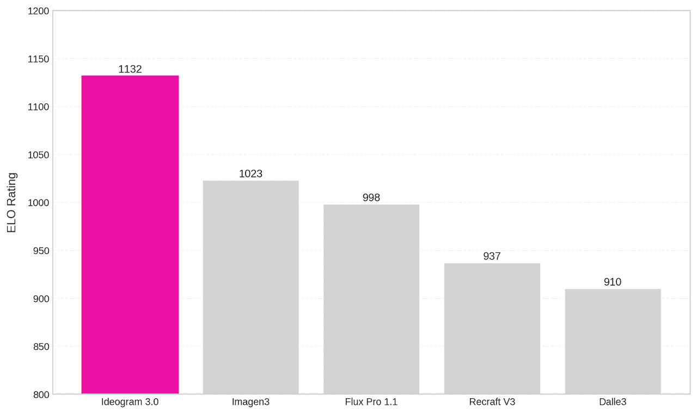

## 【20250321】动态 | Pika Labs 推出新视频编辑功能，精准操控视频内个别元素

Pika Labs 公布了一项强大的视频编辑功能，允许用户操控视频中的特定角色或物体，同时保持其余部分不变。这一创新提升了 AI 视频编辑的灵活性，使内容创作者能够精准调整画面，而无需重新生成整个视频。该技术有望在影视、广告及短视频创作中带来更多可能性，推动 AI 视频生成迈向更专业化和精细化的方向。

此外，Pika 还推出了 Pika Creative Partner Program，仅对社交内容与 AI 领域的顶级创作者开放，提供独家早期访问权限。

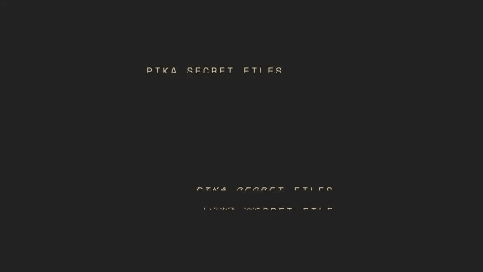

[db4078ee60848fad234baa2350665d0f.mp4](https://internal-api-drive-stream.feishu.cn/space/api/box/stream/download/all/BK32bZej5oKYxYxTSI1cvNURnXb)

## 【20250321】动态 | MidJourney 或将推出视频生成功能，征集用户意见

MidJourney 官方正在考虑在其平台上推出 视频生成功能，并向用户发起调查，征求关于发布时间、功能需求及定价模式的意见。从目前的趋势来看，AI 生成式视频正成为行业热点，MidJourney 这一举措可能意味着其将进军 AI 视频生成领域，与 Runway、Pika Labs 等平台展开竞争。该功能的推出或将进一步提升 MidJourney 在视觉创作领域的影响力，为用户提供更加丰富的内容创作工具。

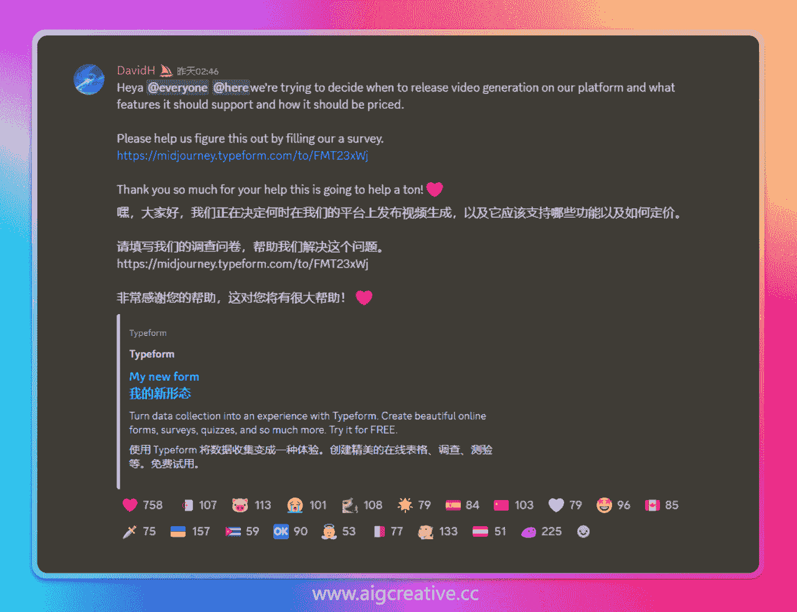

## 【20250321】动态 | OpenAI发布新一代音频模型，提升语音识别与TTS合成能力

OpenAI近日推出三款全新音频模型API，包括两款语音转文字（Speech-to-Text）模型——gpt-4o-transcribe（精准版）和gpt-4o-mini-transcribe（轻量版），以及一款文本转语音（Text-to-Speech）模型——gpt-4o-mini-tts。新版本在语音识别准确性上有明显提升，尤其在嘈杂环境下的抗干扰能力更强。同时，TTS模型支持语气风格调整，开发者可以生成更具个性化的语音内容。这些改进让音频AI技术更具实用价值，为客服、导航、语音助手等应用带来更智能、更人性化的体验。

网址：https://www.openai.fm/

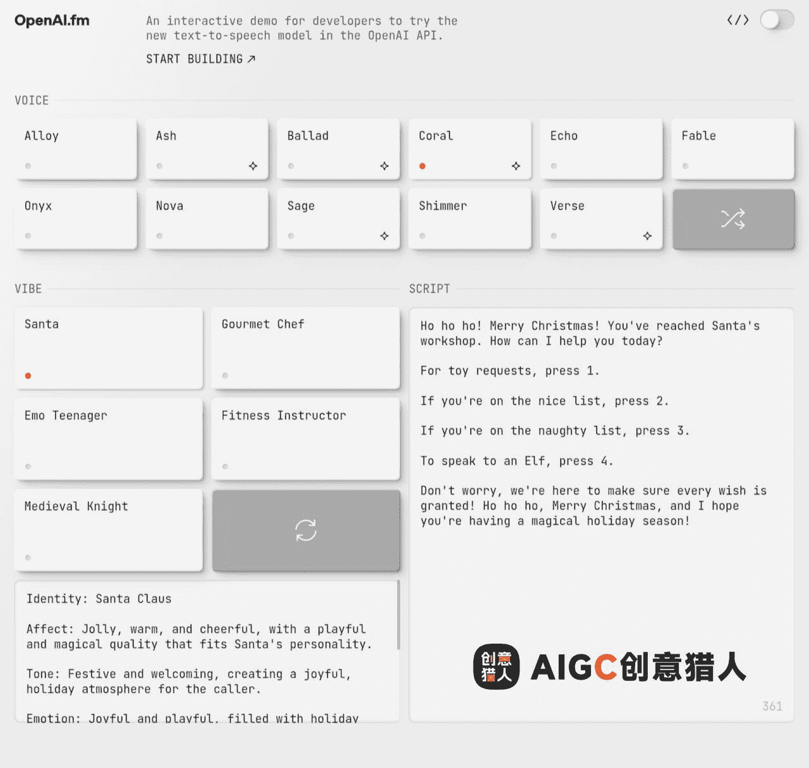

## 【20250320】动态 | Stability AI 推出 Stable Virtual Camera，AI 生成 3D 视角视频新突破！

Stability AI 发布了 Stable Virtual Camera，这是一款多视角扩散模型，可将 2D 图像转换为具有真实深度和透视感的 3D 视频，无需复杂的重建或场景优化。其核心功能包括动态相机控制（支持 360°、Dolly Zoom、螺旋等多种路径）、灵活输入（单张或多张图片生成 3D 视频）及多种比例输出。该技术在新视角合成（NVS）基准测试中表现优异，超越 ViewCrafter 和 CAT3D 等模型。目前，该模型处于研究预览阶段，并可在 Hugging Face 和 GitHub 上获取。

[52340fddc29a1abbfa51f350252753c8.mp4](https://internal-api-drive-stream.feishu.cn/space/api/box/stream/download/all/FfcYbVbNaoqb3hxtD7AcqmhRnnf)

## 【20250320】动态 | Google推出Canvas，让Gemini 2.0 Flash助力文档与代码创作

Google今日宣布推出Canvas，一个全新的互动空间，让用户可以与Gemini 2.0 Flash协作撰写文档和代码。Canvas支持快速生成初稿、编辑特定段落、调整语气和格式，适用于文章、博客、报告等多种文档创作。此外，开发者可以在Canvas中直接生成和预览React或HTML代码，进行实时迭代。Canvas已在所有Gemini支持的语言中上线。

未来，Gemini Advanced用户还将获得时间轴、思维导图和幻灯片等视觉创作功能。与此同时，Google还推出Audio Overview，允许Gemini Advanced用户基于文档和研究报告生成播客式对话，为信息获取提供全新体验。

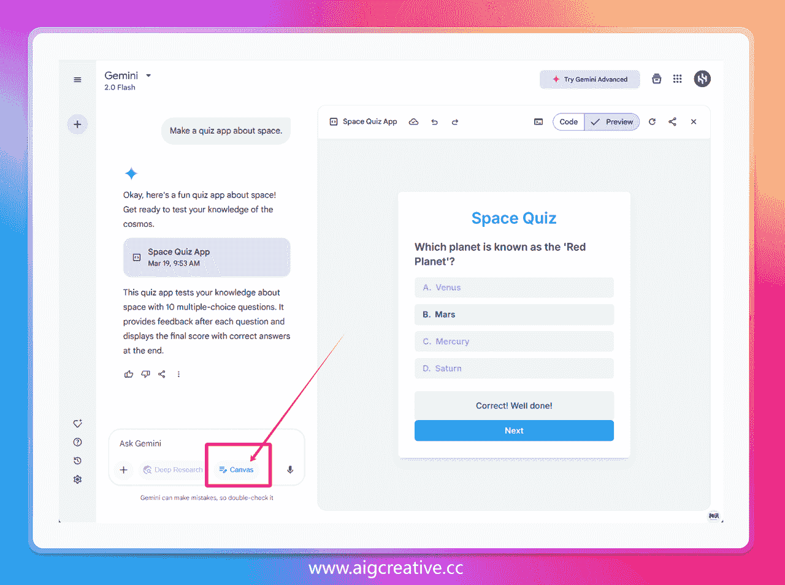

## 【20250319】动态 | 深圳众擎机器人惊艳展示：人形机器人学会舞蹈挑战人类极限

近日，深圳众擎机器人公司推出人形机器人SE01，该机器人在一镜到底的手机视频中，展现学习人类舞蹈的惊人能力，动作自然流畅，无需剪辑或加速，彰显中国在机器人领域的技术突破。结合AI技术，SE01定位工业用途，计划于2024年10月正式发布。

此举反映中国机器人产业快速崛起，2023年已占全球安装量51%，目标2027年实现人形机器人规模化应用，挑战美欧技术霸主地位。

[68185b3ade70df362ae31a70d598d1ec(7).mp4](https://internal-api-drive-stream.feishu.cn/space/api/box/stream/download/all/IU1vbT9tDodVCkxujg1cGZ8TnOf)

## 【20250314】动态 | 谷歌Gemini 2.0重大升级，AI助手功能全面增强

谷歌近期推出Gemini 2.0，带来多项突破性升级。

1）2.0 Flash Thinking实验版提升推理能力，扩展百万令牌上下文窗口，擅长科学与数学问题；

2）Deep Research功能免费开放，自动生成详尽研究报告并提供源链接；新增跨应用协作，支持YouTube、日历和地图；

3）Gems自定义聊天机器人免费使用，增强个性化体验。用户可输入兴趣等信息，获得精准回答。

4）2.0还支持图像生成、语音输出及代码执行，定位为高效AI助手，挑战ChatGPT地位。

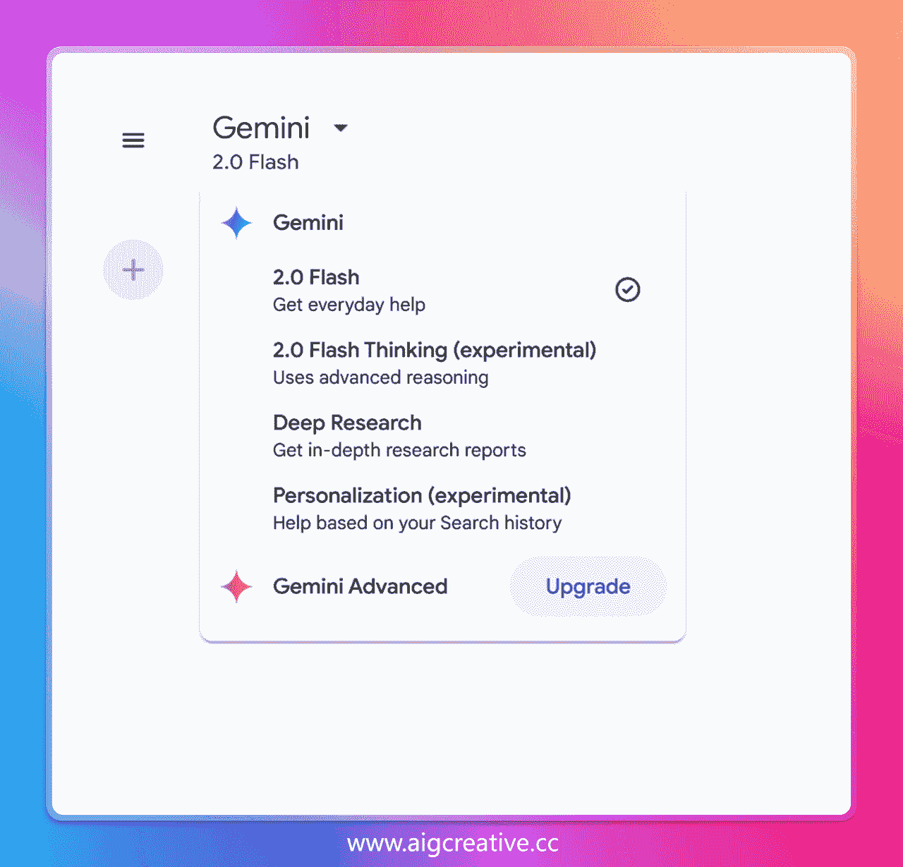

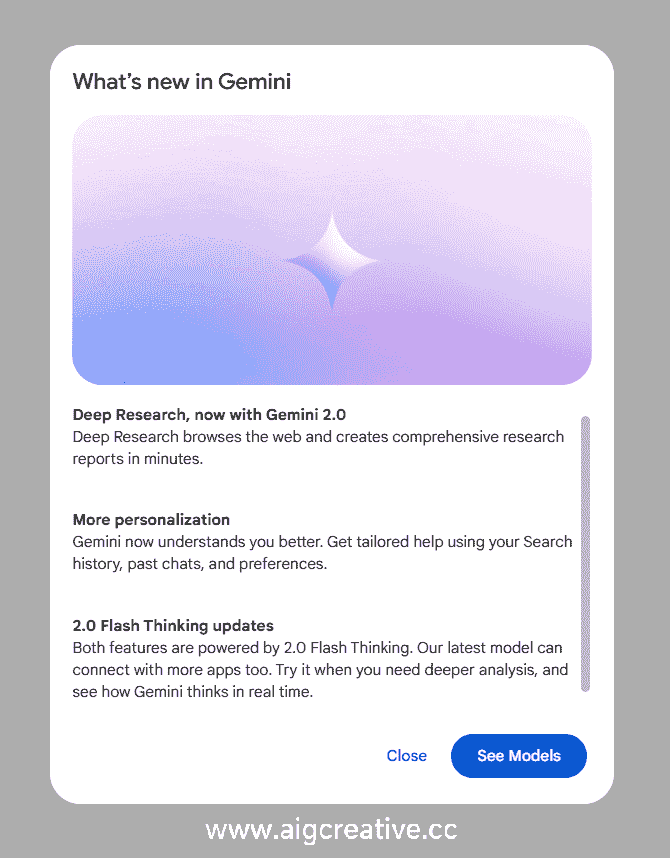

## 【20250314】动态 | KREA平台上线Google Veo 2，引领AI视频生成新纪元

Google DeepMind最新推出视频生成模型Veo 2，现已在KREA平台上线，支持从起始图像生成高品质视频，最多支持4K分辨率。Veo 2在MovieGenBench测试中表现优异，精准遵循提示，展现自然流畅的运动和复杂场景一致性，成为AI创意工具的突破性进展。相关研究显示，其性能超越多个领先模型，适用于营销、创作等领域。KREA作为AI创意平台，整合Veo 2强化其无限画布功能，推动AI生成内容发展。

[e9cef71739d331f2b7717a19060511b9_raw(3).mp4](https://internal-api-drive-stream.feishu.cn/space/api/box/stream/download/all/HUFFbX9wCoBmaSxXSWMcoX3Lnbe)

## 【20250307】动态 | a16z发布最新报告：AI消费应用格局重塑，ChatGPT与DeepSeek引领潮流

知名风险投资机构a16z发布了第四版《Top 100 Gen AI Consumer Apps》报告，揭示了生成式AI消费应用的最新格局。报告指出，ChatGPT凭借其不断升级的多模态功能，用户量在半年内从2亿增长到4亿，显示出强劲的增长势头。与此同时，新秀DeepSeek异军突起，自2025年1月推出后迅速获得大量用户，仅用20天就突破1000万用户。此外，AI视频生成领域也取得了显著进展，Hailuo、Kling AI等新公司推动技术走向成熟。a16z的报告还显示，AI开发工具和文本到网页应用平台迅速崛起，为开发者和非技术用户提供了强大的生产力支持。

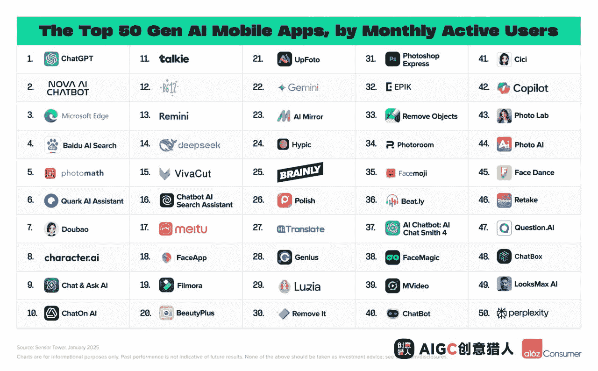

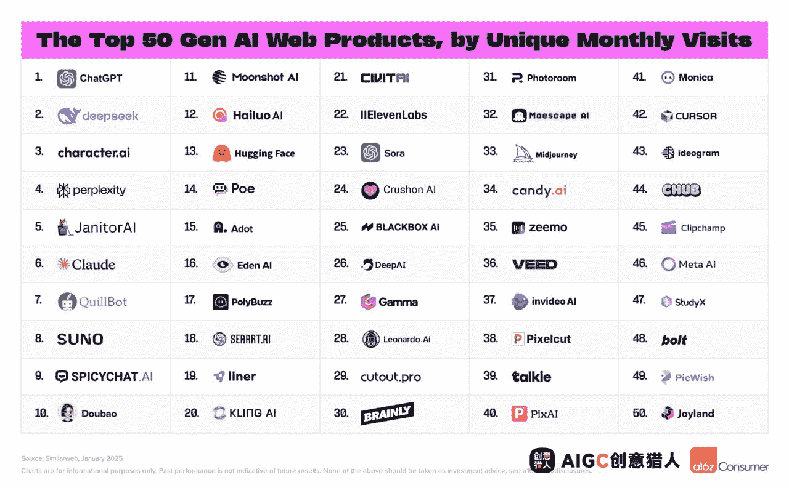

## 【20250306】动态 | Manus：中国首款通用型AI Agent，开启“真干活”时代

2025年3月5日，中国团队Monica发布了全球首款通用型AI Agent产品Manus。Manus能够自主执行复杂任务，如筛选简历、房产规划、股票分析等，并直接交付成果。它在GAIA基准测试中表现卓越，达到新的最先进水平。Manus强调“知行合一”，通过工具调用和云端计算，为用户提供从数据分析到生活规划的全方位服务。

目前，Manus处于内测阶段，用户可通过官网申请体验：https://manus.im

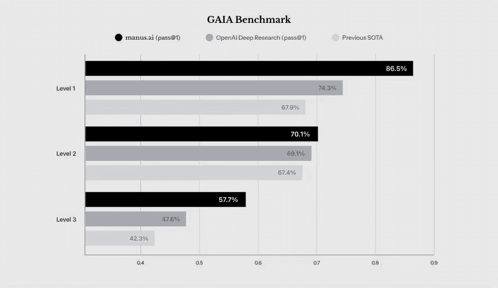

## 【20250306】动态 | ChatGPT向Plus用户开放GPT-4.5

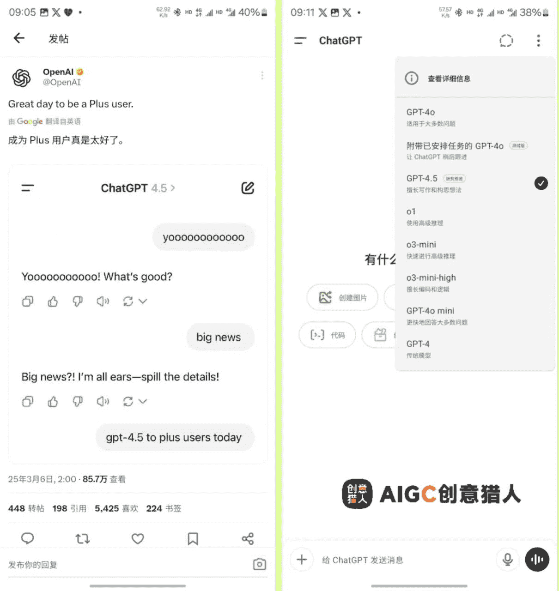

## 【20250304】动态 | Ideogram发布全新图像生成模型2a，速度更快、成本更低

最新的Ideogram 2a图像生成模型正式发布，专为平面设计和摄影优化。该模型能够在10秒内生成高质量设计和照片级真实感图像，而2a Turbo版本甚至仅需5秒。此外，生成图像的费用降低50%，极大提升了使用成本效益。2a仍然保持了强大的文字渲染能力，特别适用于海报和产品宣传设计。同时，该模型在人物刻画方面精度更高，成品图像具备出色的真实感和设计品质，并且能够灵活适应提示中的细节要求和特定风格，使其在产品展示和广告设计领域具有广泛应用价值。

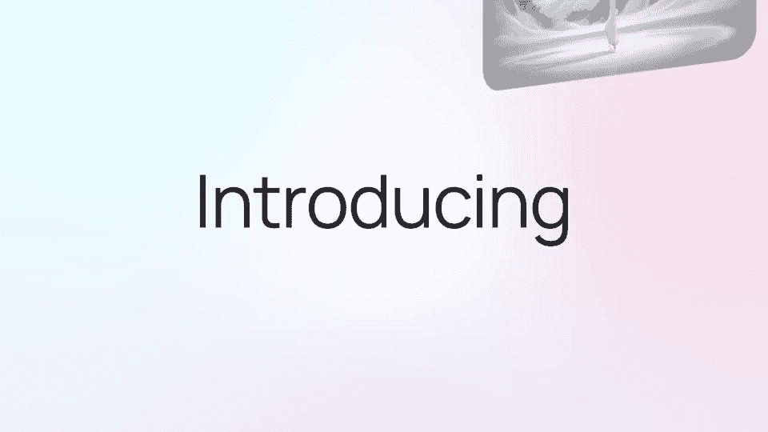

[d66384e3746db9e04051b09e1a8c5fe0.mp4](https://internal-api-drive-stream.feishu.cn/space/api/box/stream/download/all/FvD7bHt3RozwzVxqWcfcHP5pntf)

## 【20250303】动态 | AI在不同职业中的使用差异显著，在计算机、教育和媒体行业应用最广，传统行业应用较少

Anthropic的研究数据显示，人工智能（AI）在计算机与数学（37.2%）、教育/图书馆（9.3%）、艺术/体育/媒体（10.3%）等领域的应用最为广泛，而办公室行政支持、销售、运输、安装/维修等传统行业的AI使用比例相对较低。AI主要用于任务增强（57%）和自动化（43%），其中23%涉及学习查询，28%用于任务指令请求。这一趋势表明，AI在数据密集型、知识驱动型行业中已经成为重要工具，而某些传统行业尚未大规模采用AI技术。

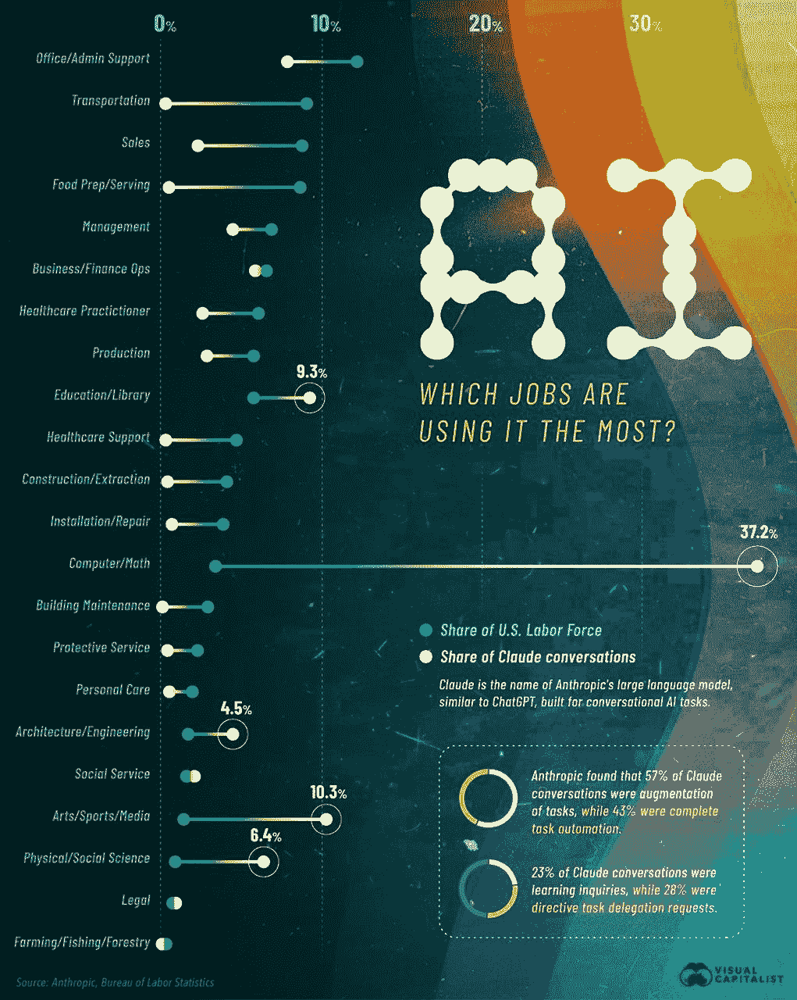

<https://aigcreative.feishu.cn/sync/K4Gvd9vUQsy9Oubwqaeclu0Fnbg>

# 知识库动态