# AI每日资讯-2024

> 来源：[https://aigcreative.feishu.cn/docx/P7dJd4HEpoH18ixaDcFcUDArnLg](https://aigcreative.feishu.cn/docx/P7dJd4HEpoH18ixaDcFcUDArnLg)

> **动态 | 观点 | 人物 | 产品 | 体验** | 应用 | 公司 | 融资 | 产业

## 【20241227】动态 | DeepSeek-V3震撼发布：低成本高性能，大模型训练新标杆！

DeepSeek发布了全新的DeepSeek-V3模型，以开放权重形式展示其强大性能。这款模型在仅耗费2048块GPU两个月、总成本约600万美元的条件下完成训练，对比之下，类似规模模型通常需动用高达1.6万块甚至10万块GPU。DeepSeek-V3的算力需求仅为2.8M GPU小时，比Llama 3 405B的30.8M GPU小时低11倍，但性能表现更强。模型速度提升至每秒生成60个token（是V2的3倍），全面支持API兼容性并开放源代码和论文，彰显在数据和算法优化上的卓越研究能力。这不仅展示了高效资源利用的可能性，也为前沿大模型发展提供了全新思路。

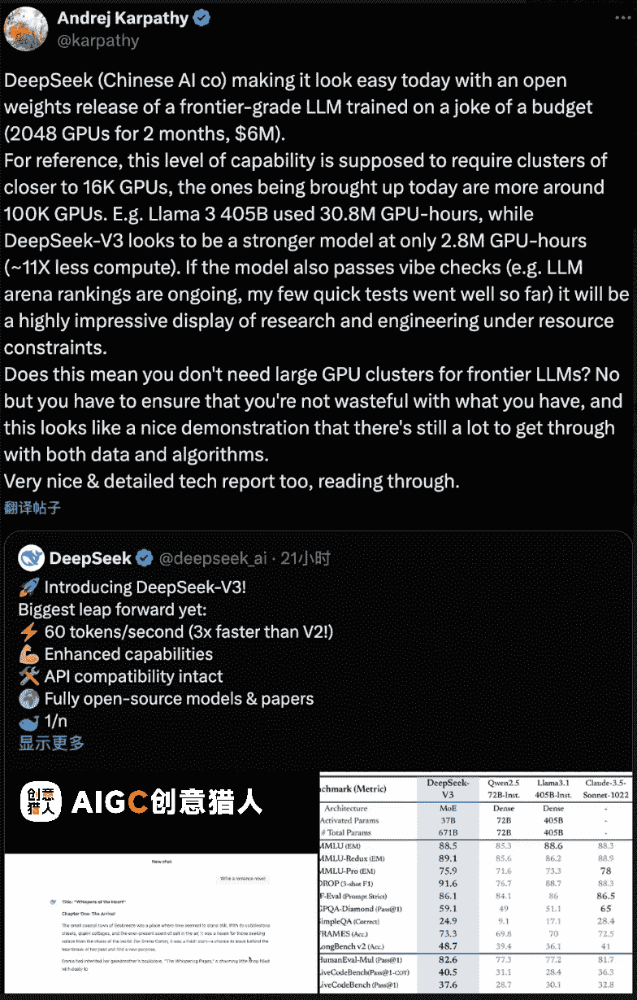

## 【20241221】动态 | OpenAI马拉松 12 天发布会一图总结：

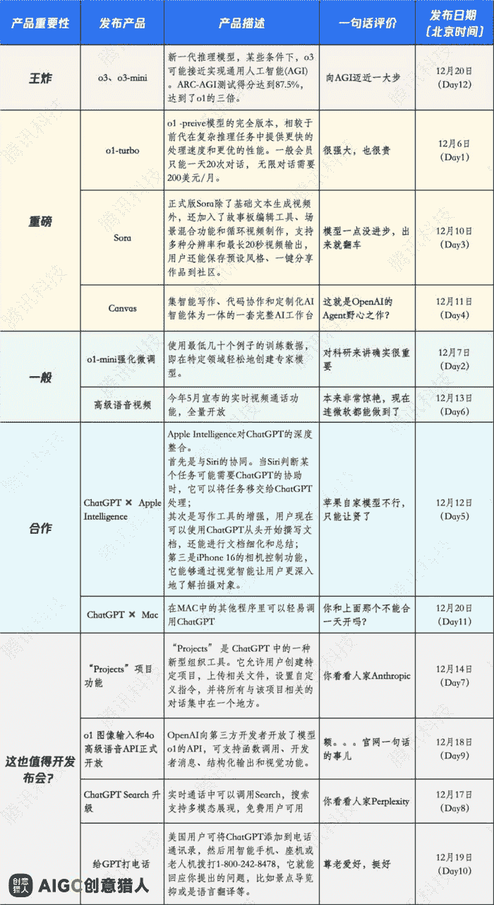

## 【20241221】动态 | OpenAI于2024年12月5日启动了为期12天的活动，每天发布新功能、产品或演示，展示其在人工智能领域的最新进展。今天终于结束了，以下是每一天的发布精彩内容：

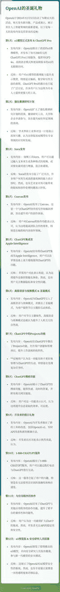

## 【20241219】动态 | ChatGPT电话版测试：

1.反应速度快，通话质量好

2.支持中文，但不可改变音色

3.无法联网，自述使用的是ChatGPT-4(?)模型，知识库截止到 2023 年 10 月

4.随时可以打断她的讲话重新提问

## 【20241218】动态 | 多款AI在IQ测试中表现亮眼，OpenAI与Claude-3系列领跑。

最新的Mensa Norway IQ测试结果显示，OpenAI的o1 Pro、o1 Vision以及Claude-3 Opus在AI智力评估中占据领先地位，平均IQ分数超过130分。GPT-4、Gemini Advanced等主流模型紧随其后，而其他AI如Llama、Grok-2和Bing Copilot分布在70到100分的范围。此次测试涵盖11个语言模型与7个视觉AI，展现了AI模型在认知能力与推理水平上的差异。

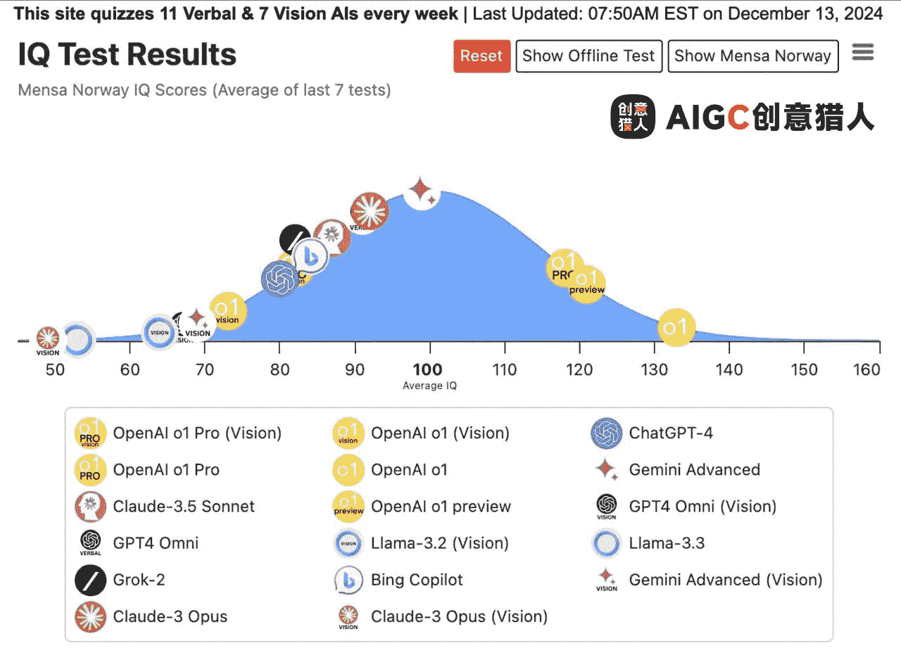

## 【20241217】动态 | Midjourney发布“情绪板”功能，个性化模型定制更高效。

Midjourney正式推出“情绪板（Moodboards）”功能，用户可以通过图像集个性化训练自己的模型。同时，平台增加了对多个个性化配置文件的支持，并将图像排名速度提升至5倍。这一更新大幅提高了创作者自定义模型的效率，使Midjourney在AI图像生成的个性化定制领域更具竞争力。

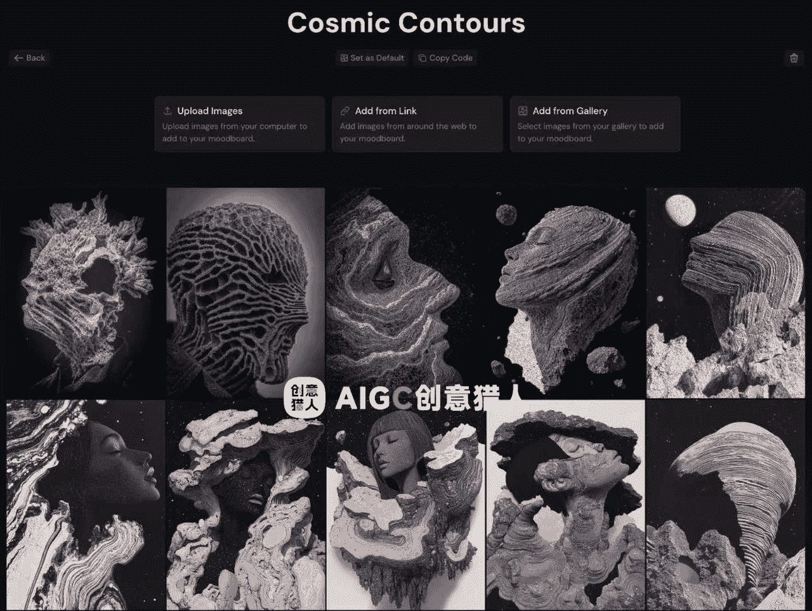

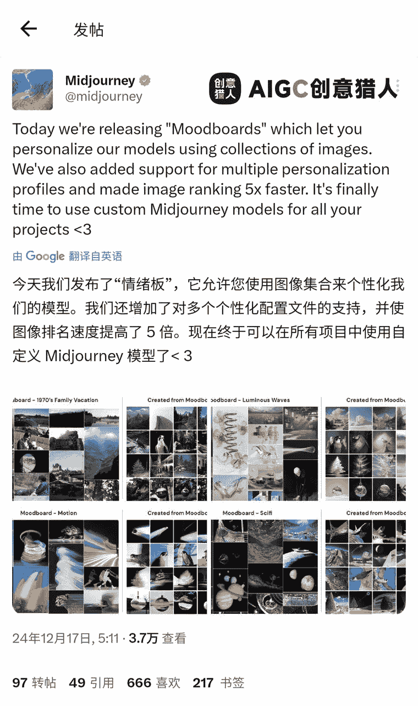

## 【20241216】动态 | 月之暗面 Kimi 视觉思考版上线：基于 k1 模型打造 可识别图片内容

月之暗面旗下的人工智能助手 Kimi 更新了视觉思考版新功能，能够观察和分析用户发送的图片内容，为用户提供准确的反馈和解答疑惑。这一功能基于 k1 视觉思考模型，可以智能分析图片，增强 Kimi 的交互能力，为用户提供更加直观和便捷的服务体验。

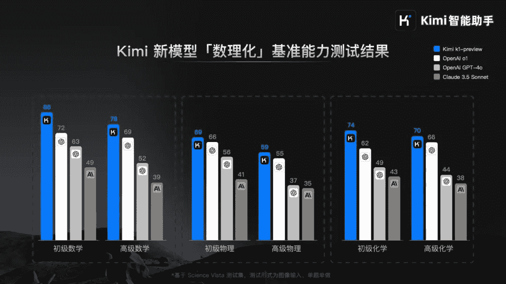

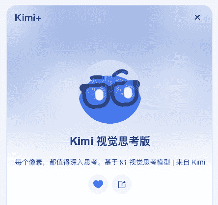

## 【20241214】动态 | 量子位发布2024十大AI趋势及国内最新AI产业图谱：大模型创新引领技术突破，AI推动全行业智能化！

量子位智库的《2024年度AI十大趋势报告》提出了未来AI发展的重要方向，包括大模型架构优化、Scaling Law的泛化、AGI探索以及AI在多领域的深度渗透。报告指出，大模型将突破算力瓶颈，AGI的研发聚焦视频生成和空间智能。AI+X产品快速崛起，催生AI助手、智能工具等全新赛道。此外，AI技术正在重塑生产力，智能化解决方案在行业应用中持续深化。

报告详情见文档：[2024年度AI十大趋势报告-量子位.pdf](https://aigcreative.feishu.cn/wiki/GNyiwflUDiDOEKk5WHBc9ZUwnsd?from=from_copylink)

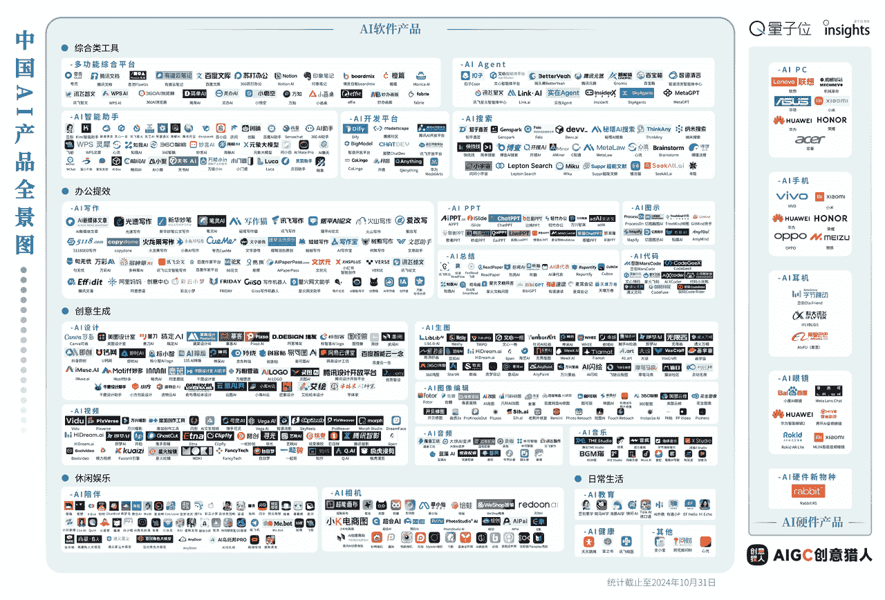

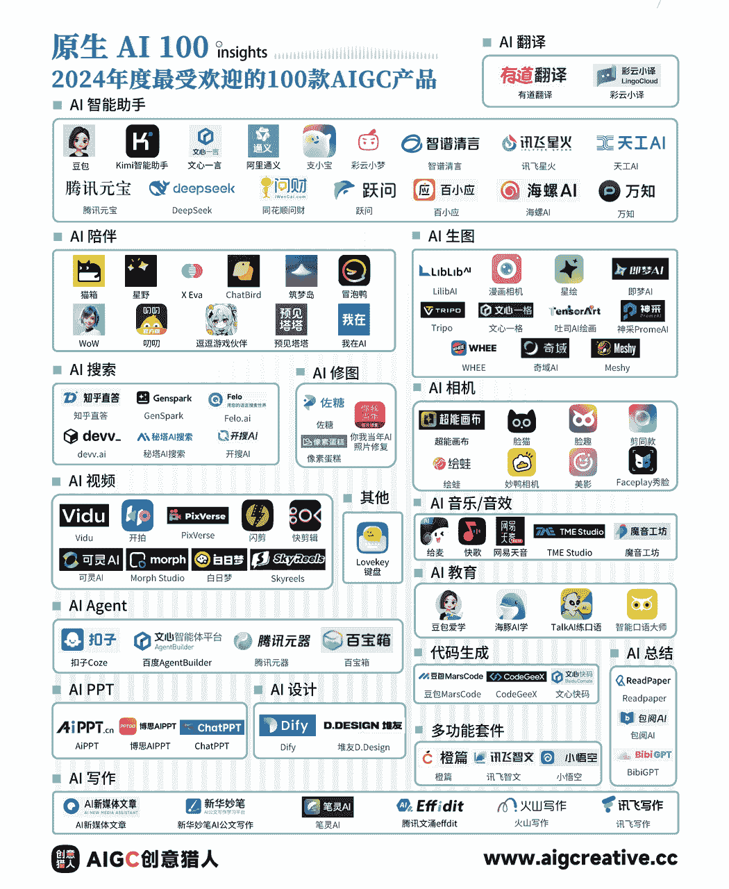

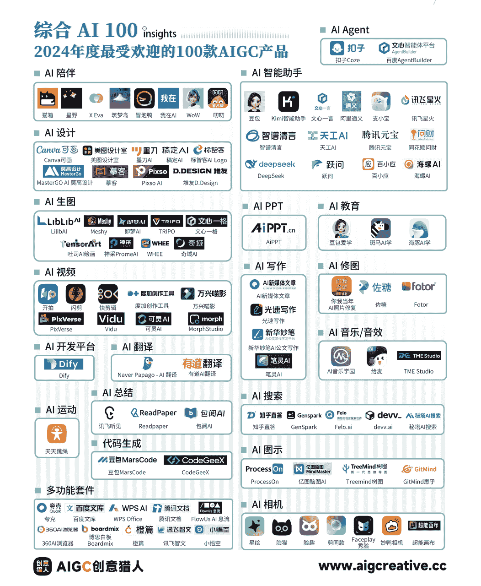

## 【20241214】动态 | Pika 2.0推出革命性功能“场景配方”，即A+B+C=ABC，让创作者自由构建完美画面。

Pika实验室发布的Pika 2.0模型通过全新的“场景配方”功能，使用户可以灵活选择角色、物品、服装和场景元素，只需上传参考图像并添加提示，模型即可智能识别各元素的角色，并将其无缝融合成一个完整画面。该功能大幅提升了场景设计的效率和自由度，为创意工作者提供了全新的创作工具。

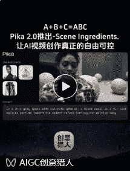

## 【20241212】动态 | 谷歌发布Gemini 2.0，开启AI新时代。

谷歌今日正式发布了下一代AI模型Gemini 2.0，标榜其为迄今为止最强大的AI模型。Gemini 2.0 Flash版本在关键基准测试中性能翻倍，支持多模态输入输出，如图像、视频和音频，提供了原生生成图像和多语言文本转语音功能。该模型还支持原生调用工具，包括Google搜索、代码执行等，极大增强了AI在日常生活和工作中的实用性。开发者可通过Google AI Studio和Vertex AI利用Gemini API进行开发，而用户可以通过Gemini和Gemini Advanced体验其聊天优化版本。

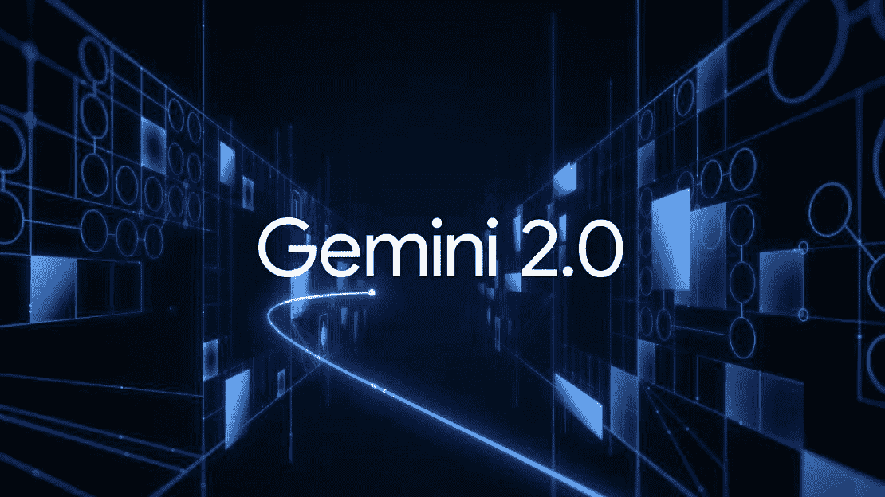

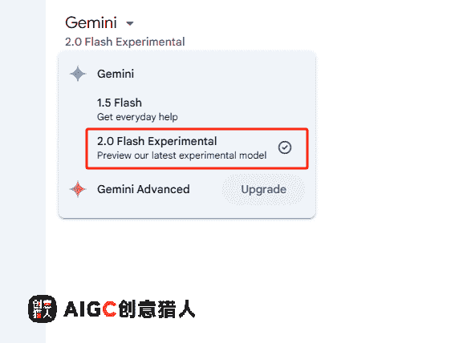

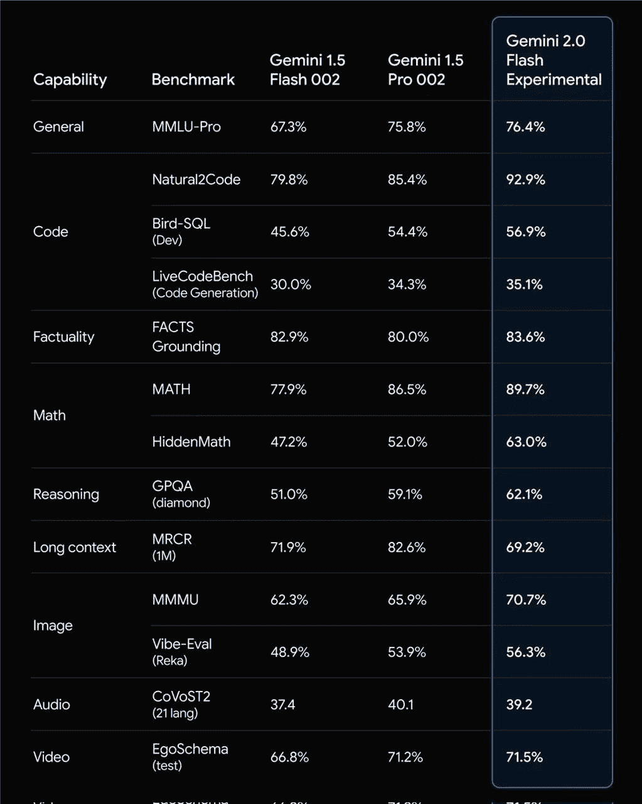

## 【20241209】动态 | 11月全球与国内AI产品排行榜揭晓，ChatGPT和360AI搜索分别领跑。

11月全球AI产品榜单显示，ChatGPT以39.2亿访问量蝉联全球榜首，访问量增长3.60%；360AI搜索在国内排名第一，访问量达2.83亿。值得关注的是，全球榜单中“Shop”电商类AI访问量增长高达57.26%，而国内榜单中Deepseek以72.57%的增长率成为增速最快产品。此外，微软Copilot与火山方舟等新兴AI工具表现亮眼，分别实现了在全球与国内市场的快速渗透。整体趋势表明，AI产品应用领域多元化，尤其在电商、设计和教育工具领域竞争激烈。

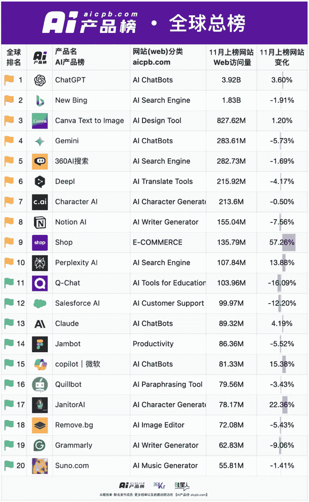

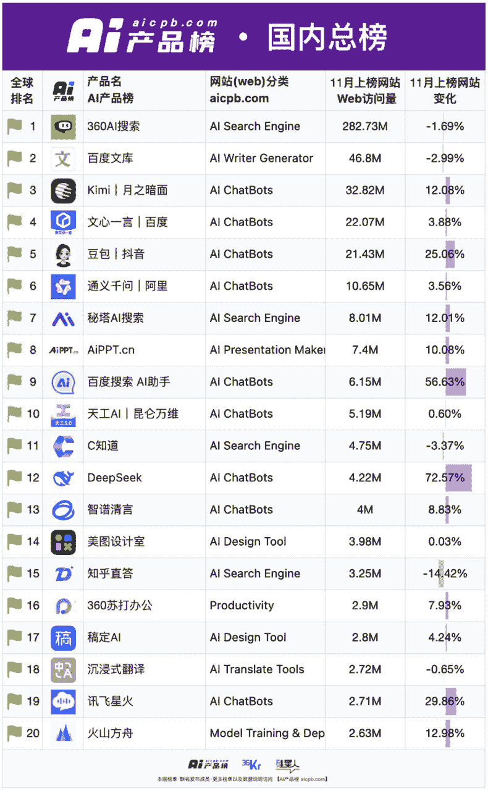

## 【20241208】动态 | 马斯克旗下X平台Grok聊天机器人全面开放，免费用户每两小时可发送10条消息

埃隆·马斯克的人工智能公司xAI推出的AI聊天机器人Grok，现已对所有X平台用户免费开放使用。此前仅限于付费订阅用户的Grok，如今免费用户每两小时可发送最多10条消息，并可生成最多10张图片。这一举措使Grok在与OpenAI的ChatGPT、谷歌的Gemini等免费AI聊天服务的竞争中更具优势。此外，xAI近期完成了60亿美元的融资，计划推出Grok的独立应用程序，进一步拓展其在AI领域的影响力。

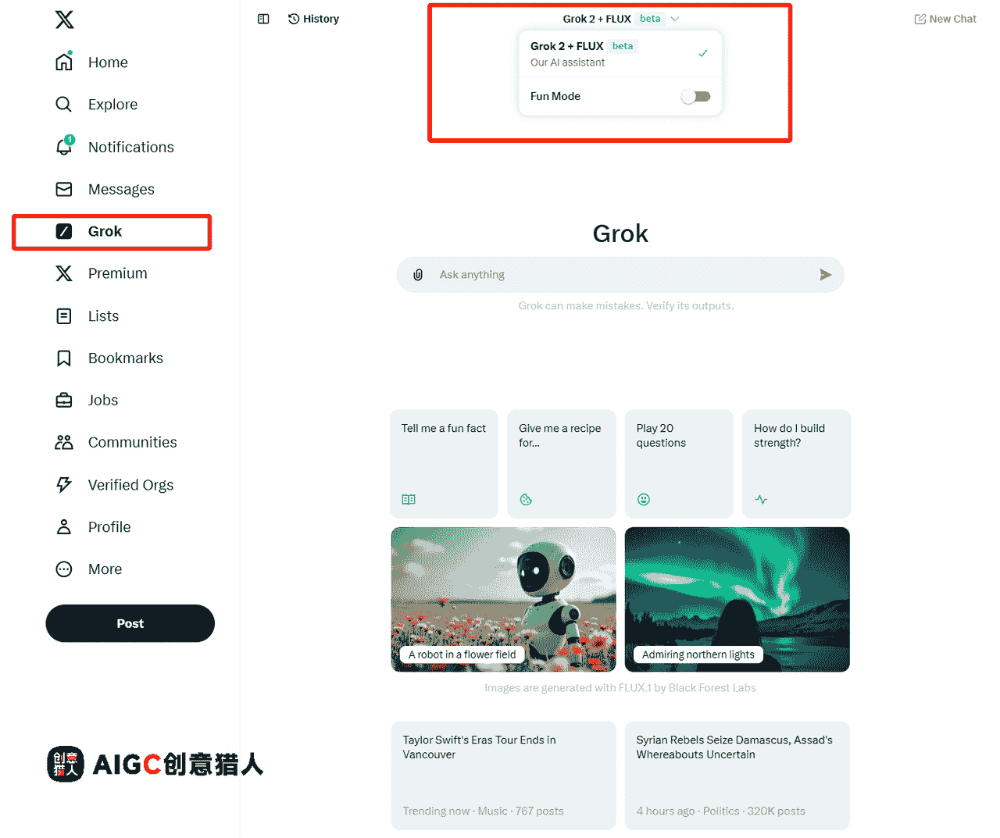

## 【20241207】动态 | 11月国内网页端AI产品排名出炉，“豆包”表现强势，AI市场呈现多元竞争格局！

在11月国内网页端AI产品排名中，字节跳动的“豆包”凭借高热搜指数和稳定用户粘性，综合得分9分强势夺冠；百度的“文心一言”以8.85分位居第二，展现其在内容生成与搜索领域的深厚积累。排名第三的“Kimi智能助手”在互动体验方面表现出色，得分8.35。值得关注的是，腾讯元宇宙（排名第5）和科大讯飞的“讯飞星火”（排名第7）持续深耕AI生态，展现了细分领域的潜力。同时，MiniMax的“海螺AI”凭借轻量化应用跻身第8，显示小型AI工具的市场需求正在增长。

此次榜单反映了国内AI市场从头部玩家主导逐步向多元竞争转变。头部产品继续巩固生态优势，而创新型企业与轻量级应用正在崛起，未来AI市场格局或将更加丰富多样。

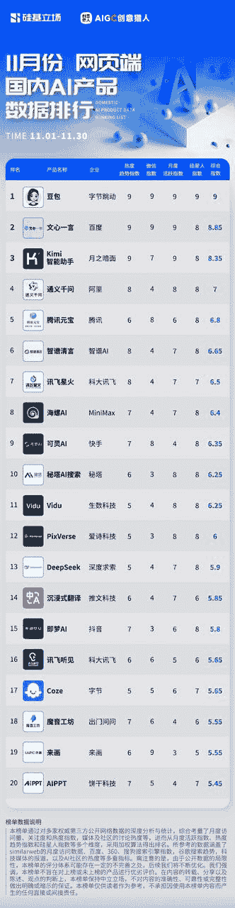

## 【20241203】动态 | Luma AI发布全新Photon文本生成图像模型，速度快、成本低、效果佳！

Luma AI推出的Photon及Photon Flash模型现已集成至Luma API，为创作者提供高度个性化和智能化的视觉生成工具。Photon具备多图参考、风格匹配等功能，以优越的语义理解生成符合需求的高质量图像。其成本极低，1080P图像仅需0.015美元，Flash模式更低至0.002美元，同时生成速度大幅提升，适合专业级创作。相比其他模型，Photon在创造力与质量上表现出色，带来AI生成图像的新标准。

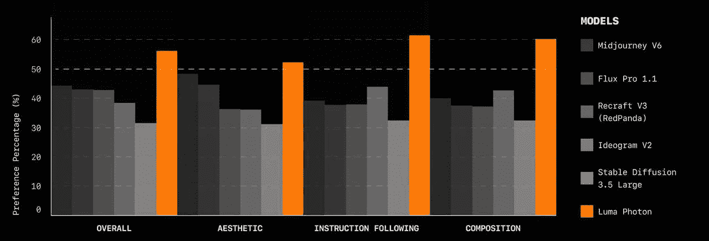

## 【20241202】动态 | 单张图片即可生成3D世界，李飞飞的World Labs发布空间智能预览版！

李飞飞的World Labs推出的空间智能技术，可通过单张2D图片生成完整的3D世界。其核心特点包括自由视角实时交互、真实物理模拟及场景持久性，同时支持与其他AI创作工具结合，优化创作流程。用户可“走进”图片，探索3D生成的场景，感受高度清晰且逼真的沉浸式体验。不过，目前交互范围有限，尚需进一步优化。

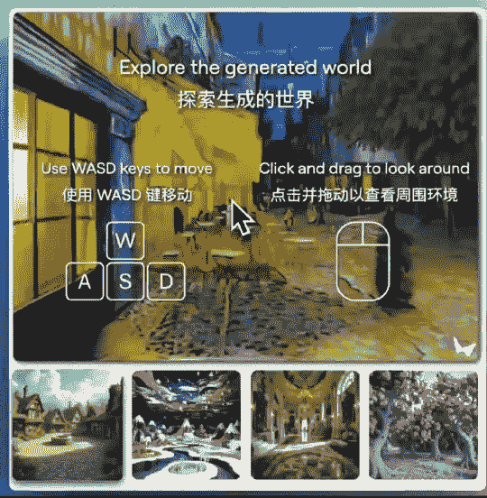

[2567463af8d87707d0d4ae2285e2274e.mp4](https://internal-api-drive-stream.feishu.cn/space/api/box/stream/download/all/TUAObx2M0ov0ZRxrzyLcMFOtn5O)

<https://aigcreative.feishu.cn/sync/K4Gvd9vUQsy9Oubwqaeclu0Fnbg>

# 知识库动态