# AI每日资讯-202411

> 来源：[https://aigcreative.feishu.cn/docx/GMSHd0zdioaTNnxisHLc6oXknld](https://aigcreative.feishu.cn/docx/GMSHd0zdioaTNnxisHLc6oXknld)

> **动态 | 观点 | 人物 | 产品 | 体验** | 应用 | 公司 | 融资 | 产业

## 【20241129】动态 | Midjourney 推出外部图片编辑功能，让用户能够上传本地图片进行局部修改。

Midjourney宣布新增的外部图片编辑功能，允许设计师和创作者上传自己的图片，并对特定区域进行 AI 辅助的精确修改。这一功能可在 Midjourney 官网中的 “Edit” 标签页找到，选择图片来源后，可利用 “Erase” 工具选择修改区域，并填写提示词来指导 AI 生成新图。编辑完成后，用户可调整画面大小、构图，并重复编辑流程以达到理想效果。

值得注意的是，此功能当前仅对于累计生图超过 10000 张、年度会员或者连续月度会员一年的用户开放。

Midjourney 的这一创新不仅提升了设计效率，也展示了 AI 在创意领域的巨大潜力。

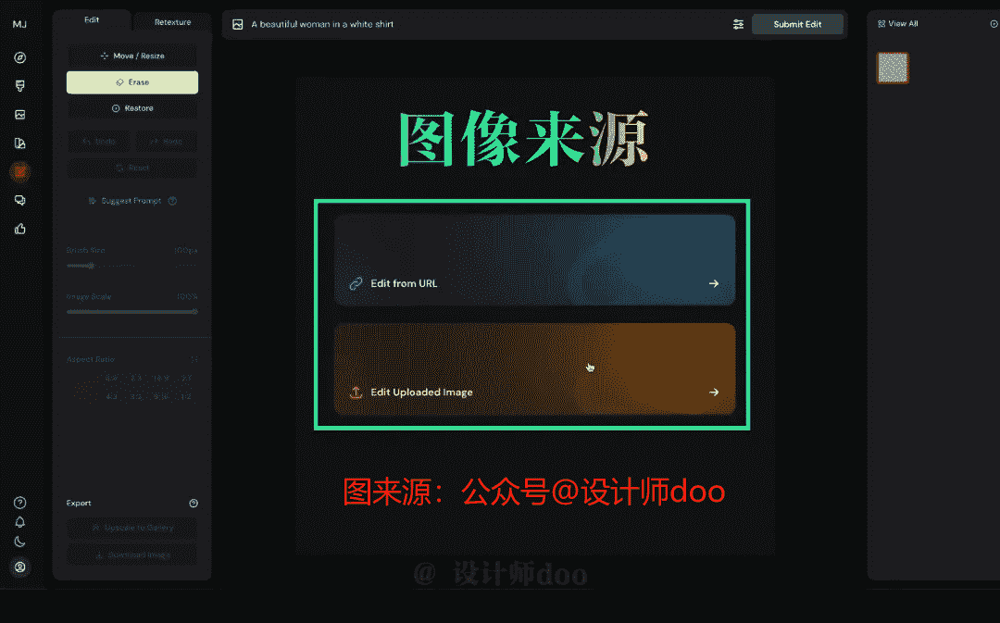

## 【20241128】洞察 | 硬件智能化趋势下AI设备创新迈向高峰。

AI硬件产品正引领智能化创新浪潮，从传统计算平台到AI驱动设备，涵盖机器人、智能汽车、穿戴设备和XR设备等多领域。其中，AI手机、XR设备（如Vision Pro和PICO 4 Ultra MR）与机器人（如Tesla Optimus）成为焦点，结合强大计算平台和AI算法提升用户体验。硬件创新历程也显示了从PC时代、移动互联网到物联网与AIGC的演进趋势，2024年人工智能设备正全面渗透各场景，构筑人机协同的未来。

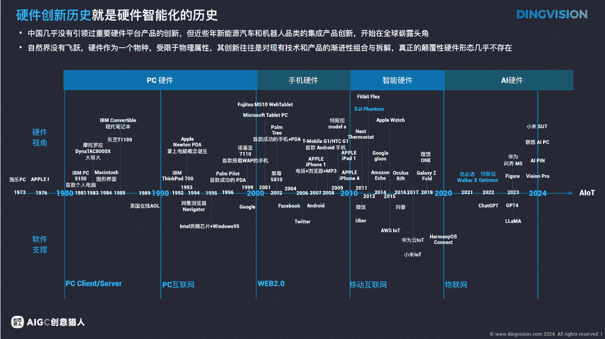

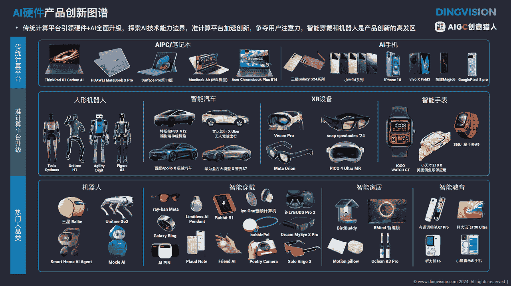

## 【20241126】动态 | Runway发布新基础模型“Frames”，带来前所未有的风格化控制能力。

“Frames”是Runway最新推出的图像生成基础模型，标志着在视觉逼真度与风格化控制方面的重大突破。通过该模型，用户可以创建具备精确视角和美学特征的虚拟世界。“Frames”旨在为艺术创作、影视制作及视觉设计领域提供更灵活的创意工具，满足用户对高精度和高品质影像的需求，进一步拓展生成式AI的应用边界。

[039df42c2a9516c79adb7a7c27259e4f(11).mp4](https://internal-api-drive-stream.feishu.cn/space/api/box/stream/download/all/J9scbjJcNoc6F9xSqq4crFxZn5e)

## 【20241126】动态 | Luma推出全新AI创意工具“Dream Machine”，打造突破性视觉创作体验。

Luma近日正式发布“Dream Machine”，这是一个强大的AI驱动创意工具，用户只需通过简单的文字提示，即可生成独特的场景、特效和动态影像。从超现实主义艺术到高品质摄影效果，工具支持多种风格定制。与此同时，Luma还推出了照片增强工具和多元化的场景设计功能，适合个人创作与商业应用，为视觉创作注入更多想象力与可能性。目前，该工具已全面上线，期待重新定义AI艺术创作方式。

[287a3ba423b47d9df7315f5b8d30d6df(11).mp4](https://internal-api-drive-stream.feishu.cn/space/api/box/stream/download/all/NMRzb3HTsosiFCxUxuIcDeVZnsd)

## 【20241120】动态 | Figure与宝马合作，推出自动化机器人车队Figure 02！

Figure宣布其第二代机器人车队Figure 02成功实现全面自动化操作，在端到端应用场景中速度提升400%，成功率提高至7倍以上。目前，该机器人车队每天已能执行超过1000次精确任务部署。Figure致力于将数百万台机器人推向全球企业和家庭，为产业链自动化和家居智能化带来颠覆性变革。

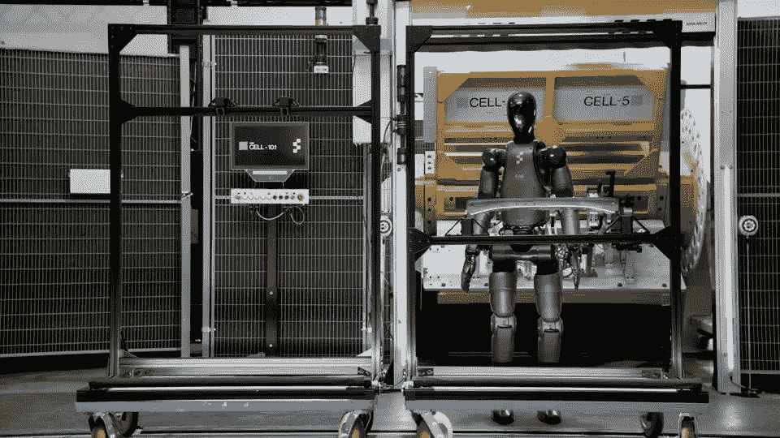

[431c519ebc673576c15f765317c56781.mp4](https://internal-api-drive-stream.feishu.cn/space/api/box/stream/download/all/EqzsbClypoblWmxAFnDcG2dEncd)

## 【20241119】动态 | 法国Mistral.ai平台推出1240亿参数的Pixtral Large，成为最强开源多模态AI模型。

该模型支持多种语言和128K上下文，能处理文本、图表、图像，性能超越GPT-4o等。同时，Mistral.ai更新聊天助手Le Chat，新增网络搜索、Canvas功能，并整合图像生成技术Flux Pro，提升多模态任务处理能力。

## 【20241119】动态 | Perplexity推出“Buy with Pro”，一键式AI购物体验全面升级。

Perplexity全新上线“Buy with Pro”功能，为用户提供一站式AI驱动的电商体验。用户可直接在平台内完成商品搜索、下单与支付，实现无缝一键结账，同时享受免费配送服务。该功能现已向美国的Perplexity Pro用户开放，并计划快速扩展至国际市场，助力从家居采购到派对筹备等多场景购物需求。

[ee18292aba201c4dbe053be3773209dc(11).mp4](https://internal-api-drive-stream.feishu.cn/space/api/box/stream/download/all/GYzxbz5DEoZWc9x8QRBcPiKNncr)

## 【20241118】动态 | 2024中文大模型全景图发布，应用、行业、多模态齐头并进。

SuperCLUE最新中文大模型全景图展示了多领域百花齐放的发展格局。在应用层，百度文心、讯飞星火、腾讯混元等通用大模型持续引领；多模态领域，涌现如“可灵AI”、“清帧AI”等文本生成视频的创新应用；行业模型涵盖医疗（百度灵医、医度MedGPT）、汽车（极氪大模型、NomiGPT）、教育（作业帮MathGPT）及金融（妙算金融大模型）等垂直领域，展现精准落地与深度场景化。

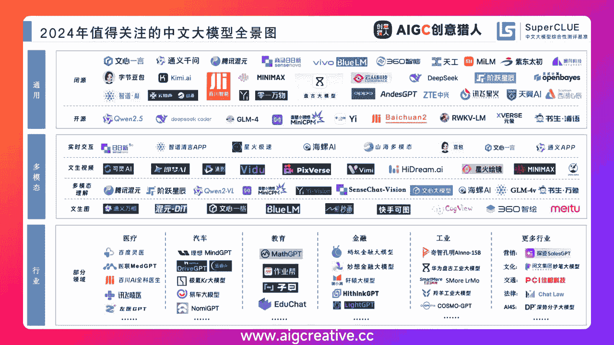

## 【20241118】动态 | Runway Gen-3 初学者使用指南，快速掌握AI视频创作核心功能！

这份速查表详细解析了 Runway Gen-3 的核心功能，包括从文字到视频、图像到视频的创作流程，以及镜头运动、关键帧控制、高级摄像设置等模块。通过直观的控制面板，用户可调整镜头平移、倾斜、缩放等效果，并结合丰富的电影风格、颜色分级及镜头类型，创作出高质量的视频内容。此外，还提供了结构化的文本提示模板，让用户快速上手视频生成功能。对于创作者，这是一款整合了AI创意与技术的全能工具。

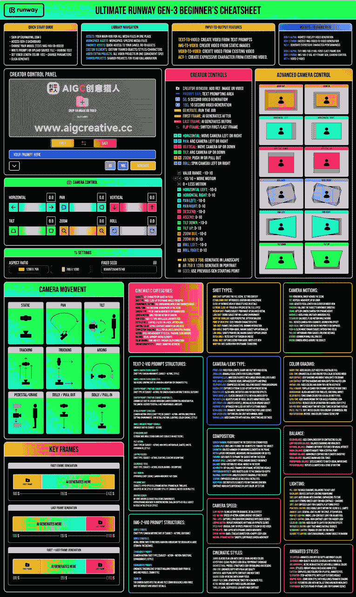

## 【20241106】动态 | AI大模型推动RPA进入2.0时代，实现智能化流程自动化。

来自a16z的图示，展示了RPA（机器人流程自动化）从传统人工流程到智能自动化的进化路径。1.0时代的RPA依赖固定流程，但易因路径中断导致失败。而2.0时代结合大语言模型（LLMs），通过AI代理灵活适应复杂任务需求，突破传统RPA的限制，实现从目标到结果的智能自动化，开启下一代流程自动化革命。

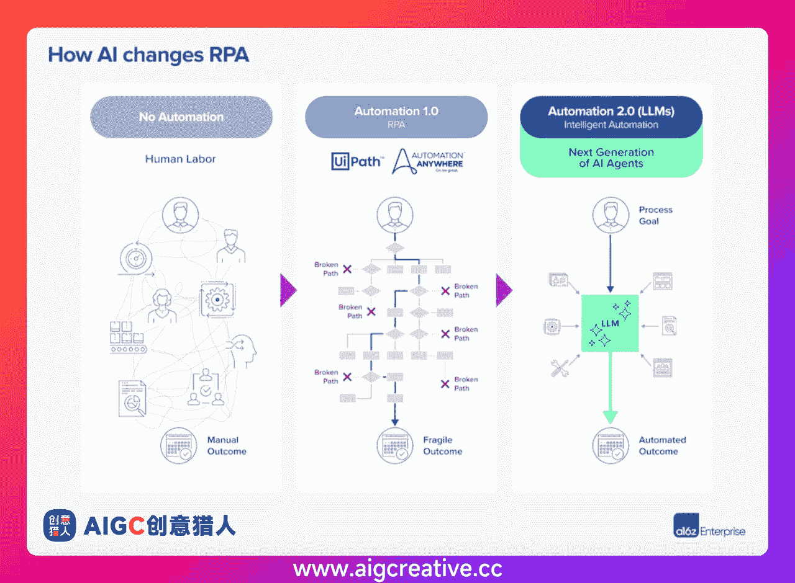

## 【20241115】动态 | Anthropic推出“提示词改进器”工具，优化AI提示词质量提升30%。

Anthropic发布了一项名为“提示词改进器”（Prompt Console）的新功能，帮助开发者自动优化提示词质量。该工具可改进提示词的逻辑结构、增加示例及标准化格式，还能预测模型的输出，确保AI生成的回答更精准、符合预期。测试显示，这一工具在多任务分类中将模型的准确率提升30%，并显著改善任务循环需求的完成度。

原文链接：https://www.anthropic.com/news/prompt-improver

[3adaf1c449c15bfea6ac4ea299f4c565(11).mp4](https://internal-api-drive-stream.feishu.cn/space/api/box/stream/download/all/CbnEbXxUDo6546xVxdVceJScnVb)

## 【20241115】动态 | Windows版ChatGPT桌面应用正式上线，支持快捷键和高级语音模式。

OpenAI宣布，适用于Windows系统的ChatGPT桌面应用现已向所有用户开放。用户可通过“Alt + Space”快捷键快速访问ChatGPT，并利用高级语音模式实现免提操作，与电脑进行实时互动，提升工作效率。这一应用的推出将为用户提供更便捷的AI助手体验。

下载地址：https://openai.com/chatgpt/desktop/

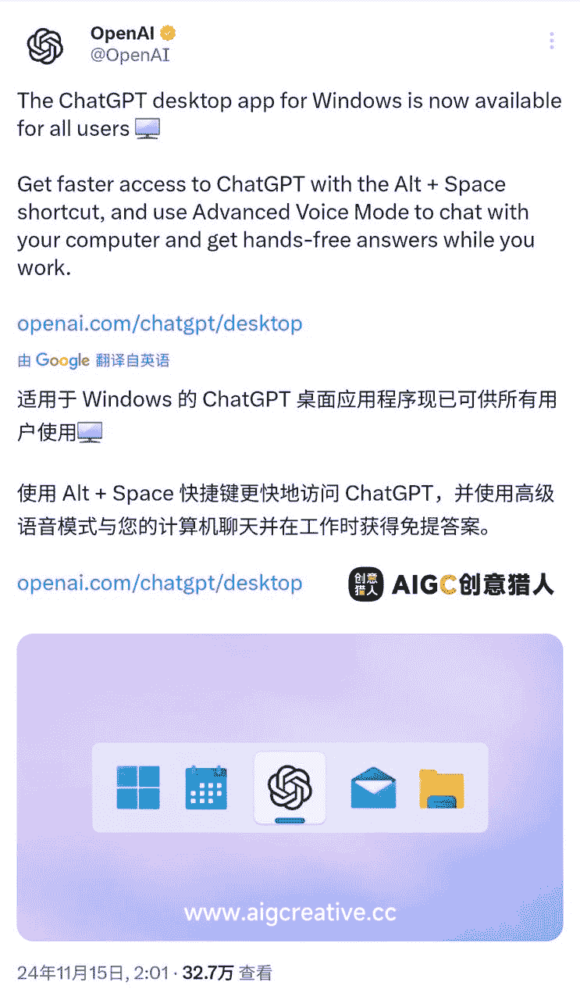

## 【20241114】动态 | 马斯克的xAI推出Grok网页版，加入C端用户争夺战

埃隆·马斯克推出的xAI大语言模型Grok近日上线了网页版，标志着其正式加入C端用户的争夺战。此前，Grok仅对X社交媒体的Premium订阅用户开放。新版本Grok2.0目前仅支持文本模式，且需要通过X账户登录，每小时限额约20次查询。尽管Grok在文本理解和逻辑推理方面表现尚可，但在实时搜索X社交媒体的功能上存在一些局限性，如无法提供参考链接、内容不全和可能出现过时信息等问题。尽管如此，Grok的实时搜索功能仍显示出其在社交媒体信息整合方面的潜力。

免费使用体验：https://x.ai/grok

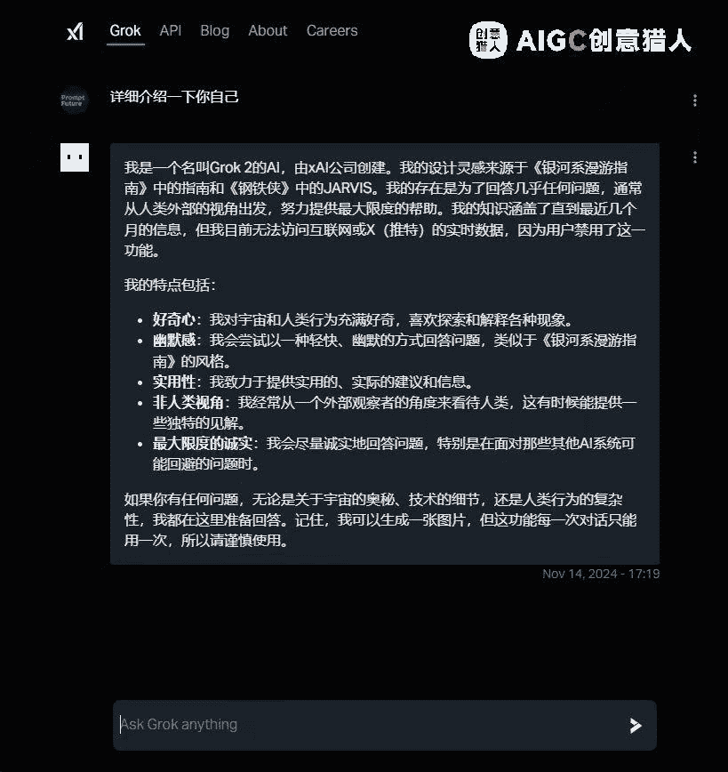

## 【20241113】百度展示全球AI生态图谱，聚焦AI生态系统中的多元玩家。

在Baidu World 2024大会上，百度展示了全球AI生态图谱。该图谱涵盖AI原生巨头、云服务、开源平台、芯片制造商、应用程序等多种类型的AI参与者。包括OpenAI、Google、NVIDIA、微软等国际巨头，以及阿里巴巴、腾讯等中国科技公司。该图谱反映出全球AI产业链的完整性和多样性，强调各类玩家在AI创新与应用落地中的独特角色。

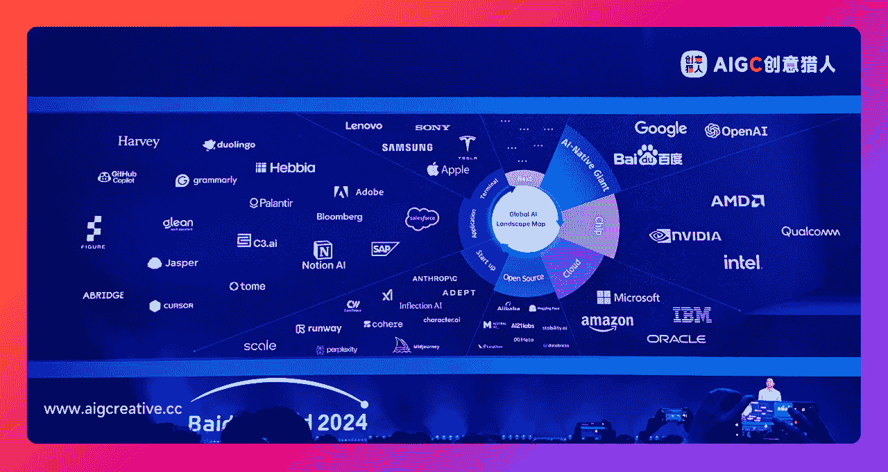

## 【20241112】动态 | 文心大模型突破日均调用15亿次，实现AI规模化应用

百度在2024年百度世界大会上表示：文心大模型日均调用量达15亿，自去年12月上线以来增长近30倍。百度推出两大新AI技术——“文心iRAG”增强精准生成能力，“秒赋”无代码工具降低开发门槛。文心智能体平台已有15万家企业与80万开发者入驻，广泛应用于营销、角色化服务、行业法律等领域。百度智能云服务覆盖60%央国企与大规模商业用户，累计优化33,000个模型并开发77万个企业级应用。未来，百度计划培养500万AI人才，推动“超级有用”生态建设。

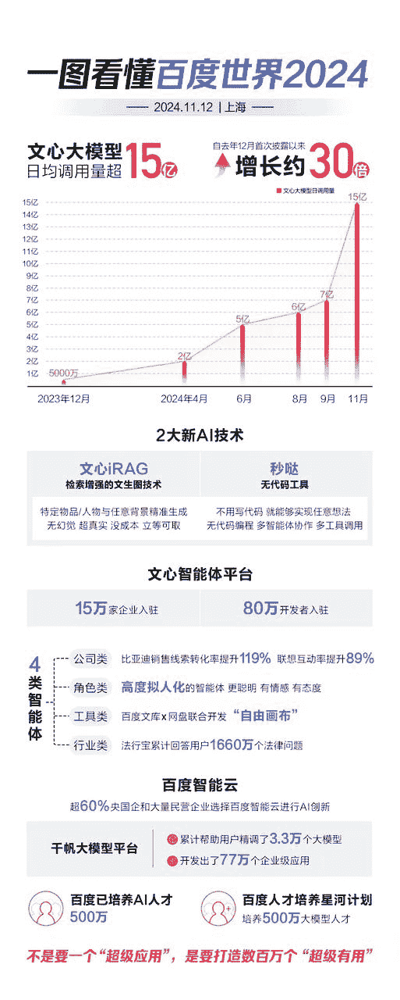

## 【20241111】动态 | Midjourney+Runway高级相机控制：对于静态拍摄来说非常稳定。.

Midjourney prompt: drone aerial shot, futuristic 5-star treehouse hotel exterior, nestled among the trees, eco-architecture luxury, sustainable, early morning shadows, bold, high-contrast, dramatic shadows, nature's symphony --ar 5:3 --p --s 200 --q 2

Runway prompt结构: The camera [motion] [direction], revealing [details]

Runway prompt例子: The camera pans left revealing an immaculate Yucatan jungle canopy, white sand beaches, crystal teal water, epic scenery

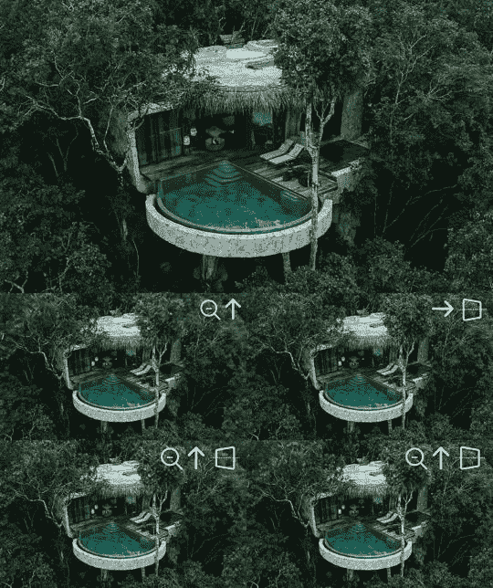

[14ebf4f2a97737dd7fdab369aaf0c135(5)_raw.mp4](https://internal-api-drive-stream.feishu.cn/space/api/box/stream/download/all/WLlubnZmaoltZaxauk3c7QCvn4c)

## 【20241110】动态 | Google推出Gemini AI驱动的自动化视频生成工具Vids，革新内容创作方式。

Google正式发布的Vids工具，可通过简单提示或Google Drive中文档生成各类视频演示内容，包括推销场景、脚本、背景音乐等。同时支持语音旁白与滚动式提词器，便于用户录制流畅自然的视频。此外，用户还可上传自己的素材，结合屏幕录制与音频编辑功能，创作多样化的视频内容。该工具适用于营销推广、公司公告与会议总结等多种场景，大幅降低视频制作门槛。

[d258c24bef889d32c395e144feaa4bb2(11).mp4](https://internal-api-drive-stream.feishu.cn/space/api/box/stream/download/all/F9UUbyzDYonvPCxudhEcFeLFnpb)

## 【20241109】动态 | 利用Gen-3 Alpha Turbo提升室内设计视频制作效率

设计师X@Everett World在X上分享了其使用Gen-3 Alpha Turbo的高级相机控制功能来制作室内设计视频的经验，表示这一工具极大地提升了其工作流程的效率。使用的资源包括Udio V1.5的音乐、Capcut的编辑、Midjourney V6.1的图片以及RunwayML的Gen-3 Alpha Turbo视频制作。整体效果很不错~~

[a53a3f19eef19dd57b65cf74a28219b8.mp4](https://internal-api-drive-stream.feishu.cn/space/api/box/stream/download/all/Za1GbSq8qoJBEvxvqFZcK5BUnMg)

## 【20241109】动态 | 利用Gen-3 Alpha Turbo提升室内设计视频制作效率

设计师X@Everett World在X上分享了其使用Gen-3 Alpha Turbo的高级相机控制功能来制作室内设计视频的经验，表示这一工具极大地提升了其工作流程的效率。使用的资源包括Udio V1.5的音乐、Capcut的编辑、Midjourney V6.1的图片以及RunwayML的Gen-3 Alpha Turbo视频制作。整体效果很不错~~

[1418d5c93fde8be1a17581574b766934.mp4](https://internal-api-drive-stream.feishu.cn/space/api/box/stream/download/all/CiNtb92StovfrPxko6icwgx2nPf)

## 【20241109】动态 |Suno音乐生成平台V4版本即将发布，音乐创作体验全面升级

音乐生成平台Suno即将推出的V4版本备受期待，这次更新将为音乐创作带来重大突破。V4版本的主要亮点包括提升音质，支持对已生成音乐进行“升级”处理，实现更高质量的音效和更清晰的人声；多元化风格，特别是在Hip-Hop/Rap等特定风格上更加自然；以及强化用户体验，通过频繁更新和优化生成效果，使用户能够快速创作出高质量的音乐作品。Suno V4将为音乐创作者提供更多的创作空间，无论是日常使用还是专业应用，都将提升平台的创作能力和用户满意度。

[562989398091a4f6117bf96bec109643.mp4](https://internal-api-drive-stream.feishu.cn/space/api/box/stream/download/all/OdRbbZiEpoiRKnxHIJkcwNWtnc1)

## 【20241108】动态 | Ai产品榜10月榜单

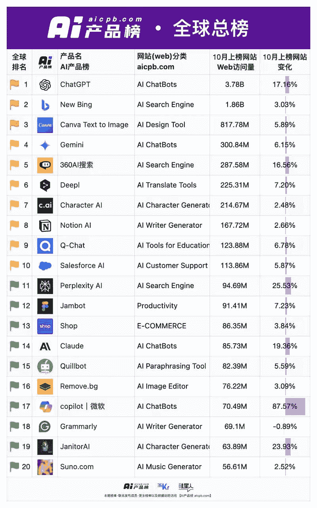

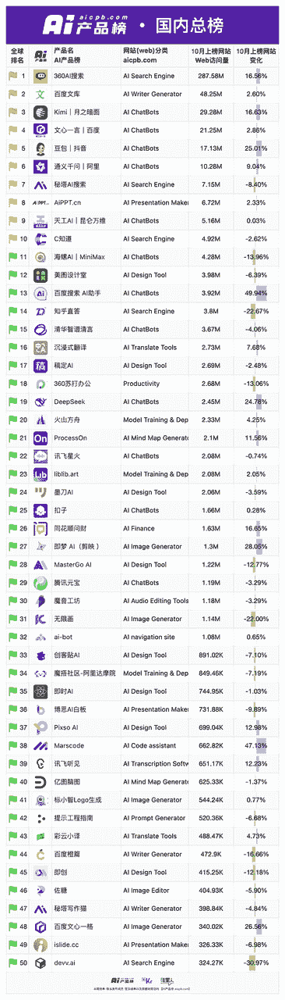

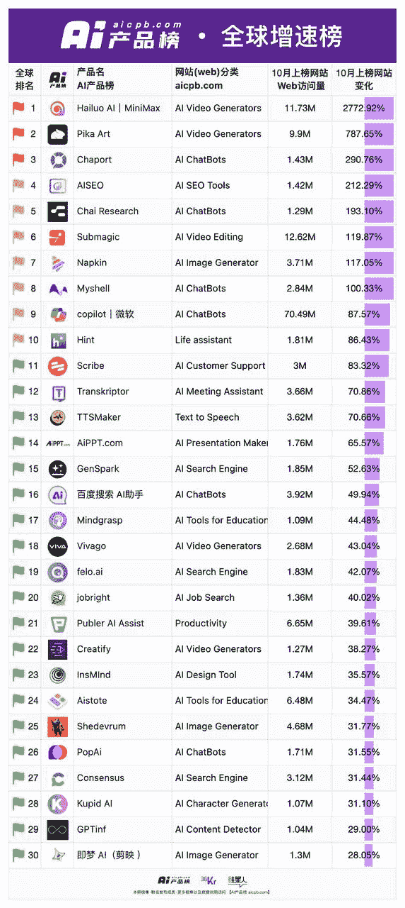

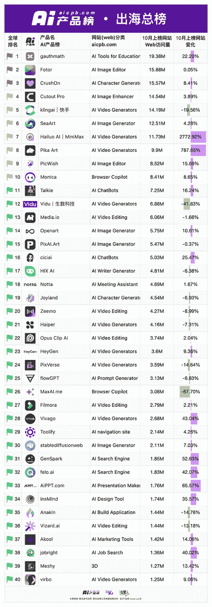

## 【20241107】动态 | 数字艺术家Jon Uriarte与OpenAI Sora合作，探索创意新境界

伦敦的数字艺术家Jon Uriarte，拥有超过15年的电影和电视行业经验，与OpenAI的Sora合作，创造出令人惊叹的视觉作品。Sora在创作过程中提供了意想不到的惊喜，帮助Uriarte实现了他对于“塑料椅子上飞翔的人”这一主题的想象。Sora的强大之处在于它能够在艺术家对具体外观有明确要求的同时，带来超出预期的创意。Uriarte表示，Sora的使用体验类似于写作或白日梦，能够流畅地发展创意，创造出既有机又精确的图像。

[6ca1e46f6ab73c50647281f4b06ba756(3).mp4](https://internal-api-drive-stream.feishu.cn/space/api/box/stream/download/all/LiCwbbHP9o4KWixSGZGcnfhBndc)

## 【20241107】动态 | 腾讯发布混元-3D：首个支持文本与图像生成的3D开源模型

腾讯推出“混元-3D”模型，支持用户通过文本或图像在10秒内生成高分辨率3D模型。该模型涵盖“文本到3D”和“图像到3D”功能，能够精确构建从大型建筑到小型工具和植物等多种3D物体，广泛适用于游戏开发、影视动画、电商广告及虚拟现实（VR/AR）等领域。生成过程包括网络格和纹理提取，快速高效，旨在提升3D创作效率，为创作者提供便捷的3D生成解决方案。

官网：https://3d.hunyuan.tencent.com/

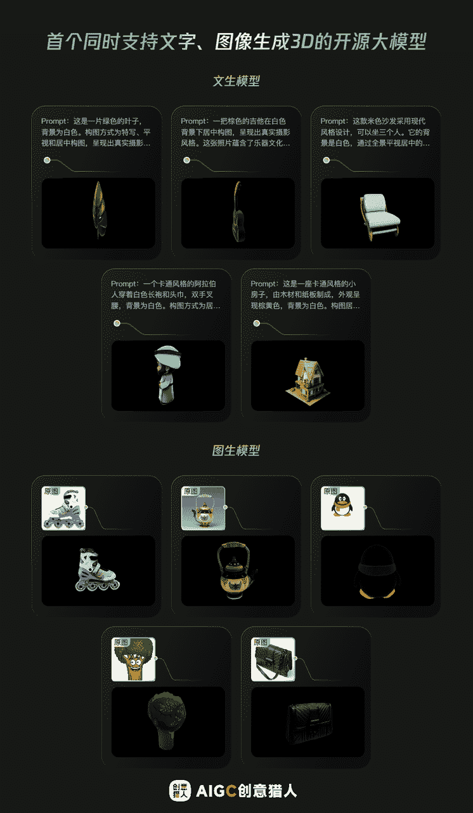

## 【20241105】动态 | 生成式AI应用多样化，六大主题覆盖100种使用场景。

研究显示，生成式AI在六大主题中的使用情况丰富，包括技术支持与故障排除（23%）、内容创作与编辑（22%）、个人与职业支持（17%）、学习与教育（15%）、创意与娱乐（13%），以及研究、分析与决策（10%）。在100个具体用例中，用户借助生成式AI来实现创意激发、文本编辑、调试问题、代码生成、数据处理及个人陪伴等功能。这种广泛的应用场景展现了生成式AI对提升生产力和问题解决能力的潜力。

文字版见文档：[How People Are Using GenAl](https://aigcreative.feishu.cn/wiki/IUxXwHs9viFt7Gk0xB6cz786nN6)

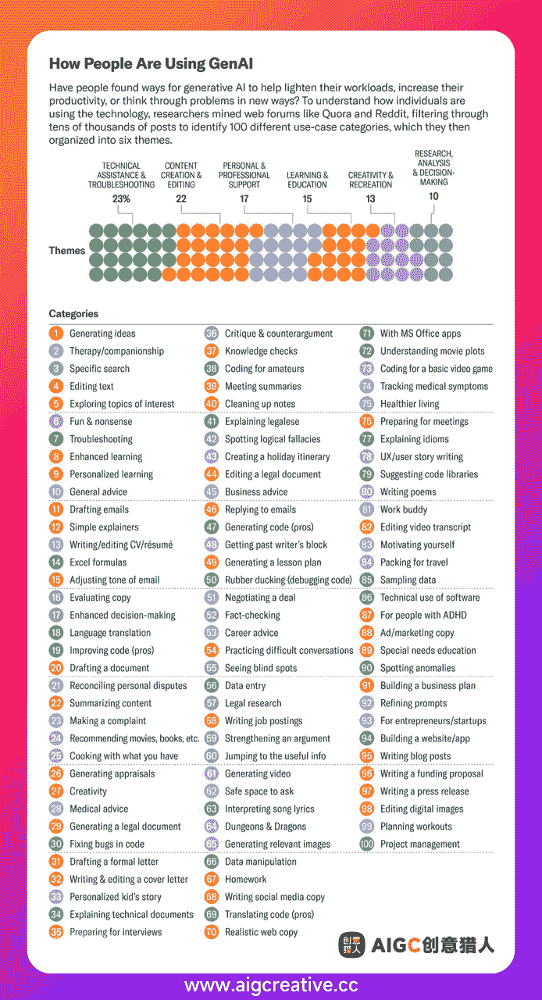

## 【20241104】市场 | ChatGPT等AI工具的查询量远不及搜索引擎，AI大规模用户应用仍面临挑战。

即使是人气最高的ChatGPT，每月查询量也不到Google的6%，用户黏性较低。过去两年中，Perplexity通过其套壳应用成功实现5000万美元ARR，年增速高达1600%，但整体查询量仍远低于传统搜索引擎。相比之下，Google等搜索巨头在覆盖日常需求和用户习惯上仍然具有明显优势。尽管ChatGPT积极发展“搜索”功能，Perplexity优化其API，但AI工具的应用规模化落地仍需克服移动时代用户习惯的挑战。

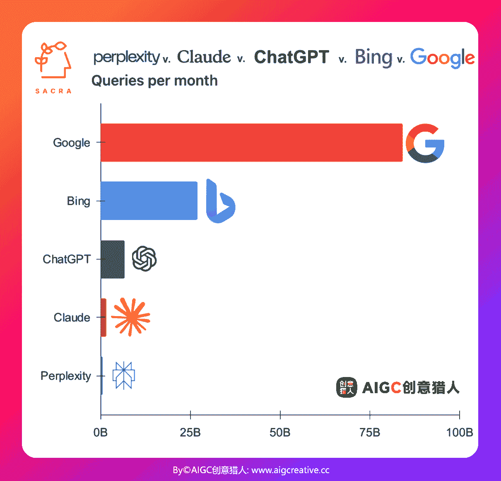

## 【20241103】洞察 | ChatGPT以59.4%市场份额领先美国AI聊天软件市场

最新数据显示，ChatGPT凭借59.4%的市场份额，在美国AI聊天软件市场占据主导地位，稳居第一。紧随其后的是微软的Copilot（14.4%）和谷歌Gemini（13.6%），后者作为谷歌新一代通用AI助手，展示了强劲的增长势头。另一些专注于不同垂直领域的AI产品也逐渐崭露头角，如精确搜索导向的Perplexity和以隐私为重点的Brave Leo AI，分别占据5.5%和1.5%的份额。在季度用户增长方面，Phind增长率最高（20%），其次是以商务为导向的Claude AI（16%）。整体来看，美国AI聊天市场格局中，通用型助手与垂直领域应用逐渐分化，各显优势。

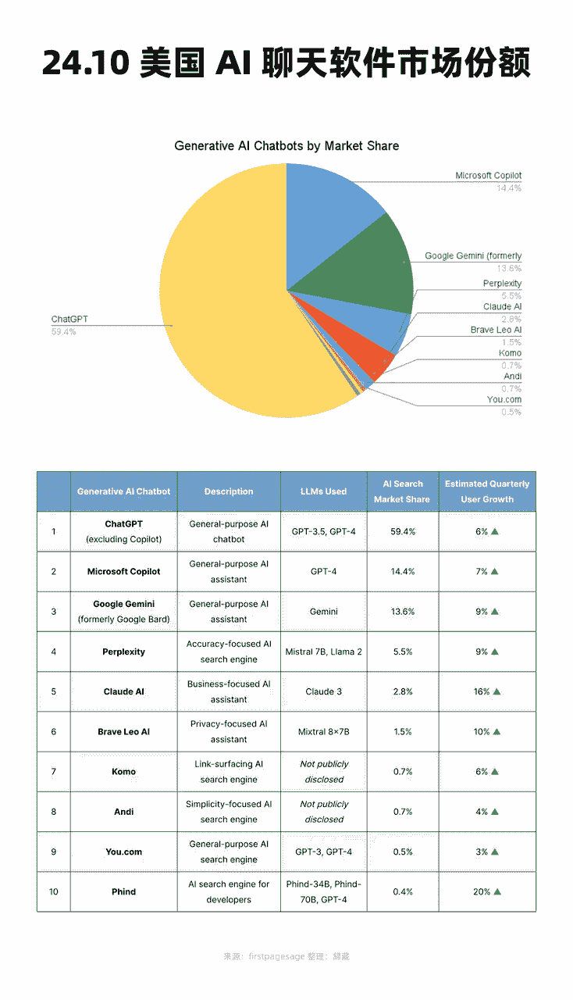

## 【20241101】产品 | Runway发布Gen-3 Alpha Turbo版本“高级相机控制”功能，提升视频生成创意掌控

生成式AI平台Runway发布了Gen-3 Alpha Turbo的“高级相机控制”功能，允许用户选择拍摄的方向和移动强度，增强视频场景表现的细节控制。此功能使用户能够在生成的视频中进行水平移动、环绕主体或探索场景等复杂的相机操作，并可结合不同的速度和相机运动实现流畅循环效果。这一升级赋予创作者更多自定义操作空间，使生成式AI视频更具专业表现力和艺术表达。

[04a09a504115d185bd0291a0d544fe6d.mp4](https://internal-api-drive-stream.feishu.cn/space/api/box/stream/download/all/EJ62b4aIporkWOxZ3jQcgZbynRc)

<https://aigcreative.feishu.cn/sync/K4Gvd9vUQsy9Oubwqaeclu0Fnbg>