# AI每日资讯-202410

> 来源：[https://aigcreative.feishu.cn/docx/JVn9dKxlno0X4lxgO2ec9jkUnYb](https://aigcreative.feishu.cn/docx/JVn9dKxlno0X4lxgO2ec9jkUnYb)

> **动态 | 观点 | 人物 | 产品 | 体验** | 应用 | 公司 | 融资 | 产业

## 【20241031】产品 | ChaGPT高级语音功能Advanced Voice 现已能在 macOS 和 Windows 桌面应用程序中使用。

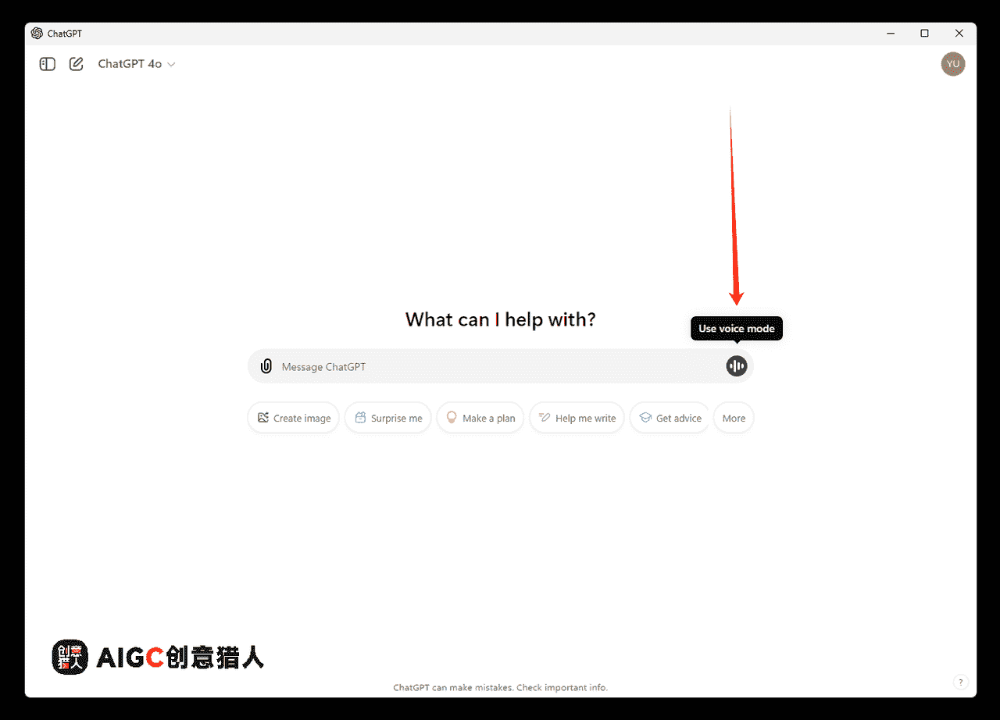

## 【20241030】产品 | Hailuo AI在视频生成模型排名中领先，ELO得分1092，胜率67%。

根据近2万次投票结果，视频生成模型竞技场（Video Arena）对各大模型进行了排名。Hailuo AI的MiniMax以ELO 1092和67%胜率位居榜首，Genmo的Mochi 1紧随其后，ELO 1088，胜率64%，是领先的开源模型；Runway的Gen 3 Alpha则以ELO 1051和61%胜率位列第三。用户可在广泛的提示下测试模型性能，并通过投票参与个人排名。

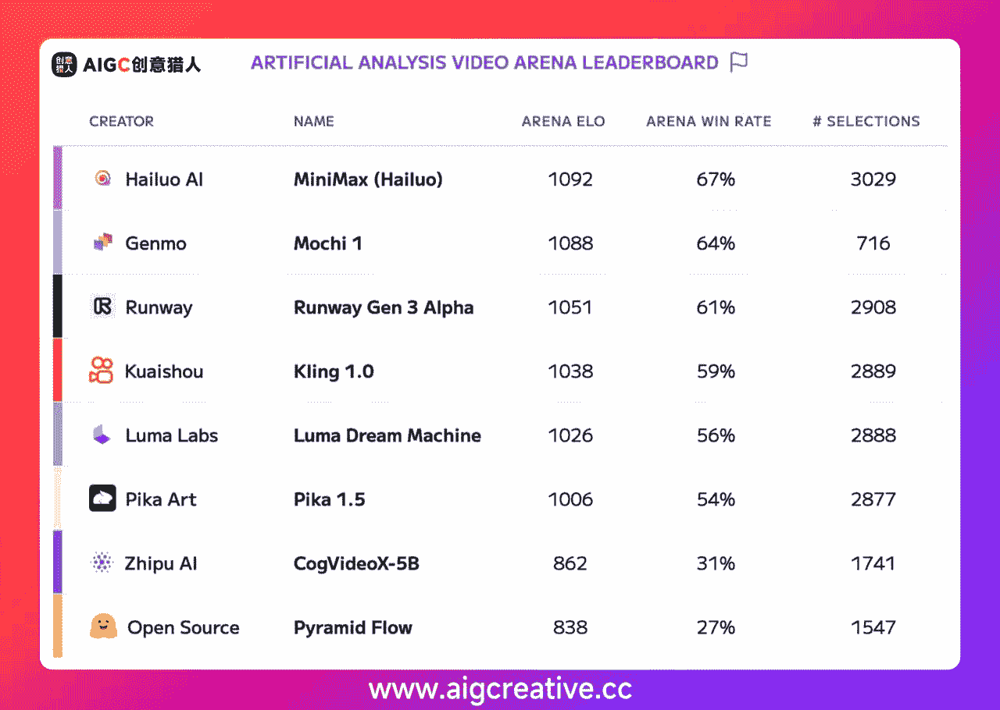

## 【20241029】产品 | GitHub升级Copilot！多家AI模型加持，还推出新工具“Spark”

GitHub重磅宣布Copilot支持Anthropic、Google和OpenAI的多种AI模型，开发者可根据项目需求灵活选择最佳AI支持。此外，全新AI工具“Spark”问世，旨在用自然语言助力快速构建Web应用，降低开发门槛。此次升级还包括VS Code多文件编辑功能和Xcode版Copilot公测，预计2025年推出更多扩展和代码评审功能。这一系列举措显示出GitHub致力于提升开发者体验和普及软件开发的雄心。

[09c42595e21f8cc746ebf68432fd9bc6(10).mp4](https://internal-api-drive-stream.feishu.cn/space/api/box/stream/download/all/JwxdbRUVPoVMAvxddXQcn3YUntc)

## 【20241029】公司| 壮观！全球最强AI超级计算机Colossus问世，由10万张NVIDIA GPU组成，采用液冷设计，实现顶级AI运算。

美超微与伊隆马斯克的xAI联手打造Colossus，这座全球最大AI超级计算机拥有10万张NVIDIA H100 GPU，并计划扩充至15万张H100和5万张H200，总规模将达20万张。Colossus以T-MED-X设施为基础，具备数个ExaBytes的存储和超高速网络，用于支援Grok AI系统。工程团队仅用122天便建成该系统，展示惊人效率。每个机柜内含64颗GPU和16颗CPU的强大算力，液冷设计有效降低噪音并优化温度控制。网络速度超家用网络400倍，达800GB/s。供电方面，Tesla Megapack电池组确保稳定，满足AI训练的巨大电力需求。

## 【20241029】产品 | 苹果推出AI加持的新款iMac，搭载M4芯片，设计更轻薄，性能大幅提升。

新款iMac搭载Apple Intelligence，提供全新配色，不需账户即可访问ChatGPT，并具备隐私保护功能。相比M1款，M4款在日常生产性能提升达2.1倍，编辑和游戏流畅度提升1.7倍。24英寸4.5K Retina显示屏采用纳米纹理玻璃，提升图像质量并减少反光。配有12MP Center Stage相机、四个Thunderbolt 4接口和多种外设。售价1,299美元起，将于11月7日上市。

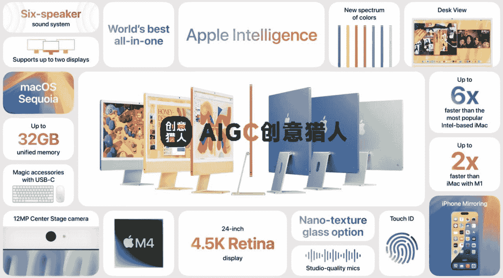

## 【20241028】产品 | Grok功能升级，可识别图像并回答相关问题。

Grok在最新更新中增加了图像理解能力，用户可上传图像进行互动问答。这项功能有助于追踪在X平台上共享图像的来源，增强用户体验。

## 【20241028】产品 | 洞察：拥抱人工智能的十种姿势

在“进化的力量 2024”大会上，刘润提出了拥抱人工智能的十种姿态，从“看新闻”“多探索”等基础级别，到“懂具身”“找方案”的职业级，再到“改范式”“做模型”等大师级。每个级别对应的技能步骤展示了个人与AI互动的不同层次，旨在帮助人们更好地适应和应用AI技术。强调了从基础知识积累到高级范式转变的重要性，为个人和企业的未来发展提供了新方向。

## 【20241025】洞察 | 苹果在AI领域的战略布局集中在生成式AI、计算机视觉与增强现实、数字图像和制造业四大方向。

从2023年第一季度以来，苹果通过一系列收购和合作，逐步扩大其在AI技术领域的影响力。在生成式AI基础设施方面，苹果与OpenAI建立了合作；在计算机视觉与增强现实领域，苹果收购了Datakalab、Mira，并与Adobe和Unity达成合作；在数字图像领域，苹果收购了WaveOne，并与Shutterstock合作；在制造业方面，苹果收购了DarwinAI，并与Drishti达成了合作。这些举措显示出苹果在AI技术上的多元化发展和长期战略规划。

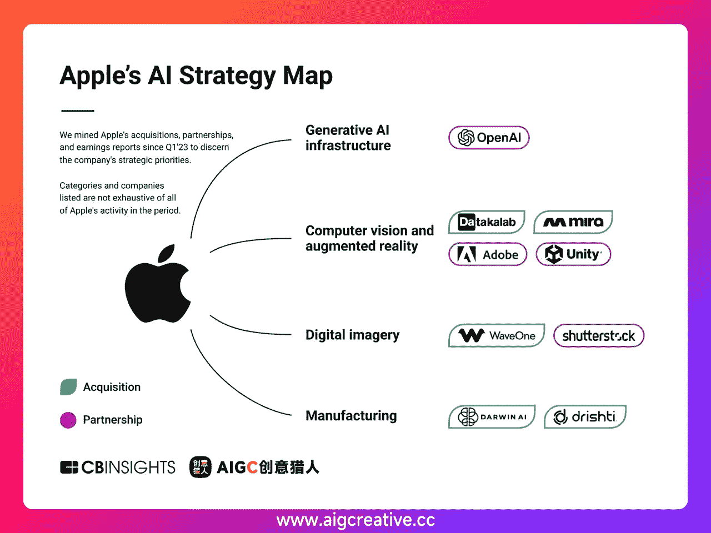

## 【20241024】产品 | Claude新增功能：支持代码编写与运行。

Anthropic为Claude引入了新的分析工具，提升其回答数学精确性和可重复性的能力。同时，用户可以通过“Artifacts”创建交互式数据可视化效果。此功能增强了Claude在数据处理和分析方面的表现，进一步扩展了其应用场景。用户可通过提供的链接进行功能预览体验。

[05cc2fce2e559b9c4af49d7d662acf27(9).mp4](https://internal-api-drive-stream.feishu.cn/space/api/box/stream/download/all/JEWdbxeipoXpjWxB212crYlnnqc)

## 【20241024】产品 | Midjourney测试图片编辑和重新纹理化功能，限部分订阅用户开放。

Midjourney宣布推出两项新功能：图片编辑器和图片重新纹理化，可用于探索材料、表面和光照效果。这些新功能与其高级功能（如风格参考、角色参考、个性化模型）兼容。初期测试阶段仅面向年订阅用户、过去12个月持续订阅用户以及上传图片数量超过1万的用户开放，旨在确保系统平稳运行。

## 【20241023】产品 | Ideogram Canvas上线，提供无限创意画板，整合AI驱动的图片生成、编辑与组合功能。

Ideogram Canvas是一个全新设计的创意界面，让用户在一个平台上轻松组织、生成、编辑和组合图像。通过Magic Fill工具，用户可以对图像特定区域进行修补和替换，如添加文本、修复瑕疵、修改背景等，同时还能放大特定区域，生成更高分辨率的细节图像。Extend工具则可扩展图像边界，保持风格一致的同时，自适应不同屏幕比例。该平台适用于品牌视觉和个性化内容创作，使创意实现更加快捷、精准、流畅。

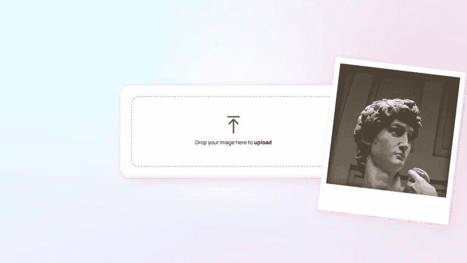

[7b626a5ef4f5329b7a8f5772ef012e03(9).mp4](https://internal-api-drive-stream.feishu.cn/space/api/box/stream/download/all/OiEybAM3Zof5GJx45ObcxqVNnAd)

## 【20241023】产品 | Runway推出新工具，将视频转换为虚拟角色动画。

Runway的Act-One工具能够将用户的普通视频表演转化为各种风格的虚拟角色动画，并精确捕捉表情、动作和语音同步。该工具不需要复杂的设备和手动建模，只需摄像头录制演员表演即可完成，极大简化了动画制作流程。Act-One还能根据参考图像生成不同风格的动画输出，无论是卡通还是真实风格都能实现，赋予用户更大的创意空间。

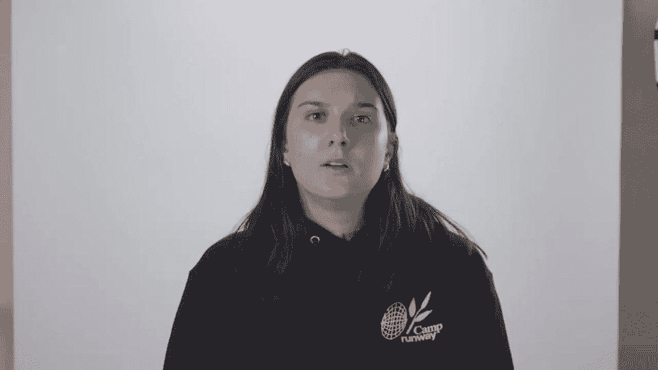

[4dcf4c5c23516b2f75b6fdbe0b5db5d3(9).mp4](https://internal-api-drive-stream.feishu.cn/space/api/box/stream/download/all/Wso0b9sAToWDpox54hlcFSa3n1b)

## 【20241023】产品 | Stable Diffusion 3.5发布，性能在提示词匹配与美学质量方面均有显著提升。

Stability AI发布了Stable Diffusion 3.5版本，包括多种可定制模型，适用于商业和非商业用途。根据图表数据，SD 3.5 Large在提示词匹配与美学质量上表现最佳，得分均超过1020分，领先于FLUX和SDXL等其他模型。SD 3.5 Large Turbo和Medium版本也分别在1000分左右，整体表现优异。目前，“Large”和“Large Turbo”版本可在Hugging Face与GitHub下载，“Medium”版将于10月29日推出。

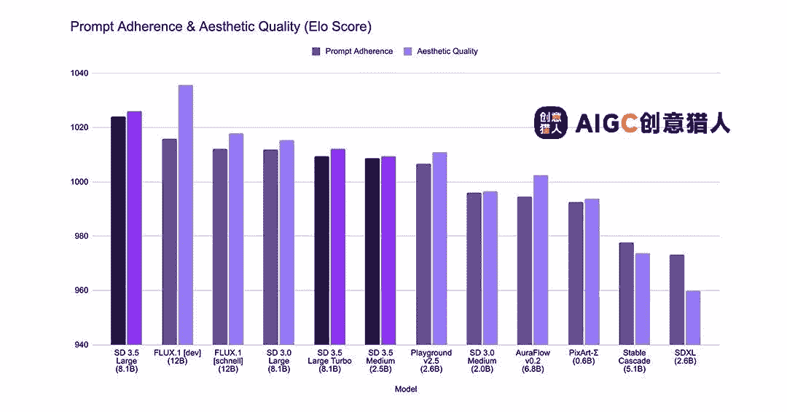

## 【20241023】产品 | AI模仿人类操控电脑自动干活？Claude 3.5重磅升级

## 【20241022】产品 | Gartner发布2025年十大关键战略技术趋势

Gartner最新报告揭示2025年十大技术趋势，包括代理型AI、AI治理平台、虚假信息安全、后量子密码学、环境隐形智能、节能计算、混合计算、空间计算、多功能机器人及神经增强。这些技术旨在提升企业效率、安全性和可持续性。报告预计，2028年15%工作决策将由代理型AI主导，虚假信息安全应用率将达50%。此外，后量子密码学、混合计算和神经增强等领域也将显著影响未来发展。该趋势为企业决策者提供了前瞻性视角。

## 【20241022】产品 | Adobe GenAI 生产力神器

满足甲方奇葩需求！Adobe推出Project Turntable，实现2D矢量图的 3D旋转效果～

## 【20241021】产品 | ComfyUI V1大更新：桌面版！！！

1、一键安装桌面版（内测）

+   适用于Windows/macOS/Linux，支持自动更新

+   自动安装Python依赖环境

+   默认安装ComfyUI 管理器

+   即将开源，加入内测：https://comfy.org/waitlist

2、全新用户界面

+   模板工作流/节点模糊搜索

+   侧边菜单栏：Queue队列记录、模型库、节点库

+   非桌面版也可立刻体验，更新最新版本，在设置中打开！

3、节点注册表Custom Node Registry更新

+   600+ 发布的节点，2000+ 版本

+   支持节点版本选择

+   默认集成 ComfyUI Manager（目前仅限 V1 桌面版）

完整细节见ComfyUI博客：https://blog.comfy.org/comfyui-v1-release/

## 【20241018】产品 | 尝鲜！ Windows版本的ChatGPT开放下载了。

下载地址： https://apps.microsoft.com/detail/9nt1r1c2hh7j?hl=zh-cn&gl=US

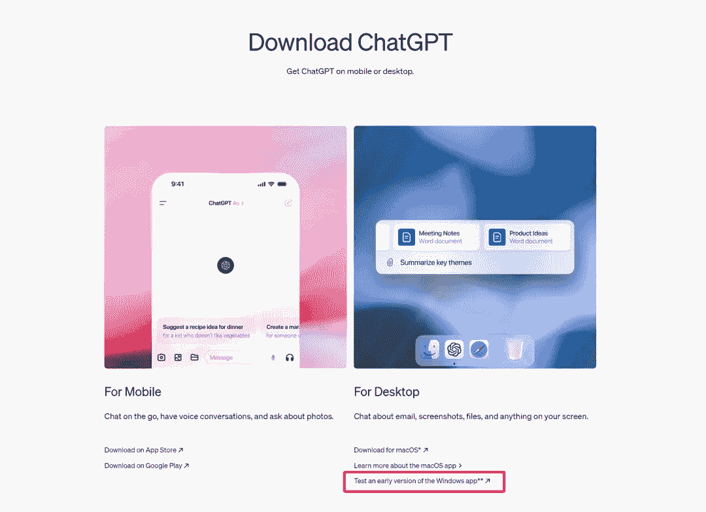

## 【20241017】产品 | Suno推出Suno Scenes，打造专属创意视频和音乐场景。

Suno Scenes现已上线，可通过照片或视频自动生成独特的音乐场景。用户可以拍摄日常生活中的精彩瞬间，并在应用中添加个性化的歌曲，使社交内容更加生动有趣。Suno还鼓励用户通过标签#sunoscenes与其互动，展示自己创作的作品。目前该应用在iPhone上可用，并即将推出国际版本，创作者们也已使用该工具创作了多种场景，包括运动日歌单和骑行配乐等。

## 【20241017】产品 | 传GPT-4.5o或成下一代AI模型

近期关于OpenAI可能发布GPT-4.5o的消息引发广泛讨论，传闻称这一版本将显著提升AI在复杂任务处理上的能力，并可能通过Plus订阅提供。但目前，这一消息尚未得到官方确认，仍停留在猜测阶段，具体发布时间和功能细节仍未可知。

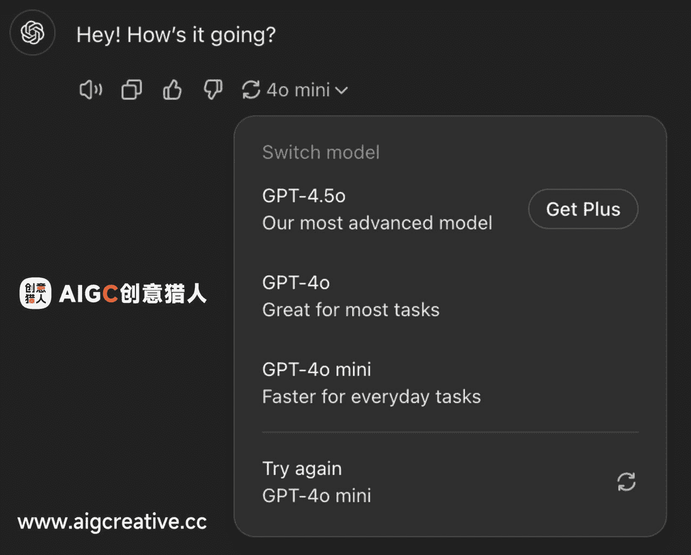

## 【20241016】产品 | 全新iPad mini发布，搭载Apple AI智能功能。

苹果发布的全新iPad mini，不仅配备A17 Pro芯片和轻量化设计，还融入了AI智能功能，进一步提升用户体验。凭借Apple Pencil Pro和AI助力，用户可以轻松完成更复杂的绘图、笔记和任务处理，成为学习与创作的得力助手。其1200万像素前置摄像头、USB-C接口等也为设备提供了更全面的功能支持。

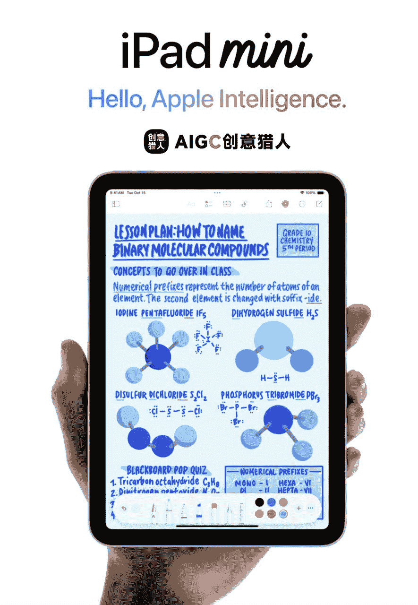

## 【20241015】产品 | Adobe Premiere Pro推出全新“生成扩展”功能，增强视频编辑效率。

在Adobe MAX大会上，Adobe Premiere Pro新增的“生成扩展”功能，支持用户自动生成与原视频匹配的片段和音频，简化视频增补编辑。目前该功能处于测试阶段（beta版）。此外，Premiere Pro还升级了多个AI功能，如自动生成字幕、场景识别、重构比例、自动调色等，使视频编辑过程更智能化。通过这些升级，用户可以加速剪辑流程，显著提升视频处理的效率与质量。

[e2e254bf0795435d59d61f67e9d0f5f4(13).mp4](https://internal-api-drive-stream.feishu.cn/space/api/box/stream/download/all/ACtZbxDZdo2eyfxNAiAcdgWNnoe)

## 【20241015】产品 | Adobe推出全新AI创意工具Project Concept，助力设计师加速创意实现。

在Adobe MAX大会上，Adobe展示了基于AI的Project Concept工具，旨在帮助设计师快速生成创意风景、混合资源及重新组合风格。通过Firefly生成AI模型，设计师可加快灵感呈现，减少日常任务所耗时间，探索更多创作边界。目前该项目处于测试阶段，未来将推出私人测试版，进一步推动创意产业的发展。

[5812216456815f27002244532a5e2ede(13).mp4](https://internal-api-drive-stream.feishu.cn/space/api/box/stream/download/all/Fmkob6S26o5otZx7POPcft5GnFc)

## 【20241015】产品 | AI算力8年提升1000倍，Blackwell芯片突破20000 TFLOPS。

从2016年到2024年，AI算力实现了1000倍飞跃。2016年的Pascal芯片性能为19 TFLOPS（FP16精度），到2020年，Ampere芯片达到620 TFLOPS。2022年，Hopper芯片引入FP8精度，算力增至4000 TFLOPS。而2024年，NVIDIA推出的Blackwell芯片进一步突破，达到惊人的20000 TFLOPS，并采用最新FP4精度。这一飞速提升标志着AI计算进入前所未有的高效时代。

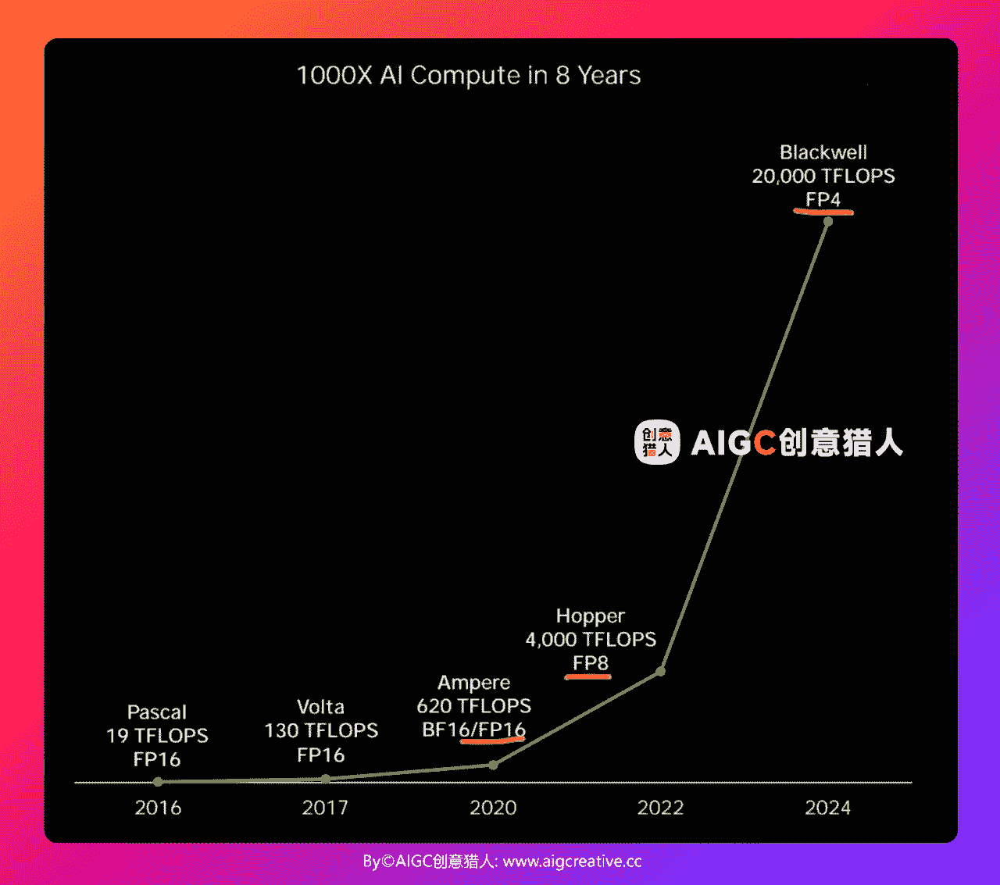

## 【20241015】产品 | Kimi 迎来全新语言通话模式升级，功能丰富！

Kimi 设备近期新增语言通话功能，支持屏幕字幕显示、打断、换音、语速调整等实用功能。同时，还推出了两种特别情景模式：语法跟读训练和模拟面试场景。此外，克隆声音功能的加入，让用户的自定义声音也能应用于通话模式，提升了互动体验。

[8ea76b8c202b09b82a7ff125b45cfadc.mp4](https://internal-api-drive-stream.feishu.cn/space/api/box/stream/download/all/Be97bimrbolBj2xeSIEcJD3mn0d)

## 【20241014】公司 | OpenAI持续扩展内容授权版图，合作涵盖全球顶级媒体。

2023年7月至2024年5月，OpenAI与多家全球知名媒体达成重要内容授权协议。2023年7月，OpenAI与美联社(AP)签署协议，随后在12月以3000万美元达成与Axel Springer（旗下有Politico、Business Insider等）的合作。2024年，OpenAI继续与法国《世界报》(Le Monde)、PRISA Media（旗下有《国家报》）和英国《金融时报》(Financial Times)等合作。到2024年5月，OpenAI更与News Corp（包括《华尔街日报》）、Reddit、Vox Media等大型内容平台达成协议，推动其AI模型内容的多元化。

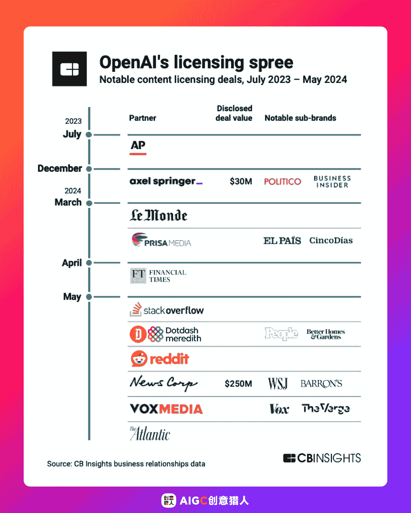

## 【20241013】市场 | 高质量训练数据或将在2026年前耗尽，AI发展面临挑战。

研究表明，到2026年，用于训练大规模语言模型（LLM）的高质量文本数据可能会被耗尽。这一趋势将显著减缓AI领域的进展，尤其是在模型性能提升方面。数据枯竭的警告意味着需要寻找新数据源或开发新的训练方法，以应对未来AI训练对海量数据的需求。

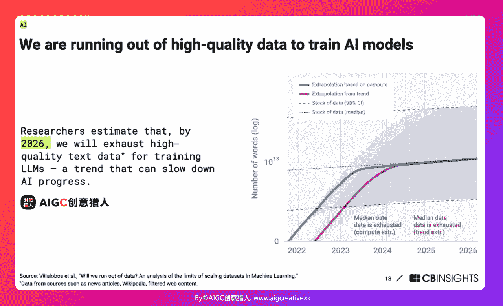

## 【20241012】产品 | ChatGPT九月访问量再创新高，全球用户增长强劲

根据Similarweb数据，ChatGPT在九月打破连续两个月的流量记录，访问量达到31.24亿次，年增长111%，月增长18%。全球独立访客数为2.842亿，平均访问时长6分11秒。美国、印度和巴西是流量主要来源国，其中美国占比最高，达14.18%。

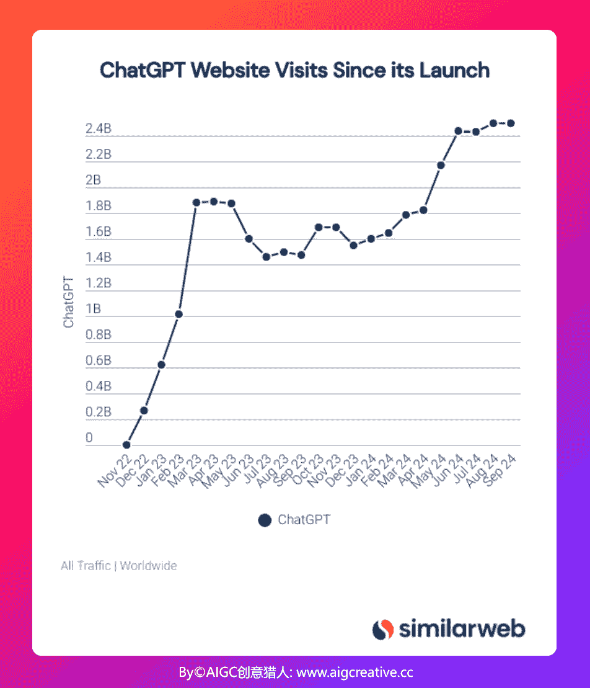

## 【20241011】产品 | Google推出Imagen 3模型，提升图像生成质量

Google在Gemini平台推出最新Imagen 3图像生成模型，全球用户现已可用。该模型具备更高的照片级真实感，优化指令跟随能力，并减少了视觉干扰，生成效果更加细腻逼真。

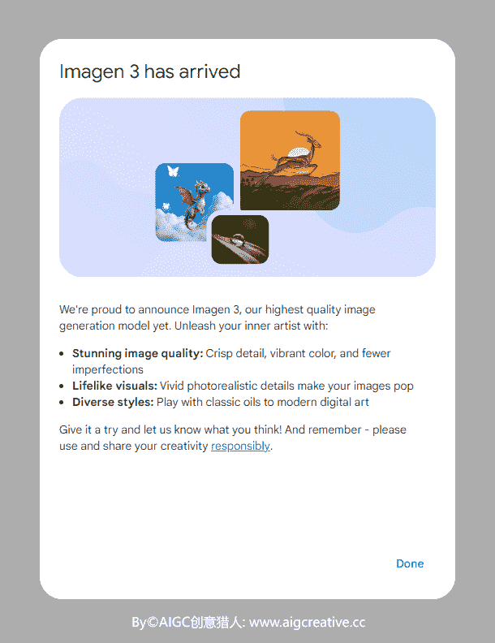

## 【20241010】产品 | Suno推出强大歌曲编辑功能，用户可自由替换特定片段

Suno平台近日推出全新功能，允许用户替换歌曲中的部分片段，支持替换内容包括10-30秒的歌词、节奏或乐器间奏。用户通过简单操作即可进入编辑模式，选择需要替换的部分，系统提供两种版本供用户选择：一种是在原段落基础上继续调整，另一种则可从替换后重新开始编排。此外，Suno还允许用户选择替换段落长度是否与原段相同，为音乐创作带来更多的自由度和创意空间。这项功能尤其适合想要微调歌词或节奏的音乐人，帮助他们精准替换段落内容，优化整体作品，进一步提升音乐个性化和制作效率。

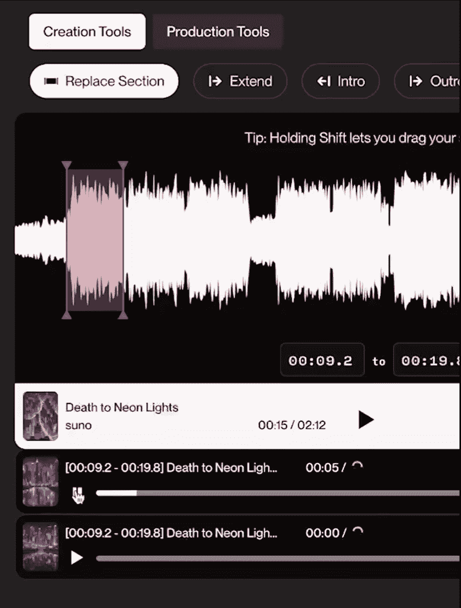

## 【20241009】动态 | DeepMind CEO Demis Hassabis获2024年诺贝尔化学奖

2024年诺贝尔化学奖颁发给了在蛋白质结构和设计领域取得革命性成就的科学家。其中，David Baker因在计算蛋白质设计方面的贡献获奖，而DeepMind的CEO Demis Hassabis和高级研究科学家John M. Jumper因利用人工智能预测蛋白质结构而获奖，共享另一半奖项。他们开发的AlphaFold模型成功预测了几乎所有已知的蛋白质结构，为生物医学研究开辟了新天地。这一成就不仅展示了AI技术在科学研究中的潜力，也预示着未来在药物开发等领域的巨大应用前景。

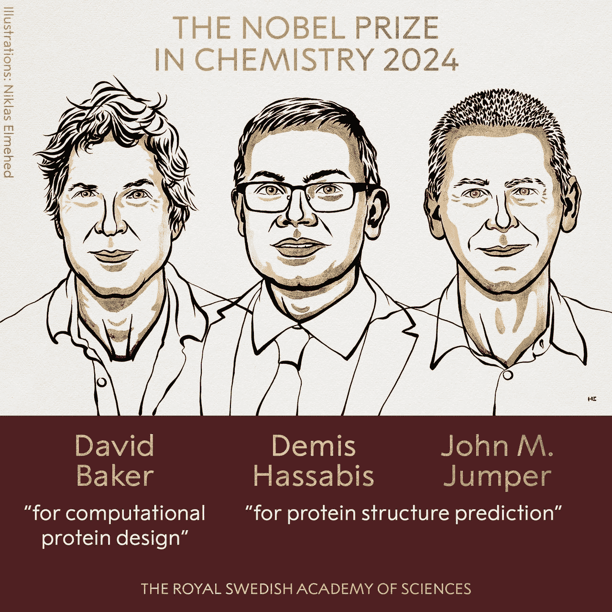

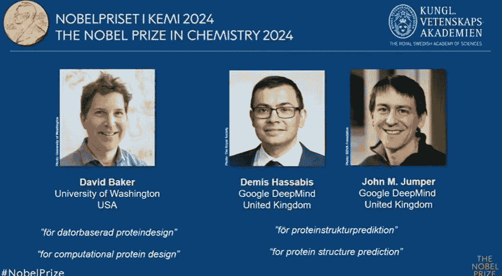

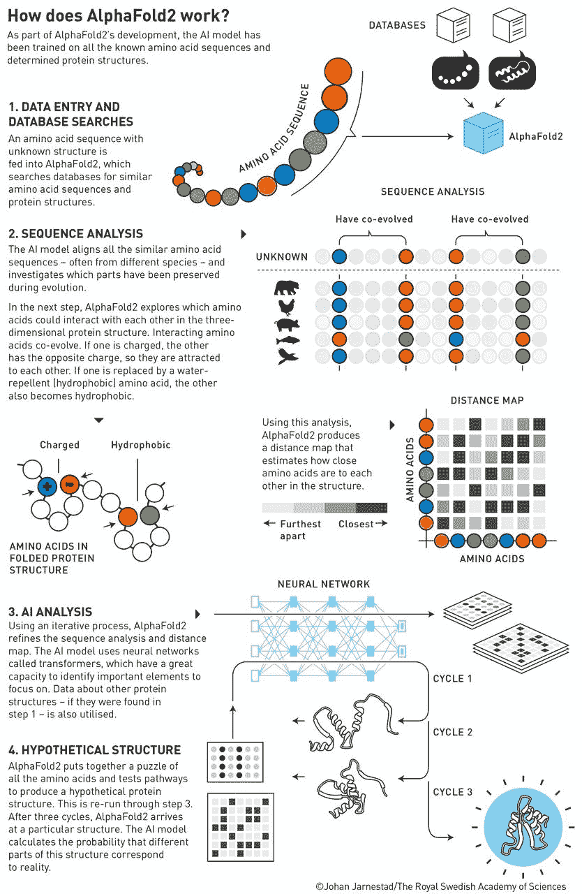

## 【20241008】动态 | 约翰·霍普菲尔德与杰弗里·辛顿荣获2024年诺贝尔物理学奖！

2024年诺贝尔物理学奖授予了约翰·J·霍普菲尔德和杰弗里·E·辛顿，以表彰他们在人工神经网络和机器学习领域的基础性发现与发明。这两位科学家为现代人工智能的发展奠定了理论基础，其研究推动了深度学习技术的突破，显著提升了人工智能的能力和应用。霍普菲尔德的神经网络模型和辛顿的反向传播算法，成为了现代AI技术中最重要的支柱之一，影响了多个学科的研究和实际应用。

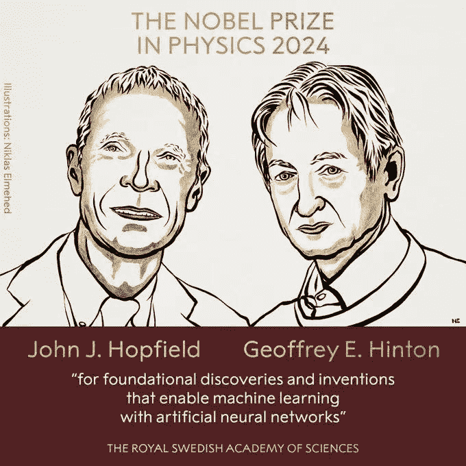

## 【20241005】动态 | Meta发布全新Meta Movie Gen模型，引领媒体生成技术创新。

Meta最新推出的Meta Movie Gen，是目前最先进的媒体生成基础模型之一，旨在为创作者和专业人士提供突破性的创意工具。Movie Gen Video基于30B参数，可从单一文本提示生成高质量、高分辨率的图像和视频；Movie Gen Audio使用13B参数，可以处理视频输入并生成同步的高保真音频，支持背景音乐、环境音效及文本与音频的精准对齐。此外，该模型还具备精确的视频编辑能力，可根据文本指令进行元素添加、替换或风格调整，甚至实现个性化视频生成，保留人物特征并展现自然的动作表现。Meta计划与全球创意领域的专家合作，进一步优化这一技术，开启媒体创作的全新可能性。

[e2d20ddfb7a3e2b69d828fabe95518d6.mp4](https://internal-api-drive-stream.feishu.cn/space/api/box/stream/download/all/Kx74be0fWonwuPx0qBHcZb9onoc)

## 【20241004】动态 | OpenAI给ChatGPT整了个新界面，

叫Canvas，简直是人机协作的神器！不再是单调的对话框，而是像画布一样，你和AI一起在上面创作、编程、编辑，效率杠杠的！比如写文章，AI能帮你改句子、调长度、加表情；编代码，AI能审查、加注释、修bug，还能跨语言翻译！这货不只是工具，简直是你的创意搭档！

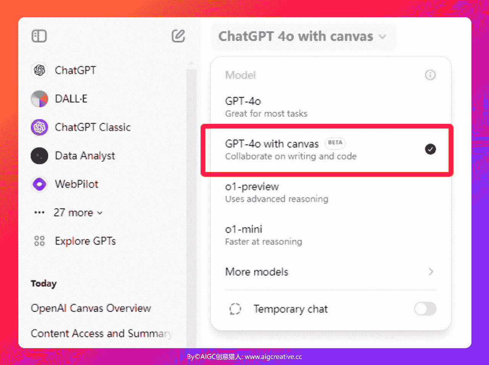

<https://aigcreative.feishu.cn/sync/K4Gvd9vUQsy9Oubwqaeclu0Fnbg>