# AI每日资讯-202409

> 来源：[https://aigcreative.feishu.cn/docx/Ar7jdGcOEoTrS5x0OGFc8dJhnBg](https://aigcreative.feishu.cn/docx/Ar7jdGcOEoTrS5x0OGFc8dJhnBg)

> **动态 | 观点 | 人物 | 产品 | 体验** | 应用 | 公司 | 融资 | 产业

## 【20240915】产品 | ChatGPT新增/picture和/search指令，提供更强大功能！

ChatGPT平台新增两大功能指令：/picture可调用OpenAI的DALL-E工具，实现图像生成；/search指令则引入新的搜索模式，帮助用户在对话中进行更精确的信息查找。这些新功能将极大增强用户的创作能力和信息获取体验，助力内容创作者更加便捷地生成视觉与文本内容。

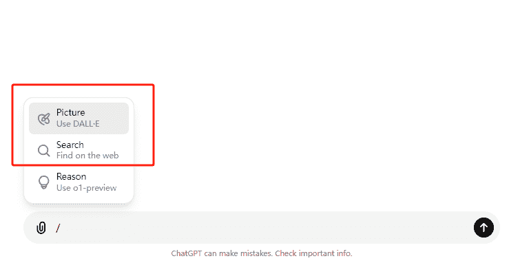

## 【20240915】产业 | SuperCLUE榜单：OpenAI新模型o1-preview超越GPT-4系列，推理能力领先

根据2024年9月发布的SuperCLUE评测，OpenAI的o1-preview模型以85.27分的总成绩位居榜首，显著超越现有的ChatGPT-4和GPT-4系列。在多步推理、数字推理、推理计算等多个维度，o1-preview均表现优异，尤其在数字推理方面得分高达94.22，远超其他模型。这表明o1-preview在复杂推理任务上展现了强大的性能和潜力，进一步提升了大模型在中文高阶推理任务中的表现。

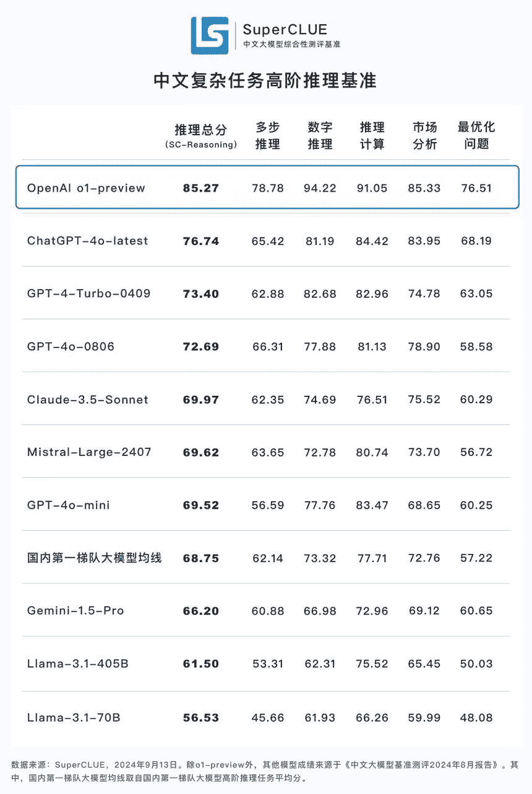

## 【20240915】产品 | Runway推出Gen-3 Alpha版本Video to Video功能，提供精细化视频生成控制

Runway正式上线Gen-3 Alpha Video to Video功能，适用于所有付费用户。这一功能通过精准的运动控制和表现机制，让生成的视频在多个迭代中实现复杂的表达和意图传达。用户只需上传输入视频，并可以根据自己的喜好选择美学方向或预设风格模板进行调整，轻松生成理想效果的视频作品。这一创新工具为内容创作者提供了更大的创作自由度与精确性，使视频生成更加灵活多样。

## 【20240914】产品 | HeyGen推出全新Avatar 3.0，支持全身动态动作与精准情感表达！

HeyGen宣布其最新Avatar 3.0正式上线，不仅突破了传统的唇语同步技术，还支持全身动态动作。此次更新中，Avatar首次能够动态生成面部表情与语调变化，完美匹配剧本的情感需求，大幅提升了虚拟人物的真实感与互动性。这一升级将为用户带来更逼真的虚拟互动体验，适用于各种创意内容制作。

## 【20240913】公司 | 炸场！OpenAI发布新一代推理模型OpenAI o1

OpenAI于2024年9月12日推出了一系列新的推理模型OpenAI o1，旨在通过更长时间的思考来解决复杂问题。这些模型在科学、编程和数学等领域展现出比以往模型更强的复杂任务处理能力。在国际数学奥林匹克竞赛的资格测试中，新模型的解题正确率远高于GPT-4o。同时，OpenAI o1在安全性方面进行了强化，通过新的安全训练方法确保模型遵循安全和对齐准则。此外，还推出了更高效的OpenAI o1-mini模型，专注于编程任务，价格更亲民。

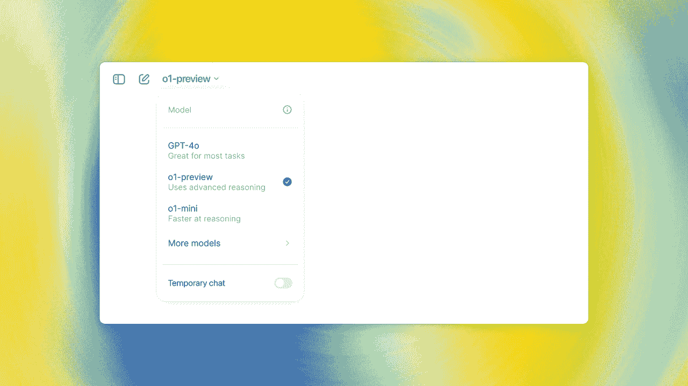

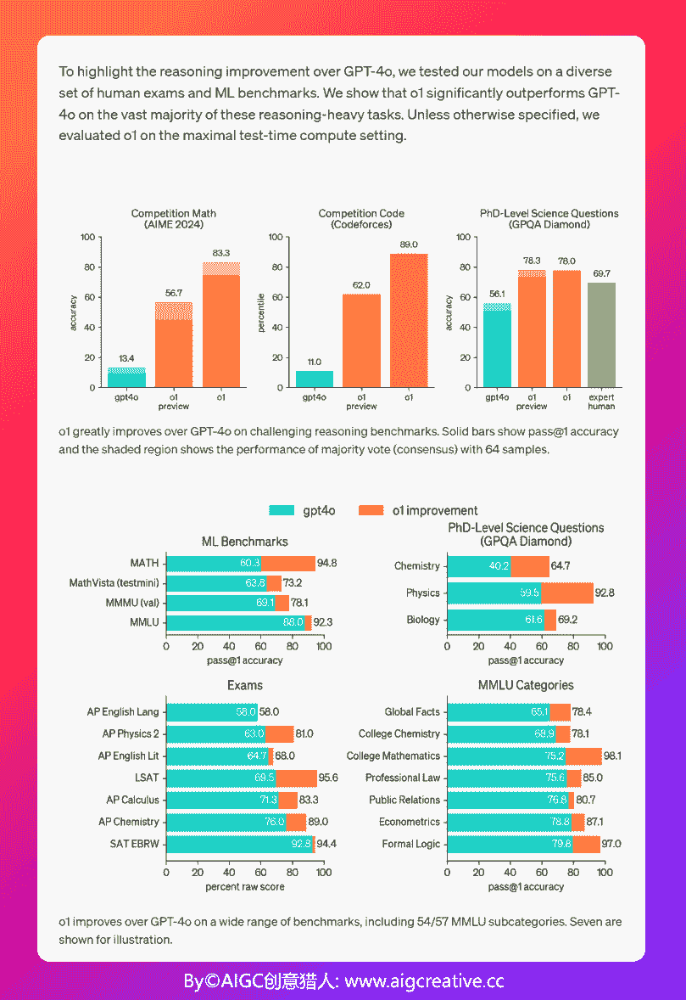

## 【20240913】产品 | Adobe推出生成式AI视频模型，支持智能视频编辑

Adobe将推出一款生成式AI视频模型，集成到Premiere Pro等视频工具中，可通过文本和图像提示生成视频片段，并自动填补缺失内容、移除不需要的对象、平滑剪辑过渡。同时支持创建动画、控制镜头角度和运动，提升视频制作效率。

[fd90b633fe1f1496c9db15b44b19d9cb.mp4](https://internal-api-drive-stream.feishu.cn/space/api/box/stream/download/all/LwksbJ2Ptovtq6xdSaKc2mXHnGh)

## 【20240912】产品 | Fish Speech 1.4开源发布，支持八种语言的快速TTS与语音克隆

Fish Audio推出了全新的Fish Speech 1.4版本，经过70万小时的多语言数据训练，现已开源，支持英语、中文、德语、日语、法语、西班牙语、韩语和阿拉伯语等八种语言。其主要功能包括超低延迟的TTS技术、即时语音克隆，并支持自托管或云服务使用，定价简单透明。此次发布为全球开发者和研究人员提供了更强大的语音技术工具。

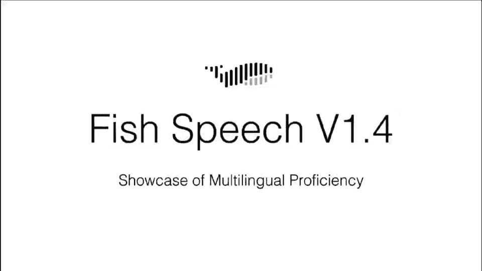

[813b24de2d38a0fccac83afb50939c2d.mp4](https://internal-api-drive-stream.feishu.cn/space/api/box/stream/download/all/Zzo2bq9Okomk3Lx6JrMc9MNFnPh)

## 【20240912】产品 | Vidu公司推出AI视频模型新功能，实现角色和物体的高保真视频生成

Vidu公司宣布其AI视频模型的重大升级，新功能包括支持根据单一角色或物体生成视频，并保持其在不同场景中的一致性。用户可以生成与参照角色在面容、半身、全身上一致的视频，以及对单一物体进行高细节还原。此外，新功能还支持多种画风，包括真人、2D和3D角色，适用于商业广告场景。Vidu公司还提供了详细的介绍和在线体验链接，以便用户进一步了解和试用这些新功能。

## 【20240911】动态 |生成式AI在金融和智能客服领域应用最广泛

根据2024年7月的最新数据，生成式AI技术在银行、证券和汽车制造等行业中广泛应用，尤其是银行业共有47个案例，位居榜首。从应用场景来看，知识助手和智能客服成为最热门的两大应用方向，分别有36和35个案例，显示出企业对提升信息处理效率和客户服务的高度需求。此外，数据分析、风控与办公助手等也成为AI技术应用的重要场景，展示了AI技术在多个垂直领域的深度渗透与变革潜力。

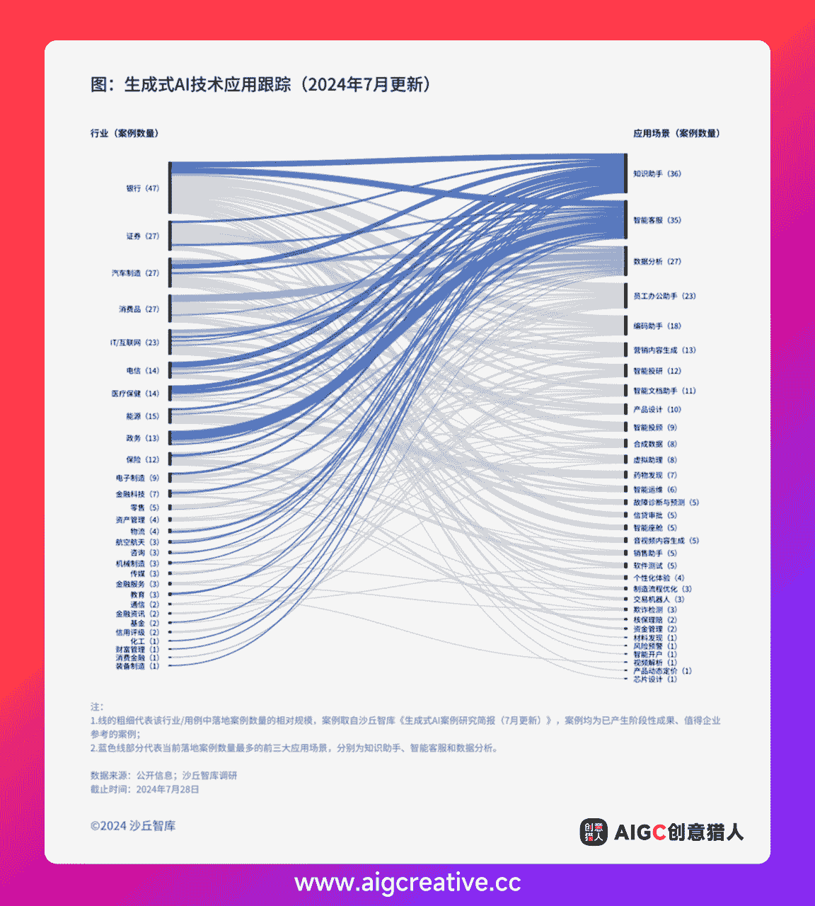

## 【20240911】动态 | OpenAI即将发布全新AI模型“草莓”，专注推理能力和深度研究，200美元/月

据消息透露，OpenAI计划在未来两周内发布名为“草莓”的全新AI模型。与当前模型相比，“草莓”将特别注重推理能力，能够在10至20秒的“思考”后，为用户提供更加准确和深度的回应。该模型旨在处理复杂的科学和数学问题，且具备自主浏览互联网进行深度研究的能力。这一特性将显著增强其在专业领域的应用潜力。尽管目前尚不清楚“草莓”如何提供给客户使用，但有可能作为一个可选项加入现有的AI模型选择菜单中。该模型的推出比预期时间要提前，进一步表明OpenAI在不断加速其AI技术的开发进程，尤其在复杂问题解决和自我学习方面，或将开启AI推理能力的新纪元。

## 【20240910】动态 | 生成式AI收入呈爆发式增长，多个平台年收入过亿

根据公开披露与分析师预测，Azure和OpenAI的年收入分别达到39亿和34亿美元，领跑生成式AI领域。亚马逊、谷歌等巨头的AI产品也实现了“数十亿”的收入。微软的Copilot和Scale的数据标注平台显示出显著的年增长，分别预计在2024财年达到12亿美元和6.75亿美元收入，生成式AI市场的商业潜力不断释放。

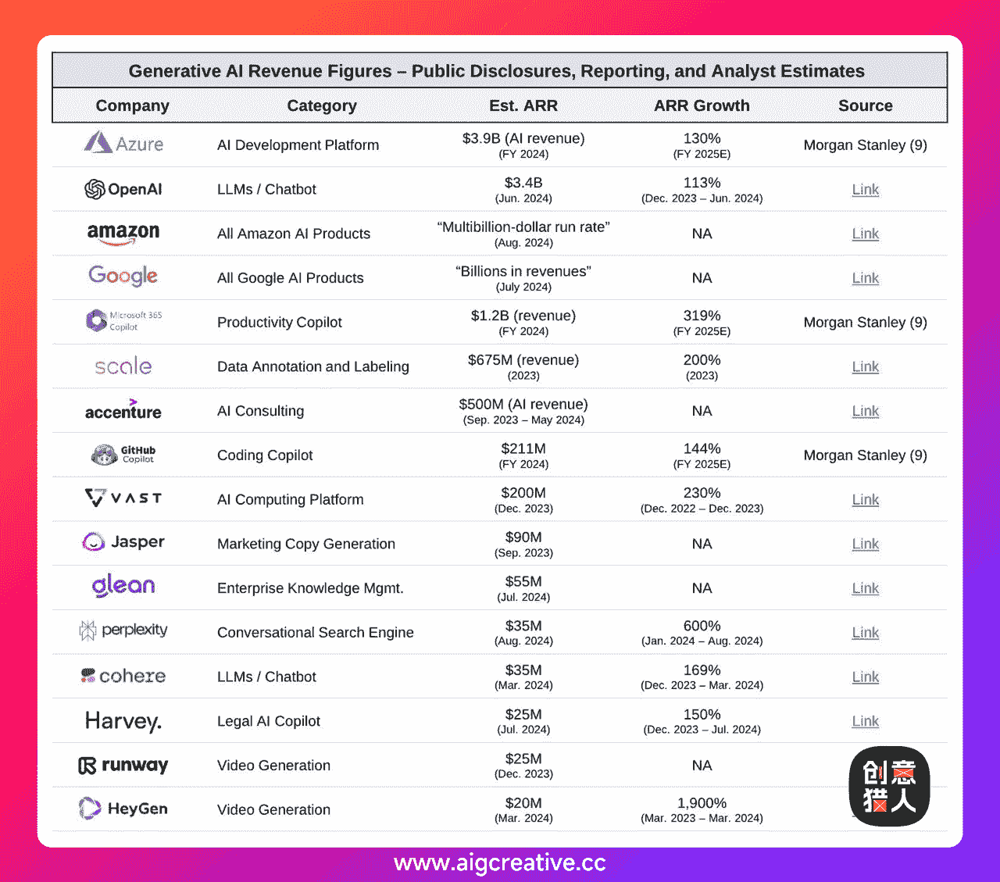

## 【20240910】动态 | 2024年8月AI超级应用中ChatGPT表现突出

根据AI产品榜2024年8月的数据显示，ChatGPT在AI网站应用中独占鳌头，月独立访客超260百万，远超其他AI应用。与此同时，360AI搜索和Character AI等平台也表现不俗，但相对流量较低。国内市场上，文心一言、秘塔AI搜索等本土AI应用有着较强的用户黏性，表现亮眼。

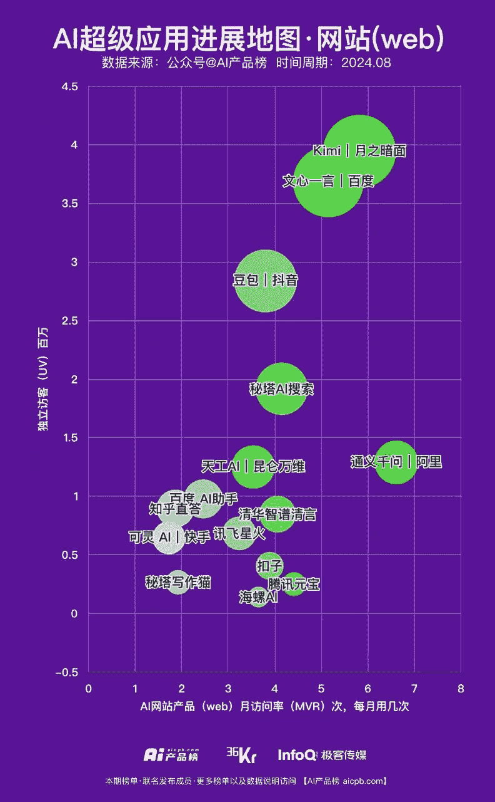

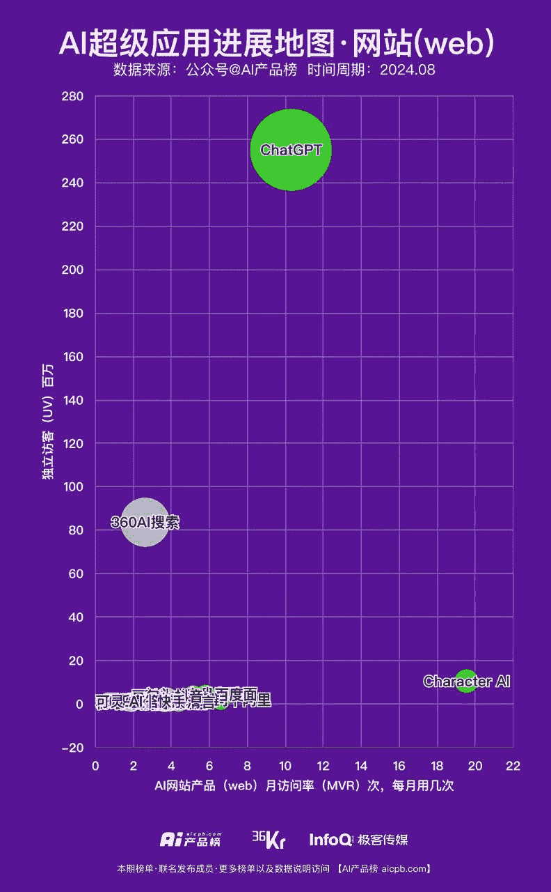

## 【20240910】动态 | 全球对AI编程技能的重视程度显著提升

根据图表显示，在美国、巴西、德国和印度，AI编程工具技能被普遍认为是提升就业竞争力的重要因素。其中，美国和巴西有近50%的受访者明确表示，这项技能会“显著”提升其就业吸引力。德国则有43%的人持相同观点，而印度最高，达56%。这表明，全球范围内对AI技能的需求不断增加，尤其在新兴市场，这项技能已成为职场竞争力的关键因素。

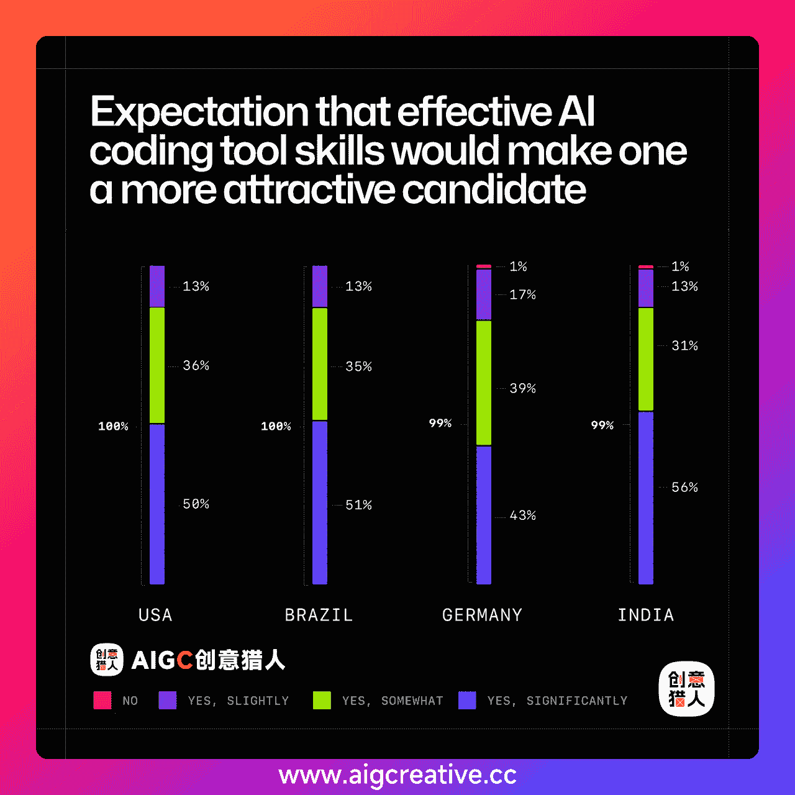

## 【20240908】动态 | Replit 推出 AI 编程工具 Replit Agent，简化自动部署环境操作

Replit 发布了 AI 编程工具 Replit Agent，极大简化了编程新手部署和运行代码的复杂流程。此工具支持从文本生成代码，并通过自动部署到云端，免去了选择服务商和处理后端配置的繁琐步骤。特别适合那些对于 Claude 等 AI 编程工具感到无力的用户，同时满足了自修复和环境部署的需求。Replit Agent 可直接为开发者提供带有 Postgres 后端的实时 URL 部署功能，大幅降低使用门槛。

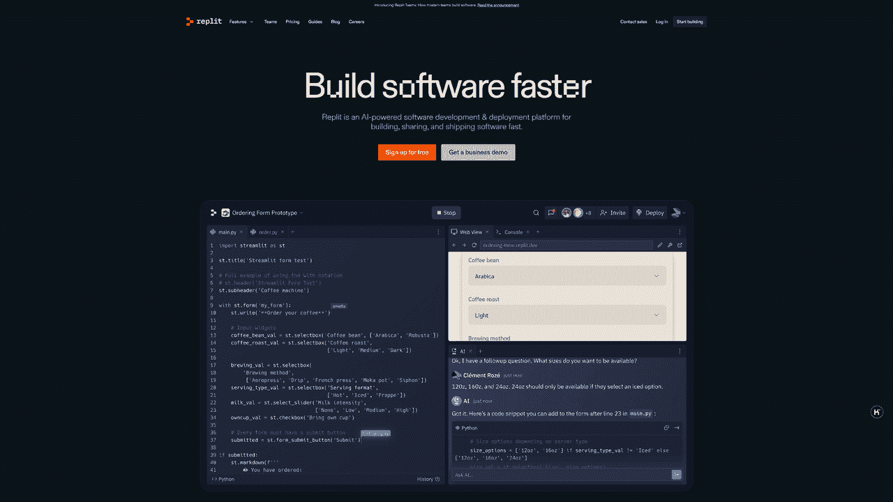

## 【20240907】动态 | 大学生必备！通义全能AI助手推出40条Prompt流出，助力学习与生活。

通义发布了适用于大学生的全能助手，提供从学习规划、简历撰写到社团活动策划等各类功能，覆盖知识学习、英语辅导、数据分析等多个领域。专为大学新生到毕业求职全程打造，40条Prompt全方位承包你的学习和生活需求，帮助学生轻松应对校园和职场挑战。

文档链接：[通义AI助手推出的40条Prompt，助力学习与生活](https://aigcreative.feishu.cn/wiki/IctOw9B3IifZpikYZgxcbtgJncb)

## 【20240906】动态 | Runway推出员工精选页面，展示Gen-3 Alpha工具创作的精彩短片集。

Runway发布了一个名为“Staff Picks”的员工精选页面，汇集了艺术家们使用其最新的Gen-3 Alpha AI工具创作的短片作品。这些短片展示了AI生成内容在视觉创作中的潜力，涵盖了从科幻未来到日常生活的多种主题。对于AI视频创作者而言，这是一个非常不错的学习资源库，能够激发创作灵感并展示AI工具的强大能力。

网址：https://runwayml.com/staff-picks

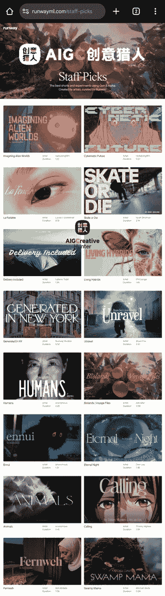

## 【20240906】动态 | Reflection Llama-3.1 70B模型推出，具备自我反思和错误修正能力，提升推理精度。

Reflection Llama-3.1 70B是当前最强的开源大语言模型之一，采用了一种全新的“反射调优”技术，能够在推理过程中自我反思并纠正错误。该模型通过Glaive生成的合成数据进行训练，并提供了多项创新功能，如“thinking”标签，用于标记模型思考过程中的输出，和“reflection”标签，用于标记自我反思时的内容。为了确保推理过程的准确性和可靠性，所有基础测试都经过了严格的去污处理。

该模型的另一个亮点是与Llama模型的高度兼容性，用户可以轻松使用现有的Llama代码和流程进行改进和优化。同时，它支持灵活的参数调节，用户可以自定义生成的温度（temperature）和top_p值，以便模型根据具体需求进行思考和回答。此外，Reflection Llama-3.1 70B模型还计划发布更大规模的405B版本，预期将显著提升性能，进一步扩大其在复杂任务中的应用范围。

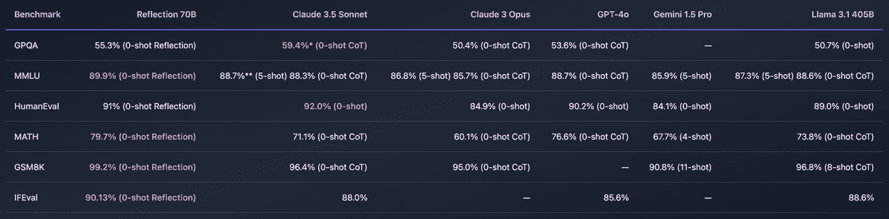

## 【20240906】产品 | Google Photos推出Ask Photos功能，借助Gemini AI提升搜索体验。

Google Photos新增Ask Photos功能，让用户通过自然语言询问即可快速找到相册中的特定照片或隐藏的信息。借助Gemini AI模型的强大能力，用户可以轻松搜索如“在某地吃了什么”这类问题，而不再需要逐张翻看照片。这一创新极大提升了照片管理的便捷性与效率，帮助用户更轻松地找到所需内容。

[239d3504b936c85a13c230ae9a7629be(4).mp4](https://internal-api-drive-stream.feishu.cn/space/api/box/stream/download/all/TPogbELlpoxddtxBzEycnS7cnHg)

## 【20240905】产品 | OpenAI推出官方新闻账号，专注发布最新动态。

OpenAI于2024年9月5日宣布推出其官方新闻账号 @OpenAINewsroom，用于发布与公司发展和新闻相关的最新信息。该账号的推出标志着OpenAI进一步加强了与公众的沟通和信息透明度。作为OpenAI官方的资讯平台，该账号预计将成为获取该公司最新动态的重要渠道。消息发布短短数小时后，已吸引了大量关注和互动。

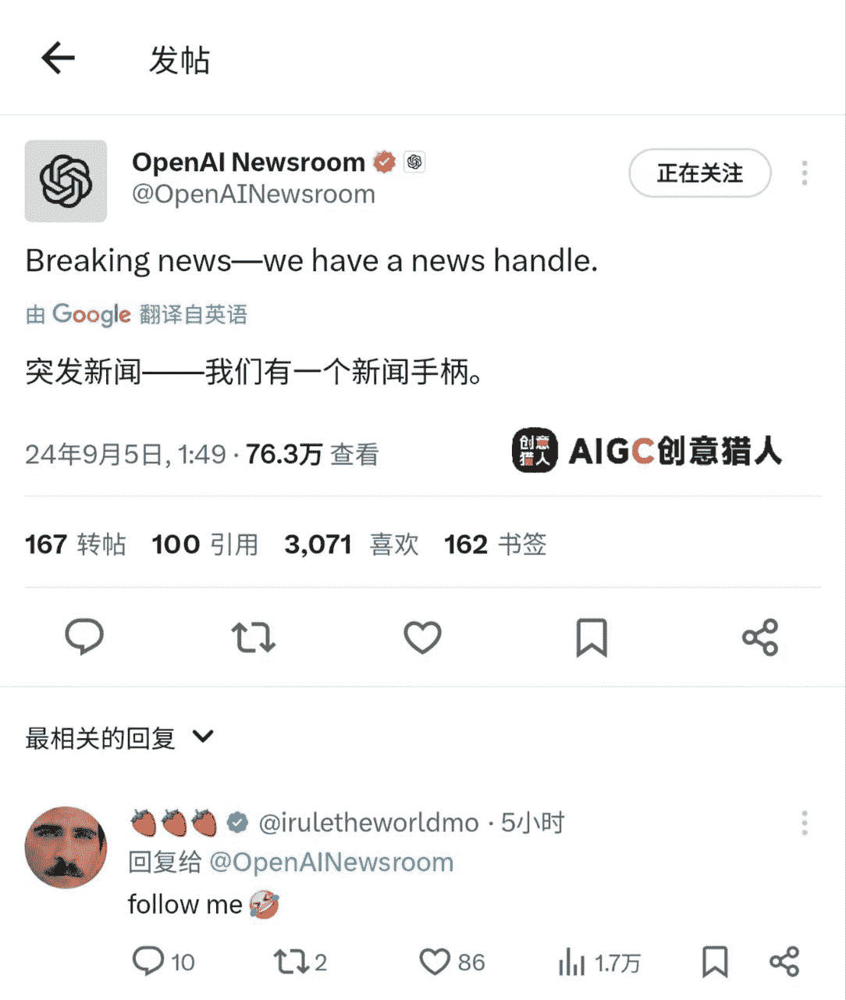

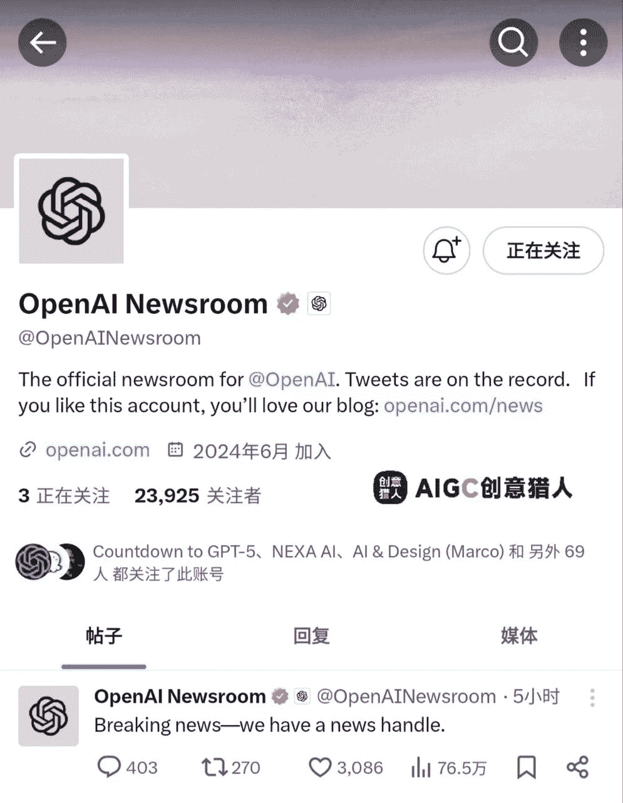

## 【20240905】动态 | Anthropic推出Claude企业版计划

帮助企业整合AI模型与内部知识库，提供个性化体验。该计划支持大上下文窗口（50万词元），集成GitHub，并提供安全功能如SSO和权限管理。Anthropic强调保护数据，不使用客户数据训练AI。

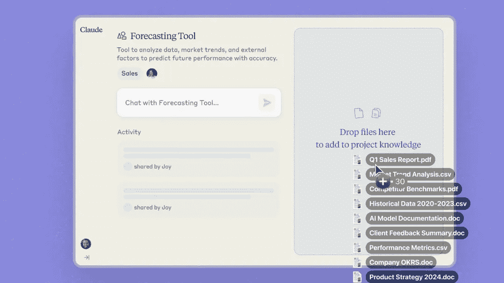

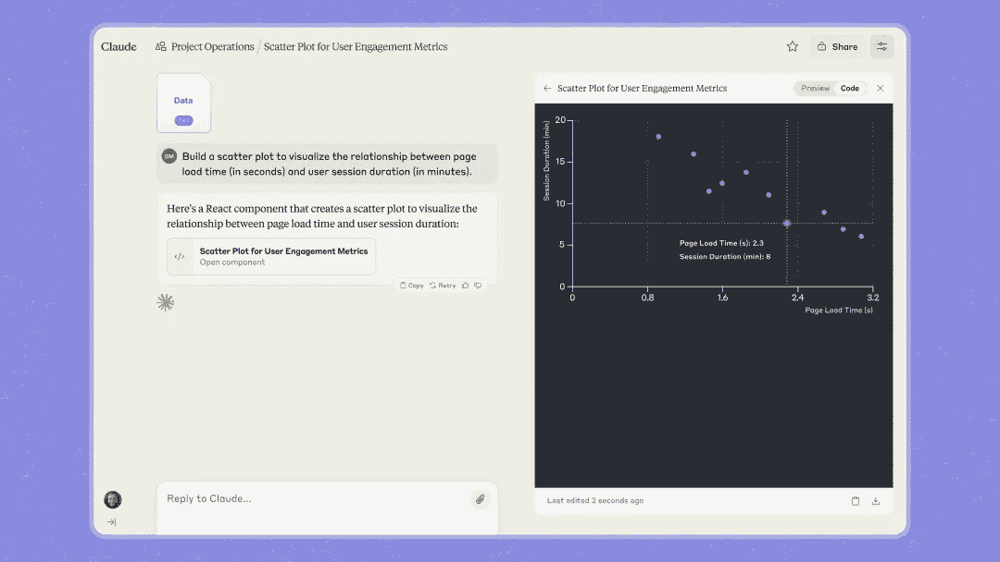

## 【20240903】动态 | Chrome浏览器引入Gemini AI功能，搜索体验迈向智能化。

Google在最新版本的Chrome浏览器中集成了Gemini AI功能，为用户提供了更为便捷的搜索体验。用户现在可以直接在浏览器的地址栏中输入“@gemini”，然后键入查询内容，即可立即调用Gemini AI进行智能化搜索。这一更新不仅提升了搜索的速度和准确性，还为用户提供了更多元化的搜索结果。

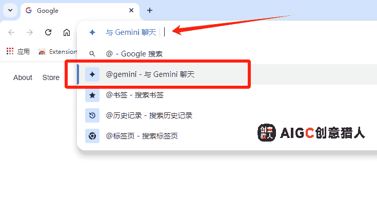

## 【20240903】动态 | GPT-4级别模型的使用成本在18个月内大幅降低240倍。

随着大语言模型（LLM）技术的发展，GPT-4级别模型的每百万个token成本从$180降至$0.75。成本的持续下降使企业可以更经济地利用生成式AI技术进行构建和应用，并期待这一趋势在未来继续保持。

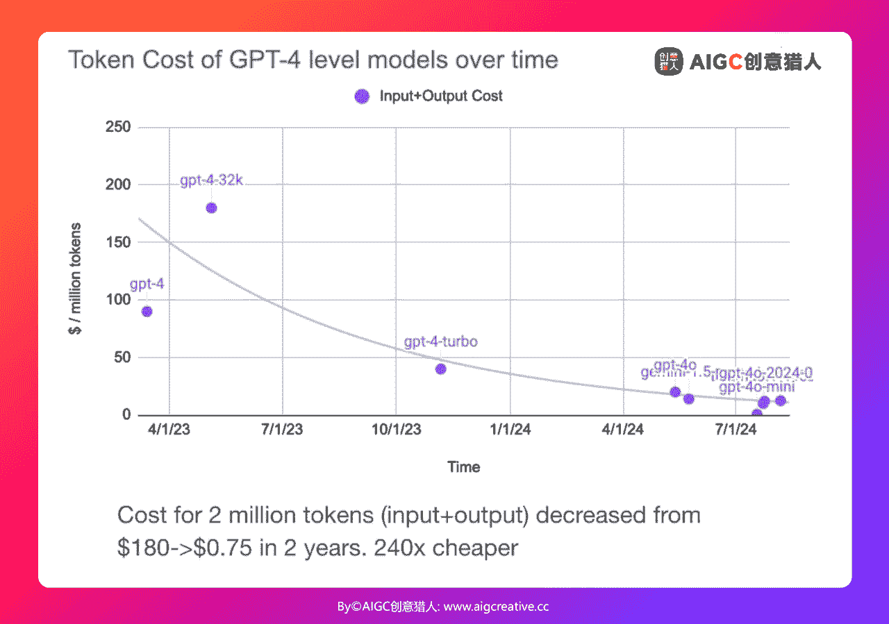

## 【20240902】动态 | WPortrait FL正式发布，写实效果进一步增强。

AWPortrait FL是基于Flux架构的最新写实模型，在图像构图美感和细节呈现上相较于原版Flux有了显著提升。该模型能够更逼真地表达人物特征，使得生成的肖像图像更加生动细腻，适用于需要高质量人像创作的场景。

在线体验地址：https://huggingface.co/spaces/vilarin/AWPortrait-FL

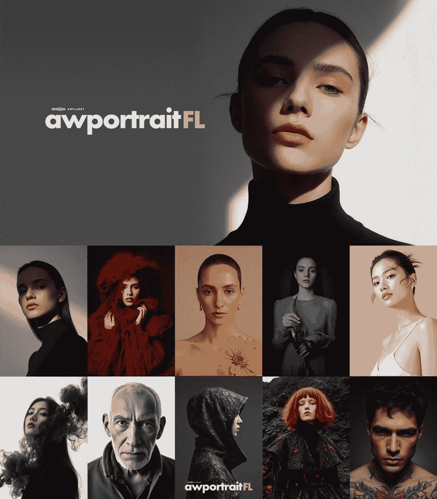

## 【20240901】动态 | 1X公司推出NEO家用人形机器人，主打安全与协作

机器人公司1X宣布其旗舰项目NEO进入测试阶段，计划将这款人形机器人引入家庭，协助完成清洁和整理等日常家务。与工业机器人不同，NEO特别注重安全性和与人类的合作，使其成为家庭环境的理想选择。该项目获得OpenAI的支持，旨在通过创新的机器人技术重塑家庭工作模式。

<https://aigcreative.feishu.cn/sync/K4Gvd9vUQsy9Oubwqaeclu0Fnbg>