# AI每日资讯-202408

> 来源：[https://aigcreative.feishu.cn/docx/Pn30dmZcyoTQpPxkkLXcjdt9nrc](https://aigcreative.feishu.cn/docx/Pn30dmZcyoTQpPxkkLXcjdt9nrc)

> **动态 | 观点 | 人物 | 产品 | 体验** | 应用 | 公司 | 融资 | 产业

## 【20240831】动态 | 创作者Everett World用多种AI工具制作汽车广告，展现动态视觉效果

创作者Everett World通过结合Leonardo AI的`Kino`模型、Runway的`Gen-3`视频生成功能以及`Udio v1.5`的音乐，制作了一则充满动感的蓝色汽车广告。视频剪辑使用Capcut完成，充分展示了多种AI工具协同工作带来的强大创作能力，为广告制作开辟了新的可能性。

[4fc75d5818428716849a502265cf3641(1)_raw.mp4](https://internal-api-drive-stream.feishu.cn/space/api/box/stream/download/all/IerBbG7Mnol2M2xUmNJc10fSncb)

## 【20240831】产品 | Runway推出`Gen-3 Alpha`扩展功能，生成视频时长延至40秒

Runway宣布推出`Gen-3 Alpha`扩展功能，用户现在可以将生成的视频时长延长至40秒。这一更新已经对所有用户开放，进一步提升了创意制作的灵活性和可能性。Runway持续致力于增强其平台的功能，为创作者提供更强大的工具支持。

[7db182ddf5aff66dff7d9a20cd2ff7c7(6).mp4](https://internal-api-drive-stream.feishu.cn/space/api/box/stream/download/all/BTQLboBbpoqSWyxc5dscgQzrnwc)

## 【20240830】公司 | NVIDIA财报亮眼，数据中心业务推动营收再创新高

在2024财年第二季度，NVIDIA实现了创纪录的收入，达到300亿美元，同比增长15%。其中，数据中心业务贡献最大，收入达263亿美元，占总收入的87%，并推动整体毛利润达到226亿美元，毛利率高达75%。净利润达166亿美元，较上季度增长显著。NVIDIA的强劲表现得益于其在AI和数据中心领域的持续投入和市场需求的增长。

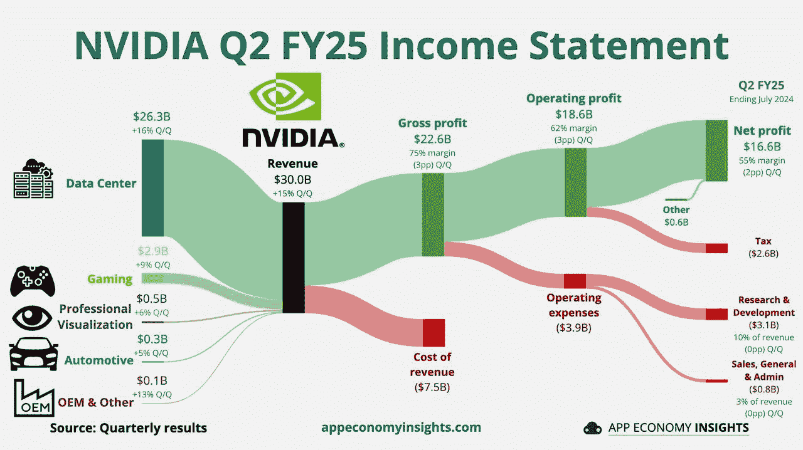

## 【20240830】动态 | Runway真的Run away了，突然删除Hugging Face上所有内容

AI公司Runway在Hugging Face平台上突然删除了所有内容，包括备受争议的`Stable Diffusion v1.5`项目。尽管Runway声称参与了Stable Diffusion的研究并已开源，但此前曾因Stability AI的侵权警告而陷入法律纠纷。Runway的主页上仅留下一句“我们不再对HuggingFace账号进行维护”，而官方尚未对此次删库事件作出解释。目前，Runway自家的模型`Gen-3`仍可在官网正常使用。

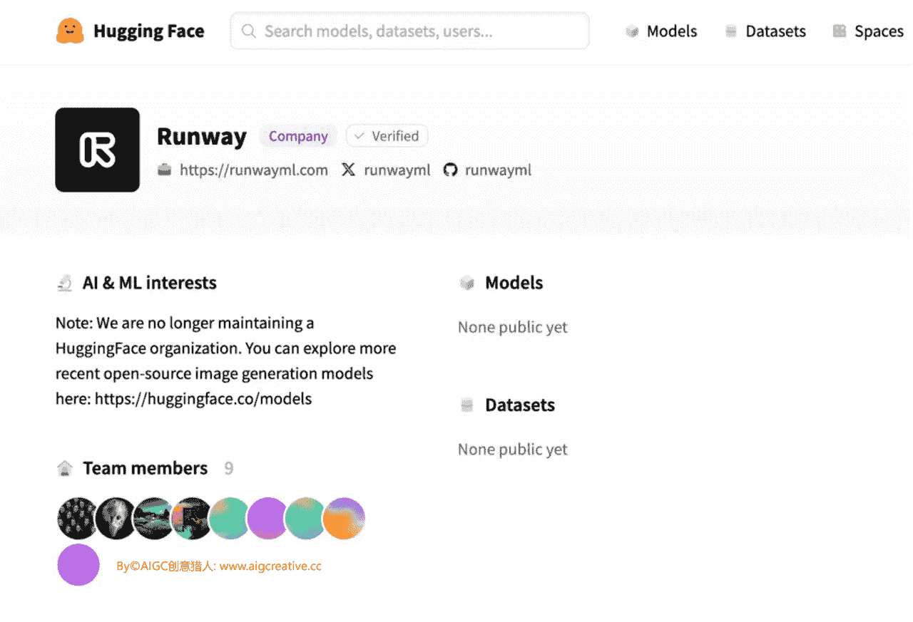

## 【20240829】产品 | Google Gemini 推出定制 AI 专家 `Gems` 和高级图像生成模型 `Imagen 3`。

在最近的一次更新中，Google Gemini 为其高级、商业和企业用户带来了革命性的创新 —— 自定义 AI 专家 `Gems`。这项功能允许用户根据自己的需求，创建专门针对特定任务或话题的 AI 助手，如编程伙伴、职业导师等，极大地提升了个性化服务的水平。同时，`Imagen 3` 的推出，作为 Google 的最新图像生成模型，它能够以多种艺术风格生成高质量的图像，包括超真实的风景和质感丰富的油画作品。为了确保图像生成的安全性和质量，Google Gemini 在 `Imagen 3` 中加入了先进的技术改进和保护措施。这些新特性将逐步在全球范围内推出，支持多种语言，并且 Google Gemini 团队已经开始收集用户反馈，以持续改进产品，确保用户在使用 AI 创作图像时能够保持创意控制权，同时遵守严格的道德标准。

[f2667a0ae6928e8717008335eec92d44(1)_raw.mp4](https://internal-api-drive-stream.feishu.cn/space/api/box/stream/download/all/N9ZxbDdz6ouLqxxiY0hcoeKinmg)

## 【20240829】洞察 | GenAI工具流量对比：OpenAI依然主导，微软和谷歌紧随其后

最新数据显示，OpenAI在AI工具的日均访问量和流量占比中继续保持领先地位，明显超越微软、谷歌、Perplexity和Claude等竞争对手。尽管其他平台也在持续增长，但OpenAI的市场份额依旧遥遥领先，展现出其在通用AI领域的强大影响力。随着市场的持续发展，微软和谷歌正在加紧追赶，试图缩小与OpenAI的差距。

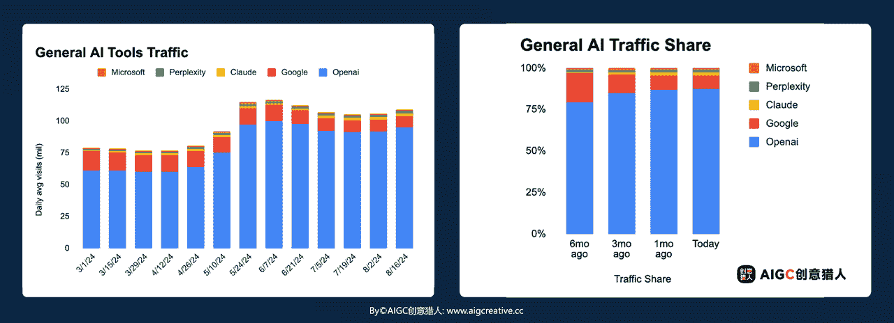

## 【20240829】公司 | Midjourney宣布进军硬件领域，由David Holz和Ahmad Abbas领导新团队

知名AI图像生成公司Midjourney正式宣布进军硬件领域，并在旧金山成立新团队，由创始人David Holz和前苹果硬件经理Ahmad Abbas共同领导。公司正在积极招募硬件人才，尽管尚未透露具体产品类型，但这一举动标志着Midjourney将从纯软件服务拓展到硬件开发领域，或将带来全新的产品和用户体验。

## 【20240828】动态 | DynamicWang的`AWPortraitXL 1.1`模型上线，提升人像生成细节与多样性表现

`AWPortraitXL 1.1`在`1.0`版本基础上进行了优化，融入了近2000张高质量时尚摄影图像，显著提升了人像生成的构图美感和细节表现。新版模型在多种族肤色的纹理表现上更为精细，尤其增强了东方元素的识别能力，如旗袍和汉服等。此外，`AWPortraitXL 1.1`在语义理解、场景构图和风格表现上也有提升，适合生成高质量且真实感极强的人像作品。

模型下载地址：https://huggingface.co/awplanet/AWPortraitXL

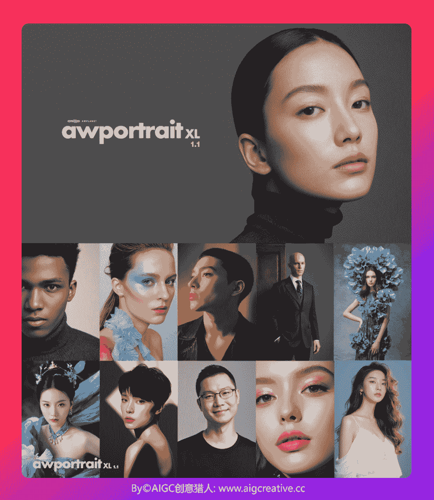

## 【20240828】动态 | Claude AI推出`Artifacts`功能，助力团队高效创作与协作

Claude AI正式向所有用户开放`Artifacts`功能，允许用户在iOS和Android应用上创建和分享各种高质量的工作产品。无论是开发者的架构图、产品经理的交互原型，还是设计师的可视化图表，`Artifacts`都能帮助团队快速将创意变为现实。免费和Pro版用户可以将`Artifacts`分享至全球社区，而团队版用户还可在项目中进行安全协作，共享与迭代工作成果。

## 【20240827】洞察 | 2024年主要大语言模型规模盘点，竞争激烈！

2024年6月的主流大语言模型如行星般各展实力。其中，`Claude 3 Opus`和`Olympus`模型拥有2万亿参数，展现了超强性能；而`Gemini Ultra 1.0`以1.5万亿参数紧随其后。`GPT-4 Classic`则保持1.76万亿参数的表现。此外，百度`ERNIE 4.0`和`Gemini 1.5 Pro`也跻身前列。值得关注的是，未来下半年可能会有更多重量级模型面世，进一步推动AI领域的发展和创新。

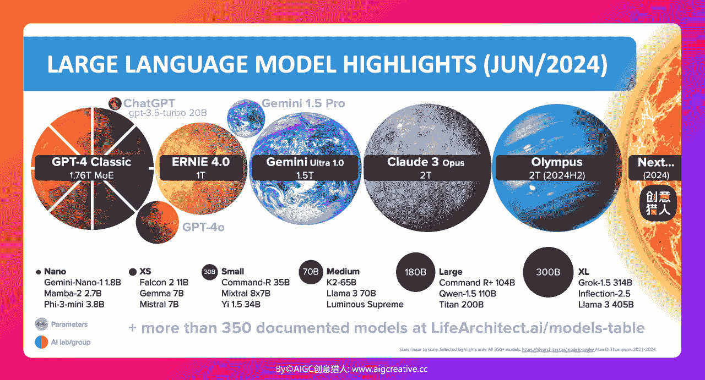

## 【20240826】案例 | `Midjourney 6.1`与`Gen-3`结合，打造绿金色调沉浸体验。

艺术家Everett World使用`Midjourney 6.1`和Runway `Gen-3`技术，结合音乐`Udio v1.5`与Capcut编辑工具，创作了一段绿金色主题的视觉作品。此次创作未使用参考图，仅通过常规文本提示生成，作者强调了作品的情感抒发体验。这一系列创作也展示了AI生成内容在艺术与视觉表达中的多样性和灵活性。

[f40c0a4e7d4984d034abb289b3ae04a9_raw.mp4](https://internal-api-drive-stream.feishu.cn/space/api/box/stream/download/all/BTsTbF10bomCc2xWyppc1cXDnOe)

## 【20240824】动态 | OpenAI为SearchGPT推出浏览器扩展，为搜索体验带来AI即时答案

SearchGPT 是一个用于 Chrome 的浏览器扩展，用户安装后可将其设为默认搜索引擎。它通过 AI 模型结合实时网络信息，提供更快、更相关的搜索结果。与传统搜索不同，SearchGPT 允许用户在浏览器地址栏直接输入查询，如 `lg [搜索内容]` 即可快速获取精确答案，同时提供来源链接供深入了解。此外，该扩展支持上下文连续对话，帮助用户更便捷地完成搜索任务。要体验这款工具，用户需申请访问其原型版本。

插件下载地址：https://chromewebstore.google.com/detail/searchgpt/ejcfepkfckglbgocfkanmcdngdijcgld

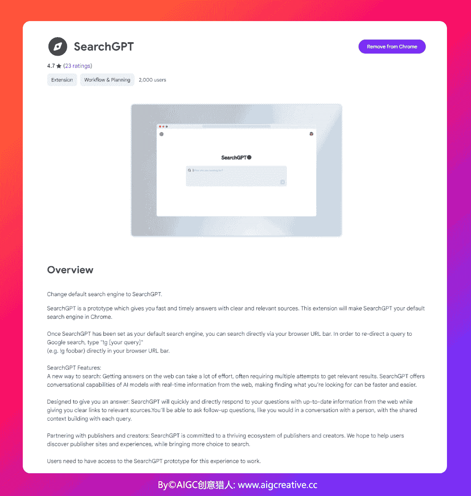

## 【20240823】动态 | 2024年消费者生成式AI应用榜单Top100揭晓

Andreessen Horowitz（a16z）最新发布的《Top 100 Gen AI Consumer Apps》报告显示，创意工具应用成为市场新宠，其中音乐生成器Suno表现突出，从第36位跃升至第5位。AI助手市场由ChatGPT主导，但新兴AI助手如Perplexity和Anthropic的Claude正发起挑战。字节跳动推出的Gauth、Coze和Doubao等应用首次上榜，展现了其在AI领域的雄心。此外，新兴的审美和约会应用也开始受到关注。

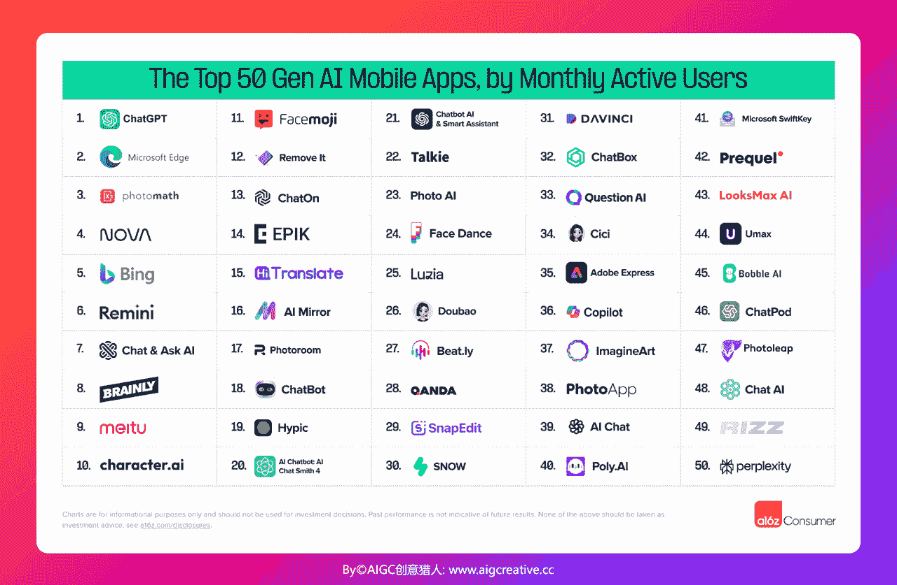

## 【20240822】产品 | 爱诗科技发布`PixVerse V2.5`，视频生成速度提升200%，新增功能丰富创作体验。

爱诗科技最新推出的`PixVerse V2.5`版本，实现了视频生成速度的显著提升，达到200%的加速，同时在动态、速度和画质上实现了三重优化。新版本支持7种语言界面，全球用户均可访问使用。模型优化后，提示词理解及视频生成能力显著增强，分辨率可达4K，细节更加生动。新增的`Performance`模式、运动笔刷和运镜功能，为用户提供了更加专业和生动的视频创作工具。文本内容生成功能也通过提示词即可设置文本风格和动态，进一步丰富了创作体验。

登录 https://app.pixverse.ai/ 即可使用。

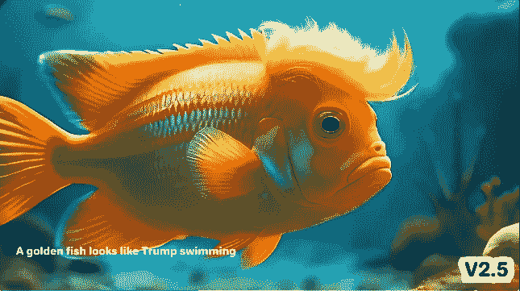

## 【20240821】动态 | DeepSeek开源`Prover-V1.5`，AI数学定理证明领域取得新突破

`DeepSeek-Prover-V1.5`，一款开源的AI数学定理证明模型，通过强化学习与蒙特卡洛树搜索技术，显著提升了在高中和大学数学定理证明中的成功率。该模型将数学问题转化为`Lean`编程语言，利用自然语言思维链数据与形式化证明的结合，实现与`Lean`证明器的直接交互，强化学习训练进一步提升了模型的证明生成能力。这一成果预示着AI在数学领域的应用潜力，为未来自主提出并证明数学理论的AI系统铺平了道路。

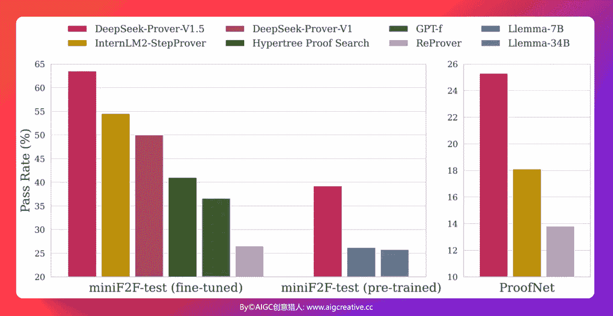

## 【20240820】动态 | Procreate宣布坚持“No AI”策略，引发用户热烈反响

著名设计工具Procreate近日宣布了其信仰战略：永不在产品中添加AI相关功能，强调艺术创作应由手工完成，而非通过生成方式实现。此声明获得用户一致好评，相关视频曝光量已超600万次，广受点赞、分享与讨论。这一选择突显了Procreate对特定艺术人群的定位与坚持。

## 【20240820】动态 | 各国公众对AI看法存在显著经济差异。

一项Ipsos的全球调查显示，发展中国家如中国、沙特阿拉伯和印度等，超过70%的受访者认为AI产品和服务的好处大于弊端，而在法国、加拿大和美国等发达国家，这一比例不足40%。整体趋势表明，经济较不发达国家对AI持更积极态度，认为其能带来更多发展机遇。而在富裕国家，公众则普遍对AI抱有更大的谨慎和疑虑，可能由于对就业影响和隐私问题的担忧。

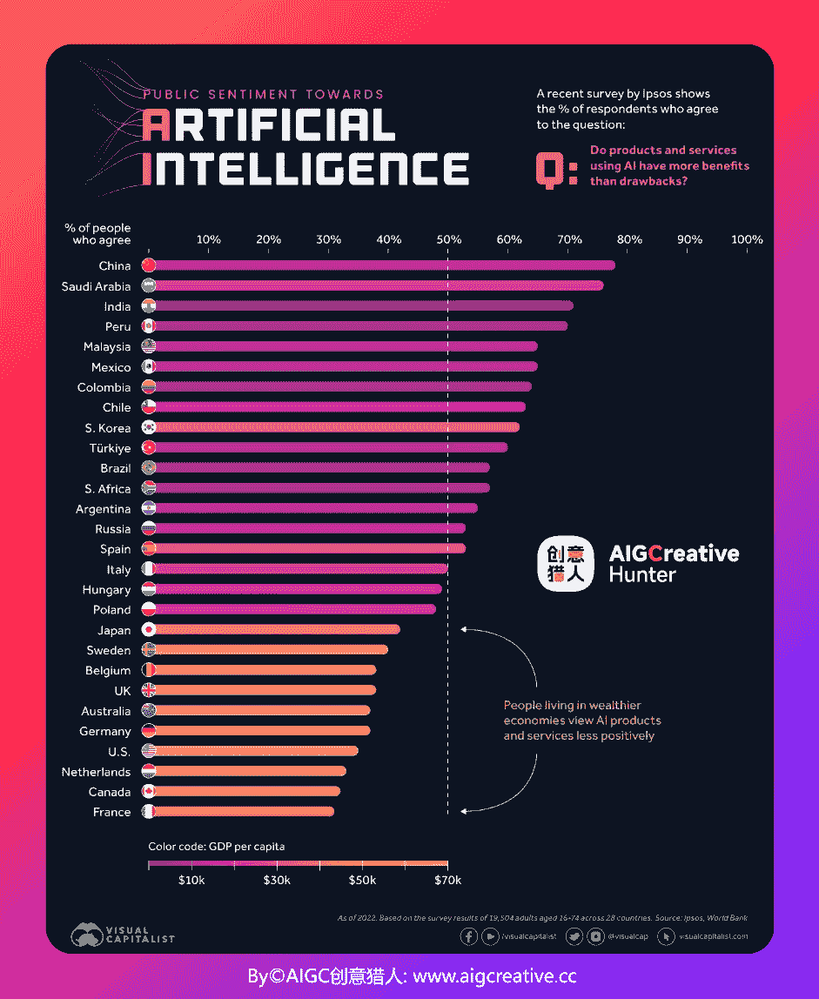

## 【20240819】动态 | 麦当劳日本携手Kakudrop使用AI打造炫目广告。

麦当劳日本推出了一支由AI技术打造的创新广告，KakuDrop使用LumaLabsAI，展示了未来感十足的视觉效果。广告中的AI元素使画面更加超现实且引人注目，展现了品牌在数字化时代的全新创意表达。这一突破性的尝试不仅体现了麦当劳在广告创新领域的前瞻性，也为其他品牌提供了AI应用的新思路。

[8fdcbebbb37ea0148dba143a6770d1d4.mp4](https://internal-api-drive-stream.feishu.cn/space/api/box/stream/download/all/O1gUbgrh9oKpyfxVZsuc4fklnRJ)

## 【20240819】动态 | 2024年大型语言模型（LLMs）发布计划：`GPT-5`、`Grok-3`等将于年内推出。

根据2024年7月的最新估计，多个关键大型语言模型将在年内推出。第三季度将发布`Grok-2`、`Claude 3.5 Opus`和微软的`MAI-1 500B`模型。第四季度则预计迎来`GPT-5`、Amazon的`Olympus 2T`、以及`Meta Next`等高关注度产品。这些模型的发布时机恰逢美国大选，AI技术在社会舆论中的应用备受关注。

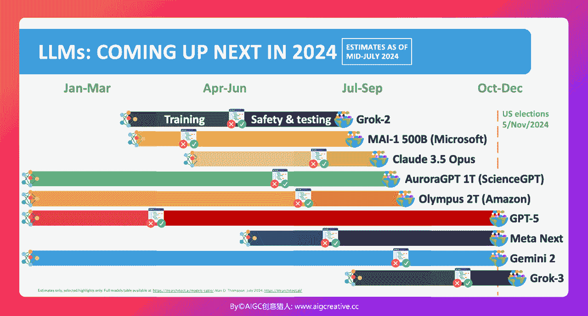

## 【20240816】动态 | Google Gemini推出全新AI语音助手功能，支持10种独特声音实时对话。

Gemini应用宣布推出高级社区的新AI语音助手功能，用户可从10种独特的语音中选择，用于更自然的实时对话。这一更新将助力用户进行更个性化的交流，例如在送礼建议等场景中提供创意方案。Gemini此举展示了其在AI语音领域的持续进化，进一步增强用户的互动体验。

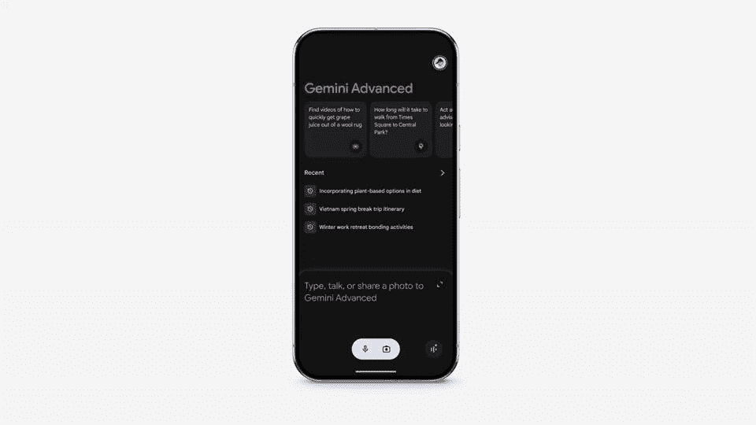

[2625206621db726edb9072635eb1fedb.mp4](https://internal-api-drive-stream.feishu.cn/space/api/box/stream/download/all/Mtn1bDHe9oyUHdxqy1fcfXYinug)

## 【20240816】动态 | 谷歌发布Gemini Live AI语音助手，支持更自然的情感对话与多任务联动。

谷歌推出的Gemini Live AI语音助手，可通过模拟真人对话展现更自然的情感表达，并支持多轮对话与持续的任务处理。该助手能够后台运行，允许用户在对话过程中随时暂停与继续某个话题，并可深度集成至Android系统，不仅能读取屏幕信息，还可与多种应用程序实现互动联动，提升用户体验。

[ece2b28a2e6700bd6bf451746affc176.mp4](https://internal-api-drive-stream.feishu.cn/space/api/box/stream/download/all/NXzgbpY7Vo76lQxDNAwc5e7FnIh)

## 【20240807】动态 | 全球最先进的AI硬件`Figure 02`亮相

Figure推出了最新的AI机器人`Figure 02`，其搭载的板载视觉推理模型（VLM）可以通过机器人摄像头实现快速的常识性视觉推理。此外，`Figure 02`配备了2.25千瓦时的定制电池组，提供超过50%的能量增量，并且计算和AI推理能力是上一代产品的3倍。

## 【20240807】动态 | OpenAI推出新款`GPT-4o`模型，输入令牌费用降低50%，输出令牌费用降低33%。

OpenAI宣布发布`GPT-4o`模型，该模型在操作成本上更具优势：输入tokens价格降低了50%，输出tokens价格降低了33%。此外，`GPT-4o`还支持结构化输出，确保模型输出与用户的`JSON`模式完全匹配，提升了数据处理的精确度和效率。

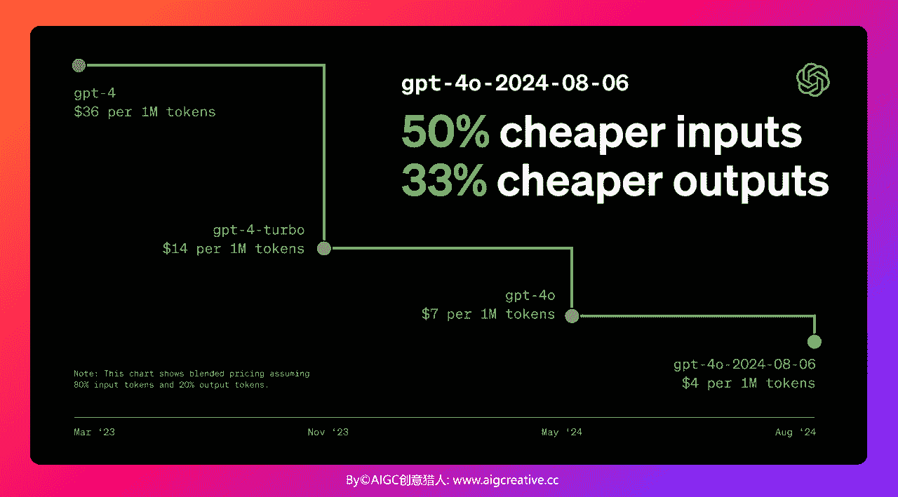

## 【20240807】动态 | ComfyUI将于8月15日起切换到新的前端框架

ComfyUI宣布，从2024年8月15日起，其前端将从旧框架迁移到新框架。新的前端使用`TypeScript`、`Vue`和`Vite`等现代技术，旨在提高代码质量和维护效率。此更改将解决现有前端架构中的模块化不足和开发挑战，并为未来的扩展性提供更好的支持。用户可以通过命令行参数选择提前体验新版本。

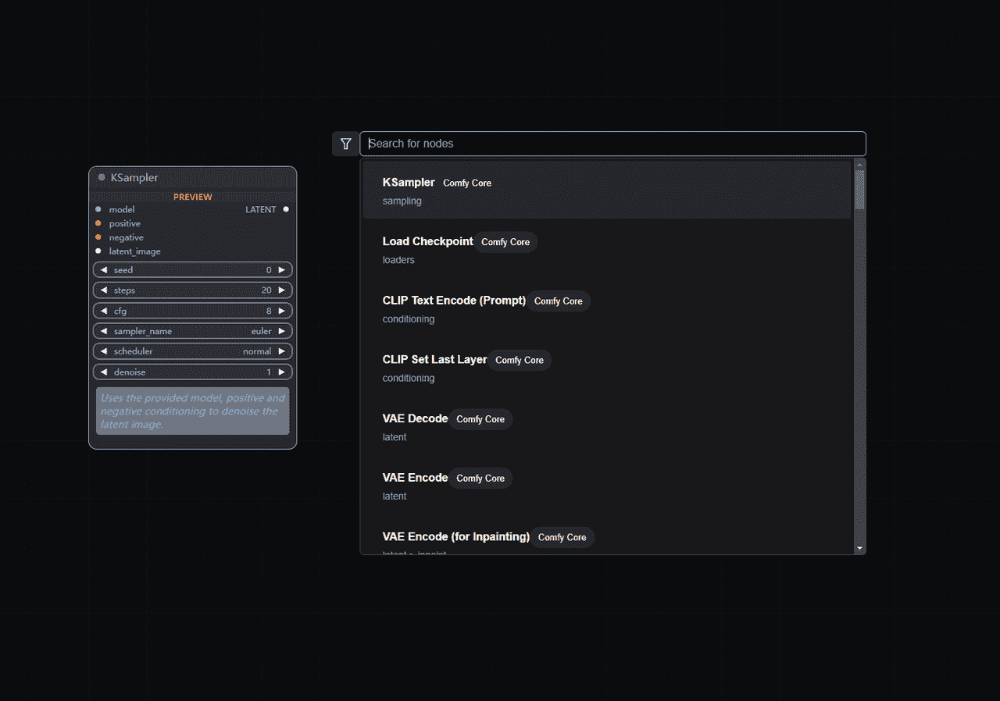

## 【20240805】动态 | 近日，Black Forest Labs宣布推出`FLUX.1`系列模型

该系列模型在图像细节、提示遵循、风格多样性和场景复杂性方面树立了新的行业标准，效果，文字控制非常精准

## 【20240802】动态 | Stability AI推出Stable Fast 3D技术，革新3D资产生成领域

Stability AI最新突破性技术Stable Fast 3D，能在0.5秒内将单一输入图像转化为详尽的3D资产，树立了3D重建速度与质量的新标准。公司同时发布了技术报告，介绍如何通过减少烘焙照明和材质参数实现快速推理速度。这项技术有望大幅提高3D世界内容创造的效率，为自动生成资产铺平道路，同时可能对游戏工作室和3D打印技术产生深远影响。

## 【20240802】动态 | Google Gemini 1.5 Pro (0801)成为Arena榜单第一！

根据最新的Arena评分排名，Google的Gemini 1.5 Pro (0801)以1300分的成绩登顶，超越了OpenAI的GPT-4.0系列。Gemini 1.5 Pro在总体问题应答中表现出色，领先其他竞争对手。此次排名进一步巩固了Google在AI模型领域的领先地位，凸显了其在自然语言处理和人工智能技术上的最新突破。

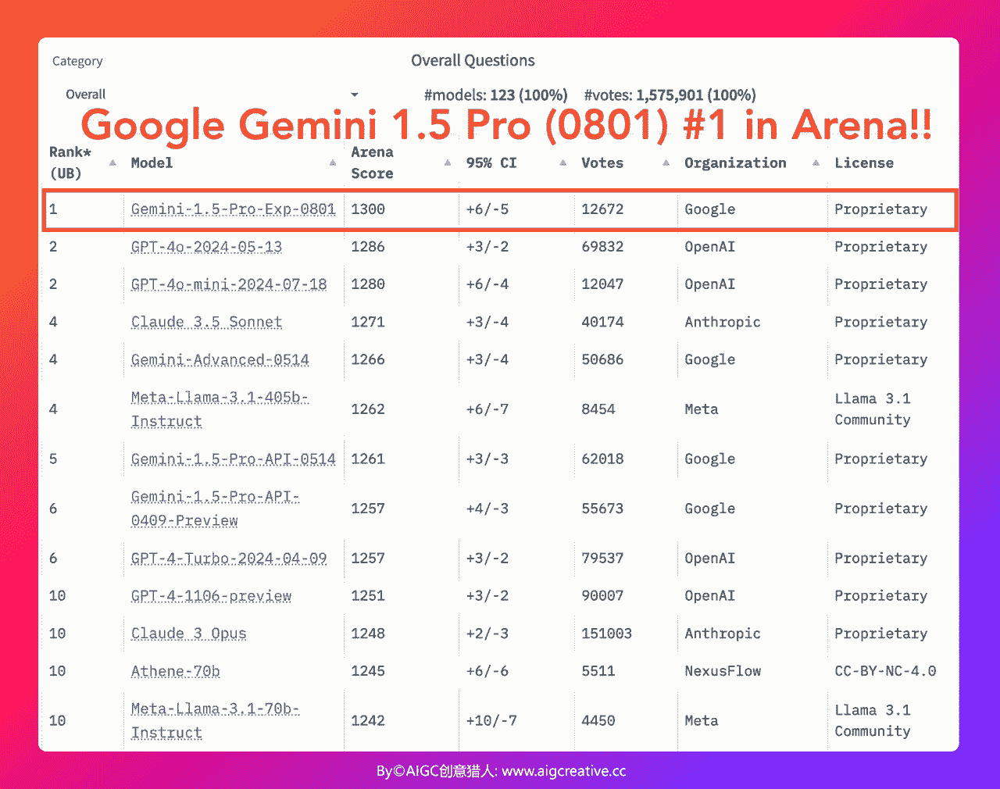

## 【20240802】动态 | Andrej Karpathy分享AI工具生成音乐视频的新玩法。

Andrej Karpathy在推特上展示了一种使用多种生成式AI工具快速制作音乐视频的方法。他通过将《华尔街日报》的头版内容输入Claude AI生成场景描述，再使用Ideogram AI生成图片，接着用RunwayML将图片变为10秒短视频片段。然后，Claude生成歌词，并通过Suno AI生成音乐，最后用iMovie将一切拼接起来。此创意展示了AI技术在多媒体内容创作中的潜力。

[642d80793dcbc42bc97a062993a35432.mp4](https://internal-api-drive-stream.feishu.cn/space/api/box/stream/download/all/BBRlbxCFWoRiwwxRLkmc5UPRnec)

## 【20240801】动态 | 360牵头组建AI"复仇者联盟"，打造CoE混合模型

在ISC大会上，360公司展示了一个创新的AI架构，通过整合15家大模型公司的优势，构建了一个类似"复仇者联盟"的CoE混合模型。这个架构通过海量真实数据的测试和分类，实现了对不同任务的精准匹配和高效处理。360AI搜索已经集成了这一架构，为用户提供了更智能、更精准的搜索体验。

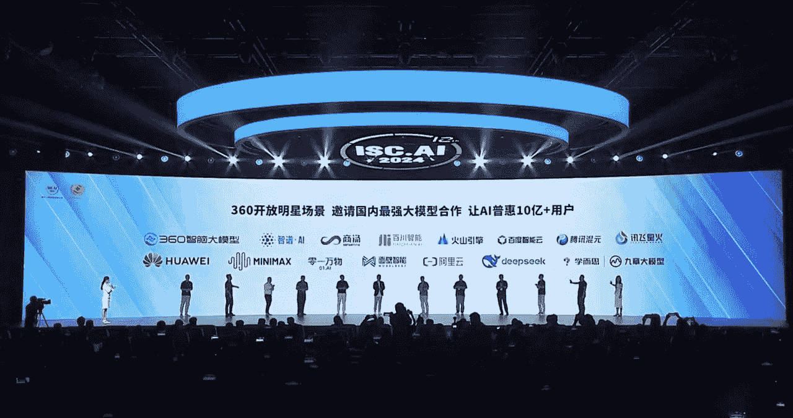
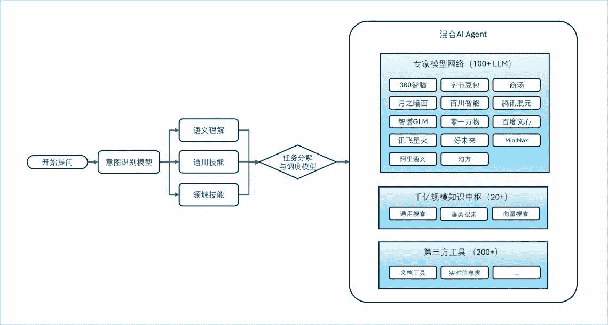
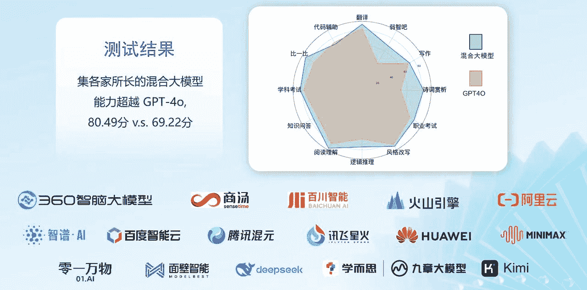

## 【20240801】产品 | Runway即将推出Gen-3 Alpha Turbo，视频生成速度提升7倍

Runway公司宣布，他们训练了Gen-3 Alpha的新版本Turbo，该版本在保持原有性能的同时，视频生成速度比原版本快7倍。公司计划在未来几天内推出Turbo版本，用于图像到视频的转换，并且价格将显著降低，同时对免费用户开放。这一技术进步将为高保真视频生成提供前所未有的效率，开启实时互动的新可能性。

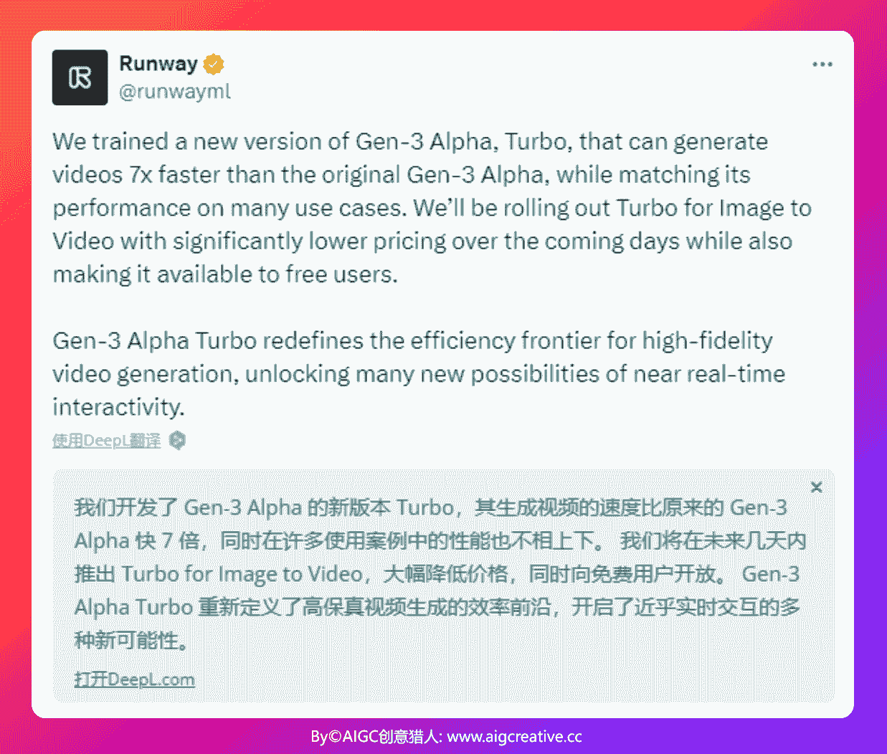

<https://aigcreative.feishu.cn/sync/K4Gvd9vUQsy9Oubwqaeclu0Fnbg>
