# AI每日资讯-202407

> 来源：[https://aigcreative.feishu.cn/docx/CT2ndc7FDon52Kx5CmJcts11ncg](https://aigcreative.feishu.cn/docx/CT2ndc7FDon52Kx5CmJcts11ncg)

> **动态 | 观点 | 人物 | 产品 | 体验** | 应用 | 公司 | 融资 | 产业

## 【20240731】产品 | 美图一站式AI短片制作平台【MOKI】即将推出，让每个人都能成为短片导演

该平台将通过AI技术辅助短片的前期设定、素材生成和后期制作，实现高度可控的创意制作流程。产品将分阶段上线，为创作者带来前所未有的便利和创意自由。

内测申请地址：https://www.moki.cn/

[e08c9214b6b11e09992232db92888330_raw.mp4](https://internal-api-drive-stream.feishu.cn/space/api/box/stream/download/all/M2AobH4YUolLH3xbyuUcfxQKncg)

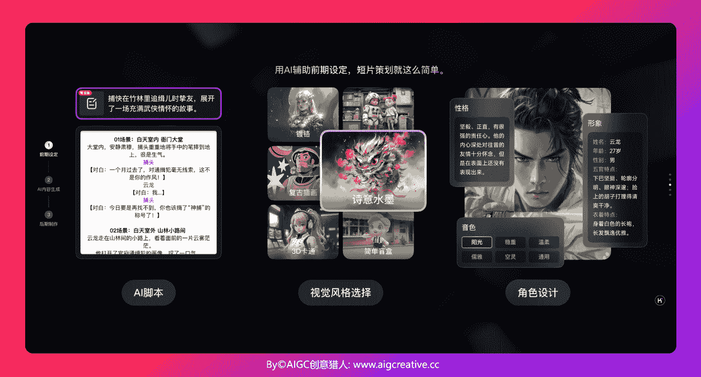

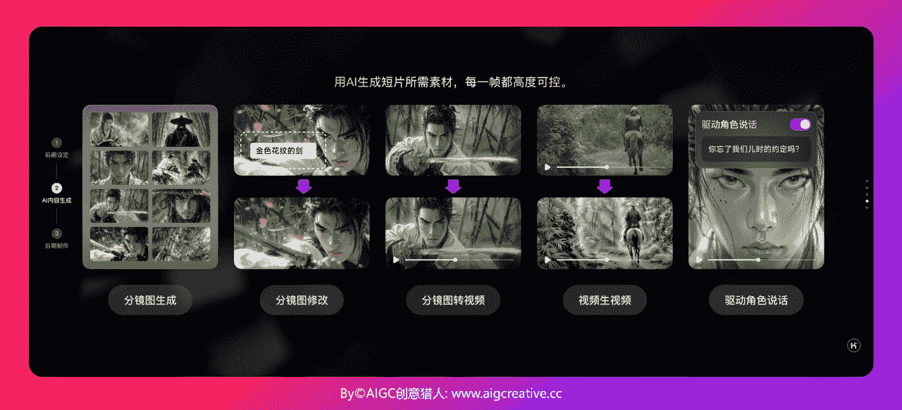

## 【20240731】产品 | Midjourney V6.1上线，提升图像质量与个性化

Midjourney V6.1现已发布，显著提高了图像质量、连贯性和文本表现。新版本引入了全新的升级和个性化模型，具备更智能、快速、清晰和美观的特点。更新内容包括：更连贯的图像、更优质的图像质量、更精准的小图像特征识别、新的提升图像/纹理质量的升级器，以及提高文本准确性和个性化代码版本控制等功能。

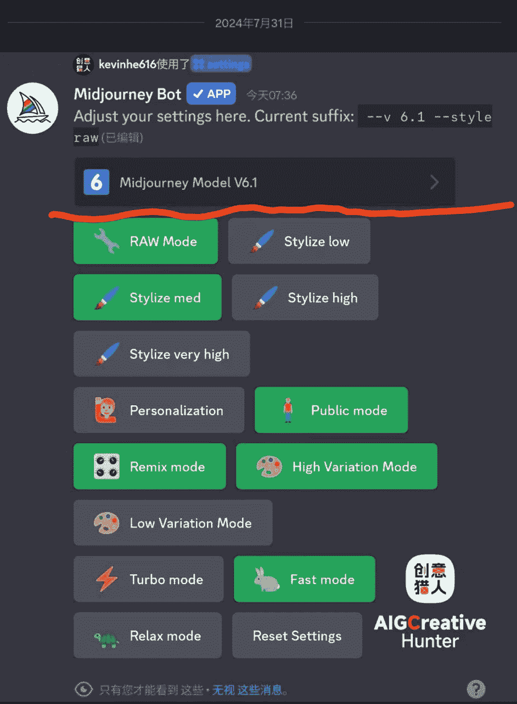

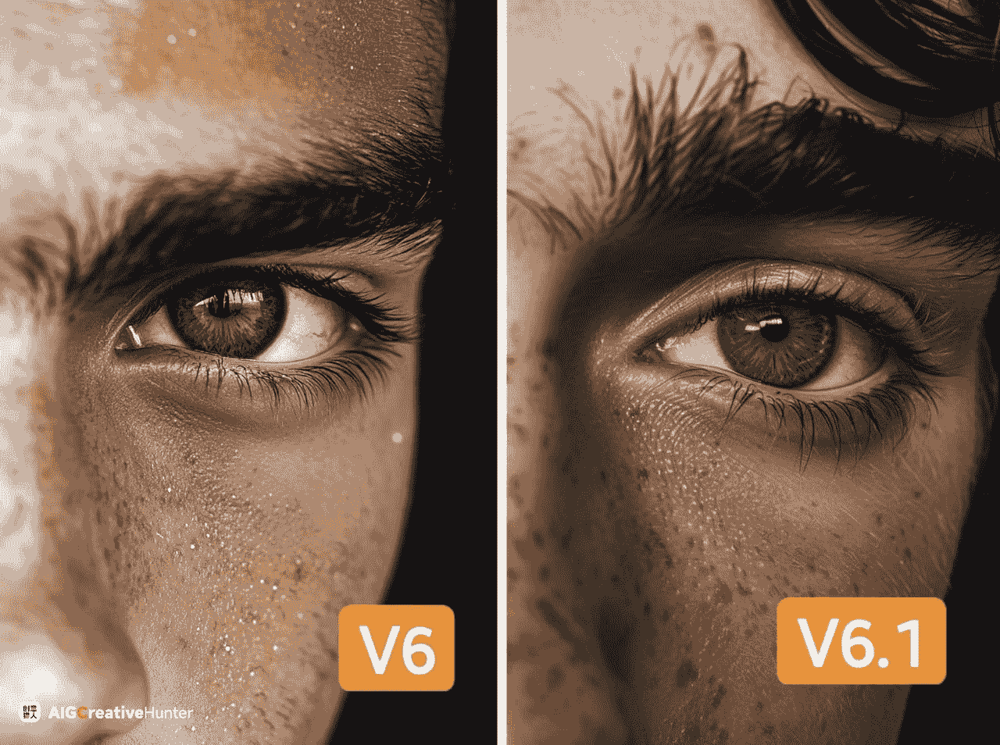

## 【20240731】产品 | ChatGPT Plus推出高级语音模式，支持自然对话

OpenAI宣布向部分ChatGPT Plus用户推出高级语音模式，该模式支持更加自然的实时对话，用户可随时打断，并感知和响应情绪。这一新功能将分阶段向更多用户开放，预计秋季全面上线。同时，还计划推出视频和屏幕共享功能，以提升用户体验。

[592cd7ace27604f54cadebd20f448f48.mp4](https://internal-api-drive-stream.feishu.cn/space/api/box/stream/download/all/By36bN90yoBCowxN8j1c9FlWn6g)

## 【20240730】产品 | 清华系生数科技推出AI视频生成平台Vidu

清华系生数科技的AI视频生成平台Vidu全面上线，支持文/图生视频功能，用户注册即可使用。平台强调角色一致性和动漫风格，提供快速生成视频片段能力，官方宣称推理速度业界领先，同时还放出了API申请。Vidu的推出标志着AI视频生成技术的新突破。

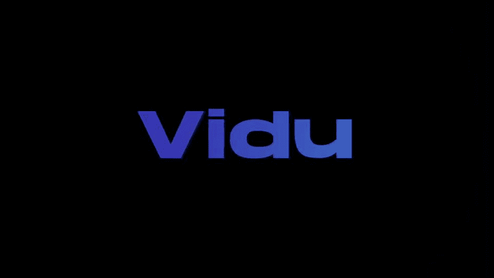

[25a0e97697a6eda134eb3088c8d1c4da(2)_raw.mp4](https://internal-api-drive-stream.feishu.cn/space/api/box/stream/download/all/MSMHbKyfgocFCdxtXK9chr7MnHe)

## 【20240730】产品 | Runway发布Gen-3 Alpha图像转视频功能

Runway今天发布了Gen-3 Alpha图像转视频功能更新。该更新允许用户使用任意图像作为视频生成的第一帧，并可以结合文本提示进行额外指导。这个重大更新极大地提高了生成视频的艺术控制和一致性。

## 【20240726】产品 | Stable Assistant新增Inpaint和Erase功能，提升创作体验

Stability AI今日宣布，Stable Assistant新增Inpaint和Erase两大功能。Inpaint可替换指定区域内容，生成无尽的迭代，Erase则能移除指定区域的不需要对象或瑕疵。这两项功能的推出，将极大提升用户的创作过程，提供更加灵活和高效的编辑体验。

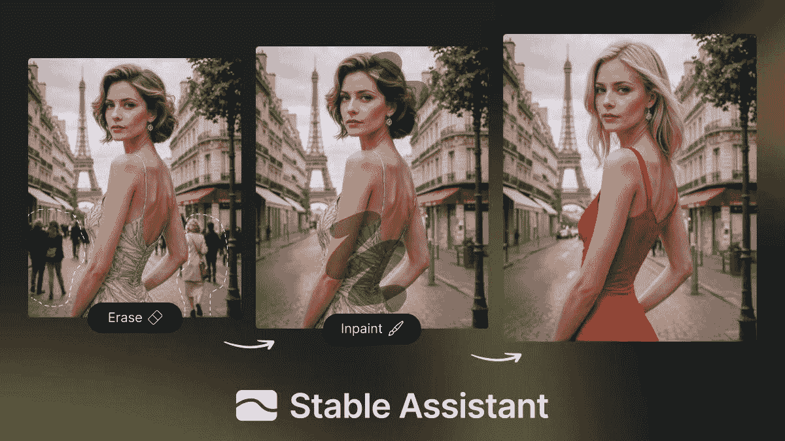

## 【20240726】产品 | Aiuni推出新工具，实现最佳图生3D效果

由清北00后团队开发的Aiuni最新图生3D工具问世，该产品不仅效果出色，还能细致补全图片中未展示的内容。支持将图片生成3D模型和场景，适用于游戏和影视制作。视频中展示了通过DALL·E生成图片并转化为3D的效果，展示了其强大的应用前景。官网：aiuni.ai

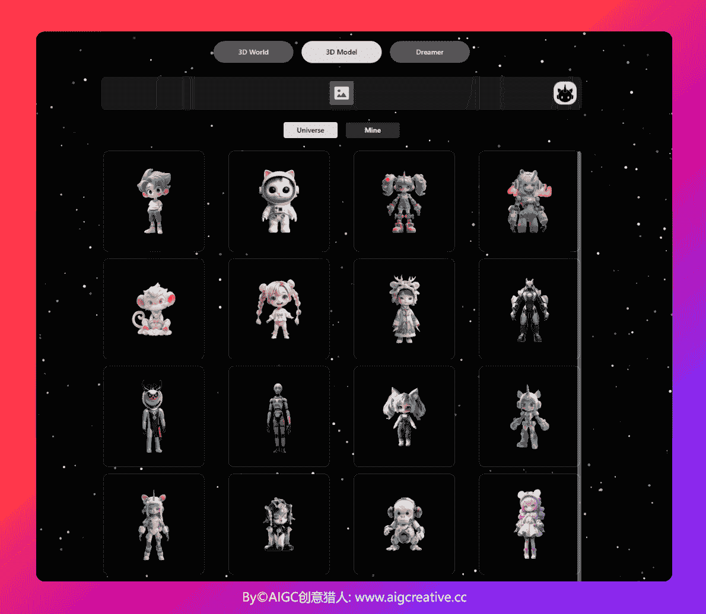

## 【20240726】产品 | OpenAI推出SearchGPT原型，提升搜索体验

OpenAI正在测试SearchGPT原型，结合AI模型和网络信息，为用户提供快速、及时的答案，并附上清晰的相关来源链接。该原型面向少部分用户和出版商，计划将最佳功能集成到ChatGPT中。用户可通过对话形式进行搜索，获得高质量内容。

## 【20240725】人物 | 2024年美国最具发展潜力的生成式AI初创企业

在美国，2024年最值得关注的生成式AI初创企业包括Anthropic、Perplexity、Abridge、Hugging Face、AssemblyAI等。这些企业的创始人如Dario Amodei、Aravind Srinivas、Shivdev Rao等，正在引领AI技术的发展和应用，为行业带来创新与突破。

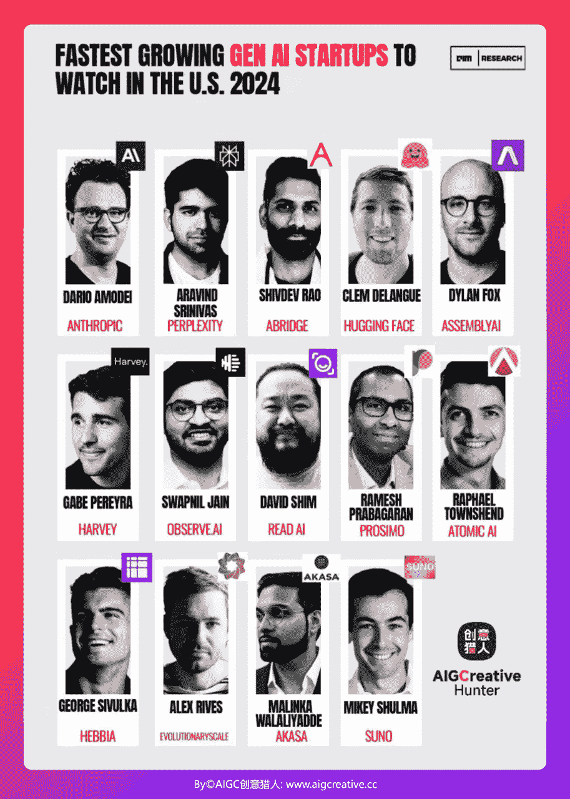

## 【20240725】产品 | Luma AI推出全新End Frame功能

Luma AI在其Luma Dream Machine中引入了全新End Frame功能。用户现在只需提供终点帧，系统就会自动生成到达这一瞬间前的画面内容。此功能现已向所有用户开放。

详情请访问lumalabs.ai/dream-machine。

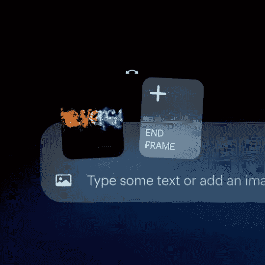

[d3041cec11dda05e3496ba9c0af14dd0(5).mp4](https://internal-api-drive-stream.feishu.cn/space/api/box/stream/download/all/JvI6bxddXoVjdfxil4jcmR0nnBf)

## 【20240725】产业 | AI视频软件价格对比：可灵性价比最高，Runway GEN-3价格最高

截至2024年7月的AI视频软件价格对比显示，可灵以每秒收费0.10元和最低月费33元成为性价比最高的软件。Runway GEN-3则以每秒收费1.73元和108元起的月费为最高。其他软件如Pika、Luma、Morph和Haiper在性价比和收费方面各有不同优势，Luma提供高级选项，Morph和Haiper则有高性价比的基础套餐。

更多精彩内容：www.aigcreative.cc

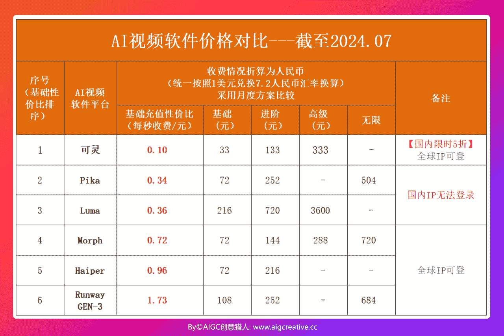

## 【20240724】产品 | Stability AI发布了一个视频到视频生成模型：Stable Video 4D

Stable Video 4D可以将单个视频转换为八个不同角度的新视角视频，一次推理就能生成 8 个视角的 5 帧视频，约40秒。Stable Video 4D 基于 Stable Video Diffusion 模型，该模型可以将图像转换为视频。Stable Video 4D 可以将视频作为输入，并从不同视角生成多个新视角视频。目前该模型处于研究阶段，未来可应用于游戏开发、视频编辑和虚拟现实等场景。

博客：https://stability.ai/news/stable-video-4d

模型：https://huggingface.co/stabilityai/sv4d

## 【20240723】产品 | Adobe 发布Firefly Vector AI 模型，为 Illustrator 和 Photoshop 推出更多生成式 AI 功能

Adobe Illustrator 和 Photoshop 推出一些新的工具和生成式 AI 功能。此次更新最引人注目的功能来自 Adobe 最新的 Firefly Vector AI 模型，该模型今天开始公开测试。这个新的 Firefly Vector 模型为 Illustrator 带来了诸多新功能，比如生成形状填充 (Generative Shape Fill)，用户可以通过描述性文本提示为形状添加详细的矢量图形。更新后的模型还改进了文本到图案 (Text to Pattern) 的测试功能，可以用来创建可扩展的自定义矢量图案，如壁纸；还有样式参考 (Style Reference)，能够生成与现有样式相匹配的输出。

## 【20240723】产品 | OpenAI API推出模型微调功能，助力定制化应用开发

OpenAI API的模型微调功能允许用户通过提供特定示例，训练出更符合应用需求的模型。这一过程不仅能够提高结果质量，节省令牌消耗，还能实现更低延迟的请求。用户首先需要准备并上传训练数据，随后训练新的微调模型，评估结果，并根据需要进行迭代优化。OpenAI提供了详细的指南和定价信息，以帮助用户了解微调模型的训练和使用成本。此外，用户还可以选择微调已有的微调模型，以便在获取更多数据时无需重复之前的训练步骤。

## 【20240723】产品 | PixVerse V2版本正式上线

* 更长：8 秒视频生成
* 更有趣：全新玩法，一键生成1-5段连续视频内容
* 更一致：人物一致、风格一致、场景一致

🔗入门教程：[PixVerse V2 使用教程](https://wiuswkbgux0.feishu.cn/wiki/ZXYpwJkatiqBGNkbjg7cQ489nAc)

👏体验地址：https://pixverse.ai

## 【20240723】产品 | 快手可灵AI全量上线，不再需要排队预约，不过开始收费了

快手可灵AI视频工具自7月23日起全面开放使用，用户可以体验AI生成的图像和视频。免费用户每日登录赠送66灵感值，大概可生成6个视频，但有功能限制。会员分为黄金、铂金、钻石三档，提供不同灵感值赠送。首周会员享受5折优惠。快手可灵以其性价比和效果，成为国产AI视频工具的佼佼者。

## 【20240722】产品 | Llama 3.1 405B 模型正式开源，性能媲美 GPT-4。

Meta 发布了 Llama 3.1 405B 模型，具备 128K 长文本处理能力，共有 405B、8B、70B 三种型号。此外，Meta 还推出了 Llama Guard 3 和 Prompt Guard 安全工具，以及 Llama Stack API，方便第三方开发者集成和使用。Llama 3 将新增图像和视频处理功能，目前正在开发中。为支持大规模推理，Meta 使用了超过 16,000 个 H100 GPU，并对模型进行重构，实现单个服务器节点上运行。

## 【20240722】产品 | Luma AI发布Dream Machine的Loops功能

Luma AI发布了Dream Machine的新功能Loops，允许从文本或图像生成无缝的AI无限循环的视频，以持续激发用户的想象力。用户可以通过该功能在其创意过程中反复使用和调整内容，增强创作体验。

[d6b58bf6be1dfb82d94df50230575889_4.mp4](https://internal-api-drive-stream.feishu.cn/space/api/box/stream/download/all/B04EbmM2KoW9SexlpeYcW4dUnbg)

## 【20240719】产品 | OpenAI发布GPT-4o mini：性价比最高的小型智能模型

7月18日，OpenAI宣布推出GPT-4o mini，这款小型智能模型在成本和性能上均实现突破，支持文本和视觉输入输出，未来将扩展至图像、视频和音频处理。其学术基准测试表现优异，安全性内置并持续改进，预示着AI技术普及化和低成本化的未来。

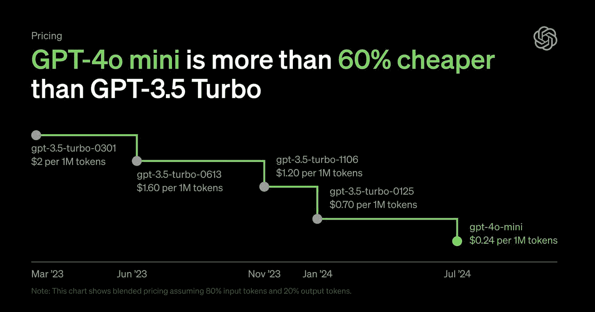

## 【20240717】产品 | Anthropic推出了全新的Claude Android应用程序

Anthropic公司最近发布了Claude Android应用程序，使得安卓用户也能享受到包括Claude 3.5 Sonnet在内的强大功能。该应用程序不仅支持多平台操作，还具备视觉能力、多语言处理和高级推理功能，能够随时随地为用户提供帮助。用户可以通过Google Play下载并开始使用。

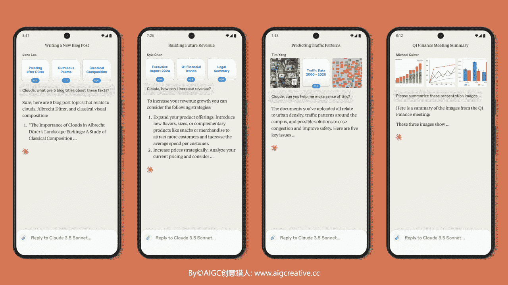

## 【20240715】洞察 | OpenAI、DeepMind与Anthropic发布AI智能分级标准

近日，Bloomberg披露了OpenAI在内部会议上发布的AI智能等级定义，该定义分为五个等级。目前，我们仍处于Level 1，但预计很快将达到Level 2。这一分级体系与OpenAI的目标一致，即通过AGI解放生产力。DeepMind则采用类似人类能力的衡量标准，以提升单体智能为目标，直至超越人类。而Anthropic从人类安全角度出发，将AI自主性和自我升级能力视为潜在威胁，其任务是识别并控制AI自主意识的出现。

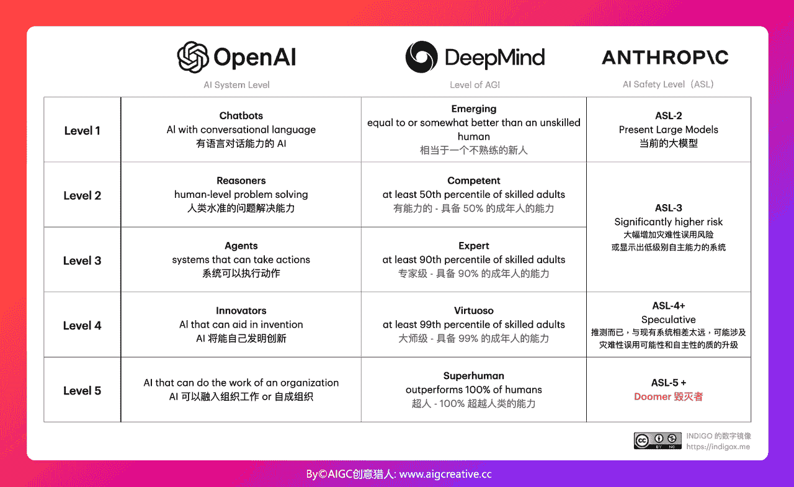

## 【20240714】资料 | OpenAI 推出新的AGI评分体系，ChatGPT 接近人类推理水平

OpenAI 在全员大会上宣布推出新的AGI评分体系，将人工智能分为五个等级：

1. 第一级（Level 1, ChatBots）：这是目前我们已经看到的AI，能够以对话的形式与人交流，比如现在的ChatGPT。
2. 第二级（Level 2, Reasoners）：这个级别的AI能够像拥有博士学位的人那样进行基本的推理和解决问题，但不依赖任何外部工具。
3. 第三级（Level 3, Agents）：这一级别的AI能够在几天内代表用户执行任务，比如自动完成一些复杂的工作流程。
4. 第四级（Level 4, Innovations）：这一级别的AI不仅能完成任务，还能进行创新，提出新的解决方案或发明。
5. 第五级（Level 5, Organizations）：最高级别的AI可以像一个组织一样工作，处理大量复杂任务，几乎能够完全取代人类在某些领域的工作。

目前ChatGPT 处于第一级，即将升级至第二级“推理者”，其基于GPT-4模型的最新能力已接近人类推理水平。这一进展标志着人工智能向更高自主性和解决问题能力迈进的重要一步。

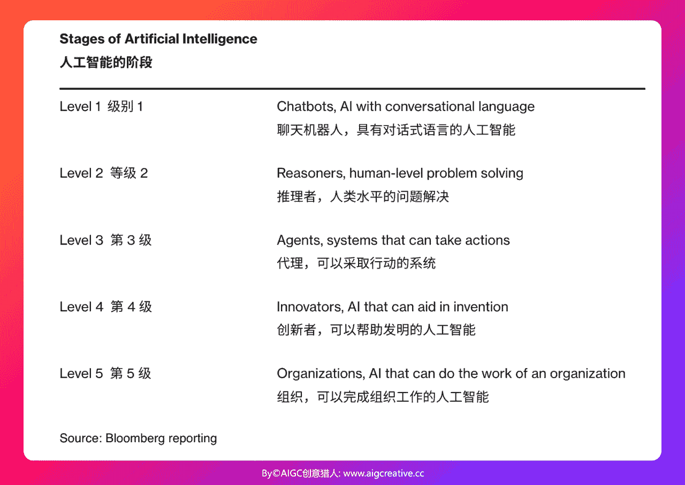

## 【20240712】资料 | 可灵AI视频官方简单提示词参考《「可灵AI」驯服指南-V1.0》：

https://docs.qingque.cn/d/home/eZQDp092-vzqbhb02KUdurkwP?identityId=1oEG9JKKMFv

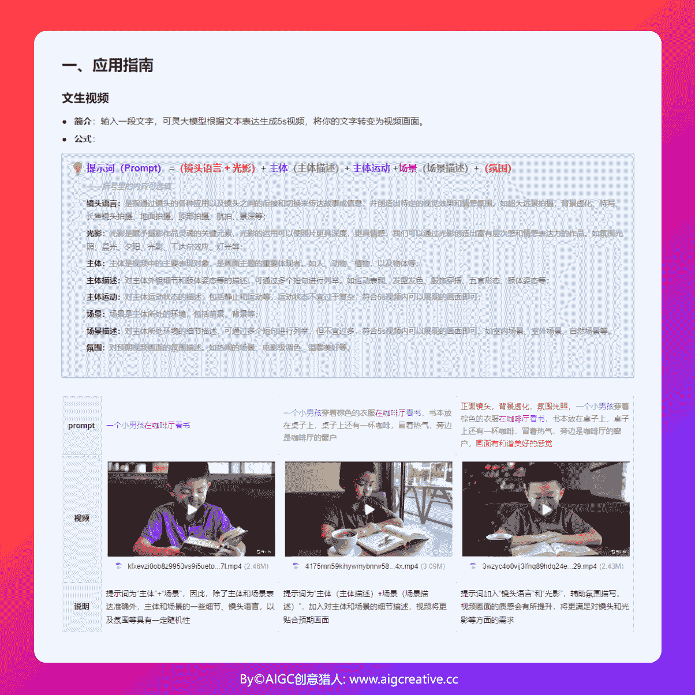

## 【20240712】产品 | OpenAI 推出新的AGI评分体系，ChatGPT 接近人类推理水平

OpenAI 在全员大会上宣布推出新的AGI评分体系，将人工智能分为五个等级：

1. 第一级（Level 1, ChatBots）：这是目前我们已经看到的AI，能够以对话的形式与人交流，比如现在的ChatGPT。
2. 第二级（Level 2, Reasoners）：这个级别的AI能够像拥有博士学位的人那样进行基本的推理和解决问题，但不依赖任何外部工具。
3. 第三级（Level 3, Agents）：这一级别的AI能够在几天内代表用户执行任务，比如自动完成一些复杂的工作流程。
4. 第四级（Level 4, Innovations）：这一级别的AI不仅能完成任务，还能进行创新，提出新的解决方案或发明。
5. 第五级（Level 5, Organizations）：最高级别的AI可以像一个组织一样工作，处理大量复杂任务，几乎能够完全取代人类在某些领域的工作。

目前ChatGPT 处于第一级，即将升级至第二级“推理者”，其基于GPT-4模型的最新能力已接近人类推理水平。这一进展标志着人工智能向更高自主性和解决问题能力迈进的重要一步。

## 【20240711】产品 | 系统级AI加持！三星电子在巴黎Galaxy Unpacked上发布了全新Galaxy Z Fold6和Galaxy Z Flip6

这些设备通过Galaxy AI的升级和独特的可折叠形态，以及连接的Galaxy生态系统，将智能手机的人工智能提升到新的高度。Galaxy Z Fold6和Flip6搭载了高通Snapdragon 8 Gen 3移动平台，为AI处理提供优化，同时升级的冷却系统提升了性能

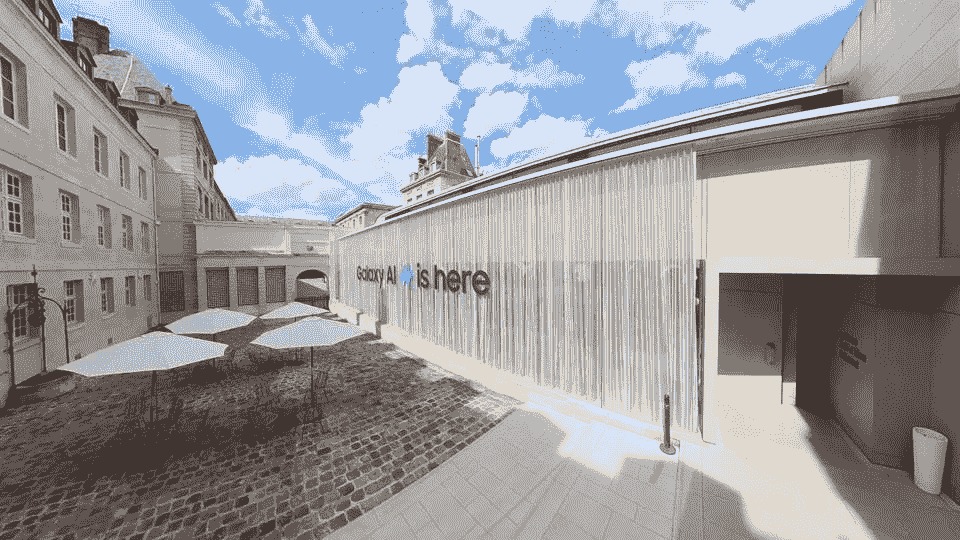

[2d41ec786632522154aaca092d45c9a2(1)_raw(7).mp4](https://internal-api-drive-stream.feishu.cn/space/api/box/stream/download/all/GgB2bQuaToDwGExaYIPc1MtSnUf)

## 【20240705】产品 | ElevenLabs 推出免费声音隔离工具，旨在提升音频清晰度，适用于多媒体制作领域。

ElevenLabs 最新推出的免费声音隔离器能够有效去除背景噪音，如街道嘈杂声、麦克风反馈等，确保电影、播客和访谈的语音内容达到最佳效果。用户可以选择通过麦克风实时录制或上传音频文件，利用 AI 技术清晰提取人声。

关于ElevenLabs，提供了一个全面的 AI 文本到语音平台，支持多达 29 种语言，拥有数千种声音可供选择，极大地丰富了内容创作者的选择。这些工具不仅适用于视频配音、广告朗读，还能实现个人声音的克隆，自动化生成个性化内容。

体验地址：https://elevenlabs.io/

## 【20240704】产品 | 商汤科技在2024世界人工智能大会上公布首个面向C端用户的可控人物视频生成大模型Vimi，获选为大会“镇馆之宝”。

Vimi能够通过单张照片生成与目标动作一致的人物视频，支持多种驱动方式，实现了精准的表情控制和自然肢体变化，自动生成匹配的头发、服饰和背景，光影效果流畅自然。Vimi的稳定性使其能够生成长达1分钟的高质量视频，满足娱乐互动等长时间视频生成需求，为C端用户尤其是女性用户带来全新的娱乐创作体验。

测试申请链接：https://vme-int.softsugar.com/questionnaire/

## 【20240704】产品 | Perplexity 推出升级版 Pro Search，带来更高效的问题解决能力

Perplexity Team 最近宣布，他们的强化搜索工具 Pro Search 已经升级，以更好地应对复杂问题解决。这一升级不仅提升了多步骤推理和高级数学编程计算的能力，还通过与 Wolfram|Alpha 引擎的集成，提供了前所未有的精确答案。用户可以通过简单的切换，启用 Pro Search 来进行深入的研究，无论是法律、市场营销还是软件开发领域，都能获得专业的分析和支持。每个人都可以免费使用 Pro Search 五次每四小时，而 Pro 订阅用户则可以享受更多的访问次数。这一升级标志着人工智能在知识发现领域的进一步突破，为各行各业的专业人士提供了更为强大的辅助工具。

## 【20240704】技术 | 媲美GPT-4o！法国AI实验室Kyutai发布开源实时语音多模态模型Moshi

法国AI实验室Kyutai近日发布了一款名为Moshi的开源实时语音多模态模型，该模型具备听、说、看的能力，并且支持随时打断和模仿口音的功能。尽管在效果上略逊于GPT-4o，但Moshi的模型训练管道和架构设计简单且具有高度可扩展性，使得Kyutai这样的小团队能在短短4个月内完成开发。Moshi专注于本地设备运行，实现了低延迟操作，其预测编码技术允许模型在用户提问未结束时即给出回应，或在被打断时迅速做出反应。Kyutai的这一创新预示着实时语音技术的未来普及趋势。

官网：kyutai.org

## 【20240703】技术 | Meta 3D Gen：快速高保真文本到3D资产生成新技术

Meta推出最新的3D资产生成管道——Meta 3D Gen（3DGen），实现了在一分钟内高保真、高质量的3D形状和纹理创建。3DGen支持物理基础渲染（PBR），适用于真实世界中的3D资产再光照处理。此外，3DGen还支持使用用户提供的文本输入对已生成或艺术家创建的3D形状进行生成性重纹理化。其核心技术包括Meta 3D AssetGen和Meta 3D TextureGen，实现了视图空间、体积空间和UV（或纹理）空间的三重表示，性能相比单阶段模型提升了68%。与行业基准相比，3DGen在提示保真度和视觉质量方面均表现优异且速度更快。

论文：https://ai.meta.com/research/publications/meta-3d-gen/

## 【20240702】资料 | 借助Claude Artifacts出的视频拍摄要素一览图

这张信息图涵盖了视频拍摄的各种要素和技术，包括镜头类型、运动方式、角度、构图元素、光线、色彩、时间和天气条件等。通过分类展示不同的拍摄方式，如特写、远景、跟踪镜头、俯视和仰视等，以及各种光线使用技巧如自然光和人工光，全面了解和运用这些拍摄元素来提升视频质量和创意表现，也就能更好的写好AI文生视频的Prompt。

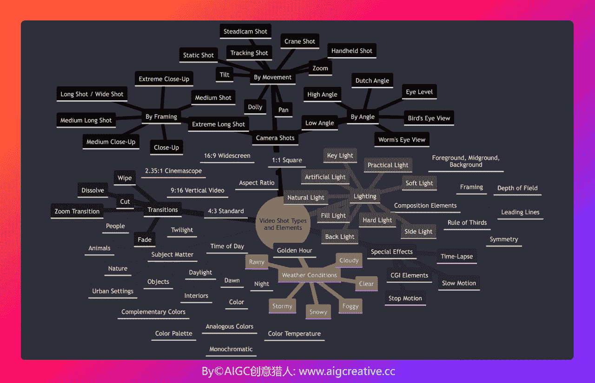

## 【20240702】产业 | SuperCLUE发布最新文生视频生成能力评测基准AIGVBench

大模型评测机构SuperCLUE推出针对视频生成能力的评测基准AIGVBench，采用Gemini-1.5-Pro对视频进行统一评估。评测包括10个模型，结果显示中文环境国内模型整体表现好于国外模型。国内模型在视频质量和中文指令遵循能力上表现出色，但在模拟物理世界的能力上略有不足。

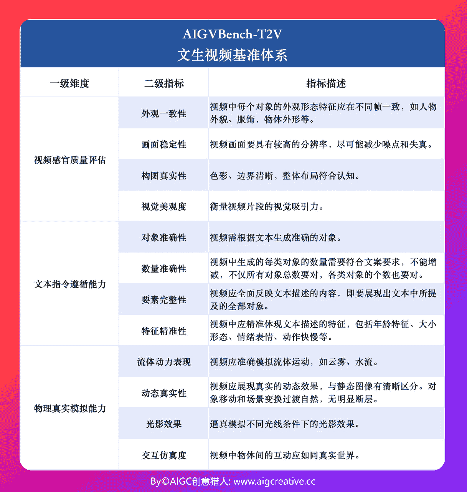

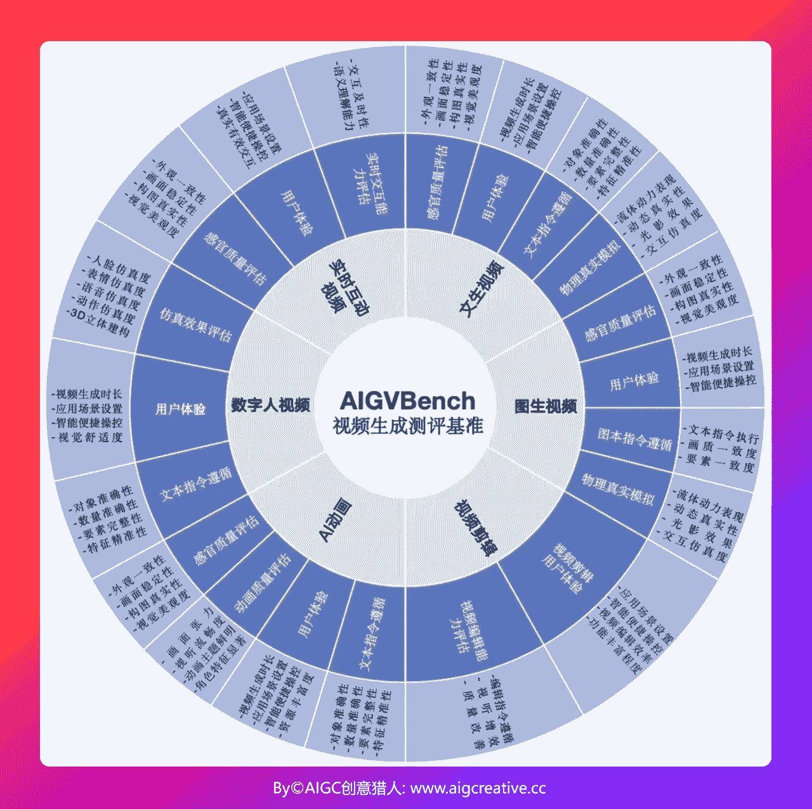

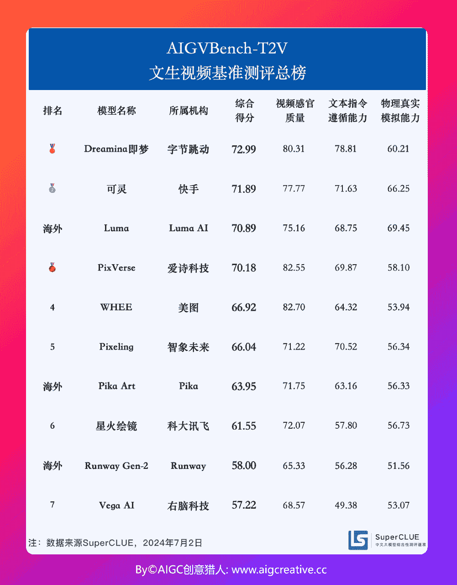

## 【20240702】产品 | Suno音乐创作应用登陆iOS平台

Suno应用程序正式在iOS平台上线，用户现在可以通过Apple App Store下载体验。这款应用让音乐创作变得触手可及，无论何时何地，只要有灵感，就可以通过手机轻松创作出个性化的音乐作品，并与朋友分享。

目前，Suno仅在美国地区提供服务，但官方表示，Android版本和全球推广计划即将到来，同时还有更多令人期待的功能更新。

## 【20240701】产品 | 谷歌推出的AI视频编辑应用Google Vids已于今日上线测试

Google Vids 集成了 Gemini 大模型，可以帮助用户创建幻灯片、编写视频脚本，并从 Shutterstock 寻找素材，还可以为整个视频制作分镜头脚本。用户则可以通过添加或删除幻灯片、文本字段、图片和音频等元素来编辑视频，最后将其导出为 MP4 文件。尽管测试版缺少AI配音功能，但其简易操作理念，使得视频制作变得无需专业经验。

## 【20240701】产品 | 全球首款集成GPT-4o智能眼镜发布

模块化设计支持更换框架，集成LED通知灯，支持多语言实时翻译，同步运动计划，售价249美元。

最新推出的Solos AirGo 3音频眼镜，以其模块化设计和集成的GPT-4o AI技术，为用户带来前所未有的智能体验。这款眼镜不仅支持超过10种语言的实时翻译，还能根据用户所看到的内容提供实时回答，帮助用户轻松打破语言障碍。此外，它还具备LED通知灯，整合了Google Gemini和Anthropic的Claude AI模型。这款不含相机的智能眼镜，售价为249美元，为追求科技与时尚结合的消费者提供了新的选择。

<https://aigcreative.feishu.cn/sync/K4Gvd9vUQsy9Oubwqaeclu0Fnbg>
