# AI每日资讯-202406

> 来源：[https://aigcreative.feishu.cn/docx/MfXndmVWgopKPWx5bcBcyNIAnbh](https://aigcreative.feishu.cn/docx/MfXndmVWgopKPWx5bcBcyNIAnbh)

> **动态 | 观点 | 人物 | 产品 | 体验** | 应用 | 公司 | 融资 | 产业

## 【20240628】产品 | Viggle推出新功能“Move”，保留原图背景实现动态效果。

Viggle的最新功能“Move”现已上线！相比之前的绿幕和白背景功能，Move允许用户在无需进一步编辑的情况下保留图像的原始背景并实现动画效果。

官网体验：https://viggle.ai

[e618788902757e185d61fa2e64b9448f.mp4](https://internal-api-drive-stream.feishu.cn/space/api/box/stream/download/all/LG2zbdj64oNeL4x3mMtceJl7ngc)

## 【20240628】资源 | SrefHunter.top推出全新Midjourney风格代码库

Midjourney风格代码库SrefHunter.top为艺术家和设计师提供了一个丰富的资源平台，通过其网站，用户可以轻松获取并应用各种独特的视觉风格代码，从而快速创作风格一致的图像。该平台每周更新，从社交媒体收集最新流行的Midjourney风格代码，并提供视觉示例，帮助用户探索创意可能性，激发灵感。

官网链接：https://srefhunter.top/zh

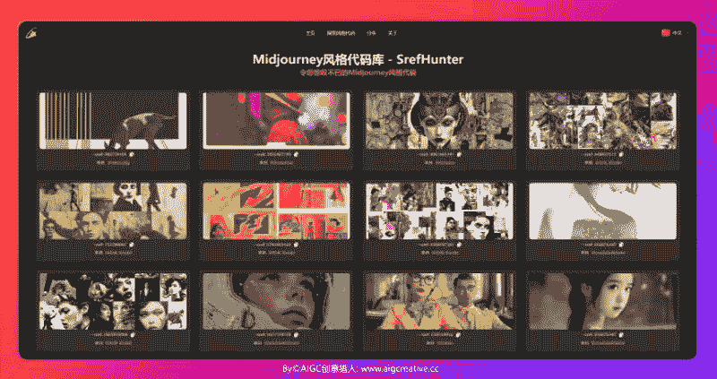

## 【20240628】动态 | 【用魔法打败魔法】OpenAI推出CriticGPT模型，用GPT-4给GPT-4找错误

OpenAI发布了基于GPT-4的CriticGPT模型，该模型旨在帮助人类训练师识别ChatGPT代码输出中的错误。研究表明，使用CriticGPT辅助训练师在检测错误方面的表现优于单独工作，并减少了模型单独检测时的错误。此举旨在改进“人类反馈强化学习”（RLHF）过程中数据的质量，以更好地评估和校正高级AI系统的输出。

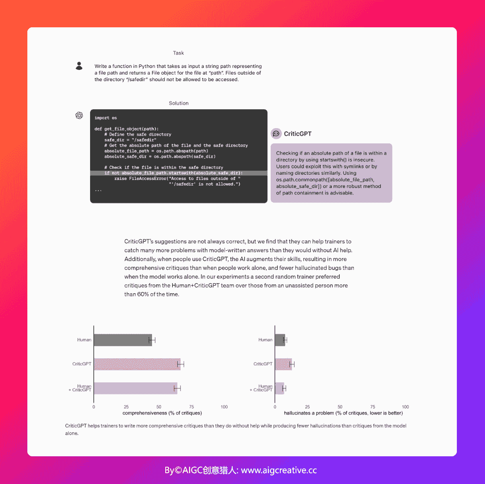

## 【20240628】产品 | Luma引入关键帧功能，实现叙事控制和视觉变换。

Luma的最新更新带来了关键帧技术，允许用户通过起始和结束关键帧来控制叙事流程。通过文本指令引导创作旅程，用户可以改变光线和季节，控制视角，转变主题形态，甚至创造出不可能的过渡效果，极大地丰富了创意表达的可能性。

[3e8f7fcd59b21ea7b709ab1f4990b244.mp4](https://internal-api-drive-stream.feishu.cn/space/api/box/stream/download/all/XQHObgn3eo8fjRxvSLYcc7jmnvg)

## 【20240628】产品 | Glif平台五分钟快速搭建AI梗图生成器，引爆推特热潮

推特上，Glif平台的AI梗图生成器以其五分钟搭建的便捷性迅速走红，吸引了157.3万人的观看。用户通过低代码方式，利用Claude 3.5等模块，轻松创作个性化的meme梗图。Glif的简单操作和创意自由度，让每个人都能成为梗图创作者，分享自己的幽默与创意。平台完全免费，支持源码查看与改编，甚至可以嵌入到HTML中，为创意表达提供了无限可能。

体验地址：https://glif.app/@fab1an/glifs/clxtc53mi0000ghv10g6irjqj

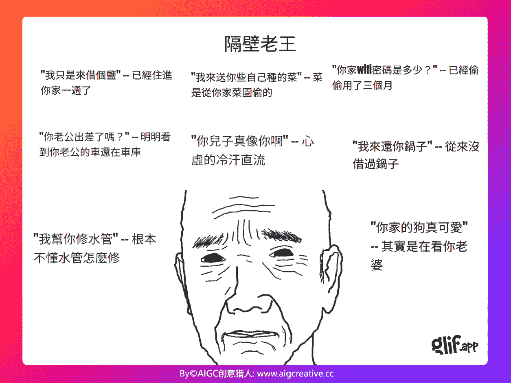

## 【20240627】产品 | OpenAI正在灰度测试新模型GPT-4o(S2S)

GPT-4o(S2S)是一种序列到序列的模型，这个缩写代表"GPT-4 for OpenAI (Sequence-to-Sequence)"。这个版本特别针对桌面用户进行了优化。简单来说，它专门用于训练特定模式，例如机器翻译、文本摘要或语音识别等等。这个新模型还在灰度测试阶段，可能有的用户还看不见它。

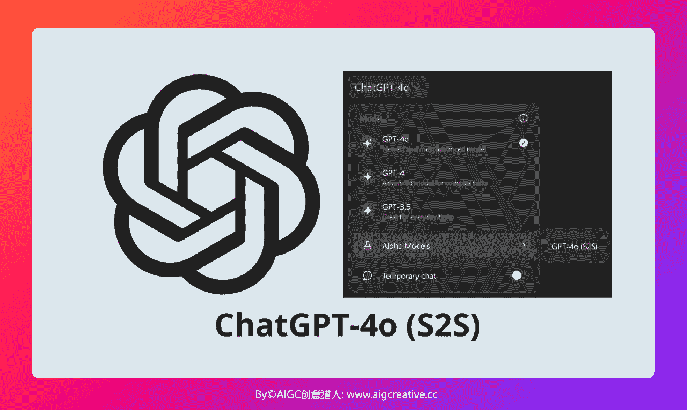

## 【20240627】动态 | Midjourney v6.5即将完成训练，v7版本和Niji计划更新

Midjourney团队在6月26日的办公室会议上透露，v6.5已进入训练第二阶段，最终训练即将完成。未来将发布人口统计数据并可能引入性别校准模式。v7版本预计将更快、更智能。Niji团队计划增加更多风格，同时正在探索随机sref探险器的可能性。3D和视频功能也在开发中，团队致力于提供高质量的体验。团队计划在适当时候发布五年规划。

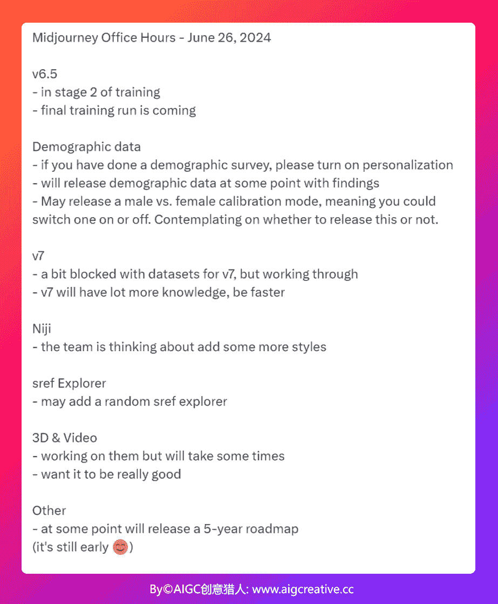

## 【20240626】动态 | Notion新推出一键将笔记“发布”成网站的功能，Notion Sites

Notion最新推出的网站构建工具Notion Sites，通过提供超过10,000个模板和拖放式构建模块，简化了网站创建过程，无需编写复杂代码即可实现移动适配。内置的数据库助力内容管理，AI辅助填充功能和搜索引擎优化工具提升内容质量和流量。此外，用户可通过Plus、Business、Enterprise计划定制域名、导航栏、主题等，实现个性化品牌展示，并集成Google Analytics进行流量跟踪。

详情：https://www.notion.so/product/sites

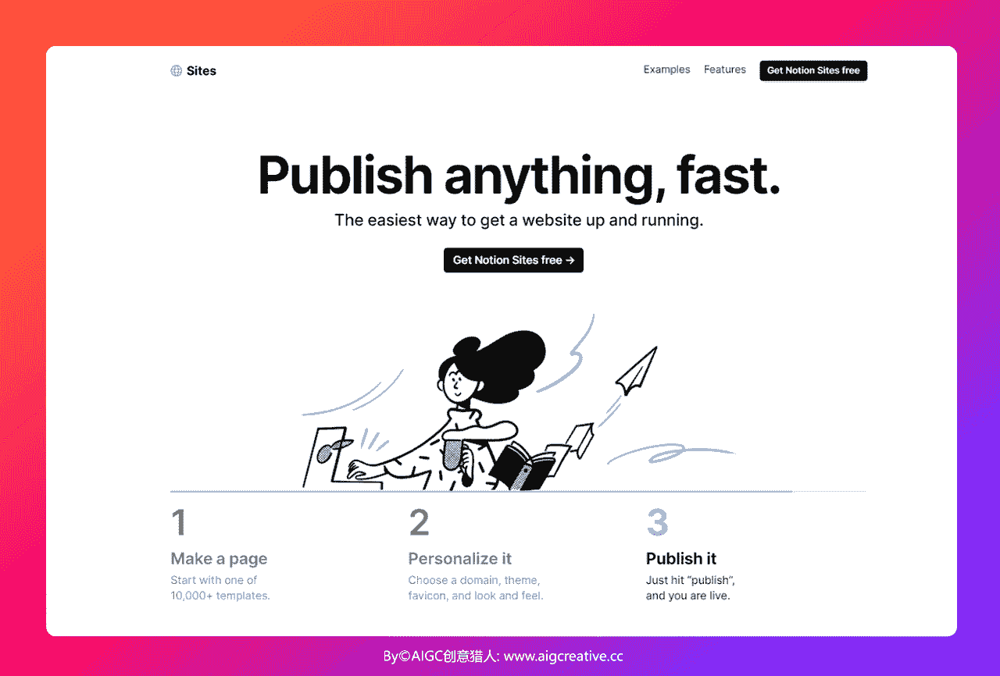

## 【20240626】动态 | ElevenLabs Reader App: 随时随地享受高质量语音阅读体验

ElevenLabs推出了一款全新的Reader App，能够将文章、PDF、ePubs、新闻通讯等文本内容转化为语音，用户可以从丰富的语音库中选择喜欢的语音进行播放。这款应用目前在美国、加拿大和英国的iOS平台上可用，并已在其他地区开放预购。ElevenLabs Reader App让用户在移动中也能享受到高质量的语音阅读体验。

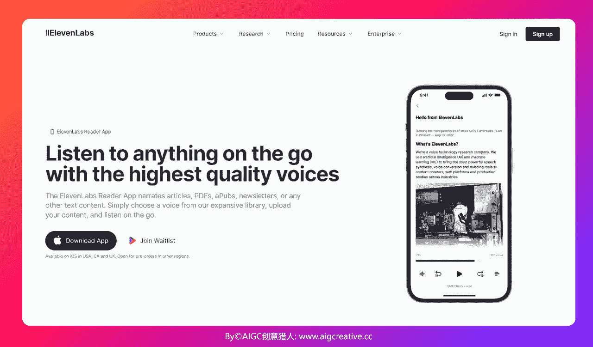

## 【20240626】动态 | OpenAI 正式发布 ChatGPT 桌面应用，提升用户体验

OpenAI 刚刚发布了ChatGPT桌面应用程序，允许用户在 macOS 上与 ChatGPT 进行更直接的交互。这款应用专为 macOS 14 及以上版本设计，支持 Apple Silicon (M1 或更高版本)，并且预计将在今年晚些时候推出 Windows 版本。用户可以通过 Option + Space 快捷键快速打开 ChatGPT，实现从任何屏幕开始对话，甚至练习新语言。此外，用户还可以通过点击耳机图标与 ChatGPT 进行语音交流，提升工作效率和创造力。

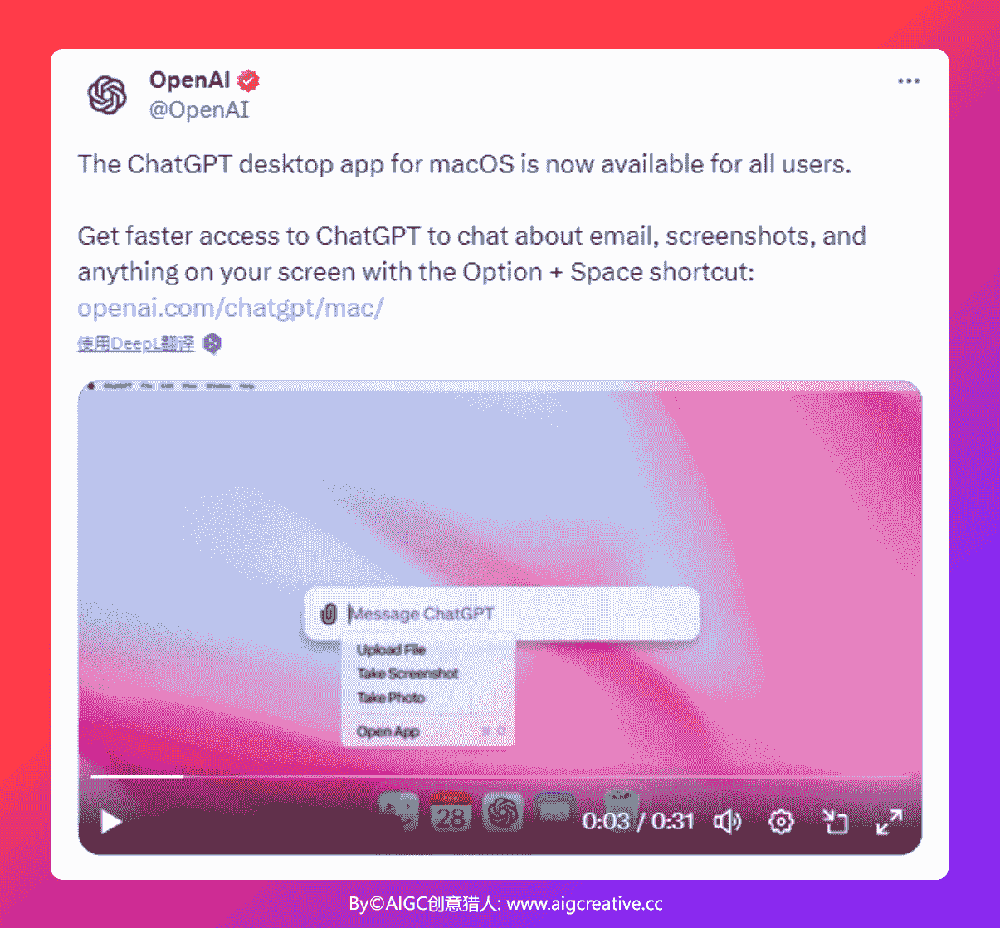

## 【20240626】洞察 | AI模型发布与性能发展时间表

图中展示了多个AI模型在不同时间节点的发布和性能评分。Claude系列从Claude 1到最新的Claude 3.5 Sonnet，其性能逐步提升。GPT系列包括GPT-4和GPT-4 Turbo，保持稳定高分。Gemini系列也在不断提升性能，包括Gemini 1.0 Ultra和Gemini 1.5 Pro。最新的Claude 3.5 Sonnet在评分中表现优异，进一步巩固了其在AI模型中的领先地位。

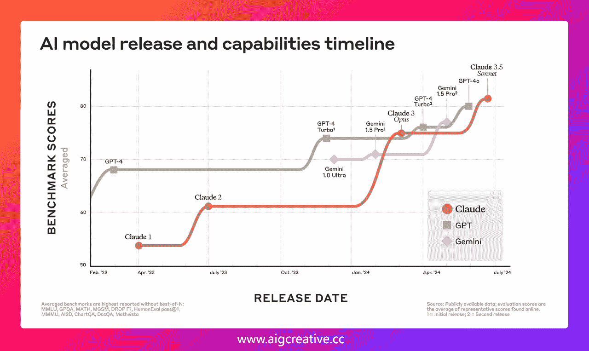

## 【20240625】产业 | 音乐AI侵权案：索尼、环球、华纳联合起诉Suno与Udio

三家全球领先的唱片公司索尼音乐、环球音乐和华纳音乐近日对人工智能公司Suno和Udio提起诉讼，指控这两家公司未经授权使用其音乐作品训练AI系统，涉嫌大规模侵犯版权。原告方要求每首歌赔偿15万美元，并指出Suno和Udio分别复制了662首和1670首歌曲。Suno首席执行官Mikey Shulman辩称其技术旨在生成全新音乐而非复制现有作品。美国唱片业协会首席执行官Mitch Glazier批评此类行为损害了真正的AI创新。（DALL·E配图）

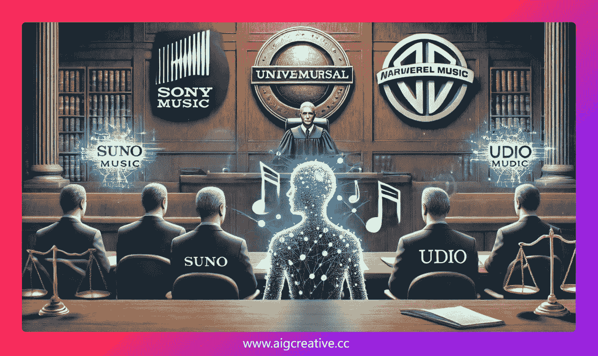

## 【20240625】产品 | ChatGPT 即将启动有限的高级语音模式 alpha 测试，旨在提供更自然、交互式的语音体验。

OpenAI 宣布推出 ChatGPT iOS 应用的高级语音模式 alpha 测试版，将为用户提供与 AI 进行自然对话的能力，包括识别情感和幽默。仅部分用户将能够首先体验这一新功能，且可能需要等待几个月才能广泛推出。alpha 测试者需授权使用其音频和视频内容进行模型训练，以改善 AI 性能。用户可随时选择退出测试和训练。此次更新还可能包括视频聊天功能，但屏幕共享可能暂未提供。OpenAI 即将公布更多关于 alpha 计划的细节，macOS 用户也在期待相关更新。

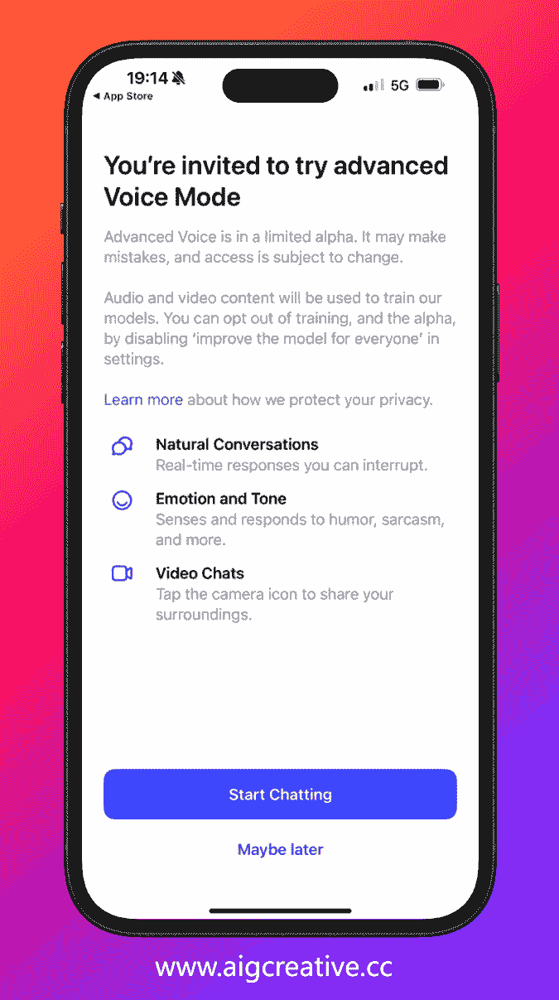

## 【20240624】报告 | 生成式AI的提示工程技术全面综述

这份《提示报告》系统性调查了生成式AI的提示工程技术。报告定义了33个术语，构建了58种文本提示技术和40种其他模态提示技术的分类。关键技术包括上下文学习、零样本提示、链式思维等。此外，报告还探讨了多语言和多模态提示技术，强调提示的安全性、对齐性和评估方法。提示工程技术不断发展，优化提示和答案提取技术也在报告中详细描述。

报告原文文档：[The Prompt Report A Systematic Survey of Prompting Techniques.pdf](https://aigcreative.feishu.cn/wiki/AclGwDgWjitNC0kj2t7cBFARnAd?from=from_copylink)

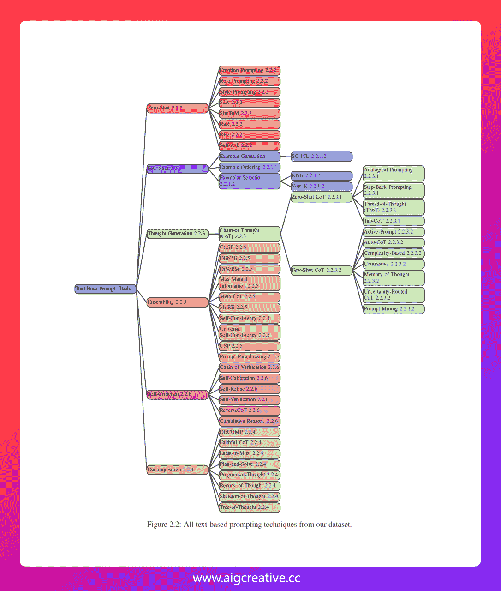

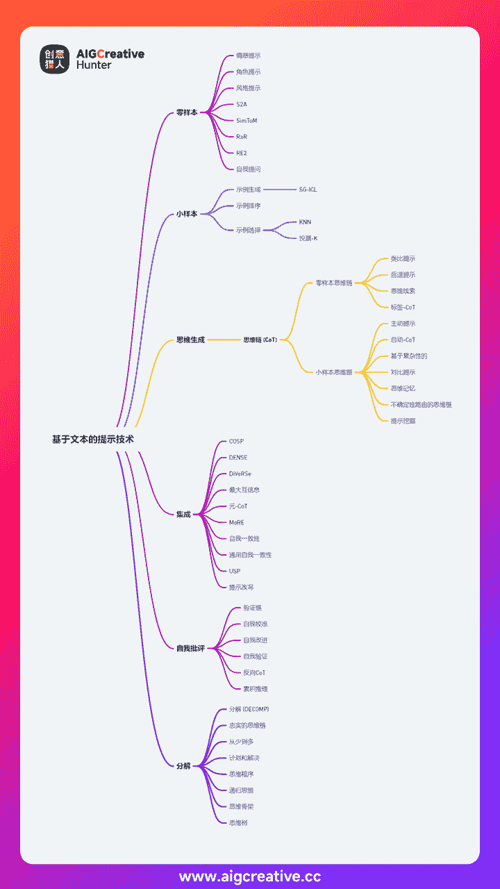

## 【20240623】报告 | 生成式人工智能引领新超级周期

市场预感到新的超级周期即将来临，生成式人工智能（Generative AI）正在成为下一个主要技术浪潮。自1960年以来，技术发展经历了大型机、PC、网络、桌面互联网（Web 1.0）、移动互联网（Web 2.0）和云/SaaS等阶段。如今，包括NVIDIA、微软、谷歌、Meta和OpenAI等在内的科技巨头正在引领这一AI革命，推动市场向前发展。

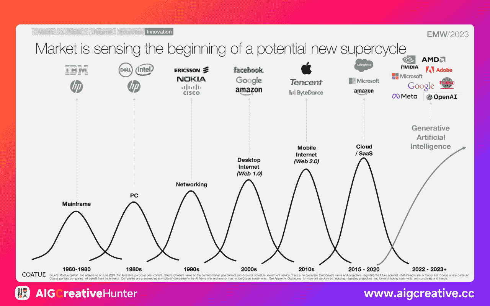

## 【20240622】报告 | 大型语言模型新评估：Claude 3.5 Sonnet表现突出

2024年6月的最新评估显示，Claude 3.5 Sonnet在GPQA测试中表现优异，其得分从59.4%提升至67.2%，在众多大型语言模型中名列前茅。其他领先模型包括GPT-4 Turbo（46.5%）、Gemini 1 Ultra（35.7%）和Llama 2（26.26%）。预计即将发布的GPT-5将达到75%的GPQA得分，进一步提升AI语言模型的表现。

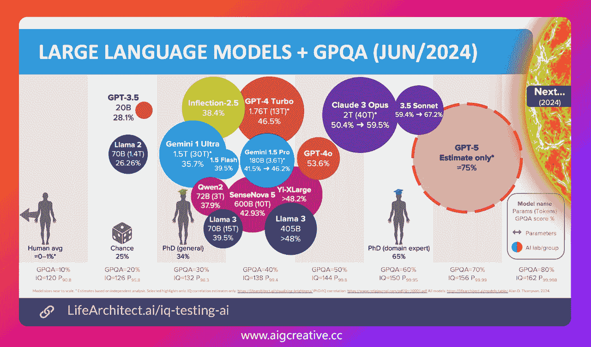

## 【20240621】文档 | 知识库文档上新：《生成人工智能手册》

William Brown 编写的《生成人工智能手册》，旨在为感兴趣于现代人工智能，特别是大型语言模型（LLMs）和其他生成模型的技术背景读者提供一个综合性的学习指南。总结了自 ChatGPT 发布以来人工智能领域的快速发展，包括技术巨头的参与、新兴组织的竞争、启动公司的崛起、Nvidia GPU 的需求、ArXiv 上论文的爆炸性增长以及人工智能在各个领域的应用。（创意猎人作翻译&整理）

文档链接：[【中&英】《生成人工智能手册》Generative AI Handbook: A Roadmap for Learning Resources](https://aigcreative.feishu.cn/wiki/Iqoewi672ixZiLksHiVc2uU5nid?from=from_copylink)

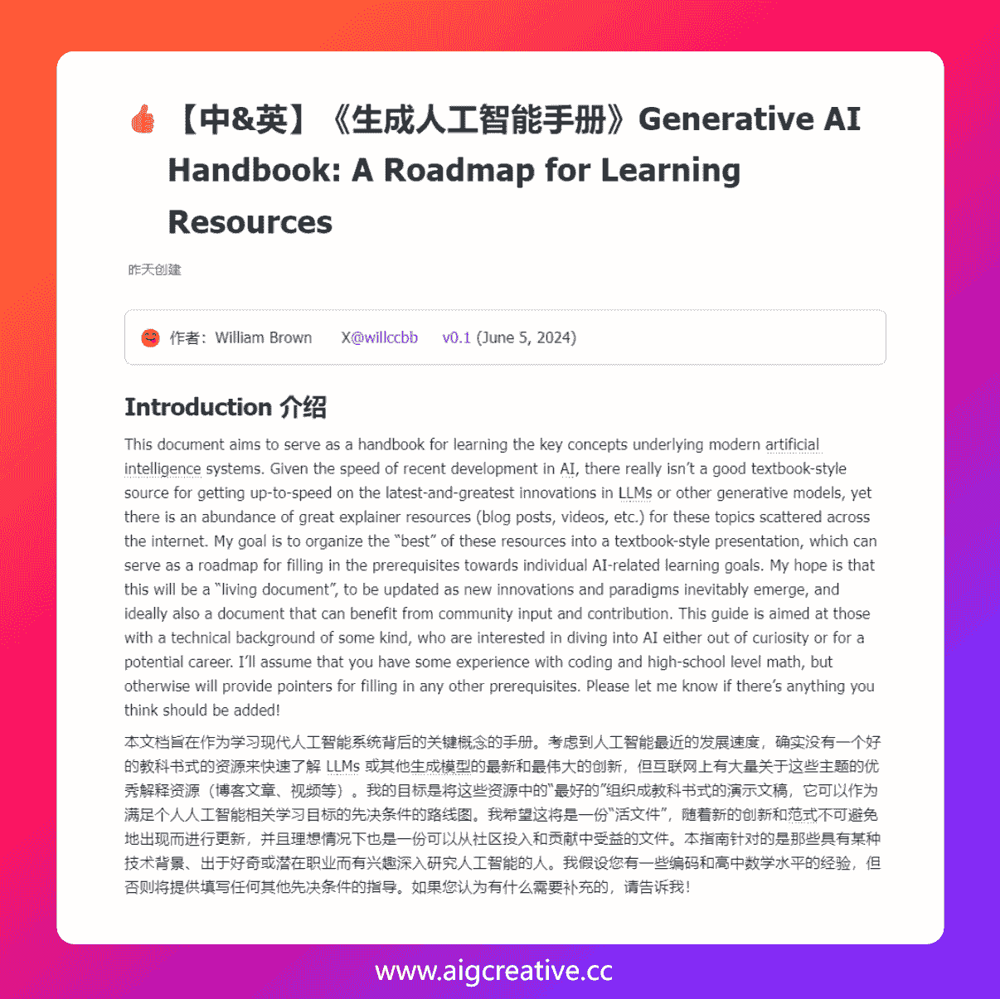

## 【20240620】报告 | CBINSIGHTS最新报告：科技巨头投资生成式AI公司，展开新一轮竞赛

科技巨头如亚马逊、谷歌、微软、Meta和英伟达正加大对生成式AI公司的投资力度，形成了多重重叠的投资联盟。这些公司包括Hugging Face、Anthropic、Runway和Synthesia等，其中多家公司吸引了两家或两家以上的科技巨头投资。这种投资趋势显示出生成式AI领域的激烈竞争和巨大的市场潜力，各大公司通过资本注入抢占技术制高点，推动AI技术的发展和应用。

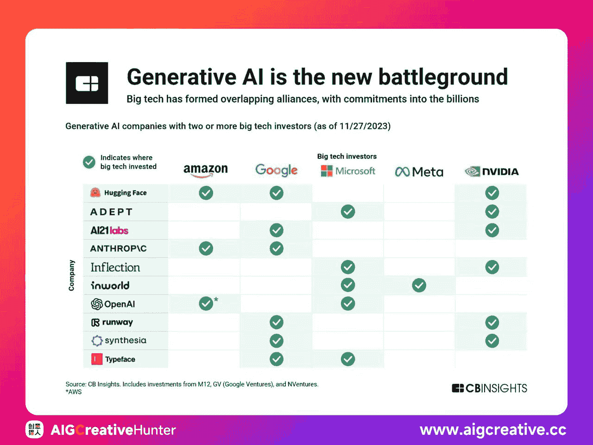

## 【20240619】公司 | NVIDIA今日登顶全球市值最高公司，超越微软与苹果

NVIDIA现已成为全球市值最高的公司，其市值达3.335万亿美元，年初至今股价上涨173.78%。紧随其后的是微软，市值为3.321万亿美元，股价上涨18.69%。苹果位居第三，市值3.285万亿美元，股价上涨11.30%。谷歌、亚马逊和沙特阿美分别排在第四至第六位。Meta、台积电、伯克希尔哈撒韦和礼来公司也进入前十名，显示出科技和制药行业的强劲表现。

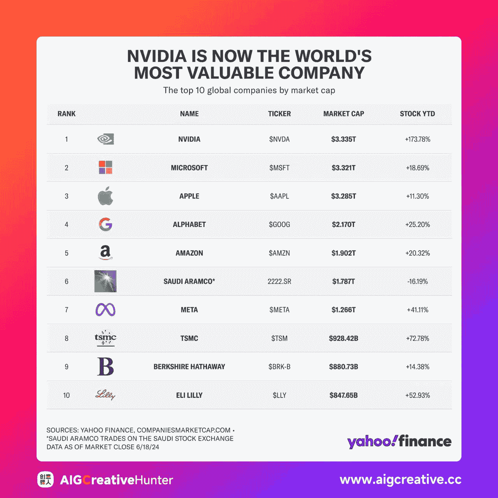

## 【20240619】产品 | Hedra 实验室推出革命性的基础模型 Character-1，为创意行业带来了新的可能性。

该模型能够实现无限时长的视频内容生成，并在每分钟内产出高达 90 秒的高质量视频，涵盖了说唱、唱歌和对话等多种表达方式。这一进展预示着创意工作室的未来，将使得创作者能够更加轻松地控制角色的情感和动作，甚至整个世界的构建。Character-1 在面部识别和多语言支持方面展现了卓越的性能，尤其是在中文和英文的处理上。尽管目前对非人类角色的支持还有待提升，但 Hedra 实验室已经在积极开发中解决这一挑战。

体验地址：https://www.hedra.com/

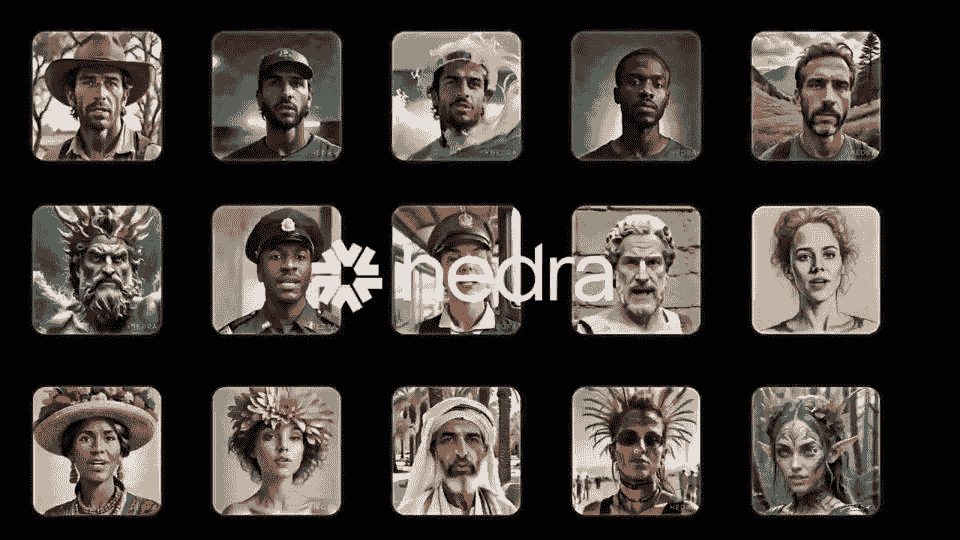

[af26521c2d108afe17788ca4f2144657(1).mp4](https://internal-api-drive-stream.feishu.cn/space/api/box/stream/download/all/Hebybo2Y5o2QK0xIV7kcMDrnnbt)

## 【20240619】产品 | Microsoft Surface 推出全新 Copilot+ PC 系列，引领智能计算新潮流

微软Surface系列今日发布了全新 Copilot+ PC，包括Surface Laptop和Surface Pro，这些轻薄美观的设备旨在助力用户在创意项目、社交联系以及商业探索等方面实现更多可能。作为市场上最快、最智能的Windows PC，它们提供了64GB内存配置选项，以及专为提高生产力和创造力而设计的AI体验。此外，Surface Pro Flex Keyboard的推出，为用户带来了前所未有的灵活性和便利性。

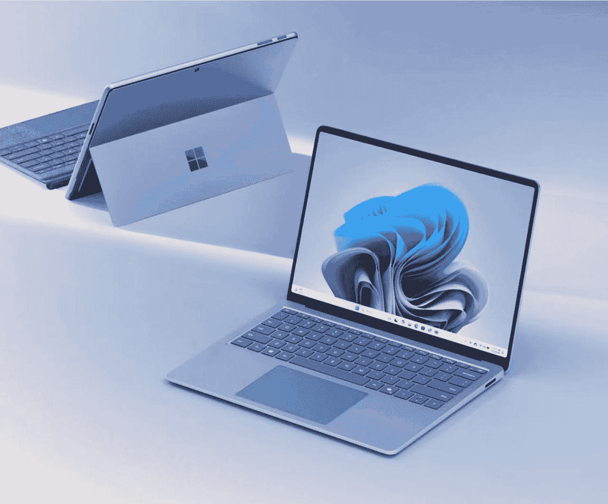

## 【20240618】产品 | 反狙！Luma AI 即将在 Dream Machine 平台上推出前所未有的视频编辑能力和直观控制界面，为创作者带来更高效和个性化的视频制作体验。

近期，Luma AI 在其官方社交账号上发布了一条消息，透露了其即将上线的 Dream Machine 新功能。据悉，这一更新将为用户提供强大的视频编辑能力，包括但不限于内容感知和一致性扩展的高级系统。同时，Luma AI 还宣布，其 Extend 视频系统已经正式投入使用，允许视频内容依据指令智能扩展，极大地丰富了视频创作的可能性。值得注意的是，Luma AI 的 Standard、Pro 和 Premier 等级用户将获得去除水印的新权限，这一消息在社交媒体上引起了广泛关注和积极反馈。

## 【20240617】产品 | 深夜核弹！影视级AI视频来了，画质太好了！Runway推出新一代高保真视频生成模型Gen-3 Alpha！

RunwayML最新发布的Gen-3 Alpha模型，在保真度、一致性和运动表现上相较上一代有显著提升，迈向构建通用世界模型的目标。该模型基于新的大规模多模态训练基础设施开发，支持文本到视频、图像到视频等多种功能，并配备精细时间控制，实现场景转换的精确控制。Gen-3 Alpha能够生成写实的、多样化情感和动作的人物角色。

文档：[Runway最新视频模型Gen-3 Alpha案例100+](https://aigcreative.feishu.cn/wiki/JQMJwlzpfiqD3akfYVncIcxGn4f?from=from_copylink) 方30+高清视频案例合集文档：

## 【20240617】产品 | DeepSeek Coder V2开源，代码能力超越GPT-4

DeepSeek Coder V2以236B参数量级在代码和数学能力上首次超越GPT-4-Turbo，成为全球领先的开源模型。它在多个领域展现出卓越的性能，包括代码生成、数学算术、逻辑推理和中英通用能力。DeepSeek Coder V2的开源发布，提供236B和16B两种参数规模的模型，免费商用，无需申请。同时，DeepSeek提供API服务和本地私有化部署选项，以满足不同用户需求。

访问对话官网：coder.deepseek.com，与 DeepSeek-Coder-V2 永久免费畅聊。

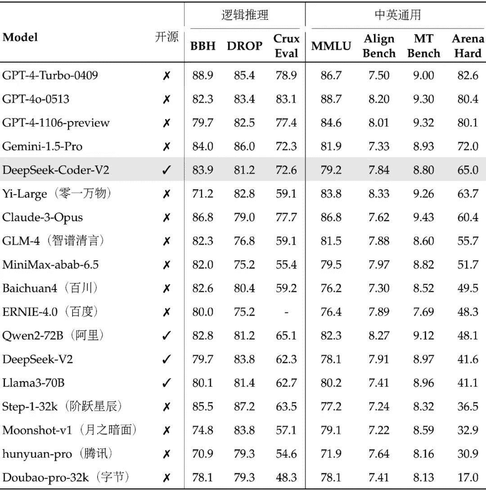

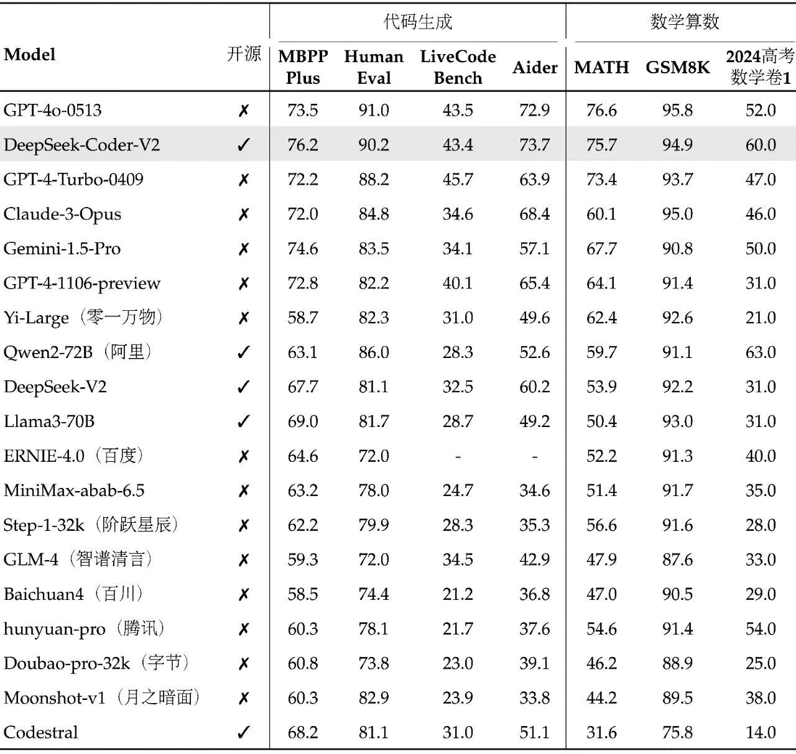

## 【20240617】洞察 | 微软四十年历程：从Windows到全球AI科技巨头

微软在1985年推出首个Windows版本，经过四十年的发展，已成为市值超3万亿美元的全球科技巨头。从收购Hotmail、Skype到LinkedIn，再到近年来的GitHub和OpenAI，微软不断通过创新和并购扩展其业务版图。随着Windows 11、Microsoft Teams的推出及对人工智能领域的深耕，微软的收入从197百万美元增长至2440亿美元，利润从61百万美元增至1070亿美元，展现出强劲的增长势头。

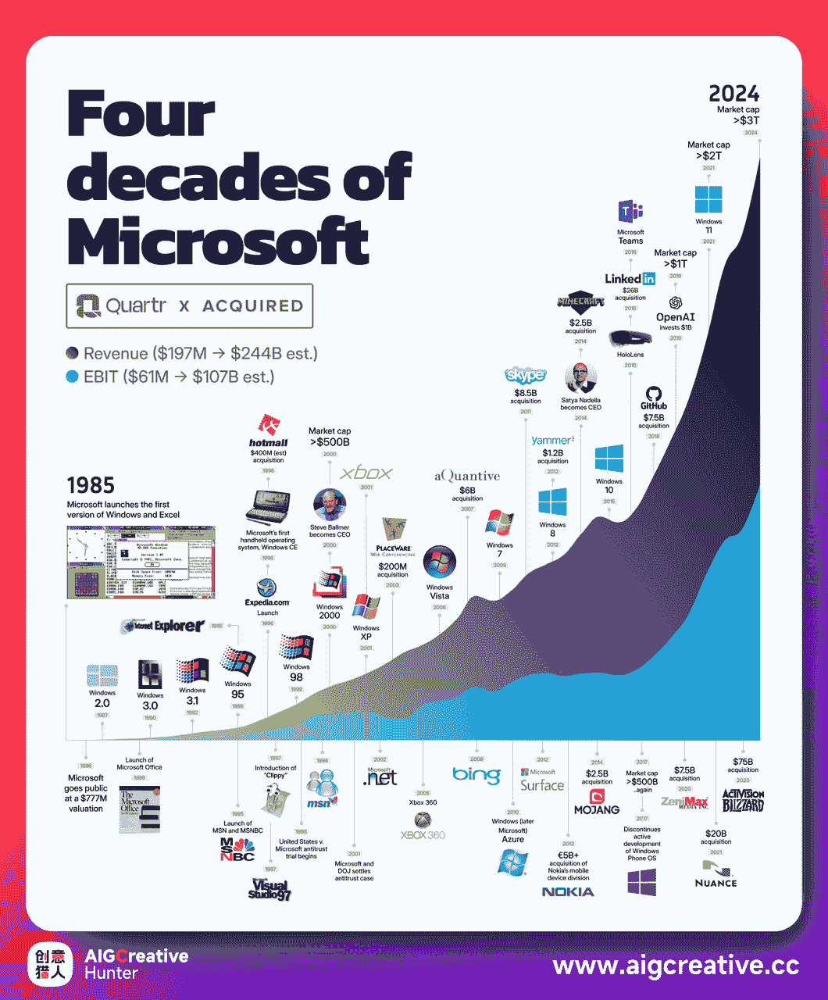

## 【20240617】洞察 | ChatGPT速查表，助你成为专业用户

这份《ChatGPT Mastery Cheat Sheet》，涵盖了多种角色（如简历编写员、市场营销人员等）、任务（如简历、求职信等）、格式（如表格、总结等）和语气（如自信、专业等）。

此外，还推荐了替代聊天机器人和最佳插件，并提供了研究、销售、开发者、设计师等领域的具体提示示例。速查表还引入了多种提示框架，帮助用户更高效地利用ChatGPT的强大功能，提升使用效果。

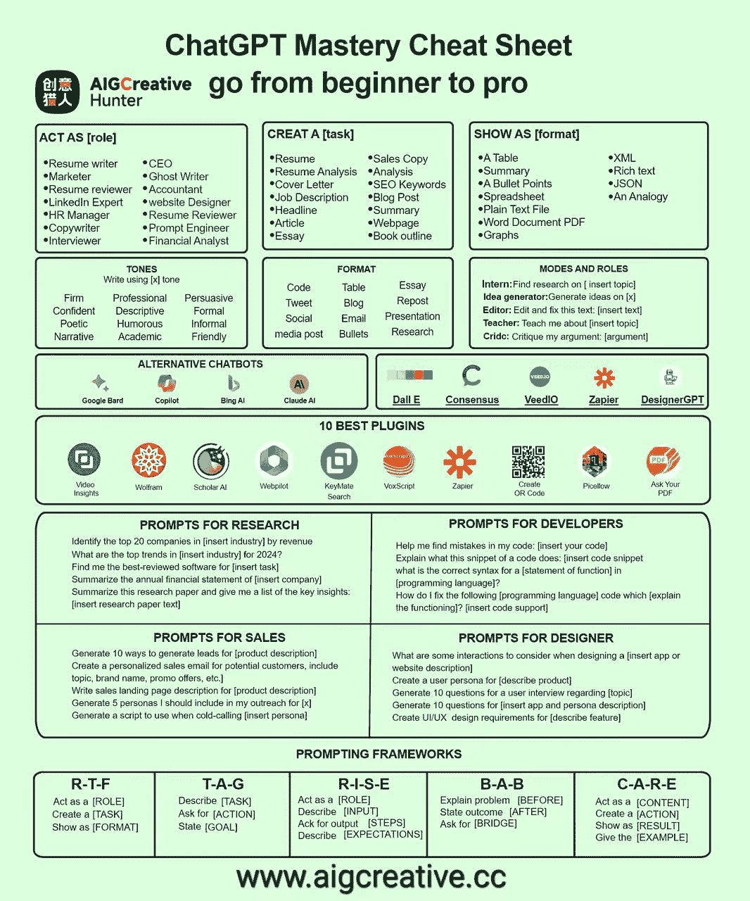

## 【20240612】产品 | 美图公司推出AI视频制作工具MOKI，革新视频创作流程

美图公司今日发布全新AI视频制作工具MOKI，该工具集成视频生成模型和工作流，用户可一键生成AI视频短片，专注于网文短剧、故事绘本、动画短片和MV等视频形式。MOKI通过文本驱动，实现脚本、角色、视频及音效配音的同步生成，并允许用户在生成过程中控制各个阶段，大幅提升视频创作效率。

[126cbaa3fb1333702e5769a9a962600c.mp4](https://internal-api-drive-stream.feishu.cn/space/api/box/stream/download/all/NSvqbwErAo1d1MxlGZRcjwuhnIc)

## 【20240612】产品 | 美国空军推出NIPRGPT，探索生成式AI军事应用

美国空军发布了一款类似ChatGPT的AI工具NIPRGPT，旨在帮助空军人员在非机密网络上完成编码、通信和内容总结等任务。该工具是Dark Saber软件平台的一部分，用于实验、开发和部署军方应用。NIPRGPT利用公开的AI模型，尚未选择特定供应商，未来将根据需求可能扩展到更高机密级别。空军研究实验室正在评估其在情报、作战计划和业务流程等方面的应用潜力。

## 【20240611】产品 | 极佳科技发布首个端侧可用的超长时长视频生成大模型「视界一粟 YiSu」

近日，极佳科技与清华大学自动化系联合发布了“自称”中国首个Sora级视频生成大模型「视界一粟 YiSu」，该模型具有16秒超长生成能力，可扩展至1分钟以上，同时具备超大运动和超强表现力。YiSu模型以其高性价比和端侧可用性，旨在加速长视频生成技术在产品应用中的普及。此外，极佳科技在世界模型领域也取得了突破，发布了中国首个自动驾驶世界模型，并已实现商业化落地。YiSu-Beta V0.5版本的发布标志着该大模型正在快速迭代，未来将为行业带来更多价值。

体验地址：https://studio.giga.ai/

## 【20240611】产品 | OpenAI与苹果宣布建立合作伙伴关系

苹果公司在其2024年全球开发者大会上宣布，将整合ChatGPT至iOS、iPadOS和macOS系统中，使用户能够无需切换工具即可访问ChatGPT的图像和文档理解功能。Siri也将利用ChatGPT的智能，在用户同意的情况下提供帮助。

此外，ChatGPT将被集成到苹果的系统级写作工具中，帮助用户生成各种写作内容。用户还可以使用ChatGPT的图像工具生成多种风格的图像，以丰富他们的写作。在Siri和写作工具中访问ChatGPT时，内置了隐私保护措施，包括不存储请求和模糊用户IP地址。

ChatGPT的集成将在今年晚些时候推出，由GPT-4o驱动，用户可以免费使用而无需创建账户，订阅用户还可以连接账户并直接访问付费功能。

## 【20240607】产品 | Stability AI发布Stable Audio Open，提供开源音频生成模型

Stability AI近日发布了Stable Audio Open，这是一款创新的开源音频生成模型，能够从文本提示生成短音频样本和音效，最长可达47秒。该模型专注于声音设计，适用于创作鼓点、乐器节奏和环境音效，用户还可以使用自己的音频数据进行微调。Stable Audio Open的模型权重已经在Hugging Face上发布，供用户下载和使用。此举旨在为音频创作者提供更多工具和灵活性，推动音频生成技术的发展和普及。

## 【20240607】产品 | AI音乐-Udio平台升级，自动延长用户上传的音频片段

Udio平台最新升级，包括对移动界面的优化，使得移动设备上的使用体验更加流畅；WAV格式的下载功能，让用户能够获得更高质量的音频文件；桌面端的易用性也得到了提升，让创作过程更加顺滑。此外，搜索功能通过标签自动完成得到了加强，帮助用户更快地找到所需内容。

最引人注目的是，Udio现在允许标准和专业计划的用户上传自己的音频，通过udio-32模型的扩展功能，创作出长达15分钟的音乐作品。上传音频时必须确保拥有完整的使用和分发权利，且目前使用上传音频创作的曲目还不能在Udio平台上发布。

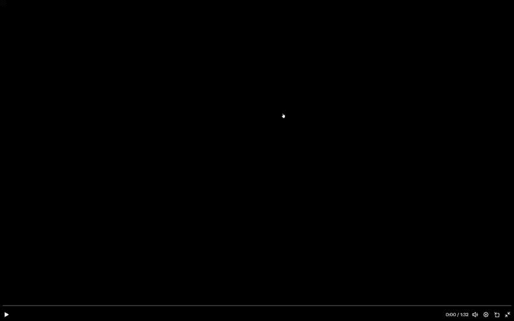

[36dff5dc640bc985a8265643ca440eba(1).mp4](https://internal-api-drive-stream.feishu.cn/space/api/box/stream/download/all/ZBAkbavwFo26JQxCy1gcKKI4n8g)

## 【20240607】产品 | 阿里云发布全球最强开源模型Qwen2

阿里云更新技术博客，发布全球性能最强的开源模型Qwen2-72B，性能超过美国最强的开源模型Llama3-70B，也超过文心4.0、豆包pro、混元pro等众多中国闭源大模型。

Qwen2系列模型经过数月努力，从Qwen1.5升级至Qwen2，包含5个不同尺寸的预训练和指令微调模型，支持多达29种语言的高质量数据，显著提升了代码和数学能力，以及长文本处理能力。模型在多个评测基准上表现领先，支持上下文长度高达128K tokens，并通过多种方法提升了安全性和智能水平。Qwen2的开源将进一步推动AI技术的发展和应用。

在魔搭社区和Hugging Face免费下载通义千问最新开源模型：https://modelscope.cn/organization/qwen

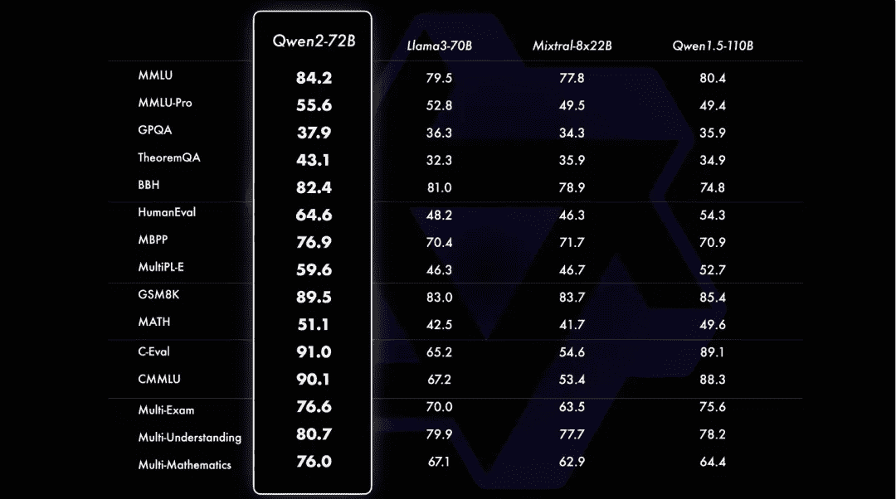

## 【20240606】产品 | 快手推出Sora「可灵」视频生成大模型，支持生成长达2分钟、1080p分辨率的超长视频

快手版Sora「可灵」开放测试，这款国产AI视频生成大模型不仅能够生成长达2分钟、1080p分辨率的超长视频，还特别擅长模拟物理世界的特性和复杂运动的精准建模。从高速奔跑的老虎到宇航员在月球上的奔跑，再到倒牛奶和弹钢琴的场景，「可灵」都能以高度的真实感和细节展现。它采用了原生的视频生成技术路线，结合了快手自研的多项技术创新，包括3D VAE网络和全注意力机制的时空建模模块，大幅提升了视频生成的质量和效率。目前，「可灵」已在快影APP中正式开启邀测，预示着短视频领域将有更多创新和突破。

体验地址：http://kling.kuaishou.com

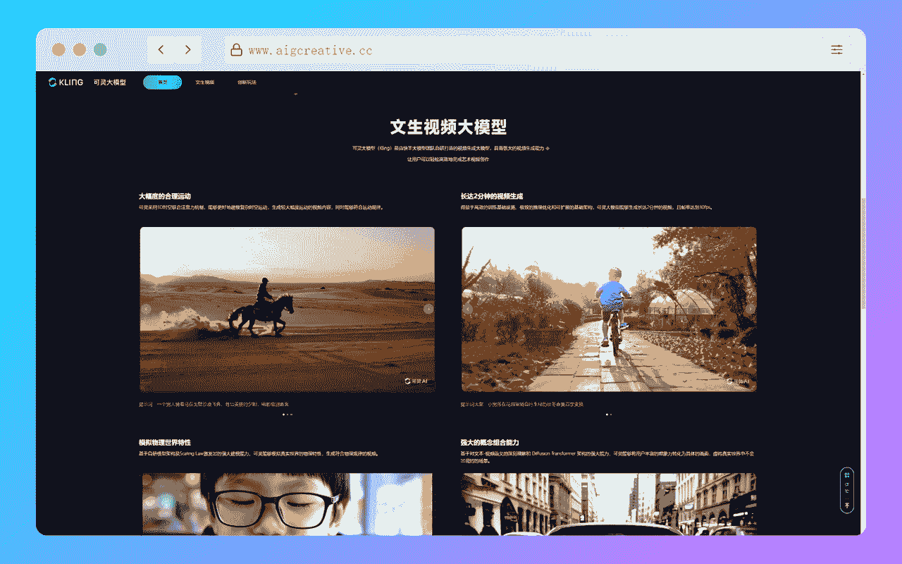

## 【20240606】产品 | AI语音技术新突破：Seed-TTS让机器语音难以区分于人类

最新AI语音技术Seed-TTS，由字节跳动研发，成功实现了文本到语音的转换，生成的语音质量高，情感丰富，几乎可以与人类语音相媲美。该技术能够根据简短的语音样本，调整情感、语调、说话风格等属性，生成个性化的语音。Seed-TTS特别在小说和视频配音领域表现出色，能够模拟复杂的情感和语境，提供逼真的听觉体验。此外，它还支持Zero-shot技术，即使没有训练数据，也能生成高质量的语音，极大地提高了应用的灵活性和实用性。

相关论文：https://arxiv.org/abs/2406.02430

在线体验：https://bytedancespeech.github.io/seedtts_tech_report/

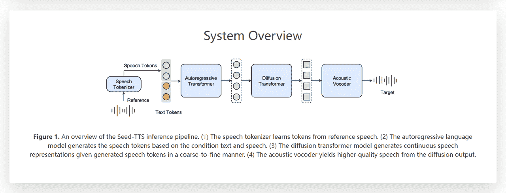

## 【20240606】公司 | 英伟达市值突破3万亿美元，跃居全球第二大上市公司

英伟达市值在最近的交易中突破了3万亿美元大关，超越苹果成为全球市值第二的公司。这一历史性里程碑意味着英伟达有望挑战微软市值第一的位置，成为首家半导体企业问鼎全球最高市值的公司。从2022年10月低点至今股价上涨近1000%。英伟达的快速增长得益于其在AI芯片市场的领先地位和生成式AI热潮的推动，目前市场份额高达70%~95%，微软和苹果均为其大客户。

<https://aigcreative.feishu.cn/sync/K4Gvd9vUQsy9Oubwqaeclu0Fnbg>
