# AI每日资讯-202405

> 来源：[https://aigcreative.feishu.cn/docx/I0AAdlx1WorQehxzZcicu9O9nGg](https://aigcreative.feishu.cn/docx/I0AAdlx1WorQehxzZcicu9O9nGg)

> **动态 | 观点 | 人物 | 产品 | 体验 | 应用** | 公司 | 融资 | 产业 | 文档

## 【20240531】产品 | Suno v3.5版本全面上线，带来全新音乐创作体验！

Suno音乐创作平台发布了v3.5版本，为所有用户带来了一系列新功能。现在，用户可以一次性生成完整的4分钟歌曲，并且能够创建最长2分钟的歌曲扩展。此外，新版本还改进了歌曲结构和人声流畅度，提供了更加丰富和专业的音乐创作体验。平台鼓励用户通过点赞和反馈来帮助他们不断改进Suno，以满足用户的需求。

## 【20240530】产品 | OpenAI宣布免费用户现在可以使用浏览、视觉、文件上传和GPTs等功能。

这项更新是在5月14日，随着OpenAI对旗舰模型GPT-4o的开放，这个模型支持数据分析、记忆功能，并提供有限的免费服务。

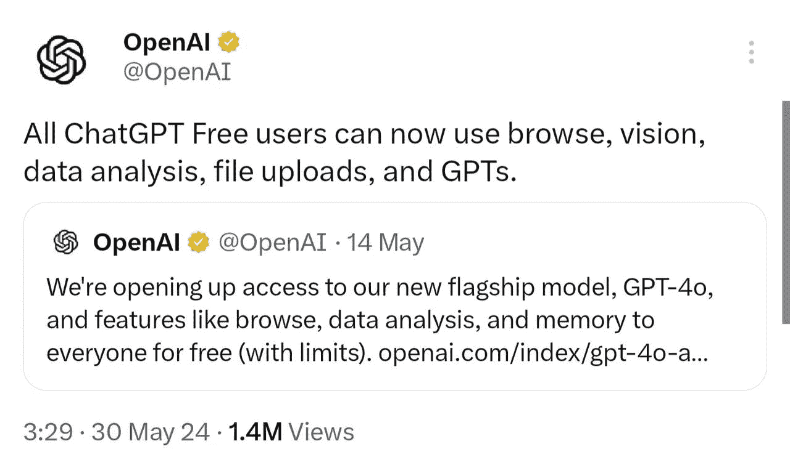

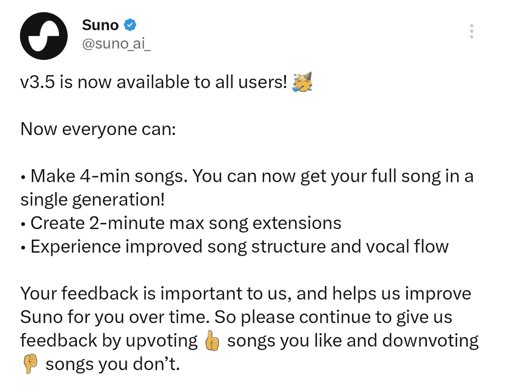

## 【20240530】产品 | 腾讯推出基于混元大模型的 AI 助手 “腾讯元宝” APP应用，发力AI搜索

今日，腾讯最新推出了 AI 助手应用 “腾讯元宝”，该产品依托于腾讯混元大模型，支持中英文双语，在文本生成、数理逻辑和多轮对话等关键领域表现出色。已在各大商店上架。腾讯元宝具备 AI 搜索、AI 解析、AI 写作、AI绘画等多项功能，能够帮助用户高效完成办公、学习和生活中的各类任务。

基于👸号庞大优质的内容生态，不仅提升了 AI 搜索的内容质量，还有望促进👸号生态系统的繁荣，为内容创作者带来新的增量和影响力。

此外，应用还提供个性化智能体创建、声音克隆等特色服务。

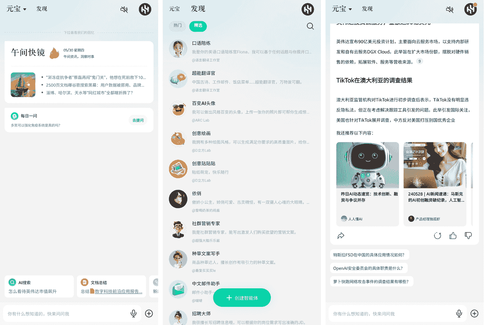

## 【20240529】公司 | xAI完成60亿美元B轮融资，加速AI技术发展

xAI公司宣布成功完成60亿美元的B轮融资，此轮融资吸引了Valor Equity Partners、Vy Capital、Andreessen Horowitz、Sequoia Capital、Fidelity Management & Research Company、Prince Alwaleed Bin Talal和Kingdom Holding等关键投资者的参与。自2023年7月公司成立以来，xAI在AI模型能力上取得了显著进步，包括Grok-1的发布、Grok-1.5的长文本理解能力以及Grok-1.5V的图像理解能力。该公司致力于开发真实、能干且对全人类有益的高级AI系统，并以理解宇宙的真实本质为使命。

## 【20240527】产业 | 马斯克的 AI 公司 xAI 完成 60 亿美元 B 轮融资，估值飙升至 1304 亿元

马斯克旗下的人工智能公司 xAI 宣布完成了价值约 1304 亿元人民币的 B 轮融资。这一轮融资以 60 亿美元的庞大资金注入，使得 xAI 的估值一跃成为独角兽级企业。融资的主要投资者包括 Valor Equity Partners、Vy Capital 等知名机构。自 2023 年成立以来，xAI 已推出了一系列先进的 AI 产品，包括聊天机器人 Grok 和多模态大模型 Grok-1.5V，与 OpenAI 的 ChatGPT 直接竞争。尽管马斯克在 X 公司的管理曾遭质疑，但他在特斯拉和 SpaceX 的成功让投资者对 xAI 抱有极高期望，预计此次融资将进一步推动 xAI 在 AI 领域的快速发展和创新。

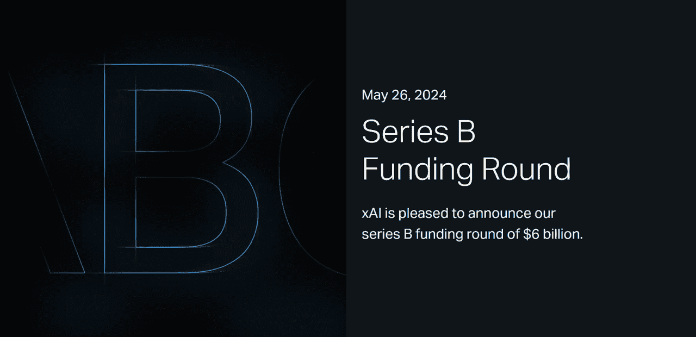

## 【20240526】产业 | GPT-4o自己回答：最有可能取代和最不可能取代的20种职业（仅供参考）

例如，创意总监、心理治疗师、外科医生等岗位由于需要深层次的人类情感、创造力和实时决策，GPT-4o难以取代。然而，在数据录入员、电话销售员、客户服务代表等任务重复且需高效处理大量信息的职业上，GPT-4o则显示出极高的替代可能性。这两份来自4o自己的回答，不仅突显了人工智能在特定领域的巨大应用潜力，还强调了人类在情感共鸣和创造性思维方面的独特优势。人工智能和人类将共同塑造未来的工作格局，发挥各自的长处。

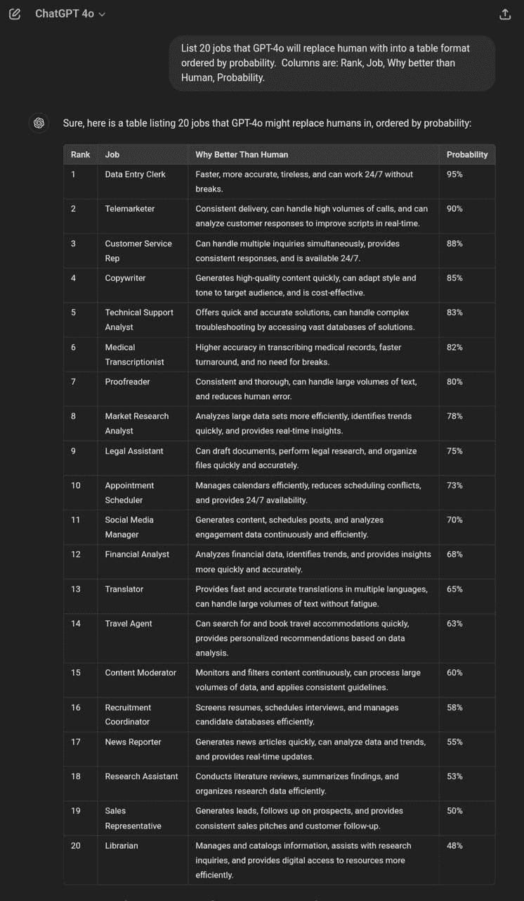

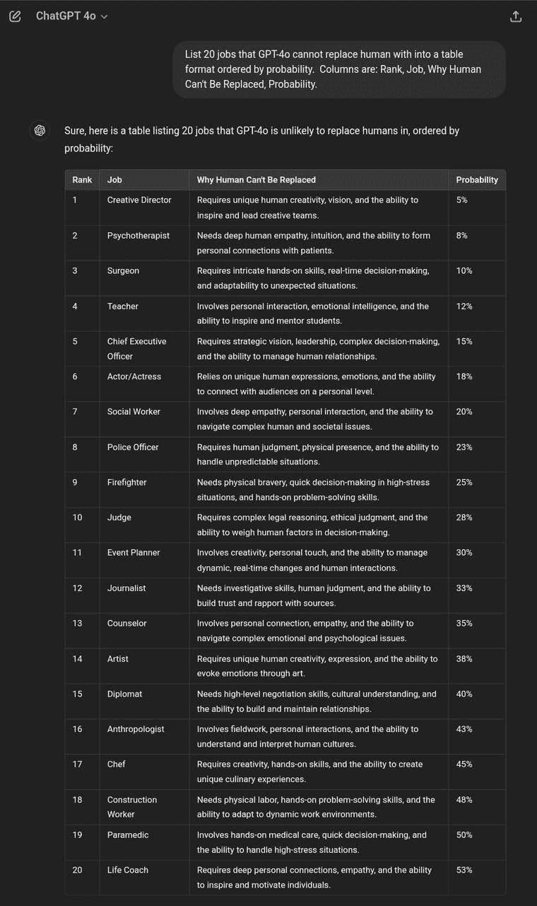

## 【20240525】产业 | KREA AI推出新视频工具公开测试版

KREA AI宣布其新视频工具现已公开测试，向所有用户开放。该工具允许用户在时间线上添加关键帧和文本提示，以描述视频在特定时间段内的表现。用户可以自由调整关键帧和文本提示的位置，还能改变设置以实现不同速度、角度和动作的动画效果。视频生成分为两个阶段：首先生成低分辨率预览，用户可检查效果，然后生成高分辨率增强版。工具还提供取消按钮，方便用户随时终止生成过程。

体验地址：https://www.krea.ai/home

[9fbe687c9d53f0dc0688bc806298d89e.mp4](https://internal-api-drive-stream.feishu.cn/space/api/box/stream/download/all/Oo5ibKapror257xDgqlcITslnqb)

## 【20240524】产业 | Suno团队推出v3.5版本，增强音乐生成功能

Suno团队宣布v4版本正在开发中，同时为Pro和Premier会员推出了v3.5版本。新版本v3.5对v3进行了改进，包括最长4分钟的剪辑长度，2分钟的歌曲扩展，以及显著改善的歌曲结构。Pro和Premier会员可以在生成时选择v3.5、v3和v2版本，并能以.wav格式下载音频。预计v3.5将在下周向免费用户开放。团队鼓励用户通过点赞和点踩来提供反馈，特别是对音质不佳的片段进行点踩反馈。

## 【20240523】产业 | 重磅，《Gen-AI 220 应用全场景地图》发布，揭示AI未来发展趋势

近日，由火山引擎与RollingAI联合发布的《Gen-AI 220 应用全场景地图》重磅亮相，全面展示了2024-2025年中国各行业AI场景应用的落地全景图谱。这张图不仅细致梳理了AI技术在多个行业中的应用现状，还深入探讨了未来的发展趋势和机遇。

这份地图涵盖了医疗、金融、零售、制造、教育、能源等多个行业，每个行业内细分为具体的AI应用场景，如医疗影像分析、智能投顾、个性化营销、智能制造、个性化学习和智能电网等。通过这些详细的分类，我们可以清晰地看到AI技术如何深度融入各行各业，提升效率，优化资源配置，创造新的商业价值。

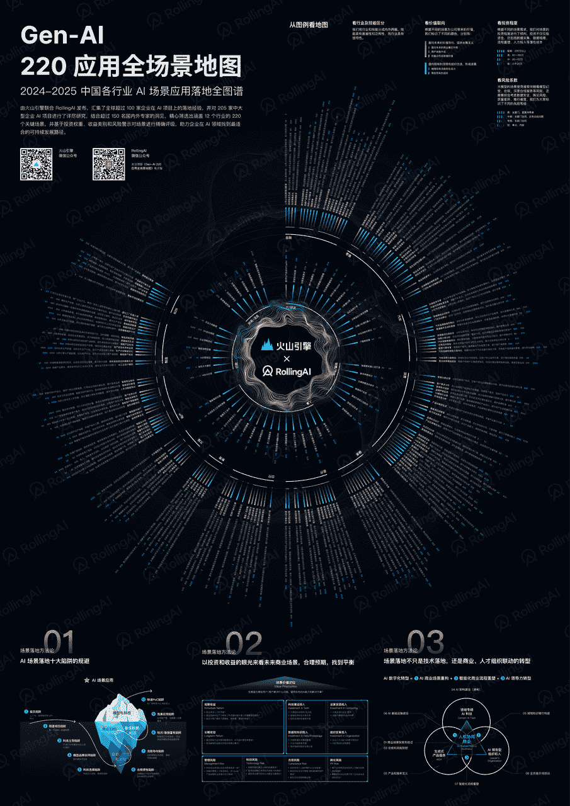

## 【20240523】产业 | 美国众议院通过法案限制AI技术出口

美国众议院外交事务委员会以43票赞成、3票反对通过了《ENFORCE Act》，旨在通过修改2018年出口控制改革法案，加强AI系统出口的控制，防止关键技术落入外国对手手中。该法案赋予美国工业和安全局（BIS）更大的权限，要求对涉及国家安全的AI系统出口进行许可申请，并可能对开源AI项目产生影响，增加国际合作的复杂性和成本。

## 【20240523】公司 | Autodesk 收购 AI 视效创企 Wonder Dynamics

今日，三维设计巨头Autodesk宣布收购AI视效初创公司Wonder Dynamics，该公司的Wonder Studio工具与Autodesk Maya等3D设计软件高度兼容，旨在简化3D角色动画、灯光和构图的制作过程。此次收购将结合Autodesk的技术和资源，推动3D动画和视觉特效领域的创新，帮助艺术家更高效地创作，同时缩短学习成本并采用自动化手段完成复杂流程，大幅提升工作效率。

## 【20240522】公司 |  ChatGPT数据增强分析功能上线

新功能包括直接从Google Drive和Microsoft OneDrive上传文件、在可扩展视图中与表格和图表交互、定制并下载图表以用于演示和文档。这些改进建立在ChatGPT理解数据集和以自然语言完成任务的能力之上，能够自动编写并运行Python代码进行数据分析，简化了从数据合并、清洗到图表创建和洞察发现的全过程。用户可以实时工作在表格上，定制呈现就绪的图表，并下载用于演示或文档。

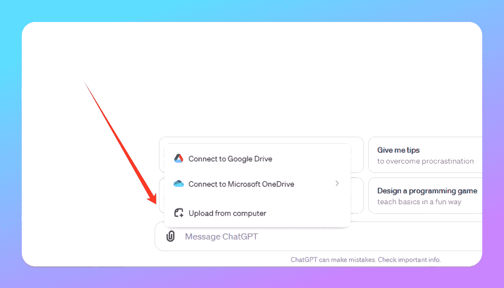

## 【20240521】公司 | 中国大模型厂商掀起价格战，百度宣布模型免费

就在今天，中国大模型厂商之间爆发激烈的价格战，阿里云、字节跳动和百度等企业纷纷宣布大幅降价或免费提供服务。阿里云将主力模型Qwen-Long的价格降低97%，字节跳动的豆包大模型定价极低，而百度智能云宣布其两大主力模型全面免费。这场价格战的背后，是厂商们为了吸引更多用户、降低使用门槛，并通过技术优化和规模效应降低成本的策略。尽管短期内可能牺牲利润，但长远来看，旨在推动AI技术的普及和市场发展。

## 【20240521】公司 | 1块钱200万tokens 通义千问主力模型降价97%

阿里云今日宣布，通义千问GPT-4级主力模型Qwen-Long的API输入价格从0.02元/千tokens降至0.0005元/千tokens，直降97%。这意味着1块钱可以买200万tokens，相当于5本《新华字典》的文字量。这款模型最高支持1000万tokens长文本输入，降价后约为GPT-4价格的1/400，击穿全球底价。

## 【20240521】公司 | 微软发布AI加持的Copilot+PC挑战苹果市场

微软近日推出了搭载GPT-4o技术的全新AI PC产品——Copilot+PC，旨在提升用户与电脑的互动体验。这款产品特别强调了其“召回”功能，能够追踪和重现用户在屏幕上的任何活动，同时具备实时翻译和上下文感知的视觉能力。新款Surface Pro作为首款搭载该技术的设备，预计将于6月18日发布，其性能在多线程处理上超越了苹果MacBook Air。微软此举被视为在AI PC领域对苹果的直接挑战，同时也预示着Arm架构在PC市场的重要性日益增加。

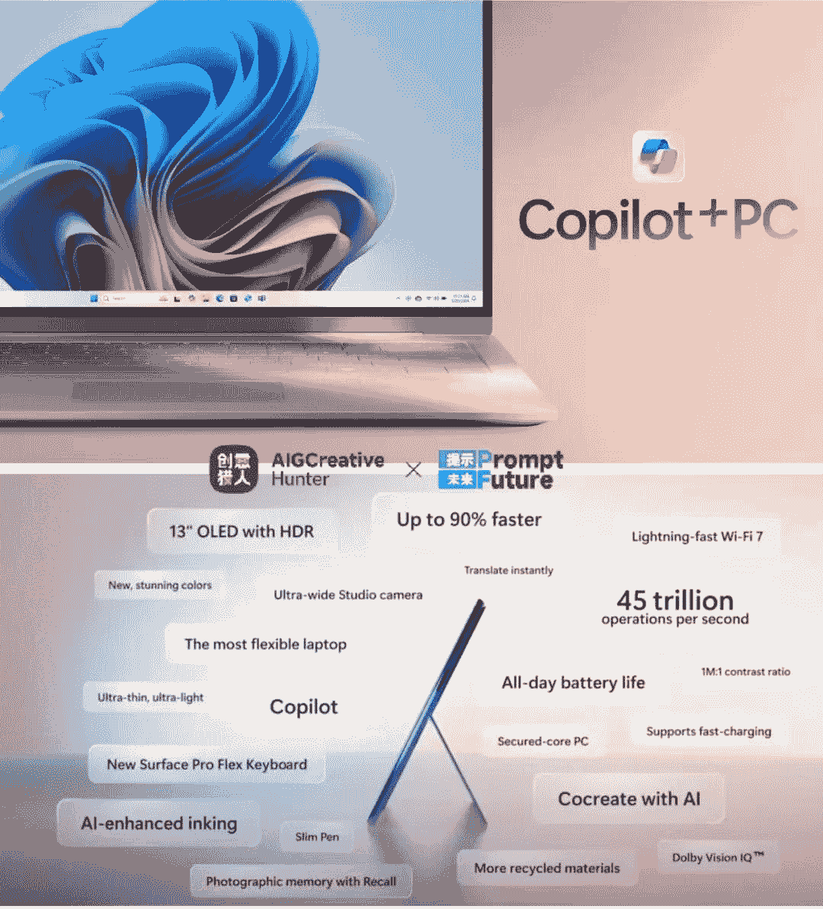

## 【20240519】公司 | Meta发布34B参数Chameleon模型，挑战GPT-4o刷新多模态SOTA

Meta团队最新发布了名为Chameleon的「混合模态」AI模型，具备34亿参数，通过10万亿token的训练，性能直逼GPT-4V，刷新了多模态领域的最新技术记录。Chameleon采用统一Transformer架构，能够无缝处理文本和图像，代表了多模态模型发展的新里程碑。尽管目前主要支持图像和文本生成，缺少GPT-4o的语音能力，但业界普遍看好其未来潜力，期待其成为开源社区的新宠。

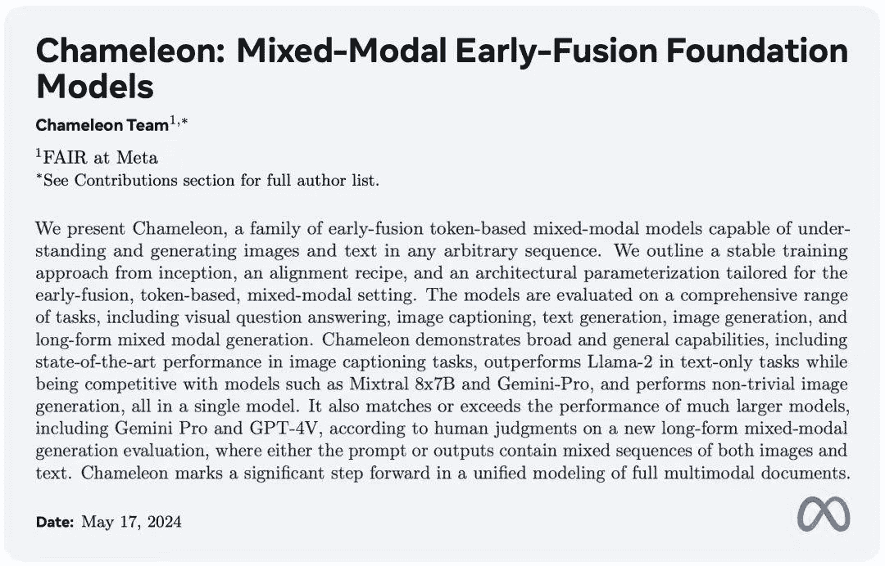

## 【20240517】产品 | 腾讯发布实用型大模型，推动AI产业应用新高度

腾讯在腾讯云生成式AI产业应用峰会上宣布了其混元大模型的最新进展，该模型已升级至万亿级参数规模，并采用混合专家模型(MoE)结构，性能提升50%。腾讯混元大模型不仅在文本生成上表现出色，还在图像、视频等多个领域实现迭代升级。此外，腾讯推出低门槛的开发工具——大模型原生工具链，包括知识引擎、图像创作引擎和视频创作引擎，旨在降低AI应用的开发门槛，助力企业快速构建专属AI应用。

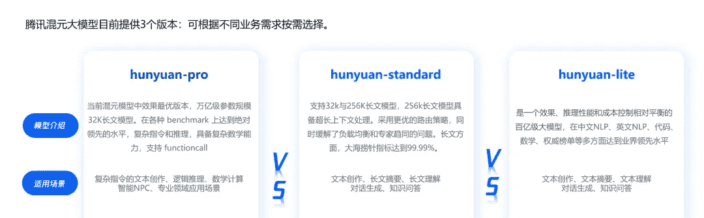

## 【20240515】产品 | 谷歌I/O2024大会，发布一系列更新和新产品，以强硬的姿态回应OpenAI

包括以下几个重点：

1.  Project Astra：谷歌推出的新项目，与OpenAI的GPT-4o竞争，具有强大的视觉识别和语音交互功能。

1.  文生视频模型Veo：与Sora竞争，能够生成超过1分钟的酷炫视频，打破Sora的记录。

1.  Gemini 1.5 Pro：谷歌的AI模型，上下文长度达到200万token，远超其他大语言模型。

1.  谷歌搜索的变革：通过Gemini的加持，谷歌搜索将被重塑，提供多步骤推理的AI Overview，简化用户搜索过程。

1.  Agent：谷歌展示的智能体，可以协助用户执行多种任务，如自动填写退货单、探索城市服务等。

1.  AI文生图Imagen 3：AI文本到图像的生成模型，能够生成高质量、细节丰富的图像。

1.  视频生成模型Veo：提供1080p的视频质量，能够根据用户提示生成视频。

1.  Music AI Sandbox：与Youtube合作的音乐工具，可以帮助艺术家进行风格迁移。

1.  Gemini App：谷歌开发的多模态应用，可以处理文本、音频、视频内容，并提供个性化服务。

1.  TPU Trillium：谷歌的第六代TPU，性能提升4.7倍，能效提升超过67%。

1.  开源模型：谷歌发布了视觉-语言开源模型PaliGemma，以及即将推出的Gemma 2 27B。

## 【20240514】产品 | OpenAI推出全能AI模型GPT-4o，实时交互能力媲美人类

OpenAI最新旗舰AI模型GPT-4o正式发布，该模型能够无缝处理文本、音频和图像输入，并生成相应输出，响应速度与人类对话无异。GPT-4o的推出标志着AI交互技术的重大进步，其Plus功能将对所有用户免费开放。此外，GPT-4o将提供API服务，价格减半，速度提升一倍，调用次数增加五倍。在直播演示中，GPT-4o展现了实时对话、翻译以及视觉识别等高级功能，预示着AI技术的未来发展将更加智能化和人性化。

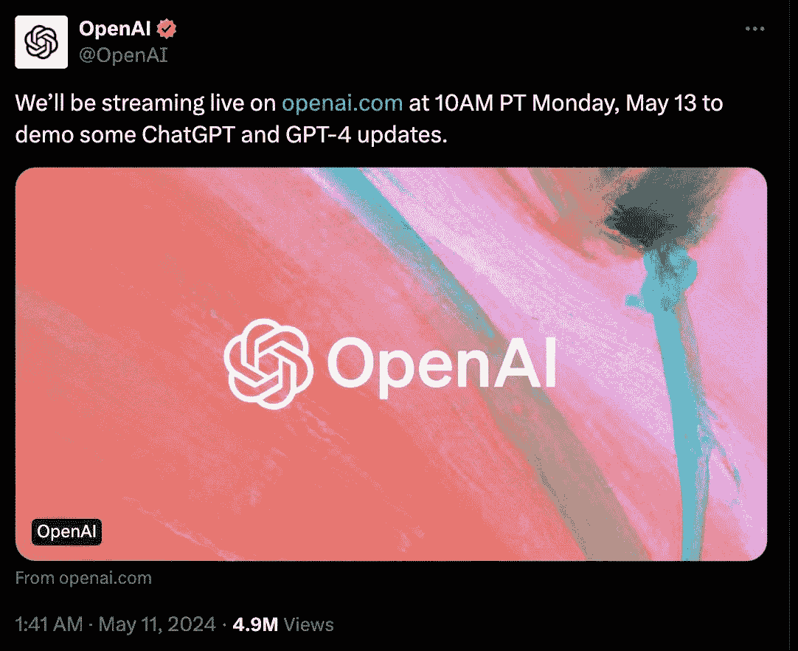

【20240511】产品 | 阅读新姿势！🛰️读书推出AI问书功能

5月11日，🛰️读书上线了AI问书和大纲功能，该功能能够从全库中检索生成答案，为用户带来更加智能的阅读体验。这一创新举措使得🛰️读书在电子书阅读应用领域达到了新的高度，进一步巩固了其在阅读软件市场的领先地位。

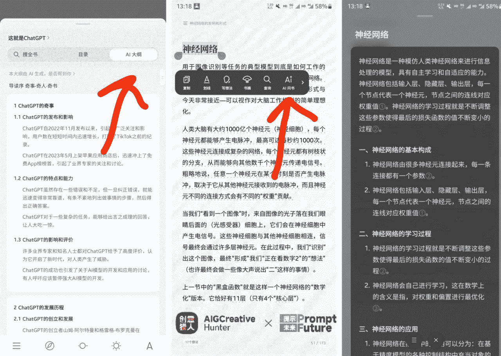

## 【20240510】产品 | Stability AI 在Discord上推出Stable Artisan

Stable Artisan 是一个用户友好的 Discord 机器人，它利用 Stability AI 的先进模型，如 Stable Diffusion 3、Stable Video 和 Stable Image Core，为用户提供了在 Discord 上直接生成高质量媒体内容的能力。用户可以通过 /dream 命令生成图像，并使用一系列编辑工具进行个性化定制，包括搜索与替换、移除背景、创意放大、外画、控制草图和控制结构等。这些工具不仅可以帮助用户进行媒体创作，还可以支持设计项目的头脑风暴和频繁迭代。

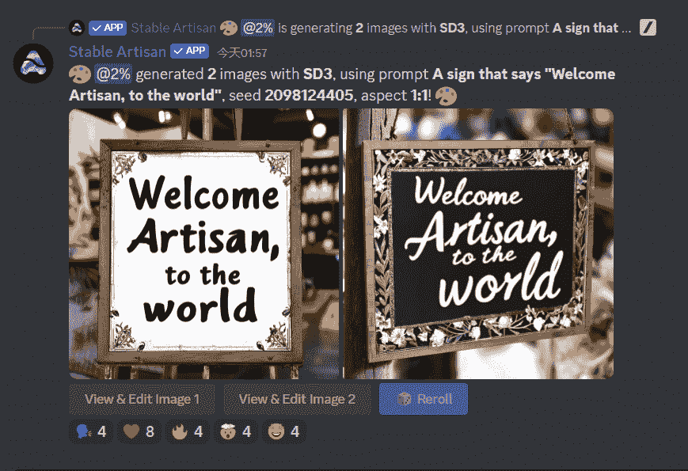

## 【20240510】产品 | ElevenLabs推出AI音乐生成平台挑战传统音乐制作

5月10日，AI语音平台ElevenLabs宣布推出文本生成歌曲产品ElevenLabs Music，其生成的音乐在节奏感、和声、乐器搭配等方面可媲美Suno和Udio等头部产品。ElevenLabs凭借其在人声研究的专业优势，生成的音乐清晰度和拟人化程度超越竞争对手。该平台的推出预示着AI技术在音乐领域的应用将更加广泛，为普通人实现音乐梦想和专业音乐人提供创作灵感带来可能。

产品免费体验地址：https://elevenlabs.io/text-to-speech

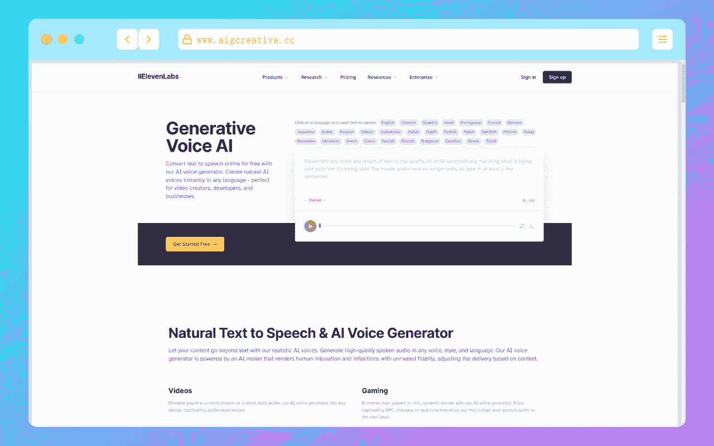

## 【20240509】产业 | 中美AI专利竞争领先，欧洲只能在AI监管立法上寻求存在感。。

在AI大模型时代，中国和美国在AI专利数量上展开激烈竞争，尽管目前胜负未分，但可以肯定的是，欧洲在这一领域已相对落后。尽管欧洲以全球最早推出AI监管立法来寻求存在感，但在AI技术发展上似乎未能跟上中美的步伐。同时，有关AI专利数量的讨论也引起了人们的关注，有人指出专利的质量比数量更为重要，而欧洲在AI技术发展上的滞后，也引发了对其科技产业和人才流失的担忧。

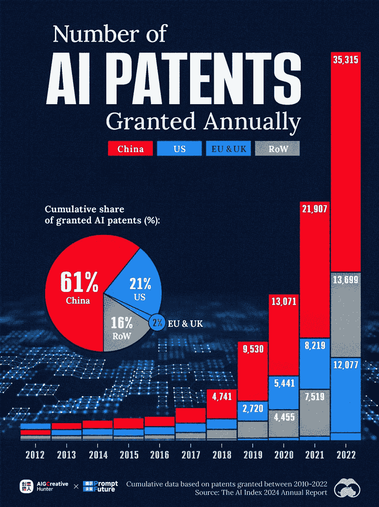

## 【20240509】动态 | OpenAI 发布模型规范草案以引导AI行为

5月8日，OpenAI公开了其模型规范（Model Spec）的初稿，旨在深化公众对AI模型行为的讨论。该规范详细说明了OpenAI希望其模型在API和ChatGPT中如何表现，并强调了塑造模型行为的重要性。规范包括目标、规则和默认行为，旨在帮助开发者和用户实现目标、造福人类，并正面反映OpenAI的形象。OpenAI计划将模型规范作为研究人员和AI训练者的指导方针，并探索模型直接从规范中学习的可行性。公司还邀请公众就规范的目标、规则和默认行为提供反馈，以促进对模型行为的持续公共对话。

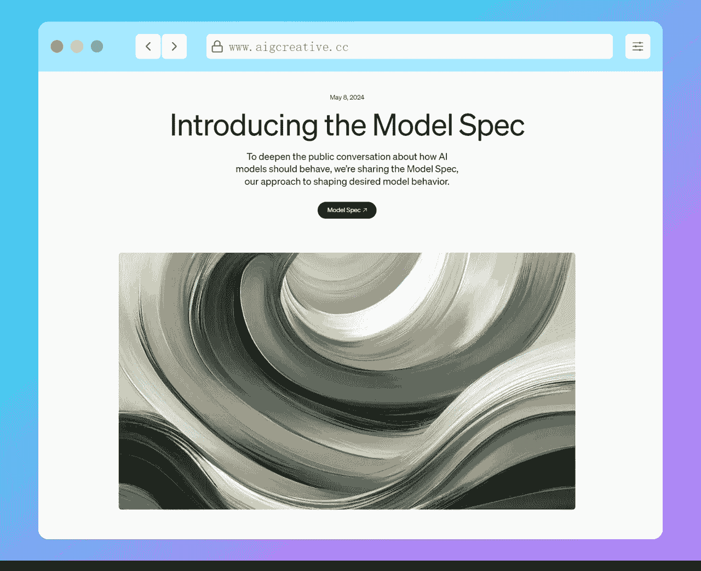

## 【20240509】动态 | 谷歌DeepMind与Isomorphic Labs联合推出AlphaFold 3 AI模型

谷歌DeepMind与Isomorphic Labs合作开发了AlphaFold 3，这是一款能够以前所未有的精确度预测蛋白质、DNA、RNA、配体等生命分子结构及其相互作用的AI模型。AlphaFold 3在预测蛋白质与其他分子类型相互作用的准确性上至少提高了50%，某些重要类别的相互作用预测准确度甚至翻倍。该模型旨在转变我们对生物世界和药物发现的理解，并通过新推出的AlphaFold Server免费提供给科学家使用。此外，Isomorphic Labs正与制药公司合作，将AlphaFold 3应用于现实世界的药物设计挑战，以开发新的治疗方法。

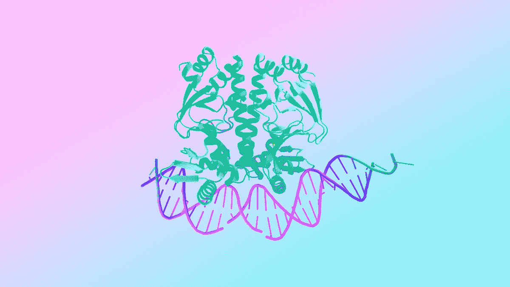

## 【20240508】动态 | OpenAI发布DALL·E 3内容识别器及媒体管理器以保护知识产权

OpenAI宣布推出DALL·E 3的内容识别器和媒体管理器，旨在帮助区分AI生成与人类创作的内容，并保护知识产权。内容识别器的API已开放申请，准确率高达98%，即使图片经过修改也能识别。媒体管理器则允许媒体和创作者控制其内容是否被用于AI模型训练。此外，OpenAI还面临未经授权使用文章训练AI模型的诉讼，正在采取措施以避免类似情况发生。

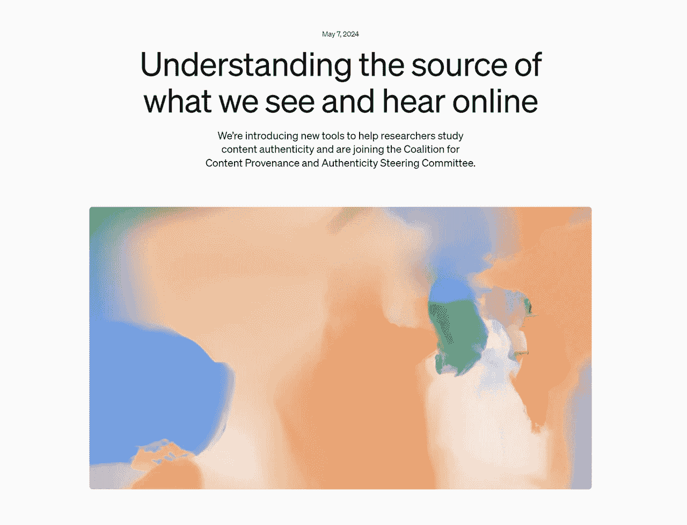

## 【20240504】动态 | OpenAI将推出ChatGPT搜索引擎，挑战Google

OpenAI计划于5月9日发布其ChatGPT搜索引擎，旨在挑战谷歌在搜索领域的领导地位。新搜索引擎将利用大语言模型（LLM）技术，解决谷歌搜索中存在的问题，如广告泛滥、死链过多、关键字匹配局限性等。此前，微软的Bing和Perplexity AI等大模型搜索引擎已在市场上取得成功，显示出大模型搜索引擎的潜力和用户认可。OpenAI的这一举措预示着搜索引擎市场的新竞争格局即将展开。

## 【20240502】产品 | Chrome新增功能：快速启动与Gemini的聊天

Google Chrome浏览器最近推出了一项创新快捷方式，用户现在可以通过在地址栏输入特定命令来快速启动与Gemini的聊天。操作简便，只需键入“@Gemini”后跟相关提示，即可迅速获得回应，极大提升了用户访问和使用聊天服务的效率。

## 【20240501】产业 | 中国生成式AI应用产品及商业模式列举

免费、会员订阅、资源购买、定制解决方案、API接口调用（来源：艾瑞咨询）

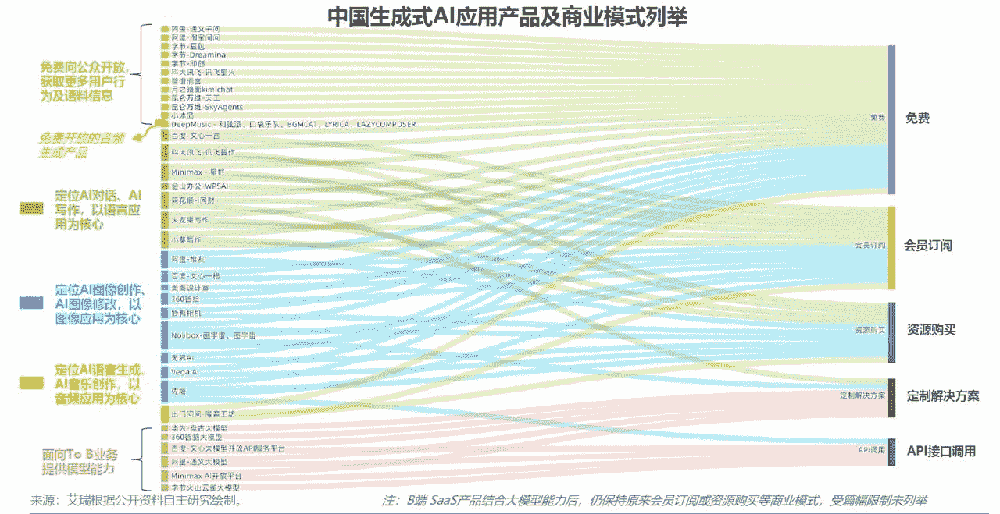

<https://aigcreative.feishu.cn/sync/K4Gvd9vUQsy9Oubwqaeclu0Fnbg>