# AI每日资讯-202404

> 来源：[https://aigcreative.feishu.cn/docx/NxJ8d4N5GoLtuZx6nWxc9YYnnic](https://aigcreative.feishu.cn/docx/NxJ8d4N5GoLtuZx6nWxc9YYnnic)
>
> **动态 | 观点 | 人物 | 产品 | 体验 | 应用** | 公司 | 融资 | 产业 | 文档

## 【20240428】产业 | 埃森哲报告：生成式AI重塑职工、企业与工作内容

埃森哲最新发布的AI报告指出，随着生成式AI的发展，企业、职工及工作内容正面临前所未有的变革。报告强调，尽管存在对失业和隐私泄露的担忧，但生成式AI的采用有望在2038年前创造10.3万亿美元的经济价值。企业需制定全面战略，结合业务目标，培养人才，以实现AI的全面潜力，同时确保员工信任并准备好拥抱这一变革。

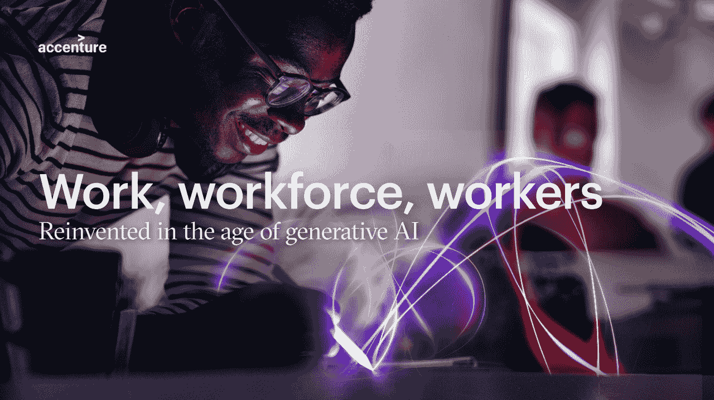

[埃森哲2024最新报告：生成式AI重塑职工、企业与工作内容.pdf](https://internal-api-drive-stream.feishu.cn/space/api/box/stream/download/all/VXdibb7YGoWnwvx9oWNc46eWn8d)

## 【20240427】产品 | ChatGPT现在可以跨对话记忆信息

1、持续对话：ChatGPT能够在多次对话中保留学到的信息，这使得它能够提供更加贴切的回答。

2、随时间变得更加实用：随着您不断与之对话，ChatGPT会持续记忆更多细节和个人偏好，从而变得更加有用。

3、管理记忆功能：您可以完全掌控这一功能。您可以查阅、删除特定记忆，可以选择重新开始，或者在设置中关闭此功能。

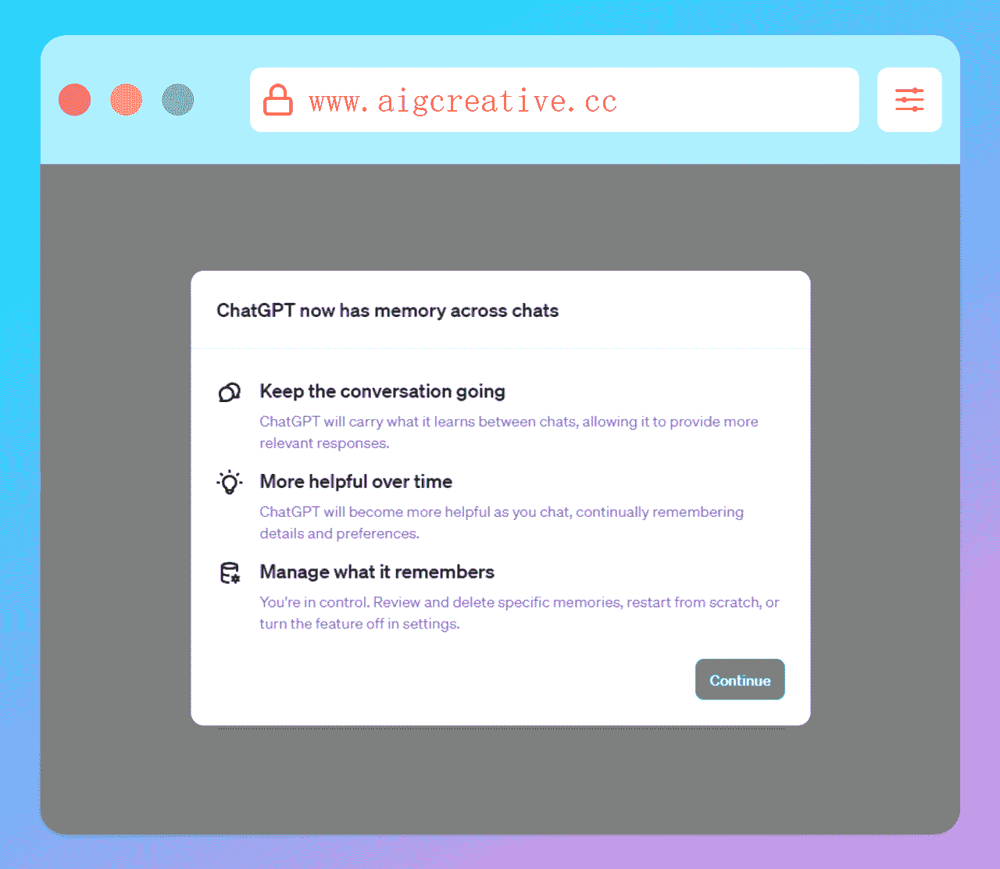

## 【20240426】公司 | 量子位-中国AIGC应用全景图谱1.0

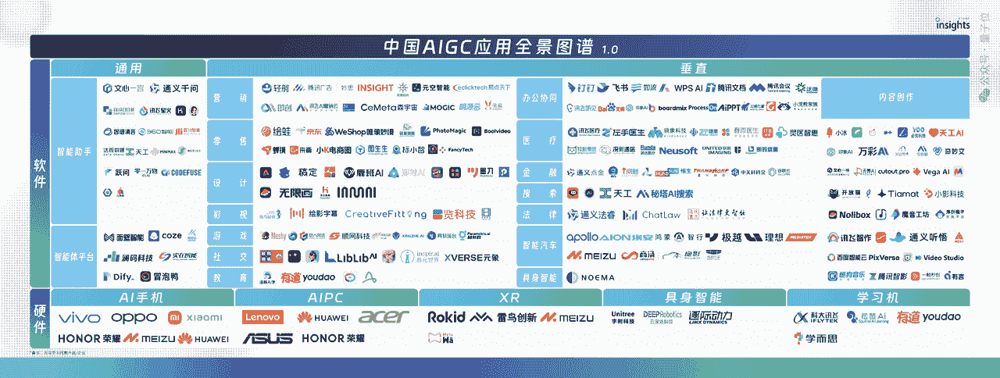

## 【20240426】公司 | 科大讯飞发布讯飞星火V3.5，支持长文本、图文、语音大模型

科大讯飞董事长刘庆峰宣布，讯飞星火V3.5春季版新增多项功能，包括支持长文本、长图文、长语音的大模型，首发星火图文识别大模型，提升行业场景下的专业和精准度。新增星火合同助手，智能评标助手升级，以及多情感超拟人合成和声音复刻技术。星火智能体平台发布，旨在解决企业落地大模型的最后难题。星火APP安卓下载量超9600万次，国内工具类大模型APP排名第一。

## 【20240426】人物 | Sam Altman 斯坦福分享

- 下一个模型会比gpt4还强大非常非常多
- copy很容易，已经有gpt4了，Google很容易copy出来Gemini，难得是innovation new things 怎样 define nexparadigm
- iPhone get a long way，Al也一样
- 为什么不开源:因为目标是 AGI，不认为开源是最好的做法，希望通过像公众提供免费无广告的ChatGPT来实现社会影响力
- 不担心 AI太强，gpt4一出来人们觉得变天了，现在人们觉得 gpt4还是不够好想要 gpt5
- 如何消除不公:让便宜的ai计算flood the world，让a超级便宜
- 很多人的创业/研究方向是在补全现在ai的缺陷，本质是在赌ai不会变得更好，但是来来会有gpt5、6，这样的工作就没意义
- 人类始终更喜欢人类，就算现在ai下棋吊打人类，人类还是只喜欢看人类下棋;不过也有一些反例，比如青少年更喜欢跟ai聊而不是跟心理医生聊
- 认为 Sora会实现全新的娱乐方式，每次看都会不同，会根据你的喜好、互动实时生成，会实现somethingbetween movie and game
- openai最大的组织变化:意识到scaling很重要之后把所有组的计算资源都聚集起来做一件事
- 会实现不需要全新的 data也能让模型推理能力不断提升现在是一个很好的时间去做ai startup，但是不会因为用上了 ai就超过所有已有的产品，ai也不会违背商业的定津
- openai在做的是tool for human，而不是新的生物，所以不觉得 chatgpt需要有情感
- 有同学问 Sora的训练数据用了多少 YouTube video?Sam: let's pass this question
- 未来一个高薪工作是给模型生成的结果提供专业反馈。

## 【20240425】产业 | 全国首例AI声音侵权案宣判，配音师获赔25万元

北京互联网法院近日对全国首例AI声音侵权案作出一审判决，原告配音师殷某因声音被非法AI化并商业化使用，获得25万元赔偿。法院认定，未经授权使用他人声音构成侵权，强调声音作为人格权益应受法律保护。五名被告均否认侵权，但法院判决被告方需书面道歉并赔偿原告损失。

## 【20240424】产品 | Adobe发布全新Photoshop，集成先进AI功能

Adobe在MAX London创意大会上发布了最新版Photoshop beta，引入了先进的生成填充和生成图像功能，由Adobe Firefly Image 3 Foundation Model驱动，提供更强大的创意控制和AI集成。新功能包括参考图像、文本到图像、生成背景等，旨在缩短创意构思与实现之间的距离，使所有用户都能快速实现创意愿景。此外，Adobe强调了其对负责任AI创新的承诺，确保内容生成符合版权和知识产权法规。

Blog：`https://news.adobe.com/news/news-details/2024/New-Adobe-Photoshop-with-Advanced-Generative-Fill-and-Generate-Image-Brings-New-Superpowers-to-All/default.aspx`

## 【20240423】公司 | 微软发布手机端可运行的Phi-3模型，性能领先同规模模型

微软最新发布的第三代Phi-3系列大语言模型，以其在小规模参数模型上实现传统大模型能力而备受瞩目。该系列包含三个版本，最小参数规模38亿，最大140亿，其中Phi-3-mini-3.8B模型特别强调其在手机端的运行能力，仅需1.8GB内存即可运行。在各项评测中，Phi-3系列展现出超越同等参数规模模型的性能，接近GPT-3.5水平。

## 【20240423】公司 | Meta Quest 开放操作系统，引领混合现实新纪元

Meta Quest 宣布向第三方硬件制造商开放其操作系统，推出 Meta Horizon OS，旨在构建一个更加开放的元宇宙计算平台。该系统结合了十年的技术积累，包括内外跟踪、眼动、面部、手部和身体跟踪等，为开发者提供了丰富的框架和工具来创造混合现实体验。此外，Meta Quest 商店将更名为 Meta Horizon 商店，同时 Horizon 社交层将扩展至新生态系统，允许用户在不同虚拟空间中保持身份和社交联系。

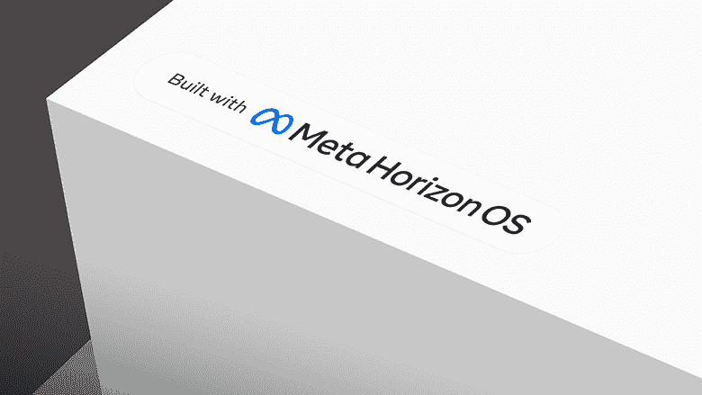

## 【20240422】文档 | 知识库文档上新~~

这是一套整理自设计师Twitter@Dogan Ural的一套Midjourney学习资料，内容精良全是干货；版式设计精美，各方面都值得学习！后续还有陆续更新，对AI绘画的朋友可以看看~~

文档链接：[Midjourney精品学习资料](https://aigcreative.feishu.cn/wiki/DboGw22jhiEq01kMgPiciYpSn1e?from=from_copylink)

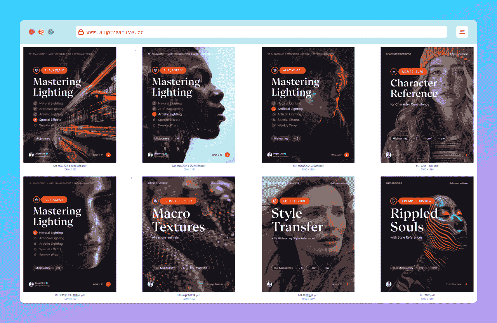

## 【20240419】产业 | Llama 3在LLM聊天服务排行榜Arena Leaderboard排名靠前

近日，Meta新发布的Llama 3引起了业界的广泛关注。Llama 3在处理复杂查询和生成长篇回答方面展现了卓越的性能，在特定领域的表现已经显示出巨大的潜力。

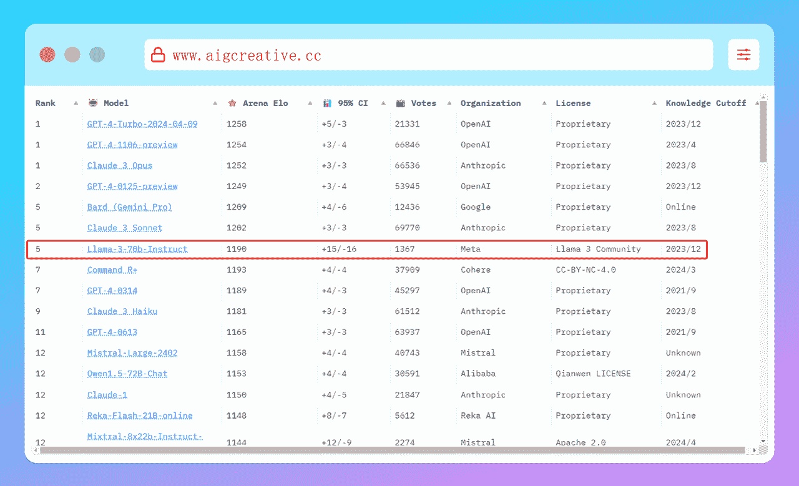

## 【20240419】产品 | 新华社推出AI工具“新华妙笔”助力公务员高效撰写公文

新华社近日推出了一款名为“新华妙笔”的人工智能工具，专为公务员设计，旨在提高公文撰写的效率和质量。该工具的发布，体现了AI技术在公共服务领域的应用潜力，有望为基层公务员减负，推动行政工作的现代化。此外，页面还涉及了Nature杂志发表的细菌马达组装研究，以及波士顿动力公司在生物智能领域的最新进展，展示了科技在不同领域的创新与突破。

体验网站：`http://miaobi.xinhuaskl.com/`

## 【20240419】产品 | Meta Llama3模型突破400B参数，性能测试超前

Meta Llama3开源模型的发布标志着AI技术的又一大步。该模型拥有超过400亿的参数规模，目前还在训练中，但其70亿参数版本已在性能测试中全面超越了Gemini Pro 1.5和Claude3 Sonnet，预示着开源模型性能的新高度。

Meta.ai里直接体验：`meta.ai`

Llama 3 8B 和 70B 已经可以在官方下载：`llama.meta.com/llama3/`

HuggingChat 上也已经可以体验：`huggingface.co/chat/`

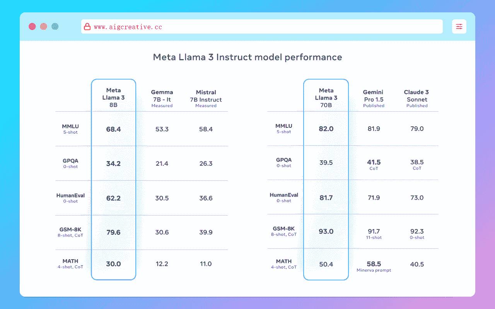

## 【20240419】产品 | HuggingFace 发布 Hugging Chat App iOS 客户端

HuggingFace 宣布其 Hugging Chat App iOS 客户端正式上线，用户现在可以在手机上便捷地使用 Hugging Face 平台上托管的开源模型。目前该应用提供了六款模型，包括 Command R+、Zephyr-14b、Mixtral 8x7B、Gemma-1.1-7b、Nous-hermes-mixtral 8x7B 和 Mistral 7B。尽管这些模型在处理中文方面存在局限，但测试显示其运行速度非常快。用户可以通过 Apple App Store 下载体验。

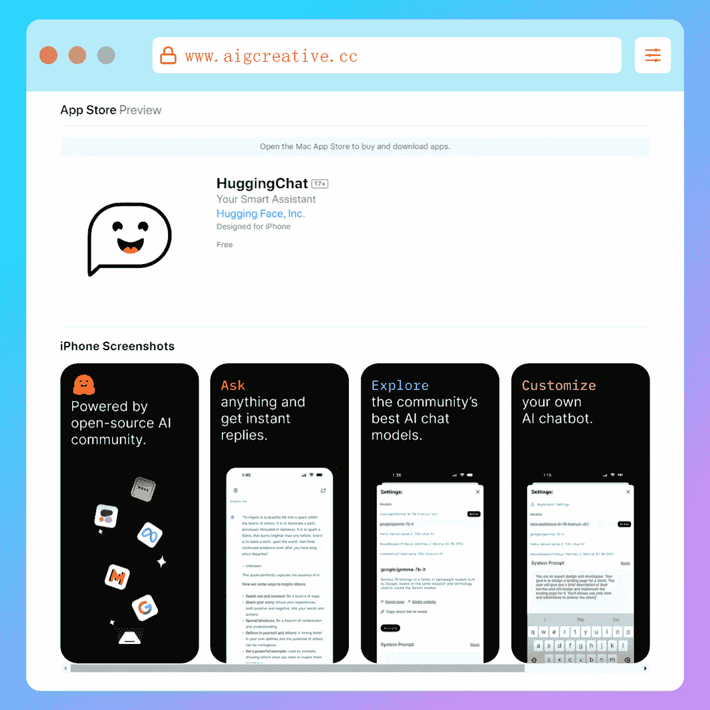

## 【20240418】产品 | 微软推出VASA-1：AI技术新突破，一张图生成逼真视频

微软近日发布了VASA-1项目，该技术仅需一张肖像照和一段语音即可生成高清且嘴形与声音同步的演讲视频。VASA-1基于先进的面部动态和头部运动生成模型，支持多语言，包括中文，且在性能上超越了阿里巴巴的EMO项目。其商业潜力巨大，预示着AI绘画和视频制作领域的新商机。

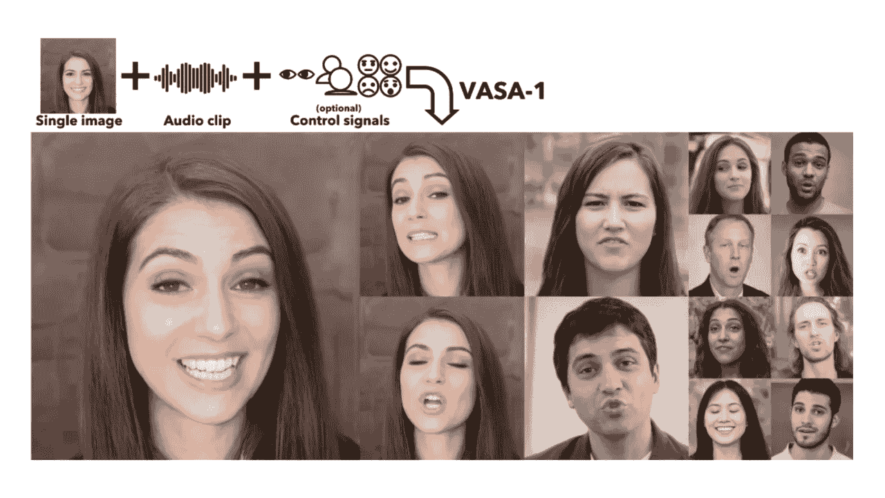

[4a4ec03188abcbcbaad063ab28190a17.mp4](https://internal-api-drive-stream.feishu.cn/space/api/box/stream/download/all/ZtvdbaWx4opOanxy5BFcjITbnXb)

[a5d35eb34ba13cdb3c15de3cd4ab4e81.mp4](https://internal-api-drive-stream.feishu.cn/space/api/box/stream/download/all/KyCIbvRrUoF0mMxP2XFc5gYmnUc)

## 【20240418】产品 | Stability AI 发布 Stable Diffusion 3 API，提升文本到图像生成性能

Stability AI 宣布在其开发者平台上推出 Stable Diffusion 3 和 Stable Diffusion 3 Turbo API。该模型在排版和提示遵循性方面，基于人类偏好评估，与 DALL-E 3 和 Midjourney v6 等顶尖文本到图像生成系统相当或更优。新架构 MMDiT 通过为图像和语言表示使用不同的权重集，提高了文本理解和文本字符的拼写能力。附案例：

详情：`https://stability.ai/news/stable-diffusion-3-api?utm_source=twitter&utm_medium=website&utm_campaign=blog`

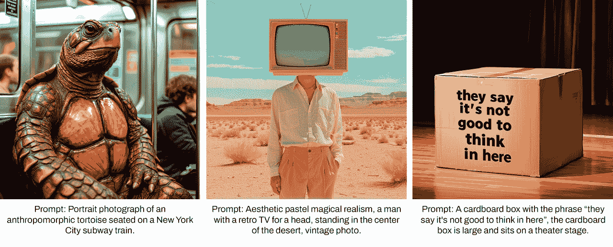

## 【20240418】公司 | 波士顿动力发布全面电动化新版人形机器人Atlas

波士顿动力公司宣布停止开发液压动力机器人Atlas，并推出全新电动化版本的Atlas机器人。新版Atlas拥有更轻巧的机械骨架和更流畅的动作，如180度头部旋转和快速站立，显著提升了在复杂环境中的适用性。其电动驱动系统使动作更平滑且安静，而高性能执行器则提供了更广泛的运动范围。现代化设计包括圆形屏幕头部和紧凑的转弯能力，使其在狭窄空间中更加灵活。此外，Atlas具备自我恢复能力，能够自行站立，适用于多种工作环境和任务。

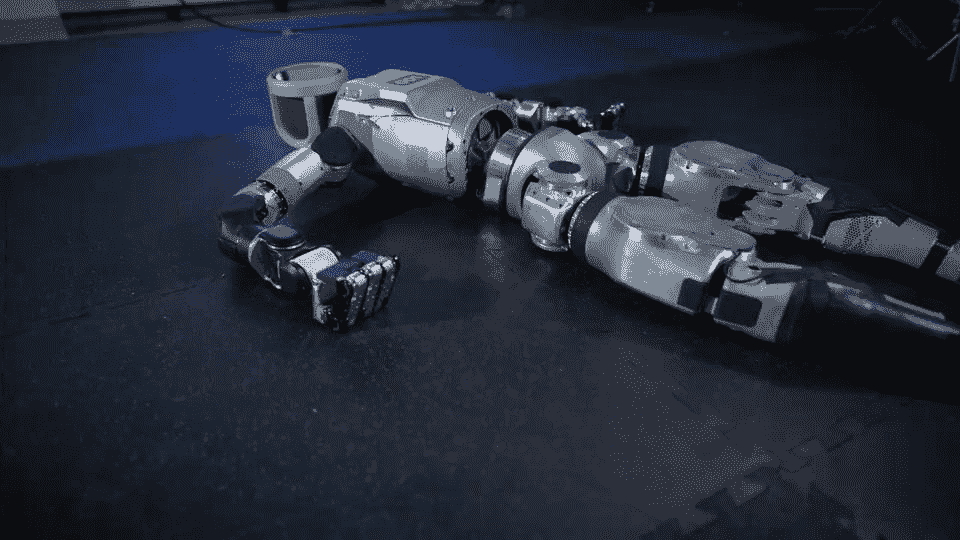

[X2Twitter.com_GLX5KsXWEAAJeQo(720p).mp4](https://internal-api-drive-stream.feishu.cn/space/api/box/stream/download/all/G9FBbd2nXosAOhxLxoScz4bInWd)

## 【20240417】产品 | 昆仑万维推出中国首个音乐SOTA模型「天工音乐大模型」

中国首个音乐SOTA模型「天工音乐大模型」由昆仑万维主导研发，今日开始公测。该模型采用自研技术，实现端到端音乐生成，具备参考音乐生成与方言歌曲生成的独特能力。同时，「天工3.0」作为全球最大的开源MoE模型，拥有4000亿参数，其多模态性能超越GPT-4V。昆仑万维通过「天工」系列大模型，推动AI技术在多个领域的应用与创新，助力构建自主可控的AI产业生态。

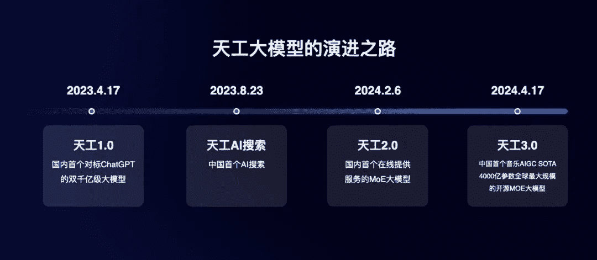

## 【20240417】文档 | 推荐：【干货 · 书籍】

[大语言模型LLM综述.pdf](https://aigcreative.feishu.cn/wiki/XZbQwRBqZiKoHbkBYJicnY32nYd?from=from_copylink) 大文继荣、赵鑫老师团队编写的大语言模型综述（391页）：

## 【20240417】产品 | Reka AI Labs 发布了一款新的多模态语言模型 Reka Core

该模型在过去几个月中进行了培训，并最终发布。Reka Core 具有多种能力之一，即理解视频。Reka AI Labs 对该模型进行了标准基准测试，包括文本和多模态测试，以及第三方人工评估。除此之外，Reka AI Labs 还发布了一份详细技术报告，涵盖了 Reka Core 的训练、架构、数据和评估。用户可以在 `https://showcase.reka.ai` 和 `https://chat.reka.ai` 上查看 Reka Core 的输出示例，或尝试自己使用该模型。在 MMMU 方面，Core 可与 GPT-4V 相媲美；在由独立第三方进行的多模态人类评估中，Core 优于 Claude-3 Opus；在视频任务方面，Core 超越了 Gemini Ultra。在语言任务方面，Core 在成熟的基准测试中可与其他前沿模型媲美。

## 【20240417】产业 | PixArt-Sigma更新，引领图像生成技术新飞跃

近日，PixArt-Sigma发布了重大更新，这一基于Transformer框架的图像生成工具以其高质量输出和用户友好的操作界面受到广泛关注。由华为诺亚方舟实验室联合大连理工和香港大学共同研发的PixArt-Sigma，不仅提升了图像保真度和文本对齐能力，还支持高达6K分辨率的图像生成，显著推动了电影和游戏行业的视觉内容创新。

体验地址：`https://huggingface.co/spaces/PixArt-alpha/PixArt-Sigma`

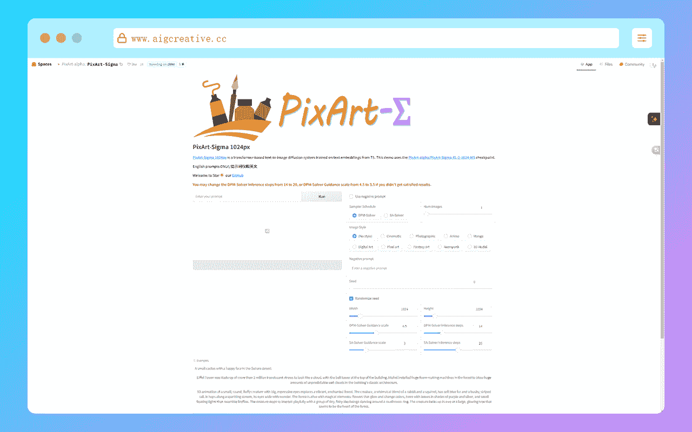

## 【20240416】产业 | 2023年ChatGPT全球用户使用趋势

如图，2023年，全球ChatGPT的使用频率显示17%的用户日均使用，36%的用户每周使用，16%的用户每月至少一次。印度、巴基斯坦和肯尼亚的日常使用率最高，而印度和肯尼亚也是对ChatGPT认知率最高的国家。

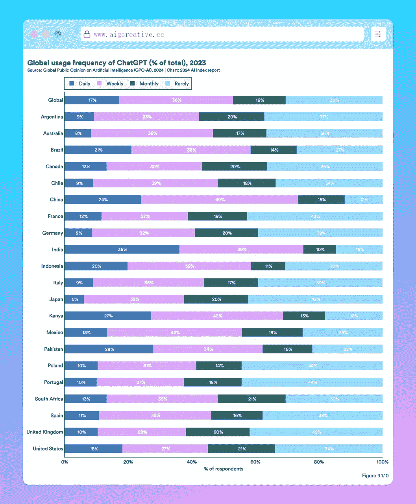

## 【20240416】产品 | OptimizerAI 1.0发布：革新游戏和多媒体的AI音效技术

OptimizerAI 1.0是一款突破性的文本转声音效果模型，旨在为游戏、视频、电影和动画注入生动的AI音效。该技术现已支持网络和Discord平台，用户可通过访问官网立即体验。用户反馈显示，新版OptimizerAI在性能上显著优于前代，并期待其未来能扩展至更多应用场景，如带有情感的文本到语音转换，为创作者提供了更多可能性。

官网：`https://www.optimizerai.xyz/`

[`ad30ac4669c581fbcc2fe1f0036b1570.mp4`](https://internal-api-drive-stream.feishu.cn/space/api/box/stream/download/all/XQtGbKmAdo6zcXxycK0cEiJwnHg)

## 【20240416】产品 | Mira项目：腾讯ARC实验室探索高质量长视频生成新技术

腾讯ARC实验室近日推出了Mira项目，旨在探索高质量、长时视频生成技术。Mira项目区别于现有文本转视频(T2V)框架，能够生成更长时（10秒至20秒以上）、动态丰富、3D一致性强的视频。尽管与Sora项目相比仍有差距，Mira项目通过初步实验，旨在分享关键组件的研究成果，推动内容创作领域的创新和民主化。MiraData作为项目的一部分，提供了一个大规模、长时、结构化字幕的视频数据集，目前包含游戏和城市/风景探索两种场景。

项目地址：<https://mira-space.github.io/>

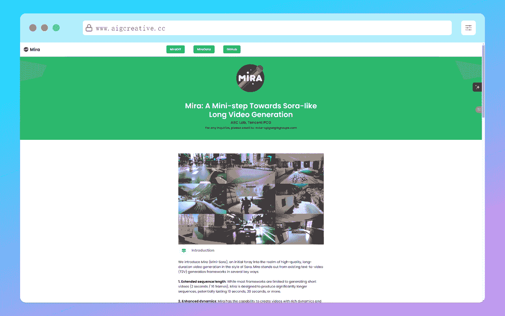

## 【20240415】产品 | Adobe Premiere Pro 引入创新的生成性AI工具，提升视频编辑工作流

Adobe 宣布在旗下的行业标准视频编辑软件 Adobe Premiere Pro 中整合生成性AI技术，旨在通过智能工具提高编辑效率和创意控制。新工具包括内容扩展、对象添加与移除以及生成缺失的B-roll片段，同时支持第三方AI模型，如OpenAI的Sora和RunwayML。Adobe Firefly Video Model将加入现有的图像、矢量、设计和文本效果模型，推动专业视频编辑进入生成性AI时代。此外，Adobe 承诺通过内容凭证提供透明度，确保消费者了解所观看媒体的生成模型。

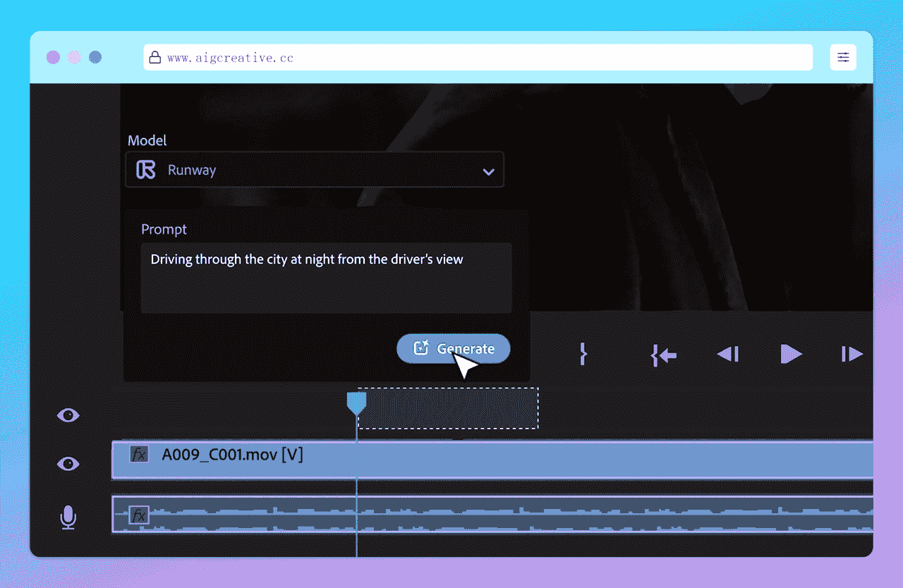

## 【20240415】公司 | OpenAI在日本设立亚洲首个办公室并推出定制版GPT-4

OpenAI宣布在东京开设其亚洲首个办公室，旨在与日本政府、企业和研究机构合作，开发符合日本需求的安全AI工具。公司还推出了针对日语优化的GPT-4定制模型，提高了翻译和总结性能，同时运行速度是前代产品的三倍。此外，OpenAI与日本领先企业如Daikin、Rakuten和TOYOTA Connected合作，利用ChatGPT Enterprise提升业务流程效率。横须贺市等地方政府也通过ChatGPT提高了公共服务效率。OpenAI期待为解决日本社会挑战贡献力量，并邀请有志之士加入其团队。

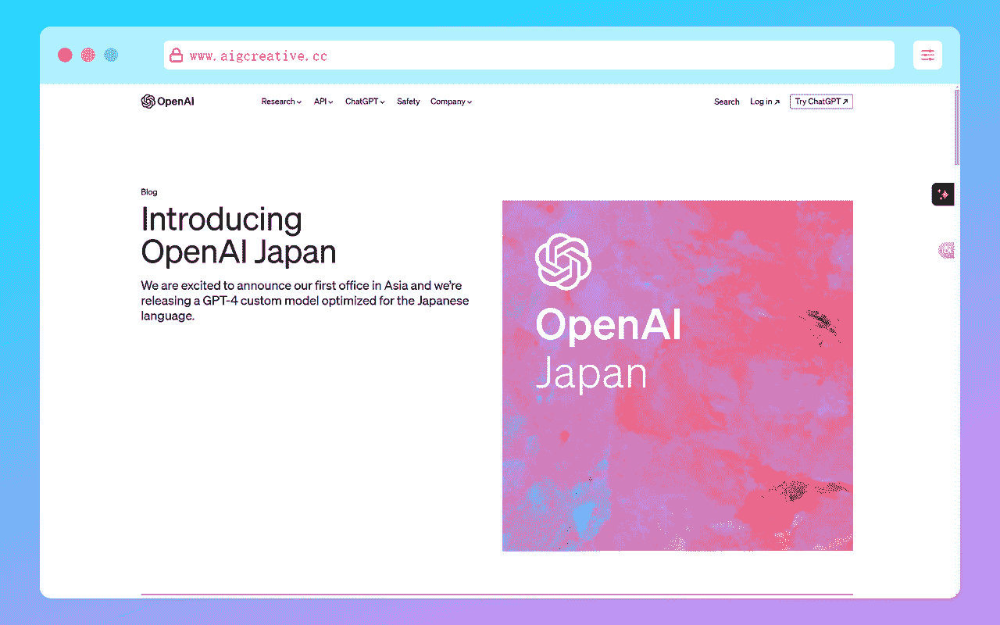

## 【20240415】公司 | Adobe Firefly 训练数据争议：使用竞争对手 AI 生成图像

Adobe Inc. 推出的 Firefly 图像生成软件声称主要使用自家的 Adobe Stock 数据库进行训练，以确保商业安全性，与通过互联网抓取图片的竞争对手如 Midjourney 区别开来。然而，事实上 Firefly 的训练数据也部分依赖于竞争对手的 AI 生成内容，这一点在公开演讲和宣传中并未明确披露，引发了关于其商业道德和透明度的讨论。

## 【20240414】产品 | Udio：不仅能生成音乐，还能生成喜剧、演讲、NPC对话、体育分析、广告等多种音频内容

Udio作为一款创新的人工智能音频引擎引起了广泛关注。它不仅能够生成音乐，还能够创作喜剧、演讲、NPC对话、体育分析、广告等多种音频内容。这一技术突破极大地扩展了人工智能在音频领域的应用范围。Udio的这一进展不仅令人惊叹，也为内容创造者提供了一个全新的创作平台。

[`fc8e80b0f27f53ccb2c4bb9b22d8f4f3_raw.mp4`](https://internal-api-drive-stream.feishu.cn/space/api/box/stream/download/all/P4PjbWjFYoknIfxPLyrcnjVqnjc)

## 【20240413】产业 | 斯坦福HAI发布2023年AI指数报告

斯坦福大学人类与AI研究所（HAI）近日发布了2023年的人工智能指数报告，该报告深入分析了AI行业的发展趋势。报告显示，产业界在AI技术的发展上已超越学术界，AI系统的性能在传统基准测试中提升趋于饱和，同时AI对环境的影响和滥用问题受到关注。AI在科学研究中的作用日益凸显，而美国对AI专业技能的需求持续增长。此外，全球对AI的立法和政策兴趣显著增加，中国公民对AI产品和服务的态度最为积极。报告强调了AI技术在未来发展中的重要性和挑战。

报告链接：<https://aiindex.stanford.edu/wp-content/uploads/2023/04/HAI_AI-Index-Report_2023.pdf>

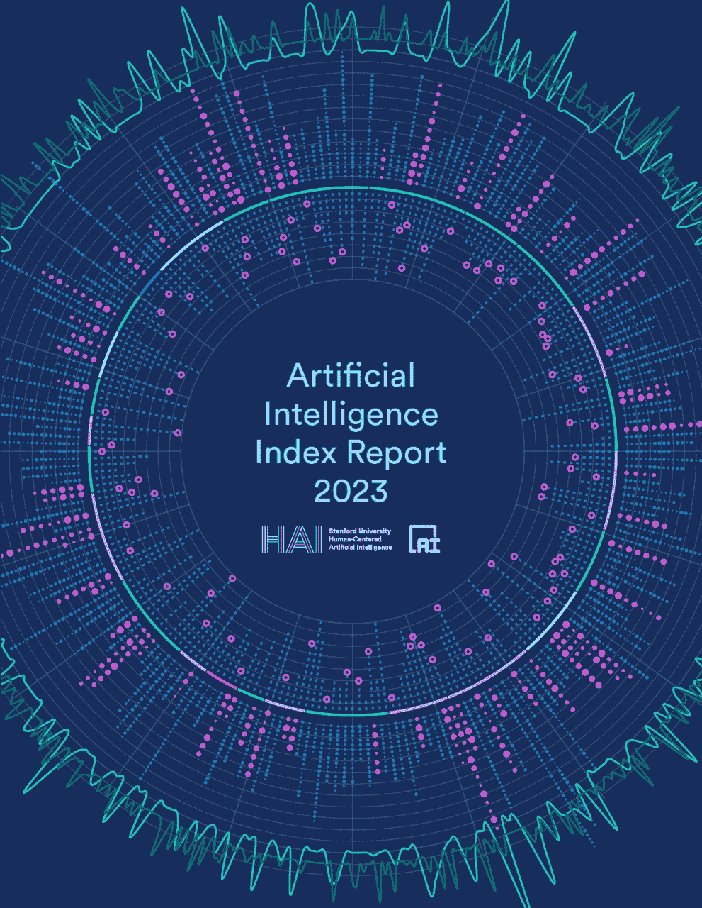

## 【20240412】产业 | 福布斯发布2024年人工智能初创企业50强

福布斯近日发布了2024年度人工智能初创企业50强榜单，这是从1900家申请公司中通过算法分析和专家评审严格选出的顶级AI企业。榜单显示，生成式AI正从边缘领域走向主导地位，显著提升生产力。大型企业如ServiceNow、Palo Alto Networks等通过整合AI实现成本节约和效率提升。未来，用户体验和界面将围绕AI能力重新设计，硬件与AI软件的整合将转变工作方式，AI自动化可能促成新的公司形成和管理结构。同时，AI在教育、医疗等领域的潜力巨大，但需负责任的政策来应对就业减少问题。

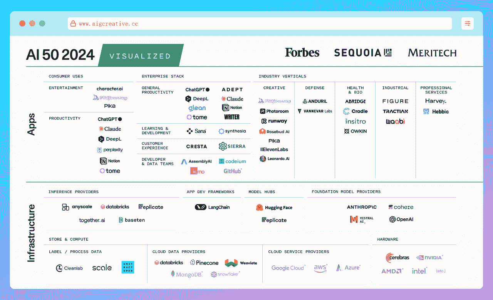

## 【20240411】产品 | Udio发布：创新音乐平台助力音乐家与爱好者释放创造力

Udio，一款由前Google DeepMind团队创立的免费音乐创作平台，正在引领音乐制作的新潮流。它支持多种流派和风格的探索，并允许用户用不同语言创作音乐。Udio致力于成为音乐家和非音乐家的游戏规则改变者，得到了包括@iamwill和@common在内的领先艺术家的支持。尽管目前模型尚在迭代改进中，但其强大的功能已经吸引了广泛的关注。Udio鼓励用户发挥创意，每月可生成高达1200首歌曲，共同期待社区的精彩创作。

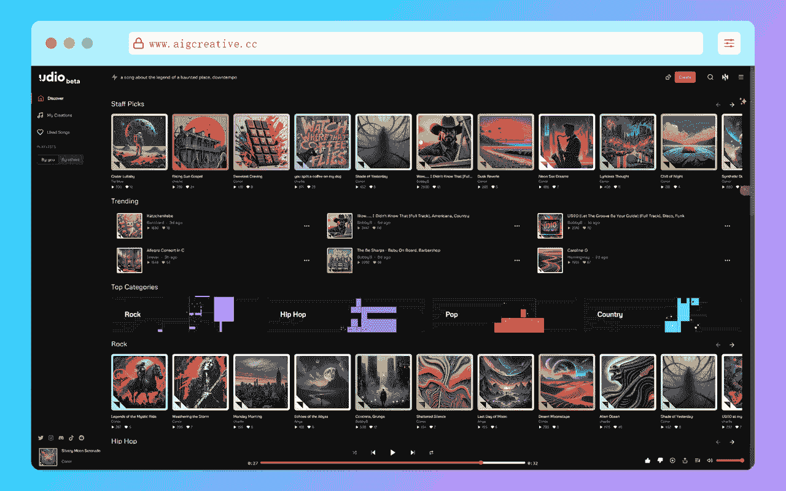

## 【20240410】动态 | 苹果推出Ferret-UI多模态模型，优化移动端UI交互

苹果公司近日发布了名为Ferret-UI的多模态模型，该模型专门针对智能手机用户界面(UI)设计，旨在提升对移动端UI屏幕的理解与交互。Ferret-UI在多项手机UI任务中表现出色，超越了GPT-4V模型。通过引入“任何分辨率”技术，Ferret-UI能有效处理不同屏幕大小和长宽比的设备，展现出在OCR、图标识别和控件分类等基础任务以及高级任务上的卓越性能。这一创新可能会推动iPhone进一步引入AI功能，助力苹果在大模型竞赛中取得领先。

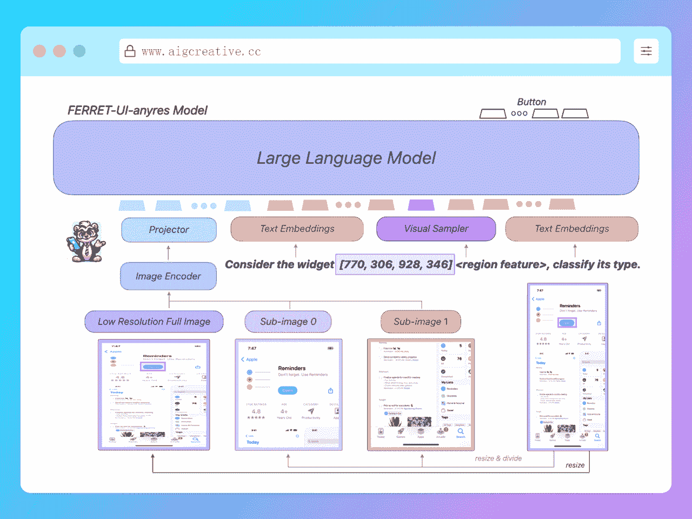

## 【20240410】动态 | Google宣布Gemini 1.5 Pro开放API，新增音频和视频模态理解能力

Google宣布其Gemini 1.5 Pro已开放API，并在全球180多个国家提供服务。该版本新增了原生音频理解能力、文件API、系统指令和JSON模式等功能，使得Gemini模型能够直接处理音频输入，无需音频转文本。此外，Gemini 1.5 Pro还能够同时对视频中的图像和音频进行推理，解锁了新的音频和视频模态使用案例。这些改进为多模态理解、内容索引搜索、交互体验增强、视频内容分析和创意内容生成等领域带来了巨大的应用潜力。开发者现可通过Gemini API访问新一代的高性能文本嵌入模型。

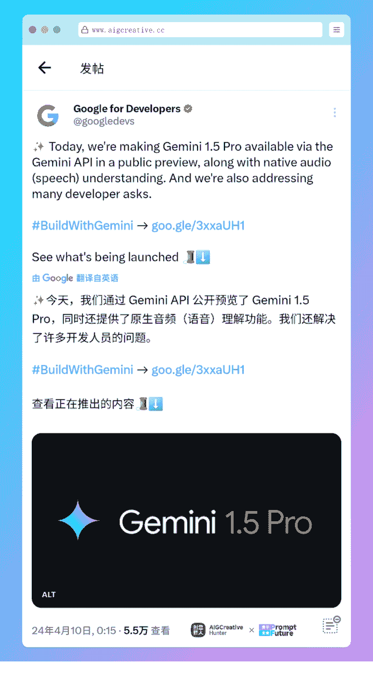

## 【20240410】动态 | OpenAI推出GPT-4-Turbo正式版，集成视觉能力并支持128k上下文

OpenAI发布了GPT-4-Turbo的正式版，该模型具备了先进的视觉识别功能，并能处理高达128k的上下文信息。此次更新带来了显著的性能提升，同时保持了与之前版本相同的价格结构。模型的训练数据更新至2023年底，确保了信息的时效性。用户现在可以通过JSON模式和函数调用更灵活地使用Vision请求。

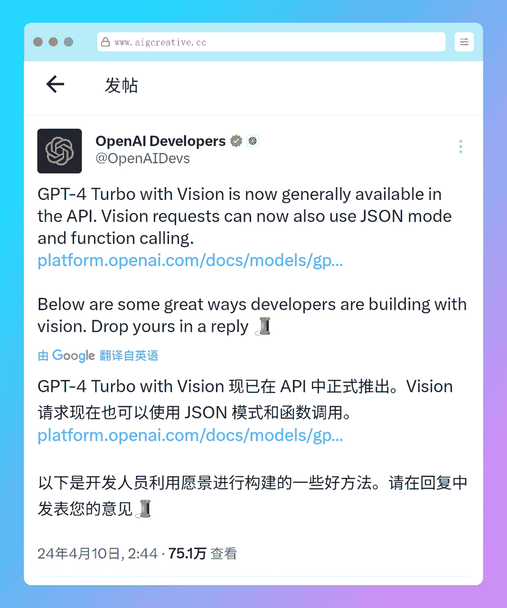

## 【20240409】产业 | 人形机器人主要玩家发展现状

人形机器人主要玩家发展现状。

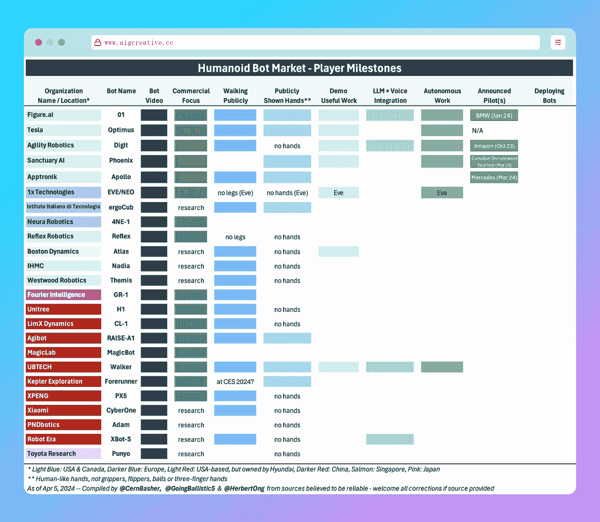

## 【20240408】动态 | 出门问问通过港交所聆讯，或将成为“AIGC第一股”

近日，出门问问（Mobvoi Inc.）已通过港交所聆讯并于4月2日披露通过聆讯后的资料集，拟主板挂牌上市。这意味着出门问问或将成为“AIGC第一股”，成立于2012年的出门问问作为一家以生成式AI和语音交互技术为核心的人工智能公司，专注于提供AIGC解决方案、AI企业解决方案、智能设备及配件等AI Copilot解决方案。

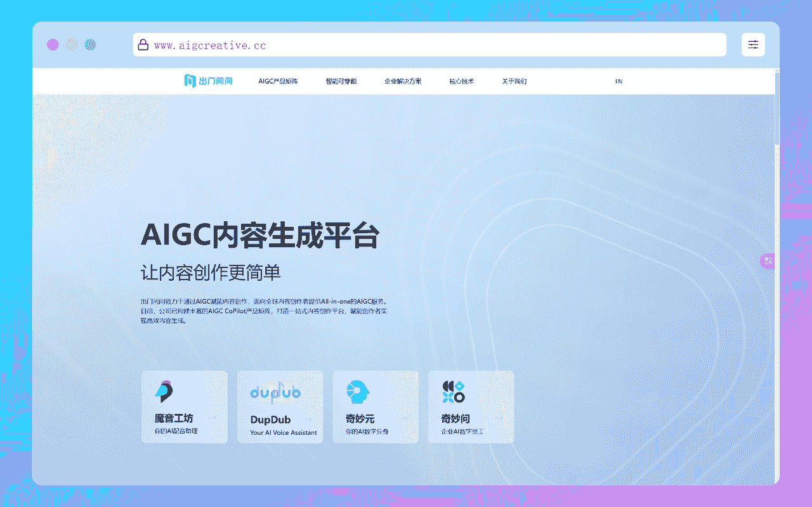

## 【20240407】动态 | YouTube迎来重大升级，AI功能即将上线

YouTube宣布进行了一次大规模的系统升级，引入了创新的AI技术。

1. 将允许用户在观看视频时，通过AI聊天机器人实时提问，而不会中断视频播放，极大提升了观看体验。

2. 除此之外，YouTube还推出了名为Dream Screen的视频编辑工具，用户可以轻松定制视频背景。

3. 同时，新增的分类评论功能，让用户能够通过摘要快速把握评论要点。这些新功能的加入预示着YouTube在提升用户体验方面迈出了重要一步。

## 【20240407】动态 | 「天工SkyMusic」将于4月17日免费对外开放

昆仑万维即将推出「天工SkyMusic」AI音乐生成大模型。这款模型不仅支持长达80秒的高音质歌曲创作，还能根据歌词风格定制歌曲，并在人声合成上达到业内顶尖水平。目前处于内测阶段的「天工SkyMusic」，将于4月17日免费对外开放，旨在降低音乐创作门槛，促进音乐风格融合创新，让每个人都能轻松创作并表达个性与情感。

详情：<https://mp.weixin.qq.com/s/y-PAlLldRCMdLkMepIBLTA>

## 【20240405】动态 | 中国已备案大模型清单

截至目前，中国已备案大模型清单，共计117家，其中北京就占55家！

点击链接查看详情：[中国已备案生成式AI服务-202403](https://aigcreative.feishu.cn/wiki/FWw7wpJWiiHdYkkAKkscsbpjnde?from=from_copylink)

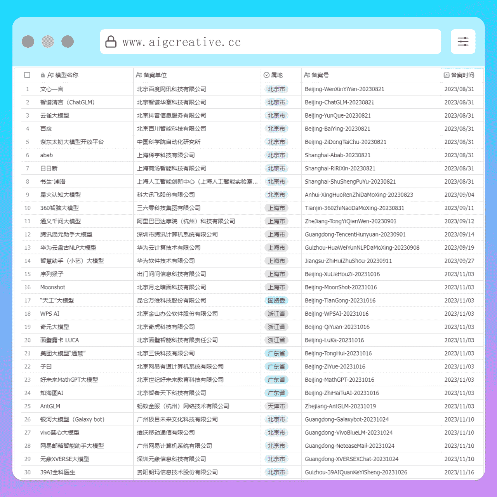

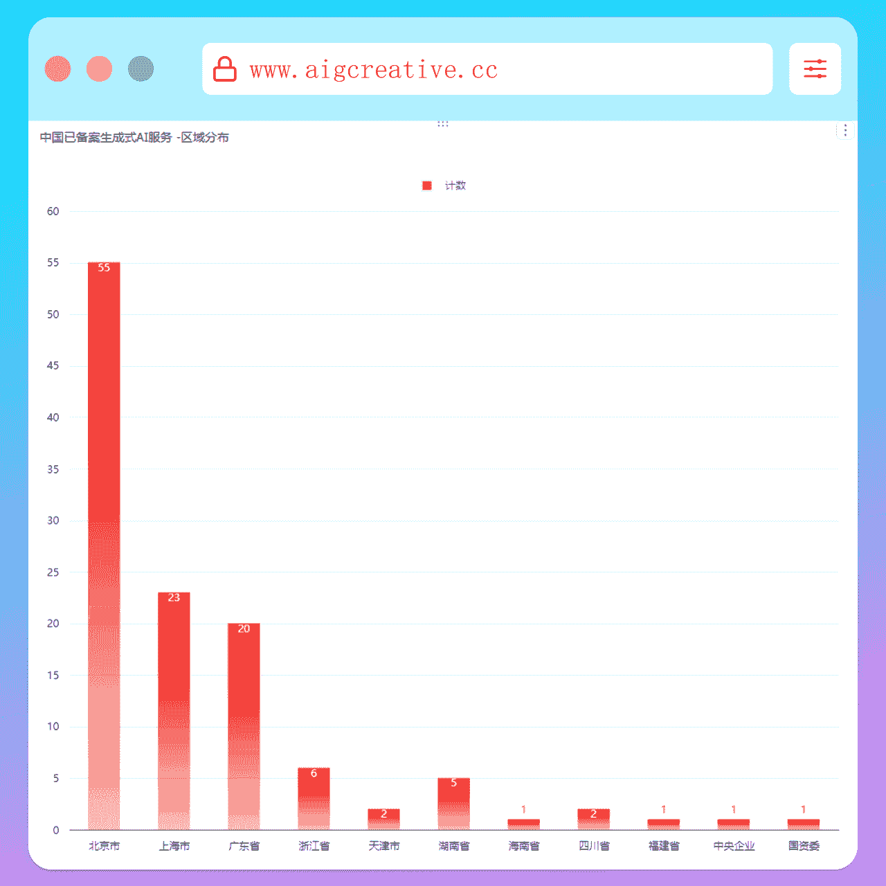

## 【20240404】动态 | AI 音乐平台 Stable Audio 2.0 发布，可生成高质量 3 分钟音乐

Stability.ai 正式发布了音频模型 Stable Audio 2.0，它可以一次性生成 3 分钟 44.1 kHz 的摇滚、爵士、电子、嘻哈、重金属、民谣、流行、乡村等 20 多种类型的高质量音乐。该模型使用了 Diffusion transformer (DiT) 替换了 1.0 的 U-Net 架构，并且使用了一个超过 80 万个音频文件组成的数据集。Stable Audio 2.0 生成的音乐可以用于商业化。

体验官网链接：<https://stableaudio.com/generate>

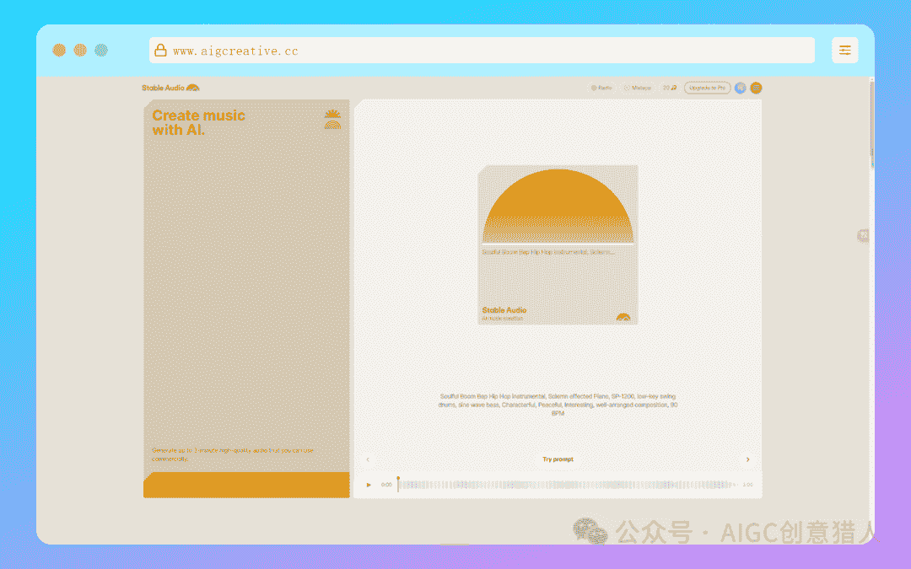

## 【20240403】动态 | MAD2024 AI基础设施地图

《2024 MAD（ML/AI/Data）领域地图》由 FirstMark 发布，介绍了当今和未来五年内 ML、AI 和数据领域中重要的基础设施、分析工具和应用。本报告从「基础设施」到「开源基础设施」、「数据源 &API」等多个方面进行详细阐述，同时对「应用」进行了广泛的分类和涵盖，如「企业应用」、「横向应用」、「行业应用」等。

点击查看：[`MAD2024AI基础设施地图.pdf`](https://aigcreative.feishu.cn/wiki/GXsawggYDiZCHbkle3LciCyKnNh?from=from_copylink)

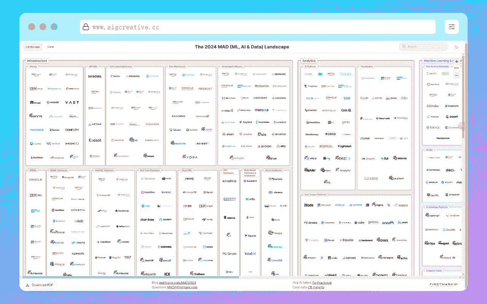

## 【20240403】动态 | OpenAI发布艺术家与Sora合作的《Worldweight》官方音乐视频

OpenAI携手艺术家August Kamp推出了名为《Worldweight》的官方音乐视频，该视频由创新的AI视频生成工具Sora制作。视频中，August Kamp分享了他对这件艺术作品的情感投入，以及如何通过音乐和视觉图像表达内心世界。该视频在YouTube上发布后，受到了广泛关注和积极反响，展示了AI技术在艺术创作领域的潜力和影响力。

+   原视频链接：<https://www.youtube.com/watch?v=f75eoFyo9ns>
+   [Sora生成视频合集-滚动更新](https://aigcreative.feishu.cn/wiki/AH9ZwOTcbixKchksKqvcGAgLnKf?from=from_copylink)ora视频全集+Prompt：

[`2b7913910c3ccd562721d0ef0aac445d(1)_raw.mp4`](https://internal-api-drive-stream.feishu.cn/space/api/box/stream/download/all/QE2Eb4H69ocROrxQyEQcBJTunhb)

## 【20240403】产品 | ChatGPT DALL·E图片编辑功能重磅更新！

DALL·E最新推出直接编辑图片功能，用户可通过选择工具和编辑提示轻松调整生成图片，如添加或删除元素、调整特定特征等，类似于Midjourney的操作。此功能已在网页端、移动设备上实现，目前处于灰度测试阶段，预计将很快全面上线。

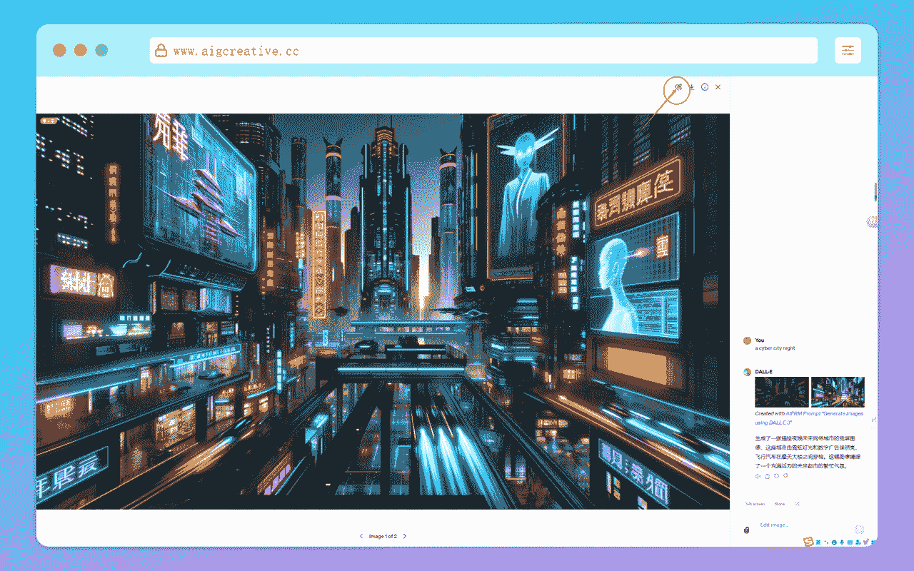

## 【20240402】公司 | 英伟达跃居全球半导体市场领头羊

在2023年第四季度，英伟达以198亿美元的销售额跃升为全球最大的半导体供应商，这一成就得益于其在人工智能领域的数据中心处理器的强劲表现。英伟达的数据中心业务和分析人工智能单元的收入大幅增长，尤其是H100显卡的推出，为大型语言模型提供了强大的计算能力。尽管面临来自UXL基金会等竞争对手的挑战，英伟达凭借其CUDA软件和庞大的开发者社区，依然保持着市场领先地位。

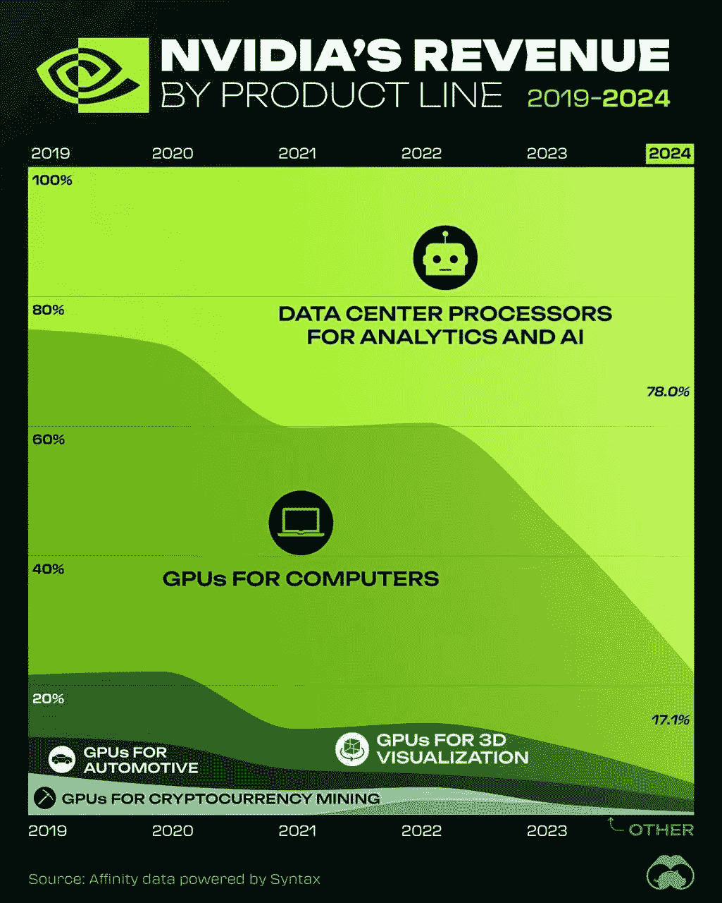

## 【20240402】动态 | OpenAI放开限制，ChatGPT 3.5无需注册，直接免费使用！

OpenAI 近期宣布，用户可以免注册直接使用其人工智能聊天机器人 ChatGPT 3.5，以便更多人接触和体验 AI 的便利。ChatGPT 已有超过 1 亿周活跃用户，用于学习、创意灵感等方面。OpenAI 采取内容保护措施以保证用户的安全和舒适度，同时推荐用户创建账号以保存聊天记录、分享有趣对话、解锁高级功能。这无疑是一则令人振奋的消息，为科技爱好者和对 AI 好奇者提供了更简单的使用途径。

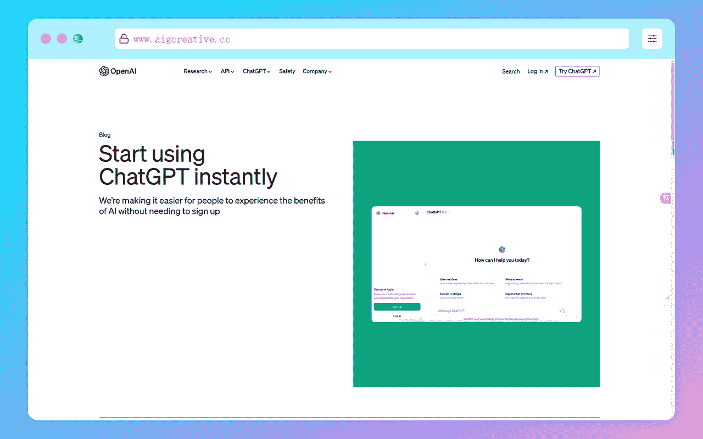

## 【20240401】产品 | 苹果公布生成式AI新进展 模型性能优于GPT-4

近日，苹果研究人员开发了一种新的AI系统ReALM，该系统可以理解屏幕上实体、对话和背景上下文的模糊引用，从而实现与语音助手的更自然的交互。ReALM的一项关键创新是使用解析的屏幕上实体及其位置来重建屏幕，以生成捕获视觉布局的文本内容。研究人员证明，这种方法与专门用于参考解析的微调语言模型相结合，可以在该任务上优于GPT-4。苹果研究人员在论文中写道：“让用户能够对屏幕上看到的内容发出查询，是确保语音助手真正免提体验的关键一步。”

<https://aigcreative.feishu.cn/sync/K4Gvd9vUQsy9Oubwqaeclu0Fnbg>
