# AI每日资讯-202403

> 来源：[https://aigcreative.feishu.cn/docx/MVWOdlIajo4Rv4xgpRTcSiX0nhe](https://aigcreative.feishu.cn/docx/MVWOdlIajo4Rv4xgpRTcSiX0nhe)

> **动态 | 观点 | 人物 | 产品 | 体验** | 应用 | 公司 | 融资 | 产业

## 【20240331】产品 | Kimi Copilot——基于人工智能的浏览器助手

它可以通过自然语言理解和生成来协助用户搜索信息、完成任务或学习新知识。该扩展程序支持多种语言，并且具有个性化定制功能。用户可以通过简单的命令与 Kimi Copilot 进行交互，享受聪明又好玩的浏览体验。

Chrome插件下载体验链接：https://chromewebstore.google.com/detail/kimi-copilot/icmdpfpmbfijfllafmfogmdabhijlehn

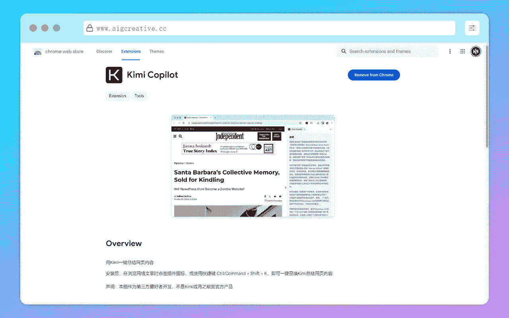

## 【20240331】产品 | PixVerse 的新特性 "Character-to-Video"

它允许用户使用一张图像创建视频角色，并且在任意场景中保持角色的一致性。首先，用户需要从 PixVerse 的主页访问该特性，然后上传所需的角色面部图像、为其命名并点击 "Create Character"。PixVerse 会在大约 20 秒内完成角色的训练。最后，用户可以通过单击 "Create"、选择角色并输入提示、选择宽高比来创建视频。文章还提供了两个视频示例和输入图像。

**要点**

+ PixVerse 引入了 "Character-to-Video" 新特性。
+ 可以使用一张图像创建视频角色。
+ 无论创建哪些场景，角色都能保持一致。
+ 使用方法：从主页访问特性 -> 上传图像 -> 命名角色 -> 点击 "Create Character" -> 等待

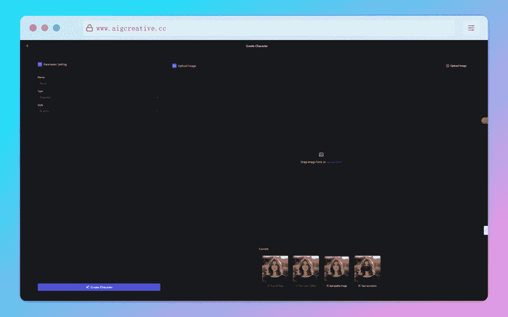

## 【20240330】产品 | OpenAI发布了名为VoiceEngine的语音合成大模型

该技术通过仅使用15秒的原始录音即可实现声音克隆，生成与目标人声音极为相似的合成语音。尽管这项技术在儿童教育和视频制作等领域展现出巨大潜力，OpenAI仍谨慎对待其潜在风险，呼吁逐步淘汰基于声音的认证系统，并采取措施保护个人声音的AI使用，同时要求使用水印追踪技术以区分合成声音，防止滥用。

详情见官网：https://openai.com/blog/navigating-the-challenges-and-opportunities-of-synthetic-voices

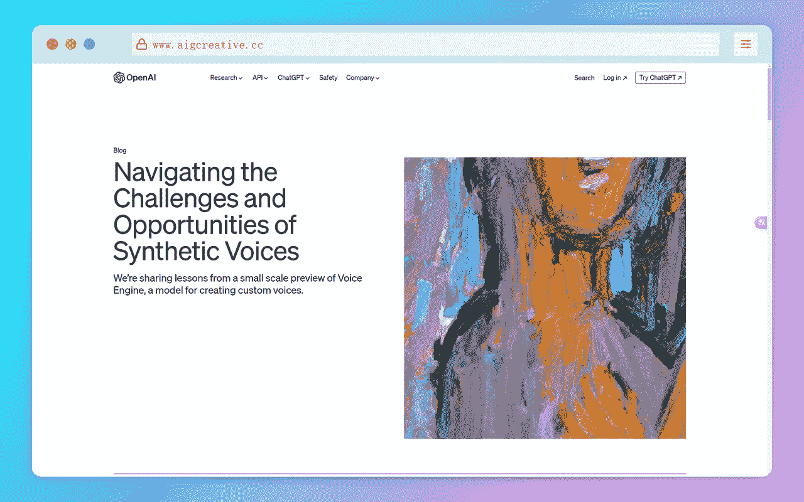

## 【20240329】动态 | 字节跳动旗下的AI创作平台Dreamina宣布开放内测

用户可以通过访问官网体验其强大的功能。在内测期间，每天的名额有限，先到先得。（内测地址：https://dreamina.jianying.com/ai-tool/home）

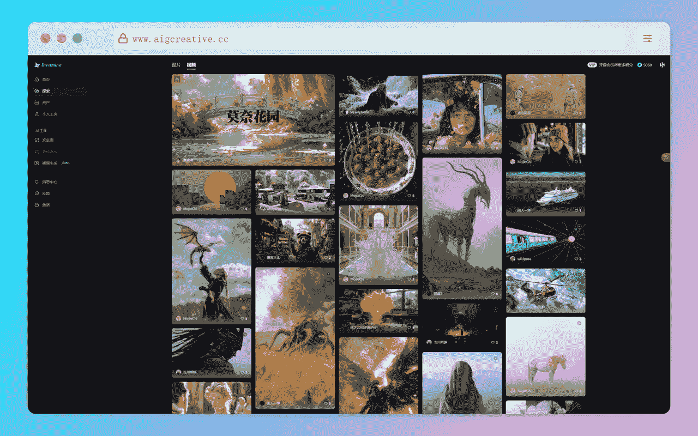

## 【20240328】产品 | Adobe新GenStudio平台成广告商AI工厂

昨天，Adobe在峰会期间宣布推出一款新的人工智能广告创作平台GenStudio，旨在让用户更轻松地使用该公司的生成式人工智能工具来开展营销活动。同时还推出了Adobe Experience的AI助手以及围绕Adobe Firefly生成式AI模型的更新。其中，GenStudio可以提供品牌套件、文案指导和预先批准的资源等内容，以及一系列AI驱动的生成工具，这些工具可以生成背景并确保整体基调保持品牌特色。

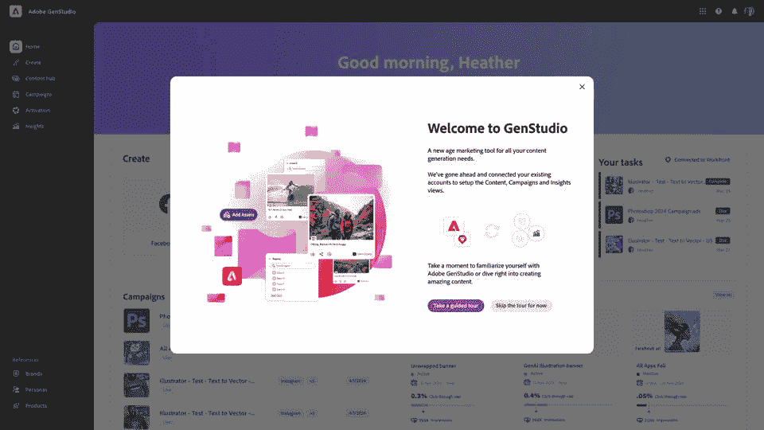

[Adobe GenStudio _ Adobe Experience Cloud.mp4](https://internal-api-drive-stream.feishu.cn/space/api/box/stream/download/all/AADkbUc2Dom8GAxL2EHcSu2Cnqd)

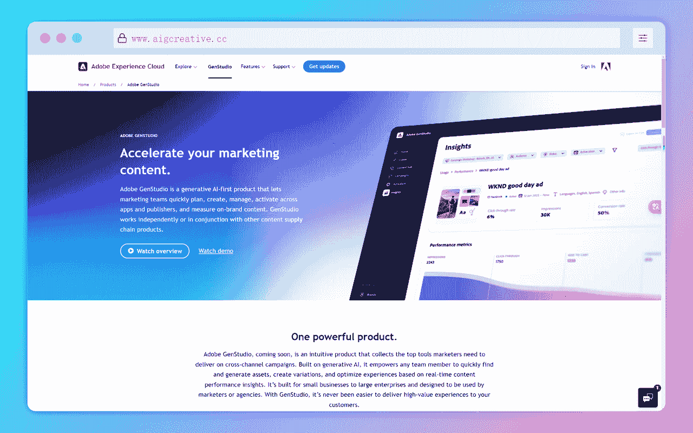

## 【20240327】产品 | 生成视频广告Arcads

官网：https://www.arcads.ai/

就是有点贵。。。

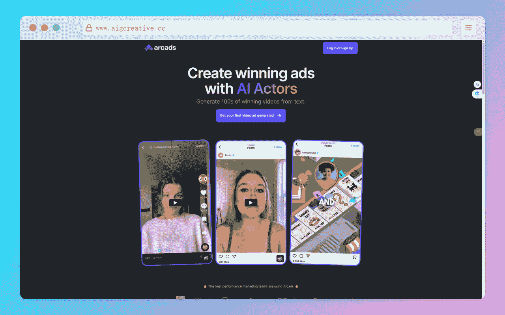

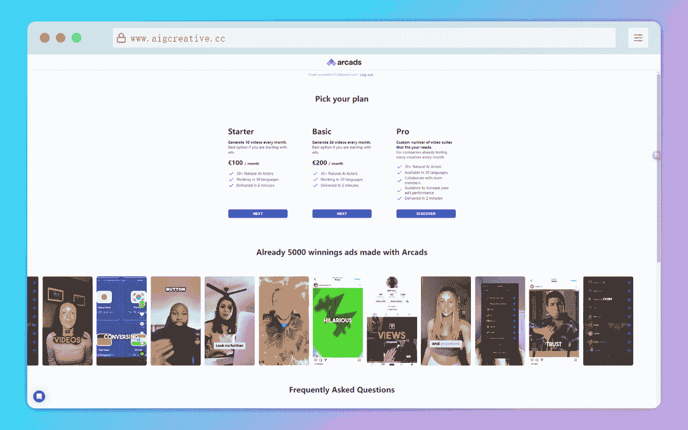

## 【20240327】产品 | 这个AI视频工具Haiper还不错啊~~高清输出，目前免费！

Haiper致力于通过其AI视频工具将用户的创意愿景转化为现实，从而释放创造力，以前所未有的方式实现创意想法。

详情及案例见链接：[Haiper](https://aigcreative.feishu.cn/wiki/Vm4bwJJhlii4SNkU9ddcb97CnOh?from=from_copylink)

## 【20240327】产品 | AI视频平台：https://kaiber.ai/

Kaiber是一个利用人工智能技术进行视频生成的平台，它可以帮助用户将文本、视频、照片和音乐转换成令人惊叹的视频作品。该平台提供了多种功能，包括音频反应性、视频转换和动画制作等，旨在提升用户的创意表达和艺术创作水平。Kaiber鼓励用户发掘内在的艺术家，通过其先进的AI生成引擎，即使是初学者也能轻松上手，同时也为专业人士提供了足够的控制空间。用户可以通过上传自己的视频和音乐，利用Kaiber的音频分析技术，将自己的创作带入新的风格和美学境界。此外，Kaiber还提供了一个名为Kaiber Studio的平台，这是一个艺术与技术创新相结合的空间，用户可以在这里体验无限的创造力，并与志同道合的艺术家们建立联系。

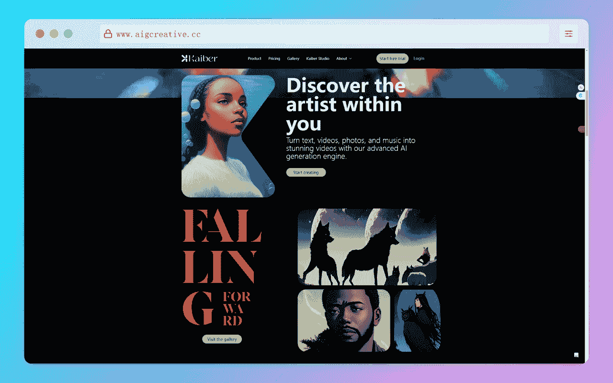

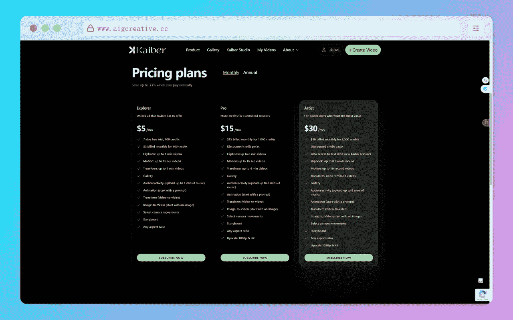

## 【20240326】动态 | 首批艺术家创作的Sora视频发布

今天凌晨，OpenAI发布了首批7个由专业艺术家使用Sora创作的短片，他们还分享了自己如何将Sora融入工作流程和业务的早期想法。多伦多的媒体制作公司shy kids称：“Sora在创造看似真实的事物方面表现出色，但更令我们兴奋的是它能够创造出完全超现实的事物。”

详情点击查看：[Sora：使用初体验！与艺术家们一起开启创意新纪元！](https://aigcreative.feishu.cn/wiki/RtgZwRmcSiKJm7klSHmcrf3knFd?from=from_copylink)

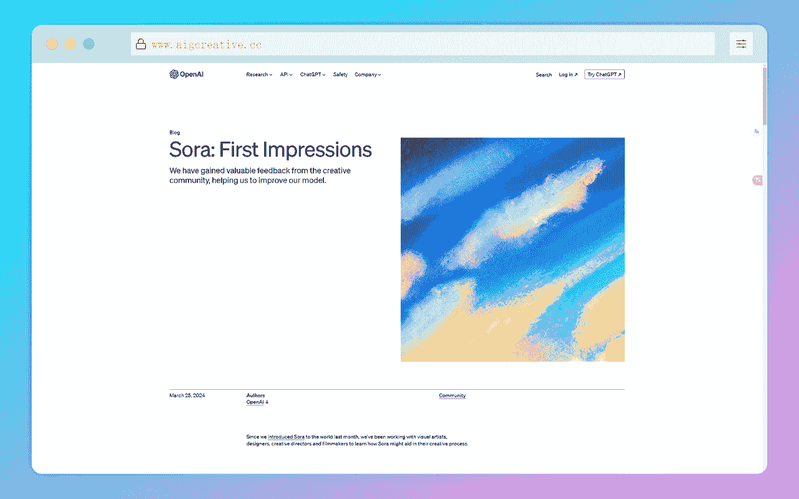

## 【20240325】产品 | Gatekeep是一个创新的在线平台

专注于通过人工智能技术将用户的文本问题转换为个性化的教育解释视频。这项服务旨在提高学习效率，特别是对于数学等学科的学习。用户可以通过Gatekeep的网页或在Discord上使用这项服务，以便更快地获取知识和理解复杂概念。该平台的特点是能够根据用户的具体需求生成视频内容，从而使学习体验更加个性化和高效。

官网体验：https://gatekeep.ai/

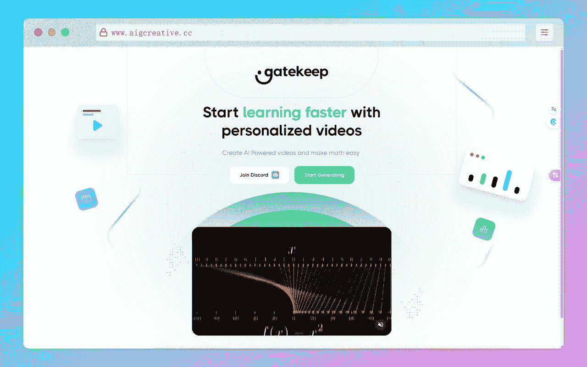

## 【20240325】产品 | 阿里还在内测阶段的电商AI种草神器🌿

大家可以去试试看，主打AI生文和AI生图两大能力，提供电商营销场景💄的解决方案。

体验网址：https://www.ihuiwa.com/

Tips：官网右上角加入官方钉钉群可以获取

体验效果：

## 【20240323】人物 | 突发！Stability AI CEO宣布辞职

今日上午，美国明星AI独角兽Stability AI发布官方公告，称今天早些时候，Emad Mostaque辞去了Stability AI首席执行官及公司董事会的职务，以追求去中心化的AI。Stability AI董事会已任命首席运营官Shan Shan Wong和首席技术官Christian Laforte为Stability AI的临时联合首席执行官。Stability AI正在积极寻找一位永久的首席执行官，以带领公司进入下一个增长阶段。

## 【20240322】产品 | 阿里通义千问免费开放1000万字长文档处理功能

3月22日消息，阿里通义千问向所有人免费开放1000万字的长文档处理功能。即日起，所有金融、法律、科研、医疗、教育等领域的专业人士，都可通过通义千问网站和APP快速读研报、分析财报、读科研论文、研判案情、读医疗报告、解读法律条文、分析考试成绩、总结深度文章。

## 【20240322】产品 | 剪映最近更新突飞猛进啊

今天看到有内测视频翻译功能，申请地址

https://bytedance.larkoffice.com/share/base/form/shrcnq7rM9EEJytIW5LKyUpVaee

审批很快的，不过目前只支持在app手机端体验，而且只支持本人的视频进行翻译，有个声音认证环节

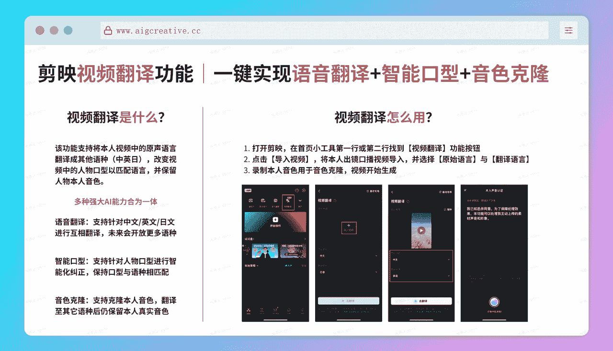

## 【20240321】动态 | AI音乐生成创企Suno发新模型，几秒生成两分钟歌曲

今天，AI音乐生成创企Suno发布文生音乐模型v3，该模型可在几秒钟内创建完整的两分钟歌曲。该工具可以通过其免费的独立网站访问，也可以通过启用Suno的第三方插件Microsoft Copilot访问。

## 【20240321】产品 | 微软利用AI Agent复现Sora

今日，微软发布视频生成多AI Agents框架Mora，利用Agent还原Sora能力，实现了文本到视频生成、文本+图像到视频生成、扩展生成视频、视频到视频编辑、连接视频和模拟数字世界等功能，目前支持生成1024*576分辨率的12秒视频。

## 【20240321】动态 | 谷歌Gemini 1.5 Pro推出API

今日，谷歌宣布其多模态大模型Gemini 1.5 Pro推出API（应用程序接口），开发者现在可以在AI Studio UI中试用。

## 【20240321】公司 | 快手CEO：半年内达GPT-4水平

快手CEO程一笑昨日在业绩电话会上谈道，快手自研大模型快意的综合性能已经大幅超过GPT-3.5，公司有信心在未来半年内达到GPT-4水平。在多模态方面，快手文生图大模型“可图”综合性能已经超过Midjourney V5。文生视频方面，快手一直有研究和投入，并在去年年底积极推进视频生成技术的专利研发，未来会把生成模型和生产者工具结合起来，帮助创作者降低创作门槛，提升短视频制作的质量和效率。

## 【20240320】公司 | Stability AI推出3D视频生成模型

明星AI创企Stability AI 宣布推出Stable Video 3D（SV3D）视频生成模型，首次将视频扩散模型应用到3D生成领域。只需要一张图，Stable Video 3D就能生成高质量3D网格。此次发布的生成模型有两个变体版本：SV3D_u和SV3D_p。其中，SV3D_u基于输入单个图像就可以生成视频，无需调节相机。SV3D_p通过单个图像和透视视图来扩展功能，并允许沿着指定的相机路径创建3D视频。Stability AI会员现在可将SV3D用于商业目的；对于非商业用途，用户可以在Hugging Face上下载模型权重及查看研究论文。

## 【20240319】公司 | 英伟达在GTC 2024上发布了其最新的AI芯片B200

点击查看：[英伟达全产品体系：从全新Blackwel架构，到能容纳32000块GPU的超级AI工厂](https://aigcreative.feishu.cn/wiki/PDr4wEE5iicBzhkIQwTctRtqnCg?from=from_copylink)

1、Blackwell GPU推出：Blackwell 的 AI 性能可达 20 petaflops，并配备192GB HBM3e显存，8TB/sec HBM带宽。采用台积电 4 纳米（4NP）工艺，整合两个独立裸晶（Die），裸晶之间通过10 TB / 秒的NVLink 5.0（NV-HBI）连接。Blackwell complex 的 NVLink 5.0 端口可提供 1.8 TB / 秒的带宽，是 Hopper GPU 上 NVLink 4.0 端口速度的两倍。此外，每个 Blackwell 裸晶(die)的浮点运算能力比 Hopper Die 高出 25%，且每个封装中包含两个 Blackwell 芯片，总性能提高 2.5 倍。

2、发布GB200，性能全面提升：架构上GB200 包含两个 B200 Blackwell GPU 和一个基于 Arm 的 Grace CPU，单个机柜内部可容纳72个GPU。NVSWITCH采用台积电4nm工艺，72端口，双向200G SerDes。在性能方面，推理大语言模型性能比 H100 提升 30 倍，在参数为 1,750 亿的 GPT-3 LLM 基准测试中，GB200 的性能是 H100 的 7 倍，而训练速度是 H100 的 4 倍。Blackwell B200 GPU与现有Hopper平台及数据中心制造商的最新解决方案相兼容，兼顾了创新与兼容性。

3、GB200光模块配比预计为1:9：因为NVLink5.0带宽翻倍，单卡双向传输带宽达到1800GB，单向对应900GB，两层网络架构下，对应GPU与光模块配比达到1:9，GB200若持续上量，有望带动1.6T光模块需求快速放量。

4、GB200使用液冷方案：GB200 NVL72 服务器提供 36 个 CPU 和 72 个 Blackwell GPU，并使用一体水冷散热方案，全部采用液冷MGX封装技术。

5、发布智能汽车&具生智能相关合作与项目：包括和比亚迪的合作，以及宣布一项名为GR00T的项目，旨在进一步推动英伟达在机器人和具身智能的突破性工作。

本次GTC大会发布GB200有望带动1.6T光模块的配比提升，销售放量。GB200搭配液冷方案，带动整体液冷在AI服务器及数据中心侧的渗透率提升。同时从单机柜功率来看将进一步提升，AIDC向高电机柜、液冷方向发展。

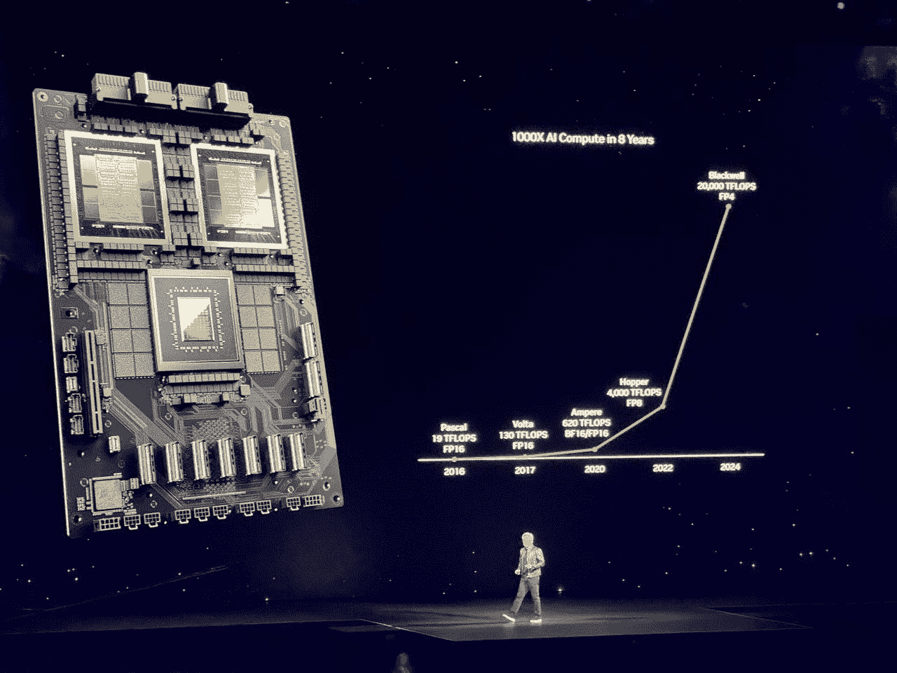

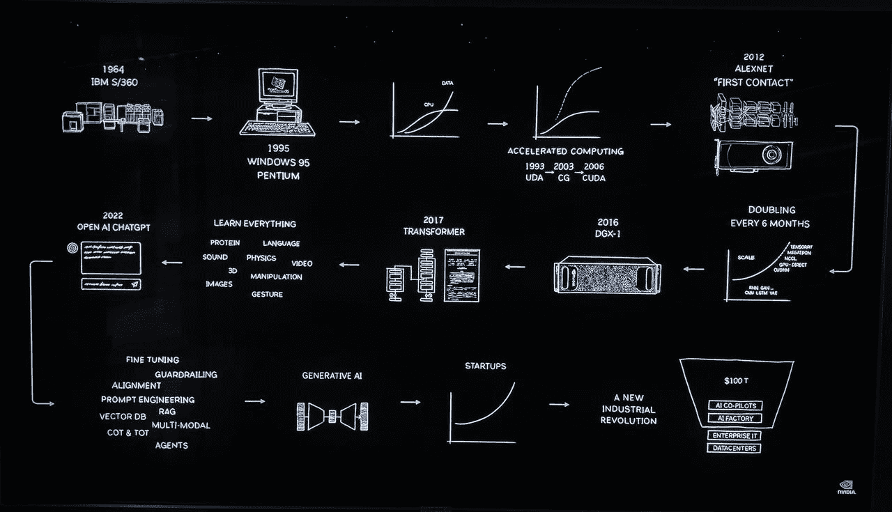

## 【20240318】产品 | Open-Sora视频生成模型开源

3月18日凌晨，潞晨科技创始人尤洋教授在X平台发文，潞晨科技旗下Colossal-AI团队开源了其Open-Sora 1.0视频生成模型，包括模型权重、训练源代码和详细的架构。该模型采用了Diffusion Transformer（DiT）架构。据了解，团队以使用了DiT架构的开源文生图模型PixArt-α为基础，引入了时间注意力层，并将其扩展到了视频数据上。

## 【20240318】公司 | 马斯克Grok大模型开源 参数量3410亿

3月18日马斯克的AI创企xAI正式发布了大模型Grok-1，其参数量达到了3140亿，超过OpenAI GPT-3.5的1750亿。这是迄今参数量最大的开源大语言模型，遵照Apache 2.0协议开放模型权重和架构。Grok-1是一个混合专家（Mixture-of-Experts，MOE）大模型。xAI称这是他们自己从头训练的大模型，Grok-1没有针对特定应用进行微调。

## 【20240315】公司 | 苹果多模态大模型研究进展公布

今天，根据预印本平台arXiv，苹果研究人员公布了最新多模态大模型研究成果MM1，这一系列模型参数最高为30B。得益于大规模的预训练，MM1具有增强的上下文学习和多图像推理等能力，可以实现少量的思维链提示。

## 【20240315】动态 | 微软推出全球222个国家和地区的Copilot Pro服务

提供1个月免费试用。Copilot Pro集成到Microsoft 365的Office应用中，比OpenAI的付费更划算。用户可定制GPT助手，优先访问最新OpenAI模型，集成到Office应用中，即将支持移动应用。

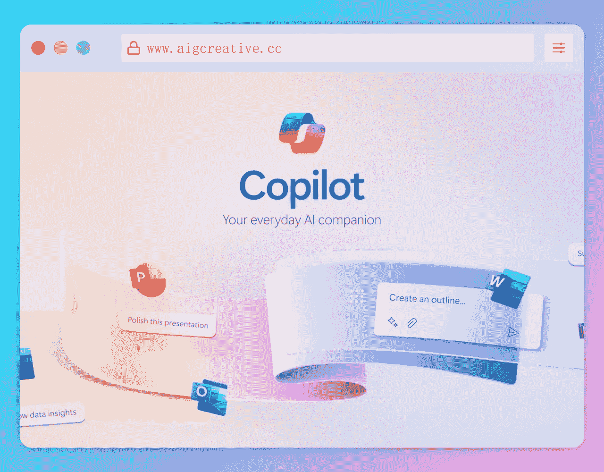

## 【20240315】动态 | a16z发布最受欢迎生成式AI榜单

ChatGPT将生成式AI带入公众视野后，市场上出现了成千上万的新型消费产品，涵盖了视频生成器、工作流程工具、创意工具和虚拟伴侣等多个领域。尽管一些早期的赢家如ChatGPT和Midjourney吸引了广泛关注，但每个月都有新的AI原生公司出现，形成了一个充满活力的市场。

与2023年9月的初始报告相比，现在有超过40%的公司是新出现的。此外，网络和移动Gen AI产品被分为两个单独的列表，以便更全面地研究顶级AI移动应用的领域。数据显示，消费者在网络和移动设备上与Gen AI互动的方式存在明显差异。

**以下是两个主要的榜单：**

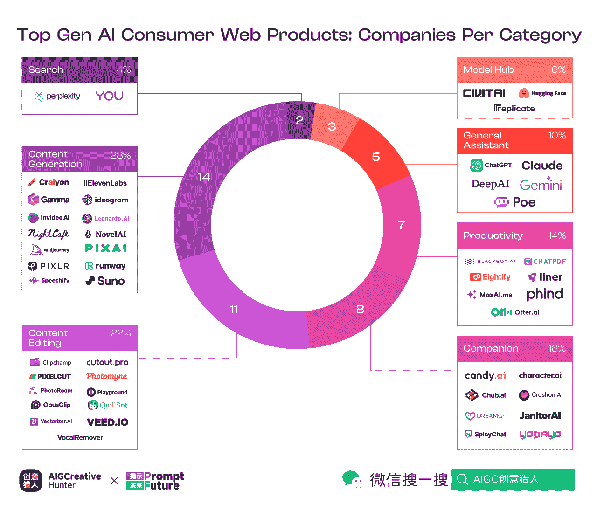

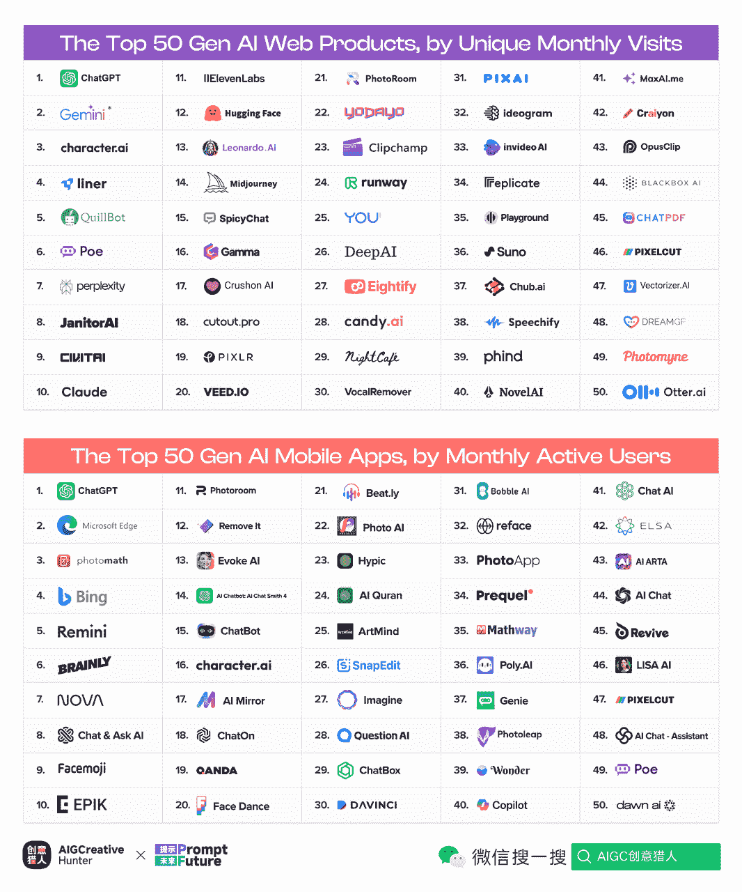

## 【20240315】动态 | Claude 3 Haiku正式上线

Al大模型创企Anthropic发布了Claude3Haiku，这是同系列中速度最快且最实惠的型号，该模型现已与Sonnet和Opus一起在Claude APl和claude.ai上为Claude Pro订阅者提供。

## 【20240315】公司 | 谷歌DeepMind最新发布了SIMA智能体

一个能在3D虚拟环境中遵循自然语言指令执行任务的通用AI智能体。SIMA通过与多家游戏工作室合作，在多款游戏中接受训练，展示了其在理解游戏世界和执行复杂任务方面的能力。无需访问源代码或定制API，SIMA仅凭屏幕上的图像和简单指令，就能控制游戏角色。尽管在测试中表现优异，谷歌DeepMind仍表示，SIMA需要进一步研究以提升至人类水平。

详情点击：https://deepmind.google/discover/blog/sima-generalist-ai-agent-for-3d-virtual-environments/

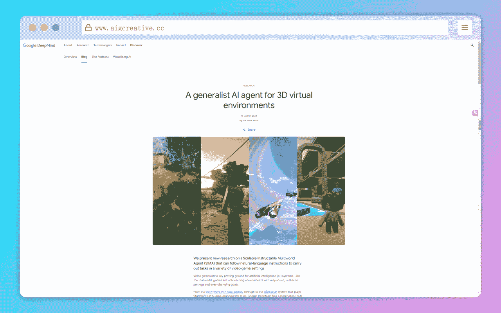

## 【20240314】产品 | 阿里通义千问发布创新文档解析服务：千万字级处理能力，助力高效学习和研究

阿里通义千问近日推出了一项创新的免费文档解析服务，旨在大幅提升长文档处理能力。这项服务能够解析包括网页、文档、论文和图书在内的多种类型资料，单个文档处理量可达1000万字，同时支持快速阅读和分析高达100份不同格式的资料。用户可通过官网或APP上传文档，进行提问和获取摘要，极大地节省了阅读和检索的时间。此外，该服务还支持在线网页内容的快速解读和要点总结，使得信息获取变得更加高效和便捷。这一功能现已在通义千问的官网和APP上线，为考试复习、文献研究等提供了强大的辅助工具。

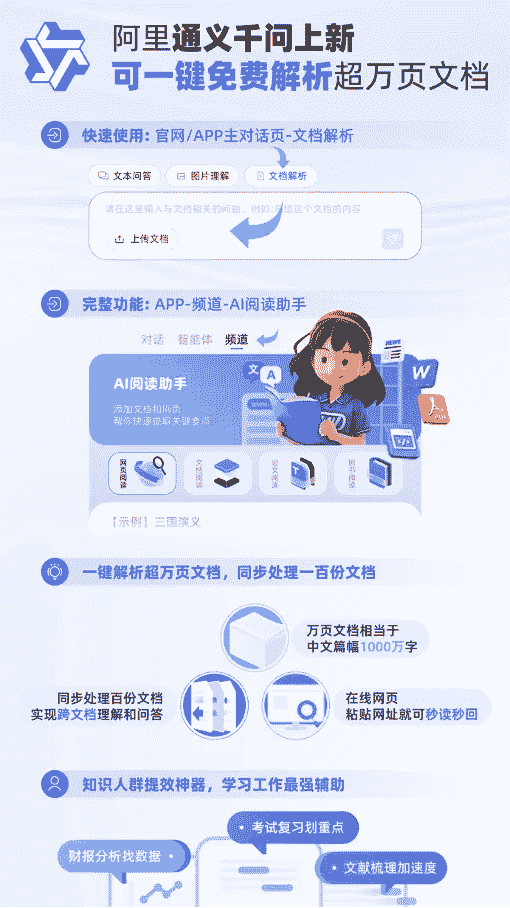

## 【20240314】公司 | OpenAI与Figure公司合作仅用13天时间便展示了人形机器人

OpenAI与Figure公司合作，仅用13天时间便展示了人形机器人的显著智能进步，该机器人能与人类流畅对话并执行复杂任务。这一成果基于端到端的大语言-视觉模型，标志着具身智能领域的重大突破。同时，OpenAI在机器人领域的其他投资和合作项目也显示了其在智能技术方面的雄心壮志。Figure公司已与宝马达成合作，并计划推出大规模的模型驱动人形机器人，预示着智能机器人技术的未来发展潜力巨大。

[3.14 (2).mp4](https://internal-api-drive-stream.feishu.cn/space/api/box/stream/download/all/HD6YbBd68oVXgzxa5dYc7d1knPc)

## 【20240313】公司 | 全球首个AI软件工程师发布 华人AI创企打造

由华人团队创办的Cognition AI今日宣布推出世界上首个全自主AI软件工程师Devin，据悉能在几分钟内独立完成整个软件项目。随着其在长期推理和规划方面的进步，Devin可计划和执行需要数千个决策的复杂工程任务，能够在每一步中回忆起相关的上下文，随时间推移学习并修正错误。Cognition AI团队共10人，其中8位是华人，已获得由Founders Fund领投的2100万美元A轮融资。

### 补充

Cognition AI 是一家专注于开发先进人工智能技术的初创公司，其目标是创造能够执行编程任务的AI系统。该公司由一支拥有丰富编程竞赛经验和深厚技术背景的团队创立，其中包括多位国际信息学奥林匹克（IOI）金牌得主。Cognition AI 的首席执行官Scott Wu和他的弟弟Neal Wu都是经验丰富的软件工程师和商业人士。

Cognition AI 最引人注目的成就之一是开发了全球首位AI软件工程师Devin。Devin是一个全栈AI编程助手，具备自主学习不熟悉技术的能力，能够端到端地构建和部署应用程序，自主修复bug，甚至训练和微调自己的AI模型。Devin在SWE-bench测试中表现出色，正确处理问题的比例高达13.86%，远超过其他AI模型。

Cognition AI 的团队成员背景多样，包括连续创业者、资深AI系统工程师以及在哈佛大学等顶尖学府受过良好教育的专业人士。该公司已经从包括硅谷大佬Peter Thiel领投的Founders Fund在内的知名投资机构获得了2100万美元的投资。

Cognition AI 的愿景是通过其创新的AI技术，推动编程和软件开发领域的进步，同时也为人工智能的未来发展探索新的可能性。他们的工作不仅在技术上取得了突破，也引发了关于AI与人类工作关系、AI技术的未来应用以及相关伦理问题的广泛讨论。

## 【20240312】动态 | 沃顿商学院发布教学提示词库

沃顿商学院发布了一个专门用来教学的提示词库，里面包含了非常多用于学习和教育的提示词，同时也有一些其他很有用的提示，比如密度链总结、因果关系解释、产品发布提示和学术论文创建。

点击文档查看：[沃顿商学院发布教学提示词库](https://aigcreative.feishu.cn/wiki/J1lOwWtoDig74kk5WEWcI00dnt5?from=from_copylink)

## 【20240312】动态 | Midjourney 人物一致性功能已上线

### 功能操作说明

使用`--cref URL`命令，并在后面加上人物图片的URL，来设定人物参考图像。

可以通过`--cw`命令调整参考强度，范围从100到0。

默认强度为100（`--cw 100`），此时会尽可能匹配面部、发型和服装。

强度设为0（`--cw 0`）时，主要集中于面部特征（适用于更换服装或发型等场景）。

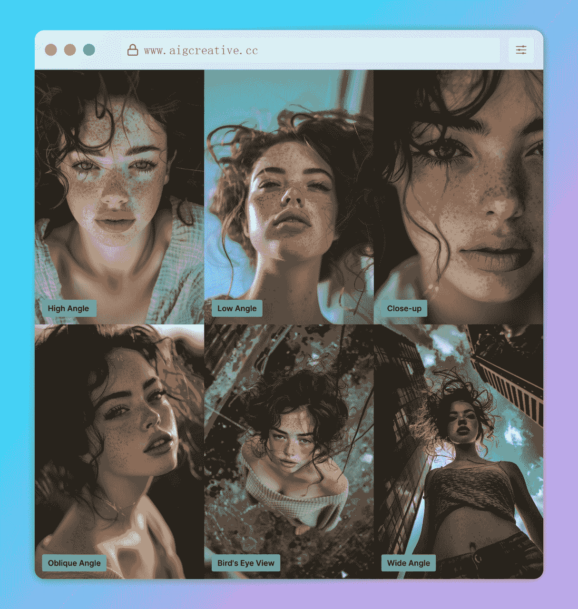

### 适用范围

这项功能主要适用于使用Midjourney图像创建的角色，不建议用于真实人物/照片（可能会像常规图像提示一样产生扭曲）。

`cref`的工作原理类似于常规图像提示，但它会“专注”于角色特征。

这项技术的精确度有限，不会复制确切的酒窝、雀斑或T恤标志等。

`cref`适用于Niji和普通MJ模型，也可以与`--sref`结合使用。

### 高级功能

可以通过`--cref URL1 URL2`这样的方式，使用多个URL来混合多个图像/角色的信息（类似于多个图像或风格提示）。

在web alpha版本上的使用：

将图片拖放或粘贴到想象栏中，现在有三个图标。选择这些图标之一可以设置图片是作为图像提示、风格参考还是角色参考。按住Shift并选择一个选项，可以将一张图片用于多个类别。

Midjourney提醒用户，由于MJ V6目前还处于alpha阶段，这项功能以及其他功能可能会突然改变。不过，V6的官方beta版本即将推出。Midjourney欢迎大家在⁠ideas-and-features⁠中分享自己的想法，并希望这个早期版本的发布能帮助用户在构建故事和世界时有更多的玩法。

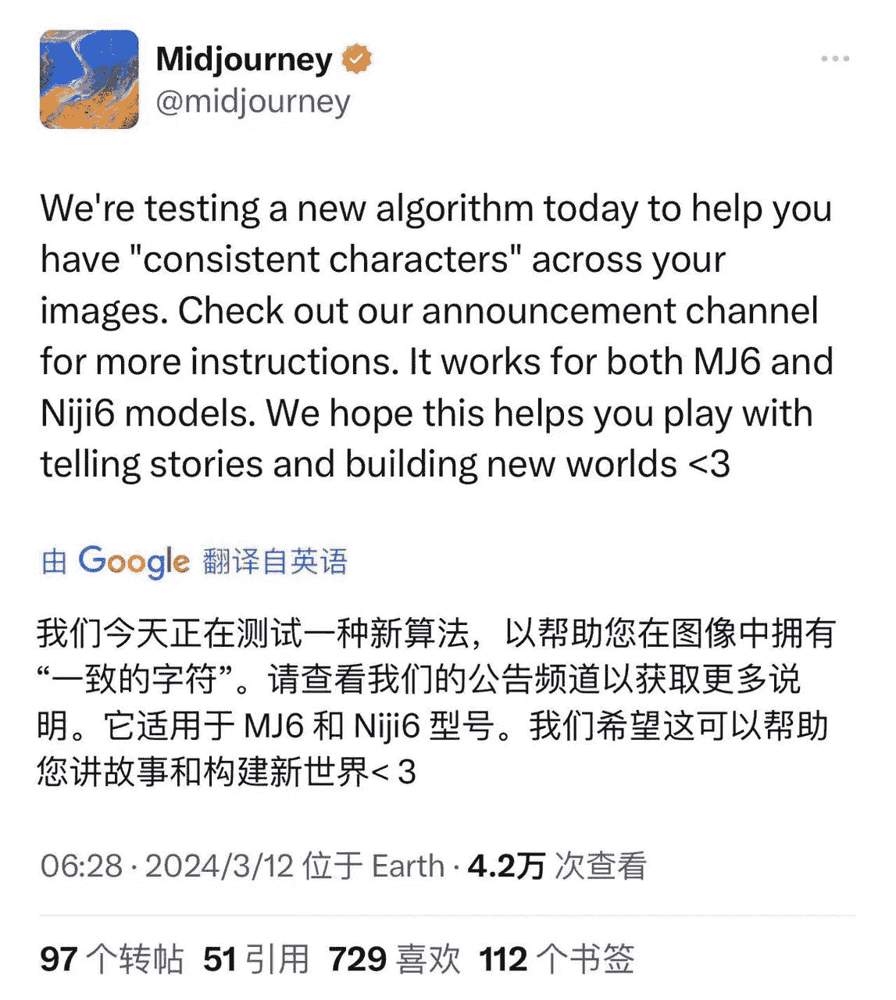

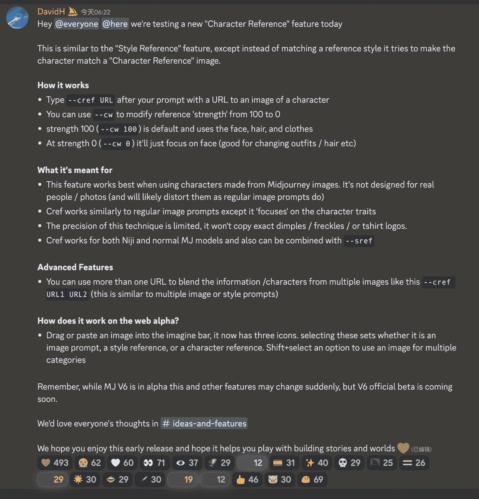

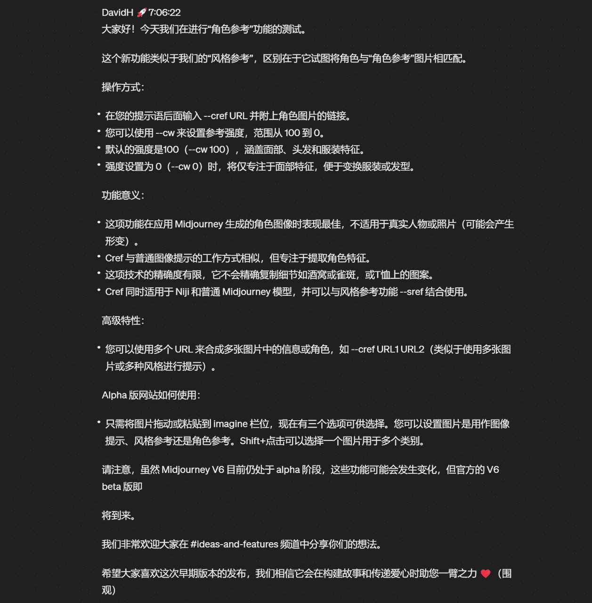

## 【20240311】动态 | 马斯克宣布本周开源AI聊天机器人Grok

马斯克在社交平X上发帖，他宣布xAI本周将开源AI聊天机器人Grok。

同时，他还在推文下回复：“OpenAI是一个谎言。”

## 【20240311】动态 | 摆脱Discord！Midjourney Alpha官网直接出图使用

网址：https://www.midjourney.com/imagine

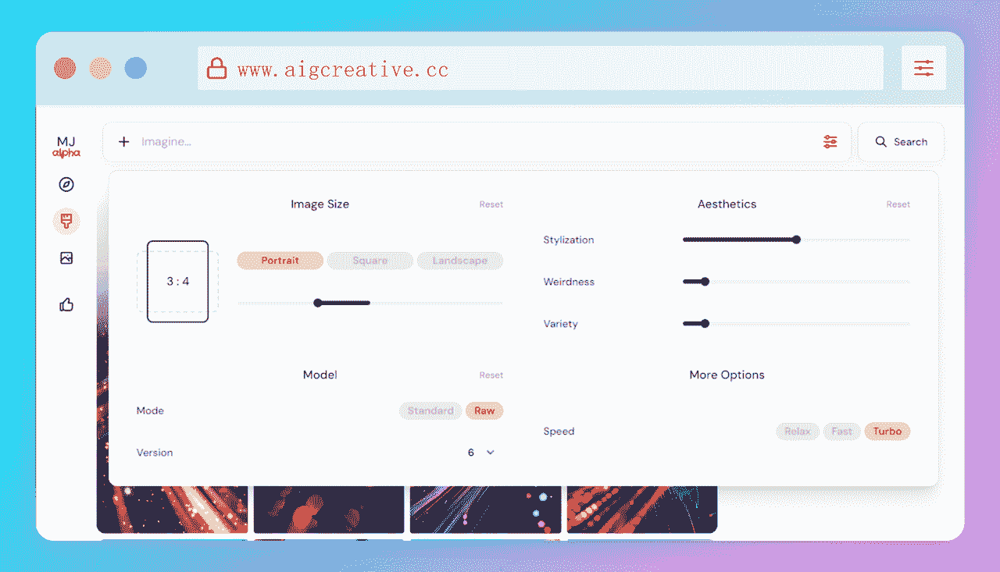

## 【20240310】动态 | 二合一！Pika推出AI配音工具Sound Effects

Pika昨日在社交平台X上宣布推出AI配音工具Sound Effects，支持在Pika上为视频生成配套的音效。目前，Pika提供两种生成视频音效的方式，用户可以描述期望的声音让AI生成相应的音效，或者是让Pika直接根据视频内容匹配相应的音效。据Pika透露，目前该功能仅对超级合作者和Pro用户开放测试，很快向所有用户推出。

官方：我们将推出Pika的音效。现在，您可以无缝生成声音并将其集成到视频中。要么提示你想要的声音，要么让Pika根据你的视频内容自动生成它。如果这听起来很棒，那是因为它确实很棒。

官网体验：https://pika.art/

[X2Twitter.com_1766553762921947136(720p).mp4](https://internal-api-drive-stream.feishu.cn/space/api/box/stream/download/all/B1XAb6cZXoofGTx7DGpcSUkunj0)

[WeChat_20240310110322.mp4](https://internal-api-drive-stream.feishu.cn/space/api/box/stream/download/all/M2Dxb2YK2o91lpxHJrEcnkn9nxc)

[X2Twitter.com_1764381708017696768(1080p).mp4](https://internal-api-drive-stream.feishu.cn/space/api/box/stream/download/all/AClXbxD5hoVY4wxHbpacsTpdnVf)

[_sfx.mp4](https://internal-api-drive-stream.feishu.cn/space/api/box/stream/download/all/RJn2bWGw3o7R5Vx7ciecjnXSnJd)

## 【20240309】动态 | Gemini新增修改提示功能

谷歌Gemini近日上线了一个新功能，用户可以根据Gemini的提示，在已经输入的提示词基础上进行词语修改。当用户选中Gemini提示信息时，页面会出现一个菜单，帮助用户调整所选文本。例如，用户最初输入的提示是“计划以中央公园为中心，安排纽约3天的旅行”，然后用户选中“3”后，可以直接将其更改为“4”，Gemini会根据最新的提示信息给出对应的回答。

## 【20240308】动态 | 全球最强模型Claude 3颠覆物理/化学！2小时破解博士一年实验成果，网友惊呼：科研不存在了

Claude 3 AI显示了惊人的能力，能够轻松破解和实现多个学科领域，包括化学、物理和语言学等高级学术研究，令科研人员和语言专家震惊。

### 要点提炼

1. Claude 3 AI凭借低成本和快速响应在化学、物理和语言学研究中展现出与博士层面相当的专业能力，挑战了传统的科研方法和教育系统。

2. 在无需复杂实验的情况下，Claude 3提供了先进的科学解决方案，如在化学研究中提供微胶囊化技术，速度远快于一线化学家。

3. 物理学领域，Claude 3能够理解和复现高级量子物理论文，并且在量子算法的预测上表现出色，甚至能解读尚未公开发表的研究。

4. Claude 3在语言学领域表现惊人，能够处理极其稀有和古老的语言，例如切尔克斯语和帕提亚语，翻译和语法分析的准确度超越现有技术。

5. 网友和科研工作者对Claude 3的表现提出了混合反应，从震惊、不安到对未来科研和教育变革的展望。

原文链接：https://mp.weixin.qq.com/s/Z54kt9wmM29iO8zLrlW1Rw

## 【20240308】产业 | 鸿海将拿下苹果2万台AI服务器订单

今年鸿海将拿下苹果2万台AI服务器订单，其中英伟达H100服务器占比高达40%-50%。鸿海集团旗下工业富联自2021年就开始与苹果合作发展服务器，并在2023年中旬开始小量批次出货苹果。鸿海今年有机会获得英伟达最新的B200订单。

## 【20240307】应用 | OOTDiffusion（图像生成-小i研究院）

为任意人体和服装图像生成高质量的着装图像，实现高保真度和可控性的虚拟试穿。

开源地址：https://github.com/levihsu/OOTDiffusion

体验链接：https://ootd.ibot.cn/

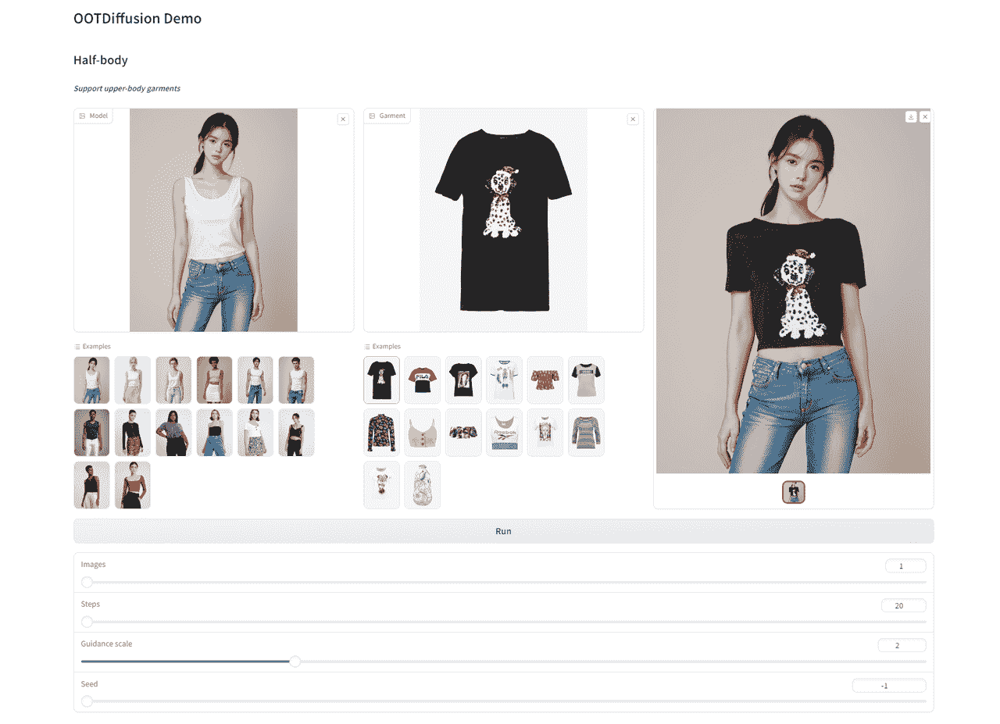

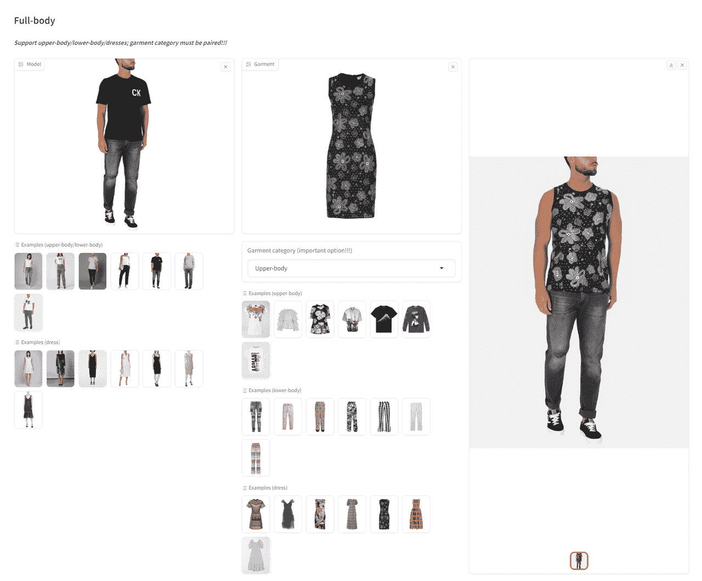

## 【20240307】观点 | 朱啸虎讲了一个中国现实主义AIGC故事

金沙江创投主管合伙人朱啸虎很快对美版AIGC故事丧失了兴趣。他随即决定不再和美国同事开原定每周一次的远程例行会议，探讨两边大模型产业格局变化。“打了半年我不打了，没有意义。”他说。

中国科技界针对大模型的态度已分裂成两股阵营。一股是技术信仰派，他们大多技术出身，认为应该像OpenAI一样信仰AGI、信仰scaling law（规模定律），思维更偏硅谷。在他们眼中，随着模型能力跃升、模型成本降低，过程中会解锁丰富的应用。倘若不追求“更大更强的AI能力”，一旦其他人的模型飞跃，很快会降维碾碎现有根据地与护城河。

另一股是市场信仰派，他们信奉陡峭的技术曲线终有放缓的一天，只需将“足够的AI能力”投入可以快速变现的商业场景中，用中国市场庞大而独特的数据构筑壁垒。这类人往往在中国丛林式的商场中浸泡更久，思维更偏本土。

......

原文链接：https://mp.weixin.qq.com/s/4111julSNH4XPXsUc8XEXA

AI对朱啸虎的各条观点总结如下：

1. **技术与市场信仰**：他指出中国科技界在大模型问题上分为技术信仰派和市场信仰派，前者倾向于追求更强大的AI能力，后者更注重将AI技术应用于商业场景中。

2. AIGC PMF（产品市场匹配）：当前在AIGC领域，找到真正的产品市场匹配非常困难，即使投入大量人力物力，也可能难以找到。

3. **美国AIGC故事的态度**：对美版的AIGC故事持怀疑态度，认为其在中国市场的应用前景并不明朗，他更关注实际的应用场景和商业变现。

4. **对AIGC应用的态度**：中国的AIGC应用已经大爆发，但这些应用主要是面向企业（to B），而不是面向消费者（to C）。

5. **开源模型与闭源模型**：虽然目前闭源模型在技术上领先，开源模型在未来有可能缩小甚至拉平与闭源模型的差距，这使得现在投入闭源模型开发的公司可能面临尴尬处境。

6. **对大模型态度**：大模型产业持谨慎态度，他认为这些公司缺乏实际应用场景和足够的数据支持，因此难以产生真正的价值。且估值过高。大模型领域投入巨大但回报难以预料，尤其是在科研方面的投入，一旦其他公司开源了类似技术，所有的投入都可能付诸东流。确表示不会投资任何中国的大模型公司。

7. 对AGI（通用人工智能）实现的看法：目前看来，至少在5到10年之内，实现真正的AGI是不可见的。他认为，实现智力级别的提升首先需要能量级别的提升，而地球在可控核聚变实现前可能没有足够的算力来实现AGI。

8. **对技术迭代曲线的预测**：技术迭代曲线GPT-5以后基本会放缓，大模型的发展将面临成本和能耗的挑战。就像PC行业的发展历程一样，初期看似美国的技术领先，但随着时间的推移，技术发展的速度会逐渐趋于平稳。

9. **对创业者的评价**：欣赏那些思路清晰、表达直接的创业者，他们能够在短时间内讲明白自己的商业模式和市场机会。

10. **对大模型创业的观点**：在当前资本环境下，大模型创业需要非常现实的考量，不能像资本泡沫时期，或者上一代AI创业时期那样有容错能力，所有公司都需要在不烧钱的情况下运营。

11. **对大模型应用创业的观点**：建议创业者不要在别人的基础上构建业务，而应该专注于自己的数据和应用场景。

12. **投资策略**：当前的投资环境更加理性，投资人和创业者都更加注重实际的商业成果。强调投资时的现实主义，主张不烧钱，寻找具有明确产品市场匹配（PMF）的项目，并关注企业的自我造血能力。倾向于投资那些能够迅速商业化、具有实际应用价值的技术。

13. **个人投资哲学**：强调数字驱动的投资决策，不轻易被故事所吸引，更注重实际的市场数据和用户反馈。不认为大厂和政府应该支持人类梦想与科学研究，而是应该让市场来决定。

14. **对错过项目的看法**：认为这偏玄学了，错过字节跳动等项目损失很大，但是事后复盘也依旧说不不了自己，创始人类型和业务类型，都不是成为超级独角兽的可能。内敛的创业者类型是他难以理解的。

## 【20240307】动态 | 零一万物开源Yi-9B模型

国内大模型独角兽零一万物宣布开源Yi-9B模型，Yi-9B的实际参数为8.8B，默认上下文长度是4K tokens。零一万物公布的数据显示，在综合能力方面（Mean-All），Yi-9B 的性能超越了DeepSeek-Coder、DeepSeek-Math、Mistral-7B、SOLAR-10.7B和Gemma-7B；在代码能力方面（Mean-Code），Yi-9B的性能仅次于DeepSeek-Coder-7B，超越了Yi-34B、SOLAR-10.7B、Mistral-7B和Gemma-7B；在数学能力方面（Mean-Math），Yi-9B的性能仅次于DeepSeek-Math-7B，超越了SOLAR-10.7B、Mistral-7B和Gemma-7B；在常识和推理能力方面（Mean-Text），Yi-9B的性能与Mistral-7B、SOLAR-10.7B和Gemma-7B不相上下。

## 【20240307】融资 | AI搜索创企Perplexity将敲定新融资 估值或达10亿美元

据《华尔街日报》援引知情人士消息称，AI搜索创企Perplexity即将敲定一笔新的融资交易，估值约为10亿美元，较几个月前的最新融资估值大约翻了一番。Perplexity成立于2022年，主要产品是通过大模型的能力为用户搜索查询提供直接答案。从2022年9月到今年1月，Perplexity的融资总额已经超过1亿美元，彼时公司整体估值达到5.2亿美元。

## 【20240306】动态 | Hugging Face开源最大地球观测数据集

开源社区Hugging Face联合创始人兼CEO克莱门特·德朗格（Clam Delangue）宣布，Hugging Face与欧洲航天局开源了有史以来最大的地球观测数据集Major TOM Core，该数据集覆盖了整个地球的大约一半，其中包含224.5886万个1068x1068的像素块。

## 【20240306】产品 | 微软首批AI PC将于3月21日发布

据外媒Window Central报道，微软将于3月21日发布Surface Pro 10和Surface Laptop 6，将成为微软首批AI PC产品，并且下一代Windows 11 AI功能将于今年秋季推出。这些设备将配备基于英特尔酷睿Ultra或高通Snapdragon X Elite的处理器，搭载最新NPU，以增强AI功能。新品将搭载“AI Explorer”功能，AI Explorer可以在任何应用程序上运作，用户可以使用自然语言搜索文档、网页、图像和聊天。

## 【20240306】产品 | 抖音上线AI社交APP“话炉”

抖音上线了AI社交APP“话炉”，由字节的Flow部门打造。“话炉”是一款基于字节旗下云雀大模型驱动的角色聊天产品，用户可以与不同AI角色实时聊天互动。

## 【20240306】应用 | ComfyUI多端整合包Comflowy

使用ComfyUI的小伙伴，可以试试这个

多端整合包：https://www.comflowy.com/zh-CN/space

或者https://github.com/6174/comflowyspace

+   UI极度舒适，操作有优化
+   实现工作流高效管理
+   模板库、模型库、扩展库直达

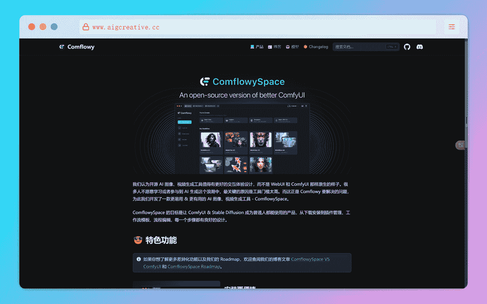

## 【20240305】产品 | Stability AI 与 Tripo AI合作发布TripoSR：单图秒变3D！

Stability AI与Tripo AI合作开发了TripoSR，这是一种快速的 3D 物体重建模型，其灵感来自于 LRM 最近的工作：用于单图像到 3D 的大型重建模型。这种新的图像到 3D 模型旨在满足娱乐、游戏、工业设计和建筑专业人士不断增长的需求，并提供响应式输出以可视化详细的 3D 对象。

+   速度快：A100上仅需0.5s就可生成高质量3D
+   硬件要求低：即使没有GPU也可生成
+   模型权重和源代码已开源：MIT许可，允许商业化、个人和研究使用

TripoSR体验官网：https://www.tripo3d.ai/app

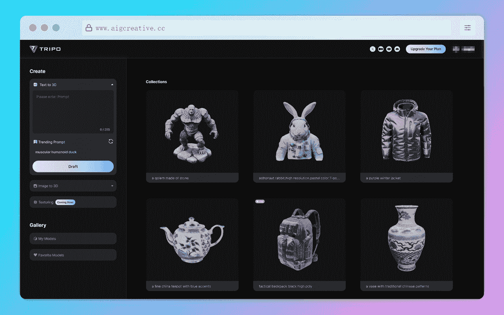

官网介绍链接：https://stability.ai/news/triposr-3d-generation

项目地址：[https://github.com/VAST](https://t.co/XiD9QMxXVB)-AI-Research/TripoSR

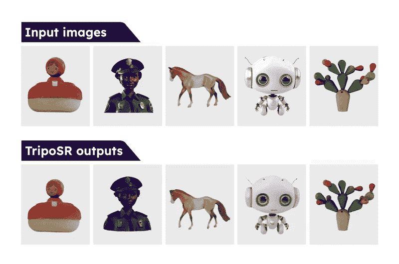

## 【20240305】动态 | ChatGPT新增文本朗读功能

OpenAI今日宣布ChatGPT上线“朗读”功能，可将对话文本内容读出声。

在iOS或安卓系统上的操作方式是点击并按住消息，然后点击“Read Aloud（大声朗读）”按钮。OpenAI也在网页端滚动，用户可点击消息下方的“Read Aloud”按钮。

## 【20240305】产品 | Anthropic宣布推出Claude 3模型系列，性能全面超越GPT4

1. Anthropic推出Claude 3系列，超越GPT-4，包括三款性能递增模型：Haiku、Sonnet、Opus，提供先进智能和成本效益平衡；
2. Claude 3具备高级多模态能力，实时支持聊天、自动完成、数据提取，速度快且准确性高，特别是Opus模型在智能水平大幅提升；
3. 引入强大的视觉处理能力，减少拒绝回答率，提高长上下文处理和记忆能力，Opus在复杂问题上准确性提高两倍。

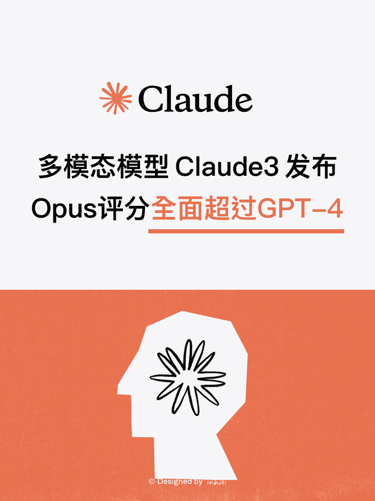

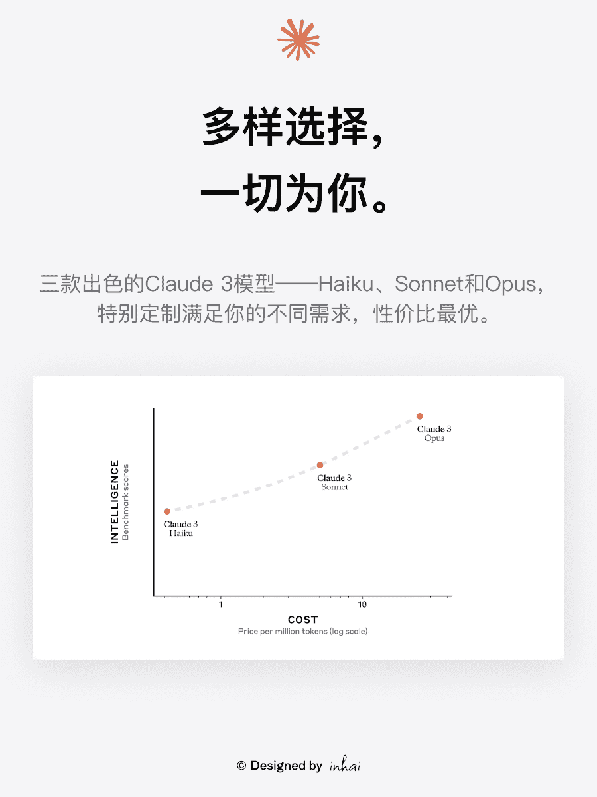

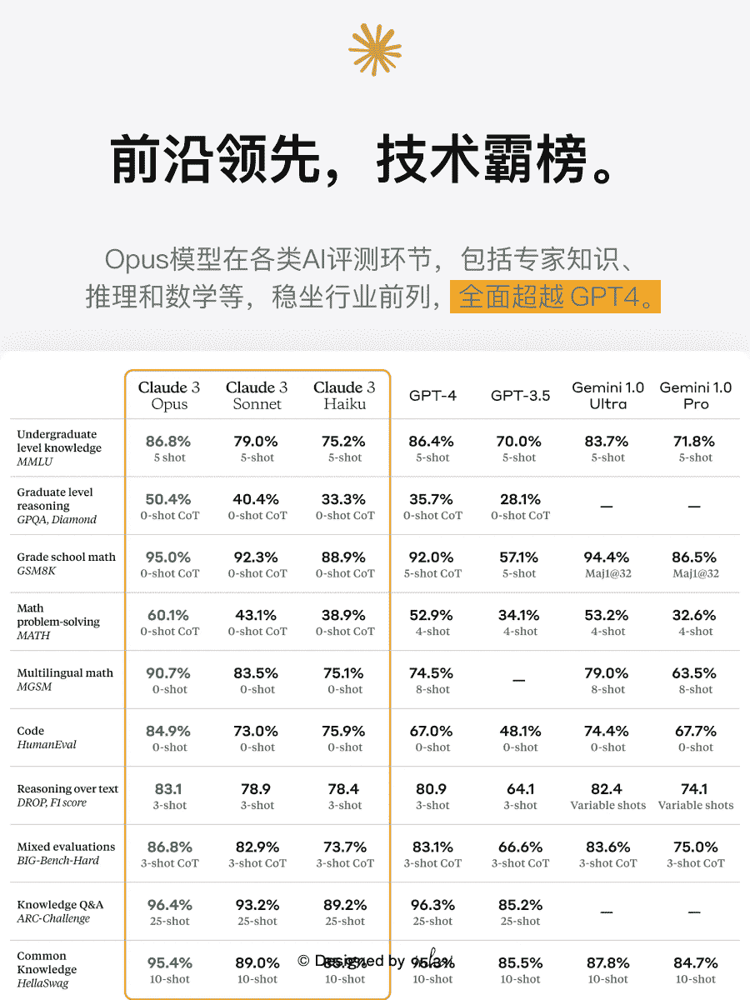

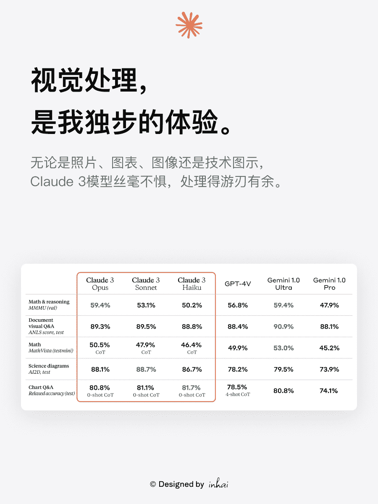

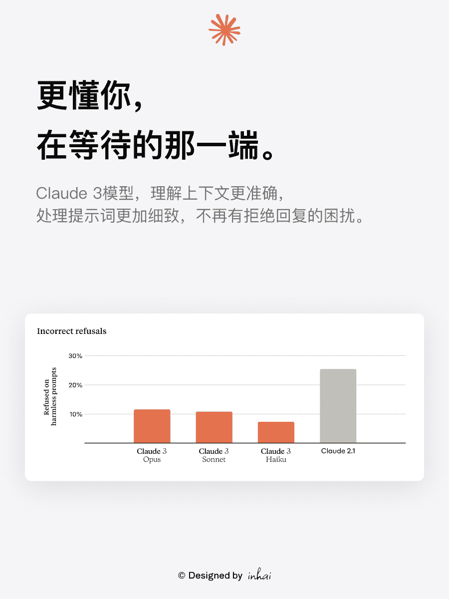

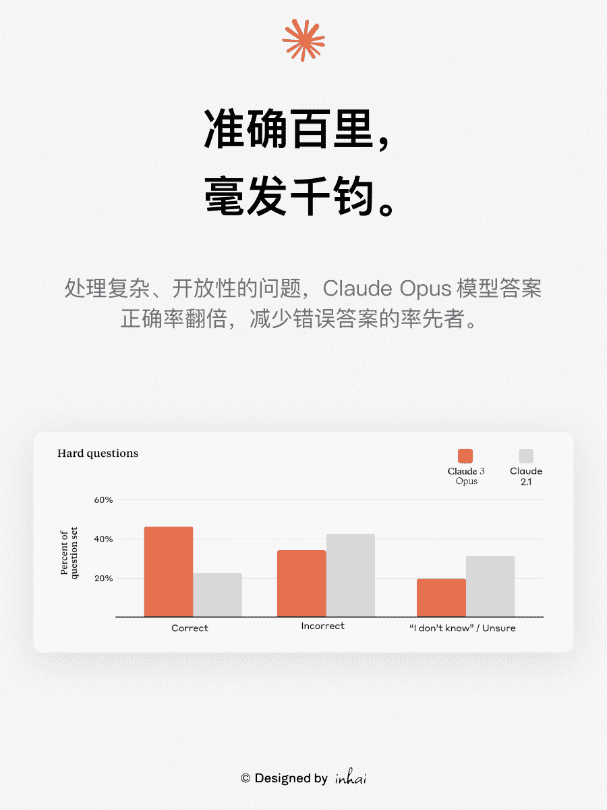

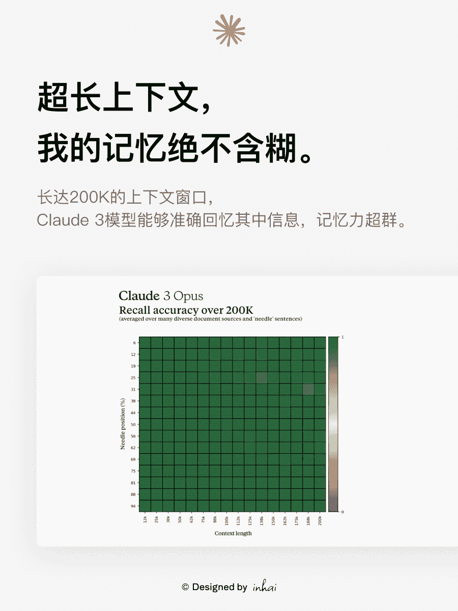

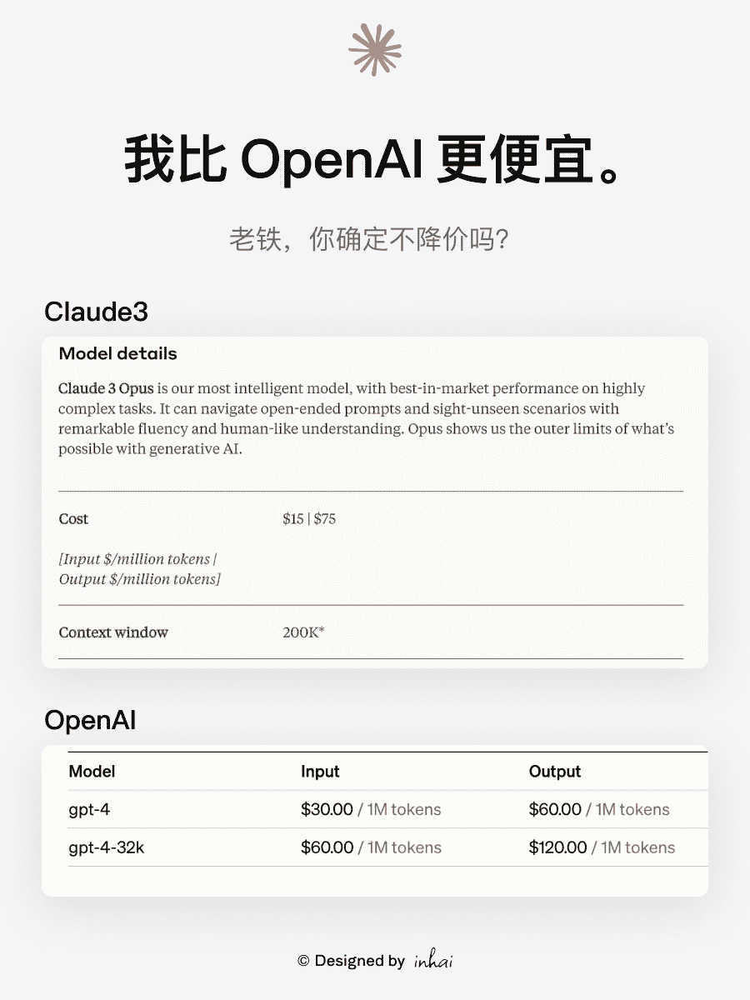

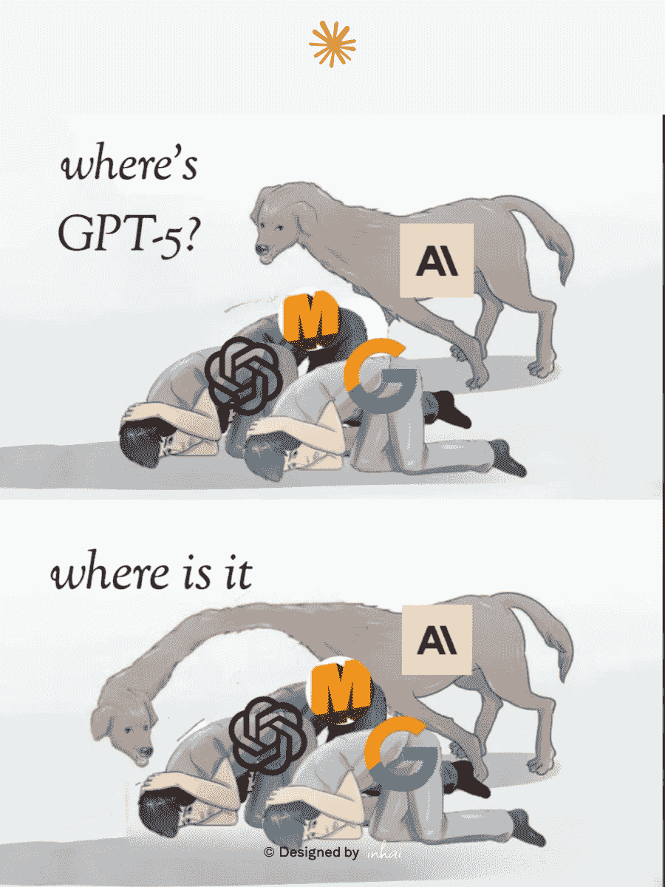

图片来源：银海inhai，👸号：AI产品经理inhai

链接：https://mp.weixin.qq.com/s/HrxBniehnLluB8gXwWN-1g

**续：**Claude官方上了Prompt library，提示词库，

链接：https://docs.anthropic.com/claude/prompt-library

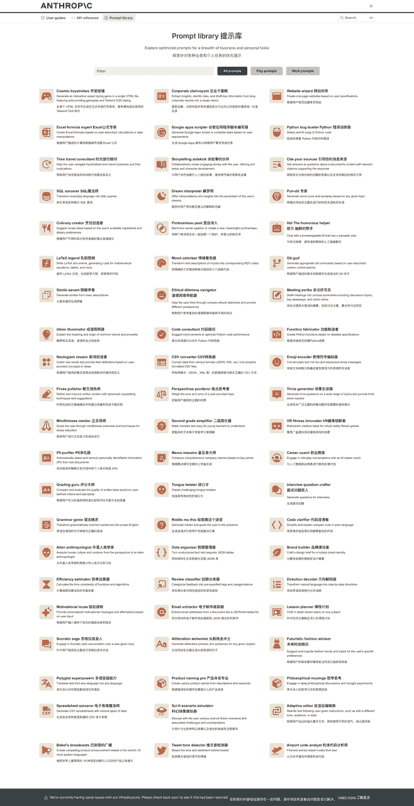

**续：**社交平台X博主Maxim Lott对Anthropic推出Claude 3系列模型进行了门萨IQ测试，结果显示，Claude 3得分101分，GPT-4为85分，且Claude 3是测试中唯一得分过百的大模型。

## 【20240304】动态 | 53页PDF曝OpenAI的Q*模型推进时间表

今天凌晨，社交平台X上一个名为杰克逊（Jackson）的网友发布了一个53页PDF文件，名为《揭示OpenAI计划在2027年前创建AGI》。根据该文件，OpenAI于2022年8月开始训练一个125万亿参数的多模态模型。第一个阶段是Arrakis，也叫Q*。该模型在2023年12月完成了训练，但由于推理成本过高而取消了发布，这是原计划于2025年发布的GPT-5。Gobi（GPT-4.5）被重新命名为GPT-5，因为原来的GPT-5被取消了。Q*的下一阶段最初是GPT-6，但后来更名为GPT-7，最初计划于2026年发布，但因为最近马斯克的诉讼而被搁置。Q* 2025 （GPT-8）计划于2027年发布，实现全面AGI。目前还不知这个透露可靠度有多高，OpenAI未对此进行回应。

## 【20240303】动态 | Figure与OpenAI将合作为人形机器人研发AI模型

据外媒PR Newswire报道，在机器人创企Figure获得来自OpenAI等方给出的6.75亿美元融资同时，Figure和OpenAI还达成了一项合作协议，将OpenAI的研究与Figure 对机器人硬件和软件的深入理解相结合，为人形机器人开发下一代AI模型。此次合作旨在通过增强人形机器人处理和推理语言的能力，帮助加快Figure的商业化进程。

## 【20240303】动态 | Sora更新4段生成视频

外星人、一镜到底、眼中地球......视效炸裂, 持续进化！

详情：https://mp.weixin.qq.com/s/Di4j_OegXN8n7KHKeBQ5Hw

[Sora官方案例合集-实时更新](https://aigcreative.feishu.cn/wiki/AH9ZwOTcbixKchksKqvcGAgLnKf?from=from_copylink)ora官方案例合集，点击查看：

根据社交平台X上的用户奥利弗·诺布里奇（Oliver Knoblich）曝料，相关人士打电话告诉他，Sora几个月内都不会推出。在评论区，多位网友称可能要等到11月以后了。

## 【20240302】产品 | OpenAI 3年前就开始研究AI音乐生成

**OpenAI在2019年8月**份就推出了他们的一音乐生成模型：Jukebox

> 我们正在推出 Jukebox，这是一种神经网络，可以生成音乐（包括基本歌唱）作为各种流派和艺术家风格的原始音频。 我们将发布模型权重和代码，以及用于探索生成样本的工具。

Jukebox能够根据提供的歌词、艺术家和流派信息生成多种流派和艺术家风格的完整音乐和人声歌曲。3年前的质量就已经很好了，官网上可以试听。

而且据说Jukebox 2即将发布...

官网链接：https://openai.com/research/jukebox

## 【20240301】产品 | OpenAI Sora也能生成图片，图片分辨率最高至2048x2048

> Our video model Sora is also capable of generating images of variable sizes—up to 2048x2048 resolution.These images were generated by Sora, without modification.

+   Prompt 1: Close-up portrait shot of a woman in autumn, extreme detail, shallow depth of field
+   Prompt 2: Vibrant coral reef teeming with colorful fish and sea creatures
+   Prompt 3: Digital art of a young tiger under an apple tree in a matte painting style with gorgeous details
+   Prompt 4: A snowy mountain village with cozy cabins and a northern lights display, high detail and photorealistic dslr, 50mm f/1.2

*Sora is not yet available to the public. We’re sharing our research progress early to learn from feedback and give the public a sense of what AI capabilities are on the horizon.

详情点击：[Sora不止于视频，还有文生图的能力！图片分辨率最高至2024*2048](https://aigcreative.feishu.cn/wiki/W37ywCDFXiz7b6kgO1CcPrrznib?from=from_copylink)

## 【20240301】动态 | OpenAI将关闭ChatGPT插件，聚焦GPTs

OpenAI宣布将于3月19日起关闭ChatGPT插件测试版，专注于GPT。自3月19日起，用户将不能使用插件建立新的对话，但既有对话最晚将会被保留到4月9日。根据官方信息，在插件测试期间，插件商店中已有1000多个可用插件。GPT商店中已经有成千上万个GPT，涉及写作、生产力、编程、教育等领域。OpenAI称GPTs已经与插件具有完全对等的特性，这也是关闭的主要原因之一。

## 【20240301】产品 | Adobe 发布了名为“Project Music GenAI Control”的全新 AI 音乐创作工具原型

该工具利用生成式人工智能技术，帮助用户无需专业音频制作经验即可创作和编辑音乐。用户只需输入文本描述，例如“欢快的舞蹈”或“忧伤的爵士乐”，Project Music GenAI Control 就能生成对应风格的音乐。更重要的是，用户还可以使用集成的编辑控件自定义生成的音乐，调整重复模式、速度、强度和结构。此外，该工具可以重新混音音乐片段，并生成循环音频，非常适合内容创作者制作背景音乐和配乐。

前该工具尚未向公众开放，也未公布发布时间。

<https://aigcreative.feishu.cn/sync/K4Gvd9vUQsy9Oubwqaeclu0Fnbg>
