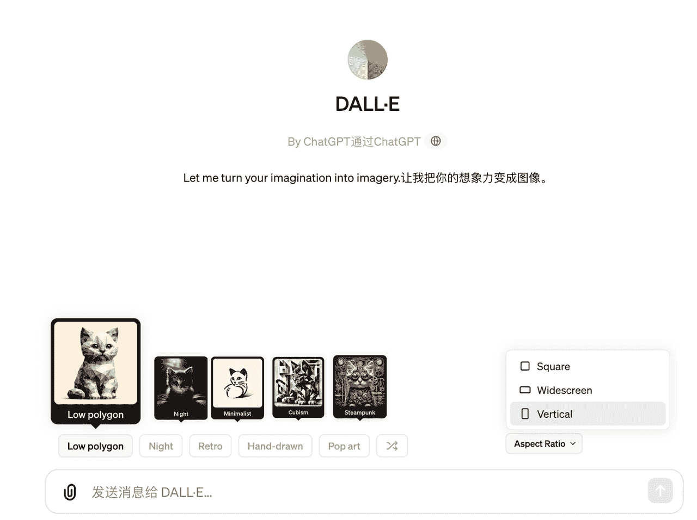
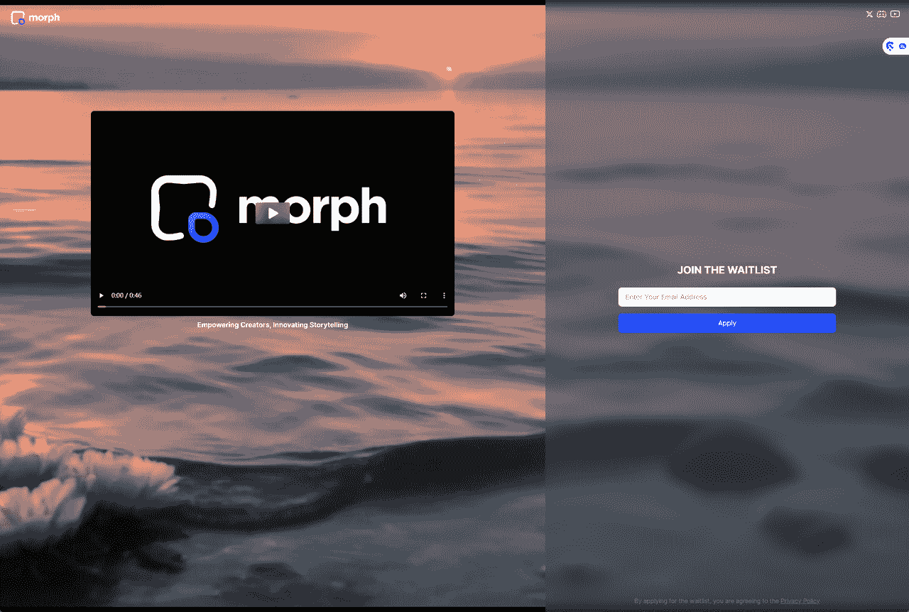
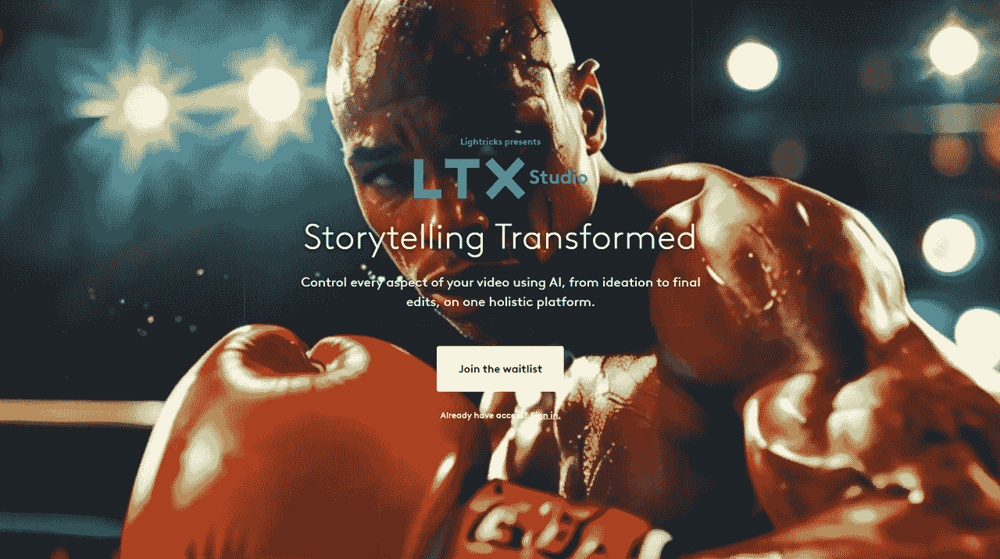
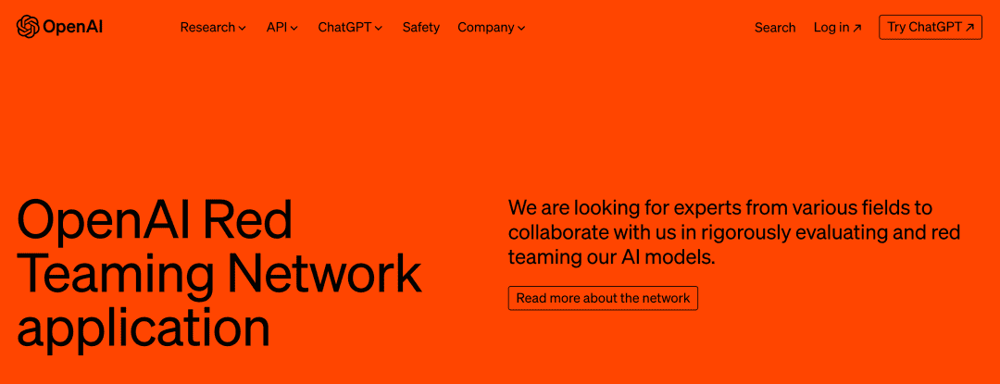
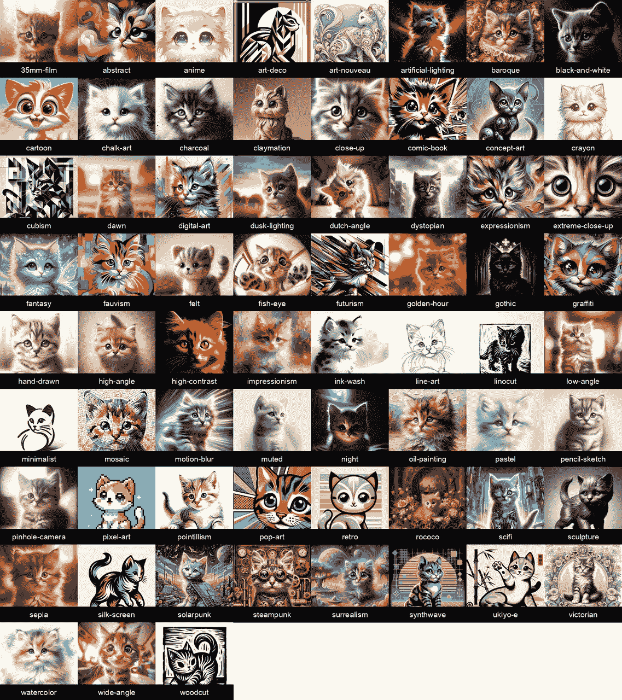
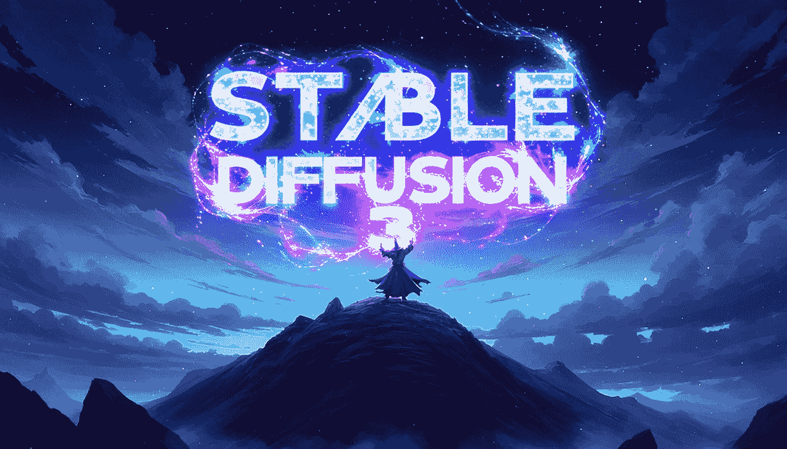
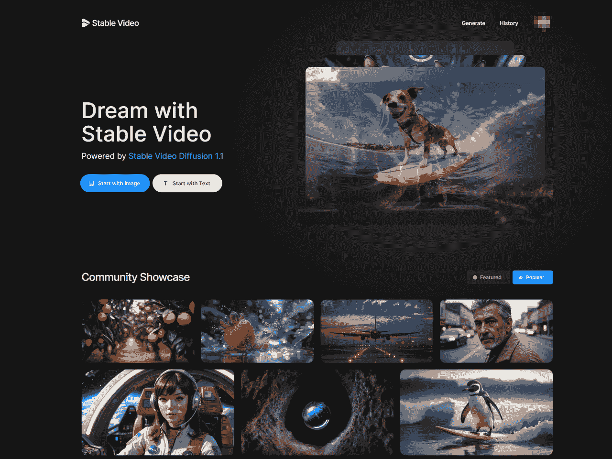
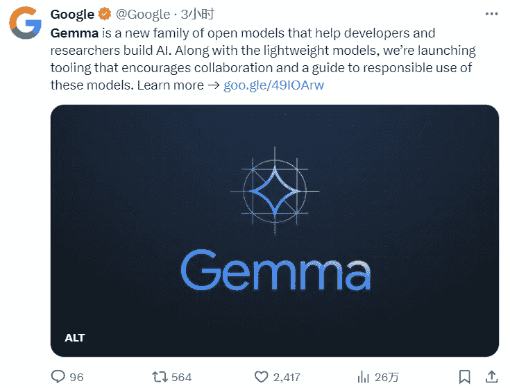

# AI每日资讯-202402

> 来源：[https://aigcreative.feishu.cn/docx/PUIid1clVoIcVwxZJKjclLHOnEf](https://aigcreative.feishu.cn/docx/PUIid1clVoIcVwxZJKjclLHOnEf)

> **动态 | 观点 | 人物 | 产品 | 体验** | 应用 | 公司 | 融资 | 产业

## 【20240229】动态 | DALL·E 更新 正在灰度测试

可以选择图像风格指定图像纵横比，选择生成横屏还是垂直方向

## 【20240228】动态 | AI电影制作平台Morph正式发布

AI创企Morph Studio刚刚联合Stability AI推出了AI电影制作平台Morph，该平台基于文本到视频模型，用户可以通过过输入不同场景的文本提示来创建和编辑镜头，并将它们组合成一个连贯的故事。

waitlist地址：https://app.morphstudio.com/waitlist

## 【20240228】动态 | LTX 一款AI驱动的电影生成和剪辑软件

支持通过文字直接生成复杂的剧情视频，包含语音、音效以及视频画面，支持编辑画面内容。 支持通过故事板组织和剪辑生成的视频，你可以自定义演员场景和造型。

网址：https://ltx.studio/

## 【20240228】动态 | Playground发布V2.5最新的文本到图像生成模型

提升了图像的美学质量，特别强调颜色和对比度的增强、改进了多纵横比图像生成，可以生成各种比例图像以及人像细节的提升。

官方宣称：根据用户研究显示，v2.5在性能上大幅超越了SDXL、PixArt-⍺以及DALL·E 3和Midjourney v5.2！

详细：playground.com/blog/playgroun…

在线体验：playground.com

## 【20240228】动态 | Pika 新功能 Lip Sync。

支持将生成视频中人物的嘴部动画和音频同步。

[f54fb5ca2f0d4882b403a6e1c53d2de1.mp4](https://internal-api-drive-stream.feishu.cn/space/api/box/stream/download/all/Tvj7bhf3SoCdiZxt9OFcHvObngb)

## 【20240227】动态 | 剪映旗下类Sora的AI视频生成工具内测申请

剪映旗下类Sora的AI视频生成工具，很快就要和大家见面了！

该产品为网页端产品Dreamina（https://www.capcut.cn/s/i8XfjgEE/），是剪映旗下的AI生图和AI生视频产品，现在诚邀对AI能力感兴趣、有一定创作基础的视频创作者，优先参于到产品上线的内测之中。

有意的创作者们辛苦填写一下问卷，剪映的老师会进行一些简单的筛选，筛选通过后会联系您并为您开通内测期内的创作权限。

https://bytedance.larkoffice.com/share/base/form/shrcnGti7D9KgJRDBUCMnGfTB9f

## 【20240227】产品 | Sora的完整能力曝光

根据OpenAI 申请的SORA™商标注册描述显示

Sora的能力如下：

+   生成视频和图像；

+   基于自然语言提示、视觉提示、文本、语音创建、生成和编辑视频和图像；

+   视频和图像识别、处理、分析、理解和生成；

+   编辑、组织、修改、传输、上传、下载和分享视频、图像和音视频材料；

+   创建和生成文本到视频以及文本到图像的内容。

值得注意的是Sora可以对视频和图像进行识别、处理、分析、理解和生成

这意味着Sora具有对视频的理解能力，这个和Gemini 1.5 Pro的能力一样，但是不知道程度如何，Gemini 1.5 Pro可以分析1个小时的视频。

这也能理解，为什么在Gemini 1.5 Pro发布的时候，OpenAI会拿出Sora来阻击！😀

## 【20240227】动态 | 今天，OpenAI Sora开放了对外申请。

内测申请链接：https://openai.com/form/red-teaming-network

虽然开放，但目前只有两种方式能用上官方版的Sora：加入Red Teaming和著名艺术从业者。大家注意不要被骗。

## 【20240226】产品 | DALL·E 3 新增了67种图像风格

35mm-film, abstract, anime, art-deco, art-nouveau, artificial-lighting, baroque, black-and-white, cartoon, chalk-art, charcoal, claymation, close-up, comic-book, concept-art, crayon, cubism, dawn, digital-art, dusk-lighting, dutch-angle, dystopian, expressionism, extreme-close-up, fantasy, fauvism, felt, fish-eye, futurism, golden-hour, gothic, graffiti, hand-drawn, high-angle, high-contrast, impressionism, ink-wash, line-art, linocut, low-angle, minimalist, mosaic, motion-blur, muted, night, oil-painting, pastel, pencil-sketch, pinhole-camera, pixel-art, pointillism, pop-art, retro, rococo, scifi, sculpture, sepia, silk-screen, solarpunk, steampunk, surrealism, synthwave, ukiyo-e, victorian, watercolor, wide-angle, woodcut

## 【20240225】动态 | Stability AI 推出图像提升增强工具：Creative Upscaler

可以将图像升级到4k分辨率，并创造以前没有的新细节和赋予图像新生命。

体验：

https://creator.nightcafe.studio/stability-ai-creative-upscaler

其他：https://www.krea.ai/apps/image/enhancer

## 【20240224】动态 | Suno 发布AI音乐生成模型V3 Alpha 版本

现已对Pro和Premier用户开放。

好的音质和更高的表现力+其他强烈要求的功能

+    最大生成长度增加到两分钟

+    更快的生成速度

+    特定乐器的专门支持

+    扩大语言覆盖范围

+    从任何地方继续 — 该功能允许用户从任何点继续他们的音乐创作。

如果用户在创作一首歌时需要中断，他们可以在之后的任何时刻从上次停止的地方继续创作，而不需要重新开始。且与之前使用V2版本制作的歌曲向后兼容。

为了感谢用户对V3早期版本提供反馈，Suno为所有付费用户的赠送300个积分

## 【20240224】产品 | SDXL-Lightning：一步或少步生成1024分辨的图像

**

该项目由**字节跳[动开发，采用了一种创新的蒸馏策略，优化扩散模型，实现了](https://t.co/cBIHb9hSXb)[从](https://t.co/cBIHb9hSXb)文本到[高分辨率图像的快速、高质量生成。

SDXL-Lightning显著提高了生成过程的速度，能够](https://t.co/tPwr0bWTKO)在一步/少步骤内完成1024px分辨率的文本到图像生成。

工作原理：

扩散模型通过模拟从数据分布到噪声分布的逐渐转变过程（前向过程），再反向学习这一过程（反向过程），从而能够生成新的数据样本。这一过程涉及大量的迭代步骤，导致生成速度慢。

SDXL-Lightning通过结合渐进式蒸馏和对抗式蒸馏的方法，旨在解决扩散模型在生成过程中存在的速度慢和计算成本高的问题，同时保持生成图像的高质量和多样性。解决了传统蒸馏方法中存在的模糊问题。

SDXL-Lightning的主要能力和特点：

1.、快速生成高分辨率图像

高效率：SDXL-Lightning显著提高了生成过程的速度，能够在少步骤内完成1024px分辨率的文本到图像生成，这对于需要快速响应的应用场景尤为重要。

高分辨率：支持生成高达1024px的高质量图像，满足了对图像细节和清晰度有高要求的场景。

2、结合渐进式和对抗式蒸馏

渐进式蒸馏：通过逐步简化模型的生成步骤，保持了模型的模式覆盖和生成质量，同时提高了效率。

对抗式蒸馏：引入鉴别器以提高生成图像的真实性和质量，通过对抗性损失优化模型，解决了传统蒸馏可能导致的图像模糊问题。

3、优化的模型设计和训练策略

创新的鉴别器设计：使用预训练的扩散UNet编码器作为鉴别器骨干，完全在潜在空间操作，提高了训练效率和模型性能。

稳定的训练技术：提出了对抗性损失目标和稳定训练的技术，包括扩散时间表的优化和输出公式的调整，确保了高质量生成的同时，训练过程的稳定性。

4、广泛可用

SDXL-Lightning模型已被开源，包括支持LoRA的版本和完整的UNet权重版本，便于研究者和开发者在不同场景下的应用和进一步研究。

插件兼容性：支持与LoRA模块和控制插件的兼容性，使得模型可以灵活应用于多种文本到图像的生成任务，包括风格化和特定主题生成。

模型：https://huggingface.co/ByteDance/SDXL-Lightning…

论文：https://huggingface.co/ByteDance/SDXL-Lightning/resolve/main/sdxl_lightning_report.pdf

## 【20240223】动态 | StabilityAl发布 Stable Diffusion3

该模型采用扩散变换架构，显著提高了在多主题提示、图像质量和拼写能力方面的性能。

Stable Diffusion 3还采用了一种新型的扩散变换技术，与Sora类似…

Stable Diffusion 3的性能提升不仅基于其先进的扩散变换架构，还包括了以下关键的技术创新和改进：

1、新型扩散变换器： Stable Diffusion 3采用了一种新型的扩散变换技术，与Sora类似，这种新技术为模型提供了更强大的图像生成能力。 Transformer 是一种深度学习模型，专门设计来逐步构建图像的细节，从而生成高质量的视觉内容。

2、流匹配与其他改进： 模型还整合了流匹配技术和其他技术改进，进一步增强了生成图像的质量和多样性。流匹配技术有助于模型更好地理解和模拟图像中的动态元素和结构，使得生成的图像在视觉上更加连贯和自然。

3.利用Transformer的改进： Stable Diffusion 3充分利用了Transformer技术的最新进展，这不仅使模型能够进一步扩展其能力，还使其能够接受多模态输入。这意味着模型能够处理更复杂和多样化的数据类型，如结合文本和图像的输入，从而在理解和生成图像内容方面提供更大的灵活性和精确度。

尽管目前已经提及了一些关键的技术创新，Stability AI计划很快发布更多的技术细节。这些细节将为技术社区和感兴趣的用户提供对Stable Diffusion 3技术基础和创新点的深入了解。

**性能的具体提升内容包括：**

1、多主题提示处理能力： 新模型对于包含多个主题或元素的提示具有更好的理解和处理能力。这意味着用户可以在一个提示中描述更复杂的场景，而模型能够更准确地根据这些描述生成图像。

2、图像质量： Stable Diffusion 3在生成的图像质量上有显著提高，包括更细腻的细节表现、更准确的颜色匹配以及更自然的光影处理。这些改进使得生成的图像更加逼真，更能捕捉到用户的创意意图。

3、拼写和文本处理能力： 这个版本在处理文本元素，尤其是在图像中直接展现的文本（如标语、标签等）时，有更好的拼写能力和文本理解。这包括更准确地识别和渲染用户提示中的文字，甚至是在复杂的视觉背景中。

网站：https://stability.ai/news/stable-diffusion-3

## 【20240222】动态 | SVD开放公测

【军备竞赛】stablevideo.com 开放公测！！！

SVD1.1官网正式开放了公测！

除了每日 150 个赠送积分外，还新增了积分购买选项，目前提供两种积分包（积分永久有效）：

500积分/$10，约 50段视频

3000积分/$50，约 300 段视频

网址：www.stablevideo.com

当然，效果比Sora差一些~~

## 【20240221】动态 | Google 推出Gemma模型

这是一款轻量级、先进的开源模型，供开发者和研究人员用于AI构建。

Gemma模型家族包括Gemma 2B和Gemma 7B两种尺寸，

能够在不同的设备类型上运行，包括笔记本电脑、桌面电脑、IoT设备、移动设备和云端。

详细：https://dpmd.ai/3UJu1Y1

访问：http://ai.google.dev/gemma

抱脸：https://huggingface.co/google/gemma-2b

## 【20240220】动态 | Groq是比GPT-4快25倍的生成AI，具有革命性意义。

Groq是比GPT-4快25倍的生成AI，能在1秒内输出500个token，具有革命性意义。LPU芯片使其推理速度极快，API也可用，适合速度要求高的产品。

Groq体验地址：https://groq.com/

## 【20240219】动态 | Sora的核心技术源自Diffusion Transformers （DiT）模型

这是一个2022年12月由伯克利和纽约大学两位研究人员提出的模型，目前这两位一个在Meta AI，一个在OpenAI…🤓

根据其中一个作者@sainingxie （目前就职于Meta AI），根据他他提供的深入分析，Sora是一个基于DiT的混合模型，包含VAE、ViT、DDPM。

自编码器（VAE）：用来处理视频数据，使得视频在生成时可以保持时间上的连贯性。

视觉变换器（ViT）：让模型更灵活地处理不同的视频数据，比如可以只关注视频中的某些特定部分。

DDPM：帮助生成更高质量的视频。

•Sora的”视频压缩网络”实质上是一个在原始视频数据上训练的VAE，其中标记化对于保持良好的时间一致性很关键。

•在DiT项目中，强调了简单性和可扩展性。ViT的灵活性使模型在处理输入数据时更加灵活，而Sora展示了DiT的缩放定律也适用于视频。

•Sora的关键进展包括其”新兴模拟能力”，特别是在长视频生成方面的突破，以及对训练数据来源和构建的讨论缺失。

DiT项目地址：wpeebles.com/DiT

论文：arxiv.org/abs/2212.09748

## 【20240216】动态 | Google继Gemini 1.0 Ultra之后，推出了更高能力的模型Gemini 1.5。

Gemini 1.5具有100万token的上下文理解能力，是目前最强！ 具有跨模态理解和推理：能够对文本、代码、图像、音频和视频进行高度复杂的理解和推理。 允许分析1小时视频、11小时音频、超过30,000行代码或超过700,000字的文本。 Gemini 1.5 的介绍

1、性能提升：Gemini 1.5在多个维度上展现出显著的性能提升，特别是在处理长上下文信息的能力上实现了重大突破，可以连续处理高达100万个标记（tokens），拥有迄今为止所有大型基础模型中最长的上下文窗口。

2、高效架构：Gemini 1.5采用了新的Mixture-of-Experts（MoE）架构，使模型更高效地进行训练和服务，同时在维持类似于1.0 Ultra模型的质量的同时，减少了计算需求。

3、长上下文窗口：这一特点允许Gemini 1.5处理并分析大量信息，比如1小时的视频、11小时的音频、超过30,000行代码的代码库或超过700,000字的文本。

4、跨模态理解和推理：Gemini 1.5能够对不同模态的内容（包括文本、代码、图像、音频和视频）进行高度复杂的理解和推理，例如，分析44分钟的默片并准确捕捉情节要点和细节。

5、增强性能：在文本、代码、图像、音频和视频评估的综合面板上测试时，Gemini 1.5 Pro在用于开发我们的大型语言模型（LLMs）的87%的基准测试中表现优于1.0 Pro，并且与1.0 Ultra在同样的基准测试中表现大致相当。 工作原理 • MoE技术：通过将模型划分为较小的“专家”神经网络，并根据输入类型选择性激活最相关的专家路径，MoE技术大大提高了模型的效率。 通过一系列机器学习创新，Gemini 1.5能够处理和分析前所未有的信息量，为开发者和企业客户提供全新的能力，帮助他们的模型和应用。这一长上下文窗口的能力特别适用于需要处理大量数据和复杂情境的应用场景，如深度分析大型文档、视频内容理解、复杂代码分析和多模态数据融合等。

## 【20240208】动态 | Gemini Ultra 上线，Bard 正式更名为 Gemini

核心要点：

+   Gemini Ultra上线，Bard更名为Gemini

+   界面优化：Gemini的用户界面经过优化，以减少视觉干扰，提高可读性，并简化导航。

+   Gemini Advanced付费计划：提供访问Google最强大的AI模型Ultra 1.0的能力，可以执行复杂任务如编程、逻辑推理和创造性协作等。

+   Gemini Advanced将引入新功能和独家特性，如增强的多模态能力和编程特性，以及上传和深入分析文件的能力。

+   将推出Gemini APP，用户可以在手机上下载使用Gemini来学习、写信、规划活动等。该应用与Google的其他应用（如Gmail、Maps和YouTube）集成，支持文本、语音或图片交互。

地址：https://gemini.google.com/app

## 【20240207】动态 | Stability AI展示了一种新型文本到语音（TTS）模型

无需提前录制人声样本，只需描述声音特征，如口音、语速，模型即可生成相应声音。不仅模仿还能根据描述合成新的声音。项目体验网址：https://www.text-description-to-speech.com/

<https://aigcreative.feishu.cn/sync/K4Gvd9vUQsy9Oubwqaeclu0Fnbg>

# 知识库动态