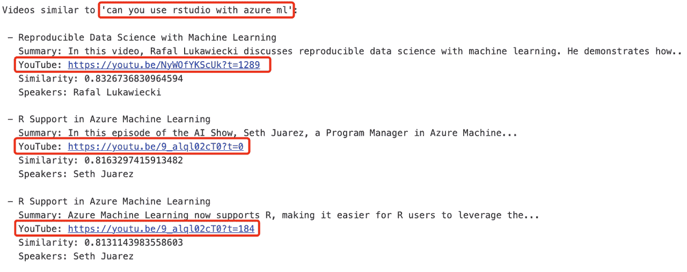
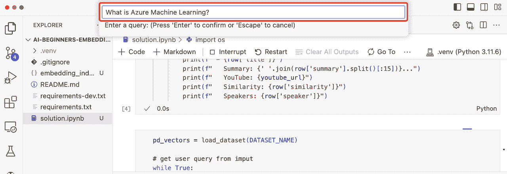

# 08-创建搜索应用

> 来源：[https://aigcreative.feishu.cn/docx/YzfddNqYXoVIaHxHrRBcmH3Un6c](https://aigcreative.feishu.cn/docx/YzfddNqYXoVIaHxHrRBcmH3Un6c)

>

LLMs 应用场景不仅仅是聊天机器人和文本生成。 还可以使用嵌入的方式来构建搜索应用程序。 嵌入是数据的数字表示，也称为向量，可用于数据的语义搜索。

在本章中，您将为“Our Startup”构建一个搜索应用程序。 我们的初创公司是一家非营利组织，为发展中国家的学生提供免费教育。 我们的初创公司拥有大量 YouTube 视频，学生可以使用这些视频来了解人工智能。 我们的初创公司希望构建一个搜索应用程序，允许学生通过输入问题来搜索 YouTube 视频。

例如，学生可能会输入“什么是 Jupyter Notebooks？” 或“什么是 Azure ML”，搜索应用程序将返回与该问题相关的 YouTube 视频列表，更好的是，搜索应用程序将返回视频中问题答案所在位置的链接 。

## [本章概述](https://microsoft.github.io/generative-ai-for-beginners/#/08-building-search-applications/translations/cn/README?wt.mc_id=academic-105485-koreyst&id=%e6%9c%ac%e7%ab%a0%e6%a6%82%e8%bf%b0)

在本章中，您将学习到：

+   语义搜索与关键字搜索。

+   什么是文本嵌入。

+   创建文本嵌入索引。

+   搜索文本嵌入索引。

## [学习目标](https://microsoft.github.io/generative-ai-for-beginners/#/08-building-search-applications/translations/cn/README?wt.mc_id=academic-105485-koreyst&id=%e5%ad%a6%e4%b9%a0%e7%9b%ae%e6%a0%87)

在完成本章的学习，您将能够：

+   区分语义搜索和关键字搜索之间的区别。

+   解释什么是文本嵌入。

+   使用嵌入创建一个应用程序来搜索数据。

## [为什么要构建搜索应用？](https://microsoft.github.io/generative-ai-for-beginners/#/08-building-search-applications/translations/cn/README?wt.mc_id=academic-105485-koreyst&id=%e4%b8%ba%e4%bb%80%e4%b9%88%e8%a6%81%e6%9e%84%e5%bb%ba%e6%90%9c%e7%b4%a2%e5%ba%94%e7%94%a8%ef%bc%9f)

创建搜索应用将帮助您了解如何使用嵌入来搜索数据。 您还将学习如何构建可供学生快速查找信息的搜索应用程序。

[本课程包括 M](https://www.youtube.com/playlist?list=PLlrxD0HtieHi0mwteKBOfEeOYf0LJU4O1)icrosoft AI Show YouTube 频道的 YouTube 记录的嵌入索引。 AI Show 是一个 YouTube 频道，向您介绍人工智能和机器学习。 嵌入索引包含截至 2023 年 10 月每个 YouTube 记录的嵌入。您将使用嵌入索引为“Our Startup”构建搜索应用程序。 搜索应用程序返回视频中问题答案所在位置的链接。 这是学生快速找到所需信息的好方法。

以下是问题“can you use rstudio with azure ml?”的语义查询示例。 查看 YouTube 网址，您会看到该网址包含一个时间戳，可将您带到视频中问题答案所在的位置。



## [什么是语义搜索？](https://microsoft.github.io/generative-ai-for-beginners/#/08-building-search-applications/translations/cn/README?wt.mc_id=academic-105485-koreyst&id=%e4%bb%80%e4%b9%88%e6%98%af%e8%af%ad%e4%b9%89%e6%90%9c%e7%b4%a2%ef%bc%9f)

现在您可能想知道什么是语义搜索？ 语义搜索是一种使用查询中单词的语义或含义来返回相关结果的搜索技术。

这是语义搜索的示例。 假设您想买一辆汽车，您可能会搜索“我的梦想汽车”，语义搜索会理解您并不是在“梦想”一辆车，而是想购买您的“理想”汽车。 语义搜索了解您的意图并返回相关结果。 另一种方法是“关键字搜索”，它会逐字搜索有关汽车的梦想，但通常会返回不相关的结果。

## [什么是文本嵌入？](https://microsoft.github.io/generative-ai-for-beginners/#/08-building-search-applications/translations/cn/README?wt.mc_id=academic-105485-koreyst&id=%e4%bb%80%e4%b9%88%e6%98%af%e6%96%87%e6%9c%ac%e5%b5%8c%e5%85%a5%ef%bc%9f)

[文本嵌入](https://en.wikipedia.org/wiki/Word_embedding)是[自然语言处理](https://en.wikipedia.org/wiki/Natural_language_processing?WT.mc_id=academic-105485-koreyst)中使用的文本表示技术。 文本嵌入是文本的语义数字表示。 嵌入用于以机器易于理解的方式表示数据。 用于构建文本嵌入的模型有很多，在本章中，我们将重点关注使用 OpenAI 嵌入模型生成嵌入。

下面是一个示例，图像以下文本是 AI Show YouTube 频道上某一集的文字记录：

```
Today we are going to learn about Azure Machine Learning.
```

我们将文本传递给 OpenAI Embedding API，它将返回以下由 1536 个数字（也称为向量）组成的嵌入。 向量中的每个数字代表文本的不同方面。 为简洁起见，这里是向量中的前 10 个数字。

```
[-0.006655829958617687, 0.0026128944009542465, 0.008792596869170666, -0.02446001023054123, -0.008540431968867779, 0.022071078419685364, -0.010703742504119873, 0.003311325330287218, -0.011632772162556648, -0.02187200076878071, ...]
```

## Embedding 索引是如何创建的？

本章的嵌入索引是使用一系列 Python 脚本创建的。 您可[以在本章的“](https://microsoft.github.io/generative-ai-for-beginners/#/08-building-search-applications/scripts/README?wt.mc_id=academic-105485-koreyst)scripts”文件夹中的 README 中找到脚本和说明。 您无需运行这些脚本即可完成本章，因为我们为您提供了嵌入索引。

这些脚本执行以下操作：

1.  下载 [AI Show](https://www.youtube.com/playlist?list=PLlrxD0HtieHi0mwteKBOfEeOYf0LJU4O1) 播放列表中每个 YouTube 视频的文字记录。

1.  使用OpenAI Functions，尝试 从 YouTube 记录的前 3 分钟中提取演讲者姓名。 每个视频的演讲者姓名存储在名为 embedding_index_3m.json 的嵌入索引中。

1.  然后将转录文本分成 3 分钟的文本片段。 该片段包含大约 20 个与下一个片段重叠的单词，以确保该片段的嵌入不会被切断并提供更好的搜索上下文。

1.  然后，每个文本片段都会传递到 OpenAI Chat API，将文本总结为 60 个单词。 摘要也存储在嵌入索引 embedding_index_3m.json 中。

1.  最后，将片段文本传递到 OpenAI Embedding API。 Embedding API 返回一个由 1536 个数字组成的向量，这些数字表示该段的语义含义。 该段与 OpenAI 嵌入向量一起存储在嵌入索引 embedding_index_3m.json 中。

### [向量数据库](https://microsoft.github.io/generative-ai-for-beginners/#/08-building-search-applications/translations/cn/README?wt.mc_id=academic-105485-koreyst&id=%e5%90%91%e9%87%8f%e6%95%b0%e6%8d%ae%e5%ba%93)

为了简[单起见，嵌](https://cookbook.openai.com/examples/vector_databases/redis/readme?WT.mc_id=academic-105485-koreyst)入索[引存储在名为 e](https://cookbook.openai.com/examples/vector_databases/pinecone/readme)mb[edding_i](https://cookbook.openai.com/examples/vector_databases/weaviate/readme?WT.mc_id=academic-105485-koreyst)ndex_3m.json 的 JSON 文件中，并加载到 Pandas Dataframe 中。 但是，在生产中，嵌入索引将存储在向量数据库中，例如 Azure Cognitive Search, Redis, Pinecone, Weaviate

## [理解余弦相似度](https://microsoft.github.io/generative-ai-for-beginners/#/08-building-search-applications/translations/cn/README?wt.mc_id=academic-105485-koreyst&id=%e7%90%86%e8%a7%a3%e4%bd%99%e5%bc%a6%e7%9b%b8%e4%bc%bc%e5%ba%a6)

我们已经了解了文本嵌入，下一步是学习如何使用文本嵌入来搜索数据，特别是使用余弦相似度找到与给定查询最相似的嵌入。

### [什么是余弦相似度？](https://microsoft.github.io/generative-ai-for-beginners/#/08-building-search-applications/translations/cn/README?wt.mc_id=academic-105485-koreyst&id=%e4%bb%80%e4%b9%88%e6%98%af%e4%bd%99%e5%bc%a6%e7%9b%b8%e4%bc%bc%e5%ba%a6%ef%bc%9f)

余弦相似度是两个向量之间相似度的度量，您还会听到这被称为 近邻搜索。 要执行余弦相似度搜索，您需要使用 OpenAI Embedding API 对 查询 文本进行 _向量化_。 然后计算查询向量与嵌入索引中每个向量之间的余弦相似度。 请记住，嵌入索引对于每个 YouTube 转录文本片段都有一个向量。 最后，按余弦相似度对结果进行排序，余弦相似度最高的文本片段与查询最相似。

从数学角度来看，余弦相似度测量投影在多维空间中的两个向量之间的角度的余弦。 这种测量是有益的，因为如果两[个文档由于](https://en.wikipedia.org/wiki/Cosine_similarity?WT.mc_id=academic-105485-koreyst)大小而相距欧几里得距离很远，它们之间的角度仍然较小，因此余弦相似度较高。 有关余弦相似度方程的更多信息，请参阅余弦相似度。

## [构建您的第一个搜索应用程序](https://microsoft.github.io/generative-ai-for-beginners/#/08-building-search-applications/translations/cn/README?wt.mc_id=academic-105485-koreyst&id=%e6%9e%84%e5%bb%ba%e6%82%a8%e7%9a%84%e7%ac%ac%e4%b8%80%e4%b8%aa%e6%90%9c%e7%b4%a2%e5%ba%94%e7%94%a8%e7%a8%8b%e5%ba%8f)

接下来，我们将学习如何使用嵌入构建搜索应用程序。 搜索应用将允许学生通过输入问题来搜索视频。 搜索应用程序将返回与问题相关的视频列表。 搜索应用程序还将返回视频中问题答案所在位置的链接。

此解决方案是使用 Python 3.10 或更高版本在 Window[s 11、macOS](https://www.python.org/downloads/?WT.mc_id=academic-105485-koreyst) 和 Ubuntu 22.04 上构建和测试的。 您可以从 python.org 下载 Python。

## 作业 - 构建一个让学生能够使用的搜索应用程序

我们在本章开始时介绍了“Our Startup”。 现在是时候让学生为他们的评估构建搜索应用程序了。

您将创建用于构建搜索应用程序的 Azure OpenAI 服务。 您将创建以下 Azure OpenAI 服务。 你需要 Azure 订阅才能完成此任务。

### 启动 Azure Cloud Shell

1.  登录[Azure 门户](https://portal.azure.com/?WT.mc_id=academic-105485-koreyst)。

1.  选择 Azure 门户右上角的 Cloud Shell 图标。

1.  选择 Bash 作为环境类型。

#### [创建资源组](https://microsoft.github.io/generative-ai-for-beginners/#/08-building-search-applications/translations/cn/README?wt.mc_id=academic-105485-koreyst&id=%e5%88%9b%e5%bb%ba%e8%b5%84%e6%ba%90%e7%bb%84)

> 通[过指引我们](https://aka.ms/oai/models?WT.mc_id=academic-105485-koreyst)使用美国东部名为“semantic-video-search”的资源组。 您可以更改资源组的名称，更改资源的位置等 检查可用的模型。

```
az group create --name semantic-video-search --location eastus
```

#### 创建 Azure OpenAI Service 资源

从 Azure Cloud Shell 运行以下命令来创建 Azure OpenAI Service 资源。

```
az cognitiveservices account create --name semantic-video-openai --resource-group semantic-video-search \
    --location eastus --kind OpenAI --sku s0
```

#### [G](https://microsoft.github.io/generative-ai-for-beginners/#/08-building-search-applications/translations/cn/README?wt.mc_id=academic-105485-koreyst&id=get-the-endpoint-and-keys-for-usage-in-this-application)et the endpoint and keys for usage in this application

#### 获取此应用程序中使用的 endpoint 和 keys

从 Azure Cloud Shell 运行以下命令以获取 Azure OpenAI 服务资源的终 endpoint 和 keys

```
az cognitiveservices account show --name semantic-video-openai \
   --resource-group  semantic-video-search | jq -r .properties.endpoint
az cognitiveservices account keys list --name semantic-video-openai \
   --resource-group semantic-video-search | jq -r .key1
```

#### 部署 OpenAI Embedding 模型

从 Azure Cloud Shell 运行以下命令来部署 OpenAI 嵌入模型。

```
az cognitiveservices account deployment create \
    --name semantic-video-openai \
    --resource-group  semantic-video-search \
    --deployment-name text-embedding-ada-002 \
    --model-name text-embedding-ada-002 \
    --model-version &quot;2&quot;  \
    --model-format OpenAI \
    --scale-settings-scale-type &quot;Standard&quot;
```

## [解决方案](https://microsoft.github.io/generative-ai-for-beginners/#/08-building-search-applications/translations/cn/README?wt.mc_id=academic-105485-koreyst&id=%e8%a7%a3%e5%86%b3%e6%96%b9%e6%a1%88)

在 GitHub Codespaces 中打开 solution notebook 并按照 Jupyter Notebook 中的说明进行操作。

当您运行 notebook 时，系统将提示您输入查询。 输入框将如下所示：



## [继续学习](https://microsoft.github.io/generative-ai-for-beginners/#/08-building-search-applications/translations/cn/README?wt.mc_id=academic-105485-koreyst&id=%e7%bb%a7%e7%bb%ad%e5%ad%a6%e4%b9%a0)

想要了解有关创建搜索应用的更多信息？ 转至进阶学习的页面 查找有关此主章节的其他学习资源。

前往第九章，我们将学习构建图像生成应用程序

<https://aigcreative.feishu.cn/sync/K4Gvd9vUQsy9Oubwqaeclu0Fnbg>