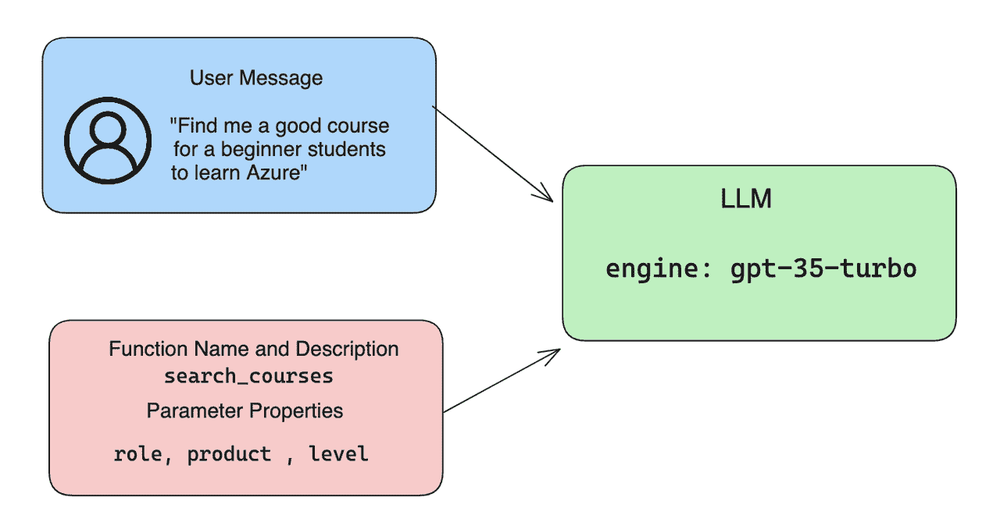

# 11-为生成式 AI 添加 function calling

> 来源：[https://aigcreative.feishu.cn/docx/Xiicd319uo0ODJxCRcUc6RMOnag](https://aigcreative.feishu.cn/docx/Xiicd319uo0ODJxCRcUc6RMOnag)

>

到目前为止，您在之前的章节中已经学到了相当多的知识。 然而，我们可以进一步改进。 可以解决的一些问题是如何获得更一致的响应格式，以便更轻松地处理下游响应。 此外，我们可能希望添加来自其他来源的数据以进一步丰富我们的应用程序。

上述问题正是本章要解决的问题。

## [本章概述](https://microsoft.github.io/generative-ai-for-beginners/#/11-integrating-with-function-calling/translations/cn/README?wt.mc_id=academic-105485-koreyst&id=%e6%9c%ac%e7%ab%a0%e6%a6%82%e8%bf%b0)

在本章中，您将学习到:

+   解释什么是 function calling 及其用例。

+   使用 Azure OpenAI 创建 function calling。

+   如何将 function calling 集成到应用程序中。

## [学习目标](https://microsoft.github.io/generative-ai-for-beginners/#/11-integrating-with-function-calling/translations/cn/README?wt.mc_id=academic-105485-koreyst&id=%e5%ad%a6%e4%b9%a0%e7%9b%ae%e6%a0%87)

在完成本章的学习，您将能够：

+   解释使用 function calling 的目的。

+   使用 Azure OpenAI Service 设置 function calling 。

+   为您的应用程序用例设计有效的 function calling 。 。

## 场景：通过功能改进我们的聊天机器人

在本课程中，我们希望为 "Our Startup" 构建一个功能，允许用户使用聊天机器人来查找技术课程。 我们将推荐适合他们的技能水平、当前角色和感兴趣的技术的课程。

为了完成这个场景，我们将使用以下组合：

+   “Azure Open AI” 为用户创建聊天体验。

+   “Microsoft Learn Catalog API” 帮助用户根据用户的请求查找课程。

+   “Function Calling” 接受用户的查询并将其发送到相关函数以发出 API 请求。

首先，让我们看看为什么我们要首先使用 Function Calling：

## 为什么需要 Function Calling

在函数调用之前，LLMs 的回复是非结构化且不一致的。 开发人员需要编写复杂的验证代码，以确保他们能够处理响应的每种变化。 用户无法获得诸如“斯德哥尔摩现在的天气怎么样？”之类的答案。 这是因为模型局限于数据训练的时间。

Function Calling 是 Azure Open AI Service 的一项功能，旨在克服以下限制：

+   一致的响应格式。 如果我们能够更好地控制响应格式，我们就可以更轻松地将响应下游集成到其他系统。

+   外部数据。 能够在聊天上下文中使用应用程序其他来源的数据

## [通过场景说明问题](https://microsoft.github.io/generative-ai-for-beginners/#/11-integrating-with-function-calling/translations/cn/README?wt.mc_id=academic-105485-koreyst&id=%e9%80%9a%e8%bf%87%e5%9c%ba%e6%99%af%e8%af%b4%e6%98%8e%e9%97%ae%e9%a2%98)

> 如果您想运行以下场景，我们建议您创建一个文件 Notebook.ipynb 并将以下代码粘贴到单独的代码单元格中。 您也可以继续阅读，因为我们正在尝试说明函数可以帮助解决问题的问题。

让我们看一下说明响应格式问题的示例：

假设我们想要创建一个学生数据数据库，以便我们可以向他们建议正确的课程。 下面我们有两个对学生的描述，它们所包含的数据非常相似。

1.  创建与我们的 Azure OpenAI 资源的连接：

```
import os
import openai
import json
openai.api_type = &quot;azure&quot;
openai.api_base = &quot;YOUR OPENAI API BASE URL&quot;
openai.api_version = &quot;2023-07-01-preview&quot;
openai.api_key = os.getenv(&quot;OPENAI_API_KEY&quot;)
```

Below is some Python code for configuring our connection to Azure Open AI where we set api_type, api_base, api_version and api_key.

1.  使用变量 'student_1_description' 和 'student_2_description' 创建两个学生描述。

```
student_1_description=&quot;Emily Johnson is a sophomore majoring in computer science at Duke University. She has a 3.7 GPA. Emily is an active member of the university&#x27;s Chess Club and Debate Team. She hopes to pursue a career in software engineering after graduating.&quot;
student_2_description = &quot;Michael Lee is a sophomore majoring in computer science at Stanford University. He has a 3.8 GPA. Michael is known for his programming skills and is an active member of the university&#x27;s Robotics Club. He hopes to pursue a career in artificial intelligence after finishing his studies.&quot;
```

We want to send the above student descriptions to an LLM to parse the data. This data can later be used in our application and be sent to an API or stored in a database.

1.  让我们创建两个相同的提示，指引 LLM 给我们指出哪些兴趣点：

```
prompt1 = f&#x27;&#x27;&#x27;
Please extract the following information from the given text and return it as a JSON object:
name
major
school
grades
club
This is the body of text to extract the information from:
{student_1_description}
&#x27;&#x27;&#x27;
prompt2 = f&#x27;&#x27;&#x27;
Please extract the following information from the given text and return it as a JSON object:
name
major
school
grades
club
This is the body of text to extract the information from:
{student_2_description}
&#x27;&#x27;&#x27;
```

上述提示指示 LLM 提取信息并以 JSON 格式返回响应。

1.  设置提示并连接到 Azure OpenAI 后，我们现在将使用 openai.ChatCompletion 将提示发送到 LLM。 我们将提示存储在 messages 变量中，并将角色分配给 user.。 这是为了模仿用户写入聊天机器人的消息。

```
# response from prompt one
openai_response1 = openai.ChatCompletion.create(
  engine=&quot;gpt-function&quot;,
  messages = [{&#x27;role&#x27;: &#x27;user&#x27;, &#x27;content&#x27;: prompt1}]
)
openai_response1[&#x27;choices&#x27;][0][&#x27;message&#x27;][&#x27;content&#x27;]

# response from prompt two
openai_response2 = openai.ChatCompletion.create(
  engine=&quot;gpt-function&quot;,
  messages = [{&#x27;role&#x27;: &#x27;user&#x27;, &#x27;content&#x27;: prompt2 }]
)
openai_response2[&#x27;choices&#x27;][0][&#x27;message&#x27;][&#x27;content&#x27;]
```

现在我们可以将两个请求发送到 LLM 并通过查找 openai_response1['choices'][0]['message']['content'] 来检查我们收到的响应。

1.  最后，我们可以通过调用 json.loads 将响应结果转换为 JSON 格式：

```
# Loading the response as a JSON object
json_response1 = json.loads(openai_response1[&#x27;choices&#x27;][0][&#x27;message&#x27;][&#x27;content&#x27;])
json_response1
```

1.  Response 1:

```
{
  &quot;name&quot;: &quot;Emily Johnson&quot;,
  &quot;major&quot;: &quot;computer science&quot;,
  &quot;school&quot;: &quot;Duke University&quot;,
  &quot;grades&quot;: &quot;3.7&quot;,
  &quot;club&quot;: &quot;Chess Club&quot;
}
```

1.  Response 2:

```
{
  &quot;name&quot;: &quot;Michael Lee&quot;,
  &quot;major&quot;: &quot;computer science&quot;,
  &quot;school&quot;: &quot;Stanford University&quot;,
  &quot;grades&quot;: &quot;3.8 GPA&quot;,
  &quot;club&quot;: &quot;Robotics Club&quot;
}
```

1.  尽管提示相同且描述相似，但我们看到 Grades 属性值的格式不同，例如有时我们可以获得“3.7”或“3.7 GPA”格式。

1.  这个结果是因为 LLM 以书面提示的形式获取非结构化数据并返回非结构化数据。 我们需要有一个结构化的格式，以便我们知道在存储或使用这些数据时会发生什么

那么我们该如何解决格式化问题呢？ 通过使用 function calling，我们可以确保收到返回的结构化数据。 当使用 function calling 时，LLM 实际上并不调用或运行任何函数。 相反，我们为 LLMs 创建了一个响应结构。 然后，我们使用这些结构化响应来了解要在应用程序中运行哪些功能。.

然后我们可以获取函数返回的内容并将其发送回 LLM。 然后， LLM 将使用自然语言来回答用户的查询。

## 使用 function calling 的用例

在许多不同的用例中，function calling 可以改进您的应用程序，例如：

+   调用外部工具。 聊天机器人非常擅长回答用户的问题。 通过使用函数调用，聊天机器人可以使用来自用户的消息来完成某些任务。 例如，学生可以要求聊天机器人“向我的老师发送电子邮件，说我需要有关该主题的更多帮助”。 这可以对 'send_email(to: string, body: string)' 进行函数调用

+   创建 API 或数据库查询。 用户可以使用自然语言查找信息，并将其转换为格式化查询或 API 请求。 举个例子，老师请求“谁是完成最后作业的学生”，该老师可以调用名为 'get_completed(student_name: string, assignment: int, current_status: string)' 的函数

+   创建结构化数据。 用户可以获取一段文本或 CSV 并使用 LLM 从中提取重要信息。 例如，学生可以将有关和平协议的维基百科文章转换为创建人工智能闪存卡。 这可以通过使用名为 'get_important_facts（agreement_name：string，date_signed：string，partys_involved：list）' 的函数来完成

## 创建您的第一个 function calling

创建 function calling 的过程包括 3 个主要步骤：

1.  调用 Chat Completions API，并提供您的函数列表和用户消息。

1.  读取模型的响应以执行操作，即执行函数或 API 调用。

1.  使用函数的响应再次调用 Chat Completions API，以使用该信息创建对用户的响应。



### [Step 1 - 创建消息](https://microsoft.github.io/generative-ai-for-beginners/#/11-integrating-with-function-calling/translations/cn/README?wt.mc_id=academic-105485-koreyst&id=step-1-%e5%88%9b%e5%bb%ba%e6%b6%88%e6%81%af)

Step 1 是创建用户消息。 这可以通过获取文本输入的值来动态分配，或者您可以在此处分配一个值。 如果这是您第一次使用聊天完成 API，我们需要定义消息的“角色”和“内容”。

role 可以是system （创建规则）、assistant 模型）或user最终用户）。 对于函数调用，我们将其指定为 user 和一个示例问题。

```
messages= [ {&quot;role&quot;: &quot;user&quot;, &quot;content&quot;: &quot;Find me a good course for a beginner student to learn Azure.&quot;} ]
```

通过分配不同的角色， LLMs 可以清楚地知道是系统在说话还是用户在说话，这有助于建立 LLMs 可以建立的对话历史记录。

### Step 2 - 创建 functions

接下来，我们将定义一个函数以及该函数的参数。 我们在这里仅使用一个名为“search_courses”的函数，但您可以创建多个函数。

> 重要：功能包含在发给 LLM 的系统消息中，并将包含在您拥有的可用 tokens 数量中。

下面，我们将函数创建为项目数组。 每个项目都是一个函数，并具有属性 name, description 和 parameters：

```
functions = [
   {
      &quot;name&quot;:&quot;search_courses&quot;,
      &quot;description&quot;:&quot;Retrieves courses from the search index based on the parameters provided&quot;,
      &quot;parameters&quot;:{
         &quot;type&quot;:&quot;object&quot;,
         &quot;properties&quot;:{
            &quot;role&quot;:{
               &quot;type&quot;:&quot;string&quot;,
               &quot;description&quot;:&quot;The role of the learner (i.e. developer, data scientist, student, etc.)&quot;
            },
            &quot;product&quot;:{
               &quot;type&quot;:&quot;string&quot;,
               &quot;description&quot;:&quot;The product that the lesson is covering (i.e. Azure, Power BI, etc.)&quot;
            },
            &quot;level&quot;:{
               &quot;type&quot;:&quot;string&quot;,
               &quot;description&quot;:&quot;The level of experience the learner has prior to taking the course (i.e. beginner, intermediate, advanced)&quot;
            }
         },
         &quot;required&quot;:[
            &quot;role&quot;
         ]
      }
   }
]
```

下面让我们更详细地描述每个函数实例：

+   name 我们想要调用的函数的名称。

+   description 这是函数如何工作的描述。 在这里，重要的是要具体和清晰。

+   parameters 您希望模型在其响应中生成的值和格式的列表。 参数数组由项目组成，其中项目具有以下属性：

1.  type - 将存储属性的数据类型。

1.  properties - 模型将用于其响应的特定值的列表

1.  name - 键是模型将在其格式化响应中使用的属性的名称，例如，product。

1.  type - 该属性的数据类型，例如，string。

1.  description - 特定属性的描述。

还有一个可选属性“required” - 完成 function call 所需的属性。

### Step 3 - 进行 function call

定义函数后，我们现在需要将其包含在对聊天完成 API 的调用中。 我们通过向请求添加 functions 来做到这一点。 在这种情况下 functions=functions。

还有一个选项可以将“function_call”设置为“auto”。 这意味着我们将让 LLM 根据用户消息决定应该调用哪个函数，而不是我们自己分配它。

下面是我们调用 ChatCompletion.create 的一些代码，请注意我们如何设置 functions=functions 和 function_call="auto" ，从而让 LLM 选择何时调用我们提供的函数：

```
response = openai.ChatCompletion.create( engine=&quot;gpt-function&quot;,
                                        messages=messages,
                                        functions=functions,
                                        function_call=&quot;auto&quot;, )
print(response[&#x27;choices&#x27;][0][&#x27;message&#x27;])
```

现在返回的响应结果如下所示：

```
{
  &quot;role&quot;: &quot;assistant&quot;,
  &quot;function_call&quot;: {
    &quot;name&quot;: &quot;search_courses&quot;,
    &quot;arguments&quot;: &quot;{\n  \&quot;role\&quot;: \&quot;student\&quot;,\n  \&quot;product\&quot;: \&quot;Azure\&quot;,\n  \&quot;level\&quot;: \&quot;beginner\&quot;\n}&quot;
  }
}
```

在这里，我们可以看到如何调用函数 search_courses 以及使用哪些参数，如 JSON 响应中的 arguments 属性中所列。

结论是，LLMs 能够找到适合函数参数的数据，因为它从聊天完成调用中提供给“messages”参数的值中提取数据。 下面是“messages”值的提醒：

```
messages= [ {&quot;role&quot;: &quot;user&quot;, &quot;content&quot;: &quot;Find me a good course for a beginner student to learn Azure.&quot;} ]
```

如您所见，student, Azure 和 beginner 是从messages 中提取的，并设置为函数的输入。 以这种方式使用函数是从提示中提取信息的好方法，同时也可以为 LLM 提供结构并具有可重用的功能。

接下来，我们需要看看如何在我们的应用程序中使用它。

## 将 function calling 集成到应用程序中

在我们测试了 LLM 的格式化响应后，现在我们可以将其集成到应用程序中。

### [管理流程](https://microsoft.github.io/generative-ai-for-beginners/#/11-integrating-with-function-calling/translations/cn/README?wt.mc_id=academic-105485-koreyst&id=%e7%ae%a1%e7%90%86%e6%b5%81%e7%a8%8b)

要将其集成到我们的应用程序中，我们需要执行以下步骤：

1.  首先，我们调用 Open AI 服务并将消息存储在名为 response_message 的变量中。

```
response_message = response[&quot;choices&quot;][0][&quot;message&quot;]
```

1.  现在我们将定义调用 Microsoft Learn API 来获取课程列表的函数：

```
import requests
def search_courses(role, product, level):
  url = &quot;https://learn.microsoft.com/api/catalog/&quot;
  params = {
     &quot;role&quot;: role,
     &quot;product&quot;: product,
     &quot;level&quot;: level
  }
  response = requests.get(url, params=params)
  modules = response.json()[&quot;modules&quot;]
  results = []
  for module in modules[:5]:
     title = module[&quot;title&quot;]
     url = module[&quot;url&quot;]
     results.append({&quot;title&quot;: title, &quot;url&quot;: url})
  return str(results)
```

1.  请注意我们现在如何创建一个实际的 Python 函数，该函数映射到 functions 变量中引入的函数名称。 我们还进行真正的外部 API 调用来获取我们需要的数据。 在这种情况下，我们根据 Microsoft Learn API 来搜索培训模块。

1.  好的，我们创建了 functions 变量和相应的 Python 函数，我们如何告诉 LLM 如何将这两个映射在一起，以便调用我们的 Python 函数？

1.  要查看是否需要调用 Python 函数，我们需要查看 LLM 响应并查看“function_call”是否是其中的一部分并调用所指出的函数。 以下是进行下面提到的检查的方法：

```
# Check if the model wants to call a function
if response_message.get(&quot;function_call&quot;):
  print(&quot;Recommended Function call:&quot;)
  print(response_message.get(&quot;function_call&quot;))
  print()

 # Call the function.
 function_name = response_message[&quot;function_call&quot;][&quot;name&quot;]

 available_functions = {
         &quot;search_courses&quot;: search_courses,
 }
 function_to_call = available_functions[function_name]

 function_args = json.loads(response_message[&quot;function_call&quot;][&quot;arguments&quot;])
 function_response = function_to_call(**function_args)

 print(&quot;Output of function call:&quot;)
 print(function_response)
 print(type(function_response))
```

```
# Add the assistant response and function response to the messages
messages.append( # adding assistant response to messages
    {
        &quot;role&quot;: response_message[&quot;role&quot;],
        &quot;function_call&quot;: {
            &quot;name&quot;: function_name,
            &quot;arguments&quot;: response_message[&quot;function_call&quot;][&quot;arguments&quot;],
        },
        &quot;content&quot;: None
    }
)
messages.append( # adding function response to messages
    {
        &quot;role&quot;: &quot;function&quot;,
        &quot;name&quot;: function_name,
        &quot;content&quot;:function_response,
    }
)
```

```

These three lines, ensure we extract the function name, the arguments and make the call:
function_to_call = available_functions[function_name]

function_args = json.loads(response_message[&quot;function_call&quot;][&quot;arguments&quot;])
function_response = function_to_call(**function_args)
```

以下是运行代码的输出：

Output

```
{
  &quot;name&quot;: &quot;search_courses&quot;,
  &quot;arguments&quot;: &quot;{\n  \&quot;role\&quot;: \&quot;student\&quot;,\n  \&quot;product\&quot;: \&quot;Azure\&quot;,\n  \&quot;level\&quot;: \&quot;beginner\&quot;\n}&quot;
}
Output of function call:
[{&#x27;title&#x27;: &#x27;Describe concepts of cryptography&#x27;, &#x27;url&#x27;: &#x27;https://learn.microsoft.com/en-us/training/modules/describe-concepts-of-cryptography/?
WT.mc_id=api_CatalogApi&#x27;}, {&#x27;title&#x27;: &#x27;Introduction to audio classification with TensorFlow&#x27;, &#x27;url&#x27;: &#x27;https://learn.microsoft.com/en-
us/training/modules/intro-audio-classification-tensorflow/?WT.mc_id=api_CatalogApi&#x27;}, {&#x27;title&#x27;: &#x27;Design a Performant Data Model in Azure SQL
Database with Azure Data Studio&#x27;, &#x27;url&#x27;: &#x27;https://learn.microsoft.com/en-us/training/modules/design-a-data-model-with-ads/?
WT.mc_id=api_CatalogApi&#x27;}, {&#x27;title&#x27;: &#x27;Getting started with the Microsoft Cloud Adoption Framework for Azure&#x27;, &#x27;url&#x27;:
&#x27;https://learn.microsoft.com/en-us/training/modules/cloud-adoption-framework-getting-started/?WT.mc_id=api_CatalogApi&#x27;}, {&#x27;title&#x27;: &#x27;Set up the
Rust development environment&#x27;, &#x27;url&#x27;: &#x27;https://learn.microsoft.com/en-us/training/modules/rust-set-up-environment/?WT.mc_id=api_CatalogApi&#x27;}]
&lt;class &#x27;str&#x27;&gt;
```

1.  现在我们将向 LLM 发送更新后的消息 messages ，以便我们可以接收自然语言响应，而不是 API JSON 格式的响应。

```
print(&quot;Messages in next request:&quot;)
print(messages)
print()
second_response = openai.ChatCompletion.create(
  messages=messages,
  engine=&quot;gpt-function&quot;,
  function_call=&quot;auto&quot;,
  functions=functions,
  temperature=0
     )  # get a new response from GPT where it can see the function response
```

print(second_response["choices"][0]["message"])

```


Output

{
  &quot;role&quot;: &quot;assistant&quot;,
  &quot;content&quot;: &quot;I found some good courses for beginner students to learn Azure:\n\n1. [Describe concepts of cryptography] (https://learn.microsoft.com/training/modules/describe-concepts-of-cryptography/?WT.mc_id=api_CatalogApi)\n2. [Introduction to audio classification with TensorFlow](https://learn.microsoft.com/training/modules/intro-audio-classification-tensorflow/?WT.mc_id=api_CatalogApi)\n3. [Design a Performant Data Model in Azure SQL Database with Azure Data Studio](https://learn.microsoft.com/training/modules/design-a-data-model-with-ads/?WT.mc_id=api_CatalogApi)\n4. [Getting started with the Microsoft Cloud Adoption Framework for Azure](https://learn.microsoft.com/training/modules/cloud-adoption-framework-getting-started/?WT.mc_id=api_CatalogApi)\n5. [Set up the Rust development environment](https://learn.microsoft.com/training/modules/rust-set-up-environment/?WT.mc_id=api_CatalogApi)\n\nYou can click on the links to access the courses.&quot;
}
```

## [作业](https://microsoft.github.io/generative-ai-for-beginners/#/11-integrating-with-function-calling/translations/cn/README?wt.mc_id=academic-105485-koreyst&id=%e4%bd%9c%e4%b8%9a)

要继续学习 Azure 开放 AI function calling，您可以构建：

+   该功能的更多参数可以帮助学习者找到更多课程。 您可以在此处找到可用的 API 参数：

+   创建另一个函数调用，从学习者那里获取更多信息，例如他们的母语

+   当函数调用和/或 API 调用未返回任何合适的课程时创建错误处理

+   提示：按照 [Learn API 参考文档](https://learn.microsoft.com/training/support/catalog-api-developer-reference?WT.mc_id=academic-105485-koreyst) 页面了解此操作的方式和和哪些数据是可用的

## Great Work! Continue the Journey

## [继续学习](https://microsoft.github.io/generative-ai-for-beginners/#/11-integrating-with-function-calling/translations/cn/README?wt.mc_id=academic-105485-koreyst&id=%e7%bb%a7%e7%bb%ad%e5%ad%a6%e4%b9%a0)

[想要了解有关 ](https://aka.ms/genai-collection?WT.mc_id=academic-105485-koreyst)Function Calling 的更多信息？ 转至进阶学习的页面 查找有关此主章节的其他学习资源。

前往第十二章，我们将学习 [为人工智能应用程序添加用户体验](https://microsoft.github.io/generative-ai-for-beginners/#/12-designing-ux-for-ai-applications/translations/cn/README?wt.mc_id=academic-105485-koreyst)!

<https://aigcreative.feishu.cn/sync/K4Gvd9vUQsy9Oubwqaeclu0Fnbg>