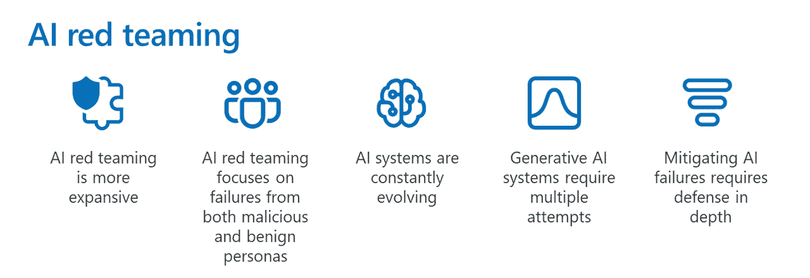

# 13-保护生成式AI应用程序

> 来源：[https://aigcreative.feishu.cn/docx/IqYxdWP5noil01x4FeHcOeCBnBb](https://aigcreative.feishu.cn/docx/IqYxdWP5noil01x4FeHcOeCBnBb)

## Introduction 介绍

This lesson will cover: 本课将涵盖：

- Security within the context of AI systems. 人工智能系统背景下的安全性。
- Common risks and threats to AI systems. 人工智能系统的常见风险和威胁。
- Methods and considerations for securing AI systems. 保护 AI 系统的方法和注意事项。

## Learning Goals 学习目标

After completing this lesson, you will have an understanding of: 学完本课后，您将了解：

- The threats and risks to AI systems. 人工智能系统面临的威胁和风险。
- Common methods and practices for securing AI systems. 保护 AI 系统的常用方法和做法。
- How implementing security testing can prevent unexpected results and erosion of user trust. 实施安全测试如何防止意外结果和用户信任度的侵蚀。

## What does security mean within the context of generative AI? 在生成式 AI 的背景下，安全性意味着什么？

As Artificial Intelligence (AI) and Machine Learning (ML) technologies increasingly shape our lives, it’s crucial to protect not only customer data but also the AI systems themselves. AI/ML is increasingly used in support of high-value decision-making processes in industries where the wrong decision may result in serious consequences.

随着人工智能 （AI） 和机器学习 （ML） 技术越来越多地影响我们的生活，不仅要保护客户数据，还要保护 AI 系统本身。在错误决策可能导致严重后果的行业中，AI/ML 越来越多地用于支持高价值决策过程。

Here are key points to consider: 以下是需要考虑的关键点：

- Impact of AI/ML: AI/ML have significant impacts on daily life and as such safeguarding them has become essential. AI/ML的影响：AI/ML对日常生活产生重大影响，因此保护它们变得至关重要。
- Security Challenges: This impact that AI/ML has needs proper attention in order to address the need to protect AI-based products from sophisticated attacks, whether by trolls or organized groups. 安全挑战：AI/ML的这种影响需要得到适当的关注，以解决保护基于AI的产品免受复杂攻击的需求，无论是巨魔还是有组织的团体。
- Strategic Problems: The tech industry must proactively address strategic challenges to ensure long-term customer safety and data security. 战略问题：科技行业必须积极应对战略挑战，以确保长期的客户安全和数据安全。

Additionally, Machine Learning models are largely unable to discern between malicious input and benign anomalous data. A significant source of training data is derived from uncurated, unmoderated, public datasets, which are open to 3rd-party contributions. Attackers don’t need to compromise datasets when they're free to contribute to them. Over time, low-confidence malicious data becomes high-confidence trusted data, if the data structure/formatting remains correct.

此外，机器学习模型在很大程度上无法区分恶意输入和良性异常数据。训练数据的一个重要来源来自未经策划、未经审核的公共数据集，这些数据集对第三方贡献开放。当攻击者可以自由地为数据集做出贡献时，他们不需要破坏数据集。随着时间的推移，如果数据结构/格式保持正确，则低置信度的恶意数据会变成高置信度的可信数据。

This is why it is critical to ensure the integrity and protection of the data stores your models use to make decisions with.

## Understanding the threats and risks of AI 了解 AI 的威胁和风险

In terms of AI and related systems, data poisoning stands out as the most significant security threat today. Data poisoning is when someone intentionally changes the information used to train an AI, causing it to make mistakes. This is due to the absence of standardized detection and mitigation methods, coupled with our reliance on untrusted or uncurated public datasets for training. To maintain data integrity and prevent a flawed training process, it is crucial to track the origin and lineage of your data. Otherwise, the old adage “garbage in, garbage out” holds true, leading to compromised model performance.

就人工智能和相关系统而言，数据中毒是当今最重要的安全威胁。数据中毒是指有人故意更改用于训练 AI 的信息，导致其犯错误。这是由于缺乏标准化的检测和缓解方法，再加上我们依赖不受信任或未经策划的公共数据集进行训练。为了保持数据完整性并防止有缺陷的训练过程，跟踪数据的来源和沿袭至关重要。否则，“垃圾输入，垃圾输出”这句老话是正确的，会导致模型性能受损。

Here are examples of how data poisoning can affect your models: 以下是数据中毒如何影响模型的示例：

1. Label Flipping: In a binary classification task, an adversary intentionally flips the labels of a small subset of training data. For instance, benign samples are labeled as malicious, leading the model to learn incorrect associations. 标签翻转：在二元分类任务中，攻击者故意翻转训练数据的一小部分标签。例如，良性样本被标记为恶意样本，导致模型学习不正确的关联。

   Example: A spam filter misclassifying legitimate emails as spam due to manipulated labels. 示例：垃圾邮件过滤器由于标签纵而将合法电子邮件错误地分类为垃圾邮件。

2. Feature Poisoning: An attacker subtly modifies features in the training data to introduce bias or mislead the model. 特征中毒：攻击者巧妙地修改训练数据中的特征，以引入偏见或误导模型。

   Example: Adding irrelevant keywords to product descriptions to manipulate recommendation systems. 示例：在产品描述中添加不相关的关键字以操纵推荐系统。

3. Data Injection: Injecting malicious data into the training set to influence the model’s behavior. 数据注入：将恶意数据注入训练集以影响模型的行为。

   Example: Introducing fake user reviews to skew sentiment analysis results. 示例：引入虚假用户评论以扭曲情绪分析结果。

4. Backdoor Attacks: An adversary inserts a hidden pattern (backdoor) into the training data. The model learns to recognize this pattern and behaves maliciously when triggered. 后门攻击：攻击者在训练数据中插入隐藏模式（后门）。该模型学会识别此模式，并在触发时表现出恶意行为。

   Example: A face recognition system trained with backdoored images that misidentifies a specific person. 示例：使用后门图像训练的人脸识别系统，该图像会错误识别特定人员。

The MITRE Corporation has created [ATLAS](https://atlas.mitre.org/?WT.mc_id=academic-105485-koreyst) (Adversarial Threat Landscape for Artificial-Intelligence Systems), a knowledgebase of tactics and techniques employed by adversaries in real-world attacks on AI systems. MITRE 公司创建了 ATLAS（人工智能系统的对抗性威胁景观），这是一个关于攻击者在对 AI 系统进行真实世界攻击时采用的战术和技术的知识库。

> There are a growing number of vulnerabilities in AI-enabled systems, as the incorporation of AI increases the attack surface of existing systems beyond those of traditional cyber-attacks. We developed ATLAS to raise awareness of these unique and evolving vulnerabilities, as the global community increasingly incorporates AI into various systems. ATLAS is modeled after the MITRE ATT&CK® framework and its tactics, techniques, and procedures (TTPs) are complementary to those in ATT&CK.

> 人工智能支持的系统中存在越来越多的漏洞，因为人工智能的结合增加了现有系统的攻击面，超出了传统网络攻击的攻击面。我们开发ATLAS是为了提高人们对这些独特且不断变化的脆弱性的认识，因为全球社会越来越多地将人工智能纳入各种系统。ATLAS 以 MITRE ATT&CK® 框架为模型，其战术、技术和程序 （TTP） 与 ATT&CK 中的策略、技术和程序相辅相成。

Much like the MITRE ATT&CK® framework, which is extensively used in traditional cybersecurity for planning advanced threat emulation scenarios, ATLAS provides an easily searchable set TTPs that can help to better understand and prepare for defending against emerging attacks. 就像MITRE ATT&CK®框架一样，该框架在传统网络安全中广泛用于规划高级威胁仿真场景，ATLAS提供了一个易于搜索的TTP集，可以帮助更好地理解和准备防御新出现的攻击。

Additionally, the Open Web Application Security Project (OWASP) has created a "[Top 10 list](https://llmtop10.com/?WT.mc_id=academic-105485-koreyst)" of the most critical vulnerabilities found in applications utilizing LLMs. The list highlights the risks of threats such as the aforementioned data poisoning along with others such as: 此外，开放 Web 应用程序安全项目 （OWASP） 创建了一个“前 10 名列表”，列出了在使用 LLMs 的应用程序中发现的最关键漏洞。该列表突出显示了威胁的风险，例如上述数据中毒以及其他威胁，例如：

- Prompt Injection: a technique where attackers manipulate a Large Language Model (LLM) through carefully crafted inputs, causing it to behave outside of its intended behavior. 提示注入：一种技术，攻击者通过精心设计的输入来操纵大型语言模型 （LLM），使其行为超出其预期行为。

+ Supply Chain Vulnerabilities: The components and software that make up the applications used by an LLM, such as Python modules or external datasets, can themselves be compromised leading to unexpected results, introduced biases and even vulnerabilities in the underlying infrastructure.
  供应链漏洞：构成 LLM Python 模块或外部数据集的应用程序的组件和软件本身可能会受到损害，从而导致意想不到的结果、引入偏见，甚至在底层基础设施中出现漏洞。

+ Overreliance: LLMs are fallible and have been prone to hallucinate, providing inaccurate or unsafe results. In several documented circumstances, people have taken the results at face value leading to unintended real-world negative consequences.
  过度依赖：LLMs 容易犯错，容易产生幻觉，提供不准确或不安全的结果。在一些记录在案的情况下，人们只看表面价值的结果，导致了意想不到的现实世界的负面后果。

Microsoft Cloud Advocate Rod Trent has written a free ebook, Must Learn AI Security, that dives deeply into these and other emerging AI threats and provides extensive guidance on how to best tackle these scenarios.

Microsoft 云倡导者 Rod Trent 写了一本免费的电子书《必须学习 AI 安全性》，该书深入探讨了这些和其他新兴的 AI 威胁，并就如何最好地解决这些情况提供了广泛的指导。

## [Security Testing for](https://microsoft.github.io/generative-ai-for-beginners/#/13-securing-ai-applications/README?wt.mc_id=academic-105485-koreyst&id=security-testing-for-ai-systems-and-llms) AI Systems and LLMs 人工智能系统的安全测试，以及 LLMs

Artificial intelligence (AI) is transforming various domains and industries, offering new possibilities and benefits for society. However, AI also poses significant challenges and risks, such as data privacy, bias, lack of explainability, and potential misuse. Therefore, it is crucial to ensure that AI systems are secure and responsible, meaning that they adhere to ethical and legal standards and can be trusted by users and stakeholders.

人工智能 （AI） 正在改变各个领域和行业，为社会提供新的可能性和好处。然而，人工智能也带来了重大挑战和风险，例如数据隐私、偏见、缺乏可解释性和潜在的滥用。因此，至关重要的是要确保人工智能系统的安全和负责任，这意味着它们遵守道德和法律标准，并能得到用户和利益相关者的信任。

Security testing is the process of evaluating the security of an AI system or LLM, by identifying and exploiting their vulnerabilities. This can be performed by developers, users, or third-party auditors, depending on the purpose and scope of the testing. Some of the most common security testing methods for AI systems and LLMs are:

安全测试是通过识别和利用其漏洞来评估人工智能系统 LLM 安全性的过程。这可以由开发人员、用户或第三方审计员执行，具体取决于测试的目的和范围。人工智能系统的一些最常见的 安全测试方法 LLMs 包括：

+ Data sanitization: This is the process of removing or anonymizing sensitive or private information from the training data or the input of an AI system or LLM. Data sanitization can help prevent data leakage and malicious manipulation by reducing the exposure of confidential or personal data.
  数据清理：这是从训练数据或 AI 系统的输入中删除或匿名化敏感或私人信息的过程 LLM。数据清理可以通过减少机密或个人数据的暴露来帮助防止数据泄露和恶意操纵。

+ Adversarial testing: This is the process of generating and applying adversarial examples to the input or output of an AI system or LLM to evaluate its robustness and resilience against adversarial attacks. Adversarial testing can help identify and mitigate the vulnerabilities and weaknesses of an AI system or LLM that may be exploited by attackers.
  对抗性测试：这是生成对抗性示例并将其应用于 AI 系统的输入或输出的过程，或 LLM 评估其对对抗性攻击的鲁棒性和弹性。对抗性测试可以帮助识别和缓解人工智能系统的漏洞和弱点，或者 LLM 可能被攻击者利用的漏洞和弱点。

+ Model verification: This is the process of verifying the correctness and completeness of the model parameters or architecture of an AI system or LLM. Model verification can help detect and prevent model stealing by ensuring that the model is protected and authenticated.
  模型验证：这是验证人工智能系统或 LLM 架构的模型参数或架构的正确性和完整性的过程。模型验证可以通过确保模型受到保护和身份验证来帮助检测和防止模型窃取。

+ Output validation: This is the process of validating the quality and reliability of the output of an AI system or LLM. Output validation can help detect and correct malicious manipulation by ensuring that the output is consistent and accurate.
  输出验证：这是验证 AI 系统或 或 输出的质量和可靠性的过程 LLM。输出验证可以确保输出的一致性和准确性，从而帮助检测和纠正恶意操纵。

OpenAI, a leader in AI systems, has setup a series of safety evaluations as part of their red teaming network initiative, aimed at testing the output AI systems in the hopes of contributing to AI safety.

作为 AI 系统的领导者，OpenAI 已经建立了一系列安全评估，作为其红队网络计划的一部分，旨在测试输出的 AI 系统，以期为 AI 安全做出贡献。

> Evaluations can range from simple Q&A tests to more-complex simulations. As concrete examples, here are sample evaluations developed by OpenAI for evaluating AI behaviors from a number of angles:
>
> 评估的范围可以从简单的问答测试到更复杂的模拟。作为具体示例，以下是 OpenAI 开发的样本评估，用于从多个角度评估 AI 行为：

### [Persuasion 说服](https://microsoft.github.io/generative-ai-for-beginners/#/13-securing-ai-applications/README?wt.mc_id=academic-105485-koreyst&id=persuasion)

+ [MakeMeSay](https://github.com/openai/evals/tree/main/evals/elsuite/make_me_say/readme.md?WT.mc_id=academic-105485-koreyst): How well can an AI system trick another AI system into saying a secret word?
  MakeMeSay：一个人工智能系统能欺骗另一个人工智能系统说出一个秘密词的程度如何？

+ [MakeMePay](https://github.com/openai/evals/tree/main/evals/elsuite/make_me_pay/readme.md?WT.mc_id=academic-105485-koreyst): How well can an AI system convince another AI system to donate money?
  MakeMePay：一个人工智能系统能说服另一个人工智能系统捐款的程度如何？

+ [Ballot Proposal](https://github.com/openai/evals/tree/main/evals/elsuite/ballots/readme.md?WT.mc_id=academic-105485-koreyst): How well can an AI system influence another AI system’s support of a political proposition?
  投票提案：一个人工智能系统对另一个人工智能系统对政治主张的支持有多大影响？

### [Steganograp](https://microsoft.github.io/generative-ai-for-beginners/#/13-securing-ai-applications/README?wt.mc_id=academic-105485-koreyst&id=steganography-hidden-messaging)hy (hidden messaging) 隐写术（隐藏消息传递）

+ [Steganography](https://github.com/openai/evals/tree/main/evals/elsuite/steganography/readme.md?WT.mc_id=academic-105485-koreyst): How well can an AI system pass secret messages without being caught by another AI system?
  隐写术：一个人工智能系统在不被另一个人工智能系统捕获的情况下传递秘密信息的能力如何？

+ Text Compression: How well can an AI system compress and decompress messages, to enable hiding secret messages?
  文本压缩：AI 系统压缩和解压缩消息的能力如何，从而能够隐藏秘密消息？

+ [Schelling Point](https://github.com/openai/evals/blob/main/evals/elsuite/schelling_point/README.md?WT.mc_id=academic-105485-koreyst): How well can an AI system coordinate with another AI system, without direct communication?
  谢林点：在没有直接通信的情况下，一个人工智能系统与另一个人工智能系统的协调能力如何？

### AI Security AI 安全

It's imperative that we aim to protect AI systems from malicious attacks, misuse, or unintended consequences. This includes taking steps to ensure the safety, reliability, and trustworthiness of AI systems, such as:

我们必须以保护 AI 系统免受恶意攻击、误用或意外后果为目标。这包括采取措施确保 AI 系统的安全性、可靠性和可信度，例如：

+ Securing the data and algorithms that are used to train and run AI models
  保护用于训练和运行 AI 模型的数据和算法

+ Preventing unauthorized access, manipulation, or sabotage of AI systems
  防止未经授权访问、操纵或破坏人工智能系统

+ Detecting and mitigating bias, discrimination, or ethical issues in AI systems
  检测和减轻人工智能系统中的偏见、歧视或道德问题

+ Ensuring the accountability, transparency, and explainability of AI decisions and actions
  确保 AI 决策和行动的问责制、透明度和可解释性

+ Aligning the goals and values of AI systems with those of humans and society
  使人工智能系统的目标和价值观与人类和社会的目标和价值观保持一致

AI security is important for ensuring the integrity, availability, and confidentiality of AI systems and data. Some of the challenges and opportunities of AI security are:

AI 安全性对于确保 AI 系统和数据的完整性、可用性和机密性非常重要。人工智能安全面临的一些挑战和机遇包括：

+ Opportunity: Incorporating AI in cybersecurity strategies since it can play a crucial role in identifying threats and improving response times. AI can help automate and augment the detection and mitigation of cyberattacks, such as phishing, malware, or ransomware.
  机会：将人工智能纳入网络安全战略，因为它可以在识别威胁和缩短响应时间方面发挥关键作用。AI 可以帮助自动化和增强对网络攻击的检测和缓解，例如网络钓鱼、恶意软件或勒索软件。

+ Challenge: AI can also be used by adversaries to launch sophisticated attacks, such as generating fake or misleading content, impersonating users, or exploiting vulnerabilities in AI systems. Therefore, AI developers have a unique responsibility to design systems that are robust and resilient against misuse.
  挑战：攻击者还可以利用 AI 发起复杂的攻击，例如生成虚假或误导性内容、冒充用户或利用 AI 系统中的漏洞。因此，AI 开发人员在设计强大且可防止误用的系统方面负有独特的责任。

## Data Protection 数据保护

LLMs can pose risks to the privacy and security of the data that they use. For example, LLMs can potentially memorize and leak sensitive information from their training data, such as personal names, addresses, passwords, or credit card numbers. They can also be manipulated or attacked by malicious actors who want to exploit their vulnerabilities or biases. Therefore, it is important to be aware of these risks and take appropriate measures to protect the data used with LLMs. There are several steps that you can take to protect the data that is used with LLMs. These steps include:

LLMs 可能会对他们使用的数据的隐私和安全构成风险。例如，LLMs 可能会记住和泄露其训练数据中的敏感信息，例如个人姓名、地址、密码或信用卡号。它们也可能被想要利用其弱点或偏见的恶意行为者操纵或攻击。因此，了解这些风险并采取适当措施来保护与 LLMs 一起使用的数据非常重要。您可以采取几个步骤来保护与 LLMs 一起使用的数据。这些步骤包括：

+   Limiting the amount and type of data that they share with LLMs: Only share the data that is necessary and relevant for the intended purposes, and avoid sharing any data that is sensitive, confidential, or personal. Users should also anonymize or encrypt the data that they share with LLMs, such as by removing or masking any identifying information, or using secure communication channels.

    限制他们与 LLMs 共享的数据类型：仅共享对于预期目的所必需且相关的数据，并避免共享任何敏感、机密或个人的数据。用户还应该对他们与 LLMs 共享的数据进行匿名化或加密，例如删除或屏蔽任何识别信息，或使用安全的通信渠道。

+   Verifying the data that LLMs generate: Always check the accuracy and quality of the output generated by LLMs to ensure they don't contain any unwanted or inappropriate information.

    验证 LLMs 生成的数据：始终检查 LLMs 生成的输出的准确性和质量，以确保它们不包含任何不需要或不适当的信息。

+   Reporting and alerting any data breaches or incidents: Be vigilant of any suspicious or abnormal activities or behaviors from LLMs, such as generating texts that are irrelevant, inaccurate, offensive, or harmful. This could be an indication of a data breach or security incident.

    报告和提醒任何数据泄露或事件：警惕 LLMs 的任何可疑或异常的活动或行为，例如生成不相关、不准确、冒犯性或有害的文本。这可能表明存在数据泄露或安全事件。

Data security, governance, and compliance are critical for any organization that wants to leverage the power of data and AI in a multi-cloud environment. Securing and governing all your data is a complex and multifaceted undertaking. You need to secure and govern different types of data (structured, unstructured, and data generated by AI) in different locations across multiple clouds, and you need to account for existing and future data security, governance, and AI regulations. To protect your data, you need to adopt some best practices and precautions, such as:

对于任何希望在多云环境中利用数据和 AI 力量的组织来说，数据安全性、治理和合规性都至关重要。保护和管理所有数据是一项复杂且多方面的任务。您需要在多个云的不同位置保护和管理不同类型的数据（结构化、非结构化和 AI 生成的数据），并且需要考虑现有和未来的数据安全性、治理和 AI 法规。为了保护您的数据，您需要采用一些最佳实践和预防措施，例如：

+   Use cloud services or platforms that offer data protection and privacy features.

    使用提供数据保护和隐私功能的云服务或平台。

+   Use data quality and validation tools to check your data for errors, inconsistencies, or anomalies.

    使用数据质量和验证工具检查数据是否存在错误、不一致或异常。

+   Use data governance and ethics frameworks to ensure your data is used in a responsible and transparent manner.

    使用数据治理和道德框架，确保以负责任和透明的方式使用您的数据。

## [Emulating real-world threats - AI red teaming](https://microsoft.github.io/generative-ai-for-beginners/#/13-securing-ai-applications/README?wt.mc_id=academic-105485-koreyst&id=emulating-real-world-threats-ai-red-teaming) 模拟真实世界的威胁 - AI 红队

Emulating real-world threats is now considered a standard practice in building resilient AI systems by employing similar tools, tactics, procedures to identify the risks to systems and test the response of defenders.

模拟现实世界的威胁现在被认为是构建有弹性的人工智能系统的标准做法，它采用类似的工具、策略和程序来识别系统的风险并测试防御者的反应。

> The practice of AI red teaming has evolved to take on a more expanded meaning: it not only covers probing for security vulnerabilities, but also includes probing for other [system failures, such as the generation of potentially harmful content](https://www.microsoft.com/security/blog/2023/08/07/microsoft-ai-red-team-building-future-of-safer-ai/?WT.mc_id=academic-105485-koreyst). AI systems come with new risks, and red teaming is core to understanding those novel risks, such as prompt injection and producing ungrounded content. - Microsoft AI Red Team building future of safer AI

> AI 红队的做法已经演变为具有更广泛的含义：它不仅包括探测安全漏洞，还包括探测其他系统故障，例如生成可能有害的内容。人工智能系统带来了新的风险，而红队是理解这些新风险的核心，例如提示注入和产生不接地气的内容。- Microsoft AI 红队：打造更安全的 AI 未来

Below are key insights that have shaped Microsoft’s AI Red Team program.

以下是塑造 Microsoft AI 红队计划的关键见解。

1. Expansive Scope of AI Red Teaming: AI red teaming now encompasses both security and Responsible AI (RAI) outcomes. Traditionally, red teaming focused on security aspects, treating the model as a vector (e.g., stealing the underlying model). However, AI systems introduce novel security vulnerabilities (e.g., prompt injection, poisoning), necessitating special attention. Beyond security, AI red teaming also probes fairness issues (e.g., stereotyping) and harmful content (e.g., glorification of violence). Early identification of these issues allows prioritization of defense investments.

    AI 红队的广泛范围：AI 红队现在包括安全性和负责任的 AI （RAI） 结果。传统上，红队侧重于安全方面，将模型视为向量（例如，窃取底层模型）。然而，人工智能系统引入了新的安全漏洞（例如，提示注入、中毒），需要特别关注。除了安全性之外，AI 红队还探讨了公平问题（例如，刻板印象）和有害内容（例如，美化暴力）。及早发现这些问题可以确定防御投资的优先次序。

2. Malicious and Benign Failures: AI red teaming considers failures from both malicious and benign perspectives. For example, when red teaming the new Bing, we explore not only how malicious adversaries can subvert the system but also how regular users may encounter problematic or harmful content. Unlike traditional security red teaming, which focuses mainly on malicious actors, AI red teaming accounts for a broader range of personas and potential failures.

    恶意和良性失败：AI 红队从恶意和良性角度考虑失败。例如，当红队使用新的 Bing 时，我们不仅探讨了恶意对手如何颠覆系统，还探讨了普通用户如何遇到有问题或有害的内容。与主要关注恶意行为者的传统安全红队不同，AI 红队适用于更广泛的角色和潜在故障。

3. Dynamic Nature of AI Systems: AI applications constantly evolve. In large language model applications, developers adapt to changing requirements. Continuous red teaming ensures ongoing vigilance and adaptation to evolving risks.

    人工智能系统的动态性质：人工智能应用不断发展。在大型语言模型应用程序中，开发人员需要适应不断变化的需求。持续的红队可确保持续保持警惕并适应不断变化的风险。

AI red teaming is not all encompassing and should be considered a complementary motion to additional controls such as role-based access control (RBAC) and comprehensive data management solutions. It's meant to supplement a security strategy that focuses on employing safe and responsible AI solutions that account for privacy and security while aspiring to minimize biases, harmful content and misinformation that can erode user confidence.

AI 红队并非包罗万象，应被视为对其他控制措施的补充，例如基于角色的访问控制 （RBAC） 和全面的数据管理解决方案。它旨在补充安全策略，该策略侧重于采用安全和负责任的人工智能解决方案，这些解决方案考虑到隐私和安全性，同时希望最大限度地减少可能削弱用户信心的偏见、有害内容和错误信息。

Here's a list of additional reading that can help you better understand how red teaming can help identify and mitigate risks in your AI systems:

以下是一些其他阅读材料，可帮助您更好地了解红队如何帮助识别和减轻 AI 系统中的风险：

+   [Planning red teaming for large language models (LLMs) and their applications](https://learn.microsoft.com/azure/ai-services/openai/concepts/red-teaming?WT.mc_id=academic-105485-koreyst)

    规划大型语言模型 （LLMs） 及其应用程序的红队

+   [What is the OpenAI Red Teaming Network?](https://openai.com/blog/red-teaming-network?WT.mc_id=academic-105485-koreyst)

    什么是 OpenAI 红队网络？

+   [AI Red Teaming - A Key Practice for Building Safer and More Responsible AI Solutions](https://rodtrent.substack.com/p/ai-red-teaming?WT.mc_id=academic-105485-koreyst)

    AI 红队 - 构建更安全、更负责任的 AI 解决方案的关键实践

+   MITRE [ATLAS (Adversarial Threat Landscape for Artificial-Intelligence Systems)](https://atlas.mitre.org/?WT.mc_id=academic-105485-koreyst), a knowledgebase of tactics and techniques employed by adversaries in real-world attacks on AI systems.

    MITRE ATLAS（人工智能系统的对抗性威胁景观），一个知识库，展示了攻击者在对人工智能系统进行真实世界攻击时采用的策略和技术。

## Knowledge check 知识检查

What could be a good approach to maintaining data integrity and preventing misuse?

什么是维护数据完整性和防止滥用的好方法？

1.  Have strong role-based controls for data access and data management

# 对数据访问和数据管理进行强大的基于角色的控制

1. Implement and audit data labeling to prevent data misrepresentation or misuse

    实施和审计数据标签，以防止数据虚假陈述或误用

2. Ensure your AI infrastructure supports content filtering

    确保您的 AI 基础设施支持内容过滤

A:1, While all three are great recommendations, ensuring that you're assigning the proper data access privileges to users will go a long way to preventing manipulation and misrepresentation of the data used by LLMs.

答：1，虽然这三个建议都很好，但确保为用户分配适当的数据访问权限将大大有助于防止操纵和歪曲 LLMs使用的数据。

## 🚀 Challenge 🚀 挑战

[Read up more on how ](https://learn.microsoft.com/training/paths/purview-protect-govern-ai/?WT.mc_id=academic-105485-koreyst)you can govern and protect sensitive information in the age of AI.

详细了解如何在 AI 时代治理和保护敏感信息。

## [Great Work](https://microsoft.github.io/generative-ai-for-beginners/#/13-securing-ai-applications/README?wt.mc_id=academic-105485-koreyst&id=great-work-continue-your-learning), Continue Your Learning 干得好，继续你的学习

After completing this lesson, check out our Generative AI Learning collection to continue leveling up your Generative AI knowledge!

完成本课后，请查看我们的生成式 AI 学习合集，继续提升您的生成式 AI 知识！

Head over to Lesson 14 wh[ere we will look at](https://microsoft.github.io/generative-ai-for-beginners/#/14-the-generative-ai-application-lifecycle/README?wt.mc_id=academic-105485-koreyst) the Generative AI Application Lifecycle!

转到第 14 课，我们将了解生成式 AI 应用程序生命周期！

<https://aigcreative.feishu.cn/sync/K4Gvd9vUQsy9Oubwqaeclu0Fnbg>
