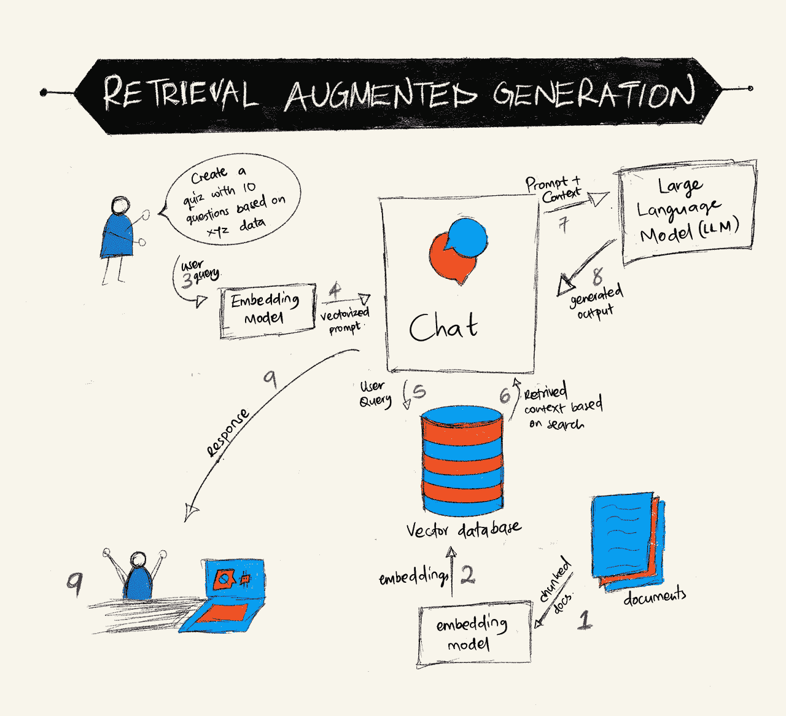
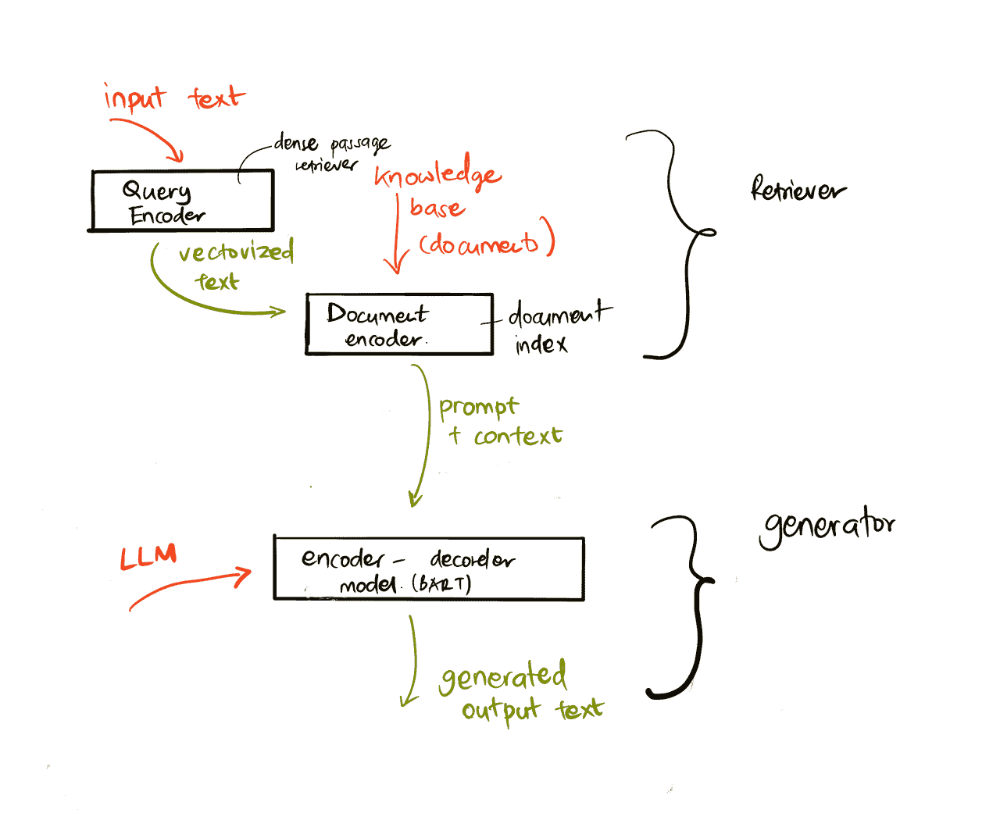
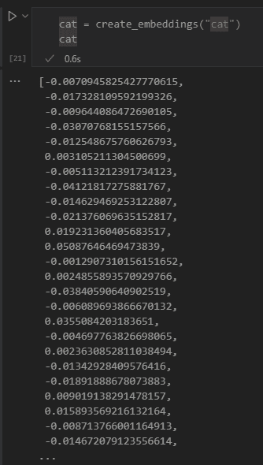

# 15-检索增强生成 （RAG） 和向量数据库

> 来源：[https://aigcreative.feishu.cn/docx/Z8I4dQfA6o0CYMxXByecmyIynhe](https://aigcreative.feishu.cn/docx/Z8I4dQfA6o0CYMxXByecmyIynhe)

In the search applications lesson, we briefly learned how to integrate your own data into Large Language Models (LLMs). In this lesson, we will delve further into the concepts of grounding your data in your LLM application, the mechanics of the process and the methods for storing data, including both embeddings and text.

在搜索应用程序课程中，我们简要学习了如何将自己的数据集成到大型语言模型中 （LLMs）。在本课中，我们将进一步深入探讨在LLM应用程序中建立数据的概念、过程的机制以及存储数据（包括嵌入和文本）的方法。

> Video Coming Soon 视频即将推出

## [Introduction 介绍](https://microsoft.github.io/generative-ai-for-beginners/#/15-rag-and-vector-databases/README?wt.mc_id=academic-105485-koreyst&id=introduction)

In this lesson we will cover the following:

在本课中，我们将介绍以下内容：

+ An introduction to RAG, what it is and why it is used in AI (artificial intelligence).

介绍 RAG，它是什么以及为什么在 AI（人工智能）中使用它。

+ Understanding what vector databases are and creating one for our application.

了解什么是向量数据库，并为我们的应用程序创建一个。

+ A practical example of how to integrate RAG into an application.

有关如何将 RAG 集成到应用程序中的实际示例。

## Learning Goals 学习目标

After completing this lesson, you will be able to:

学完本课后，您将能够：

+ Explain the significance of RAG in data retrieval and processing.

解释RAG在数据检索和处理中的重要性。

+ Setup RAG application and ground your data to an LLM

设置 RAG 应用程序并将您的数据接地到LLM

+ Effective integration of RAG and Vector Databases in LLM Applications.

在应用程序中有效集成 RAG 和矢量数据库LLM。

## [Our Scenario: enhancing our LLMs with our own data 我们的方案：用我们自己的数据增强我们的LLMs方案](https://microsoft.github.io/generative-ai-for-beginners/#/15-rag-and-vector-databases/README?wt.mc_id=academic-105485-koreyst&id=our-scenario-enhancing-our-llms-with-our-own-data)

For this lesson, we want to add our own notes into the education startup, which allows the chatbot to get more information on the different subjects. Using the notes that we have, learners will be able to study better and understand the different topics, making it easier to revise for their examinations. To create our scenario, we will use:

在本课中，我们希望将我们自己的笔记添加到教育初创公司中，这使聊天机器人能够获取有关不同主题的更多信息。使用我们拥有的笔记，学习者将能够更好地学习并理解不同的主题，从而更容易为考试复习。为了创建我们的方案，我们将使用：

+ Azure OpenAI: the LLM we will use to create our chatbot

Azure OpenAI: LLM我们将用来创建我们的聊天机器人

+ AI for beginners' lesson on Neural Networks: this will be the data we ground our LLM on

AI for beginners' lesson on Neural Networks ：这将是我们赖以依据LLM的数据

+ Azure AI Search and Azure Cosmos DB: vector database to store our data and create a search index

Azure AI Search 和 Azure Cosmos DB: 矢量数据库来存储我们的数据并创建搜索索引

Users will be able to create practice quizzes from their notes, revision flash cards and summarize it to concise overviews. To get started, let us look at what is RAG and how works:

用户将能够从他们的笔记、复习抽卡中创建练习测验，并将其总结为简洁的概述。首先，让我们看看什么是 RAG 以及它是如何工作的：

## [Retrieval Augmented Generation (RAG) 检索增强生成 （RAG）](https://microsoft.github.io/generative-ai-for-beginners/#/15-rag-and-vector-databases/README?wt.mc_id=academic-105485-koreyst&id=retrieval-augmented-generation-rag)

An LLM powered chatbot processes user prompts to generate responses. It is designed to be interactive and engages with users on a wide array of topics. However, its responses are limited to the context provided and its foundational training data. For instance, GPT-4 knowledge cutoff is September 2021, meaning, it lacks knowledge of events that have occurred after this period. In addition, the data used to train LLMs excludes confidential information such as personal notes or a company's product manual.

一个LLM强大的聊天机器人处理用户提示以生成响应。它的设计是交互式的，并在广泛的主题上与用户互动。但是，其响应仅限于所提供的背景及其基础培训数据。例如，GPT-4 的知识截止时间是 2021 年 9 月，这意味着它缺乏对这段时间之后发生的事件的知识。此外，用于培训LLMs的数据不包括机密信息，例如个人笔记或公司的产品手册。

### [How RAGs (Retrieval Augmented Generation) work RAG（检索增强生成）的工作原理](https://microsoft.github.io/generative-ai-for-beginners/#/15-rag-and-vector-databases/README?wt.mc_id=academic-105485-koreyst&id=how-rags-retrieval-augmented-generation-work)



Suppose you want to deploy a chatbot that creates quizzes from your notes, you will require a connection to the knowledge base. This is where RAG comes to the rescue. RAGs operate as follows:

假设您想部署一个聊天机器人，该聊天机器人从您的笔记中创建测验，您将需要连接到知识库。这就是RAG的用武之地。RAG 的操作方式如下：

+ Knowledge base: Before retrieval, these documents need to be ingested and preprocessed, typically breaking down large documents into smaller chunks, transforming them to text embedding and storing them in a database.

知识库：在检索之前，需要对这些文档进行摄取和预处理，通常将大型文档分解为较小的块，将它们转换为文本嵌入并将它们存储在数据库中。

+ User Query: the user asks a question

用户查询：用户提出问题

+ Retrieval: When a user asks a question, the embedding model retrieves relevant information from our knowledge base to provide more context that will be incorporated into the prompt.

检索：当用户提出问题时，嵌入模型会从我们的知识库中检索相关信息，以提供更多上下文，这些信息将被合并到提示中。

+ Augmented Generation: the LLM enhances its response based on the data retrieved. It allows the response generated to be not only based on pre-trained data but also relevant information from the added context. The retrieved data is used to augment the LLM's responses. The LLM then returns an answer to the user's question.

增强生成：根据检索到的数据LLM增强其响应。它允许生成的响应不仅基于预先训练的数据，还基于来自添加上下文的相关信息。检索到的数据用于增强 LLM的响应。然后返回LLM用户问题的答案。



The architecture for RAGs is implemented using transformers consisting of two parts: an encoder and a decoder. For example, when a user asks a question, the input text 'encoded' into vectors capturing the meaning of words and the vectors are 'decoded' into our document index and generates new text based on the user query. The LLM uses both an encoder-decoder model to generate the output.

RAG 的架构是使用转换器实现的，转换器由两部分组成：编码器和解码器。例如，当用户提出问题时，输入文本被“编码”为捕获单词含义的向量，而向量被“解码”到我们的文档索引中，并根据用户查询生成新文本。两者都LLM使用编码器-解码器模型来生成输出。

[Two](https://arxiv.org/pdf/2005.11401.pdf?WT.mc_id=academic-105485-koreyst) approaches when implementing RAG according to the proposed paper: Retrieval-Augmented Generation for Knowledge intensive NLP (natural language processing software) Tasks are:

根据所提出的论文，在实施 RAG 时有两种方法： 知识密集型 NLP（自然语言处理软件）的检索增强生成 任务是：

+ RAG-Sequence using retrieved documents to predict the best possible answer to a user query

RAG-Sequence 使用检索到的文档来预测用户查询的最佳可能答案

+ RAG-Token using documents to generate the next token, then retrieve them to answer the user's query

RAG-Token 使用文档生成下一个令牌，然后检索它们以回答用户的查询

### [Why would you use RAGs? 为什么要使用 RAG？](https://microsoft.github.io/generative-ai-for-beginners/#/15-rag-and-vector-databases/README?wt.mc_id=academic-105485-koreyst&id=why-would-you-use-rags)

+ Information richness: ensures text responses are up to date and current. It, therefore, enhances performance on domain specific tasks by accessing the internal knowledge base.

信息丰富性：确保文本响应是最新的和最新的。因此，它通过访问内部知识库来提高特定领域任务的性能。

+ Reduces fabrication by utilizing verifiable data in the knowledge base to provide context to the user queries.

通过利用知识库中的可验证数据为用户查询提供上下文，减少捏造。

+ It is cost effective as they are more economical compared to fine-tuning an LLM

这是具有成本效益的，因为与微调相比，它们更经济。LLM

## [Creating a knowledge base 创建知识库](https://microsoft.github.io/generative-ai-for-beginners/#/15-rag-and-vector-databases/README?wt.mc_id=academic-105485-koreyst&id=creating-a-knowledge-base)

Our application is based on our personal data i.e., the Neural Network lesson on AI For Beginners curriculum.

我们的应用程序基于我们的个人数据，即关于初学者 AI 课程的神经网络课程。

### Vector Databases 向量数据库


A vector database, unlike traditional databases, is a specialized database designed to store, manage and search embedded vectors. It stores numerical representations of documents. Breaking down data to numerical embeddings makes it easier for our AI system to understand and process the data.

与传统数据库不同，向量数据库是一种专门的数据库，旨在存储、管理和搜索嵌入的向量。它存储文档的数字表示。将数据分解为数字嵌入使我们的 AI 系统更容易理解和处理数据。

We store our embeddings in vector databases as LLMs have a limit of the number of tokens they accept as input. As you cannot pass the entire embeddings to an LLM, we will need to break them down into chunks and when a user asks a question, the embeddings most like the question will be returned together with the prompt. Chunking also reduces costs on the number of tokens passed through an LLM.

我们将嵌入存储在向量数据库中，因为它们LLMs接受作为输入的令牌数量有限制。由于您不能将整个嵌入传递给 LLM，我们需要将它们分解为块，当用户提出问题时，最像问题的嵌入将与提示一起返回。分块还可以降低通过 LLM.

Some popular vector databases include Azure Cosmos DB, Clarifyai, Pinecone, Chromadb, ScaNN, Qdrant and DeepLake. You can create an Azure Cosmos DB model using Azure CLI with the following command:

一些流行的矢量数据库包括 Azure Cosmos DB、Clarifyai、Pinecone、Chromadb、ScaNN、Qdrant 和 DeepLake。可以通过以下命令使用 Azure CLI 创建 Azure Cosmos DB 模型：

```
az login
az group create -n <resource-group-name> -l <location>
az cosmosdb create -n <cosmos-db-name> -r <resource-group-name>
az cosmosdb list-keys -n <cosmos-db-name> -g <resource-group-name>
```

### From text to embeddings 从文本到嵌入

Before we store our data, we will need to convert it to vector embeddings before it is stored in the database. If you are working with large documents or long texts, you can chunk them based on queries you expect. Chunking can be done at sentence level, or at a paragraph level. As chunking derives meanings from the words around them, you can add some other context to a chunk, for example, by adding the document title or including some text before or after the chunk. You can chunk the data as follows:

在存储数据之前，我们需要先将其转换为向量嵌入，然后再将其存储在数据库中。如果您正在处理大型文档或长文本，则可以根据预期的查询对它们进行分块。分块可以在句子级别或段落级别完成。由于分块从它们周围的单词中派生含义，因此您可以向块添加一些其他上下文，例如，通过添加文档标题或在块之前或之后包含一些文本。您可以按如下方式对数据进行分块：

```
def split_text(text, max_length, min_length):
    words = text.split()
    chunks = []
    current_chunk = []
    for word in words:
        current_chunk.append(word)
        if len(' '.join(current_chunk)) < max_length and len(' '.join(current_chunk)) > min_length:
            chunks.append(' '.join(current_chunk))
            current_chunk = []
    # If the last chunk didn't reach the minimum length, add it anyway
    if current_chunk:
        chunks.append(' '.join(current_chunk))
    return chunks
```

Once chunked, we can then embed our text using different embedding models. Some models you can use include: `word2vec`, `ada-002` by OpenAI, Azure Computer Vision and many more. Selecting a model to use will depend on the languages you're using, the type of content encoded (text/images/audio), the size of input it can encode and length of the embedding output.

一旦被分块，我们就可以使用不同的嵌入模型来嵌入我们的文本。您可以使用的一些模型包括：`word2vec`、OpenAI 的 `ada-002`、Azure Computer Vision 等等。选择要使用的模型将取决于您使用的语言、编码的内容类型（文本/图像/音频）、它可以编码的输入大小以及嵌入输出的长度。

An example of embedded text using OpenAI's `text-embedding-ada-002` model is:

使用 OpenAI `text-embedding-ada-002` 模型的嵌入文本示例如下：



## [Retriev](https://microsoft.github.io/generative-ai-for-beginners/#/15-rag-and-vector-databases/README?wt.mc_id=academic-105485-koreyst&id=retrieval-and-vector-search)al and Vector Search 检索和向量搜索

When a user asks a question, the retriever transforms it into a vector using the query encoder, it then searches the through our document search index for relevant vectors in the document that are related to the input. Once done, it converts both the input vector and document vectors into text and passes it through the LLM.

当用户提出问题时，检索器使用查询编码器将其转换为向量，然后通过我们的文档搜索索引搜索文档中与输入相关的相关向量进行搜索。完成后，它将输入向量和文档向量都转换为文本，并通过 LLM.

### [Retrieval 检索](https://microsoft.github.io/generative-ai-for-beginners/#/15-rag-and-vector-databases/README?wt.mc_id=academic-105485-koreyst&id=retrieval)

Retrieval happens when the system tries to quickly find the documents from the index that satisfy the search criteria. The goal of the retriever is to get documents that will be used to provide context and ground the LLM on your data.

当系统尝试从索引中快速找到满足搜索条件的文档时，就会发生检索。检索器的目标是获取将用于提供上下文和数据基础LLM的文档。

There are several ways to perform search within our database such as:

有几种方法可以在我们的数据库中执行搜索，例如：

+   Keyword search used for text searches

    关键字搜索 - 用于文本搜索

+   Semantic search uses the semantic meaning of words

    语义搜索 - 使用单词的语义含义

+   Vector search converts documents from text to vector representations using embedding models. Retrieval will be done by querying the documents whose vector representations are closest to the user question.

    矢量搜索 - 使用嵌入模型将文档从文本转换为矢量表示。检索将通过查询其向量表示最接近用户问题的文档来完成。

+   Hybrid a combination of both keyword and vector search.

    混合 - 关键字和向量搜索的组合。

A challenge with retrieval comes in when there is no similar response to the query in the database, the system will then return the best information they can get, however, you can use tactics like set up the maximum distance for relevance or use hybrid search that combines both keywords and vector search. In this lesson we will use hybrid search, a combination of both vector and keyword search. We will store our data into a `dataframe` with columns containing the chunks as well as embeddings.

当数据库中的查询没有类似的响应时，检索就会面临挑战，然后系统将返回他们可以获得的最佳信息，但是，您可以使用诸如设置相关性最大距离之类的策略或使用混合搜索，将关键字和向量搜索结合起来。在本课中，我们将使用混合搜索，即向量搜索和关键字搜索的组合。我们将数据存储到一个 `DataFrame` 中，该 `DataFrame` 的列包含块和嵌入。

### Vector Similarity 向量相似性

The retriever will search through the knowledge database for embeddings that are close together, the closest neighbour, as they are texts that are similar. In the scenario a user asks a query, it is first embedded then matched with similar embeddings. The common measurement that is used to find how similar different vectors are is cosine similarity which is based on the angle between two vectors.

检索器将在知识数据库中搜索彼此靠近的嵌入，即最近的邻居，因为它们是相似的文本。在用户询问查询的场景中，它首先被嵌入，然后与类似的嵌入匹配。用于找出不同向量的相似程度的常用度量是余弦相似度，它基于两个向量之间的角度。

We can measure similarity using other alternatives we can use are Euclidean distance which is the straight line between vector endpoints and dot product which measures the sum of the products of corresponding elements of two vectors.

我们可以使用其他替代方案来衡量相似性，例如欧几里得距离（即向量端点之间的直线）和点积（测量两个向量的相应元素的乘积之和）。

### Search index 搜索索引

When doing retrieval, we will need to build a search index for our knowledge base before we perform search. An index will store our embeddings and can quickly retrieve the most similar chunks even in a large database. We can create our index locally using:

在进行检索时，我们需要在执行搜索之前为我们的知识库构建一个搜索索引。索引将存储我们的嵌入，并且即使在大型数据库中也可以快速检索最相似的块。我们可以使用以下方法在本地创建索引：

```
from sklearn.neighbors import NearestNeighbors

embeddings = flattened_df['embeddings'].to_list()

# Create the search index
nbrs = NearestNeighbors(n_neighbors=5, algorithm='ball_tree').fit(embeddings)

# To query the index, you can use the kneighbors method
distances, indices = nbrs.kneighbors(embeddings)
```

### [Re-ranking 重新排名](https://microsoft.github.io/generative-ai-for-beginners/#/15-rag-and-vector-databases/README?wt.mc_id=academic-105485-koreyst&id=re-ranking)

Once you have queried the database, you might need to sort the results from the most relevant. A reranking LLM utilizes Machine Learning to improve the relevance of search results by ordering them from the most relevant. Using Azure AI Search, reranking is done automatically for you using a semantic reranker. An example of how reranking works using nearest neighbours:

查询数据库后，可能需要从最相关的结果中对结果进行排序。重新排名LLM利用机器学习通过从最相关的位置排序来提高搜索结果的相关性。使用 Azure AI 搜索时，系统会自动使用语义重排器进行重新排名。如何使用最近邻进行重新排名的示例：


```
# Find the most similar documents
distances, indices = nbrs.kneighbors([query_vector])

index = []
# Print the most similar documents
for i in range(3):
    index = indices[0][i]
    for index in indices[0]:
        print(flattened_df['chunks'].iloc[index])
        print(flattened_df['path'].iloc[index])
        print(flattened_df['distances'].iloc[index])
    else:
        print(f"Index {index} not found in DataFrame")
```

## Bringing it all together 将所有内容整合在一起

The last step is adding our LLM into the mix to be able to get responses that are grounded on our data. We can implement it as follows:

最后一步是将我们的LLM添加到组合中，以便能够获得基于我们数据的响应。我们可以按照以下方式实现它：

```
user_input = "what is a perceptron?"
def chatbot(user_input):
    # Convert the question to a query vector
    query_vector = create_embeddings(user_input)
    # Find the most similar documents
    distances, indices = nbrs.kneighbors([query_vector])
    # add documents to query  to provide context
    history = []
    for index in indices[0]:
        history.append(flattened_df['chunks'].iloc[index])
    # combine the history and the user input
    history.append(user_input)
    # create a message object
    messages=[
        {"role": "system", "content": "You are an AI assiatant that helps with AI questions."},
        {"role": "user", "content": history[-1]}
    ]
    # use chat completion to generate a response
    response = openai.chat.completions.create(
        model="gpt-4",
        temperature=0.7,
        max_tokens=800,
        messages=messages
    )
    return response.choices[0].message
chatbot(user_input)
```

## [Evaluating our application 评估我们的应用程序](https://microsoft.github.io/generative-ai-for-beginners/#/15-rag-and-vector-databases/README?wt.mc_id=academic-105485-koreyst&id=evaluating-our-application)

### Evaluation Metrics 评估指标

+ Quality of responses supplied ensuring it sounds natural, fluent and human-like

提供的回复质量确保它听起来自然、流畅和像人一样

+ Groundedness of the data: evaluating whether the response that came from supplied docs

数据的接地性：评估是否来自提供的文档的响应

+ Relevance: evaluating the response matches and is related to the question asked

相关性：评估响应是否匹配并与所提出的问题相关

+ Fluency - whether the response makes sense grammatically

流利度 - 响应在语法上是否有意义

## [Use Cases for using RAG (Retervival Augmented Generation) and vector databases 使用 RAG（Retervival Augmented Generation）和矢量数据库的用例](https://microsoft.github.io/generative-ai-for-beginners/#/15-rag-and-vector-databases/README?wt.mc_id=academic-105485-koreyst&id=use-cases-for-using-rag-retervival-augmented-generation-and-vector-databases)

There are many different use cases where function calls can improve your app like:

在许多不同的用例中，函数调用可以改进您的应用程序，例如：

+ Question and Answering: grounding your company data to a chat that can be used by employees to ask questions.

问答：将您的公司数据为基础，以供员工使用来提问。

+ Recommendation Systems: where you can create a system that matches the most similar values e.g. movies, restaurants and many more.

推荐系统：您可以在其中创建一个与最相似的值匹配的系统，例如电影、餐厅等等。

+ Chatbot services: you can store chat history and personalize the conversation based on the user data.

聊天机器人服务：您可以存储聊天记录并根据用户数据对对话进行个性化设置。

+ Image search based on vector embeddings, useful when doing image recognition and anomaly detection.

基于向量嵌入的图像搜索，在进行图像识别和异常检测时很有用。

## [Summary 总结](https://microsoft.github.io/generative-ai-for-beginners/#/15-rag-and-vector-databases/README?wt.mc_id=academic-105485-koreyst&id=summary)

We have covered the fundamental areas of RAG from adding our data to the application, the user query and output. To simplify creation of RAG, you can use frameworks such as Semanti Kernel, Langchain or Autogen.

我们已经涵盖了 RAG 的基本领域，从将我们的数据添加到应用程序、用户查询和输出。为了简化 RAG 的创建，您可以使用 Semanti Kernel、Langchain 或 Autogen 等框架。

## [Assignment 分配](https://microsoft.github.io/generative-ai-for-beginners/#/15-rag-and-vector-databases/README?wt.mc_id=academic-105485-koreyst&id=assignment)

To continue your learning of Retrieval Augmented Generation (RAG) you can build:

要继续学习检索增强生成 （RAG），您可以构建：

+ Build a front-end for the application using the framework of your choice

使用您选择的框架为应用程序构建前端

+ Utilize a framework, either LangChain or Semantic Kernel, and recreate your application.

利用框架，LangChain或Semantic Kernel，并重新创建您的应用程序。

Congratulations for completing the lesson 👏.

恭喜您完成了这节课👏。

## [Learning does not stop here, continue the Journey 学习并不止于此，继续旅程](https://microsoft.github.io/generative-ai-for-beginners/#/15-rag-and-vector-databases/README?wt.mc_id=academic-105485-koreyst&id=learning-does-not-stop-here-continue-the-journey)

After completing this lesson, check out our Generative AI Learning collection to continue leveling up your Generative AI knowledge!

完成本课后，请查看我们的生成式 AI 学习合集，继续提升您的生成式 AI 知识！

<https://aigcreative.feishu.cn/sync/K4Gvd9vUQsy9Oubwqaeclu0Fnbg>
