# 16-探索和比较不同的LLMs

> 来源：[https://aigcreative.feishu.cn/docx/GZu8dcchvoAIINxrDSQcMrxVn9b](https://aigcreative.feishu.cn/docx/GZu8dcchvoAIINxrDSQcMrxVn9b)

With the previous lesson, we have seen how Generative AI is changing the technology landscape, how Large Language Models (LLMs) work and how a business - like our startup - can apply them to their use cases and grow! In this chapter, we're looking to compare and contrast different types of large language models (LLMs) to understand their pros and cons.

在上一课中，我们已经了解了生成式 AI 如何改变技术格局，大型语言模型 （LLMs） 的工作原理，以及企业（如我们的初创公司）如何将它们应用于他们的用例并发展壮大！在本章中，我们将比较和对比不同类型的大型语言模型 （LLMs），以了解它们的优缺点。

The next step in our startup's journey is exploring the current landscape of LLMs and understanding which are suitable for our use case.

我们初创公司旅程的下一步是探索和理解哪些适合我们的用例的当前情况LLMs。

## [Introduction 介绍](https://microsoft.github.io/generative-ai-for-beginners/#/02-exploring-and-comparing-different-llms/README?wt.mc_id=academic-105485-koreyst&id=introduction)

This lesson will cover: 本课将涵盖：

+   Different types of LLMs in the current landscape. LLMs在当前景观中的不同类型。
+   Testing, iterating, and comparing different models for your use case in Azure. 在 Azure 中测试、迭代和比较用例的不同模型。
+   How to deploy an LLM. 如何部署 LLM.

## Learning Goals 学习目标

After completing this lesson, you will be able to: 学完本课后，您将能够：

+   Select the right model for your use case. 为您的用例选择正确的模型。
+   Understand how to test, iterate, and improve performance of your model. 了解如何测试、迭代和提高模型的性能。
+   Know how businesses deploy models. 了解企业如何部署模型。

## [Understand ](https://microsoft.github.io/generative-ai-for-beginners/#/02-exploring-and-comparing-different-llms/README?wt.mc_id=academic-105485-koreyst&id=understand-different-types-of-llms)different types of LLMs 了解不同类型的LLMs

LLMs can have multiple categorizations based on their architecture, training data, and use case. Understanding these differences will help our startup select the right model for the scenario, and understand how to test, iterate, and improve performance.

LLMs可以根据其架构、训练数据和用例进行多个分类。了解这些差异将有助于我们的初创公司为场景选择正确的模型，并了解如何测试、迭代和提高性能。

There are many different types of LLM models, your choice of model depends on what you aim to use them for, your data, how much you're ready to pay and more.

有许多不同类型的LLM模型，您选择的模型取决于您打算将它们用于什么目的、您的数据、您准备支付的金额等等。

Depending on if you aim to use the models for text, audio, video, image generation and so on, you might opt for a different type of model.

根据您是否打算将模型用于文本、音频、视频、图像生成等，您可能会选择不同类型的模型。

+   Audio and speech recognition. For this purpose, Whisper-type models are a great choice as they're general-purpose and aimed at speech recognition. It's trained on diverse audio and can perform multilingual speech recognition. Learn more about Whisper type models here. 音频和语音识别。为此，耳语型模型是一个不错的选择，因为它们是通用的，并且针对语音识别。它接受过多种音频的训练，可以执行多语言语音识别。在此处了解有关 Whisper 类型模型的更多信息。
+   Image generation. For image generation, DALL-E and Midjourney are two very known choices. DALL-E is offered by Azure OpenAI. Read more about DALL-E here and also in Chapter 9 of this curriculum. 图像生成。对于图像生成，DALL-E 和 Midjourney 是两个非常知名的选择。DALL-E 由 Azure OpenAI 提供。在此处以及本课程的第 9 章中阅读有关 DALL-E 的更多信息。
+   Text generation. Most models are trained on text generation and you have a large variety of choices from GPT-3.5 to GPT-4. They come at different costs with GPT-4 being the most expensive. It's worth looking into the Azure OpenAI playground to evaluate which models best fit your needs in terms of capability and cost. 文本生成。大多数模型都是在文本生成上训练的，从 GPT-3.5 到 GPT-4，您有多种选择。它们的成本各不相同，其中 GPT-4 是最昂贵的。值得研究 Azure OpenAI Playground，以评估哪些模型在功能和成本方面最适合你的需求。
+   Multi-modality. If you're looking to handle multiple types of data in input and output, you might want to look into models like gpt-4 turbo with vision or gpt-4o the latest releases of OpenAI models - which are capable to combine natural language processing to visual understanding, enabling interactions through multi-modal interfaces. 多模态。如果您希望在输入和输出中处理多种类型的数据，您可能需要研究像 gpt-4 turbo with vision 或 gpt-4o（OpenAI 模型的最新版本）这样的模型，它们能够将自然语言处理与视觉理解相结合，通过多模态接口实现交互。

Selecting a model means you get some basic capabilities, that might not be enough however. Often you have company specific data that you somehow need to tell the LLM about. There are a few different choices on how to approach that, more on that in the upcoming sections.

选择模型意味着您可以获得一些基本功能，但是这可能还不够。通常，您需要以某种方式告知LLM公司特定的数据。关于如何处理这个问题，有几种不同的选择，在接下来的章节中会详细介绍。

### [Foundatio](https://microsoft.github.io/generative-ai-for-beginners/#/02-exploring-and-comparing-different-llms/README?wt.mc_id=academic-105485-koreyst&id=foundation-models-versus-llms)n Models versus LLMs 基础模型与LLMs

The term Foundation Model was coined by Stanford researchers and defined as an AI model that follows some criteria, such as:

基础模型一词是由斯坦福大学的研究人员创造的，并被定义为遵循一些标准的人工智能模型，例如：

+   They are trained using unsupervised learning or self-supervised learning, meaning they are trained on unlabeled multi-modal data, and they do not require human annotation or labeling of data for their training process. 他们使用无监督学习或自监督学习进行训练，这意味着他们在未标记的多模态数据上进行训练，并且他们不需要人工注释或标记数据进行训练过程。
+   They are very large models, based on very deep neural networks trained on billions of parameters. 它们是非常大的模型，基于在数十亿个参数上训练的非常深入的神经网络。
+   They are normally intended to serve as a ‘foundation’ for other models, meaning they can be used as a starting point for other models to be built on top of, which can be done by fine-tuning. 它们通常旨在作为其他模型的“基础”，这意味着它们可以用作构建其他模型的起点，这可以通过微调来完成。

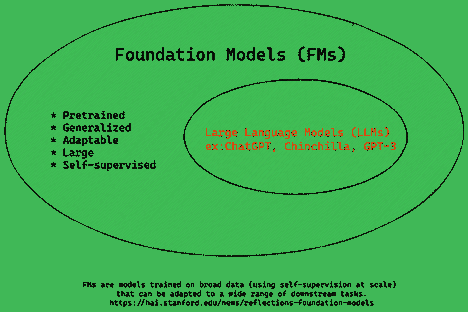

Image source: [Es](https://thebabar.medium.com/essential-guide-to-foundation-models-and-large-language-models-27dab58f7404)sential Guide to Foundation Models and Large Language Models | by Babar M Bhatti | Medium

图片来源： Essential Guide to Foundation Models and Large Language Models |由 Babar M Bhatti |中等

To further clarify this distinction, let’s take ChatGPT as an example. To build the first version of ChatGPT, a model called GPT-3.5 served as the foundation model. This means that OpenAI used some chat-specific data to create a tuned version of GPT-3.5 that was specialized in performing well in conversational scenarios, such as chatbots.

为了进一步澄清这种区别，我们以ChatGPT为例。为了构建 ChatGPT 的第一个版本，一个名为 GPT-3.5 的模型作为基础模型。这意味着 OpenAI 使用一些特定于聊天的数据来创建 GPT-3.5 的调整版本，该版本专门用于在聊天机器人等对话场景中表现良好。

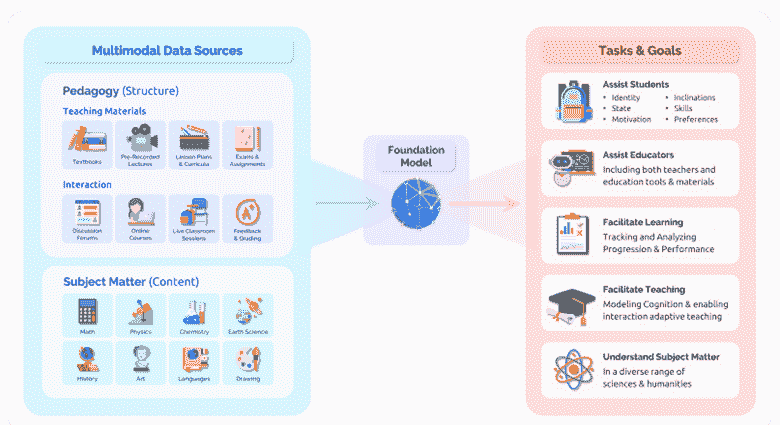

Image source: [2108.0725](https://arxiv.org/pdf/2108.07258.pdf?WT.mc_id=academic-105485-koreyst)[8](https://arxiv.org/pdf/2108.07258.pdf?WT.mc_id=academic-105485-koreyst).pdf (arxiv.org)

图片来源：2108.07258.pdf （arxiv.org）

### [Open Source versu](https://microsoft.github.io/generative-ai-for-beginners/#/02-exploring-and-comparing-different-llms/README?wt.mc_id=academic-105485-koreyst&id=open-source-versus-proprietary-models)[s Propr](https://microsoft.github.io/generative-ai-for-beginners/#/02-exploring-and-comparing-different-llms/README?wt.mc_id=academic-105485-koreyst&id=open-source-versus-proprietary-models)ietary Models 开源与专有模型

Another way to categorize LLMs is whether they are open source or proprietary.

另一种分类LLMs方式是它们是开源的还是专有的。

[Open-s](https://crfm.stanford.edu/2023/03/13/alpaca.html?WT.mc_id=academic-105485-koreyst)ou[rce m](https://huggingface.co/bigscience/bloom)odels[ are ](https://llama.meta.com/)models that are made available to the public and can be used by anyone. They are often made available by the company that created them, or by the research community. These models are allowed to be inspected, modified, and customized for the various use cases in LLMs. However, they are not always optimized for production use, and may not be as performant as proprietary models. Plus, funding for open-source models can be limited, and they may not be maintained long term or may not be updated with the latest research. Examples of popular open source models include Alpaca, Bloom and LLaMA.

开源模型是向公众开放的模型，任何人都可以使用。它们通常由创建它们的公司或研究社区提供。允许对这些模型进行检查、修改和定制，以适应 LLMs中的各种用例。但是，它们并不总是针对生产使用进行优化，并且性能可能不如专有模型。此外，开源模型的资金可能有限，它们可能无法长期维持，或者可能不会根据最新研究进行更新。流行的开源模型示例包括 Alpaca、Bloom 和 LLaMA。

Proprietary models are models that are owned by a company and are not made available to the public. These models are often optimized for production use. However, they are not allowed to be inspected, modified, or customized for different use cases. Plus, they are not always available for free, and may require a subscription or payment to use. Also, users do not have control over the data that is used to train the model, which means they should entrust the model owner with ensuring commitment to data privacy and responsible use of AI. Examples of popular proprietary models include [OpenAI models](https://platform.openai.com/docs/models/overview?WT.mc_id=academic-105485-koreyst), [Google Bard](https://sapling.ai/llm/bard?WT.mc_id=academic-105485-koreyst) or [Claude 2](https://www.anthropic.com/index/claude-2?WT.mc_id=academic-105485-koreyst).

专有模型是公司拥有且不向公众提供的模型。这些模型通常针对生产使用进行了优化。但是，不允许针对不同的用例对它们进行检查、修改或定制。此外，它们并不总是免费提供的，可能需要订阅或付费才能使用。此外，用户无法控制用于训练模型的数据，这意味着他们应该委托模型所有者确保对数据隐私的承诺和负责任地使用 AI。流行的专有模型示例包括 OpenAI 模型、Google Bard 或 Claude 2。

### [Embedding versus Image generation versus Text and Code generation](https://microsoft.github.io/generative-ai-for-beginners/#/02-exploring-and-comparing-different-llms/README?wt.mc_id=academic-105485-koreyst&id=embedding-versus-image-generation-versus-text-and-code-generation) 嵌入与图像生成与文本和代码生成

LLMs can also be categorized by the output they generate.

LLMs也可以按它们生成的输出进行分类。

Embeddings are a set of models that can convert text into a numerical form, called embedding, which is a numerical representation of the input text. Embeddings make it easier for machines to understand the relationships between words or sentences and can be consumed as inputs by other models, such as classification models, or clustering models that have better performance on numerical data. Embedding models are often used for transfer learning, where a model is built for a surrogate task for which there’s an abundance of data, and then the model weights (embeddings) are re-used for other downstream tasks. An example of this category is OpenAI embeddings.

嵌入是一组可以将文本转换为数字形式的模型，称为嵌入，它是输入文本的数字表示。嵌入使机器更容易理解单词或句子之间的关系，并且可以被其他模型用作输入，例如分类模型或在数值数据上具有更好性能的聚类模型。嵌入模型通常用于迁移学习，其中为具有大量数据的代理任务构建模型，然后将模型权重（嵌入）重新用于其他下游任务。此类别的一个例子是 OpenAI 嵌入。

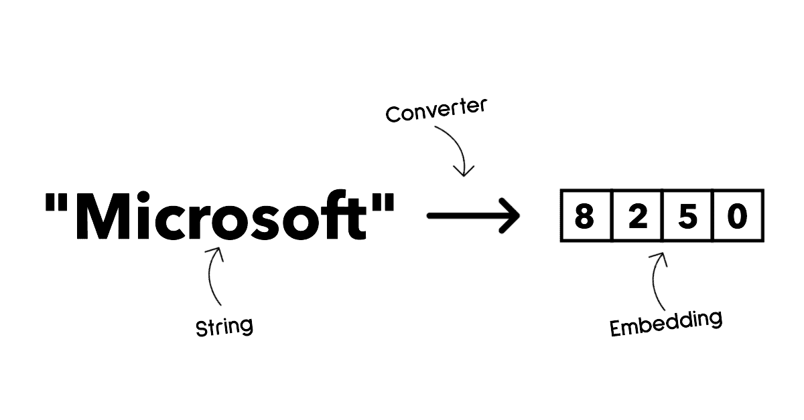

Image generation models are models that generate images. These models are often used for image editing, image synthesis, and image translation. Image generation models are often trained on large datasets of images, such as [LAION-5B](https://laion.ai/blog/laion-5b/?WT.mc_id=academic-105485-koreyst), and can be used to generate new images or to edit existing images with inpainting, super-resolution, and colorization techniques. Examples include [DALL-E-3](https://openai.com/dall-e-3?WT.mc_id=academic-105485-koreyst) and Stable Diffusion models.

图像生成模型是生成图像的模型。这些模型通常用于图像编辑、图像合成和图像翻译。图像生成模型通常在大型图像数据集（例如 LAION-5B）上进行训练，可用于生成新图像或使用修复、超分辨率和着色技术编辑现有图像。示例包括 DALL-E-3 和 Stable Diffusion 模型。

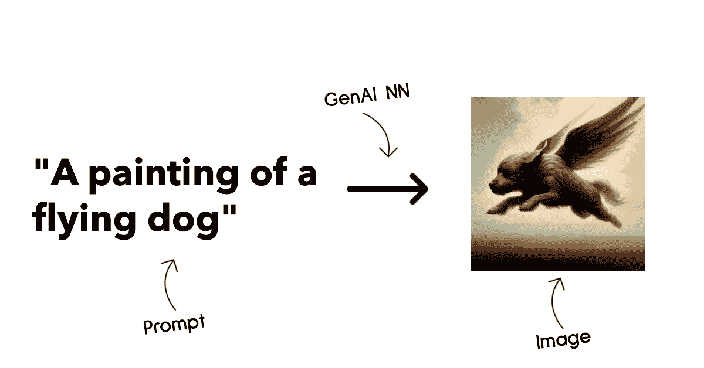

Text and code generation models are models that generate text or code. These models are often used for text summarization, translation, and question answering. Text generation models are often trained on large datasets of text, such as [BookCorpus](https://www.cv-foundation.org/openaccess/content_iccv_2015/html/Zhu_Aligning_Books_and_ICCV_2015_paper.html?WT.mc_id=academic-105485-koreyst), and can be used to generate new text, or to answer questions. Code generation models, like [CodeParrot](https://huggingface.co/codeparrot?WT.mc_id=academic-105485-koreyst), are often trained on large datasets of code, such as GitHub, and can be used to generate new code, or to fix bugs in existing code.

文本和代码生成模型是生成文本或代码的模型。这些模型通常用于文本摘要、翻译和问答。文本生成模型通常在大型文本数据集（例如 BookCorpus）上进行训练，可用于生成新文本或回答问题。代码生成模型（如 CodeParrot）通常在大型代码数据集（如 GitHub）上进行训练，可用于生成新代码或修复现有代码中的错误。

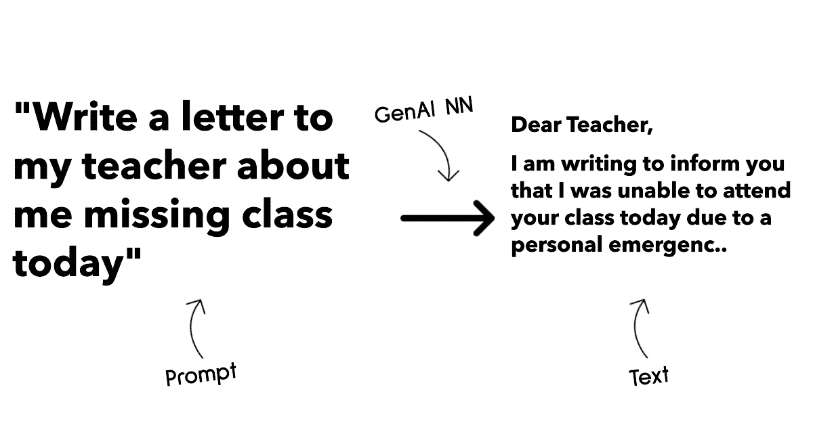

### [Encoder-Decoder versus Decoder-only](https://microsoft.github.io/generative-ai-for-beginners/#/02-exploring-and-comparing-different-llms/README?wt.mc_id=academic-105485-koreyst&id=encoder-decoder-versus-decoder-only) 编码器-解码器与仅解码器

To talk about the different types of architectures of LLMs, let's use an analogy.

要谈谈不同类型的LLMs架构，我们来做个类比。

Imagine your manager gave you a task for writing a quiz for the students. You have two colleagues; one oversees creating the content and the other oversees reviewing them.

想象一下，你的经理给你一个任务，让你为学生写一个测验。你有两个同事;一个监督内容的创建，另一个监督审查内容。

The content creator is like a Decoder only model, they can look at the topic and see what you already wrote and then he can write a course based on that. They are very good at writing engaging and informative content, but they are not very good at understanding the topic and the learning objectives. Some examples of Decoder models are GPT family models, such as GPT-3.

内容创建者就像一个仅限解码器的模型，他们可以查看主题并查看您已经写过的内容，然后他可以基于此编写课程。他们非常擅长撰写引人入胜且信息丰富的内容，但他们不太擅长理解主题和学习目标。解码器模型的一些示例是 GPT 系列模型，例如 GPT-3。

The reviewer is like an Encoder only model, they look at the course written and the answers, noticing the relationship between them and understanding context, but they are not good at generating content. An example of Encoder only model would be BERT.

审阅者就像一个仅使用 Encoder 的模型，他们查看编写的课程和答案，注意到它们之间的关系并理解上下文，但他们不擅长生成内容。仅编码器模型的一个示例是 BERT。

Imagine that we can have someone as well who could create and review the quiz, this is an Encoder-Decoder model. Some examples would be BART and T5.

想象一下，我们也可以有人可以创建和审查测验，这是一个编码器-解码器模型。一些例子是 BART 和 T5。

### Service versus Model 服务与模型

Now, let's talk about the difference between a service and a model. A service is a product that is offered by a Cloud Service Provider, and is often a combination of models, data, and other components. A model is the core component of a service, and is often a foundation model, such as an LLM.

现在，我们来谈谈服务和模型之间的区别。服务是由云服务提供商提供的产品，通常是模型、数据和其他组件的组合。模型是服务的核心组件，通常是基础模型，例如 LLM.

Services are often optimized for production use and are often easier to use than models, via a graphical user interface. However, services are not always available for free, and may require a subscription or payment to use, in exchange for leveraging the service owner’s equipment and resources, optimizing expenses and scaling easily. An example of service is Azure OpenAI Service, which offers a pay-as-you-go rate plan, meaning users are charged proportionally to how much they use the service Also, Azure OpenAI Service offers enterprise-grade security and responsible AI framework on top of the models' capabilities.

通过图形用户界面，服务通常针对生产使用进行优化，并且通常比模型更易于使用。但是，服务并不总是免费提供的，可能需要订阅或付费才能使用，以换取利用服务所有者的设备和资源、优化费用和轻松扩展。服务的一个例子是 Azure OpenAI 服务，它提供即用即付的费率计划，这意味着用户根据他们使用该服务的金额按比例收费此外，Azure OpenAI 服务在模型的功能之上提供企业级安全性和负责任的 AI 框架。

Models are just the Neural Network, with the parameters, weights, and others. Allowing companies to run locally, however, would need to buy equipment, build structure to scale and buy a license or use an open-source model. A model like LLaMA is available to be used, requiring computational power to run the model.

模型只是神经网络，包括参数、权重等。然而，允许公司在本地运行需要购买设备，构建结构以扩大规模，并购买许可证或使用开源模型。像 LLaMA 这样的模型可供使用，需要计算能力来运行模型。

## [How to test and iterate with different models to understand performance on Azure](https://microsoft.github.io/generative-ai-for-beginners/#/02-exploring-and-comparing-different-llms/README?wt.mc_id=academic-105485-koreyst&id=how-to-test-and-iterate-with-different-models-to-understand-performance-on-azure) 如何使用不同的模型进行测试和迭代，以了解 Azure 上的性能

Once our team has explored the current LLMs landscape and identified some good candidates for their scenarios, the next step is testing them on their data and on their workload.[This is an i](https://learn.microsoft.com/azure/ai-studio/how-to/model-catalog-overview?WT.mc_id=academic-105485-koreyst)tera[tive process, d](https://ai.azure.com/?WT.mc_id=academic-105485-koreyst)one by experiments and measures. Most of the models we mentioned in previous paragraphs (OpenAI models, open source models like Llama2, and Hugging Face transformers) are available in the Model Catalog in Azure AI Studio.

一旦我们的团队探索了当前LLMs的情况并为他们的方案确定了一些好的候选者，下一步就是在他们的数据和工作负载上测试他们。这是一个迭代过程，通过实验和度量来完成。我们在前几段中提到的大多数模型（OpenAI 模型、Llama2 等开源模型和 Hugging Face 转换器）都可以在 Azure AI Studio 的模型目录中找到。

[Azure AI Studio](https://learn.microsoft.com/azure/ai-studio/what-is-ai-studio?WT.mc_id=academic-105485-koreyst) is a Cloud Platform designed for developers to build generative AI applications and manage the whole development lifecycle - from experimentation to evaluation - by combining all Azure AI services into a single hub with an handy GUI. The Model Catalog in Azure AI Studio enables the user to:

Azure AI Studio 是一个云平台，专为开发人员设计，通过将所有 Azure AI 服务合并到一个带有方便 GUI 的中心，构建生成式 AI 应用程序并管理整个开发生命周期（从实验到评估）。Azure AI Studio 中的模型目录使用户能够：

+   Find the Foundation Model of interest in the catalog - either proprietary or open source, filtering by task, license, or name. To improve searchability, the models are organized into collections, like Azure OpenAI collection, Hugging Face collection, and more.

    在目录中找到感兴趣的基础模型 - 专有或开源，按任务、许可证或名称进行筛选。为了提高可搜索性，模型被组织到集合中，例如 Azure OpenAI 集合、Hugging Face 集合等。

    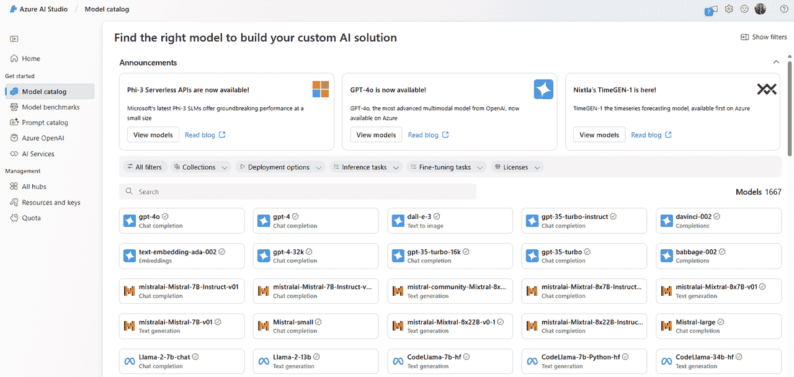

+   Review the model card, including a detailed description of intended use and training data, code samples and evaluation results on internal evaluations library.

    审查模型卡，包括预期使用和训练数据的详细说明、代码样本和内部评估库中的评估结果。

    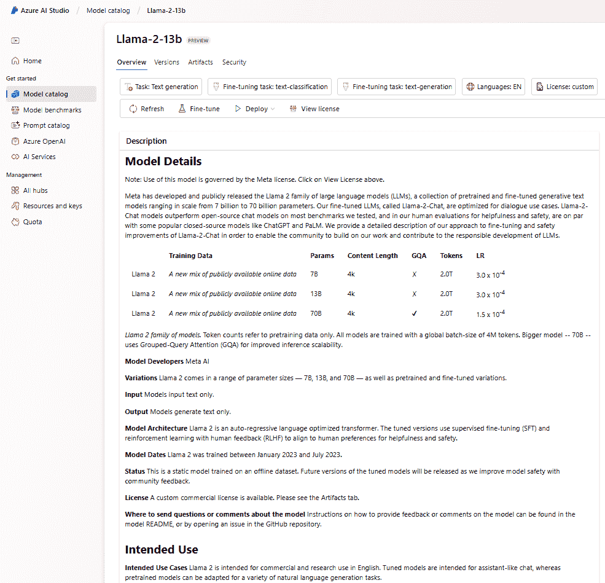

+   Compare benchmarks across models and datasets available in the industry to assess which one meets the business scenario, through the Model Benchmarks pane.

    通过“模型基准”窗格，比较行业中可用的模型和数据集之间的基准，以评估哪一个满足业务方案。

    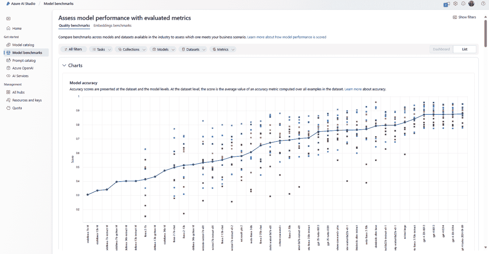

+   Fine-tune the model on custom training data to improve model performance in a specific workload, leveraging the experimentation and tracking capabilities of Azure AI Studio.

    利用 Azure AI Studio 的试验和跟踪功能，根据自定义训练数据微调模型，以提高特定工作负载中的模型性能。

    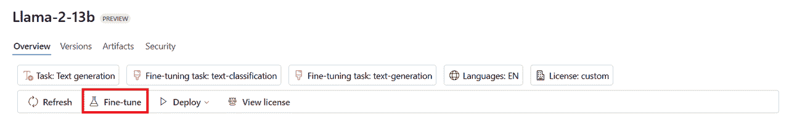

+   Deploy the original pre-trained model or the fine-tuned version [to a remote real time inference](https://learn.microsoft.com/azure/ai-studio/how-to/model-catalog-overview#model-deployment-managed-compute-and-serverless-api-pay-as-you-go?WT.mc_id=academic-105485-koreyst) - managed compute - or serverless api endpoint - pay-as-you-go to enable applications to consume it.

    将原始预训练模型或微调版本部署到远程实时推理（托管计算）或无服务器 API 端点（即用即付），使应用程序能够使用它。

    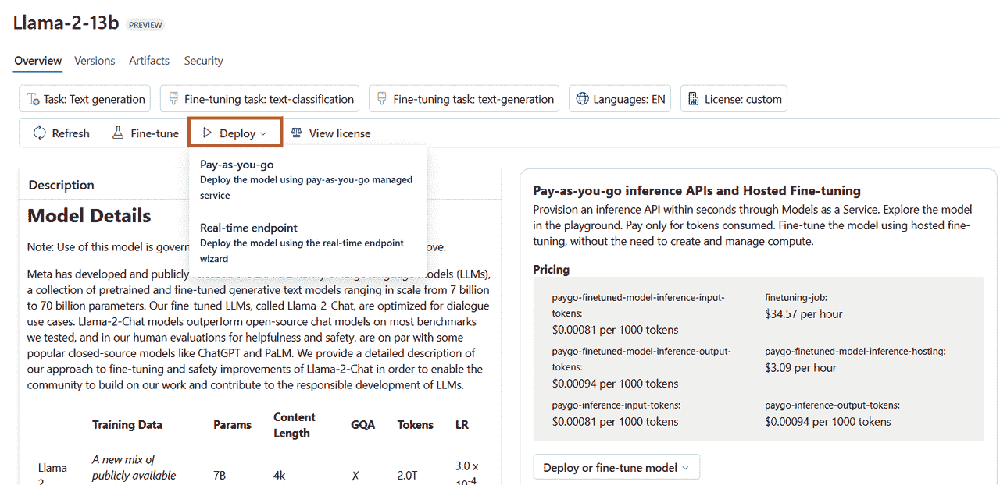

> [!NOTE] Not all models in the catalog are currently available for fine-tuning and/or pay-as-you-go deployment. Check the model card for details on the model's capabilities and limitations.

> [!注意] 并非目录中的所有型号当前都可用于微调和/或即用即付部署。请查看模型卡，了解有关模型的功能和限制的详细信息。

## Improving LLM results 改善LLM结果

We’ve explored with our startup team different kinds of LLMs and a Cloud Platform (Azure Machine Learning) enabling us to compare different models, evaluate them on test data, improve performance and deploy them on inference endpoints.

我们已经与我们的启动团队一起探索了不同类型的LLMs云平台（Azure 机器学习），使我们能够比较不同的模型，在测试数据上评估它们，提高性能并将它们部署在推理端点上。

But when shall they consider fine-tuning a model rather than using a pre-trained one? Are there other approaches to improve model performance on specific workloads?

但是，他们什么时候应该考虑微调模型而不是使用预训练模型呢？是否有其他方法可以提高特定工作负载上的模型性能？

There are several approaches a business can use to get the results they need from an LLM. You can select different types of models with different degrees of training when deploying an LLM in production, with different levels of complexity, cost, and quality. Here are some different approaches:

企业可以使用多种方法来从 LLM.在生产环境中部署时LLM，您可以选择具有不同训练程度的不同类型的模型，这些模型具有不同的复杂程度、成本和质量级别。以下是一些不同的方法：

+   Prompt engineering with context. The idea is to provide enough context when you prompt to ensure you get the responses you need.

    根据上下文提示工程设计。这个想法是在提示时提供足够的上下文，以确保您得到所需的响应。

+   Retrieval Augmented Generation, RAG. Your data might exist in a database or web endpoint for example, to ensure this data, or a subset of it, is included at the time of prompting, you can fetch the relevant data and make that part of the user's prompt.

    检索增强生成，RAG。您的数据可能存在于数据库或 Web 端点中，例如，为了确保在提示时包含此数据或其子集，您可以提取相关数据并使该部分成为用户的提示。

+   Fine-tuned model. Here, you trained the model further on your own data which leads to the model being more exact and responsive to your needs but might be costly.

    微调模型。在这里，您使用自己的数据进一步训练了模型，这使模型更加精确并响应您的需求，但可能会产生高昂的成本。

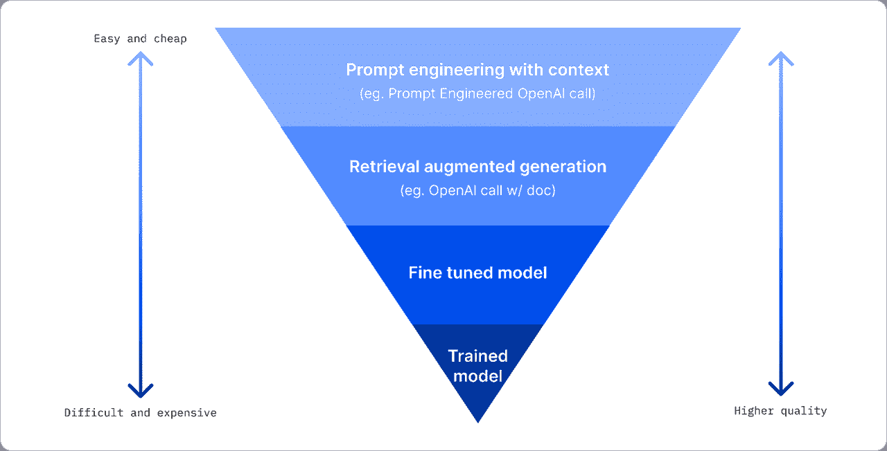

Img source: [Four Ways that Enterprises Deploy LLMs | Fiddler AI Blog](https://www.fiddler.ai/blog/four-ways-that-enterprises-deploy-llms?WT.mc_id=academic-105485-koreyst)

Img 来源：企业部署LLMs的四种方式 |Fiddler AI 博客

### [Prompt Engineering with Context](https://microsoft.github.io/generative-ai-for-beginners/#/02-exploring-and-comparing-different-llms/README?wt.mc_id=academic-105485-koreyst&id=prompt-engineering-with-context) 具有上下文的提示工程

Pre-trained LLMs work very well on generalized natural language tasks, even by calling them with a short prompt, like a sentence to complete or a question – the so-called “zero-shot” learning.

预训练LLMs在广义自然语言任务上效果非常好，即使通过简短的提示来调用它们，比如要完成的句子或一个问题——即所谓的“零样本”学习。

However, the more the user can frame their query, with a detailed request and examples – the Context – the more accurate and closest to user’s expectations the answer will be. In this case, we talk about “one-shot” learning if the prompt includes only one example and “few shot learning” if it includes multiple examples. Prompt engineering with context is the most cost-effective approach to kick-off with.

但是，用户使用详细的请求和示例（上下文）构建他们的查询的次数越多，答案就越准确，最接近用户的期望。在这种情况下，如果提示仅包含一个示例，则我们谈论“一次性”学习，如果提示包含多个示例，则谈论“几次学习”。根据上下文进行及时的工程设计是最具成本效益的启动方法。

### [Retrieval Augmented Generation (RAG)](https://microsoft.github.io/generative-ai-for-beginners/#/02-exploring-and-comparing-different-llms/README?wt.mc_id=academic-105485-koreyst&id=retrieval-augmented-generation-rag) 检索增强生成 （RAG）

LLMs have the limitation that they can use only the data that has been used during their training to generate an answer. This means that they don’t know anything about the facts that happened after their training process, and they cannot access non-public information (like company data). This can be overcome through RAG, a technique that augments prompt with external data in the form of chunks of documents, considering prompt length limits. This is supported by Vector database tools (like Azure Vector Search) that retrieve the useful chunks from varied pre-defined data sources and add them to the prompt Context.

LLMs有一个限制，即他们只能使用在训练期间使用的数据来生成答案。这意味着他们对培训过程之后发生的事实一无所知，并且他们无法访问非公开信息（如公司数据）。这可以通过 RAG 来克服，RAG 是一种技术，它以文档块的形式使用外部数据增强提示，同时考虑提示长度限制。矢量数据库工具（如 Azure 矢量搜索）支持此功能，这些工具从各种预定义数据源中检索有用的块，并将它们添加到提示上下文中。

This technique is very helpful when a business doesn’t have enough data, enough time, or resources to fine-tune an LLM, but still wishes to improve performance on a specific workload and reduce risks of fabrications, i.e., mystification of reality or harmful content.

当企业没有足够的数据、足够的时间或资源来微调 LLM，但仍希望提高特定工作负载的性能并降低捏造的风险时，这种技术非常有用，即对现实的神秘化或有害内容。

### Fine-tuned model 微调模型

Fine-tuning is a process that leverages transfer learning to ‘adapt’ the model to a downstream task or to solve a specific problem. Differently from few-shot learning and RAG, it results in a new model being generated, with updated weights and biases. It requires a set of training examples consisting of a single input (the prompt) and its associated output (the completion). This would be the preferred approach if:

微调是一个利用迁移学习将模型“适应”到下游任务或解决特定问题的过程。与小样本学习和 RAG 不同，它会导致生成一个新模型，并具有更新的权重和偏差。它需要一组训练示例，由单个输入（提示）及其关联的输出（完成）组成。如果出现以下情况，这将是首选方法：

+   Using fine-tuned models. A business would like to use fine-tuned less capable models (like embedding models) rather than high performance models, resulting in a more cost effective and fast solution.

    使用微调的模型。企业希望使用微调的功能较弱的模型（如嵌入模型）而不是高性能模型，从而获得更具成本效益和更快速的解决方案。

+   Considering latency. Latency is important for a specific use-case, so it’s not possible to use very long prompts or the number of examples that should be learned from the model doesn’t fit with the prompt length limit.

    考虑延迟。延迟对于特定用例很重要，因此无法使用很长的提示，或者应从模型中学习的示例数量不符合提示长度限制。

+   Staying up to date. A business has a lot of high-quality data and ground truth labels and the resources required to maintain this data up to date over time.

    保持最新状态。企业拥有大量高质量的数据和真实值标签，以及随着时间的推移保持这些数据更新所需的资源。

## Trained model 经过训练的模型

Training an LLM from scratch is without a doubt the most difficult and the most complex approach to adopt, requiring massive amounts of data, skilled resources, and appropriate computational power. This option should be considered only in a scenario where a business has a domain-specific use case and a large amount of domain-centric data.

LLM毫无疑问，从头开始训练是最困难和最复杂的方法，需要大量的数据、熟练的资源和适当的计算能力。只有在企业具有特定于域的用例和大量以域为中心的数据的情况下，才应考虑此选项。

## Knowledge check 知识检查

What could be a good approach to improve LLM completion results?

改善LLM完井结果的好方法是什么？

1. Prompt engineering with context

   根据上下文进行提示工程设计

2. RAG 抹布

3. Fine-tuned model 微调模型

A:3, if you have the time and resources and high quality data, fine-tuning is the better option to stay up to date. However, if you're looking at improving things and you're lacking time it's worth considering RAG first.

A：3，如果您有时间、资源和高质量的数据，微调是保持最新状态的更好选择。但是，如果您正在考虑改进事情并且缺乏时间，那么值得首先考虑 RAG。

## 🚀 Challenge 🚀 挑战

[Read up](https://learn.microsoft.com/azure/search/retrieval-augmented-generation-overview?WT.mc_id=academic-105485-koreyst) more on how you can use RAG for your business.

详细了解如何使用 RAG 开展业务。

## [Great Work](https://microsoft.github.io/generative-ai-for-beginners/#/02-exploring-and-comparing-different-llms/README?wt.mc_id=academic-105485-koreyst&id=great-work-continue-your-learning), Continue Your Learning 干得好，继续你的学习

After completing this lesson, check out our Generative AI Learning collection to continue leveling up your Generative AI knowledge!

完成本课后，请查看我们的生成式 AI 学习合集，继续提升您的生成式 AI 知识！

Head over to Lesson 3 where we [will look at how](https://microsoft.github.io/generative-ai-for-beginners/#/03-using-generative-ai-responsibly/README?wt.mc_id=academic-105485-koreyst) to build with Generative AI Responsibly!

前往第 3 课，我们将了解如何负责任地使用生成式 AI 进行构建！

<https://aigcreative.feishu.cn/sync/K4Gvd9vUQsy9Oubwqaeclu0Fnbg>
