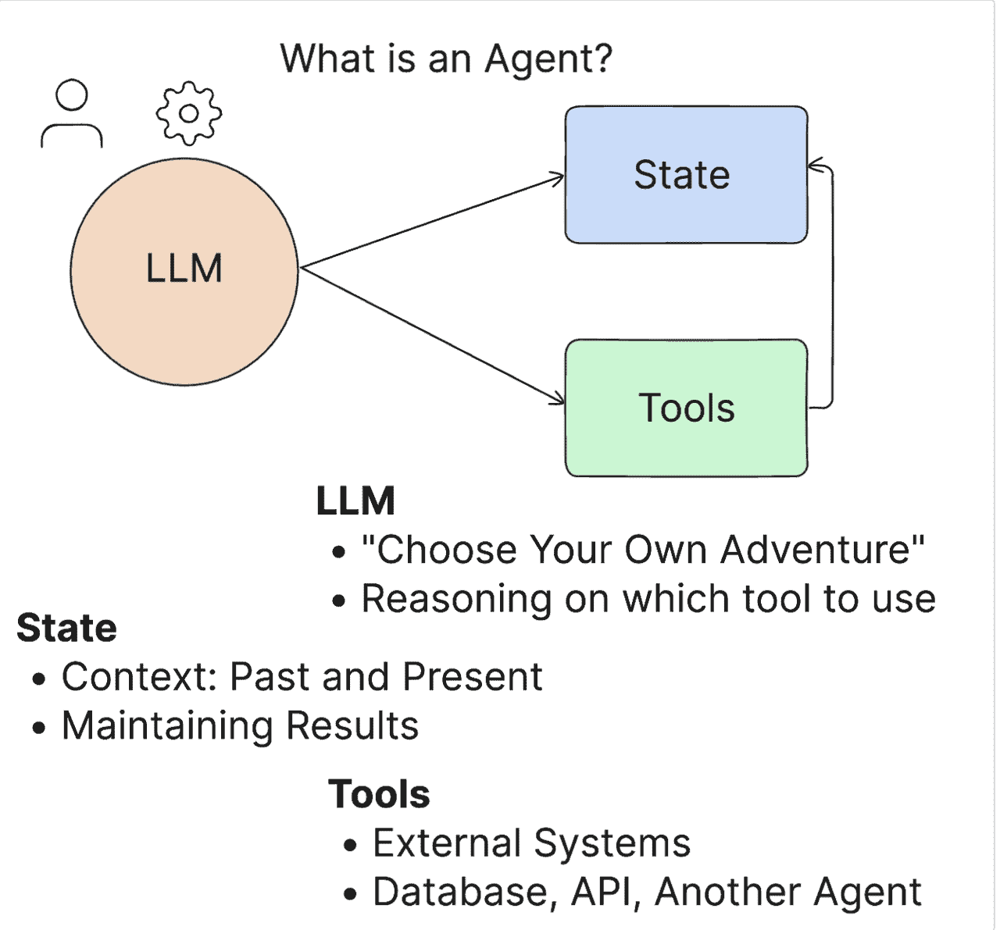
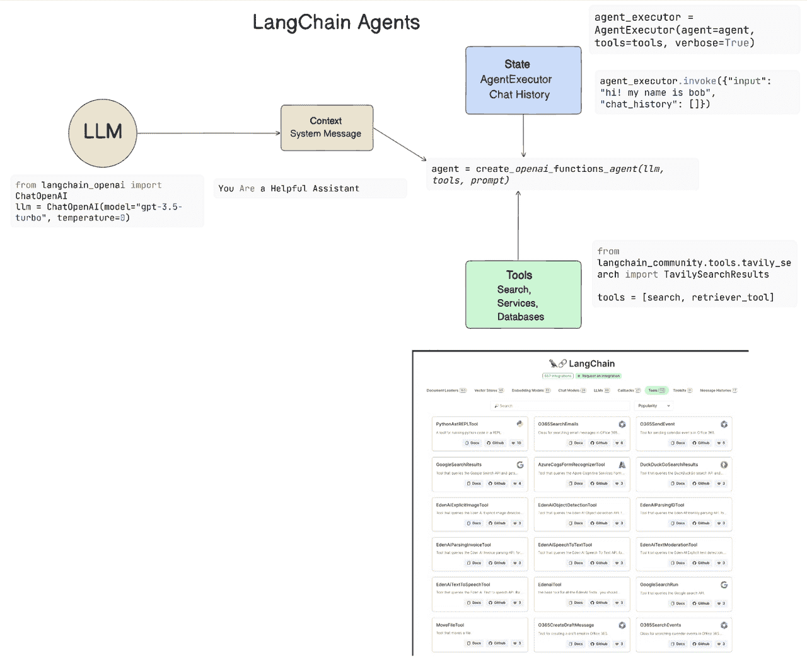
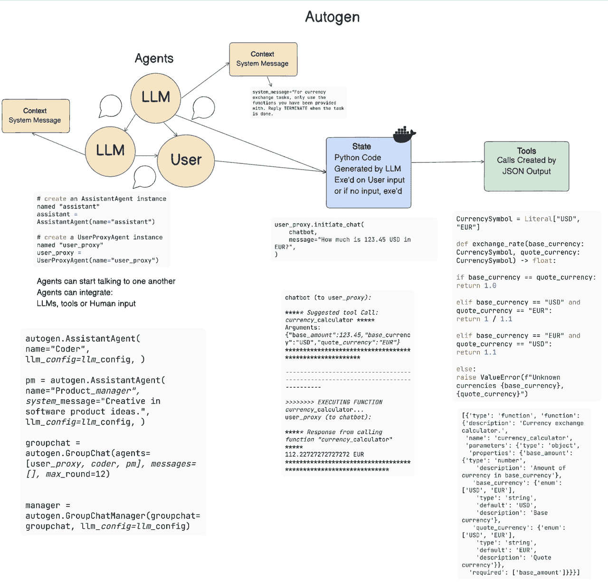
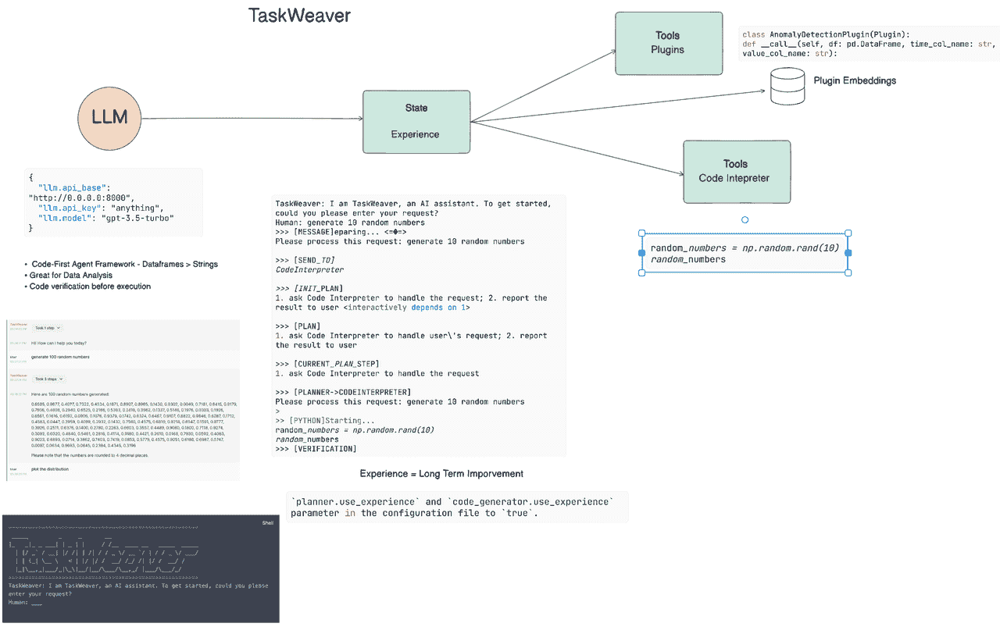
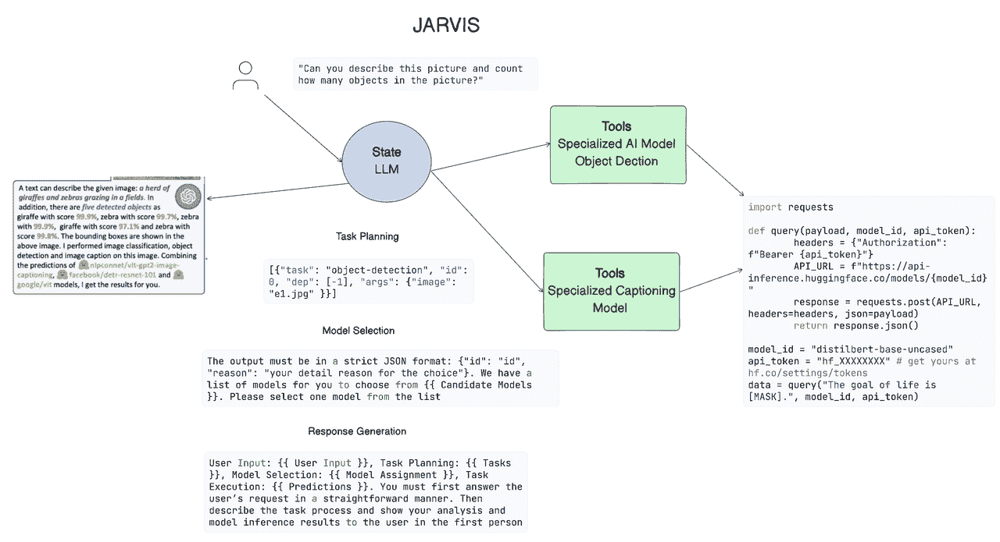

# 17-AI Agent

> 来源：[https://aigcreative.feishu.cn/docx/H3kgdCevho9h1VxxjQtcrbf9nSc](https://aigcreative.feishu.cn/docx/H3kgdCevho9h1VxxjQtcrbf9nSc)

## [Introduction 介绍](https://microsoft.github.io/generative-ai-for-beginners/#/17-ai-agents/README?wt.mc_id=academic-105485-koreyst&id=introduction)

AI Agents represent an exciting development in Generative AI, enabling Large Language Models (LLMs) to evolve from assistants into agents capable of taking actions. AI Agent frameworks enable developers to create applications that give LLMs access to tools and state management. These frameworks also enhance visibility, allowing users and developers to monitor the actions planned by LLMs, thereby improving experience management.

AI 代理代表了生成式 AI 的一个令人兴奋的发展，使大型语言模型（LLMs）能够从助手演变为能够采取行动的代理。AI 代理框架使开发人员能够创建应用程序，这些应用程序可以访问 LLMs 工具和状态管理。这些框架还增强了可见性，允许用户和开发人员监控 LLMs 计划的行动，从而改进体验管理。

The lesson will cover the following areas:

本课程将涵盖以下几个方面：

+ Understanding what an AI Agent is - What exactly is an AI Agent?

  了解什么是 AI 代理 - AI 代理到底是什么？

+ Exploring four different AI Agent Frameworks - What makes them unique?

  探索四种不同的 AI 代理框架 - 是什么让它们与众不同？

+ Applying these AI Agents to different use cases - When should we use AI Agents?

  将这些 AI 代理应用于不同的用例 - 我们什么时候应该使用 AI 代理？

## Learning goals 学习目标

After taking this lesson, you'll be able to:

学习完本课程后，您将能够：

+ Explain what AI Agents are and how they can be used.

  解释什么是 AI 代理以及如何使用它们。

+ Have an understanding of the differences between some of the popular AI Agent Frameworks, and how they differ.

  了解一些流行的 AI 代理框架之间的差异，以及它们之间的区别。

+ Understand how AI Agents function in order to build applications with them.

  了解 AI 代理的功能，以便使用它们构建应用程序。

## What Are AI Agents? 什么是 AI 代理？

AI Agents are a very exciting field in the world of Generative AI. With this excitement comes sometimes a confusion of terms and their application. To keep things simple and inclusive of most of the tools that refer to AI Agents, we are going to use this definition:

AI 代理是生成式 AI 世界中一个非常令人兴奋的领域。随着这种兴奋，有时会对术语及其应用感到困惑。为了简单起见并包括大多数引用 AI 代理的工具，我们将使用以下定义：

AI Agents allow Large Language Models (LLMs) to perform tasks by giving them access to a state and tools.

AI 代理允许大型语言模型（LLMs）通过授予它们对状态和工具的访问权限来执行任务。



Let's define these terms:

让我们定义这些术语：

+ Large Language Models - These are the models referred to throughout this course such as GPT-3.5, GPT-4, Llama-2, etc.

  大型语言模型 - 这些是本课程中引用的模型，例如 GPT-3.5、GPT-4、Llama-2 等。

+ State - This refers to the context that the LLM is working in. The LLM uses the context of its past actions and the current context, guiding its decision-making for subsequent actions. AI Agent Frameworks allow developers to maintain this context easier.

  状态 - 这是指 LLM 正在其中工作的上下文。LLM 使用其过去行动和当前环境的背景，指导其后续行动的决策。AI 代理框架使开发人员能够更轻松地维护此上下文。

+ Tools - To complete the task that the user has requested and that the LLM has planned out, the LLM needs access to tools. Some examples of tools can be a database, an API, an external application or even another LLM!

  工具 - 要完成用户请求并 LLM 已计划的任务，需要 LLM 访问工具。工具的一些示例可以是数据库、API、外部应用程序，甚至是另一个 LLM！

## LangChain Agents LangChain 代理

LangChain Agents is an implementation of the definitions we provided above.

LangChain Agents 是我们上面提供的定义的一个实现。

To manage the state, it uses a built-in function called the `AgentExecutor`. This accepts the defined `agent` and the `tools` that are available to it.

为了管理状态，它使用了一个名为 `AgentExecutor` 的内置函数。它接受定义的 `agent` 和可用的 `tools`。

The `AgentExecutor` also stores the chat history to provide the context of the chat.

`AgentExecutor` 还存储聊天历史记录以提供聊天的上下文。



LangChain offers a catalog of tools that can be imported into your application in which the LLM can get access to. These are made by the community and by the LangChain team.

LangChain 提供了一个工具目录，可以将其导入到您的应用程序中，LLM 可以在其中访问。这些都是由社区和 LangChain 团队制作的。

You can then define these tools and pass them to the `AgentExecutor`.

然后，您可以定义这些工具并将它们传递给 `AgentExecutor`。

Visibility is another important aspect when talking about AI Agents. It is important for application developers to understand which tool the LLM is using and why. For that, the team at LangChain have developed LangSmith.

在谈论 AI 代理时，可见性是另一个重要方面。对于应用程序开发人员来说，了解 LLM 正在使用哪个工具以及为什么使用非常重要。为此，LangChain 的团队开发了 LangSmith。

## [AutoGen](https://microsoft.github.io/generative-ai-for-beginners/#/17-ai-agents/README?wt.mc_id=academic-105485-koreyst&id=autogen)

The next AI Agent framework we will discuss is [AutoGen](https://microsoft.github.io/autogen/?WT.mc_id=academic-105485-koreyst). The main focus of AutoGen is conversations. Agents are both conversable and customizable.

我们将讨论的下一个 AI Agent 框架是 AutoGen。AutoGen 的主要关注点是对话。代理既是可对话的，也是可定制的。

Conversable - LLMs can start and continue a conversation with another LLM in order to complete a task. This is done by creating `AssistantAgents` and giving them a specific system message.

可交谈 - LLMs 可以开始并继续与另一个 LLM 的对话以完成任务。这是通过创建 `AssistantAgents` 并为它们提供特定的系统消息来完成的。

```python
autogen.AssistantAgent(
    name="Coder",
    llm_config=llm_config,
)

pm = autogen.AssistantAgent(
    name="Product_manager",
    system_message="Creative in software product ideas.",
    llm_config=llm_config,
)
```

Customizable - Agents can be defined not only as LLMs but be a user or a tool. As a developer, you can define a `UserProxyAgent` which is responsible for interacting with the user for feedback in completing a task. This feedback can either continue the execution of the task or stop it.

可定制 - 代理不仅可以定义为 LLM，还可以定义为用户或工具。作为开发人员，您可以定义一个 `UserProxyAgent`，它负责与用户交互以获取完成任务的反馈。此反馈可以继续执行任务，也可以停止任务。

```python
user_proxy = UserProxyAgent(name="user_proxy")
```

### State and Tools 状态和工具

To change and manage state, an assistant Agent generates Python code to complete the task.

为了更改和管理状态，助理代理会生成 Python 代码以完成任务。

Here is an example of the process:

以下是该过程的一个示例：



#### [LLM Defined](https://microsoft.github.io/generative-ai-for-beginners/#/17-ai-agents/README?wt.mc_id=academic-105485-koreyst&id=llm-defined-with-a-system-message) with a System Message LLM 使用系统消息定义

```python
system_message="For weather related tasks, only use the functions you have been provided with. Reply TERMINATE when the task is done."
```

This system message directs this specific LLM to which functions are relevant for its task. Remember, with AutoGen you can have multiple defined `AssistantAgents` with different system messages.

此系统消息指示该特定 LLM 哪些功能与其任务相关。请记住，使用 AutoGen，您可以拥有多个定义的 `AssistantAgents` 和不同的系统消息。

#### [Chat is](https://microsoft.github.io/generative-ai-for-beginners/#/17-ai-agents/README?wt.mc_id=academic-105485-koreyst&id=chat-is-initiated-by-user) Initiated by User 聊天由用户发起

```python
user_proxy.initiate_chat(
    chatbot,
    message="I am planning a trip to NYC next week, can you help me pick out what to wear?",
)
```

This message from the `user_proxy` (Human) is what will start the process of the Agent to explore the possible functions that it should execute.

来自 `user_proxy`（人类）的这条消息将启动代理的过程，以探索它应该执行的可能功能。

#### Function is Executed 函数已执行

```
chatbot (to user_proxy):
***** Suggested tool Call: get_weather *****
Arguments: {"location":"New York City, NY","time_periond":"7","temperature_unit":"Celsius"}
*****************************************************************

EXECUTING FUNCTION get_weather...

user_proxy (to chatbot):
***** Response from calling function "get_weather" *****
112.22727272727272 EUR
*****************************************************************
```


Once the initial chat is processed, the Agent will send the suggest tool to call. In this case, it is a function called `get_weather`. Depending on your configuration, this function can be automatically executed and read by the Agent or can be executed based on user input.

处理完初始聊天后，座席将发送建议工具进行呼叫。在本例中，它是一个名为 `get_weather` 的函数。根据您的配置，此功能可以由 Agent 自动执行和读取，也可以根据用户输入执行。

You can find a list of AutoGen code samples to further explore how to get started building.

您可以找到 AutoGen 代码示例列表，以进一步探索如何开始构建。

## [Taskweaver](https://microsoft.github.io/generative-ai-for-beginners/#/17-ai-agents/README?wt.mc_id=academic-105485-koreyst&id=taskweaver)

The next agent framework [we will explore](https://microsoft.github.io/TaskWeaver/?WT.mc_id=academic-105485-koreyst) is Taskweaver. It is known as a "code-first" agent because instead of working strictly with strings, it can work with `DataFrames` in Python. This becomes extremely useful for data analysis and generation tasks. This can be things like creating graphs and charts or generating random numbers.

我们将探讨的下一个代理框架是 Taskweaver。它被称为“代码优先”代理，因为它可以与 Python 中的 `DataFrames` 一起工作，而不是严格使用 strings。这对于数据分析和生成任务非常有用。这可以是创建图形和图表或生成随机数之类的事情。

### State and Tools 状态和工具

To manage the state of the conversation, TaskWeaver uses the concept of a Planner. The Planner is a LLM that takes the request from the users and maps out the tasks that need to be completed to fulfill this request.

为了管理会话的状态，TaskWeaver 使用了 Planner 的概念。Planner 是一个 LLM，它接受用户的请求，并制定出需要完成的任务来满足此请求。

To complete the tasks the Planner is exposed to the collection of tools called Plugins. This can be Python classes or a general code interpreter. This plugins are stored as embeddings so that the LLM can better search for the correct plugin.

为了完成这些任务，将 Planner 暴露给称为 Plugins 的工具集合。这可以是 Python 类，也可以是通用代码解释器。此插件存储为嵌入，以便 LLM 可以更好地搜索正确的插件。



Here is an example of a plugin to handle anomaly detection:

下面是一个用于处理异常检测的插件示例：

```
class AnomalyDetectionPlugin(Plugin): def __call__(self, df: pd.DataFrame, time_col_name: str, value_col_name: str):
```

The code is verified before executing. Another feature to manage context in Taskweaver is experience. Experience allows for the context of a conversation to be stored over to the long term in a YAML file. This can be configured so that the LLM improves over time on certain tasks given that it is exposed to prior conversations.

代码在执行之前经过验证。在 Taskweaver 中管理上下文的另一个功能是 experience。Experience 允许将对话的上下文长期存储在 YAML 文件中。可以对此进行配置，以便随着时间的推移，LLM 在某些任务上会进行改进，因为它暴露于先前的对话中。

## [JARVIS 贾维斯](https://microsoft.github.io/generative-ai-for-beginners/#/17-ai-agents/README?wt.mc_id=academic-105485-koreyst&id=jarvis)

The last agent framework [we will explore](https://github.com/microsoft/JARVIS?tab=readme-ov-file?WT.mc_id=academic-105485-koreyst) is JARVIS. What makes JARVIS unique is that it uses an LLM to manage the state of the conversation and the tools are other AI models. Each of the AI models are specialized models that perform certain tasks such as object detection, transcription or image captioning.

我们将探讨的最后一个代理框架是 JARVIS。JARVIS 的独特之处在于它使用一个 LLM 来管理对话的状态，而其他工具是 AI 模型。每个 AI 模型都是执行特定任务的专用模型，例如对象检测、转录或图像字幕。



The LLM, being a general purpose model, receives the request from the user and identifies the specific task and any arguments/data that is needed to complete the task.

LLM 是一种通用模型，它接收来自用户的请求，并标识特定任务以及完成任务所需的任何参数/数据。

```
[{"task": "object-detection", "id": 0, "dep": [-1], "args": {"image": "e1.jpg" }}]
```

The LLM then formats the request in a manner that the specialized AI model can interpret, such as JSON. Once the AI model has returned its prediction based on the task, the LLM receives the response.

然后，LLM 以专用 AI 模型可以解释的方式（例如 JSON）格式化请求。一旦 AI 模型根据任务返回预测，LLM 就会收到响应。

If multiple models are required to complete the task, it will also interpret the response from those models before bringing them together to generate to the response to the user.

如果需要多个模型来完成任务，它还将解释来自这些模型的响应，然后将它们组合在一起以生成对用户的响应。

The example below shows how this would work when a user is requesting a description and count of the objects in a picture:

以下示例显示了当用户请求图片中对象的描述和计数时，这将如何工作：

## [Assignment 分配](https://microsoft.github.io/generative-ai-for-beginners/#/17-ai-agents/README?wt.mc_id=academic-105485-koreyst&id=assignment)

To continue your learning of AI Agents you can build with AutoGen:

要继续学习 AI 代理，您可以使用 AutoGen 进行构建：

+   An application that simulates a business meeting with different departments of an education startup.

    一个应用程序，模拟与教育初创公司的不同部门的业务会议。

+   Create system messages that guide LLMs in understanding different personas and priorities, and enable the user to pitch a new product idea.

    创建系统消息，指导 LLMs 理解不同的角色和优先事项，并使用户能够提出新的产品创意。

+   The LLM should then generate follow-up questions from each department to refine and improve the pitch and the product idea

    然后，LLM 应该从每个部门生成后续问题，以完善和改进推销和产品创意。

## [Learning does not stop here, continue the Journey 学习并不止于此，继续旅程](https://microsoft.github.io/generative-ai-for-beginners/#/17-ai-agents/README?wt.mc_id=academic-105485-koreyst&id=learning-does-not-stop-here-continue-the-journey)

After completing this lesson, check out our Generative AI Learning collection to continue leveling up your Generative AI knowledge!

完成本课后，请查看我们的生成式 AI 学习合集，继续提升您的生成式 AI 知识！

<https://aigcreative.feishu.cn/sync/K4Gvd9vUQsy9Oubwqaeclu0Fnbg>
