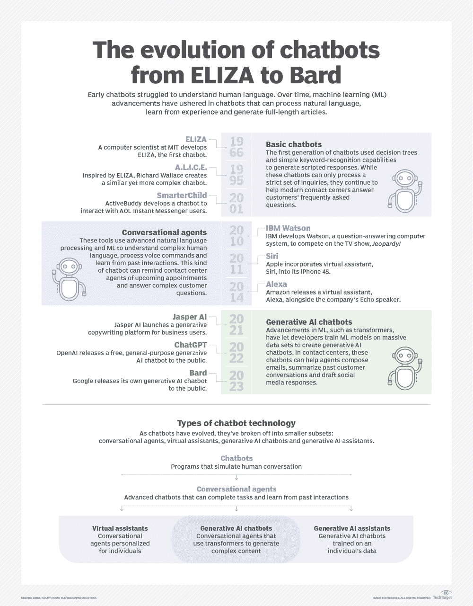
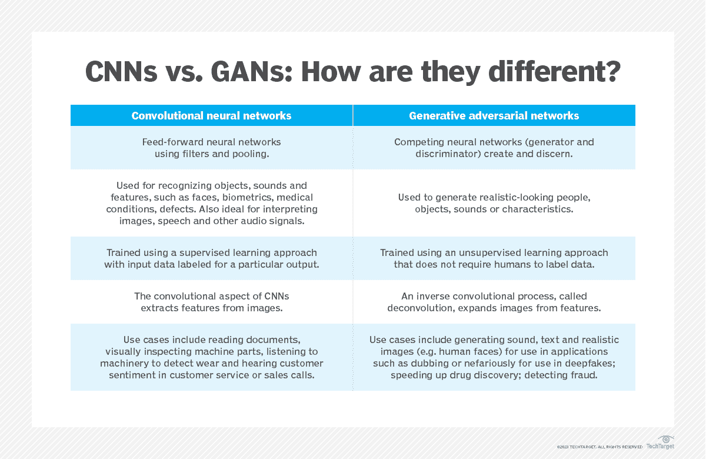
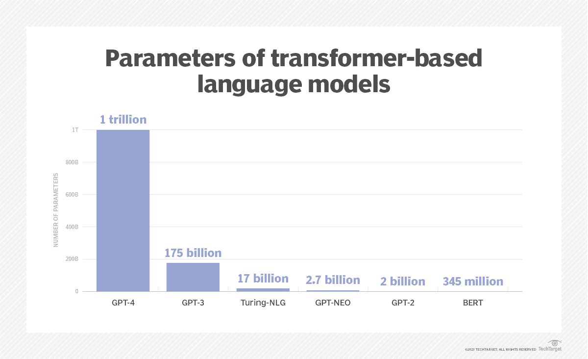
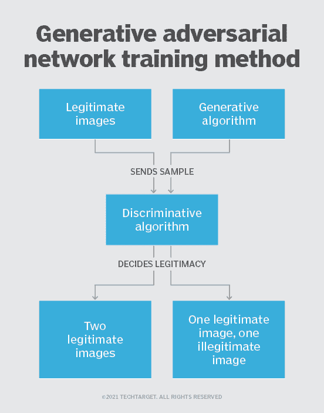

# 生成式AI发展史

> 来源：[https://aigcreative.feishu.cn/docx/HCoMdLnGkoeIbHxpR9rc4rQQnZe](https://aigcreative.feishu.cn/docx/HCoMdLnGkoeIbHxpR9rc4rQQnZe)

ChatGPT的首次亮相引发了围绕生成人工智能的广泛宣传和争议，生成人工智能是人工智能的一个子集，在历史里程碑中根深蒂固。

随着ChatGPT的推出，围绕生成人工智能的热议愈演愈烈，该公司在推出后的两个月内就增长到了1亿多用户。但ChatGPT只是生成人工智能的冰山一角。

世代人工智能的历史实际上可以追溯到90年前。尽管创新和发展比比皆是，但其商业进展相对缓慢——直到最近。在过去五年里，更大的标记数据集、更快的计算机和自动编码未标记数据的新方法的结合加速了生成人工智能的发展。仅在去年一年，就出现了近乎感知的聊天机器人，数十种用于从描述中生成图像的新服务，以及大型语言模型（LLM）几乎适用于业务的各个方面。

今天的许多发展都建立在计算语言学和自然语言处理的进步之上。同样，早期的程序性内容生成工作导致了游戏中的内容生成，参数化设计工作为工业设计奠定了基础。

## **90年，还在继续**

许多关键里程碑点缀着生成型人工智能的发展和创新。

## **1932**

Georges Artsrouni发明了一种机器，据报道，他称之为机械大脑，在编码到穿孔卡片上的机械计算机上进行语言之间的翻译。他制作了第二个版本，并于1937年在巴黎的一次展览上获得了机械学的主要奖项。

## **1957**

语言学家诺姆·乔姆斯基发表了《句法结构》一书，描述了自然语言句子解析和生成的语法规则。这本书还支持语法解析和语法检查等技术。

## **1963**

计算机科学教授Ivan Sutherland介绍了Sketchpad，这是一个交互式3D软件平台，允许用户按程序修改2D和3D内容。1968年，萨瑟兰和同为教授的大卫·埃文斯创办了Evans&Sutherland。他们的一些学生后来创办了皮克斯、Adobe和Silicon Graphics。

## **1964**

数学家兼建筑师克里斯托弗·亚历山大出版了《形式综合笔记》，阐述了自动化设计的原则，这些原则后来影响了产品的参数化和生成设计。1976年，他撰写了《模式语言》，这本书在体系结构中很有影响力，并启发了新的软件开发方法。

## **1966**

麻省理工学院教授Joseph Weizenbaum创建了第一个聊天机器人Eliza，它模拟与心理治疗师的对话。《麻省理工学院新闻》2008年报道称，魏岑鲍姆“对人工智能越来越怀疑”，“震惊地发现，许多用户都认真对待他的程序，并对其敞开心扉。”

自动语言处理咨询委员会（ALPAC）报告称，机器翻译和计算语言学没有兑现承诺，并导致未来20年这两项技术的研究资金削减。

数学家Leonard E.Baum介绍了概率隐马尔可夫模型，该模型后来被用于语音识别、分析蛋白质和生成响应。

## **1968**

计算机科学教授Terry Winograd创建了SHRDLU，这是第一个可以根据用户的指令操纵和推理出区块世界的多模式人工智能。

## **1969**

William A.Woods介绍了增广转换网络，这是一种用于将信息转换为计算机可以处理的形式的图论结构。他为美国国家航空航天局载人航天中心建造了第一个名为LUNAR的自然语言系统，以回答有关阿波罗11号月球岩石的问题。

## **1970**

耶鲁大学计算机科学和心理学教授、认知科学学会联合创始人罗杰·尚克开发了概念依赖理论，以数学方式描述自然语言理解和推理过程。

## **1978**

Don Worth在加州大学洛杉矶分校当程序员时，为Apple II创建了类似流氓的游戏《苹果庄园之下》。该游戏使用程序性内容生成以编程方式创建了一个丰富的游戏世界，可以在当时有限的计算机硬件上运行。

## **1980**

Michael Toy和Glenn Wichman开发了基于Unix的游戏Rogue，该游戏使用程序性内容生成来动态生成新的游戏级别。Toy与人共同创立了A.I.Design公司，几年后将游戏移植到PC上。该游戏激发了后来在游戏行业使用程序内容生成来生成关卡、角色、纹理和其他元素的兴趣。

## **1985**

计算机科学家和哲学家Judea Pearl介绍了贝叶斯网络因果分析，该分析提供了表示不确定性的统计技术，从而产生了以特定风格、语气或长度生成内容的方法。

## **1986**

Michael Irwin Jordan出版了《串行顺序：一种并行分布式处理方法》，为递归神经网络（RNN）的现代应用奠定了基础。他的创新使用反向传播来减少误差，这为进一步研究和几年后RNN在处理语言中的广泛采用打开了大门。

## **1988**

软件提供商PTC推出了Pro/Engineer，这是第一个允许设计师通过可控方式调整参数和约束来快速生成新设计的应用程序。现在被称为PTC Creo的实体建模软件可以帮助卡特彼勒和约翰迪尔等公司更快地开发工业设备。

## **1989**

Yann LeCun、Yoshua Bengio和Patrick Haffner演示了如何使用卷积神经网络来识别图像。LeNet-5是准确识别手写数字的新技术的早期实现。尽管这需要一些时间，但由于2006年的ImageNet数据库和2012年的AlexNet CNN架构，计算机硬件和标记数据集的改进使新方法有可能扩大规模。

Convolutional neural networks are among the older and more popular deep learning models compared to the relatively new generative adversarial networks.

## **1990**

Sepp Hochreiter和J**urgen Schmidh**uber引入了长短期记忆（LSTM）架构，这有助于克服RNN的一些问题。LSTM为RNN提供了对记忆的支持，并有助于推动对分析较长文本序列的工具的研究。

贝尔通讯研究所、芝加哥大学和西安大略大学的一组研究人员发表了论文《潜在语义分析索引》。这项新技术提供了一种识别训练文本样本中单词之间语义关系的方法，为word2vec和BERT（来自变压器的双向编码器表示）等深度学习技术铺平了道路。

## **2000**

蒙特利尔大学的Yoshua Bengio、Rejean Ducharme、Pascal Vincent和Christian Jauvin发表了《神经概率语言模型》，提出了一种使用前馈神经网络对语言建模的方法。该论文进一步研究了将单词自动编码为表示其含义和上下文的向量的技术。它还展示了反向传播如何帮助训练建模语言的RNN。

## **2006**

数据科学家李飞飞建立了ImageNet数据库，为视觉对象识别奠定了基础。该数据库为使用AlexNet识别物体并稍后生成物体的进步埋下了种子。

IBM Watson最初的目标是在标志性的智力竞赛节目《危险边缘》中击败一个人！。2011年，问答计算机系统击败了该节目的历史（人类）冠军肯·詹宁斯。

## **2011**

苹果公司发布了Siri，这是一款语音个人助理，可以生成响应并根据语音请求采取行动。

## **2012**

Alex Krizhevsky设计了AlexNet CNN架构，开创了一种利用GPU最新进展自动训练神经网络的新方法。在当年的ImageNet大规模视觉识别挑战赛中，AlexNet识别出的图像错误率比亚军低10.8%以上。它启发了在GPU上并行扩展深度学习算法的研究。

## **2013**

谷歌研究员Tomas Mikolov及其同事引入word2vec来自动识别单词之间的语义关系。这项技术使将原始文本转换为深度学习算法可以处理的向量变得更容易。

## **2014**

研究科学家伊恩·古德费罗开发了**生成对抗性网络**，使两个神经网络相互对抗，以生成越来越逼真的内容。一个神经网络生成新的内容，而另一个则区分真实数据和生成的数据。随着时间的推移，这两个网络的改进带来了更高质量的内容。

Diederik Kingma和M**ax Well**ing介绍了用于生成建模的变分自动编码器。VAE用于生成图像、视频和文本。该算法找到了更好的方法来表示输入数据，并将其转换回原始格式或另一种格式。

https://youtu.be/-8se4mWn058

## **2015**

Autodesk开始发表关于Project Dreamcatcher的研究，这是一种使用算法创建新设计的生成设计工具。用户可以描述预期的特性，如材料、尺寸和重量。

斯坦福大学的研究人员在论文《使用非平衡热力学的深度无监督学习》中发表了关于扩散模型的研究。这项技术提供了一种对最终图像添加噪声的过程进行逆向工程的方法。它合成图片和视频，生成文本并为语言建模。

## **2016**

微软发布了聊天机器人TAY（想着你），它回答了通过推特提交的问题。用户很快就开始在推特上向聊天机器人发布煽动性的概念，这很快就产生了种族主义和性指控的信息作为回应。微软在16小时后关闭了它。

## **2017**

谷歌宣布将利用人工智能设计用于深度学习工作负载的TPU（张量处理单元）芯片。

谷歌研究人员在开创性的论文《注意力就是你所需要的一切》中提出了转换器的概念。这篇文章启发了随后对可以自动将未标记文本解析为LLM的工具的研究。

西门子与Frustum合作，将生成设计能力集成到西门子NX产品设计工具中。新功能使用人工智能生成新的设计变体。西门子的竞争对手PTC于次年收购了Frustum，以提供自己的生成设计产品。

Autodesk首次将其Project Dreamcatcher研究作为Autodesk Generative Design进行商业化实施。

## **2018**

谷歌研究人员在BERT中实现了转换器，该转换器对超过33亿个单词进行了训练，由1.1亿个参数组成，可以自动学习句子、段落甚至书籍中单词之间的关系，以预测文本的含义。

谷歌DeepMind的研究人员开发了用于预测蛋白质结构的AlphaFold。这项创新技术为生成人工智能在医学研究、药物开发和化学领域的应用奠定了基础。

OpenAI发布了GPT（Generative Pre-trained Transformer）。GPT接受了约40 GB数据的培训，由1.17亿个参数组成，为随后的内容生成、聊天机器人和语言翻译LLM铺平了道路。

The GPT-4 large language model far outweighs its predecessor in parameters and capabilities.

## **2019**

“不再疟疾”慈善机构和足球明星大卫·贝克汉姆使用深度伪造技术将他的讲话和面部动作翻译成九种语言，这是在全球范围内结束疟疾的紧急呼吁的一部分。

英国一家能源公司的首席执行官在收到一项紧急请求后，利用音频深度假冒技术冒充其母公司老板，向匈牙利一家银行转账22万欧元（合24.3万美元）。全世界都注意到了社会工程网络攻击的新时代。

OpenAI发布了具有15亿个参数的GPT-2。GPT-2在800万个网页的数据集上进行了训练，其目标是预测下一个单词，给定一些文本中所有以前的单词。

## **2020**

开放人工智能发布了GPT-3，这是有史以来最大的神经网络，由1750亿个参数组成，需要800 GB的存储空间。在最初的九个月里，OpenAI报告称，有300多个应用程序正在使用GPT-3，数千名开发人员正在该平台上进行构建。

谷歌、加州大学伯克利分校和加州大学圣地亚哥分校的研究人员发表了《NeRF：将场景表示为视图合成的神经辐射场》。这项新技术激发了3D内容生成的研究和创新。

微软的研究人员开发了不带字幕数据的图像字幕算法的VIVO预训练。测试表明，这种训练可以超越许多人工字幕。

## **2021**

Cerebras Systems使用人工智能帮助生成WSE-2的设计，这是一个完整硅片大小的单芯片，有超过85万个核心和2.6万亿个晶体管。

OpenAI引入了Dall-E，它可以根据文本提示生成图像。这个名字是一个虚构机器人的名字WALL-E和艺术家萨尔瓦多·达利的组合。新工具引入了对比语言图像预训练（CLIP）的概念，对互联网上发现的图像的字幕进行排名。

## **2022**

OpenAI发布了Dall-E2，这是一款更小、更高效的图像生成器，使用扩散模型生成图像。人工智能系统可以根据自然语言的描述生成图像和艺术。

英伟达创建了NGP Instant NeRF代码，用于将图片快速转换为3D图像和内容。

谷歌DeepMind发布了一篇关于Gato的论文，Gato是一种通用的多模式人工智能，可以执行600多项任务，包括为文本添加字幕、生成机器人指令、玩视频游戏和导航环境。

Runway Research、Stability AI和CompVis LMU的研究人员发布了Stable Diffusion作为开源代码，可以通过文本提示自动生成图像内容。这项技术是一种结合自动编码器将数据转换为中间格式的新方法，因此扩散模型可以更有效地处理数据。

OpenAI于11月发布了ChatGPT，为其GPT 3.5 LLM提供了一个基于聊天的接口。它在两个月内吸引了超过1亿用户，这是有史以来消费者采用服务最快的一次。

## **2023**

Getty Images 和一群艺术家分别起诉了几家实施Stable Diffusion的公司侵犯版权。他们的诉讼声称，Stability AI、Midtravel和DeviantArt等公司未经同意擅自剽窃了盖蒂的内容。

微软在其必应搜索引擎中集成了一个版本的ChatGPT。谷歌紧随其后，计划发布基于Lamda引擎的Bard聊天服务。关于检测人工智能生成的内容的争议也随之升温。

OpenAI发布了GPT-4多模式LLM，它可以接收文本和图像提示。包括埃隆·马斯克（Elon Musk）、史蒂夫·沃兹尼亚克（Steve Wozniak）和数千名签名者在内的技术领袖名人录呼吁暂停开发“比GPT-4更强大”的先进人工智能系统

## **人工智能的未来**

ChatGPT的深度和易用性为生成人工智能的广泛采用显示出了巨大的前景。但安全、负责任地推出聊天机器人的问题激发了人们对检测人工智能生成的文本、图像和视频的更好工具的研究。工业和社会还将建立更好的工具来跟踪信息的来源，以创建更值得信赖的人工智能。

人工智能开发平台的改进将有助于加快文本、图像、视频、3D内容、制药、供应链、物流和业务流程的更好生成人工智能能力的研发。尽管这些新的一次性工具很好，但当这些功能直接嵌入当今工具的更好版本中时，生成人工智能的最重大影响将得以实现。

<https://aigcreative.feishu.cn/sync/K4Gvd9vUQsy9Oubwqaeclu0Fnbg>