# AI绘画发展史

> 来源：[https://aigcreative.feishu.cn/docx/GT6rdykPhoNwjlxUkTEcTlDjnse](https://aigcreative.feishu.cn/docx/GT6rdykPhoNwjlxUkTEcTlDjnse)

> 作者：OpenChat

> 来源知乎：https://zhuanlan.zhihu.com/p/613323061

## 【1】AI绘画发展史

人类绘画的历史可以追溯到距今几万年前的旧石器时代。那时，人们在岩石上绘制了许多形象的图案，这些图案可能具有某种宗教或神秘的含义。随着时间的推移，绘画逐渐演变成一种表现艺术，被用于描绘人类生活、历史事件、神话传说、自然景观等等。

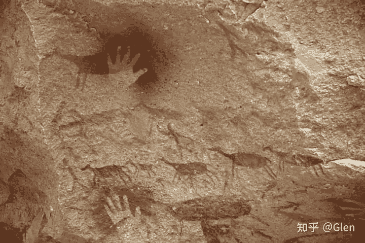

推荐一款好用的AI绘图工具：AI图片全能王

[https://www.xunjiepdf.com/aitupian?stzhcsm20230625-613323061](https://www.xunjiepdf.com/aitupian?stzhcsm20230625-613323061)

一款运行相对稳定的AI图像生成软件，各种风格的AI模型，能带我们玩转各式各样的AI画作。

口说无凭，先给大家上一波成片图吧~

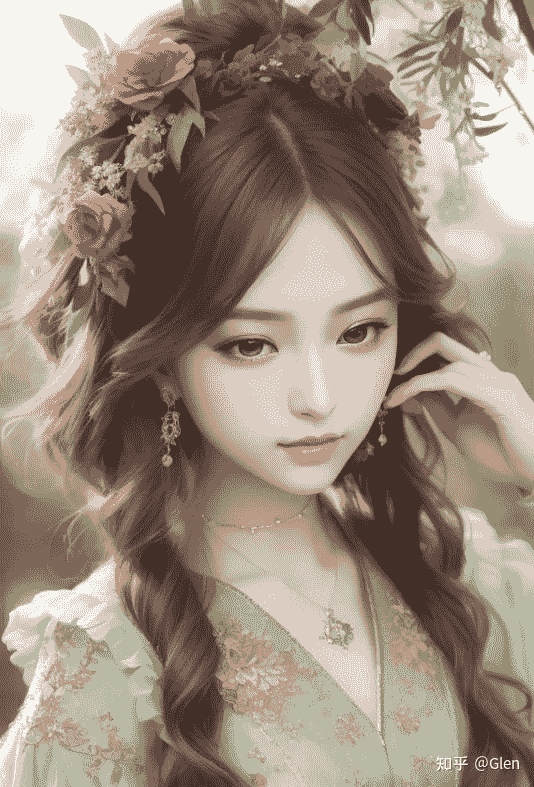

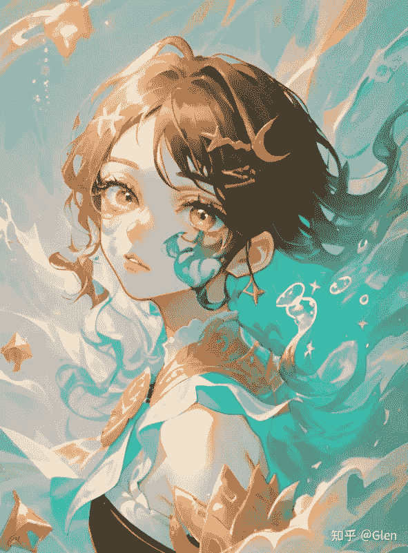

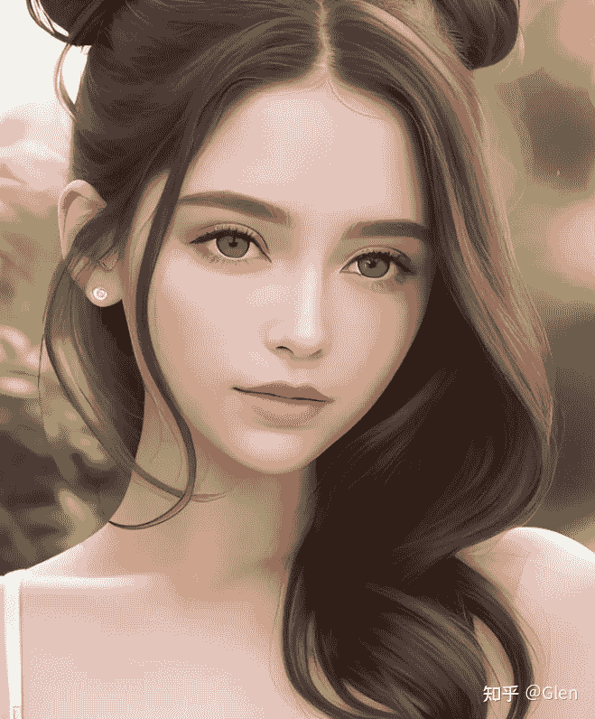

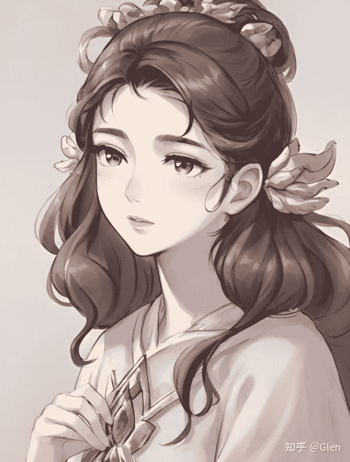

要生成同款的AI画作，一点也不难！

先选用一键AI绘画功能，在输入框编辑自己想象中的画面内容，选择模型、设置其他参数，最后坐等收图就好了~

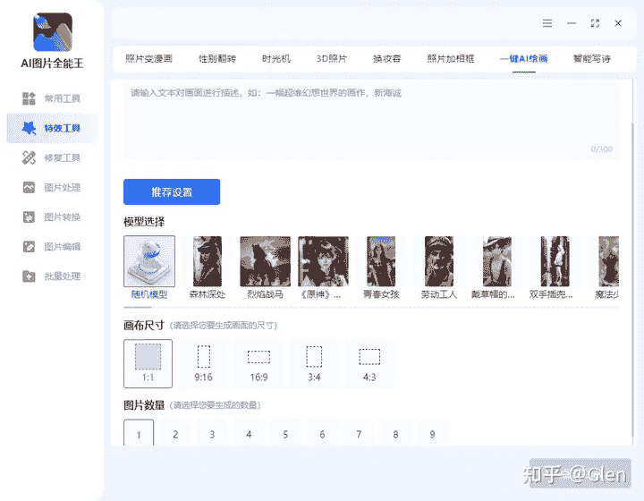

我们几乎每个人都会说话，但是只有极少数的一部分人会画画。说话是一种普遍的交流方式，但是绘画是一种具有挑战性和独特性的艺术形式，需要不断的探索和发展。许多人从小就开始接受美术训练，不断努力和磨练，一般需要8到10年甚至更长时间，才能达到比较高的水平，能被大家称为画师。因为难度较大， 所以一般找画师给你画画是一件昂贵的事情，不是一般人随便就能享受的。

之前，只有在科幻作家的故事里，会想象也许有一天，只要你会说话，就能够创造出一幅画。用语言画画这件事听起来就像霍格沃兹的魔法，但是它目前已经通过AI变成了现实。下面我们对AI作画的历史进行一个完整的梳理。

### 2012年，嘿我们用AI来画猫吧

AI绘画发展得挺早，但AI生成绘画是一个特别小众的领域。早在 2012 年全球人工智能和机器学习权威、华人科学家吴恩达带领团队，耗资100万美元，集结1000台电脑、16000个CPU的资源训练了一个当时世界上最大的深度学习网络, 用来指导计算机画出猫脸图片。经过整整3天训练, 画出来了一张模糊的猫猫头：

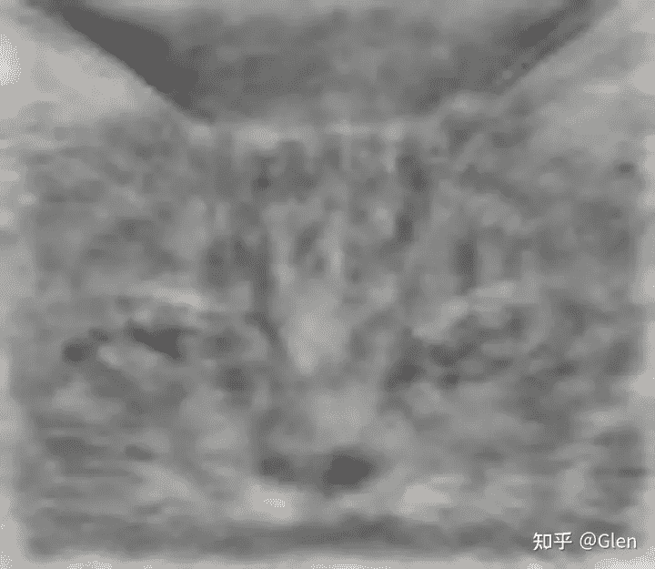

虽然基本很难看出这是一张猫脸，且价格昂贵，根本没有商用的机会，但这是AI绘画的起点，意义重大。2012年，我愿称之为AI绘画起源之年。

### 2015年，迷幻和超现实

谷歌在2015年开源了deep dream项目，可以用它画出非常迷幻和超现实的图画，生成痕迹非常明显，但看起来已经比上面的猫脸像那么回事了，不是吗？这种画作，看起来并不比直接在照片上加滤镜来得高明，也不是大家想象中的，人来输出口令，AI来产生跟指令相关的绘画。

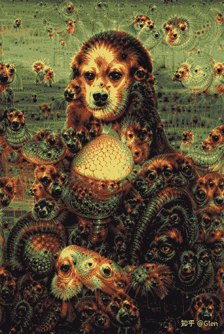

### 2015年，走入Gan的弯路

人们对于AI绘画的探索没有停止，其实比谷歌在2015年推出的deep dream项目还要早一年，加拿大蒙特利尔大学的Ian Goodfellow于2014年提出了生成对抗网络GAN的算法，这个算法一度成为了AI生成绘画的主流方向。

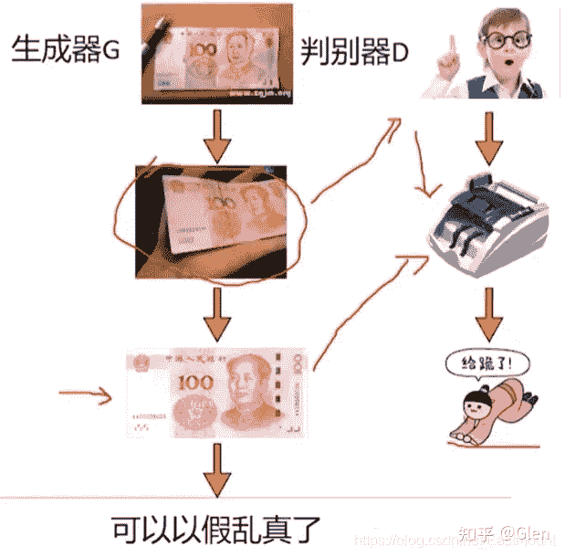

GAN的原理是通过训练两个深度神经网络模型，一个生成器（Generator）和一个判别器（Discriminator），使得生成器可以生成与真实数据相似的新数据样本，并且判别器可以准确地区分生成器生成的假样本和真实数据。在训练过程中，生成器不断尝试生成更加逼真的样本，而判别器则不断提高自己对真实样本和生成样本的区分能力。这两个模型相互对抗、相互协作，最终实现了高质量的数据生成效果。

用GAN模型已经可以生成比较高质量的图片了，但用它来生成也会有些问题：

①对抗学习非常麻烦，且对于显卡等资源消耗较高，之前我自己在跑生成对抗网络时，电脑经常直接黑屏。

②生成对抗网络很难理解图片各个部分是啥，所以它很难做到局部重新绘制，也就是很难进行修改。

虽然有各种各样的问题，但是研究人员还是在GAN算法的这条路不断前进，生成的图片效果不断提升，下图即为某GAN模型生成的二次元妹纸头像。

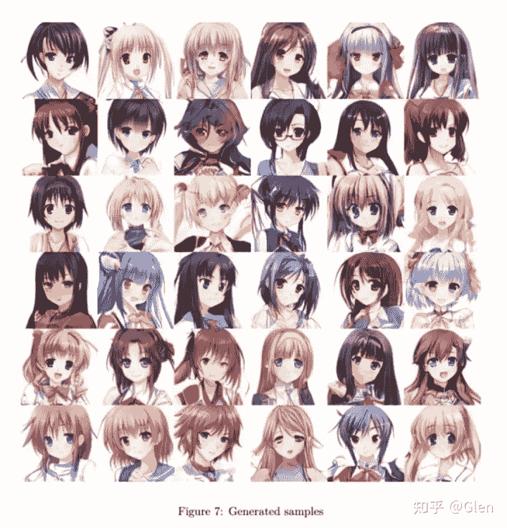

### 2015年，图像智能识别？反向用于文字画画

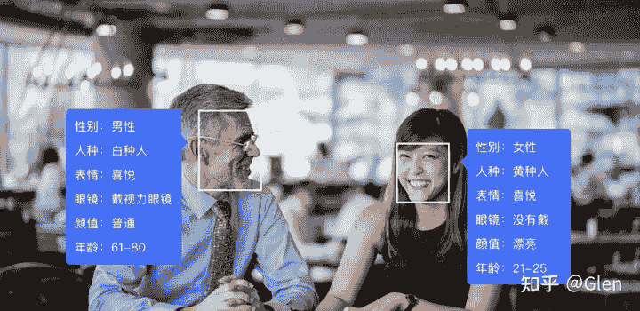

又是在2015年，一项人工智能的重大进展诞生——智能图像识别，可以通过算法识别并标记图像中的对象，然后他们还学会了将这些标签放入自然语言描述中去。这项重大进展目前已经进入了各种领域得到了应用，比如现在的各种智能门禁，已经让很多保安下岗了。但这个技术产生的价值并不只是这个，一些研究人员产生了好奇，如果把这个过程反向，通过文字来生成画面，是否也能实现呢？

于是他们向计算机模型输入了一些文字，看看能产生什么原因，结果模型真的生成了一些结果图片。如下图中所示，这是一些32X32像素的小图片，基本很难辨别出啥，但已经预示着无限的可能性。2015年，我愿称之为AI绘画的重要拐点之年。

### 2021年，重新出发

人们对AI绘画的探索，在生成对抗网络GAN的技术路线上继续进步，虽然也取得了一些成绩，但是距离人们想像的通过描述词直接生成绘画作品还有比较大的距离。研究人员把眼光开始移到其他可能的方向，一个在2016年就被提出的模型Diffusion Models开始受到更广泛的关注。它的原理跟GAN完全不一样，使用随机扩散过程来生成图像，从而避免了传统生成模型中存在的一些问题。

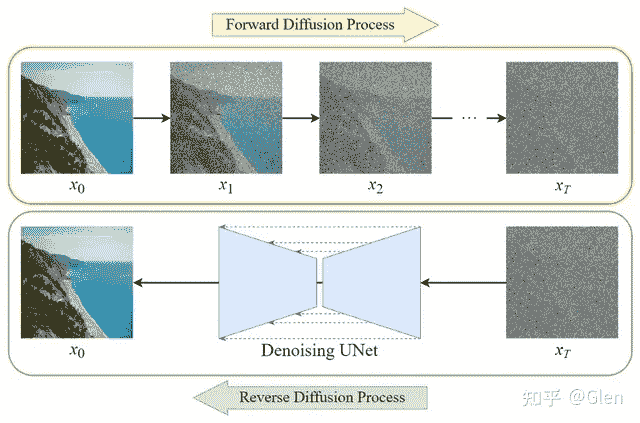

Diffusion Models的原理简单来说，先通过对照片添加噪声，然后在这个过程中学习到当前图片的各种特征。之后再随机生成一个服从高斯分布的噪声图片，然后一步一步的减少噪声直到生成预期图片。很快，基于Diffusion Models模型的图片生成成为主流。

终于来到了2021年，这一年，一家叫OpenAI的人工智能公司（他们更为有名的人工智能产品叫ChatGPT）宣布了DALL·E，他们声称这个模型可以从任何文字中创建高质量图像，它所使用的技术即为Diffusion Models。OpenAI于2022年发布了更为强大的DALL·E 2，现在已经免费开放了。但是OpenAI一直都没有公开DALL·E的算法和模型。

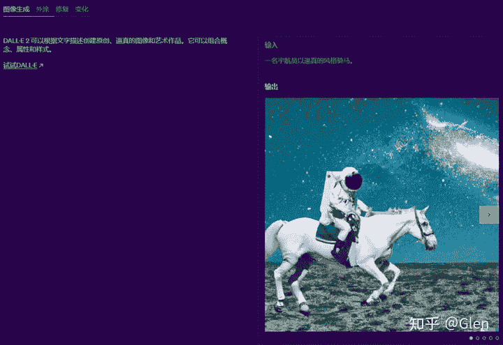

### 2022年，潘多拉魔盒已经打开

#### 2月 Disco diffusion V5发布

在2022年的2月，由somnai等几个开源社区的工程师做了一款基于扩散模型的AI绘图生成器——Disco diffusion。从它开始，AI绘画进入了发展的快车道，潘多拉魔盒已经打开。Disco diffusion相比传统的AI模型更加易用，且研究人员建立了完善的帮助文档和社群，越来越多的人开始关注它。

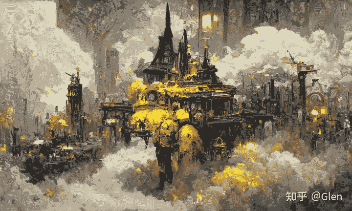

越来越多的人开始使用Disco diffusion创作作品，但是它有一个致命的缺点就是它生成的画面都十分的抽象，这些画面用来生成抽象画还不错，但是几乎无法生成具象的人。

正当大家嘲笑AI绘画不过如此时，仅仅几个月后，Disco diffusion已经能画出非常像人的作品了，虽然你可能还是觉得这个画作很业余，很难超越一些人类画师的作品。那么，就让子弹再飞一会。

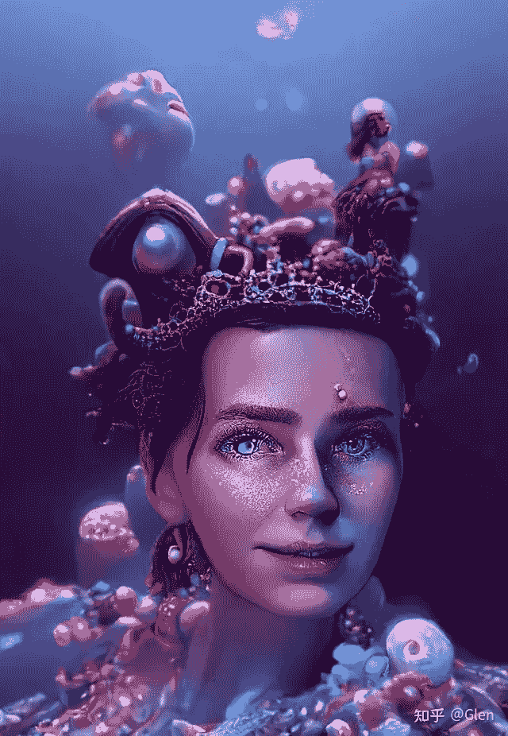

#### 3月 Midjouney

3月份，一款由Disco diffusion的核心开发参与建设的AI生成器Midjouney正式发布。Midjouney选择搭载在discord平台，借助discord聊天式的人机交互方式，不需要之前繁琐的操作，也没有Disco diffusion十分复杂的参数调节，你只需要向聊天窗口输入文字就可以生成图像。更关键的是，Midjouney生成的图片效果非常惊艳，普通人几乎已经很难分辨出它产生的作品，竟然是AI绘画生成的。

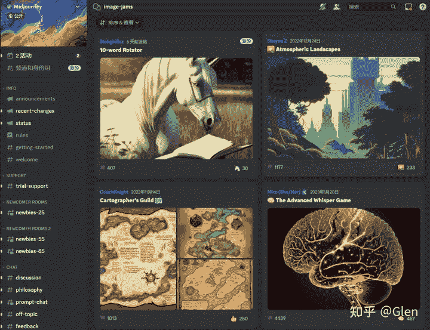

Midjouney发布5个月后，美国科罗拉多州博览会的艺术比赛评选出了结果，一张名为《太空歌剧院》的画作获得了第一名，但它甚至不是人类画师的作品，而是一个叫MidJourney的人工智能的画作。参赛者公布这是一张AI绘画作品时，引发了很多人类画师的愤怒和焦虑。

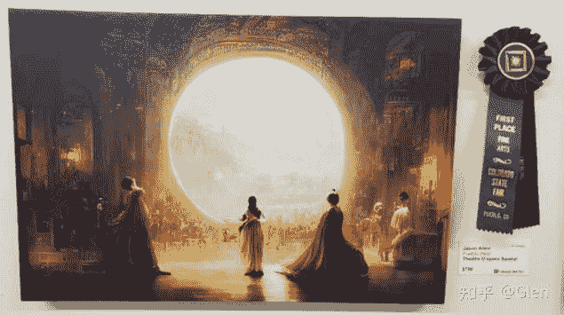

#### 4月 DALL·E 2

4月10日，之前提到过的OpenAI的DALL·E 2发布了。无论是Disco diffusion还是MidJourney，仔细品一下，我们还是可以看出是AI生成的，但DALL·E 2的生成图你已经无法跟人类的作品做区分了。用DALL·E 2生成图片的质量已经高到离谱，如下图：

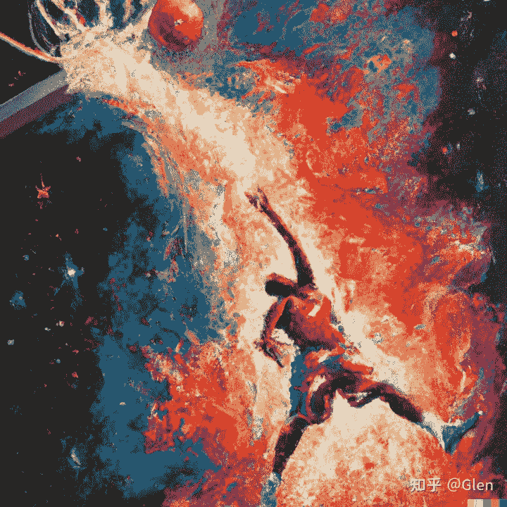

它还可以直接生成非常有质感的3D图像，3D设计师可能也快面临失业了。

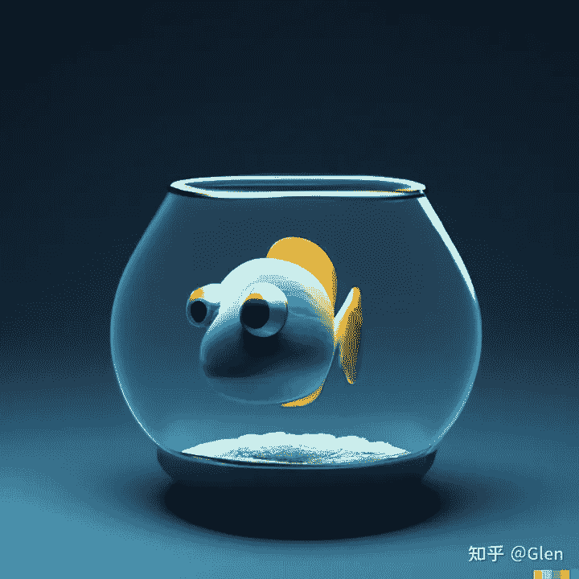

可以说DALL·E 2已经是大家心目中的AI绘画完全体了，但它到目前为止还是没有开源，且需要付费才能够使用，而且用它生成图片的限制很多，比如死亡，色情，人脸，暴力，公众的人物等都是禁止在DALL·E 2上生成的。最大的可能还是有各种各样的法务风险，DALL·E 2确实能力太强了，不法分子可以用它来生成各种各样的假图。

有意思的是，在DALL·E 2刚发布的时候就有网友发起投票，问DALL·E 2可以保持自己是AI绘画最先进技术多久时间？大多数人选了几个月或1年以上。但很不幸，子弹飞的速度比想象中的快很多。

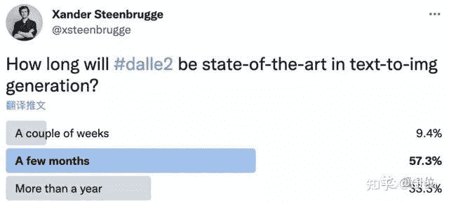

#### 7月 Stable diffusion

7月29日 一款叫Stable diffusion的AI生成器开始内测，人们发现用它生成的AI绘画作品，其质量可以媲美DALL·E 2，而且还没那么多限制。Stable diffusion共分4波邀请了 15000 名用户参与了内测，仅仅十天后，每天就有一千七百万张图片通过它生成。最关键的是，Stable diffusion的开发公司Stability AI崇尚开源，他们的宗旨是“AI by the people，for the people”。

Stable diffusion内测不到1个月，正式宣布开源，这意味着所有人都能在本地部署自己的AI绘画生成器， 真正实现每个人“只要你会说话，就能够创造出一幅画”。

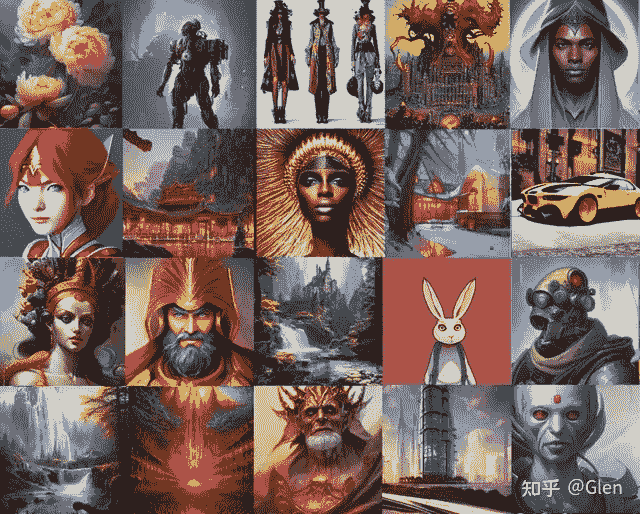

Stable diffusion的开源决定，让它迅速成为大家关注的焦点，人们将它跟各种各样的工具结合，比如有人将Stable diffusion的绘图能力做成了PS插件，你只需要画个草图，之后就能直接生成设计稿。

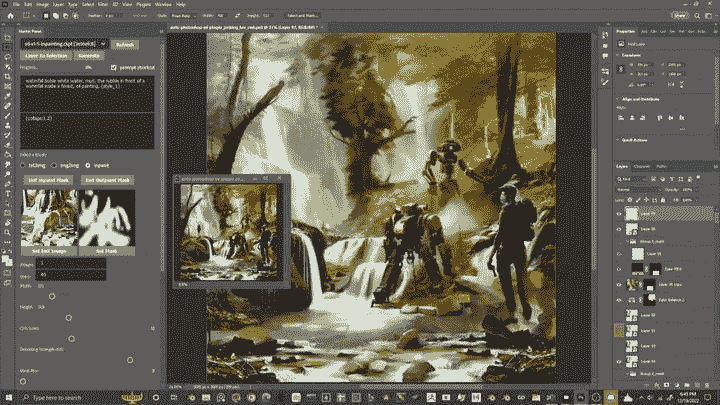

Stable diffusion仍然在不断进化中，一开始AI绘画在手的绘画总是显得不是很好，经常会出现“六指琴魔”。

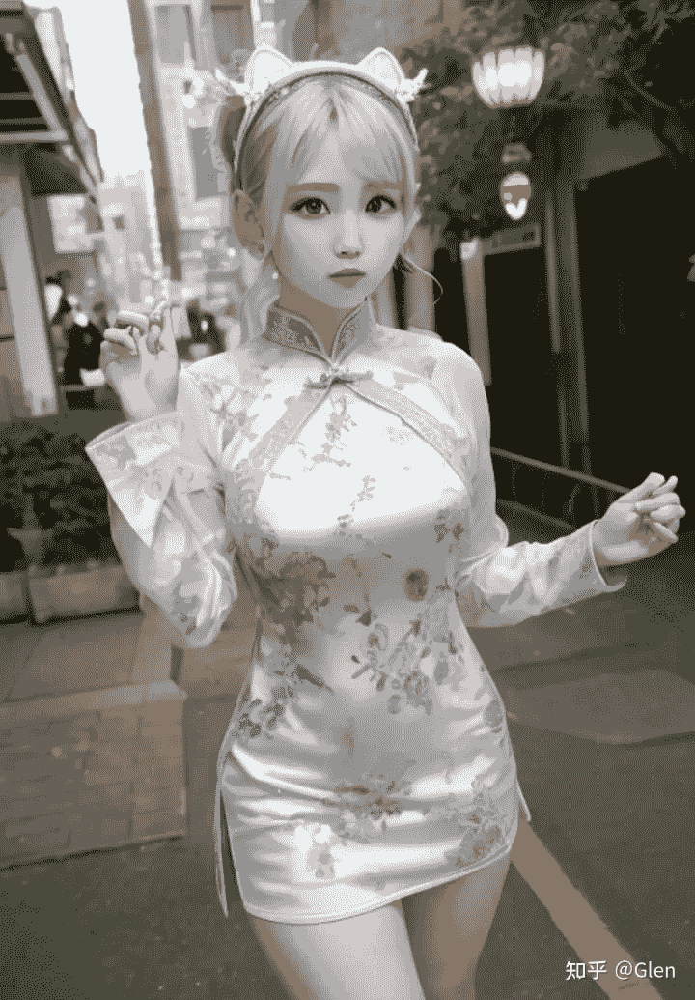

而最近，最新的插件已经支持针对特定位置进行局部调优了。

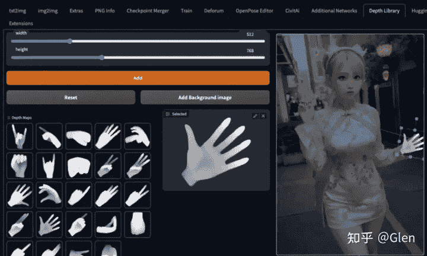

AI绘画进步得如此之快，以至于人们害怕自己的职业迟早要被AI取代，我自己甚至都开始焦虑了。在去年8月，Stable diffusion的推特账号突然挂了，因为被大量艺术家举报，他们很愤怒也很害怕。Stable diffusion的创始人说：他们在嫉妒AI画的比他们好。

最后，我们来思考一下，AI绘画可能会带来哪些改变：

1、AI绘画会取代大部分初级的画师：AI绘图效果如此之好，初级画师的生存空间会越来越少；就像旧时光大家去拍照要去照相馆，当智能手机拍照功能普及后，大部分的照相馆都倒闭了，只剩下一些比较垂直如专门拍婚纱照的照相馆能艰难的生存。

2、绘画的流程可能从此根本性改变：就像阿尔法狗的出现，改变了围棋行业一样，人们从之前的跟真人对手博弈或者学习历史上人类总结的棋谱，变成了人们直接跟AI博弈，据说人类棋手因此学习到了很多更加高明的围棋走法。绘画也是一样，从前也许AI绘画是学习人类画手的风格和技术，未来人们可能更多的从AI绘画中学习技术和风格。

3、图库行业面临大洗牌：很多无量图库网站，你想使用他们的图片，他们就敢收你几百块版权费；AI绘画产生图片的效率之高，可能会让大部分的图库网站倒闭。

愿子弹一直在飞。

PS：部分图片来自互联网，侵权请联系我删除

---

## 【2】AI绘画从历史到技术突破，何以突飞猛进？

感到吃惊是完全正常的, 因为从去年到今年, AI绘画的技术确实出现了连续的突破性的进展, 从CLIP模型基于无需标注的海量互联网图片训练大成, 到CLIP开源引发的AI绘画模型嫁接热潮, 然后找到了Diffusion扩散化模型作为更好的图像生成模块, 最后使用潜空间降维的改进方法解决了Diffusion模型时间和内存资源消耗巨大的问题

### 开源贡献

#### 一、CLIP+VQGAN

计算机数据科学家 Katherine Crowson

利用CLIP计算出文字和图像特征值相匹配, 把这个匹配验证过程链接到负责生成图像的AI模型 (比如VQ-GAN) , 负责生成图像的模型反过来推导一个产生合适图像特征值, 能通过匹配验证的图像, 就得到一幅符合文字描述的作品了

CLIP+VQGAN 引领了全新一代 AI图像生成技术的风潮，现在所有的开源 TTI(Text to Image, 文本文本生成图像)模型的简介里都会对 Katherine Crowson 致谢，她是当之无愧的全新一代AI绘画模型的奠基者。

没火起来的原因：GAN类模型的生成结果始终不尽如人意，由Disco Diffusion这个线上服务所引爆

另外一种图像生成方式：Diffusion扩散模型，基本原理其实就是"去噪点"。就是我们熟悉的手机拍照（特别是夜景拍照）的自动降噪功能。如果把这个去噪点的计算过程反复进行，在极端的情况下，可能把一个完全是噪声的图片还原为一个清晰的图片

#### 二、CLIP

2021年初，OpenAI团队开源发布CLIP

图像生成引擎DALL-E。DALL-E内部用了CLIP，但DALL-E并不开源

#### 三、LAION-5B和LAION-Aesthetics

LAION 是一个跨全球的非营利机器学习研究机构。

2022年3月开放了当前最大规模的开源[跨模态数据库]LAION-5B，包含接近60亿(5.85 Billion)个图片-文本对。

提供的海量训练素材库，可以被用来训练所有从文字到图像的的生成模型，也可以用于训练 CLIP这种用于给文本和图像的匹配程度打分的模型，而这两者都是现在 AI 图像生成模型的核心。

LAION 还训练 AI 根据艺术感和视觉美感，给LAION-5B 里图片打分，高分的图片形成LAION-Aesthetics 数据集。

最新的AI绘画模型都是利用LAION-Aesthetics这个高质量数据集训练出来的。

### AI绘画模型/产品

#### 一、Disco Diffusion

第一个基于CLIP + Diffusion 模型的实用化AI绘画产品。

缺点：并没有取代人工创作的能力的核心原因：无法刻画具体细节、渲染时间特别长

#### 二、MidJourney

在线AI作画神器优点：零门槛的交互和非常好的输出结果

利用基于Discord的MidJourney bot进行对话式绘画创作

付费服务，迭代更新快

#### 三、Stable Diffusion

开源研发团队 EleutherAI 作为技术核心团队支持了Stability.AI，推出了AI绘画模型 Stable Diffusion，并承诺完全开源。

Stable Diffusion和之前的Diffusion扩散化模型相比，把模型的计算空间，从像素空间经过数学变换，在尽可能保留细节信息的情况下降维到一个称之为潜空间(Latent Space)的低维空间里，然后再进行繁重的模型训练和图像生成计算。

#### MidJourney (VS) Stable Diffusion

从输出风格上看

MidJourney针对人像做了一些优化，细腻讨巧、油腻一点点。出人像图或者糖水风格美图

Stable Diffusion的作品，更淡雅一些，更艺术化一些，风格变化多样性。

### AI绘画的突破对人类意味着什么

2022年的AI领域，基于文本生成图像的AI绘画模型是风头无两的主角。

2月份 Disco Diffusion上线

4月 DALL-E 2和MidJourney邀请内测

5月和6月 Google发布两大模型Imagen 和Parti (不开放内测只有论文)

7月底 Stable Diffusion横空出世并开源

数学真是世界至高法则

类似Stable Diffusion这种AI生成模型和很多深度学习AI模型的一个核心思路


把人类创作的内容，表示为某个高维或者低维数学空间里的一个向量（更简单的理解，一串数字）。

如果这个“内容->向量”的转化设计足够合理，那么人类所有的创作内容都可以表示为某个数学空间里的部分向量而已。

而存在于这个无限的数学空间里的其他向量，正是那些理论上人类可能创造，但尚未被创造出来的内容。

通过逆向的“向量->内容”的转换，这些还没被创造的内容就被 AI 挖掘出来了。

原文链接：https://blog.csdn.net/liluo_2951121599/article/details/129019238

---

# 【3】AI绘画的历史：从古代到现代

## 1.背景介绍

AI绘画是一种利用人工智能技术生成图像的方法，其核心是通过算法和模型来模拟人类的绘画过程。随着计算机视觉、深度学习和其他相关技术的发展，AI绘画已经取得了显著的进展。在本文中，我们将回顾AI绘画的历史，探讨其核心概念和算法，并分析其未来发展趋势。

### 1.1 古代绘画技术

绘画是人类文明的一部分，可以追溯到古代。古代的绘画技术主要包括：

+ 筆绘：使用筆子在纸上绘制线条和形状。
+ 油画：使用油漆在布料或木板上绘画。
+ 陶瓷绘画：在陶瓷上绘画图案。

这些古代绘画技术的发展与文明的进步密切相关，随着时间的推移，人们开始使用不同的材料和工具来创作艺术品。

### 1.2 现代绘画技术

现代绘画技术的发展受到了数字技术的影响。随着计算机技术的进步，人工智能和计算机图形学开始被应用于绘画领域。现代绘画技术主要包括：

+ 数字筆绘：使用数字筆在数字画板上绘制线条和形状。
+ 数字油画：使用数字画板和数字笔记本绘画油画。
+ 3D模型绘画：使用3D模型和渲染技术创作三维图像。

这些现代绘画技术为艺术家提供了更多的创作方式和可能性，同时也为人工智能绘画奠定了基础。

### 1.3 AI绘画的诞生

AI绘画的诞生可以追溯到1960年代，当时的人工智能研究者开始尝试使用计算机程序来模拟人类的绘画过程。随着计算机视觉、深度学习和其他相关技术的发展，AI绘画已经取得了显著的进展。

## 2.核心概念与联系

AI绘画的核心概念包括：

+ 计算机视觉：计算机视觉是计算机科学和人工智能领域的一个分支，研究如何让计算机理解和处理图像和视频。
+ 深度学习：深度学习是一种机器学习方法，通过多层神经网络来学习表示和预测。
+ 生成对抗网络（GAN）：GAN是一种深度学习模型，可以生成新的图像，通常用于图像生成和改进。

这些概念之间的联系如下：

+ 计算机视觉提供了图像处理和特征提取的方法，这些方法在AI绘画中用于分析和理解图像。
+ 深度学习为AI绘画提供了一种学习表示和预测的方法，可以用于生成新的图像。
+ GAN在AI绘画中具有广泛的应用，可以生成各种类型的图像，包括人脸、场景和艺术作品。

## 3.核心算法原理和具体操作步骤以及数学模型公式详细讲解

AI绘画的核心算法主要包括：

+ 卷积神经网络（CNN）：CNN是一种深度学习模型，主要用于图像分类和识别。
+ 生成对抗网络（GAN）：GAN是一种深度学习模型，可以生成新的图像，通常用于图像生成和改进。

### 3.1 卷积神经网络（CNN）

CNN的核心概念包括：

+ 卷积层：卷积层使用卷积核对输入图像进行卷积操作，以提取图像的特征。
+ 池化层：池化层使用下采样方法（如平均池化或最大池化）对输入图像进行压缩，以减少特征维度。
+ 全连接层：全连接层将卷积和池化层的输出作为输入，通过权重和偏置学习特征表示。

CNN的具体操作步骤如下：

1. 输入图像进行预处理，如缩放和归一化。
1. 将预处理后的图像输入卷积层，进行特征提取。
1. 卷积层的输出进入池化层，进行特征压缩。
1. 池化层的输出进入全连接层，进行特征学习。
1. 全连接层的输出用 `Softmax` 函数进行归一化，得到图像分类结果。

CNN的数学模型公式如下：

+ 卷积操作：`y(i,j)=∑p=1P∑q=1Qx(i−p+1,j−q+1)⋅k(p,q)`
+ 池化操作：`o(i,j)=max⁡p=1Pmax⁡q=1Qx(i−p+1,j−q+1)`

### 3.2 生成对抗网络（GAN）

GAN的核心概念包括：

+ 生成器（Generator）：生成器是一个深度学习模型，用于生成新的图像。
+ 判别器（Discriminator）：判别器是一个深度学习模型，用于区分真实的图像和生成的图像。

GAN的具体操作步骤如下：

1. 训练生成器，使其生成更靠近真实图像的新图像。
1. 训练判别器，使其能够准确地区分真实的图像和生成的图像。
1. 通过迭代训练，生成器和判别器相互竞争，使生成的图像更接近真实图像。

GAN的数学模型公式如下：

+ 生成器的损失函数：`LG=Ez∼Pz(z)[log⁡D(G(z))]`
+ 判别器的损失函数：`LD=Ex∼Px(x)[log⁡D(x)]+Ez∼Pz(z)[log⁡(1−D(G(z)))]`

### 3.3 其他AI绘画算法

除了CNN和GAN之外，还有其他的AI绘画算法，如：

+ 基于规则的AI绘画：这种方法使用规则和算法来生成图像，如L-system和植被生成算法。
+ 基于机器学习的AI绘画：这种方法使用机器学习模型来学习和生成图像，如支持向量机（SVM）和随机森林。

这些算法在AI绘画领域具有广泛的应用，可以根据不同的需求和场景进行选择。

## 4.具体代码实例和详细解释说明

在这里，我们将提供一个基于 `Python` 和 `TensorFlow` 的GAN代码实例，以及其详细解释。

```
import tensorflow as tf
from tensorflow.keras import layers

# 生成器
def generator(input_shape, latent_dim):    
    inputs = tf.keras.Input(shape=latent_dim)    
    x = layers.Dense(4 * 4 * 256, use_bias=False)(inputs)    
    x = layers.BatchNormalization()(x)    
    x = layers.LeakyReLU()(x)    
    x = layers.Reshape((4, 4, 256))(x)    
    x = layers.Conv2DTranspose(128, (5, 5), strides=(1, 1), padding=&#x27;same&#x27;)(x)    
    x = layers.BatchNormalization()(x)    
    x = layers.LeakyReLU()(x)    
    x = layers.Conv2DTranspose(64, (5, 5), strides=(2, 2), padding=&#x27;same&#x27;)(x)    
    x = layers.BatchNormalization()(x)    
    x = layers.LeakyReLU()(x)    
    x = layers.Conv2DTranspose(3, (5, 5), strides=(2, 2), padding=&#x27;same&#x27;, activation=&#x27;tanh&#x27;)(x)    
    return tf.keras.Model(inputs=inputs, outputs=x)

# 判别器
def discriminator(input_shape):    
    inputs = tf.keras.Input(shape=input_shape)    
    x = layers.Conv2D(64, (5, 5), strides=(2, 2), padding=&#x27;same&#x27;)(inputs)    
    x = layers.LeakyReLU()(x)    
    x = layers.Dropout(0.3)(x)    
    x = layers.Conv2D(128, (5, 5), strides=(2, 2), padding=&#x27;same&#x27;)(x)    
    x = layers.LeakyReLU()(x)    
    x = layers.Dropout(0.3)(x)    
    x = layers.Flatten()(x)    
    x = layers.Dense(1, activation=&#x27;sigmoid&#x27;)(x)    
    return tf.keras.Model(inputs=inputs, outputs=x)
    
# 训练GAN
def train(generator, discriminator, latent_dim, batch_size, epochs):    
    # ...
if __name__ == &#x27;__main__&#x27;:    
    latent_dim = 100    
    batch_size = 32    
    epochs = 1000    
    generator = generator((256, 256, 3), latent_dim)    
    discriminator = discriminator((256, 256, 3))    
    
    train(generator, discriminator, latent_dim, batch_size, epochs)
```

这个代码实例定义了一个基于 `TensorFlow` 的GAN，包括生成器和判别器的定义，以及训练GAN的函数。生成器使用多层卷积层和批归一化层来生成新的图像，判别器使用多层卷积层和 `Dropout` 层来区分真实的图像和生成的图像。在训练过程中，生成器和判别器相互竞争，使生成的图像逐渐接近真实图像。

## 5.未来发展趋势与挑战

AI绘画的未来发展趋势和挑战包括：

+ 更高质量的图像生成：未来的AI绘画模型将更加强大，能够生成更高质量的图像，接近或超越人类的绘画能力。
+ 更广泛的应用：AI绘画将在艺术、设计、游戏、广告等领域得到广泛应用，为人类提供更多的创作和表达方式。
+ 数据和计算资源的需求：AI绘画需要大量的训练数据和计算资源，这将对数据收集、存储和计算技术产生挑战。
+ 道德和伦理问题：AI绘画的发展可能引发道德和伦理问题，如作品权利和版权问题，以及AI生成的艺术作品的价值和意义。

## 6.附录常见问题与解答

在这里，我们将列出一些常见问题及其解答。

Q: AI绘画与人类绘画有什么区别？

A: AI绘画使用算法和模型来模拟人类的绘画过程，而人类绘画则是通过人类的思维和手术来创作。虽然AI绘画可以生成高质量的图像，但它们可能缺乏人类绘画的情感和个性。

Q: AI绘画可以替代人类绘画师吗？

A: AI绘画可以生成各种类型的图像，但它们仍然无法完全替代人类绘画师。人类绘画师具有独特的创造力和情感表达能力，这些在AI绘画中很难复制。

Q: AI绘画的发展将如何影响艺术领域？

A: AI绘画的发展将对艺术领域产生重大影响，为艺术家提供更多的创作方式和可能性。同时，AI绘画也可能引发道德和伦理问题，如作品权利和版权问题，以及AI生成的艺术作品的价值和意义。

这就是我们关于《6. AI绘画的历史：从古代到现代》的专业技术博客文章的全部内容。希望这篇文章能够帮助您更好地了解AI绘画的历史、核心概念和算法，以及其未来发展趋势和挑战。如果您有任何问题或建议，请随时联系我们。

<https://aigcreative.feishu.cn/sync/K4Gvd9vUQsy9Oubwqaeclu0Fnbg>
