# 2024世界500强构建与采购生成式AI的16个变化 | 猎人翻译

> 来源：[https://aigcreative.feishu.cn/docx/TTEIdrXzboqaymxFcDdc6GOQn2e](https://aigcreative.feishu.cn/docx/TTEIdrXzboqaymxFcDdc6GOQn2e)

> 链接：https://a16z.com/generative-ai-enterprise-2024/

> 翻译：创意猎人-Kevin

生成式AI在2023年迅速席卷消费者市场，消费支出迅速突破十亿美元大关。到了2024年，我们预见其在企业领域的盈利机会将会是消费市场的数倍。

过去一年里，消费者或许沉浸在与AI伴侣的对话中，或忙于使用扩散模型创作图像和视频，但企业对生成式AI的探索似乎只局限于几个显而易见的应用场景，并推出了一些简单包装的“GPT产品”。有人质疑，生成式AI是否真的能拓展到企业领域——我们是否只停留在那几个旧有的应用场景？这些初创企业真的能从中盈利吗？或者这只是一场泡沫？

然而，最近几个月，我们与众多财富500强和顶尖企业的领袖进行了交谈，并对其他70多位进行了调研，以深入了解他们如何采用、购买及为生成式AI设置预算。令人惊讶的是，这些企业对生成式AI的资源投入和态度在过去六个月里发生了翻天覆地的变化。虽然这些领导者对部署生成式AI仍持保留态度，但他们的预算几乎增加了三倍，扩大了在小型开源模型上部署的应用场景，并且将更多实验初期的工作负载转入了生产阶段。

这为创业者带来了前所未有的机会。我们认为，那些能够针对企业AI中心战略项目构建解决方案、预见并解决它们痛点的AI初创企业，以及那些从依赖服务向构建可扩展产品转变的企业，将能捕获这波新的投资浪潮，并在市场中占据重要地位。

正如历来面向企业构建和销售任何产品一样，深入理解客户的预算、顾虑和规划是关键。为了帮助创业者深入了解企业领袖在部署生成式AI时的决策过程，以及为AI高管提供一个了解同行如何应对共同挑战的窗口，我们汇总了与这些领导者近期交谈中关于资源配置、模型选择和应用场景的16个核心考量。

# 资源配置：预算正大幅增长，且这一趋势看似将持续

## **生成式AI的预算急剧上升。**

2023年，我们交流的众多公司在基础模型API、自我托管和模型微调上的平均支出达到了700万美元。更令人注目的是，几乎每一位与我们对话的企业负责人都表示，鉴于生成式AI实验的初步成功，他们计划在2024年将支出增加2到5倍，以支持将更多工作负载投入生产。

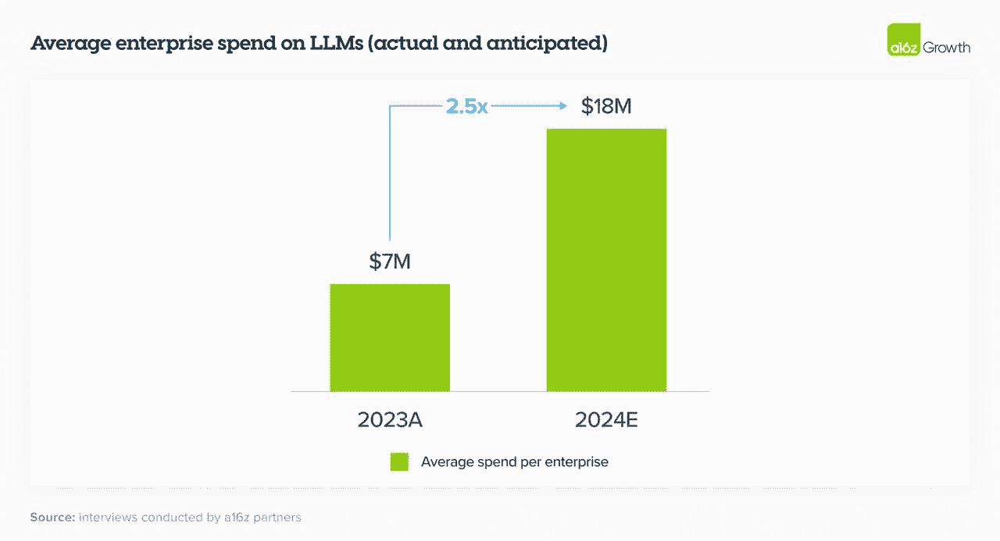

## 领导者开始将AI投资转移到常规软件预算中。

去年，企业在生成式AI上的投资大多来自一次性的“创新”预算。但到了2024年，许多领导者开始将这

些资金转移到更为持久的软件预算项目中；不到四分之一的受访者表示今年的生成式AI开支还会来自创新预算。我们还看到一些企业开始将生成式AI预算用于节约人力成本，尤其是在客户服务方面。这被看作是未来对生成式AI支出大幅增长的预兆。一家公司提到，通过使用基于LLM的客户服务，每个来电可节省约6美元，总节省成本达到约90%，这是他们将投资于生成式AI的资金增加8倍的原因。

下面是不同组织如何分配他们的LLM支出的大致情况：

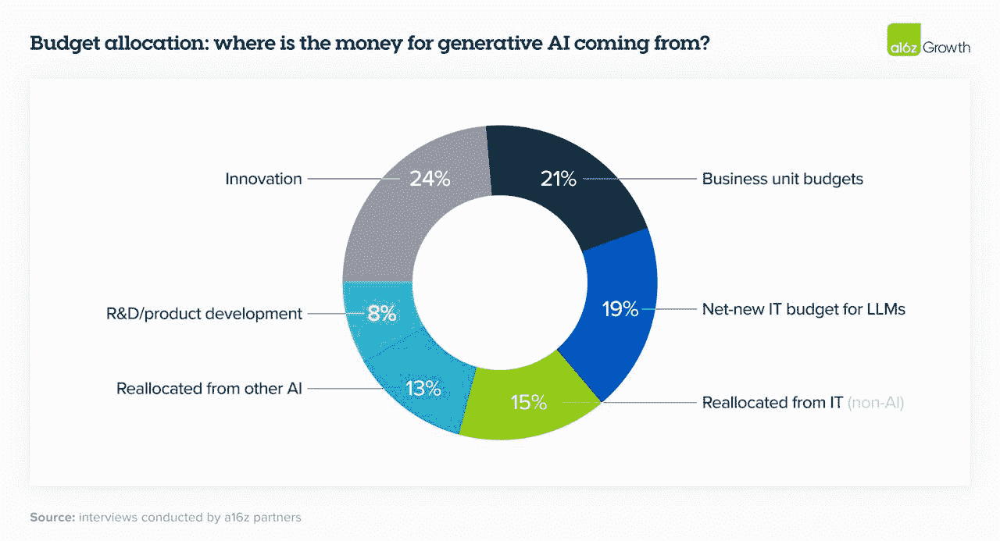

## 3. 衡量投资回报（ROI）仍旧是艺术与科学的结合。

企业领袖目前主要通过AI带来的生产力提升来衡量ROI。尽管他们依赖于NPS和客户满意度作为良好的间接指标，但他们也在寻求更具体的衡量回报的方法，如收入增长、成本节约、效率提升和准确性改进，具体取决于其应用场景。目前，领导者们还在推广这项技术，并尝试找出最佳指标来量化回报，但在接下来的2到3年里，ROI将变得越来越重要。在寻找答案的过程中，许多人信任他们的员工报告说，他们能够更好地利用时间。

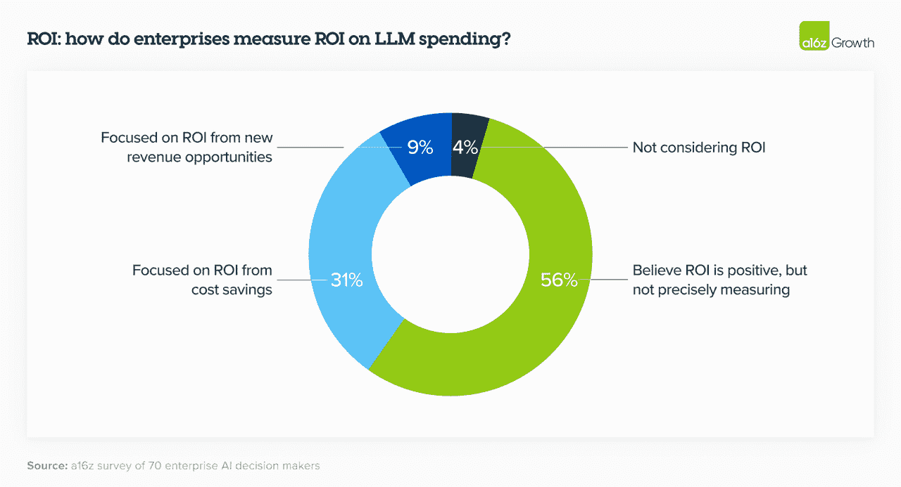

## **4. 实施和扩展生成式AI需要正**确的技术人才，目前许多企业内部并不具备。

仅有模型提供者的API远远不足以在大规模上构建和部署生成式AI解决方案。这需要高度专业化的人才来实施、维护和扩大必要的计算基础设施。仅在实施阶段的投入就是2023年AI支出中最大的一块，有时甚至是全部预算中的最大部分。一位高管提到，“利用LLMs的成本可能只是构建应用场景成本的四分之一”，开发成本占据了大头。

为了帮助企业快速启动和运行他们的模型，基础模型提供商提供了并仍在提供专业服务，通常涉及到定制模型开发。我们估计，这在2023年为这些公司带来了相当一部分收入，并且选择特定模型提供商的关键原因之一就是他们提供的性能。由于在企业内获得合适的生成式AI人才非常困难，因此，那些提供工具以便企业更容易将生成式AI开发引入内部的初创公司可能会看到更快的采用率。

生成式AI不仅仅是技术进步的象征，它正在成为推动企业创新、提高效率和节省成本的关键工具。随着企业对生成式AI投入的增加，我们可以预见一个更加智能、高效和互联的商业世界。

# 模型趋势：朝向多元化和开源的未来

## **多模型未来已来临。**

仅仅半年前，大多数企业还在试验单一模型（通常是OpenAI的）或最多两个。但当我们今天与这些企业领导对话时，他们都在测试——甚至在某些情况下已经在生产中使用——多个模型。这样做使他们能够1)根据性能、规模和成本为不同的应用场景量身定制模型，2)避免对单一供应商的依赖，以及3)快速利用这个快速发展领域的最新进展。这第三点对于领导者来说尤其重要，因为模型的领先地位不断变化，公司们渴望整合当前和未来的最先进模型及开源模型，以实现最佳效果。

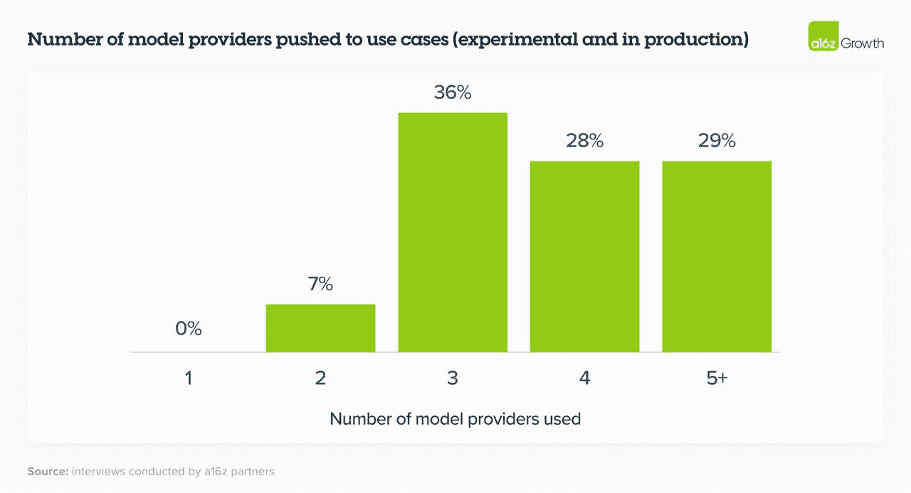

我们很可能会看到更多模型的出现。在下面的图表中，根据调查数据，企业领导者报告了在测试中的模型数量，这预示着将用于推动工作负载到生产的模型。对于生产用例，OpenAI依然占据主导地位，这是预料之中的。

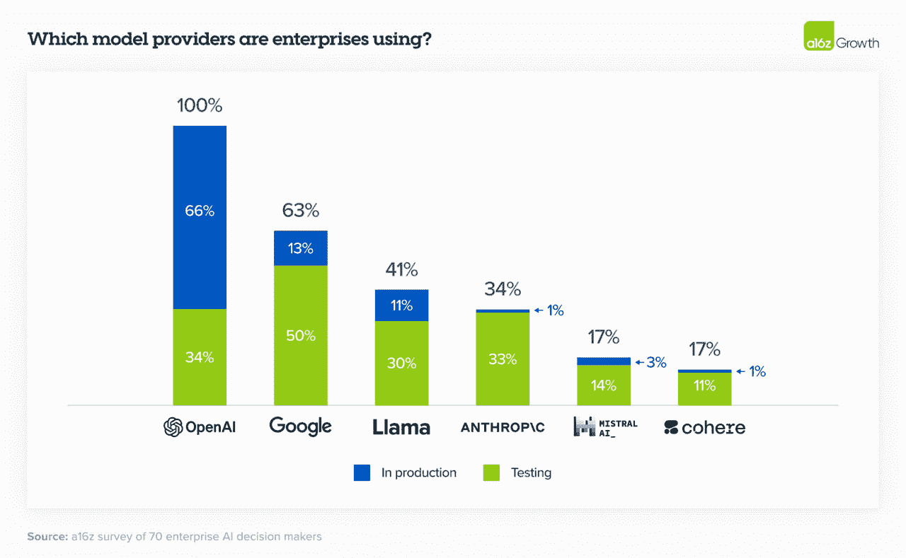

## **开源模型的兴起。**

过去六个月中最令人意外的变化之一就是对开源模型的偏好显著增长。我们估计，2023年市场上80%-90%的模型是闭源的，其中大部分份额归于OpenAI。**然而，46%的调查参与者表示他们偏好或强烈偏好转向2024年的开源模型。**在采访中，近60%的AI领袖表示他们对增加开源模型的使用或在细调后性能相近的开源模型上进行切换感兴趣。因此，从2024年开始，企业对开源的使用预期发生显著转变，其中一些明确表示目标是实现闭源和开源之间50/50的使用比例，这是从2023年80%闭源/20%开源的分配中显著上升的。

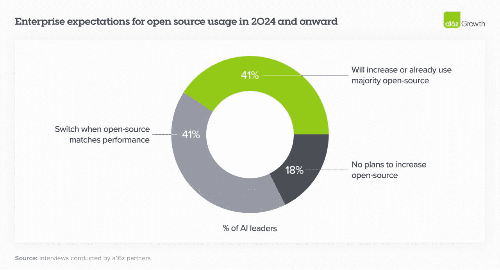

## 虽然成本是考虑因素，但控制和定制性是选择开源的主要原因。

选择开源的主要原因远远超过了成本考虑，控制（数据的安全性和模型输出的可解释性）和定制性（针对特定应用场景有效细调的能力）是企业采用开源模型的首要原因。这反映了企业领袖们的共识，即生成式AI创造的价值远远超过其成本。如一位高管所言：“获取准确答案的价值远胜于其成本。”

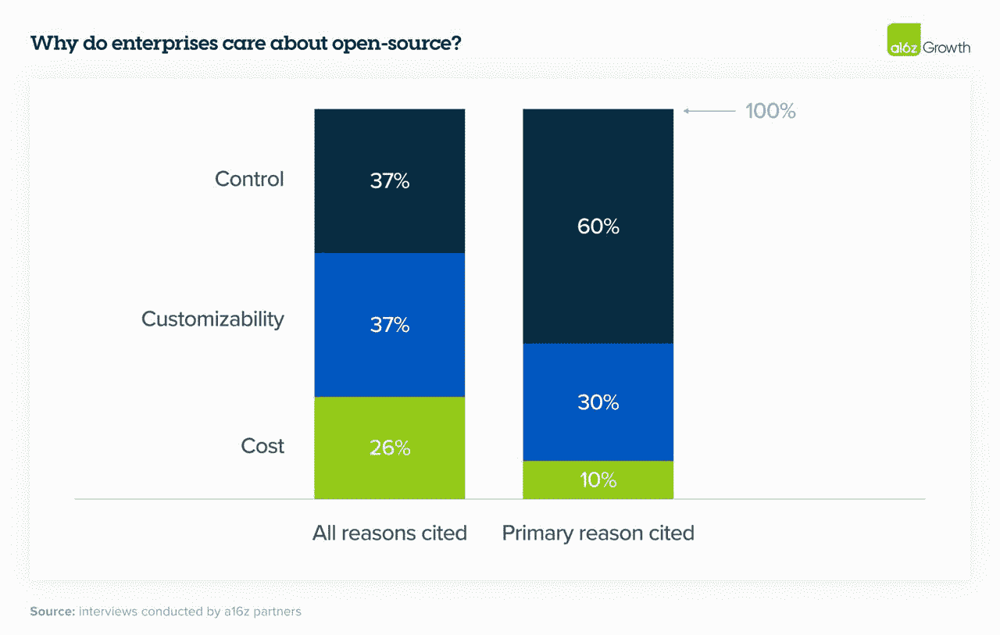

## 对控制的需求源于对敏感应用场景和企业数据安全的关注。

企业对于与闭源模型提供商共享其专有数据持保守态度，这一点并不让人意外。特别是对于那些将知识产权视为业务核心的公司来说，他们对数据隐私和安全性的要求尤其严格。虽然一些企业选择自行托管开源模型来解决这一问题，但还有其他企业更倾向于选择那些能够提供虚拟私有云（VPC）集成的模型，以保证数据安全和合规性。

## 企业通常通过微调而非从头开始构建模型来进行定制。

尽管之前有关于如同BloombergGPT这样的自定义模型的讨论，但随着高质量开源模型的出现，大多数企业现在倾向于不从头开始训练自己的LLM，而是选择通过检索增强生成（RAG）技术或对开源模型进行微调以满足其特定需求。

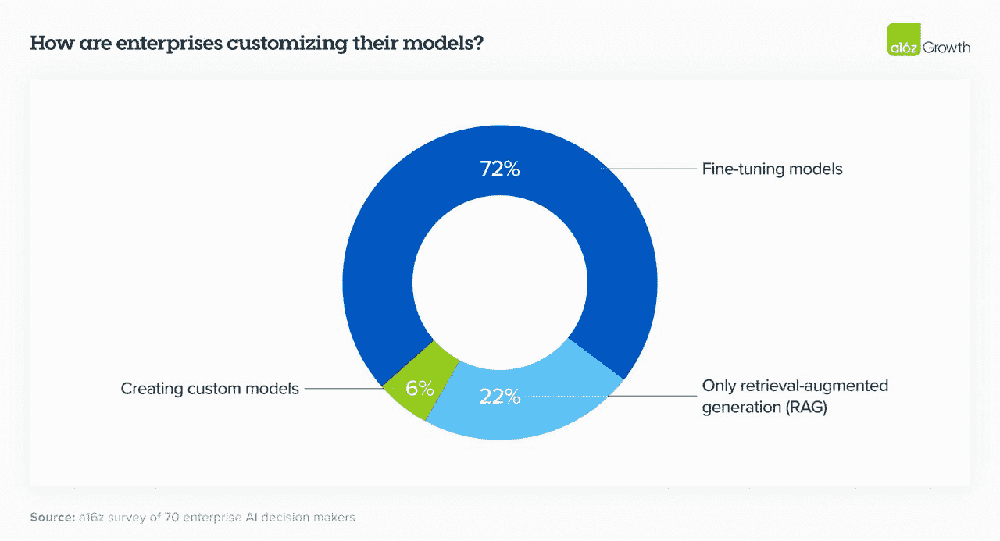

## 云服务在模型采购决策中仍然扮演重要角色。

许多企业选择通过他们现有的云服务提供商购买模型，这主要是出于安全考虑——他们更担心闭源模型处理数据的方式，而不是他们的云服务提供商——以及为了避免复杂的采购流程。在2024年，这种趋势仍在持续，意味着企业倾向于选择与其现有云服务提供商合作的模型提供商。例如，Azure用户倾向于选择OpenAI，而Amazon用户则更倾向于Anthropic或Cohere。

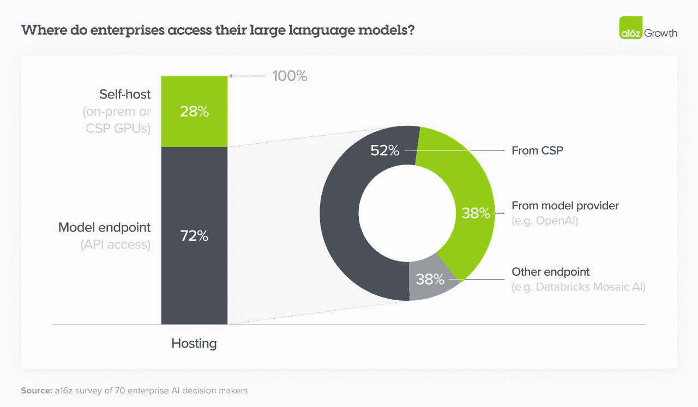

## 客户对早期市场的特性表示关注。

尽管企业在选择模型时，更看重模型的推理能力、可靠性和易于接入（例如，通过他们的云服务提供商），但他们也对具有差异化特性的模型表示出了兴趣。例如，一些企业因Anthropic先前200K的上下文窗口特性而选择它，而其他企业则因Cohere在微调方面的早期市场优势而倾向于使用它。

## 大部分企业认为模型性能正在趋于一致。

虽然技术界关注于将模型性能与公共基准进行比较，但企业领导者更加关注于将微调过的开源模型和闭源模型的性能与他们自己的内部基准进行比较。有趣的是，即便闭源模型在外部基准测试中通常表现更好，企业领导者仍然给予开源模型较高的NPS评分，因为它们更易于针对特定用例进行微调。这表明，按照这些标准，模型性能的差异正在快速缩小，为企业领导提供了从中选择的更广泛且能力强大的模型范围。

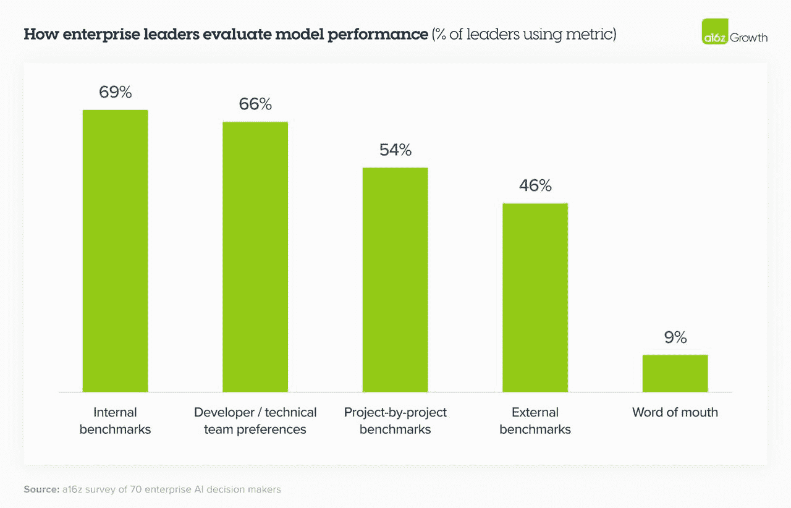

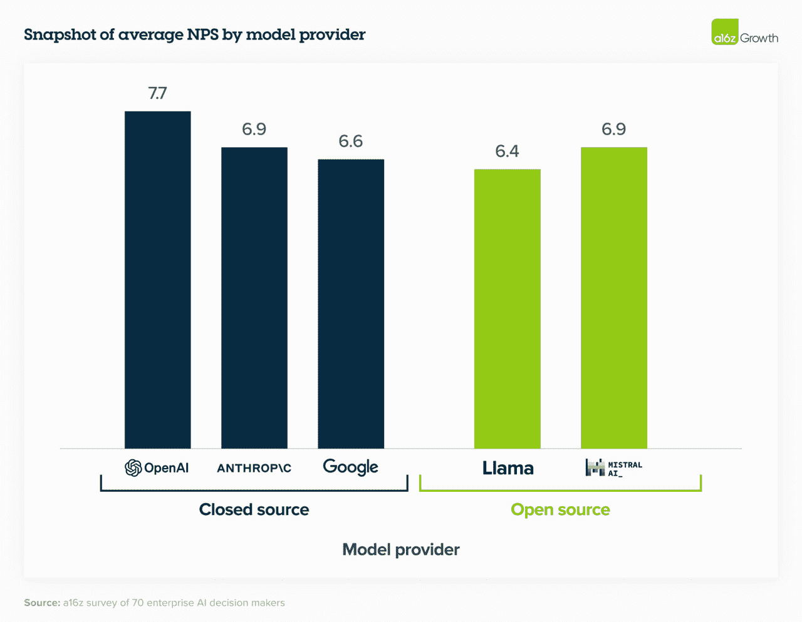

## 提升灵活性与自主性。

企业正将他们的应用设计得更加灵活，以便能够轻松地在不同的模型间切换，仅需修改API即可。这种做法背后的思路是，借鉴了云服务时代的教训，减少对单一供应商的依赖，并应对市场快速变化的现实。一些企业甚至在部署前对各种提示进行预测试，确保能够随时无缝切换，而“模型花园”的概念也应运而生，使得根据不同应用需求部署特定模型成为可能。

# 应用案例：向生产迁移

## 企业偏向于内部开发而非外部采购。

目前，企业更加倾向于自主开发AI应用，而不是购买市场上现成的产品。这主要是因为市场上缺乏能够满足所有企业特定需求的、经过严格测试的AI解决方案。基础模型及其API的普及，使得企业能够更容易地按照自己的需求定制开发AI应用，无论是改进客户服务、内部沟通，还是探索新的应用场景如产品配方设计、科学研究和销售策略优化。市场上许多仅仅是基于LLM简单封装的产品，因为缺乏创新而难以满足企业的复杂需求。

尽管如此，随着更多专注于企业需求的AI应用问世，未来的格局可能会发生变化。一些领导者对于能够使用市场上“最优秀的工具”持开放态度，认为生成式AI作为一种“战略性工具”，能够使企业减少对外部服务的依赖，增强自身的竞争力。因此，那些能够突破传统界限、帮助企业优化工作流程和更好地利用专有数据的创新应用，将在市场上脱颖而出。

通过这种方式意译，我们不仅保留了原文的核心信息，还努力使内容更贴近中文读者的阅读习惯和文化背景，同时尽量简化专业术语，让信息更易于理解。

## 企业对于内部应用案例充满热情，但对外部应用则持更加审慎的态度。

这种谨慎的态度主要源于对生成式AI（genAI）的两大担忧：一是AI生成内容的准确性和安全问题，二是在部署生成式AI时可能引发的公关危机，尤其是在诸如医疗保健和金融服务这样的敏感消费者领域。去年，最流行的应用案例集中于提升内部效率或在触及客户之前需经过人工审核的环节，例如编码助手、客户支持和市场营销。如下图所示，2024年，这些案例在企业中依然占据主导地位，企业更倾向于将文本摘要和知识管理（例如内部聊天机器人）这样的完全内部使用案例推向生产，远超过那些需要敏感的人工审核（如合同审查），或是面向客户的应用案例（如外部聊天机器人或推荐算法）。企业急于避开生成式AI导致的失误，比如加拿大航空在客户服务上的失败案例就是一个警示。由于这些担忧对大多数企业而言依旧重要，因此，那些开发出能够帮助控制这些问题工具的初创公司可能会见证其产品的显著增长。

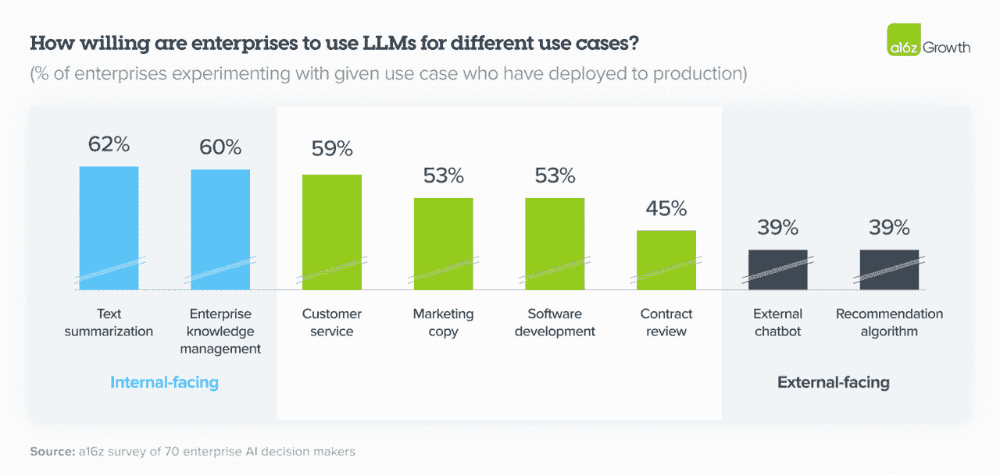

# 机遇的整体规模既庞大又在迅速扩张。

## 我们预计，到2024年底，模型API和精细调整方面的总支出将超过50亿美元，企业支出将成为这一机遇的重要组成部分。

根据我们的估算，模型API（包括精细调整）市场在2023年底的收入约为15亿至20亿美元，其中包括通过Azure对OpenAI模型的支出。鉴于市场整体预期的增长和企业具体的积极反馈，仅这一领域的支出到年底就将增长至少到50亿美元，潜力巨大。正如我们所讨论的，企业不仅将生成式AI的部署放在了优先位置，还增加了预算，并将这些预算重新分配给了标准软件产品线，优化了跨多个模型的使用案例，并计划在2024年把更多工作负载推向实际应用，这意味着他们极有可能成为推动这一增长的主力军。

在过去六个月里，企业已经从上到下发起了寻找和部署生成式AI解决方案的倡议。之前需要超过一年时间才能完成的交易，现在能在两到三个月内快速完成，而且这些交易的规模远超过以往。虽然本文主要关注于基础模型层面，我们还相信，企业中的这一机会将扩展到技术堆栈的其他环节——从辅助精细调整的工具，到模型部署，应用构建，乃至于专门针对AI设计的原生应用开发。我们正处于企业采用生成式AI技术的一个关键时刻，对于能与这个充满活力且持续增长的市场中的新一代公司合作感到兴奋不已。

<https://aigcreative.feishu.cn/sync/K4Gvd9vUQsy9Oubwqaeclu0Fnbg>

# 知识库动态