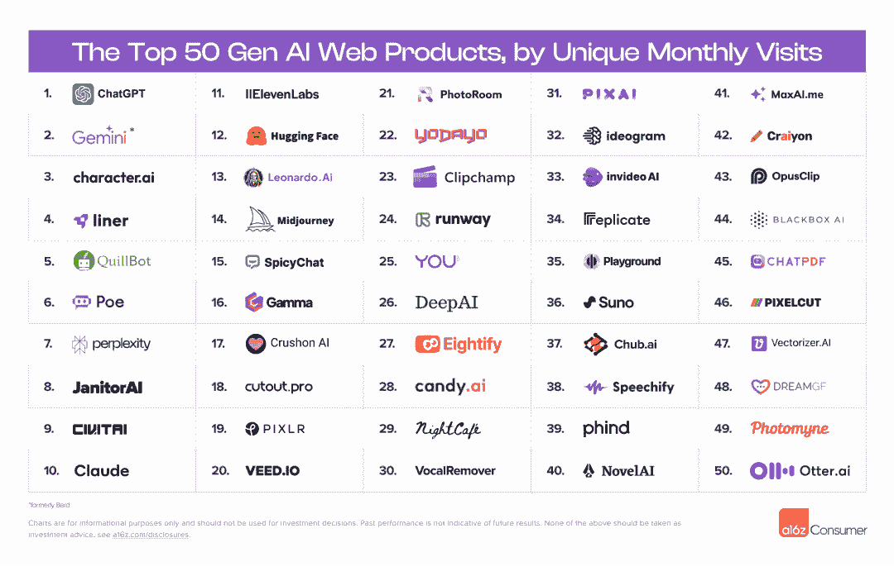
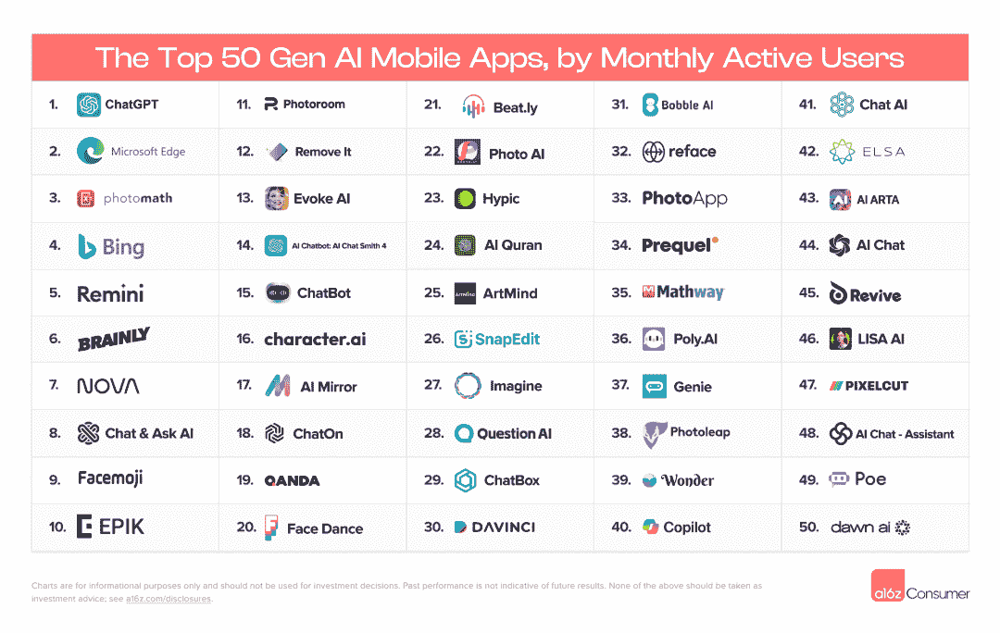
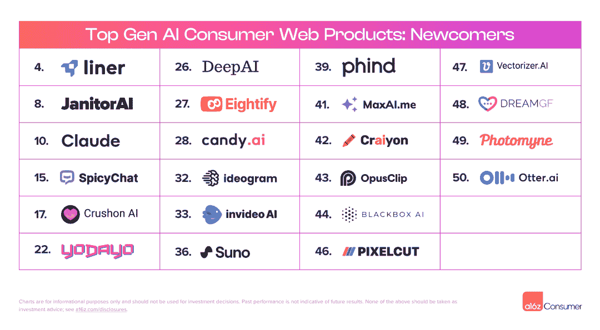
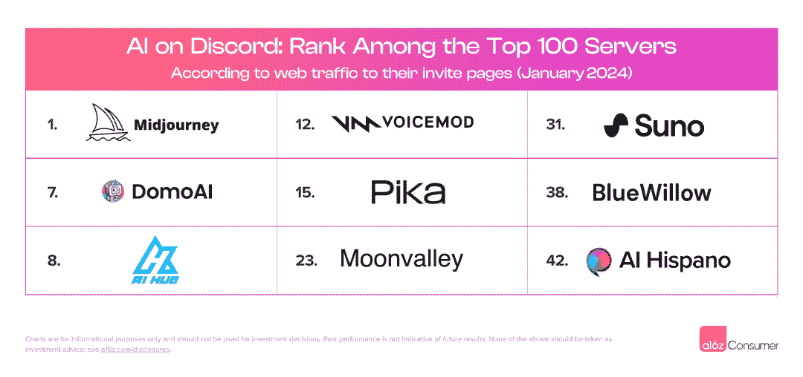
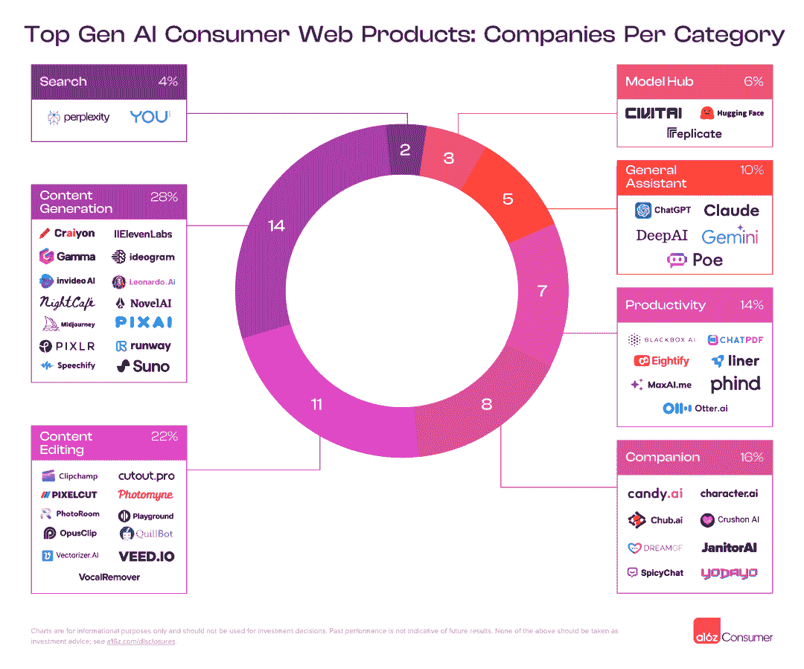
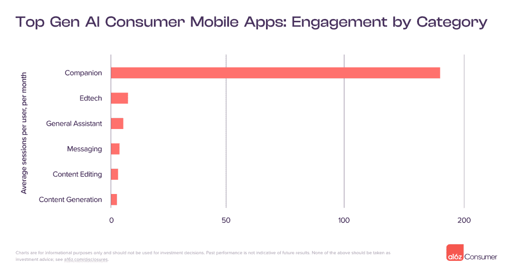
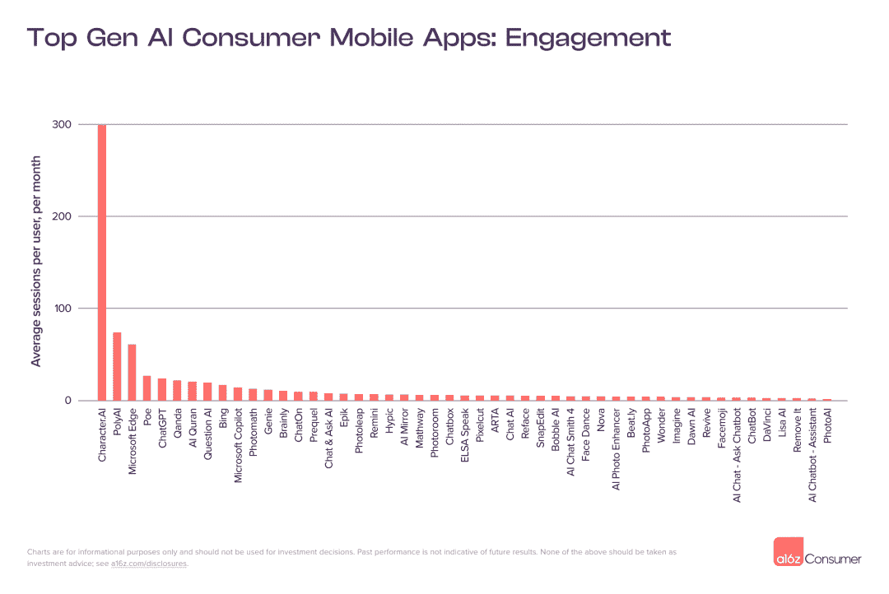
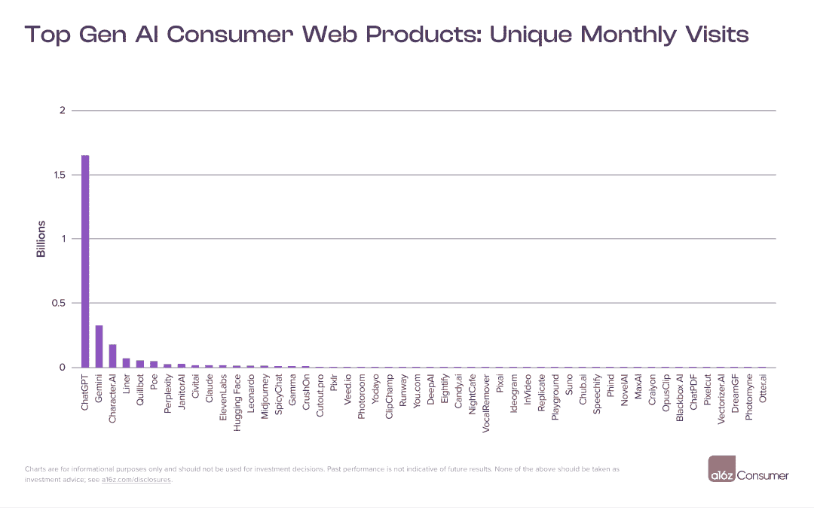
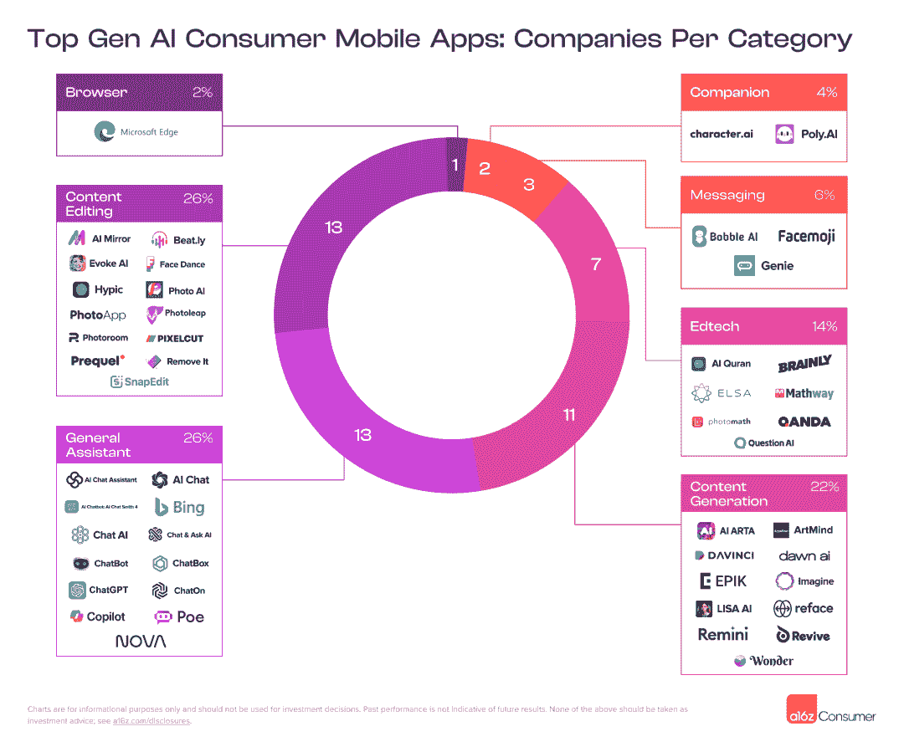
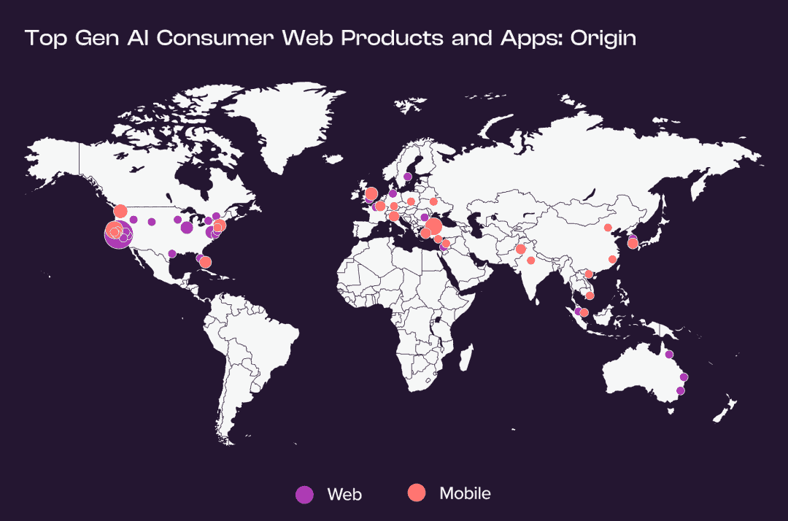

# Top 100 生成式AI消费（ToC）类应用 | 猎人翻译

> 来源：[https://aigcreative.feishu.cn/docx/KhzjdQmANoQq7ixO2DicBnc6nRh](https://aigcreative.feishu.cn/docx/KhzjdQmANoQq7ixO2DicBnc6nRh)

> 原文链接：https://a16z.com/100-gen-ai-apps/

> 翻译：创意猎人-Kevin

一年多前，ChatGPT将生成式人工智能引入公众视野，我们已经见证了成千上万个新的消费产品，融入了AI——从视频生成器到工作流程工具，从创意工具到虚拟伴侣。

六个月前，我们深入挖掘了网络流量数据，根据每月访问量对最受欢迎的生成式AI网络产品进行了排名，并揭示了消费者实际上如何使用这项技术的模式。

尽管一些早期“赢家”吸引了广泛的关注，特别是ChatGPT和Midjourney，但每个月都有新的AI原生公司涌现，推动了一个充满活力的竞争市场。

现在，六个月后，我们重新回顾了数据，更新了我们的分析，再次根据Sim**ilarWeb（截至2024年1月**）排名了前50个AI优先的网络产品。结果表明：与我们于2023年9月的初始报告相比，名单上有超过40%的公司是新出现的。

然而，与我们最初的分析方法不同——那次分析中，我们首先根据网络流量对公司进行排名，然后再为那些公司添加了移动应用程序数据——这次我们将网络和移动Gen AI产品分为两个单独的列表。

类似于网络排名，移动应用程序根据每月活跃用户数排序，根据Sensor Tower数据（截至2024年1月）。这种区分使我们能够首次全面研究顶级AI移动应用的全部领域。消费者在网络和移动设备上与Gen AI互动的方式存在明显差异，我们将在下文中详细讨论。

# 发展迅猛：6个月内新增22家公司

然而，除了这些排名本身的吸引力外，数据还揭示了一些关于新兴和扩大的类别、AI投资以及参与模式的显著趋势。以下是我们的一些重要观点：

考虑到ChatGPT令人印象深刻的早期增长——在我们六个月前的分析中，它已经是世界上访问量排名第24的网站——我们预计这一开创性的聊天机器人将保持在榜单顶部的地位。事实上，ChatGPT每月接近20亿次网络访问量，大约是排名第二的公司（Gemini）的五倍左右。

除了Gemini、伴侣创建者Character.AI和写作助手Quillbot之外，排名前五的位置保持不变。然而，并不是说过去六个月榜单一成不变：有22家公司是新进入网站流量排名榜单的。

在所谓的新来者中，排名最高的包括AI研究协作工具Liner、Anthropic的通用助手Claude，以及三款未经审查的AI伴侣应用程序：JanitorAI、Spicychat和CrushOn。

在这个列表中，ChatGPT依然位居榜首，不过领先优势明显缩小了。以月活跃用户计算，ChatGPT的规模大约是第二和第三名微软Edge和Photomath的2.5倍。在移动产品方面，前五名的排名由微软的搜索引擎Bing和照片增强器以及头像创建者Remini组成。

有趣的是，有五家AI公司真正地“跨界”，在前50名榜单上同时有一个网络产品和一个移动应用程序：ChatGPT、Character.AI、聊天机器人聚合器Poe，以及图像编辑器Photoroom和Pixelcut。

# 新兴品类持续涌现：音乐、生产力工具

在六个月前的分析中，我们注意到像ChatGPT这样的通用LLM助手占据了大部分的网络流量。而在我们最新的分析中，我们看到两个新的类别加入了这个混合中：音乐和生产力（包括研究、编码辅助和文档摘要等任务）。

目前为止，Suno是唯一进入排名的音乐公司。该工具可以根据文本提示在浏览器中生成原创歌曲，包括歌词，并提供各种风格选择。Suno最初仅限于Discord，类似于Midjourney，但在2023年12月推出了独立站点和Copilot扩展。

一些现在主要的消费者AI产品，像Suno一样，最初是在Discord服务器上开始的，或者仍然主要通过Discord运行。这个平台提供了一个测试场地以及社区，而不需要进行完整的前端产品构建。真正的Discord服务器流量几乎不可能测量，但每个服务器邀请页面的网络流量是一个近似指标。根据这一指标，截至2024年1月，有九个AI产品或社区在按邀请流量排名的前100个Discord服务器中，其中Midjourney排名第一。

在列表中，另一个显著的新类别是生产力。AI原生平台可以提升用户与软件的互动，使他们能够委派琐事并减少在行政工作上的时间。生产力类别包括七家公司：Liner、Eightify、Phind、MaxAI、Blackbox AI、Otter.ai和ChatPDF。

这些公司致力于帮助员工、自由职业者和中小型企业主更高效地完成任务，他们的特点包括流程中的编辑和摘要功能。例如，Eightify提供YouTube视频的摘要，而Otter.ai则实时记录会议笔记并转录。

在这个列表中的七个生产力应用中，有六个提供或完全通过Google Chrome扩展程序运行。我们预计更多的AI生产力工具将“融入工作流”中，与用户已经在进行的工作紧密结合，从而消除了在工作空间和诸如ChatGPT之类的助手之间复制和粘贴提示和输出的需要。

另外，AI生产力公司可能会发明围绕通用AI的独特功能构建的全新端到端工作流程。AI工作流产品可以帮助用户识别可以改进的内容，然后自动进行这些改进。

# **AI陪伴类APP迎来了增长高潮**

拥有AI伴侣可能看起来很小众，但这已成为生成式AI的主要用例之一。已有数百万人——包括我们自己——与聊天机器人建立了关系。

从网络和移动数据信号中可以看出，AI伴侣已成为主流。在我们的网站伴侣产品中，有六款产品自称为“无审查”，用户可以与它们进行在ChatGPT进行对话或互动。

用户主要通过移动网络访问这些产品，而不是桌面端——虽然几乎没有一个产品提供应用程序，但在我们的网站列表上，无审查伴侣工具的流量平均有75%来自移动端。

对于拥有移动应用的伴侣产品，用户参与度异常高。

根据SensorTower的数据，每个用户平均每月与Character.AI互动298次，而与Poly.AI的互动平均为74次。

我们已经开始观察到更为广泛的伴侣应用的早期迹象，不仅局限于AI“男友”和“女友”，还包括友谊、指导、娱乐，甚至最终是医疗保健。最近一项《自然》研究表明，Replika聊天机器人减少了3%的用户自杀念头。

# **移动端VS网页端之间的差异**

在移动应用和网络应用中，AI的使用场景存在显著的差异。

一般而言，网页（PC）应用更适合支持复杂、多步骤的工作流产品，主要围绕内容生成和编辑展开。这些产品包括ElevenLabs的AI语音工具包、Leonardo的AI艺术生成器以及Gamma的AI演示文稿构建器等，这些产品均在基于网页（PC）的新一代 AI 产品中排名前 20。

与此同时，移动应用的使用趋向于通用助手，其中许多模仿了ChatGPT。当浏览排名前列的移动应用列表时，可能会注意到有10家公司的名称与ChatGPT非常相似。部分原因是因为ChatGPT相对较慢地推出了自己的应用程序，为模仿者提供了快速获得App Store优化优势的机会，尤其是进行付费广告推广。

一些模仿ChatGPT的移动应用被称为“绒毛软件”。它们通过类似标题和标志的方式欺骗用户，让用户误以为它们提供了访问ChatGPT的高级模型的途径，但实际上，它们收费提供的是ChatGPT上免费提供的相同模型的访问。这些应用经常更改它们的名称或描述，使得应用商店难以“监管”这种行为。

其他受欢迎的生成式AI移动应用类别则专门针对手机的独特功能进行了定制。在应用列表中有七款专用的头像产品；大多数人手机中保存的自拍照可以作为可用的训练数据。此外，排名前三的应用中，Facemoji（排名第9位）、Bobble（排名第31位）和Genie（排名第37位）都是专为移动设备设计的键盘应用，允许用户在发送文本时得到AI的帮助。

教育科技是移动应用中受欢迎的另一个类别，用户可以通过手机扫描作业问题（如Photomath），或者通过实时对话学习语言（如Elsa）。值得注意的是，尽管大多数排名靠前的生成式AI移动应用是自给自足的，即没有融资，但根据PitchBook的数据，七款排名靠前的教育科技应用中有四款已经筹集了超过3000万美元的资金。

# AI应用在全球性涌现，没有一家独大

尽管硅谷是人工智能的中心，但全球各地都涌现出备受欢迎的产品，尤其是在移动应用领域。虽然我们列表中超过30%的生成式AI网络产品源自旧金山湾区，但该地区仅占12%的移动应用开发者。同样地，超过一半的顶级生成式AI网络产品是在美国开发的，但仅有不到三分之一的移动应用来自美国。

移动应用开发者取得了多项成功。例如，总部位于伊斯坦布尔的应用工作室Codeway开发了一系列生成式AI移动应用，包括AI照片动画应用Face Dance、聊天机器人应用Chat & Ask AI以及AI艺术生成器Wonder，这些应用都在移动应用排行榜上名列前茅。另一家总部也位于土耳其的公司HubX开发了Nova聊天机器人、达芬奇艺术生成器和PhotoApp增强器。

这些应用工作室通常能够从跨产品的共享专业知识中受益，了解如何推出、吸引流量和盈利应用。一些公司专注于高效地产生收入，而另一些则追求风投路径。位于米兰的科技公司Bending Spoons是这样的一家公司，他们开发了视频编辑器Splice和照片增强器Remini，名列移动应用榜单前五，并最近宣布了一笔1.55亿美元的股权融资。

很明显，新一代的AI原生产品及公司正在比以往都更快地增长并更深地吸引用户。我们相信，在未来十年中，人工智能将成为定义行业标准的重要驱动力。

<https://aigcreative.feishu.cn/sync/K4Gvd9vUQsy9Oubwqaeclu0Fnbg>

# 知识库动态