# ProductHunt 2023 年度最佳产品榜单 | 猎人翻译

> 来源：[https://aigcreative.feishu.cn/docx/A3EddfSBBoqIAIxJ6fTcEr4dnfh](https://aigcreative.feishu.cn/docx/A3EddfSBBoqIAIxJ6fTcEr4dnfh)

> 原文链接：https://www.producthunt.com/golden-kitty-awards/hall-of-fame?year=2023#ai-model，

> 翻译：创意猎人-Kevin

# 年度产品

你以为 2022 年是 OpenAI 的一年。然后到了 2023 年，这一年人工智能创新的步伐将加速。

ChatGPT 已经开始在年轻一代的浏览器书签中巩固自己的地位，并即将成为一个家喻户晓的名字，甚至连您最不懂技术的亲戚也认识到这一点。

然后，谷歌希望获得对其悄悄研究的所有人工智能进展的认可，推出了 Bard，它的 ChatGPT 竞争对手，由该公司自己的“it”模型 Gemini 提供支持。但仅仅一个多月后，OpenAI 就凭借 GPT-4 重新赢得了人们的关注。

新模型接受了最新数据的训练，比其前身更好地理解上下文，并且可以处理复杂的指令。它可以参加律师资格考试，并在考生中排名前 10%（GPT-3.5 得分排名后 10%）。

凭借 GPT-4（以及今年晚些时候添加的 DALL-E 3），ChatGPT 在 2023 年结束之前每周用户数量就突破了 1 亿。此外，今年有数千种使用 GPT-4 和 GPT-4 Turbo 构建的产品和机器人，其中包括其他一些 2023 年度产品提名产品。

这些被提名者创造了我们在 2023 年看到的一些最佳生产力功能和最有用的生成式 AI 应用，从 Arc Browser 的 AI 文件重命名到 Notion 的 AI 数据库自动填充。

也许 2024 年 OpenAI 将为另一个竞争对手腾出领奖台，但 Sam Altman 已经证明他不会让步。

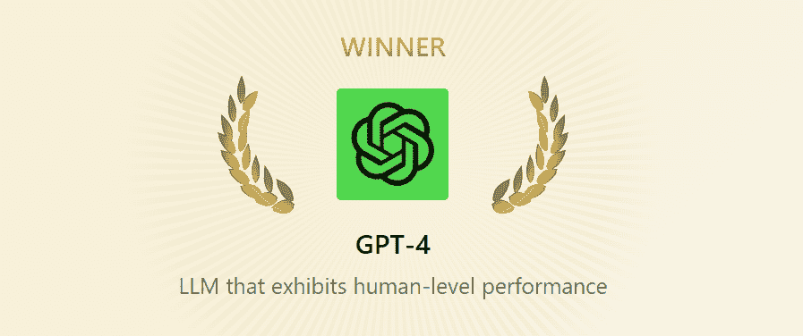

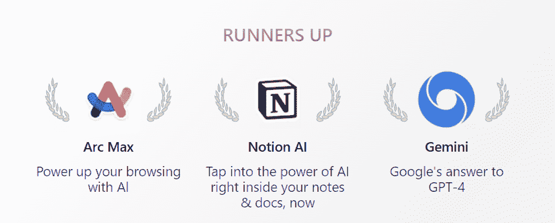

# 开发者工具

我们经常说工具是开发人员最好的朋友，在 2023 年也不例外。在以大规模技术创新为标志的一年中，软件工程行业通过将人工智能等技术融入其工具中来实现代码审查和调试过程等自动化。所有这些都是为了让开发人员的生活变得更轻松。

像 Github 这样的大公司也加入了 Copilot X 的行列。较小的团队也有自己的发言权，比如今年的亚军之一：Warp。

2023 年延续前几年的两个工程主题包括让 API 变得更简单，以及创建有助于缩短开发人员与其他团队（通常是营销团队，如果我们诚实的话）之间存在差距的工具。 Resend 存在于这两种持续趋势的交叉点：开发人员可以大规模构建、测试和发送交易电子邮件的工具。

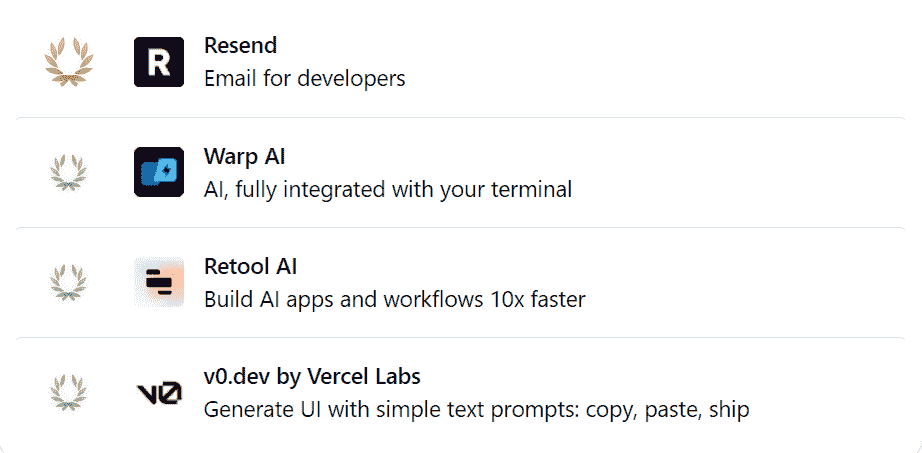

# 设计工具

对于设计工具来说，今年是过山车般的一年。与许多同行一样，设计工具公司必须适应随着人工智能兴起而快速变化的行业。再加上注定失败的 Adobe-Figma 收购，感觉这个行业总是成为新闻焦点。

去年推出了大量设计工具，但其中一些比其他工具更引人注目。专注于协作、人工智能集成和动画的公司因其创新而受到社区的奖励。

今年的提名反映了这一点。 Jitter 是获胜者，它让动画变得大众化，而 Framer AI 则让您可以在几分钟内启动登陆页面。

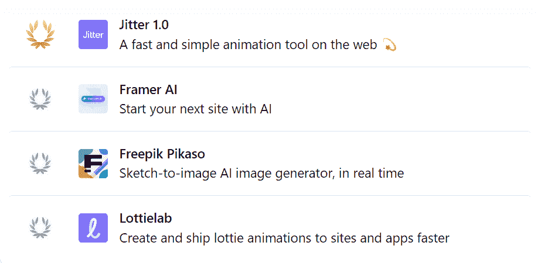

# 无代码

既然生成式人工智能已经出现，无代码类别的未来是什么？这就是决赛入围者现在向我们提出的问题，即简单的英语可以立即生成整个网站。

该类别的获胜者还独特地提醒我们，仅仅因为某些东西很快并不意味着它就一定是脏的。 Bento 重新构想了个人网站和个人简介页面，使其成为互联网上丰富、美丽且功能良好的地方。

“这比我们在其他 link-in-bio 工具中看到的四四方方的按钮和扁平网格要好得多。” Product Hunt 社区在将 Bento 推升至 2023 年投票数最高的产品中排名第七时这样想。Linktree 同意了，后来它收购了 Bento在这一年里。

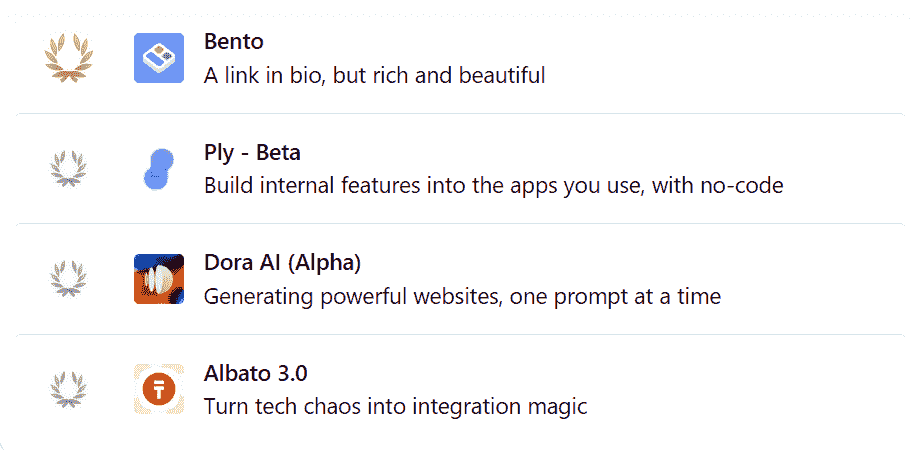

# 数据与数据安全

在过去的几年里，数据和数据安全领域的特点是制造商试图让数据对每个人来说都更容易、更灵活，而不仅仅是数据分析师和网络安全专家。

今年最佳数据工具的获奖者 Equals 于 2022 年首次推出，从重塑电子表格开始。继 1600 万美元的 A 轮融资后，Equals 在 2023 年不断推出新功能和改进，使电子表格功能更加强大。其中包括添加的人工智能功能，当然还有仪表板的推出，它提供了一种将电子表格立即转换为由实时数据驱动的仪表板的方法。

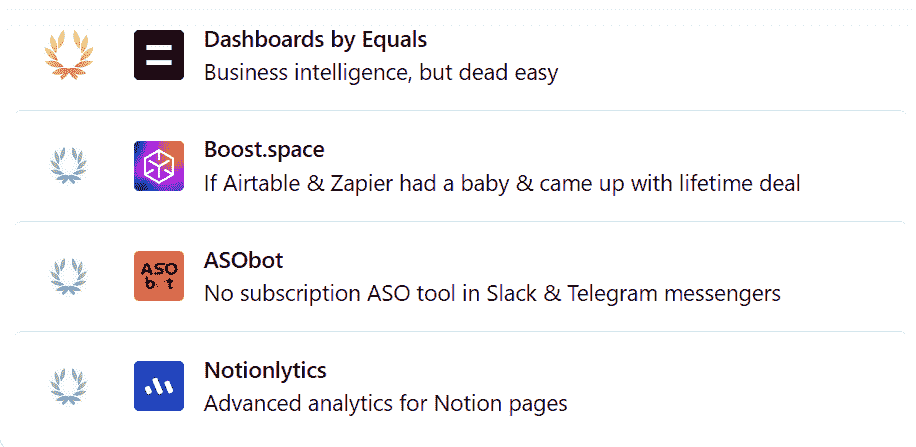

# 开源

根据 Github 的 Octoverse 报告，2023 年首次开源贡献者的数量最多。开源牵动着世界各地创客的心弦。这是一个以协作和社区驱动为荣的行业。

开源无处不在。无论您是否知道，它都已融入我们的生活方式。从框架和数据库到开发工具 (Novu)，再到世界上一些最流行的人工智能模型 (Stable Diffusion)，一切都依赖开源贡献者来保持交付。

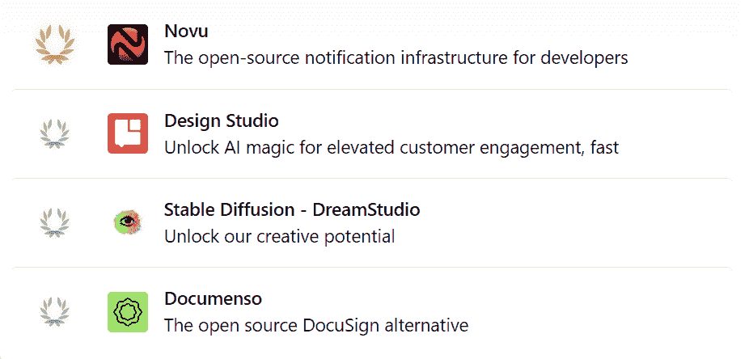

# 人工智能产品

今年最佳人工智能产品类别的决赛入围者展示了生成式人工智能在理解复杂提示方面的进展，从使用 3D 动画 (Dora AI) 生成整个网站到使用简单英语的高质量视频 (Pika)。

与去年一样，谷歌和微软等大型科技公司将与创新新秀争夺这一头衔。随着对 AI 模型、AI 基础设施和 AI 平台的访问范围不断扩大（例如 OpenAI 的 GPT 应用商店），我们预计会看到更多不同的创客在这个领域创造出下一个重大产品。

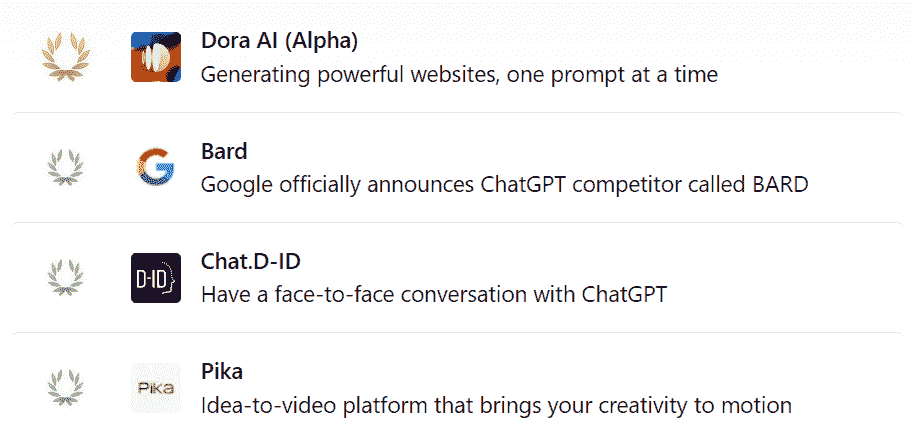

# 人工智能特点

是否感觉您的堆栈中的每个产品都将在 2023 年进行人工智能改造？这不仅仅是巴德-迈因霍夫现象。我们看到很多我们最喜欢的产品都迭代了新的人工智能功能，因此我们今年不得不创建一个全新的奖项类别。

制造商交付这些产品的速度有多快，以及团队如何在人工智能的帮助下，重新构思新的解决方案来解决他们最初要解决的问题，这给我们带来了启发。事实上，许多制造商告诉我们一些版本的“我们一直想这样做，但技术终于赶上了。”

该类别的提名者因将人工智能流畅地融入其产品而受到认可。他们在我们需要的时候准确地生成我们需要的内容，完成过去需要几个小时的繁重工作，凭空开发人造角色，并一路上真正让我们感到高兴。

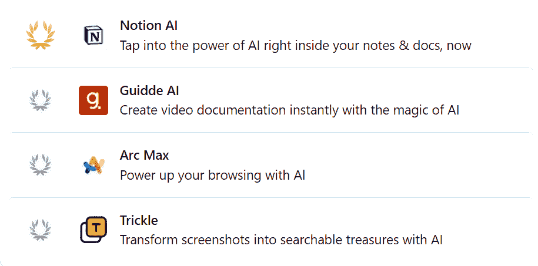

# 人工智能模型

OpenAI 今年为我们提供了两个最好的人工智能模型，并将它们打包到一个出色的聊天机器人中。这很难被击败。

不过，不要只见树木，不见森林。大型语言模型全面进步，为我们提供了大多数人一年前无法想象的生成式人工智能能力。我们可以从一些文本生成整个网站、演示文稿和头像。我们可以创造出任何我们想象的图像——如果我们愿意的话，还可以“让它变得更多”。

[明年这个类别](https://www.producthunt.com/newsletters/archive/26889-a-controller-for-your-phone)将会有[什么？更具生](https://www.producthunt.com/products/meta#audiocraft)成性的人工智能？ “大型行动[模型”？ 生成](https://deeperlearning.beehiiv.com/)口语模型？通用人工智能？ （Pst：跟随并找出答案。）

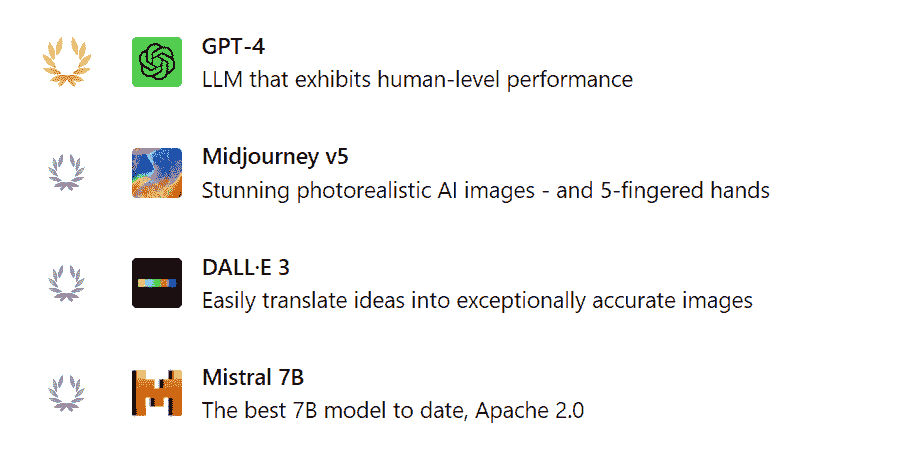

# 人工智能基础设施

随着越来越多的人工智能模型和产品的出现，帮助构建、改进和监控它们的工具比以往任何时候都更加重要，因此金猫奖中出现了一个新的类别。

该类别的决赛入围者帮助 AI 制造商为其产品选择正确的 AI API 并在它们之间进行切换 (EdenAI)，快速创建和部署 LLM 插件 (Langdoc) 或 LLM 应用程序 (LLM Spark)，以及跟踪和调试复杂的 LLM 应用程序 (Langfuse) ）。

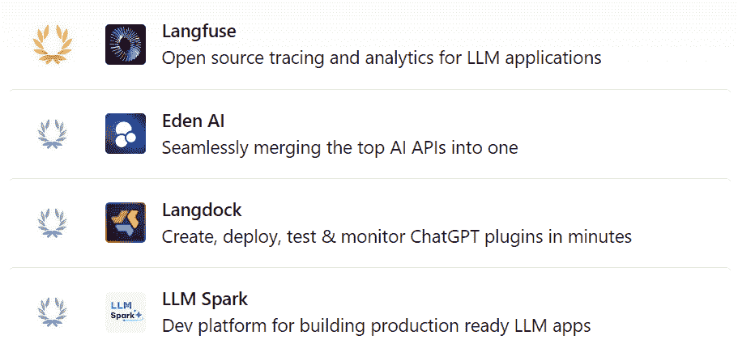

# 金融科技

当你想到金融时你会想到什么？即使在今天，仍有不少人会想起华尔街办公室里股票经纪人疯狂买卖股票的景象。谢谢，华尔街之狼。

虽然金融可能很乏味，但一个好的金融科技工具可以让这个领域变得迷人甚至有趣。今年类别的决赛入围者涉及从启动资金到个人理财的所有内容。这些工具有助于缓解企业和个人在处理银行、投资或融资时的焦虑。

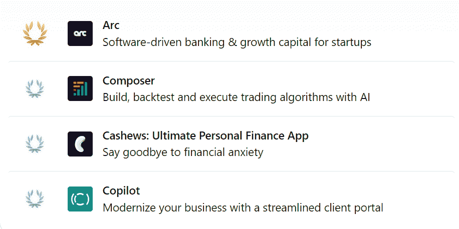

# 移动应用

根据 data.ai 的数据，移动用户平均每天花在手机上的时间为 5 小时。我们如何度过这段时间以及我们使用的应用程序都是个人的。有些人可能会在他们最喜欢的锻炼应用程序上出汗，而另一些人可能会使用他们最喜欢的生产力工具来安排一周的时间。 5 分钟后，新的应用程序再次改变了一切。

如今，有了“适用于一切的应用程序”并适合各种个性，很难从人群中脱颖而出，但该类别的决赛入围者正是那些正在这样做的人。

最佳移动应用获奖者 Hevy 最初由独立开发者于 2019 年推出，他们希望建立一种更好的方式来记录他们的锻炼情况，并在此过程中提供更好的社交体验。该应用程序已在全球拥有 150 万健身运动员。 Hevy 在网络上的文章中被评为顶级训练应用程序，在 App Store 和 Google Play Store 上获得 4.9 的评分，总共有 71,000 条评论。

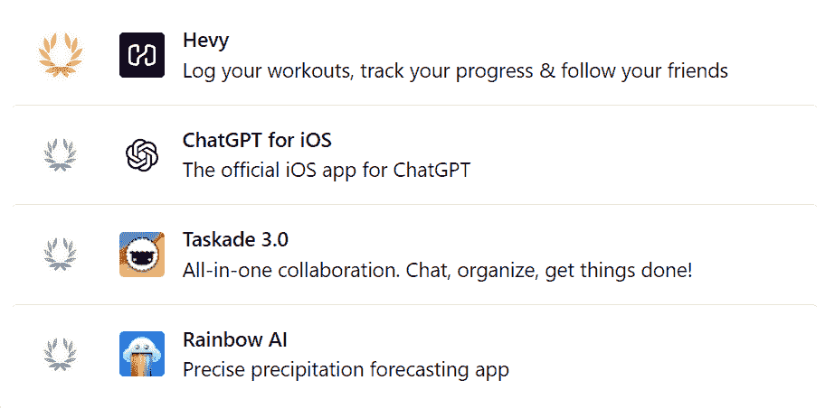

# Web3 和加密货币

看起来 web3 在 2021 年迎来了最辉煌的时刻。硬币每天都在下跌，社区如雨后春笋般涌现，当然，NFT 是每个人脑海中的热门话题。快进到 2022 年，炒作已经平息。

尽管今年 web3 可能还生活在 AI 的阴影下，但许多信号表明该行业正在等待下一个时刻。比特币在 2023 年回升了 155%，达到 4.5 万美元，是 2022 年以来的最高水平。在 Product Hunt 上，区块链 (-25%)、加密货币 (-18%) 和 NFT (-30%) 等类别的发布量有所下降，但选民对那些脱颖而出的产品表示乐观。 2023 年获得最多支持的 15 个产品中有 4 个与 web3 相关。

web3 背后的社区为 Clustr、eesee、Anytype 和 Galaxe 等产品提供了支持，这些产品去年都跻身最受欢迎的 25 个产品之列，在 Product Hunt 排行榜上留下了自己的印记。技术人员推测，“加密货币冬天”可能会清除这个空间，只留下最好的产品——我们将把目光投向决赛入围者作为顶级竞争者。

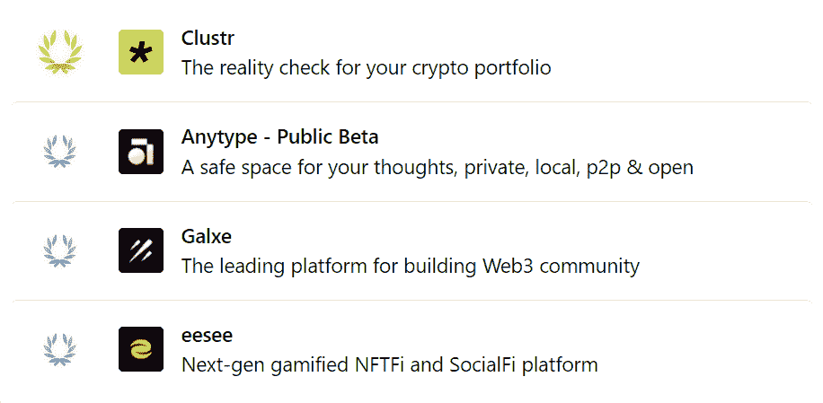

# 个人生产力

生产力是 Product Hunt 上第二热门的话题，仅 2024 年 1 月生产力产品就有近 37,000 票。

人们很难不喜欢那些可以帮助您更高效地做事的工具，这样您就可以将时间花在重要的事情上。该类别的决赛入围者解决了从浏览器到日历等日常生活各个领域的生产力问题。

今年的获胜者 Heptabase 是一款笔记工具，可帮助您通过工作空间的可视化组织来学习复杂的主题。作为粉丝喜爱的 Notion 和 Obsidian 的替代品，该工具越来越受欢迎。

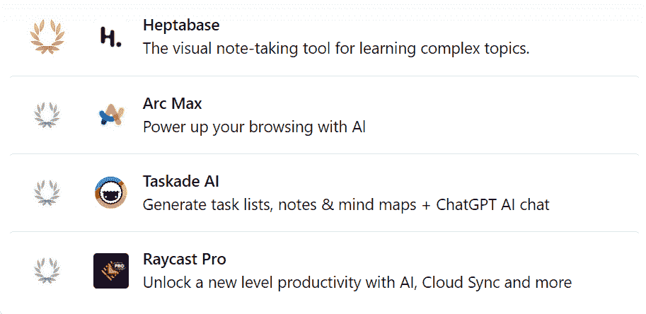

# 团队生产力

在团队动态的世界中，生产力不仅仅是一个流行词，它是成功协作的基石。据 Statista 称，到 2024 年，生产力软件的收入预计将达到 790 亿美元。基于工作的解决方案将占其中很大一部分。

这些工具对于将个人努力转化为统一力量至关重要。他们擅长编排复杂的项目，将每项任务变成一个协调良好的整体的一部分。这是为了打造一个让创造力蓬勃发展的空间，并通过集体的动力和精确度来实现目标。

今年的获胜者是 FuseBase。可以将其想象为与 Notion 类似，但更适合专业服务。它将项目管理、知识管理和客户协作合而为一，这样您就不必在试图完成工作的应用程序之间切换。

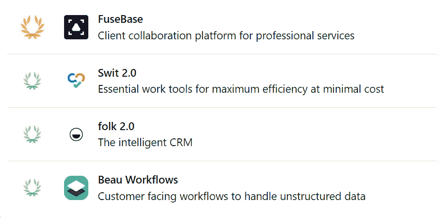

# 市场销售

今年最佳营销和销售工具的优胜者和亚军就像许多身兼数职的营销人员的职位描述一样多种多样。但如果说每个现代收入驱动者都学会优先考虑一顶帽子的话，那就是内容创造者。

我们看到的许多最具吸引力的营销工具都是那些能够使最困难、最耗时的内容变得更容易的工具，无论是电子邮件还是支持文档。随着数字化参与度达到顶峰，团队必须尽最大努力跨多个社交平台 (STORI AI) 接触客户，在收件箱中吸引注意力 (Loops)，在几秒钟内向客户介绍产品 (Floik)，并为他们提供支持他们喜欢的体验 (D-ID)。

这些工具可以帮助热爱内容的专业人士取得突破。

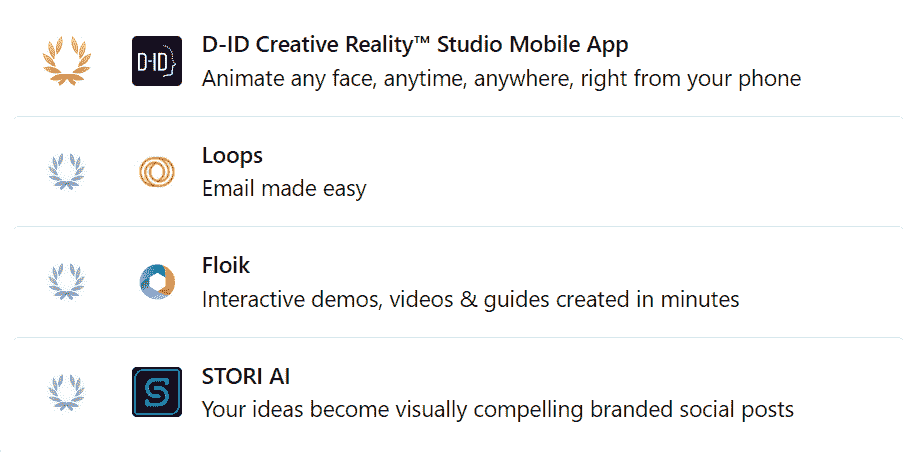

# 社区与社交

不管喜欢还是讨厌，我们在 2022 年都在等待 Elon's X（以前的 Twitter）的可行竞争对手取得突破。 Moonshot 初创公司瞄准了 X，但尚未达到吸引足够多的 X 500 多百万用户的临界点。

因此，社交和科技领域的大腕们又重新回到了擂台上。扎克伯格和 Meta 推出了 Threads，尽管有人反对，但该社交网络在年底在欧洲推出后，已显示出拥有 160 名用户的持久力，并在 App Store 中名列前茅。与此同时，Jack Dorsey 构思并支持了 Bluesky，这是一款大肆宣传的去中心化社交应用程序，在测试阶段很快就拥有了 200 万用户。

与此同时，随着 API 的变化和用户从一个工具跳到另一个工具，这个领域的制造商一直在应对快速变化的社会环境的压力。入围或提名的社交工具构建了我们所见过的最有用、适应性最强的社交技术。

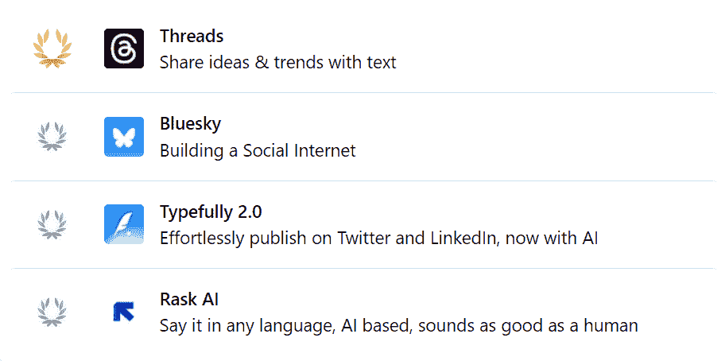

# 自己和小团队

“快速行动，打破常规”最初是马克·扎克伯格创造的 Facebook 内部座右铭。对于拥有小团队的初创公司和那些选择自力更生路线的初创公司来说，这句话已经焕发了新的活力。

自力更生唤起了一种特定类型的浪漫主义，但它也给资源匮乏的创始人带来了挑战。放弃投资，选择靠自己改变世界的想法是一个强大的想法，驱使许多制造商继续前进。这也是一种在科技界影响力越来越大的趋势。

这一类别的创客展示了令人印象深刻的足智多谋、创造力和毅力的能力。他们通过小团队、自力更生或两者兼而有之，创造了一流的产品。从无代码 (Tally 2.0) 到人工智能 (Impakt AI)，这些技术在 2023 年的表现远远超出了它们的实力。

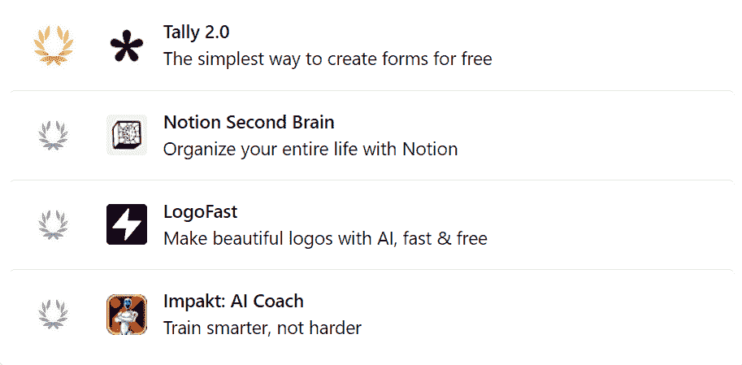

# 年度创客

每年，世界各地的制造商都会冒着风险，一头扎进打造他们梦想的产品。有时，这是一个有趣的副业项目。其他时候，这家公司正走在成为独角兽的快车道上。

其中一个共同点是，成为一名创客需要激情、奉献精神和勇气，而每一项都让 Product Hunt 变得更好。这就是为什么我们设立年度创客奖，以纪念那些走出去改变世界的人们。今年的获胜者是马克·卢。

Marc 在 2023 年推出了多达 14 种产品，涉及多个不同的领域。从保护您免受条纹纠纷的工具到以可爱为核心的习惯养成平台。马克真正表达了他的想法。

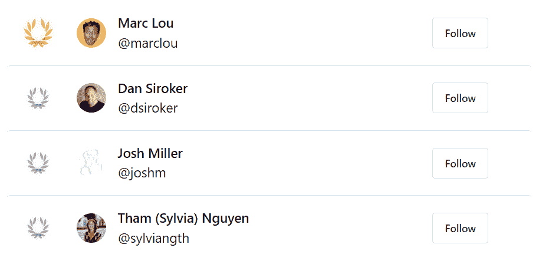

# 年度社区成员

你知道PB&J吗？当然可以。典型的盒装学校午餐，一种标志性的三明治，其作用不仅仅是各个部分的总和。两种成分完美匹配，当你缺少一种时，它就变得不一样了。

Product Hunt 也是如此。创客和社区齐头并进。 Product Hunt 社区为人们创造了一个向世界展示其作品的诱人空间，在每次发布中，您都会看到社区成员祝贺创始人、提供反馈和提出问题。在发布之外，社区成员会分享他们的经验并在讨论中寻求建议。在颁发此奖项时，我们寻找的是真正有效参与的社区成员，而不是依靠人工智能来快速管理关系建立。

今年的年度社区成员是 Elly Cho。 Elly 是 Slash Page 的首席运营官兼联合创始人。当 Elly 不推出 Product Hunt 时，她会通过提供批评性反馈、参与讨论以及为更广泛的社区发出宝贵的声音来帮助其他创客。

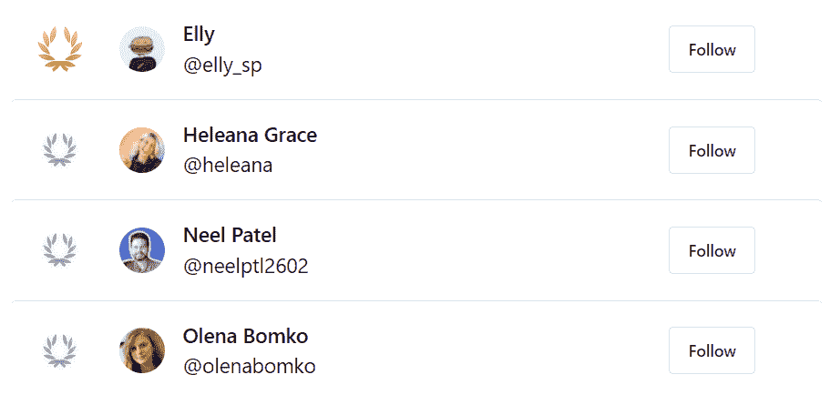

<https://aigcreative.feishu.cn/sync/K4Gvd9vUQsy9Oubwqaeclu0Fnbg>

# 知识库动态