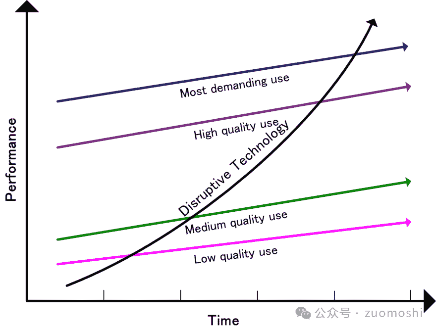
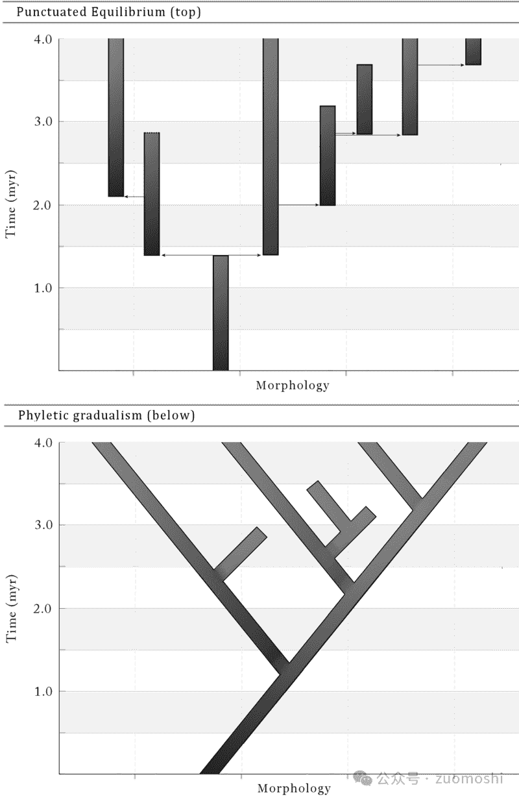

# 思考：AI上国内团队好像被甩开了？差钱？差人？

> 来源：[https://aigcreative.feishu.cn/docx/Mexpdbb5koOCjrxhuANcCqFanOe](https://aigcreative.feishu.cn/docx/Mexpdbb5koOCjrxhuANcCqFanOe)

> 来源：👸号：琢磨事

> 作者：老李话一三

> 链接：https://mp.weixin.qq.com/s/6juT2Dlq8ZEFn8WrgNgYiA

当我们还在困扰为什么国内大模型没有GPT4好用的时候，Sora来了。这潜在意味着从AGI视角看，追赶一年后差距似乎并没有缩小反倒是被拉大了。

勾连过往，这个问题就不太简单了，可以从好多维度展开：

我们是不是可以说AI国内国外团队一度站在类似平齐的起跑线上？

为什么从AlphaGo开始似乎看不到国内团队的原创，而是持续在追赶？

为什么在追赶的时候，距离似乎在被放大？

## **一点点回溯**

如果回到语音识别、人脸识别，应该可以讲大家处在类似平齐的起跑线上的。甚至因为场景和数据丰富在这两项上国内团队还占优。一个佐证是过去很多的比赛成绩；另一个是佐证是应用范围。老外到现在也不怎么用人脸，所以真实场景下人脸识别的精度，很可能还是国内团队的算法占优。

自动驾驶是个奇妙的领域，做了十几年花了几千亿，但似乎都卡在某个限度下面了。所以也看不出什么区别。

所以说**如果回到2010年之后的十年，说**大家在基本平齐的起跑线上，大致是不错的。当时大家比较公认的是AI上没有秘密，毕竟一有进展论文立刻就出来。

问题出在大模型上。

在大模型上，局面变成了：

**在平齐的起跑线上，OpenAI率先做出来大模型后**，别的团队在追赶的同时，差距还被拉大了。

如果单纯的拿没做出来说事似乎也是偏颇的，毕竟Google也没做出来。

但如果横向展开些就发现也不是那么偏颇，在AI这个领域里我们好像并没有做出太杰出的贡献。AlphaGo，chatGPT，甚至智能音箱、自动驾驶等似乎都是在重复过去C2C的故事。追到平齐的起跑线上却重复过去的故事，这不能说不是问题。

**互**联网这样是正常的，毕竟你缺了过去几十年在IT上的积累，按切入的时间点（2000年前后），你就只能这样，但AI还这样，就是问题了。

追着不顺利的时候，大家就比较多反省人才密度、资金、机器等。

但其实根本不是主因，调度起这些资源对于小公司是很难的，但还是很多公司有这个实力。（如果统计2022年发布chatGPT之前的融资金额你会发现还是不少公司融资比OpenAI多）

再进一步深层反省是需要勇气的，因为会打破一些人类本性中无谓的自尊心。

有点像一个人正兴高采烈自信的很，你非上去说，他还有那些地方不行，他真的很容易揍你。

如果不正视这种差距，并挖掘差距的根本，那再过十年，老套的故事就会再来一遍：

**好像差不多了基本平齐，然后被甩开差距，然后追赶，**然后反省表面因素。一遍一遍循环这个过程。

可怕的点在于：一个是循环自身的周期本来就不短，整体循环的所占的时间就更长。

最终后果是不是灾难性依赖于领域本身的基础特质。

对于天花板比较明显的领域，到达某个限度后，大家其实差不多，所以影响不是特别大。相当于领跑的停了，那后面的只要足够坚持就能赶个七七八八。

**对**于没有天花板，活性极强，并且今天的结果会是明天的的最大推动力的领域，那么后果很可能是灾难性。这会导致越跑距离越大，并且是在指数曲线上的距离。

很不幸，人工智能看起来是这样的领域。

## **为什么呢？**

不知道谁发明了个词叫人才密度。

然后似乎原因被找到了：人不行。

在付会上钱不够，机器买不着，似乎原因就非常明显，还特别好理解，也容易引起共鸣。

实际上这种认知视角本身就是问题。

背后体现一种思维模式的缺陷。

对于组织而言，不能像过去那样只关注：人财物等有形要素，还要关注场。

场是价值观、文化、制度、信念的综合。

我们不能忽视的一个基本事实是：

到一定程度后，其实人个体智商是差不多的。所以人才密度是趋同的。

AI就是这情况。

真做AI的人，差不多都是从顶级学校里又选了一拨人，非说谁比谁有绝对差距，那就真不是这样。

钱的话OpenAI过去用的钱虽然不少，但很多团队用的钱并不比他们少，2022年之前一共差不多融了30亿美金。(比如：商汤融的其实比这多）

核心的问题恰恰不是这些可见要素，而是场的差别。

简单说**你用修长城的场，不管给多少人、多少机器、多少钱该干不**出来还是干不出来，该撵不上就还是撵不上。

（还可以类比皮克斯做动画，动画做不好也是人才密度、机器、钱不行么？）

场可以看成独立生命体，并且在大时空尺度下持续存在，特征也会变化。

如果我们总是干存量修长城的活，场的作用是小的，按图纸搬砖，加大检查，谁干的好就多给钱，干不好就批一顿或者开掉，大致是可以的。

但**大模型这种领域显然不是这么个特征，之前有人做过内部模块拆解，其**组成还是非常复杂，需要团队一起摸索开拓。

这时候**场的落后就是致命的**。

**你**拿黑社会的场去干大模型，对于已经做出的部分，基于开源，已有论文追一追是可以的，但在乌漆嘛黑的未来里探索出一条路，并持续领先就没可能。

这是真的问题。

## **组织的间断平衡论**

这可以再形象一点来看这问题。

团队的类型可以是外科手术型的，一切以主刀医生为中心，别的全是打下手的。（其实修长城本质是这个）。

也可以是足球型的。大家有个角色，但需要更灵活的补位和配合。

更灵活的是网球团队。大家没有角色灵活补位。

**对于大模型开发而言，外科手术的肯定**是不行的，至少需要优秀的足球模式的团队。

只有模式也还不够，同样是足球队也还有我国足球的情况。

模式还要配合上文化等进行综合才是合适的场。

**最终就形成场的先进性：活性且有力量。（可以拿终结者**的液体机器人和植物大战僵尸的僵尸做类比）

这种先进性的内涵是：

可以让组织保持基本稳态的前提下持续产生跃迁。

**这种先进性的根本中精神大于物质，但不适**合简单二元论，而是两者的按特定配比的综合。(和决定战争胜利的是人而不是物也不在一个层次上）

如果这么定义先进性，**那两类偏颇场都是有问题的：**

**一种是超级稳态场，一种是活性但容易崩坏的场。**从组织的间断平衡角度看，我们可以这么讲。

有些组织会进入超稳态，它在既有的赛道上把自己强化的很好。内部利益分配各种与其适应。(创新者窘境用价值观、流程来描述，但其实还是缺东西，不过价值观、流程已经比人才密度的视角好很多了，毕竟是场的一部分）

**（那根破坏性创新增长曲线背后的原**动力是什么？是人才密度、机器、资金么？）

可以形象点来说这个问题。

比如猩猩某些方面强化的其实比人好。

我们古代在农业文明上进化的其实比欧洲好。

这种好，会导致组织和个体进入超稳态。

这种超稳态会内置妨碍跃迁的力量。

这一点点差异，在大时间轴上，效果就非常明显。

那先进性就是既有稳态，又有足够的活性。

OpenAI差点没把Altman干跑就是活性过剩，能够纠正回来说明还是有稳态力量。

但一路前跑，则是活性场产生的推动力。

这种场才可能构建出一种在稳态中行进，还具有跃迁力量的组织。

这种跃迁的力量是精神与技术的综合。

**柔性场的构建成本和难度都是高的**。

## **假如不看场，只看人会怎么样**

最典型的是面对内部大规模耗散时采取的措施会有雷同性。

组织中很容易进入一种大家一起磨叽的状态（高深的词可以叫熵增）。我们对付这种耗散只有一种方法就是揍它。回到修长城的方式。前一阵有人在朋友圈发了一个段子，倒是正好和这个呼应。

**中国式管理，理论核心就三点：**

1.  **你干的好，是因为我领导有方。**

1.  你干不好就是你有问题，和我没关系。

1.  **你不干有的是人干。**

**这个正好形象的体现了只关注人财物有形要素不关注场的表现（非常**闭环和形象，通过人事变动3是可以回到1的。

注定的后果就一定是不停内部倒腾，这种场的特征和组织行为表现具有极大的相关性，包括对强人的渴望，学习刘邦这一套东西都是伴生特征。但实际上这是在狮子社会里面都能看到的古老模式。仍然有用，但估计搞不定人工智能这样的领域。

**这背后的认识差距是真正的差距。**

**如**果上面的解读是对的，那么我们在人才密度什么上面的努力就很像缘木求鱼，根本改变不了局面（猴子水中捞月式追赶），而标题上的问题则会不停的被问。（超稳态）

难的也正是这里，如果说有形要素的改变是旦夕之功可达，那这种先进场的构建就有点十年树木百年树人百年树人的意思了，并且破功还很容易。

借助AI这种场的形成成本也许可以降下来，但认知的事就会比较困难。转过来后对问题的反省会完全不一样，比如：

但反过来如果场大于个人，那是这样的思维链条：

**落后了**

**场不行**

**进行机制建设**

**个体和整体活性增加**

**也许动荡，但保持活性迭代**

这里的关键在于怎么才能产生更多的活性个体并且乱而不散。

**也会很多混乱甚至崩溃，比如OpenAI**自己的内讧，但跃迁到下一层的可能性是高的。

（从间断平衡的视角看组织的话，什么能构成跃迁的力量呢？）

## **扩散一点点**

假如有一池水，有点颜色，在这里面有一些独立的缸，那缸里的问题是不是都是池子的问题?

我觉得在AI这个事上，主要不是，毕竟保留了足够的自由度。但确实池子的偏好会在长时间轴上有很根本的影响。

## **小结**

看着简单但其实这是一个超级复杂的话题，近来看很多人在探讨这个，所以还是从这个视角说说自己的观点，简单说就是：

组织里面人之外有场，叠加后才是最终组织特征。

**如**果我们总是用人才密度，钱不够这样的视角去看待问题，那就很难适应这种高速进化的领域，陷入一种追平，落后再追赶的困局。

倒是也闭环，不愁没事干。

<https://aigcreative.feishu.cn/sync/K4Gvd9vUQsy9Oubwqaeclu0Fnbg>